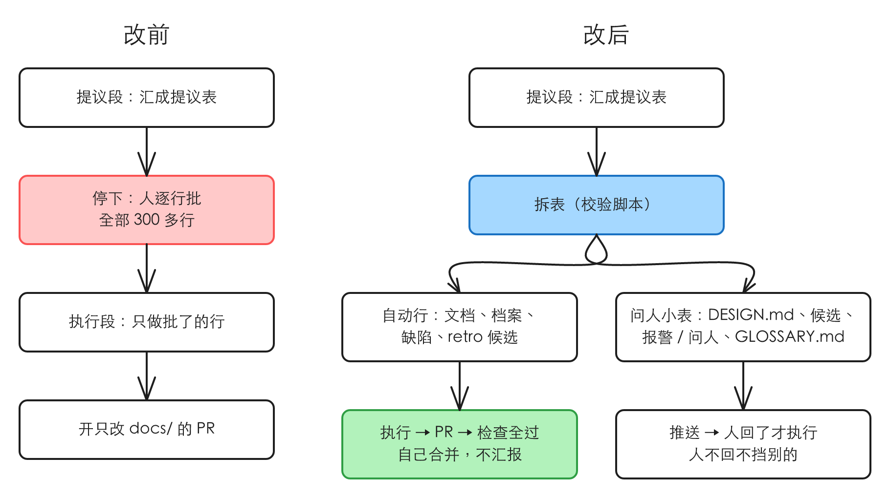

# ADR-0047 — dreaming 和每周分拣不再等人逐行批

> 由 spec `dreaming-triage-autonomous` 蒸馏而来，该 spec 已删除。
>

## 1 背景（why）

dreaming 原来分两段：提议段出一张提议表，停下；人逐行回「批 / 不批 / 改成…」后，执行段只执行批了的行（ADR-0011 定的）。每周分拣同样：15 个 issue 查完拼一张表，推送「N 个 issue 等你批」，停下（ADR-0023 定的）。当初这是为防误删、误改设的统一闸门，没按风险分。

实际人几乎都照推荐批。对 6 次 dreaming 执行 PR 的描述查（#298 正文，2026-11-12）：

| PR | 行数 | 人改过的 |
|---|---|---|
| harold-skills #281（11-10） | 50 | 无 |
| 另一个项目 #844（11-04） | 126 | 无 |
| 另一个项目 #862（11-09） | 26 | DESIGN.md 1 处 |
| 另一个项目 #726（10-26） | 95 | DESIGN.md 2 处、1 处改开 issue；1 条报警不批；1 份 spec 改成直接删、不写 ADR |
| 另一个项目 #508（10-21） | 31 页初扫 + 若干 | 5 个旧布局目录没批删除 |
| 另一个项目 #495（10-20） | 未写 | PR 里没记偏差 |

300 多行里，人改过的集中在 `DESIGN.md` 和「报警」，「文档」节的写 ADR、删 spec、订正没有一行被改过。等人的代价：10-26 那张 95 行的表，人从 10-27 到 10-31 分几天才批完。每周分拣的批复没落盘、量不到；SEO 一类有数：7 场决定记录里 6 场人回的是「照推荐」。

## 2 决策（how）

2026-11-12 人给的方向：只问 `DESIGN.md` 和文档里的矛盾、冲突，其余不问、不提；分拣自主完成。

**dreaming：行按类型和建议处置机械地分两类，不由 dreaming 临场判断。**

- **问人**：`候选` 整节、`DESIGN.md 条目` 整节、`文档` 里建议处置是「报警」「问人」的行、`文档` 里对象是 `GLOSSARY.md` 的行（术语只由人定，`decision-rules` 护栏）。
- **自动执行**：`档案对象`、`档案状态`、`初扫页面`、`漏归档` 整节；`缺陷`（开成 backlog issue，「已有 #N」的不开）；`retro 候选`（按建议处置执行，驳回的也直接改状态，候选池的计数和证据都是机械取的）；`文档` 里其余行。
- 提议段照旧：三个 agent 加 dreaming 自己的检查汇成一张完整提议表，过 `proposal-table-check`；**完整表是执行段的输入和 PR 描述的来源，不摆给人**。
- **拆表由 `proposal-table-check` 的 `--split-ask` 做，规则只在脚本里写一份**，不新做脚本（全局约定：先扩展已在用的工具）。
- 自动那份立刻执行，开一个只改 `docs/`、`DESIGN.md`、`GLOSSARY.md` 的 PR，**自己合并**：先本地跑目标仓库 `REVIEW.md` 的验证命令、`spec.mjs check`、link sweep、有设计档案时 `design-archive-check`，仓库有 CI 的再等绿；一条没过就不合并、PR 留着、推送一句。验证命令写成「`REVIEW.md` 的验证命令」，不写 `node --test`，因为那是本仓库的命令，插件里不能带某个项目的信息。
- 问人的行才推送；人不回不挡任何东西，人回了只执行批了的行，另开一个只改知识库的 PR，同样规则合并。**推送只有三种情况**：有问人的行、PR 没合成、哪一部分没跑成；「这次无事」也不发。
- 人说「回滚某次 dreaming」就开那次 PR 的 revert PR，同样规则合并。`.tmp/dreaming/<日期>/` 要等问人的行处理完、自动那份已合并才删。

**每周分拣：建议去向直接执行，不拼表。**

- `issue-triager` 交回的去向照表翻（todo / triage 带优先级、canceled 带理由、留在 backlog 什么都不做）。
- **不替人拒需求**：canceled 只来自重复、命中「不做」清单、已实现、复现不出四种；拿不准值不值得做的翻 triage，不 canceled。
- **「记不做」挪走**：原来「人拒掉一个需求就写 `out-of-scope` 记录」依赖分拣表，没表就没有触发点；人拒需求实际只发生在 triage 会话里，记录改在 `issue-session` 的 `draft-spec.md`「人决定不做」里写，走只改 `docs/` 的 PR。
- `全部` 一批接一批跑完；推送只在有留在 backlog 的 issue（评论里写了「还要你补」）或疑似 P0 时，点名这几个号。

**取舍：**

- **没改 `decision-rules` 护栏**：dreaming 的 PR 本来就符合「只改 `docs/` 的 PR 检查全过就合并」；`GLOSSARY.md` 继续问人。
- **没改 ADR-0011、0023**：它们写的「人逐行批」留给下一次 dreaming 的 `adr-reconciler` 判被取代、标注。
- **没做**：给 dreaming 加一个独立的拆表脚本；分拣时人改建议去向的次数怎么落盘（分拣不再有人批这一步，没有要记的批复）。
- 先前 [[269]]（2026-11-09）人把「分拣不等人批」关成 canceled、先用定时任务顶上；#298（11-12）是人重新给的方向，本条照 #298。

## 3 结果（result）

- `idea-loop/scripts/proposal-table-check.mjs`：导出 `splitAskRows`，CLI 加 `--split-ask[=<输出路径>]`；没有问人的行时打印「无问人的行」。判据：行类型加建议处置加对象，「报警」「问人」或对象以 `GLOSSARY.md` 开头的归人。
- `idea-loop/skills/productivity/dreaming/SKILL.md` 与 `references/`（`proposal-table.md` 的「问人的行和自动的行」「自己合并」「回滚」，另有 `retro-candidates.md`、`candidate-distillation.md`、`initial-scan.md`、`archive-reconcile.md`、`missed-archive.md`、`incremental-scope.md`、`docs-reconcile.md`、`design-md-reconcile.md`）按新流程改写。
- `idea-loop/skills/engineering/issue-triage/SKILL.md` 第 4–6 步、`全部` 行；`issue-session/references/draft-spec.md`「人决定不做」写 `out-of-scope` 记录；`issues/SKILL.md` 状态表；`setup/SKILL.md` 与 `setup/references/weekly-dreaming.md`、`weekly-triage.md`；`wiki-conventions/SKILL.md`「人机分工」改成「按风险分」；`design-archive/SKILL.md` 与 `references/archive-script.md` 补「dreaming 对账的档案行例外」；根目录 `AGENTS.md` 里 dreaming、seo-scan 两句；`idea-loop/README.md` 的 dreaming 与 issue-triage 条目。
- 守护它的测试：`proposal-table-check.test.mjs`（拆表：`GLOSSARY.md` 订正和「报警」进小表、只有自动行时报「无问人的行」、对象含 `GLOSSARY.md` 字样的路径不误判）、`dreaming-autonomous-doc.test.mjs`、`triage-autonomous-doc.test.mjs`、`dreaming-source-wave-doc.test.mjs`；`no-project-leak.test.mjs` 照常过。没加回放用例：问题出在流程设计，不是 skill 在某个历史决策点做错。
- 合并在 PR #301「dreaming 和每周分拣不再等人逐行批」（决定记录进 PR #306）。issue #298 已 COMPLETED 关闭（2026-11-13）。验收是之后每周 dreaming 与分拣的实跑。

**取代线索：** 本决策取代 ADR-0011 里「全部走同一张提议表、人逐行批了才执行」「缺陷人批了才开 issue」「档案产物人批了才并进 `prod/`」，以及 ADR-0023 里「分拣会话拼成一张表，人逐行批」；ADR-0030 里 retro 候选「提议开成 issue、批了才开」同样不再成立（`retro 候选` 行现在按建议处置自动执行）。
