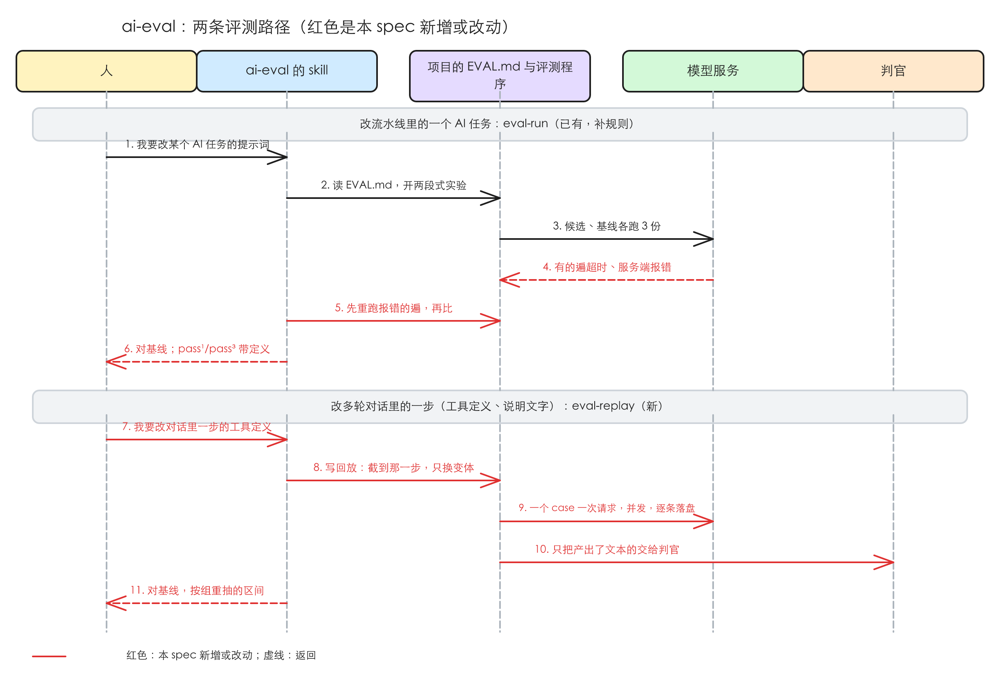
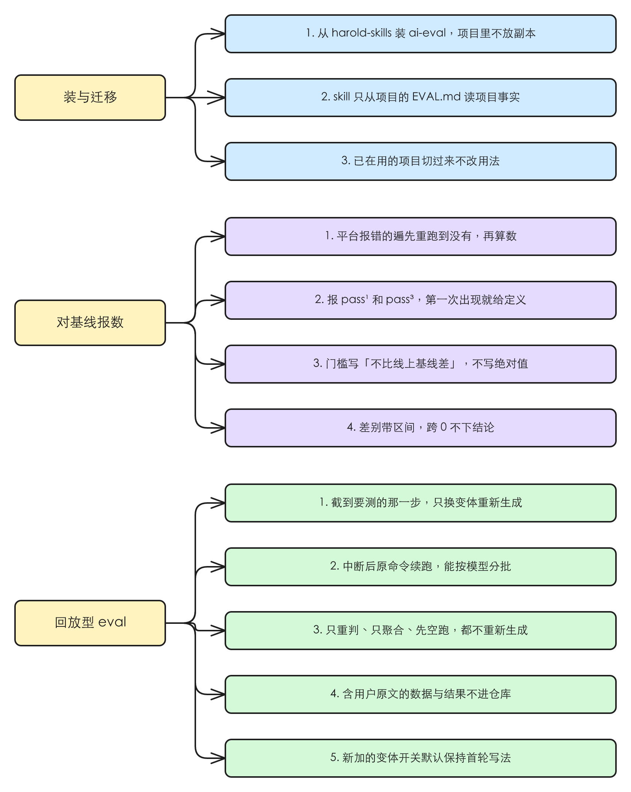

# ai-eval 进 harold-skills：报数口径与回放型 eval

> #293 存在：idea-loop 里讲 eval 的只有 to-spec「测试决策」表里的一行，写的是「LLM 输出质量（prompt 改动） → eval（确定性断言）」，在 `idea-loop/skills/engineering/to-spec/SKILL.md`。门槛怎么定、报什么数、平台报错怎么处理、回放型 eval 怎么写，这些插件里都没有。2026-11-17 对着 main `a032e45` 核过；分拣评论 2026-11-16 对着 `d3a8607` 核过，结论相同。

## 问题陈述

### 写 eval 的人只能靠会话里被纠正

这里说的 eval，是用来判断一次 prompt、工具定义或模型参数的改动有没有让 LLM 的输出变差的评测。harold-skills 里讲它的只有 to-spec「测试决策」表里那一行。toeflair 仓库里另有一套 `ai-eval` 插件，位置在 `.claude/plugins/ai-eval/`，有 6 个 skill、9 个带测试的脚本，共 3,193 行。它只装在 toeflair 自己的仓库里：`.claude/settings.json` 里写的是 `ai-eval@toeflair-local`，别的项目用不到。

#293 记录的那次需求，是给一个 LLM 工具调用加参数。它没走 ai-eval，自己写了回放脚本。下面五件事是人在会话里一条条纠正出来的。数字来自那个私有项目的会话和报告，这里没法复现，照 issue 原文记：

| 问题 | 当时写的 | 纠正后 |
|---|---|---|
| judge 打分的门槛写成了绝对值 | 门槛「≥ 90%」，可线上本身只有 49.8% / 54.6%，过不过都说明不了什么 | 门槛改成「不比线上基线低」，选中的写法 66.0%，对两个基线都过 |
| 平台超时被当成失败算进数字 | 基线组 246 次里有 30 次超时，结论写成「新写法 +11.8 个点」 | 重跑到没有超时后，差是 +0.8（区间 −2.8 到 +4.9），实际持平 |
| 报数没写口径 | 报告写「每次通过」「三次全过」 | 评审追问「评测是pass1还是paas3？」 |
| 差别没给区间 | 同一个会话里的几个 case 被当成相互独立 | 按会话分组重抽 2,000 次，算 95% 区间 |
| 回放怎么写才快、才能复现，没有现成写法 | 每一处都是当场想出来的 | 1,326 次请求不到一小时跑完，做法见 issue 第 5、6 条 |

拿 ai-eval 对照这五件事（toeflair 本地 main `c15e2dd4`，2026-11-16）：

| 这件事 | ai-eval 现在 |
|---|---|
| 门槛对基线 | 已有。准出标准写的是「候选对基线，同一个 scorer 在同一个样本上的分对分」 |
| pass¹ / pass³ | 没有这套叫法。断言按「候选 3 份里几份没过」判 |
| 平台报错先重跑 | 评测程序有 `--retry-failed` 选项，但 eval-run、eval-baseline 两个 skill 都没把重跑写成算数前必须做的一步。准出标准第 1 条反而写着「没产出报告的一遍，挡准出」，超时的那一遍也落在这条里 |
| 差别看区间 | 判官分按样本配对，算差和标准误：−D > 0.10 且 −D > 2×SE 才算退步。算法在 `paired-stats.mjs` |
| 回放型 eval | 没有。它的单位是「用户任务 → 跑产品自己的流水线」，管不到「截一步对话直接调模型」这种测法 |

ai-eval 还没做到它自称的项目无关。6 个 skill 和脚本里有 60 多处写死了 toeflair 的路径或领域词：`toeflair-app` 5 处，「学生」33 处，还有「作文」「托福」等。

### 根因

讲 eval 的写法只住在一个项目里：ai-eval 在 toeflair 仓库，别的项目装不到，它自己也缺上面三件事。harold-skills 这边只有 to-spec 那一行，它指不到任何写法。

## 方案



改完以后，用户得到这些：

- 任何项目都能从 harold-skills 装 `ai-eval`。项目的事实只写在它自己的 `EVAL.md` 里，插件里不出现任何项目的路径或领域词。
- 改流水线里一个 AI 任务时，走 eval-run，跟现在一样。新加的规矩有两条：
  - 候选和基线里平台报错的遍，先重跑到一遍都没有，再算数。
  - 报告里写 pass¹ 和 pass³，第一次出现时给定义。
- 改多轮对话里的一步（工具定义、说明文字、某一轮的提示词）时，走新的 eval-replay：照它写一个回放脚本，用插件自带的脚本算数，得到对线上基线的结论和一个按组算出的区间。
- 报数口径（门槛、pass¹/pass³、报错、区间）写成插件级的一份参考，eval-run、eval-baseline、eval-replay 都引它。

做法：

1. 把 toeflair 的 `ai-eval` 原样迁成仓库顶层的 `ai-eval/` plugin，再去掉项目信息。
2. 加一份报数口径的参考、一个 skill（eval-replay）、一个算数脚本（下文叫「回放统计脚本」）。
3. 改 eval-run、eval-baseline、eval-setup 里相关的几步。
4. idea-loop to-spec 那一行改成指向这里。

同一件事的其他入口，逐个标纳入还是排除：

- idea-loop 的 to-spec「测试决策」表的 eval 那一行：**纳入**，改成指向 ai-eval。
- idea-loop 的 tdd skill 和 implementer agent：**排除**。它们只说「eval 归 spec 的测试决策」，不讲 eval 的写法，改了 to-spec 就够。
- toeflair 仓库里的 ai-eval 副本、`.claude/settings.json` 和 `EVAL.md`：**排除**。它们在另一个仓库，见「Out of scope」。

## User Stories



**装与迁移**

1. 作为项目维护者，我想要从 harold-skills 的 marketplace 装上 `ai-eval`，以便不用在自己仓库里放一份副本。
2. 作为项目维护者，我想要 ai-eval 的每个 skill 只从我项目的 `EVAL.md` 读项目事实（命令、路径、存放处），以便换一个项目也能照用。
3. 作为已经在用 ai-eval 的项目，我想要切到 marketplace 版后六个 skill 照旧能跑我的 `EVAL.md`，以便切换时不改用法。`EVAL.md` 缺的新小节由 eval-setup 补，补之前用到它的那一步会点名缺哪一节。

**对基线报数**

1. 作为改 AI 任务的人，我想要候选和基线里平台报错的遍先重跑到一遍都没有，再算数，以便结论不被跟改动无关的报错带偏。
2. 作为读报告的人，我想要报告写 pass¹ 和 pass³，并在第一次出现时给定义，以便不用回头问是哪一个。
3. 作为定门槛的人，我想要门槛写成「不比线上基线差」，以便门槛过不过真能说明问题。用 judge 打分的指标，先用同一个 judge、同一套判据给基线打分。
4. 作为读报告的人，我想要差别带区间，点估计跨 0 的时候不下「变好」或「变差」的结论，以便不把噪声当成效果。

**回放型 eval**

1. 作为改对话里一步的人，我想要把真实对话截到要测的那一步，系统提示词和历史原样保留，只换要比较的东西，再让模型重新生成这一步。这样一个 case 只发一次请求，不用模拟用户，也不用起服务。
2. 作为跑回放的人，我想要逐条结果落盘，中断后用原命令续跑，也能按模型分批跑，以便跑到一半断了不用从头花钱。
3. 作为跑回放的人，我想要判定规则改了只重判、聚合只读结果文件、正式跑之前先空跑检查请求形状，三样都不重新生成，以便改判据和看数字不花钱。
4. 作为数据含用户原文的项目，我想要数据文件和逐条结果都不进仓库，仓库里只放聚合数字和编造的示意句。
5. 作为以后要复现结果的人，我想要后来加的变体开关默认保持首轮的写法，以便以前的结果照样能复现。

## 实现决策

### plugin 的形状

- 新 plugin 名 `ai-eval`，放在仓库顶层。marketplace.json 加一项，仓库 `AGENTS.md` 的「当前 plugins」加一行。plugin 的 README 照 `AGENTS.md`「标准 plugin 目录结构」写：介绍、安装、每个 skill 的用法示例，以及依赖。toeflair 那边原来没有 README。
- 起始版本 `0.1.0`。toeflair 那边是 `0.0.0-beta.5`，这次在它上面加了新能力（eval-replay、报数口径），按 `REVIEW.md` 的档位规则算 minor。
- 目录：
  - 6 个 skill 原样迁过来，新增 `eval-replay`，共 7 个。
  - 插件级 `references/`：现有的 `judge-format`、`judge-prompt`，再加一份报数口径。
  - `scripts/`：现有 9 个脚本连同测试，再加回放统计脚本和它的测试。
- 迁移的基准：实现时取 toeflair 主分支上最后一个改过 `.claude/plugins/ai-eval/` 的提交，提交号写进 PR 描述。合并前再对一次，toeflair 那边有新提交就同步进来。理由：这个插件最近这段时间有 33 个提交，还在动，不要求 toeflair 冻结它。

### 去掉项目信息

- 写死的项目路径和命令改成读 `EVAL.md` 对应小节，共 5 处 `toeflair-app/...`、`uv run python -m evals.*`。`EVAL.md` 模板里还没有那一项的，由 eval-setup 把它加进对应小节的模板。
- 领域词换成通用的说法：「学生」改成「用户」，「作文」「托福」改成「样本」或「用户的输入」，范例改成任何项目都读得懂的。脚本测试的夹具也一起换，ai-eval 没有回放用例，没有理由留真实数据。
- 加一份防泄漏测试，照 idea-loop `scripts/no-project-leak.test.mjs` 的做法，扫 `skills/`、`references/`、`scripts/`、`README.md`。提示词里除了 toeflair 的名字，还要有上面那些领域词。仓库的全量测试命令 `node --test '*/scripts/*.test.mjs' 'scripts/*.test.mjs'` 会自动带上它，不用改 `REVIEW.md`。
- PostHog（存样本和 scorer）和 Codex（当判官）留作插件声明的依赖，写进 README 的「依赖」，不抽象成可替换的后端。依据：现在只有一个项目在用，抽象出的接口没有第二个用户可以对照（`CLAUDE.md`「先扩展已在用的工具，不为一件事新增组件」）。

### 报数口径（插件级参考，三个 skill 都引）

下面每一条只写一次，就写在这份参考里。eval-run、eval-baseline、eval-replay 在用到的那一步引它。

- **门槛对线上基线**：门槛写成「候选不比基线差」，不写绝对值。用 judge 打分的指标，先用同一个 judge、同一套判据给线上现状打一次分，再拿候选去比。
- **pass¹ / pass³**：pass¹ 是单次运行的通过率，等于过了的次数除以总次数。pass³ 是同一个 case 跑三次全过的 case 占的比例。报告里第一次出现时，原样写这两句定义。只跑 1 次的不报 pass³。
- **平台报错先重跑**：平台报错是请求没拿到模型的回答：超时、连接失败、服务端 5xx、限流。它跟改动无关，不算失败，也不进分母。模型回答了、但产出不合格或没产出的，照算失败。
  - 算数之前，候选和基线两边的平台报错都重跑到零，最多重跑 3 轮。3 轮后还有，就停下，告诉人还剩几次、出在哪个服务，不算数。
  - ai-eval 准出标准第 1 条的「没产出报告的一遍，挡准出」只管模型的失败。这里修正它的措辞，平台报错不再落进这一条。
- **差别看区间**：统计单位是相互独立的组。
  - ai-eval 的样本本来就是独立的（一个样本一次用户任务），`paired-stats.mjs` 按样本配对算差和标准误，已经满足，不改。
  - 回放里同一个会话截出来的几个 case 不独立，按会话分组重抽，2,000 次，取 95% 区间。
  - 判定：区间整个在 0 以上，算「变好」；整个在 0 以下，算「变差」；跨 0 算「持平」，不下「变好」或「变差」的结论。门槛「不比基线差」等于「不是变差」。

### eval-run、eval-baseline、eval-setup 的改动

- eval-run 第 7、8 步（两段式实验的两段）和 eval-baseline 的「重跑」：比较之前，先用 `EVAL.md` 写的重跑命令把平台报错重跑到零，规则照报数口径。在 toeflair，这条命令就是 `--retry-failed`。
- eval-run 第 9 步（写报告的分析）：写 pass¹ 和 pass³，并给定义。数字从项目的报告里抄，项目的报告里没有，就在分析里写「报告没给」，并在 `EVAL.md`「待确认」记一条，不临场算。
- eval-run 第 2 步（评估样本与指标）：要测的东西是多轮对话里的一步、跑流水线要模拟用户的，转去 eval-replay。
- eval-setup 的 `EVAL.md` 模板：「跑基线」「两段式实验」两节各加一项「平台报错怎么重跑」（命令）。准出标准第 1 条按上面的修正写。

### eval-replay

- **什么时候用**：要比较的改动在多轮对话的某一步里（工具定义、说明文字、某一轮的提示词、模型参数），想在真实对话上比线上写法和新写法。description 写这一句触发，再写「跑产品流水线的改动用 eval-run」。
- **它交付什么**：一个跑在项目里的回放脚本，加一份对基线的结论。脚本用项目自己的语言写，放在项目的评测目录里（`EVAL.md` 写了就照它，没写就问人）。结论的数字全部出自回放统计脚本。
- **回放脚本要做到的**，这份清单就是 eval-replay 的完成条件，每一条都要有着落：
  1. 只回放一步：把对话截到要测的那一步，系统提示词和历史原样保留，只改要比较的东西。一个 case 一次请求。
  2. 异步并发，有上限（默认 12），先完成的先落盘，慢模型不拖别的。
  3. 请求的形状照抄线上运行时（服务商钉选、推理参数）。失败时按「钉选 → 不钉选 → 去掉推理参数」逐级退，每一级都带退避重试。
  4. 逐条追加到结果文件。键是「case × 变体 × 第几次」，中断后用原命令续跑，跳过已有的键；能按模型分批跑。
  5. 能用代码判的用代码判。只有自然度这类交给 judge，而且只评真的产出了文本的那些。判据改了，只重判，不重新生成。
  6. 生成和聚合分开：聚合只读结果文件。空跑模式组装全部请求、检查形状、不发请求。
  7. 数据含用户原文时，数据文件和逐条结果放仓库外，或者用 `.gitignore` 挡住；README 只放聚合数字和编造的示意句。
  8. 变体开关默认保持首轮的写法，后来加的开关用环境变量切换。
- **结果文件的行形状**：回放脚本和回放统计脚本之间就靠这个形状对接。每行是一个 JSON 对象，字段如下（形状出自 issue 第 5 条，字段名在这里定）：

  ```
  { case, group, variant, run, status: "ok" | "platform_error", pass: true|false|null, score: number|null }
  ```

  - `group` 是重抽样的分组键，比如会话 id。
  - `variant` 里，基线固定叫 `baseline`。
  - 没法判的，`pass` 和 `score` 写 `null`。
- **回放统计脚本**：读结果文件，算出每个变体的 pass¹、pass³，以及每个变体对 `baseline` 的差：差、按 `group` 重抽的 95% 区间、「变好 / 变差 / 持平」。还有 `platform_error` 行时拒绝出数，退出码 1，列出还剩几行。随机种子固定，同一份输入两次跑出同样的区间。

### to-spec 那一行

idea-loop to-spec「测试决策」表 eval 那一行的「仪器」列，改成：eval，门槛对线上基线，不写绝对值；装了 `ai-eval` 的项目，跑流水线的改动走 eval-run，多轮对话里的一步走 eval-replay。idea-loop 的版本按 `REVIEW.md` 定档（改了 to-spec 产出的内容，算 minor）。合并时 main 已经升过（比如 0.2.0 发布分支先合了），就从 main 的新版本重新按同一档升。

### toeflair 那边的切换另开 issue

harold-skills 的 PR 合并后，toeflair 要做三件事才算真正用上：用 eval-setup 更新 `EVAL.md`；`.claude/settings.json` 改成装 `ai-eval@harold-skills`；删掉仓库里的副本。这三件事不在这个 issue 里做，记在 harold-skills#361，它被 #293 挡着。迁移期间 toeflair 继续用旧副本，两份互不影响。依据是人的原话（2026-11-17）：「这个事儿在harold-skills 开issue，toeflair项目暂时用旧的，两个不相互冲突～」。

### issue 分类加一个模块

仓库 `AGENTS.md` 的「issue 分类」加 `ai-eval`（ai-eval plugin 的 issue），跟其它 plugin 一样一个 plugin 一个父类。依据：那一节写的是「父类按 issue 落在哪个 plugin 分」。合并后用 `issues labels` 建出 `type:ai-eval` label，给 #361 打上。

## 测试决策

| 变的是什么 | 仪器 | 本次 |
|---|---|---|
| 纯逻辑、数据转换、状态机 | TDD 单元测试 | 回放统计脚本：pass¹/pass³、分组重抽区间、三种判定、有平台报错时拒绝出数；防泄漏测试；迁过来的 9 个脚本的测试照旧要全过 |
| API 契约（路由、schema、序列化） | TDD API 测试 | 不涉及 |
| DB schema、迁移、并发与事务语义 | 真 DB 测试 | 不涉及 |
| LLM 输出质量（prompt 改动） | eval | 不涉及：改的是给 agent 读的 skill，按 `AGENTS.md` §5 不做定量 eval |
| 视觉正确性 | UI 实现环 | 不涉及 |
| 端到端用户流程 | 浏览器端到端测试 | 不涉及 |

- **seam**：
  - 回放统计脚本的命令行：喂一份结果文件，读它的 JSON 输出和退出码。能抓到算法和拒绝出数的条件；抓不到回放脚本本身写得对不对，那一部分在项目里，由 eval-replay 的完成清单把关。
  - 防泄漏测试：扫插件目录的文本。能抓到已知的项目名和领域词；抓不到没列进提示词表的新词。
- **增量功能测试**：
  - 前置：一份结果文件，`baseline` 和 `new` 两个变体，6 个 case 分在 2 个 group，每个 case 跑 3 次，其中 1 行是 `platform_error`。步骤：跑回放统计脚本。期望：退出码 1，输出点名还剩 1 行平台报错，不给任何差值。覆盖：对基线报数 1。
  - 前置：同一份文件，把那一行改成 `ok`。步骤：再跑一次。期望：每个变体都有 pass¹ 和 pass³，数值等于手算的结果；对 `baseline` 的差带 95% 区间；两次运行区间相同。覆盖：对基线报数 2、4。
  - 前置：构造两份文件，一份差的区间整个在 0 以下，一份跨 0。期望：前者判「变差」，后者判「持平」。覆盖：对基线报数 3、4。
  - 前置：在 `ai-eval/skills/` 的某个文件里写进 `toeflair-app`。步骤：跑全量测试。期望：防泄漏测试红，并点名那个文件。覆盖：装与迁移 2。
  - 前置：这个分支装成本地 marketplace，在一个有 `EVAL.md` 的项目里。步骤：调 `ai-eval:eval-setup`。期望：它读得到插件，按新模板列出缺的「平台报错怎么重跑」两项。覆盖：装与迁移 1、3。这一条在 PR 里由人验。
- **照着谁写**：
  - 统计脚本照 toeflair `ai-eval/scripts/paired-stats.mjs` 和它的测试，迁过来以后就在同一个目录：文件头写用法与规则，输出 JSON，退出码 0/1/2。
  - 防泄漏测试照 `idea-loop/scripts/no-project-leak.test.mjs`。

## Out of scope

- toeflair 仓库里的切换：更新 `EVAL.md`、改装法、删副本。这件事在 harold-skills#361 做。
- 把 PostHog、Codex 抽象成可替换的后端。
- 判官分数改用分组重抽：ai-eval 的样本本来就相互独立，`paired-stats.mjs` 不改。
- 给 ai-eval 的 skill 做定量 eval（`AGENTS.md` §5）。

## 关联

- raw：[[2026-11-17-ai-eval-shape]]（形状怎么定的）
- 来源：harold-skills#293 的正文和分拣评论（2026-11-16）
- 相邻还没完成的 spec 与 issue：查过 `docs/spec/`，现在没有别的 spec；开着的 issue 里搜 "eval"，只有 #293，和从它拆出去、等它合并的 #361（toeflair 切换）。idea-loop 0.2.0 发布分支（父 issue #331）会动 idea-loop 的版本号，跟这里改 to-spec 那一行只在版本号上可能冲突，处理办法见「to-spec 那一行」。
