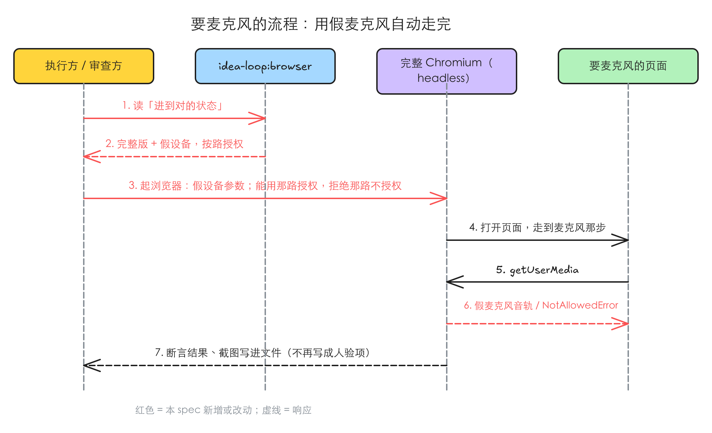

# 要麦克风的流程用假麦克风自动走

> #231 存在：默认的精简版无头浏览器调 `getUserMedia` 直接抛 `NotSupportedError`，`idea-loop:browser` 和 `idea-loop:runtime` 的『浏览器』都没写怎么办，执行方就把这一步交给人手测；详情在「问题陈述」

## 问题陈述

### 1. 麦克风这一步被当成「无头测不了」交给人

Tofelair#738 工单 03 的执行方用 Playwright 默认的精简版无头浏览器（chrome-headless-shell）走「Interview 点 Begin」，页面卡在「Checking Mic...」，执行方把这一步写成人验项交给人手测。后来改用完整 Chromium 加假麦克风参数、再授予 microphone 权限，在本地真实前后端上全自动走通。

本次复测（2026-11-16，本机 macOS，playwright-core 1.62.1，本地静态页里调 `getUserMedia({audio:true})`）：

| 浏览器 | 授权 | 参数 | 结果 |
|---|---|---|---|
| 精简版无头（chrome-headless-shell 151） | 给 | 假设备 | 失败：`NotSupportedError` |
| 完整 Chromium（`channel: 'chromium'`，151，headless） | 给 | 假设备 | 成功，拿到「Fake Default Audio Input」 |
| 完整 Chromium | 不给 | 假设备 | 失败：`NotAllowedError`（就是「拒绝授权」该有的样子） |
| 完整 Chromium | 不给 | 假设备 + 假授权弹窗 | 成功：`--use-fake-ui-for-media-stream` 无视权限直接放行，测不了「拒绝」 |
| Chrome 正式版（158，headless） | 给 | 假设备 | 成功，拿到假麦克风 |

分拣在 2026-11-13 也复现了前两行（[分拣评论](https://github.com/guohaonan-shy/harold-skills/issues/231)）。issue 原文里「拒绝授权时不授权、也不加 `--use-fake-ui-for-media-stream`」这句分拣没验，本次第三、四行验了，成立。

现在 `idea-loop:browser` 的正文（2026-11-16 主分支 a032e45）只讲无头和给人看两种用途、登录态、慢网络，全文没有麦克风、假设备的字样；`idea-loop:runtime` 的两份 reference 也没有。

复现材料：`.tmp/to-spec/browser-fake-mic/repro/t.mjs`、`out.txt`

### 2. 桌面端的 Playwright MCP 一授权就拿到本机真麦克风

issue 没写、本次查到的：桌面端用户级配的 Playwright MCP（`--headless --isolated`，由 `/idea-loop:setup` 按 runtime 的『装与设置』装）跑的是 Chrome 正式版 158 的 headless，不是精简版。在它的页面上不授权时拿到 `NotAllowedError`；用 `browser_run_code_unsafe` 授权 microphone 之后，`getUserMedia` 成功，音轨名是「Default - MacBook Pro Microphone (Built-in)」：**拿到的是这台 Mac 的真麦克风**。MCP 的启动参数里没有假设备，所以执行方照「授权就行」去做，会在人不知情时打开真麦克风；放到 CI 或没有麦克风的机器上又会失败。

复现材料：本会话 2026-11-16 对 `http://127.0.0.1:8731/mic.html` 的两次 `getUserMedia` 调用（页面在 `.tmp/to-spec/browser-fake-mic/repro/mic.html`）

### 根因

- 问题 1：两份浏览器文档都没写麦克风流程怎么进到对的状态，执行方碰到精简版的 `NotSupportedError` 就把它当成工具的极限。
- 问题 2：MCP 浏览器的启动参数从来没考虑过媒体设备，没有假设备参数，授权后落到系统默认输入设备上。

## 方案

改完以后，执行方、审查方、分拣方碰到要麦克风的流程（录音、语音面试、「检查麦克风」这类页面），自己用假麦克风把「授权后能用」和「拒绝授权」两条路都走完，结果留在文件里；不再写成人验项，也不会打开本机真麦克风。

做法只由两样东西决定：浏览器是不是完整版（精简版根本不支持），以及授不授权（决定走哪条路）。假设备参数保证拿到的永远是假麦克风。

改动落在三处给 agent 读的文档，每处对的杠杆写在后面：

- `idea-loop:browser` 的「进到对的状态」加一条：要麦克风的流程用完整 Chromium 加假麦克风自动走完，「拒绝授权」那条路就不授权、也不加假授权弹窗参数。写成正向的目标行为（「自动走完」），不写「不要交给人」（杠杆：否定会把交给人这个动作拖进上下文）。放在「进到对的状态」下而不是另起一节，因为它跟登录、慢网络是同一类事：把页面带到要测的状态（杠杆：就近归置）。
- 具体用哪个浏览器、怎么起，看「待定：麦克风流程用哪个浏览器」定下的选项写进 browser 或 runtime（杠杆：单一事实来源）。
- `idea-loop:runtime` 的 claude-desktop 『浏览器』加一句问题 2 的坑：MCP 浏览器授权后拿到真麦克风（杠杆：环境里靠看找不到的坑）。

同一行为的其他入口：

- **纳入** `idea-loop:implementer` 的人验项判断：它在「每一格标『人看』的验收」那里决定什么交给人。它已经要求按 `idea-loop:browser` 用浏览器，browser 里写清了它就照做，implementer 本身不改。实现时核一遍它读到 browser 的路径还在。
- **纳入** magi 的『浏览器』：magi 自带浏览器不能跑任意 JS、不能授权，麦克风流程在 magi 里只能走自起的 Playwright 脚本；reference 里「自起 chromium 的脚本不受影响」那句已经覆盖，选 A 时加一句指过去。
- **排除** 摄像头、屏幕共享：同一组参数（假设备）也管摄像头，但没有真实会话碰到过，不写进去。见 Out of scope。

## User Stories

只修问题，不加能力：

1. 期望行为（问题 1）：执行方或审查方碰到要麦克风的流程，用完整 Chromium 加假麦克风自动走完授权后能用、拒绝授权两条路，结果是测试或截图文件，不出现「麦克风无头测不了，交给人验」的人验项。
2. 期望行为（问题 2）：照 idea-loop 的浏览器文档走麦克风流程，任何一次 `getUserMedia` 拿到的都是假麦克风，不是本机真麦克风。

## 实现决策

- **规则写在 browser 的「进到对的状态」下，一条**：它跟登录、慢网络并列，都是把页面带到要测的状态。依据：browser 现有结构，以及 writing-for-agents 的「就近归置」。
- **「拒绝授权」只靠不授权**：不授权、不加 `--use-fake-ui-for-media-stream`，页面拿到 `NotAllowedError`。依据：本次复测第三、四行。
- **精简版写成一句原因，不写成禁令**：写「精简版不支持麦克风，`getUserMedia` 会抛 `NotSupportedError`」，让碰到这个错误的 agent 认得它。依据：Tofelair#738 的执行方正是被这个错误误导的。

### 待定：麦克风流程用哪个浏览器

两个选项都用已经在用的工具，差在你装机要不要改、以及走流程的方式。

**A（推荐）：麦克风流程写一段自起的 Playwright 脚本**
- 做法：`chromium.launch({ channel: 'chromium', args: ['--use-fake-device-for-media-stream'] })`，上下文带 `permissions: ['microphone']`（测拒绝就不带）。跟 ui-measure、flow-compose 自起 chromium 是同一种做法。做法写在 browser 里一处，桌面端和 magi 共用；claude-desktop 的『浏览器』补一句「MCP 浏览器授权后拿到真麦克风，麦克风流程照 browser 写脚本」。
- 真实例子：Tofelair#738 的 Interview 点 Begin，执行方写一个脚本：登录 → 进面试页 → 授权 → 点 Begin → 断言进入录音态；再跑一次不授权 → 断言出现「麦克风被拒」提示。脚本和结果留在 worktree。
- 代价：麦克风这一段不能用 MCP 一步一步点，得写成脚本；MCP 本身不变，授权时仍会拿到真麦克风，只靠文档那一句挡。不用改装机。

**B：给 Playwright MCP 加假设备参数**
- 做法：`/idea-loop:setup` 装 MCP 时多带一份配置文件（放 `~/.idea-loop/`），启动参数加 `--use-fake-device-for-media-stream`；麦克风流程照常用 MCP 点，授权用 `browser_run_code_unsafe` 里的 `grantPermissions`，测拒绝就不授权。magi 没有 MCP，仍要写 A 那段脚本。
- 真实例子：同一个 Interview 流程，执行方用 MCP 打开页面、调一次授权、点 Begin、截图；之后所有会话的 MCP 浏览器都只会拿到假麦克风。
- 代价：每台机器要重跑一次 `/idea-loop:setup`（或手改 MCP 配置）才生效；没重装的机器上授权仍拿到真麦克风。MCP 用配置文件加启动参数这条路本次没实测，实现时先验。

推荐 A：不动装机，桌面端和 magi 一份做法，脚本能进 CI；真麦克风的风险只在有人主动对 MCP 授权时出现，文档那一句就挡住了这条路。

## 测试决策

| 变的是什么 | 仪器 | 本次 |
|---|---|---|
| 纯逻辑、数据转换、状态机 | TDD 单元测试 | 不涉及 |
| API 契约（路由、schema、序列化） | TDD API 测试 | 不涉及 |
| DB schema、迁移、并发与事务语义 | 真 DB 测试 | 不涉及 |
| LLM 输出质量（prompt 改动） | eval（确定性断言） | 改的是给 agent 读的文档。用 `idea-loop/evals/retro/` 的回放：取 Tofelair#738 工单 03 执行方把麦克风交给人的那个决策点做一个用例，是/否题「执行方是否自己用假麦克风走完了麦克风这一步、没写成人验项」；改前「否」、改后「是」才算过。决策发生在 Tofelair 仓库，跑时用 runner 的 `--repo` 指本机的 Tofelair 仓库；要开浏览器、起前后端，按大用例算 |
| 视觉正确性 | UI 实现环 | 不涉及 |
| 端到端用户流程 | 浏览器端到端测试 | 文档里写的做法本身要能跑：把本次 `t.mjs` 的五行复测按定下的选项留成一段可重跑的验证（A 是那段脚本，B 是重启后的 MCP），实现时跑一遍贴结果 |

- **seam**：一个，规则回放的那个决策点（执行方读到 browser 后交出的工单产物）。它抓得到「规则有没有改变执行方的选择」，抓不到脚本在别的项目的真实页面上能不能跑，后者靠下一行的实测。
- **增量功能测试**：
  - 前置：本地静态页 `mic.html`；步骤：按 browser 写的做法起浏览器、授权、调 `getUserMedia`；期望：拿到音轨，名字含「Fake」；覆盖：期望行为 1、2。
  - 前置同上；步骤：不授权再调一次；期望：`NotAllowedError`；覆盖：期望行为 1。
- **照着谁写**：回放用例照 `idea-loop/evals/retro/` 里已有的用例；文档守卫照 `idea-loop/scripts/runtime-skill-doc.test.mjs`（runtime 能力小节的绊线）。

## Out of scope

- 摄像头、屏幕共享：同一组假设备参数也管它们，但还没有真实流程碰到过。
- 假麦克风喂指定音频（`--use-file-for-fake-audio-capture`）测语音识别结果：Tofelair#738 只需要「拿到麦克风」这一步。

## 关联

- #295（runtime 没有「本机覆盖」的落点）：相邻，不重叠。选 B 时 MCP 的配置文件是装机层面的，不是本机覆盖，跟 #295 无先后。
- #192（design-archive-sections-browser 测试在本机卡住）：同在浏览器这块，不重叠。
- 相关 spec、ADR：查过 `docs/spec/`、`docs/adr/`，没有浏览器或媒体设备的。
