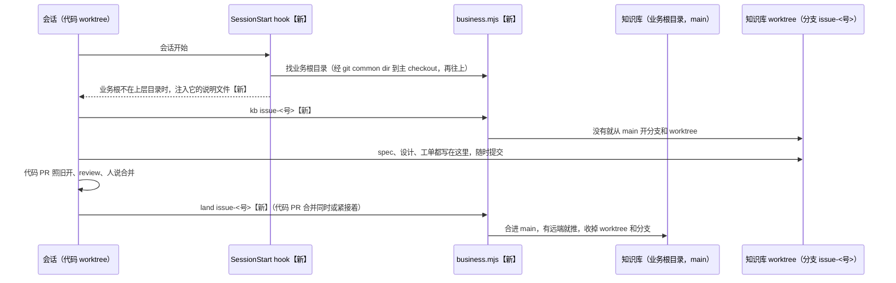

# 业务根目录与知识库

> #244 存在：知识库（`docs/`、`PRODUCT.md`、`GLOSSARY.md` 等）只能放在代码仓库里；一个业务有多个仓库时没处放，公司仓库按公司标准维护、放不进这套文件。详情在「问题陈述」。

## 问题陈述

### 知识库绑在代码仓库里

idea-loop 0.1.9 的 `wiki-conventions` 规定「项目级的规则放在仓库根目录」，`setup` 在「目标仓库的主 checkout 根目录跑」，把 `DEVELOPMENT.md`、`REVIEW.md`、`ISSUE_TRACKER.md`、`PRODUCT.md`、`docs/` 骨架都写进代码仓库（`idea-loop/skills/engineering/setup/SKILL.md`，对着 release/idea-loop-0.2.0 1a7496b 查，2026-11-05）。

- **一个业务多个仓库**：同一份 `PRODUCT.md`、同一组 spec 只能放进其中一个仓库，另外几个仓库的会话读不到。
- **公司仓库**：Harold 刚加入的公司，仓库按公司统一标准维护（决定记录 Q5 原话：「我们自己的这一套可以先放在不进入git的部分」），这套文件不能提交进去。

### 知识库改动经 PR 合进代码仓库的主分支

17 个文件写着「只改 `docs/` 的 PR 检查全过就合并」这条流程：spec 经 spec PR、冻结的设计经设计 PR、retro 候选池和 dreaming 的执行结果各经一个 PR 合进代码仓库主分支，实现阶段从主分支开 worktree 拿到它们（例：`to-spec/references/land-on-main.md`、`uiux-refine/references/freeze.md`、`pr-review/references/merge.md`、`decision-rules`「不自动的」）。知识库一离开代码仓库，这条路就不存在了。

### 读不到业务根目录的说明文件

本机实测（Claude Code 2.1.299，haiku，2026-11-05）：业务根目录 `biz/` 和代码仓库 `biz/repo/` 各写一个暗号，问会话看到哪些暗号。

| 布局 | 会话开在哪 | 默认 | 打开「两份都读」 |
|---|---|---|---|
| 业务根 `AGENTS.md`，仓库 `CLAUDE.md`（内容 `@AGENTS.md`）+ `AGENTS.md` | `biz/repo` | 只有仓库的 | 两份都有 |
| 业务根 `CLAUDE.md`，仓库只有 `AGENTS.md` | `biz/repo` | 只有业务的 | 两份都有 |
| 同一个开关写在仓库 `.claude/settings.json` | `biz/repo` | — | 不生效，只有仓库的 |
| 业务根 `AGENTS.md`，仓库 `CLAUDE.md` | 从 `biz/repo` 开到 `biz/` 外面的 worktree | 只有仓库的 | 只有仓库的 |

最后一行是桌面 app 的常态：Harold 的 worktree 位置是 `~/projects/TOEFLAIR-worktree`（Settings 里只有一个全局位置），每个 issue 会话都开在业务根目录外面。

复现材料：`/private/tmp/claude-501/kbtest/`（本机临时目录）。

### 根因

- 知识库的路径写死成「代码仓库根目录」，没有「业务」这一层（`wiki-conventions`「目录」，`setup`「写」）。
- 「两份都读」是 Claude Code 内置插件 `cc-plugin-agents-md` 的选项 `instructionFiles`，插件选项只从用户设置、`--settings` 和托管设置读，不读项目设置（Claude Code 2.1.299 的报错文案：「project settings are not read」），所以写在仓库里不起作用。
- 上层目录的说明文件只按会话所在目录往上找；worktree 开在业务根目录外面时，往上找不到它。

## 方案

改完之后：一个业务一个知识库仓库，就是业务根目录；业务的代码仓库 clone 在它下面、被它忽略。除了各代码仓库自己的 `AGENTS.md`，idea-loop 读写的文件都在业务根目录。会话不管开在代码仓库、它的 worktree（在业务根目录里外都行）还是业务根目录，都读得到业务根目录的说明文件。知识库的改动不开 PR：每个需求一个知识库分支，在需求合并时合进知识库 main。

```
<业务根目录>/                 知识库所在的 git 仓库（个人：私有远端；公司：虚拟机上本地 git，不连远端）
├── CLAUDE.md 或 AGENTS.md    业务说明文件：## idea-loop 块、## issue 分类
├── PRODUCT.md  GLOSSARY.md  ISSUE_TRACKER.md  DEVELOPMENT.md  REVIEW.md  CODING_STANDARDS.md  DESIGN.md  SEO.md
├── docs/                     spec、ADR、设计档案、raw……（结构不变）
├── .gitignore                忽略下面每个代码仓库
├── .worktrees/<分支>/        知识库分支的 worktree（本地忽略）
├── <仓库 A>/                 代码仓库 clone，只带自己的 AGENTS.md / CLAUDE.md
└── <仓库 B>/
```



### 找业务根目录

`business.mjs root`：从当前目录取主 checkout（worktree 经 `git rev-parse --git-common-dir` 回到主 checkout），往上找第一个本身是 git 仓库根的目录，就是业务根目录；找不到时业务根目录就是主 checkout 自己（单仓库、知识库还在代码仓库里的旧布局，或会话本来就开在知识库里）。输出业务根目录、当前仓库名、业务下的代码仓库清单，以及是不是旧布局。

### 说明文件

- **业务根目录放哪一种**：setup 用 `business.mjs instructions` 看业务下每个代码仓库：都有 `CLAUDE.md` → 业务根放 `CLAUDE.md`；都只有 `AGENTS.md` → 放 `AGENTS.md`；混用 → 放 `AGENTS.md`，并让人在用户设置里打开「两份都读」。脚本同时报开关现在开没开。
- **开关**：用户设置 `~/.claude/settings.json` 里

  ```json
  { "pluginConfigs": { "cc-plugin-agents-md@builtin": { "options": { "instructionFiles": "claude-md-and-agents-md" } } } }
  ```

  它改的是这台机器上所有项目：没被 `CLAUDE.md` 引入的 `AGENTS.md` 也会读进来。setup 只把这一段给人，由人自己写进去。
- **worktree 在业务根目录外面**：idea-loop 加一个 SessionStart hook，业务根目录不是当前目录的上层时，把业务根目录的 `CLAUDE.md`、`AGENTS.md`（有几份注入几份，`@文件` 引入展开一层）作为会话上下文注入，并写明它们的路径；在业务根目录里面、或旧布局时什么都不做。

### 文件归属

除了各代码仓库自己的 `AGENTS.md`（或 `CLAUDE.md`），`docs/`、`PRODUCT.md`、`GLOSSARY.md`、`ISSUE_TRACKER.md`、`DESIGN.md`、`SEO.md`、`DEVELOPMENT.md`、`REVIEW.md`、`CODING_STANDARDS.md`、`## issue 分类` 都在业务根目录。一个业务有多个仓库时，各仓库不同的地方（开发服务器、验证命令、代码规范……）在同一份文件里按 `## <仓库名>` 分节，各仓库相同的写在分节之前。`## idea-loop` 块写进业务说明文件，不写进代码仓库。

### 知识库落地

规则只在 `wiki-conventions` 新的「知识库落地」一节写一次，其它 skill 只说「照 `idea-loop:wiki-conventions` 的『知识库落地』」：

1. **开分支**：一个需求一个知识库分支 `issue-<号>`，`business.mjs kb issue-<号>` 在 `<业务根目录>/.worktrees/issue-<号>/` 开出 worktree（分支已在就接着用）。这个需求的 spec、raw、设计画布、工单、设计档案归档都写在这个 worktree 里，随时提交，不开 PR。没有 issue 的活（dreaming 的执行段、retro 的候选池）分支叫 `<skill>-<日期>`。
2. **什么时候合进知识库 main**（`business.mjs land <分支>`）：
   - 有代码 PR 的：代码 PR 合并的同时或紧接着；
   - 父 issue：拆完子 issue（spec 与设计定稿）就合，子 issue 的会话从 main 读；
   - 没有代码的 issue：issue 进 done / canceled 时合；
   - 没有 issue 的活：人批过、做完时合；
   - 搁置的：分支留着，恢复后接着用。
3. **合并**：`land` 在业务根目录（停在知识库 main）上合入分支；知识库有远端就推送；然后收掉 worktree、删分支。worktree 有没提交的改动、或跟 main 冲突时不合，列出文件退出：由这个会话在知识库 worktree 里把 main 合进来解冲突，再跑一次（两个分支改同一份文件，已知限制）。
4. 改到一半不进 main，免得别的 worktree 读到半成品。

旧布局（知识库还在代码仓库里，#247 迁移之前）下 `kb` 返回当前 worktree，`land` 拒绝并提示照旧流程，迁移前的仓库照常工作。

### 被改的 17 处

写着「只改 `docs/` 的 PR 合进主分支」的地方都改成照「知识库落地」：`to-spec`（SKILL 与 `land-on-main.md`）、`issue-verify`、`issue-session`、`uiux-refine`（SKILL、`freeze.md`、`refine-canvas.md`）、`implement/references/ui-tickets.md`、`to-ticket`、`pr-review`（`merge.md`、`deliver.md`）、`decision-rules`、`retro`（SKILL、`candidate-pool.md`）、`dreaming`（SKILL、`retro-candidates.md`、`missed-archive.md`）、`seo-outreach`、`evidence/references/spec-figures.md`、`setup/references/issue-tracker.md`、`spec-status`、`wiki-conventions` 自己、idea-loop `README.md`。只改「怎么落地」那几句，不动这些 skill 别的内容。

同一行为的其他入口：

- `issues.mjs` 读 `## issue 分类`：它读 `<docs>` 上一层的说明文件，`<docs>` 给知识库的 `docs/` 就读到业务根目录，不用改。纳入（无改动）。
- `issues.mjs` 调 `gh`：它在 `<docs>` 里跑 `gh`，`docs/` 搬进知识库后会对着知识库的远端（公司业务没有远端）跑。纳入：`ISSUE_TRACKER.md` 加一行「issue 所在仓库：`owner/name`」，`issues.mjs` 有这一行时设 `GH_REPO`；没有这一行照旧。
- 设计 skill 的「worktree 根」、`uiux-research` 的「项目根」、seo skill 读 `SEO.md`：改成知识库 worktree / 业务根目录；`.tmp/` 仍在代码 worktree。纳入。
- `seo-check-hook.mjs` 读 `SEO.md`：现在只看代码仓库根，`SEO.md` 搬走后会静默不查。纳入：代码仓库根没有时去业务根目录找；构建目录仍相对代码仓库。
- 设计档案 MCP、`design-archive-*.mjs`：参数本来就是 `<worktree>`，给知识库 worktree 即可。纳入（只改 skill 里传哪个路径）。
- 实际搬迁 harold-skills、TOEFLAIR 的 `docs/`，以及 setup 的迁移步骤：排除，归 #247。
- spec 状态机、`issues.mjs` 的 reconcile / advance 怎么不再依赖「主分支上有 spec」：排除，归 #242；这里只把「合进主分支」的说法换成知识库落地。

## User Stories

### 场景：业务布局

1. 作为有一个多仓库业务的人，我想要一份知识库放在业务根目录、几个仓库共用，以便 spec、产品说明只写一份
2. 作为在公司工作的人，我想要知识库是虚拟机上的本地 git 仓库、不连远端、不进公司仓库，以便公司仓库照公司标准维护
3. 作为维护多仓库业务的人，我想要各仓库不同的地方在同一份文件里按 `## <仓库名>` 分节，以便不用每个仓库一份规则
4. 作为 agent，我想要一条命令告诉我业务根目录在哪、这是哪个仓库，以便不猜路径

### 场景：会话读到业务说明

1. 作为在代码仓库主 checkout 里开会话的人，我想要业务根目录的说明文件自动读到，以便不用每次贴
2. 作为在桌面 app worktree（业务根目录外面）开会话的人，我想要业务说明照样进上下文，以便 issue 会话不缺规则
3. 作为跑 setup 的人，我想要它看业务下的仓库替我选业务根放 `CLAUDE.md` 还是 `AGENTS.md`，混用时给我打开「两份都读」的那一段设置，以便两种仓库都读得到

### 场景：知识库落地

1. 作为 issue 会话，我想要一条命令给我这个需求的知识库 worktree，以便 spec、设计、工单都写在分支上
2. 作为人，我想要知识库改到一半不进 main，以便别的会话不读到半成品
3. 作为 issue 会话，我想要代码 PR 合并时一条命令把知识库分支合进 main（有远端就推），以便知识库与代码一起前进
4. 作为父 issue 的会话，我想要拆完子 issue 就把知识库分支合进 main，以便子会话从 main 读到父 spec
5. 作为没有代码的 issue 的会话，我想要 issue 关闭时合知识库分支；搁置时分支留着，以便恢复后接着用
6. 作为 skill 的维护者，我想要这条规则只写在 `wiki-conventions` 一处，以便改一次就全改

## 实现决策

- **业务根目录的判定**：主 checkout 往上第一个 git 仓库根。不加标记文件：决定记录 Q5「业务根目录就是知识库所在的 git 仓库，代码仓库 clone 在它下面」，目录关系本身就是标记。找不到就是旧布局，业务根 = 主 checkout。
- **代码仓库清单**：业务根目录下一层里本身是 git 仓库的目录（不递归、不看 `.worktrees/`）。
- **知识库 worktree 位置** `<业务根目录>/.worktrees/<分支>/`：放在知识库自己里面，跟着知识库走、不跟着某个代码 worktree 走，搁置后别的会话也找得到；`kb` 第一次用时把 `.worktrees/` 追加进知识库的 `info/exclude`。
- **分支名** `issue-<号>`；没有 issue 的活 `<skill>-<YYYY-MM-DD>`。
- **合并方式**：`git merge --no-ff`，提交信息「知识库：合入 <分支>」，保留每个需求在知识库里的边界。冲突时 `merge --abort`、列冲突文件、退出码 1。
- **知识库 main**：业务根目录 checkout 当前所在的分支；它不在默认分支（远端的 HEAD，没有远端就是 `main` 或 `master`）上时 `land` 拒绝。
- **推送**：有 `origin` 就 `git push origin <main>`；推送失败退出码 1，合并已经在本地完成，提示人。
- **混用时业务根放 `AGENTS.md`**：开关打开后两种都读，`AGENTS.md` 不偏向 Claude Code。依据：决定记录 Q23（混用时让人打开「两份都读」）。
- **开关由人写**：它改的是用户级、所有项目都受影响的设置，不是这个业务的配置（决定记录 Q23 只说「让人打开」）；setup 给出原样一段与命令，人确认后由人写。
- **SessionStart hook**：注入的是文件内容加一句路径说明，不是指令改写；业务根是当前目录的上层时（Claude Code 自己会加载）不注入，避免重复。依据：本 spec「问题陈述」最后一行实测；Harold 2026-11-05 在 #244 会话里选了「用 hook」（另一个选项是要求 worktree 开在业务根目录下面，桌面 app 只有一个全局 worktree 位置，两个业务没法同时满足）。
- **seo-check-hook 的 `SEO.md`**：先代码仓库根，再业务根目录。

## 测试决策

| 变的是什么 | 仪器 | 本次 |
|---|---|---|
| 纯逻辑、数据转换、状态机 | TDD 单元测试 | `business.mjs` 的 root / repos / instructions / kb / land，hook 的注入判断：临时 git 仓库搭业务布局 |
| API 契约（路由、schema、序列化） | TDD API 测试 | `business.mjs` 的 JSON 输出字段与退出码 |
| DB schema、迁移、并发与事务语义 | 真 DB 测试 | 不涉及 |
| LLM 输出质量（prompt 改动） | eval（确定性断言） | 17 处文案：文档测试断言不再出现「只改 docs/ 的 PR」这类说法、每处指向「知识库落地」、规则正文只在 wiki-conventions |
| 视觉正确性 | UI 实现环 | 不涉及 |
| 端到端用户流程 | 浏览器端到端测试 | 不涉及；说明文件加载已用真实 Claude Code 实测（「问题陈述」的表） |

- **seam**：`business.mjs` 命令行（输入目录结构，读 JSON 与退出码）——抓得到判定、开分支、合并、推送的行为，漏掉 skill 是否真的调了它（由文档测试守）；hook 脚本（stdin 给 `cwd`，读 stdout）——抓得到注不注入、注入什么，漏掉 Claude Code 是否采用（实测过 SessionStart 的 additionalContext 机制在用）。
- **增量功能测试**：
  - 前置：`biz/` 是 git 仓库、`biz/app/` 是代码仓库、`biz/app` 开一个在 `biz/` 外面的 worktree；步骤：在 worktree 里跑 `root`；期望：业务根 `biz/`、仓库 `app`、不是旧布局。覆盖：业务布局 4。
  - 前置同上；步骤：`kb issue-7`，在 worktree 里改 `docs/x.md` 并提交，`land issue-7`；期望：`biz/` 的 main 上有这次提交，worktree 与分支没了；有远端时远端也有。覆盖：知识库落地 1、3。
  - 前置：知识库 worktree 有没提交的改动 / 与 main 冲突；步骤：`land`；期望：退出码 1，列出文件，main 不动。覆盖：知识库落地 2。
  - 前置：两个代码仓库一个有 `CLAUDE.md`、一个只有 `AGENTS.md`；步骤：`instructions`；期望：推荐 `AGENTS.md`、要开关、报开关现状。覆盖：会话读到业务说明 3。
  - 前置：worktree 在业务根外 / 在里面；步骤：跑 hook；期望：外面注入业务说明文件内容，里面不输出。覆盖：会话读到业务说明 1、2。
- **照着谁写**：`scripts/design-md-hook.test.mjs`（hook 用 spawn 喂 stdin）、`scripts/issues.test.mjs`（临时目录夹具）、`scripts/setup-single-source.test.mjs`（文档测试）。

## Out of scope

- 搬迁 harold-skills、TOEFLAIR 的 `docs/` 与根目录文件到各自的知识库仓库，setup 的迁移步骤（#247）。
- spec 状态机的删除、issue 状态与 `issues.mjs`（#242）；`issue-verify` 被 `issue-triage` 取代（#243）。
- 两个知识库分支改同一份文件的自动合并：由合并的会话手动解（已知限制）。
- Linear、cmux、Codex（0.2.x）。

## 关联

- raw：[[2026-11-04-idea-loop-0-2-0-restructure-grill]]（Q4–Q6、Q11、Q12、Q20–Q23、Q41–Q43）。
- 被 revert 的旧实现：分支 `feature/knowledge-base`（c711ba7）。不沿用的：代码仓库 `AGENTS.md` 里的指针块、`~/.idea-loop/projects.json` 映射、知识库开 PR 直接合。
- 同一 milestone「idea-loop 0.2.0」在并行改的：#241 拆插件（`uiux-refine`、`seo-outreach` 会搬目录，这里只改句子）；#242 状态机（`issue-session`、`spec-status`、`deliver.md` 的状态那几句归它）；#243 `issue-triage`（`issue-verify`）；#245 `decision-rules`（这里只改「只改 docs/ 的 PR」那一句）；#247 迁移排在本 spec 之后。
