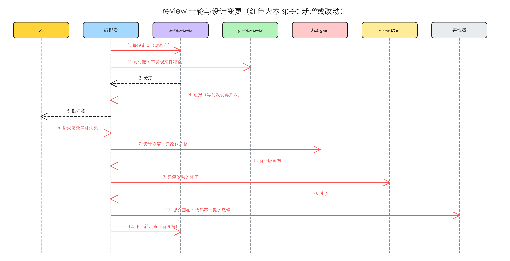
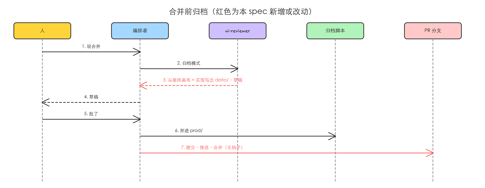
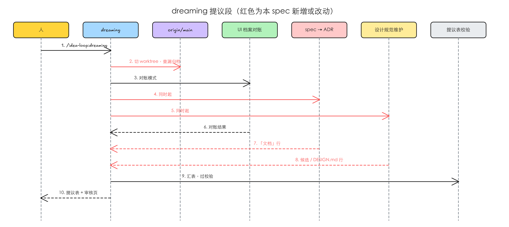

# 冻结后画布是唯一设计真相；dreaming 拆成编排者 + 专职 agent

#55 的正文是 Harold 在 #52（[[ui-state-archive]]）合并后定下的方向。其中 UI 审查那一半，在本 spec 的审核会话里被 Harold 推翻、重新定过（[[2026-10-23-design-truth-after-freeze]]）：ui-reviewer 不照实现改写档案，仍然只走查；要解决的是冻结之后设计变了，没人更新设计稿。dreaming 那一半照 #55 原样落，两条待定在同一场会话里定了。

这些是流程问题，没有界面可截，证据是对插件原文的核对（`origin/main` d3efaea，idea-loop 0.1.3，2026-10-23）。

## 验证

| issue | 结论 | 证据 |
|---|---|---|
| #55 idea-loop：UI 审查改为每轮照实现同步档案、删合并前钩子；dreaming 拆成编排者 + 专职 agent | 存在 | 冻结后没有任何一步会更新画布，人接受的 UI 偏差由编排者手改 `delta/`；合并前钩子仍注册在插件上；dreaming 仍在一个会话里自己做完几段对账。详情在「问题」。issue 标题里「每轮照实现同步档案」是原方向，已被审核会话推翻，见「问题」1 末尾 |

## 问题

### 1 冻结之后设计变了，没人更新设计稿，三份东西各说各的

**复现到的**：

- 冻结时，uiux-refine 的编排者把签字的画布 `canvas/` 和照画布抄写出来的档案差异 `delta/` 一起经设计 PR 提交进主分支。从这以后，designer（refine 起的 subagent，refine 结束它就没了）再不会被起。
- 实现期间，实现者的比对脚本逐格拿实现对画布；ui-reviewer 每轮拿 `delta/` 当清单和进入方式，画面再对画布。
- review 里 ui-reviewer 报出实现跟设计不一样，选项是「改实现」与「改档案，接受实现」。人选了接受，pr-review 写的是编排者「改 `docs/design/tmp/<spec-slug>/delta/` 里对应的文件（本地、不进 git），不提交」。画布不动；而 `delta/` 冻结时已经提交，「本地、不进 git」这句跟现状对不上。
- 合并前，ui-reviewer 的归档模式拿代码去对这份被手改过的 `delta/`，核不过就整个退回。

设计在冻结后合法地变了（人接受了实现、实现者做不下去、人改主意），三处会在同一个需求上各说各的：画布是旧的，`delta/` 被编排者改过一部分，代码是新的。下一轮 ui-reviewer 拿旧画布对，已经接受的改动会被再报一次；合并前归档要么核不过，要么把一份没有设计确认过的东西写进 `prod/`。

`delta/` 本身还是画布的抄本：每个状态的「这一屏」截图截自画布，边的定位读自画布的 DOM。冻结后同时有两份设计真相。

**本该是**：冻结后只有一份设计真相；设计变了，有一个确定的角色去改它，改完有人把关；ui-reviewer 只管拿实现对它走查，问题随 PR 反馈给实现者。

**修正**：#55 原先认为该让 ui-reviewer「以当前代码为真相源，照实现改写 `delta/`」。Harold 在审核会话里改定：「UI reviewer其实就是真实设计师来进行走查……我觉得仍然只负责review是没有问题的」；真相不是代码，是冻结的设计，「如果开发期间有设计点的改变是需要让designer知道更新在tmp画布的」。

### 2 UI 审查与代码审查是串行的

**复现到的**：pr-review「跑一轮」第 2 步先起 ui-reviewer、「等它交回发现文件的路径」，第 3 步才起 pr-reviewer。pr-reviewer 自己的两个 Codex 进程是并行的，但要等 UI 走查走完所有状态才开始。

**本该是**：ui-reviewer 跟 pr-reviewer 同时起，UI 的发现在 pr-reviewer 写汇报时并进 Spec 一节（#55 原文，未被推翻）。

### 3 合并前钩子守的是 pr-review 自己已经有的一步

**复现到的**：插件 `hooks.json` 的 Bash PreToolUse 上注册了合并前钩子：命令里有 `gh pr merge`、分支改了代码、`docs/design/tmp/<spec-slug>/` 里还有设计产物，就拦下。可归档本来就写在 pr-review 的合并步骤里；钩子只拦得住「在会话里绕过 pr-review 去合并」，拦不住网页上点合并。

**本该是**：钩子删掉，归档只是 pr-review 合并步骤里固定的一步；合并统一在 issue 会话里走 pr-review，网页上点合并这个缺口由 dreaming 兜底（Harold 原话：「靠每周 dreaming 兜底；合并统一在审核会话里做」）。

### 4 dreaming 一个会话做完所有对账，模型和思考强度钉不住

**复现到的**：dreaming 的提议段在调用它的会话里依次做知识库对账、设计档案对账、候选蒸馏、`DESIGN.md` 对账，再汇提议表。只有档案对账派了 agent（ui-reviewer 的对账模式）；知识库对账写的是「量大就派 subagent 并行」，没有点名的 agent；候选蒸馏和 `DESIGN.md` 对账由会话自己做。于是：

- 这几段跑在人当时选的模型上，没有钉在定义里（AGENTS.md：idea-loop「agent 的模型与思考强度钉在定义里」）。
- 候选蒸馏与 `DESIGN.md` 对账写同一份 `DESIGN.md`，分两段各提各的，可能对同一处提出互相打架的修改。
- 扫描范围包含 `CLAUDE.md`；项目级文档只列了 `GLOSSARY.md`，`REVIEW.md` 不在里面。

**本该是**：dreaming 只编排：派工、汇提议表、等人批、执行。每一段由一个专职 agent 做，提议段只读；对同一份文件提修改的合成一个 agent。

复现材料：`.tmp/to-spec/canvas-truth-dreaming-agents/repro/current-state.md`（上面引的原文与行号；按 0.1.1 核的，0.1.3 上这几处原文未变）

### 根因

- 问题 1：[[ui-state-archive]] 把设计档案的写入放在冻结时（`delta/`）和合并前（归档）两个时刻，中间默认设计不再变，冻结后没有设计变更这条路，于是由编排者顺手改 `delta/` 补位。
- 问题 2：UI 审查加进 pr-review 时，pr-reviewer 要读它的发现文件，就排在了它前面。
- 问题 3：合并前钩子是 [[ui-state-archive]] 为「合并时忘了归档」加的保险，归档进了合并步骤以后，它只剩下拦不住的那条路。
- 问题 4：dreaming 起初只有知识库对账，后面几段一段一段加进同一份 skill，没有回头按「谁写哪份文件」重新分工。

### 期望行为

1. 冻结后，画布 `canvas/` 是这个需求唯一的设计真相，冻结时不再写 `delta/`。人接受了一处设计变更，当前阶段的编排者起 designer 只改受影响的格子、起 ui-master 只评这几格，过了提交到 PR 分支；代码不一致的派给实现者。`delta/` 只在合并前由 ui-reviewer 从最终画布加实现整份写出。
2. ui-reviewer 每轮只走查、只报问题，跟 pr-reviewer 同时起，发现照旧并进 Spec 一节。
3. 插件上没有合并前钩子；合并在 pr-review 的合并步骤里先归档、再合并；漏归档的需求由 dreaming 发现。
4. dreaming 本身不做对账，每一段交给一个钉了模型的 agent；提议表、人批、执行仍在 dreaming。
5. dreaming 由桌面 app 的定时任务每周跑一次；截图对账只对上次成功执行以来代码改过的页面与状态做，人说「全量」才全量（PR 审核里后来加的）。

## 方案

**设计这一侧**：冻结交出去的只有签字的画布和冻结记录。之后的需求周期里，「设计长什么样」只看画布。人在实现期间或 review 里认可了一处改动，不是编排者去改某个文件，而是 designer 回来改画布那几格，评委 ui-master 看一眼，过了就进 PR 分支；实现跟不上的照常派实现者修。合并前，档案差异 `delta/` 从最终画布加实现一次写出来，人看过草稿、归档进 `prod/`。

**审查这一侧**：ui-reviewer 是设计师式的走查：每轮拿实现对画布，对不上的随 PR 汇报给人，由编排者交给实现者；它不改设计，也不判该改代码还是改设计。它跟 pr-reviewer 同时跑。

**合并**：没有钩子，归档是合并步骤里的一步；绕过 pr-review 的合并由 dreaming 的「漏归档」行接住。

**dreaming**：人调 `/idea-loop:dreaming` 得到的东西不变（一张提议表，逐行批，批过的执行成一个只改文档的 PR），变的是表怎么来：三个专职 agent 各交一段，dreaming 汇总并自己做一项漏归档的机械检查。

同类入口：

- **纳入**：uiux-refine 的冻结步骤（不再写 `delta/`）、designer（多一种任务）、implement 与 pr-review 的编排（起 designer 与 ui-master）、pr-review「接受」那条路、ui-reviewer 的每轮走查与归档模式、design-archive 讲写入时机的几处、插件 hooks 注册、dreaming 的 SKILL 与各 reference、README 里这几处的描述。
- **纳入**：没有设计稿的 UI 改动，实现者照旧在 `delta/` 记「最小差异」：那种需求没有画布，`delta/` 就是唯一的设计真相，跟这里的规则不冲突。
- **排除**：uiux-imagine 与 refine 冻结前的打磨方式不变（见 Out of scope）。

## 实现决策

### 1 冻结：只交画布和冻结记录

- uiux-refine 冻结时去掉「写 delta」一步。设计 PR 提交签字的画布、冻结记录和交互图，不再提交 `delta/`（Harold 原话：「不需要分的这么细……而不是维护多个真相源」；会话里定的是「画布是唯一真相，冻结时不再写 `delta/`」）。
- 原本冻结时写进 `delta/` 的「理由拆进对象」（决定、设计法候选）与长页面的 `sections` 结构，挪到合并前的归档模式里写（见 4）。它们的输入，冻结记录与画布，都还在。
- 冻结记录多一节「冻结后的变更」，每次设计变更记一行：日期、改了哪几格、人的原话、评委分。

### 2 设计变更：designer 改画布，ui-master 评

- **什么算设计变更**：冻结之后，人接受了一处跟画布不同的设计，来源三种：review 里人接受了实现；实现者做不下去，停下汇报里人接受了改法；人自己改主意（Harold 原话：「这些来源其实都是设计冻结定稿之后，当我接受这些改动，需要一个 designer的agent，接收反馈将改动更新到设计画布」）。
- **谁起**：当前阶段的编排者。PR 开出前是 implement 的会话（处理实现者的停下汇报时），开出后是 pr-review 的会话（处理人的批示时）。
- **designer**：复用 `idea-loop:designer` 的定义，加一种任务「设计变更」：输入是画布路径、人的原话、受影响的状态名和相关截图；只改这几格，交回新的一版画布与这几格的截图（Harold 选 A：「我也觉得选A会好一些」）。它是冻结后画布唯一的修改者（Harold 原话：「designer 就是我们refine之后的UI 画布的修改者」）。
- **ui-master**：编排者新起一个，只给改动的几格截图评分，照 refine 的「评分」用同一个评分脚本和它的停止判定；没过就把意见交回同一个 designer 再改，判定停下就交人（Harold 原话：「master则是给出UI审核的意见」）。阈值和轮数不另定，依据：refine 已有一套，评的是同一种东西。
- **过了之后**：编排者提交画布（`docs(design): <spec-slug> 设计变更 —— <一句话>`）并推送到当前分支（实现期间是集成分支，review 期间是 PR 分支），冻结记录记一行。代码跟新画布不一致的（来源不是「接受实现」的），照 pr-review「修」的那条路：给归属工单追加一格、派实现者照新画布做，比对脚本对新画布。
- **人不再单独看新画的那几格**：人接受的是改动的方向，具体样子由评委把关；实现出来后人照常在 review 里看到（会话里定的推荐，Harold：「Q1和Q2 我都同意」）。
- pr-review「接受」那条路里「改 `delta/`……本地、不进 git」一句删掉，换成上面这条。

### 3 ui-reviewer 每轮：只走查，跟 pr-reviewer 同时起

- 模式：**每轮走查**（原「每轮审查」改名不改性质：只发现、不改）、**归档**（见 4）、**对账**（不变，dreaming 用）。模型 sonnet · high 不变。
- 每轮走查的输入从 `delta/` 换成画布：要核的状态清单取冻结记录里的状态矩阵（加上「冻结后的变更」里新增的格）；进入方式取 spec 的入口与 `prod/` 里已有的边，新状态在真实应用里自己找路，找不到记「进不去」。画面比对照旧用比对脚本对画布。
- 发现照旧写 `ui-findings.json`，形状不变；`decide` 的选项从「改实现 / 改档案，接受实现」改成「改实现」与「接受实现，走设计变更」。真正的故障（控制台报错、请求失败、点了没反应、走不通）照旧是发现。ui-reviewer 不改画布、不改 `delta/`、不判该改哪边（Harold 原话：「仍然只负责review」）。
- 设计变更之后的核对就在下一轮 review 的每轮走查里做（Harold 原话：「没问题放在下一轮review」）；实现期间（PR 还没开）的变更在第一轮 review 时一起核。
- **同时起**：有设计产物时，编排者在同一条消息里起 ui-reviewer 与 pr-reviewer，pr-reviewer 拿到的仍是发现文件的路径，此时文件可能还不存在。pr-reviewer 照常起两个 Codex 进程，写汇报前等发现文件出现，记在它等 Codex 的同一个 20 分钟总预算里；到时没出现，UI 这一轴记「未完成」写进「没覆盖到的」。依据：pr-reviewer 已经用「总共 20 分钟还没结果……这一轴记为未完成」处理 Codex（现有原文）。ui-reviewer 交回 `incomplete` 时，编排者把状态写进这一轮目录，pr-reviewer 同样记未完成。

### 4 合并前归档：从最终画布加实现写出 `delta/`

- 归档模式的「核」不变：新增或改动的状态进不去又没解释、边走不通、画面对最终画布比不过、档案校验有违规，都不通过，失败条目照旧记成一次停下退回 review（Harold：「合并前归档保持现状不动」）。
- 「写」从「在冻结时写好的 `delta/` 上补齐」改成「整份写出 `delta/`」：状态文件的「这一屏」照实现拍、「应看到什么」照最终画布写、边的定位读自真实应用的 DOM；决定与设计法候选取自冻结记录（含「冻结后的变更」）与 review loop 里人的批示；长页面照 [[design-archive-sections]] 的分段脚本写 `sections`。自检照旧：档案校验与归档脚本 `--dry-run`。
- 草稿给人看、人批了跑归档脚本、提交、合并：照现在的「合并前归档」第 3 至 6 步，只删掉跟钩子有关的句子。
- **已按旧流程冻结、`delta/` 已经提交的需求**：归档模式把现有 `delta/` 当草稿接着改，不要求重来。依据：「默认改动最小」（decision-rules 自己定的第 4 条）。

### 5 删掉合并前钩子

删钩子脚本、它的单测与 `hooks.json` 里 PreToolUse 下的这一项；PreToolUse 下的 SEO 检查钩子和三个写文件之后的钩子都不动。pr-review、design-archive、README 里以钩子为前提的句子改成「归档是 pr-review 合并步骤的一步」，写明已知缺口（Harold 原话：「网页上点合并或在别的会话合并会绕过归档，靠每周 dreaming 兜底；合并统一在审核会话里做」）。

### 6 dreaming：编排者 + 三个专职 agent

dreaming 只做：起环境（从 `origin/<基准分支>` 切 worktree）、派工、汇提议表并过校验脚本、做审核页、等人批、执行段。提议段里每个 agent 只读，只写自己那段的中间物（Harold 原话：「dreaming 只做编排：汇提议表、等人批、执行。各 agent 在提议段只读」）。三个 agent 互不依赖，同一条消息里并行起。

| agent | 做什么 | 交回 | 模型 | 依据 |
|---|---|---|---|---|
| UI 档案对账 | 不新建，复用 ui-reviewer 的对账模式；源码波（不开浏览器的那一半：代码路径、引用、路由对照）也并进对账模式；`prod/` 为空时的全站初扫留在 dreaming 现有写法里 | 现在的对账结果文件，加源码波的「档案对象」行 | sonnet · high | Harold 原话「复用 ui-reviewer 对账模式，sonnet · high」；源码波归它，PR 审核第 1 轮 S3 定（「我倾向于选择B」，2026-10-23，后来改的） |
| spec → ADR | 原「知识库对账」：判 spec 上线没有、起草 ADR、标被取代的旧 ADR 小节、找出已合并却还留着的工单；次要检查：`docs/domain/`、参考手册、`GLOSSARY.md`、`REVIEW.md` 的过期 | 提议表「文档」一节的行 | sonnet · high | Harold 原话「知识库对账与 ADR 起草合成一个……sonnet · high」；次要检查归它，审核会话里定（「同意」） |
| 设计规范维护 | 候选蒸馏 + `DESIGN.md` 对账 + token；对 `DESIGN.md` 的一切修改出自它，量 token 的机械活可在内部再派 sonnet | 「候选」「DESIGN.md 条目」两节的行 | opus · high | Harold 原话「合成一个，避免对同一份文件提互相打架的修改」；模型审核会话里定（「同意」） |

- **漏归档**（dreaming 自己做，不起 agent）：`origin/<基准分支>` 上 `docs/design/tmp/<spec-slug>/` 里还有设计产物（`research/` 之外），而这份 spec 已是「完成」、或已经没有 spec 目录，就是绕过合并步骤合进去的需求。提议表多一类行 `漏归档`，处置闭集「补归档 · 丢弃」：补归档是在 dreaming 的 worktree 里对它跑一次 ui-reviewer 归档模式、人看草稿、归档脚本并进 `prod/`，跟执行段的其余改动同一个 PR；丢弃是删掉 `tmp/<spec-slug>/`。依据：Harold 原话「靠每周 dreaming 兜底」；提议表「闭集里找不到合适的……先补闭集和校验脚本的单测」（现有原文）。
- **项目级文档**：`GLOSSARY.md` 与 `REVIEW.md` 纳入；`CLAUDE.md` 与 `AGENTS.md` 从扫描范围里拿掉（Harold 原话：「CLAUDE.md / AGENTS.md 不动（Harold 还没想清楚里面该放什么）」）。
- 「只跑一部分」「单条蒸馏」照旧：只起对应的那个 agent；单条蒸馏交给设计规范维护 agent。
- 执行段不拆：人批过的行仍由 dreaming 照提议表执行，写 `DESIGN.md` 的措辞仍然要人确认才落笔。

### 7 dreaming 定时跑，截图对账做增量

PR 审核第 1 轮之后加的（讨论记录：[[2026-10-23-design-truth-after-freeze]] 的「PR 审核里加的增量对账」一节；Harold：「增量对账并进这个 PR」）。

- **定时**：`/idea-loop:setup` 照 seo-setup 建 seo-scan 定时任务的写法，问人后在 Claude 桌面 app 里建一个每周的定时任务，prompt 是 `/idea-loop:dreaming`；不在桌面 app 里就把 prompt 交给人自建。dreaming 仍是 `disable-model-invocation`，只由人或定时任务触发（Harold：「Q1 同意」）。
- **基准点**：取 dreaming 定时任务最近一次状态为 succeeded 的执行，用它的开始时间找 `origin/<基准分支>` 在那一刻的提交，从它到现在改过的文件就是这次的增量。没有定时任务、或没有一次成功的执行：全量。人手敲的那次用同一个基准，不推进基准。已知缺口：上次执行「成功」但截图那一波没跑成，基准照样前推；没跑成的批写在提议表末尾，人看到了下次说「全量」（Harold：「Q2 同意」）。
- **挑哪些状态**：改过的文件是某个页面登记的代码，这一页的状态都挑；是某个组件登记的代码，用到它的状态都挑（反查）；被这些页面或组件的代码直接 import 的数据、静态资源、样式改了，也算它们改了。只对挑中的状态跑实时波（Harold：「Q2同意」）。组件只作为页面区域出现的（如每页顶部的导航栏），它改了，摆着它的页面的全部状态都挑；「直接 import」只认相对路径，别名与第三方包不跟，是已知限制，靠人说「全量」补（Harold：「区域组件按 A，别名 import 接受成已知限制」，2026-10-26，实现后加）。这条选法做成档案查询的一种问法，给一个提交，交回受影响的状态清单，可单测。
- **全量**：只在人调用时明确说「全量」，或没有基准点时（Harold：「Q3 人明确说全量」）。全量还是增量、为什么、对了几个状态，写在提议表开头一行。
- **源码波每次全量**：不开浏览器，只读文件，抓的正是删了、改名了这类变化（Harold：「Q4 同意」）。
- **上一张提议表还没批又到点**：照跑，新提议表开头写一行「上一次（日期）的提议表还没处理」，两张表不合并（Harold：「Q3 同意」）。

## 技术方案总览

### 后端

这里的「后端」是 PR 流程与 dreaming 里的几个角色：人、编排者（调 implement、pr-review 或 dreaming 的会话）、各个 agent、脚本。红色是本 spec 新增或改动的消息，虚线是往回的消息。

- ui-reviewer 与 pr-reviewer 同时起，ui-reviewer 对画布走查（实现决策 3）。
- 人接受了一处设计变更：designer 改画布那几格、ui-master 评、编排者提交并派实现者，下一轮 ui-reviewer 再核（实现决策 2）。PR 开出前，同一段由 implement 的会话发起，图略。

- ui-reviewer 归档模式从最终画布加实现写出 `delta/`、人批草稿、归档脚本、合并，没有钩子（实现决策 4、5）。

- dreaming 先机械地查漏归档，再并行起三个 agent，收齐后汇表、过校验（实现决策 6）。执行段不变，图里略去。

接口变化：

- ui-reviewer 的模式取值：每轮审查 → 每轮走查（性质不变）、归档、对账；每轮走查的输入从 `delta/` 换成画布与冻结记录；发现的 `decide` 选项改名。
- designer 多一种任务「设计变更」。
- 冻结记录多一节「冻结后的变更」；设计 PR 不再含 `delta/`。
- 提议表多一类行 `漏归档`；新增两个 agent 定义（spec → ADR、设计规范维护）。
- 插件不再注册合并前钩子。

### 前端内部

不涉及。

### 前端交互

不涉及：改的是插件的 skill、agent 与脚本，没有目标产品的界面。

## 测试决策

| 变的是什么 | 仪器 | 本次 |
|---|---|---|
| 纯逻辑、数据转换、状态机 | TDD 单元测试 | 碰到：提议表校验脚本认 `漏归档` 行与它的处置闭集；档案查询新增「给一个提交，交回受影响的状态」的问法（页面代码、组件代码、直接 import 三条）；删钩子后 hooks 注册的断言改成「PreToolUse 只剩 SEO 检查，写文件之后的钩子都在」。照各脚本旁边现有的单测写 |
| API 契约（路由、schema、序列化） | TDD API 测试 | 不涉及 |
| DB schema、迁移、并发与事务语义 | 真 DB 测试 | 不涉及 |
| LLM 输出质量（prompt 改动） | eval（确定性断言） | 不涉及：改的是 skill 与 agent 的说明文字；`idea-loop/evals/` 只钉了 uiux-research |
| 视觉正确性 | UI 实现环 | 不涉及：比对脚本本身不改 |
| 端到端用户流程 | 浏览器端到端测试 | 不涉及浏览器；端到端用一次真实跑通代替，见下 |

- **seam**：
  - 提议表校验脚本的命令行入口：抓得到行类型与处置闭集写错；抓不到 dreaming 有没有真去查漏归档。
  - 档案校验与归档脚本的 `--dry-run`（已有）：合并前归档整份写出的 `delta/` 的准出条件，抓得到结构与引用不对；抓不到 `delta/` 写的是不是最终的样子，那靠人看草稿。
- **增量功能测试**：
  - 漏归档行：前置——提议表里一行 `漏归档`，处置「补归档」；期望——校验通过。处置写「归档」（不在闭集）；期望——校验拒绝并说出闭集。覆盖期望行为 3。
  - 钩子已删：前置——插件的 hooks 注册；期望——PreToolUse 下没有合并前钩子、SEO 检查还在，写文件之后的钩子都在；合并前钩子的单测文件不存在。覆盖期望行为 3。
  - 真实跑一个碰 UI 的需求（Toeflair 的下一个）：冻结后设计 PR 里没有 `delta/`；实现期间人在停下汇报里接受一处改法，期望——implement 的会话起 designer 改画布那几格、起 ui-master 评，过了提交、冻结记录多一行；review 第 1 轮 ui-reviewer 与 pr-reviewer 同时起，ui-reviewer 对的是新画布，不再把这处报成不一致；人再接受一处实现，期望——pr-review 的会话照同样的路改画布，第 2 轮核过；人说合并，期望——归档模式整份写出 `delta/`、过校验与 dry-run、草稿给人看，归档、合并，中间没有钩子拦。覆盖期望行为 1、2、3。
  - 真实跑一次 dreaming：在一个 `origin/main` 上留着已完成需求的 `tmp/` 的仓库上跑提议段。期望——三个 agent 并行、各交一段；表里有一行漏归档；扫描范围里没有 `CLAUDE.md` / `AGENTS.md`，有 `GLOSSARY.md` 与 `REVIEW.md`。覆盖期望行为 3、4。
- **prompt / eval 变动**：改 uiux-refine 的冻结 reference、designer、implement、pr-review（SKILL 与合并 reference）、pr-reviewer、ui-reviewer、design-archive 讲写入时机的几处、dreaming（SKILL 与各 reference）、README；新增两个 agent 定义。无 eval 变动（理由见上表）。
- **照着谁写**：提议表校验脚本现有的单测；钩子注册的断言现在在合并前钩子的单测里，删文件时把「其余钩子都在」的断言挪到 SEO 检查或写文件之后某个钩子的单测里。

## Out of scope

- uiux-imagine 与 refine 冻结前的打磨方式（评委、动效、减法、签字）不变；只是冻结的产物里不再有 `delta/`。
- 没有设计稿的 UI 改动：实现者照旧记「最小差异」到 `delta/`。
- 让网页上点合并、在别的会话里合并也走归档：已知缺口，由 dreaming 的漏归档兜底（Harold 已定）。
- `CLAUDE.md` / `AGENTS.md` 该放什么、要不要对账：Harold 还没想清楚，这次只把它们从 dreaming 的扫描里拿掉。
- ui-reviewer 对账模式实时波的判法、全站初扫的写法：不改（对账模式多接一段源码波，见实现决策 6，PR 审核第 1 轮 S3 后来改的）。

## 关联

- 讨论记录：[[2026-10-23-design-truth-after-freeze]]
- 覆盖：#55 idea-loop：UI 审查改为每轮照实现同步档案、删合并前钩子；dreaming 拆成编排者 + 专职 agent
- 上游：[[ui-state-archive]]（定下了冻结时写 `delta/`、合并前归档与合并前钩子，本 spec 改掉前一个与最后一个）、[[design-archive-sections]]（长页面的分段写法；本 spec 把冻结时写 `sections` 挪到合并前归档里写，分段脚本本身不改）、[[dreaming-design-reconcile]]（档案对账、候选蒸馏、`DESIGN.md` 对账的现有写法，本 spec 只改它们由谁跑）。三份都还是「实现中」。
- 相邻还没完成的 issue：
  - #77 uiux-imagine / uiux-refine 在 worktree 会话里把设计产出写进主 checkout：都碰 refine 的冻结步骤，它改写到哪、本 spec 改写什么，不冲突；后合的照先合的路径写。
  - #61、#64、#65、#68、#69（设计档案的分段与取证）：改的是怎么拍、怎么比、怎么写 `sections`，合并前归档沿用它们的结果，无先后依赖。
  - #86（issue 会话之间的在飞工作）、#80（decision-rules 只管谁来定）：不改设计流程与 dreaming 的分工，无重叠。
  - #51 已经落成独立的 retro skill（[[retro]]），不改 dreaming，无重叠。
- 相邻还没完成的 spec：[[design-research-agent]]、[[design-md-write-entry]]、[[uiux-imagine-agent]]、[[pr-review-report-followups]]、[[idea-loop-seo]]、[[confirm-only-on-loss]]，不改冻结产物、UI 审查时机与 dreaming 的分工，无重叠。
