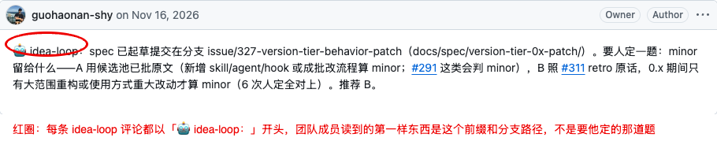
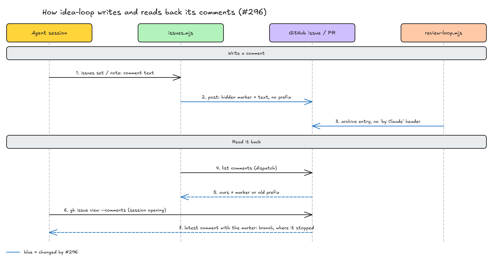

# idea-loop 发的评论不再带机器开头

> #296 存在：idea-loop 往 GitHub 发的评论，第一样东西是「🤖 idea-loop：」或「由 Claude 代发」，团队成员要读过它和分支路径才看到要他做什么；2026-11-14 至 11-18 本仓库最近 100 条评论里 65 条带前者、34 条带后者。详情在「问题陈述」

## 问题陈述

### 1. 评论开头是机器标识，不是要读的人做什么

[#327 的这条评论](https://github.com/guohaonan-shy/harold-skills/issues/327#issuecomment-6921267439)（2026-11-16）是要 Harold 定一道题，但读到的顺序是：「🤖 idea-loop：」、分支名、spec 路径，然后才是「要人定一题」。Harold 在 #296 的 triage 会话里说：「开头的那句🤖idea-loop就不需要了，你这个会话给我看可以，加入给团队其他成员看感觉还是差点意思。」

规模（2026-11-18 查 GitHub 上 harold-skills 最近 100 条 issue / PR 评论，最早一条 2026-11-14）：65 条以「🤖 idea-loop：」开头（`issues.mjs` 发的），34 条以「🤖 由 Claude 代发（仓库未配置 GitHub App……不是本人所写）」开头（`review-loop.mjs` 在合并时贴的 review 归档）。

评论正文该怎么写（第一句写结论和要他做什么、只放他用得上的、发出后变了另发新的），这次定为 Harold 个人的规矩，已写进 `~/home/AGENTS.md` 的「以我的身份对别人说话」（home 仓库提交 949bea0）；人定了 idea-loop 不放表达方式的内容（「idea-loop我倾向于就不要表达方式的内容了」）。这份 spec 只管插件里挡在这条规矩前面的机械部分。

### 根因

- 前缀由脚本写死：`issues.mjs` 每条评论前拼上「🤖 idea-loop：」（`issues set --comment`、`issues note`、迁移时补的评论三处），而且脚本靠这个前缀认出 idea-loop 自己的评论：调度判断一个 backlog issue 是否「还要你补」时，只认带前缀、含「还要你补」的那条。
- issue 会话开场、起草 spec 时，skill 里写的是「读最近一条『🤖 idea-loop：』开头的评论」，靠它知道上次停在哪、分支叫什么。
- `review-loop.mjs` 在没配 GitHub App 时给每条归档评论加「由 Claude 代发」一行，出自「不以人的身份说话」（根目录 `AGENTS.md` idea-loop 刻意例外第 2 条）。人这次推翻了它：「我倾向于不署名」。

## 方案

改完以后，团队成员在 GitHub 上打开 idea-loop 发的评论，第一行就是正文（结论、要他做什么），看不到任何机器开头或署名；idea-loop 自己仍然认得出哪些评论是它发的。

1. **写**：`issues.mjs` 发的每条评论，正文前面不再拼「🤖 idea-loop：」，改成在开头放一个 GitHub 不显示的 HTML 注释标记 `<!-- idea-loop -->`。传进来的文字已经以旧前缀开头的（老习惯写法），先去掉旧前缀再加标记；已经带标记的不重复加。
2. **归档**：`review-loop.mjs` 贴 review 归档评论时，不论有没有配 GitHub App，都不再加「由 Claude 代发」一行。配了 App 的照旧由 bot 账号发；没配的用 gh 当前登录的账号发，正文不带署名。归档评论开头已有的隐藏标记 `<!-- idea-loop-archive … -->` 不动。
3. **认**：脚本认 idea-loop 的评论，改成「含 `<!-- idea-loop -->` 标记，或以旧前缀开头」。旧前缀照认，是因为已经发出去的评论不改：本仓库开着的 issue 上，分拣贴的「还要你补」评论都是旧前缀。
4. **读**：skill 里写「最近一条『🤖 idea-loop：』开头的评论」的地方，改成「最近一条带 `<!-- idea-loop -->` 标记（或旧的『🤖 idea-loop：』开头）的评论」。agent 用 `gh issue view --comments` 读到的是原始 markdown，标记看得见。

同一行为的其他入口：

| 入口 | 纳入还是排除 |
|---|---|
| `issues set --comment`（翻状态带的评论，含 done / canceled 关闭时带的） | 纳入 |
| `issues note`（分拣员贴证据评论、P0 没复现到的评论） | 纳入 |
| `issues migrate` 补的评论 | 纳入 |
| `review-loop.mjs archive`（合并时贴 PR 归档评论） | 纳入 |
| Linear 上的评论（agent 直接用 MCP 的 `save_comment` 发） | 纳入，但只去掉前缀、不加标记：Linear 没有脚本读评论（`issues set` 在 Linear 上被拒），agent 读最近几条评论的内容就能接上；Linear 会不会把 `<!-- -->` 原样显示出来也没验证过，不加最稳 |
| PR 描述（`pr-body.mjs`） | 排除：它从来没有这个前缀，按节重写的做法本来就符合「当前状态直接改成最新」 |
| setup 给目标项目生成的 `ISSUE_TRACKER.md` 里的评论命令模板 | 排除：模板里本来没有前缀 |
| 已经发出去的评论 | 排除：不回头改，读的时候照认旧前缀 |

## User Stories

只改掉一个问题、不加能力，每个问题一行期望行为：

1. 期望行为：idea-loop 在 GitHub issue 和 PR 上发的评论，渲染出来的第一行就是正文；页面上看不到「🤖 idea-loop：」「由 Claude 代发」这类开头或署名。调度判「还要你补」、issue 会话找上次停在哪，对新标记和旧前缀的评论都照常工作。

## 实现决策

- **标记的写法**：`<!-- idea-loop -->`，放在正文最前面、单独一行。依据：GitHub 渲染 markdown 时不显示 HTML 注释；本插件的 PR 归档评论已经用 `<!-- idea-loop-archive {…} -->` 做同样的事。标记字符串定义在 `issues.mjs` 一处，替换原来的前缀常量，别的脚本和测试从那里引。
- **认评论的判断**：一个函数判断「是不是 idea-loop 发的」：含标记，或以旧前缀开头。「还要你补」的判断改用它。
- **旧前缀的去留**：发的时候不再写；认的时候一直认，不设截止日期。依据：已发的评论不改（人定「旧的评论不用管」）。
- **`noteIssue` 遇到带旧前缀的文字**：去掉旧前缀再加标记，保证新发的评论不再出现前缀；分拣员 agent 的定义同时改掉「脚本加『🤖 idea-loop：』前缀」的说法。
- **不署名**：`review-loop.mjs` 不再加「由 Claude 代发」那行，`withAuthorship` 这个分支删掉。根目录 `AGENTS.md` idea-loop 刻意例外第 2 条改成：「唯一在目标仓库 PR 上发言：只在合并时贴归档评论；配了 GitHub App 由 bot 账号发，没配就用 gh 当前账号发，不加署名（人 2026-11-18 在 #296 定）。」`implement`、`pr-review` 里「PR 上不以人的身份发言」改成「PR 上不和人往来」：它们原本要说的是不在 PR 上开 thread、不替人答题，这层意思保留。
- **要改的说明文字**（引用旧前缀的地方，全部改成认标记的说法）：`issue-session` 的开场「认领」和 triage 会话「起草」两处、它的 `draft-spec.md` 引用、`issues` 的实体表和命令表、`issues` 的 GitHub 与 Linear 两份平台说明、`pr` 的 `review-loop.md`（归档评论以谁的身份发那一段）、`issue-triager` agent 定义、`setup` 问题清单里「GitHub App 代发评论」的叫法（改成「GitHub App 发评论」）。
- **只改一个仓库**：harold-skills。
- **版本**：改了 idea-loop 的脚本行为和 skill 文字，升版本的档位照根目录 `REVIEW.md`「额外要求」在 review 时定。

## 测试决策

| 变的是什么 | 仪器 | 本次 |
|---|---|---|
| 纯逻辑、数据转换、状态机 | TDD 单元测试 | 涉及：`issues.mjs` 发评论的拼法、认评论的判断；`review-loop.mjs` 的归档正文 |
| API 契约（路由、schema、序列化） | TDD API 测试 | 不涉及 |
| DB schema、迁移、并发与事务语义 | 真 DB 测试 | 不涉及 |
| LLM 输出质量（prompt 改动） | eval（确定性断言） | 不涉及：skill 文字只换了认评论的说法，不改 agent 产出的内容 |
| 视觉正确性 | UI 实现环 | 不涉及 |
| 端到端用户流程 | 浏览器端到端测试 | 不涉及 |

- **seam**：沿用两个已有的。`issues.mjs` 导出的函数加注入的假 `gh`（`issues.test.mjs` 现在就这样记下发出的评论正文），能抓到发出的正文长什么样、调度认不认得出「还要你补」，漏掉 GitHub 实际怎么渲染；`review-loop.mjs` 导出的 `archiveBody`（`review-loop.test.mjs`），能抓到归档正文有没有署名，漏掉真贴到 PR 上的样子。
- **增量功能测试**：
  - 前置：假 `gh`。步骤：`issues set` 带评论翻 todo、`issues note` 贴一条、`issues note` 贴一条以旧前缀开头的文字。期望：三条正文都以标记开头，都不含「🤖 idea-loop：」，标记只出现一次。覆盖：期望行为 1。
  - 前置：两个 backlog issue，最新评论分别是带标记、含「还要你补」的，和以旧前缀开头、含「还要你补」的。步骤：取 backlog 候选。期望：两个都被认成「还要你补」，都跳过。覆盖：期望行为 1。
  - 前置：一个归档条目，身份分别是 App 和 gh 当前账号。步骤：生成归档正文。期望：两种身份的正文都不含「由 Claude 代发」。覆盖：期望行为 1。
  - 前置：合并后、实现会话发出第一条评论之后。步骤：在 GitHub 上打开那条评论。期望：渲染出来第一行是正文。覆盖：期望行为 1。这条由人在合并后看一眼，不写成测试。
- **照着谁写**：`issues.test.mjs` 里现有的「合并的 PR」「先放着」「还要你补」几条用例（它们现在断言旧前缀，改成断言标记），`review-loop.test.mjs` 里断言「由 Claude 代发」的那条（反过来断言没有）。

## Out of scope

- 评论正文怎么写（第一句、长度、发出后变了怎么办）：已写进 `~/home/AGENTS.md`，人定了不进插件。
- 已经发出去的评论：不改。
- ADR 里提到旧前缀的历史描述：留给 `/idea-loop:dreaming` 对账时处理。

## 关联

- raw：[[2026-11-18-comment-writing-grill]]
- 相邻、还没完成的：#252（home，`~/home/AGENTS.md` 所在仓库的建法，开在 release/idea-loop-0.2.0 上）跟这份不重叠，本 spec 只用了它建好的 home；#334（idea-loop 支持父子 issue）会碰 `issues.mjs`，但不碰评论前缀，谁先合都不冲突，后合的在 `issues.mjs` 上解一次文本冲突即可。#216（交付物和 evidence 之间缺一层「交给人决策」）讲的是写给人看的东西怎么组织，跟这份的机械改动不重叠；它要是往插件里加表达方式的规则，要先对上人这次定的「idea-loop 不放表达方式」。别的开着的 spec 与 issue 查过（2026-11-18，`gh issue list --state open --search "评论"` 共 21 个），没有重叠。
