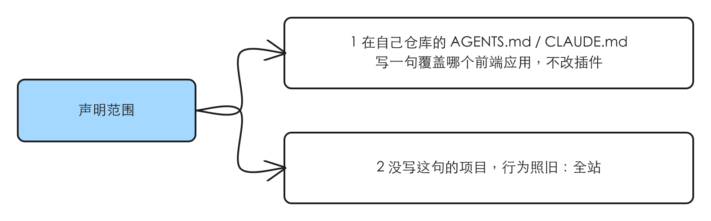
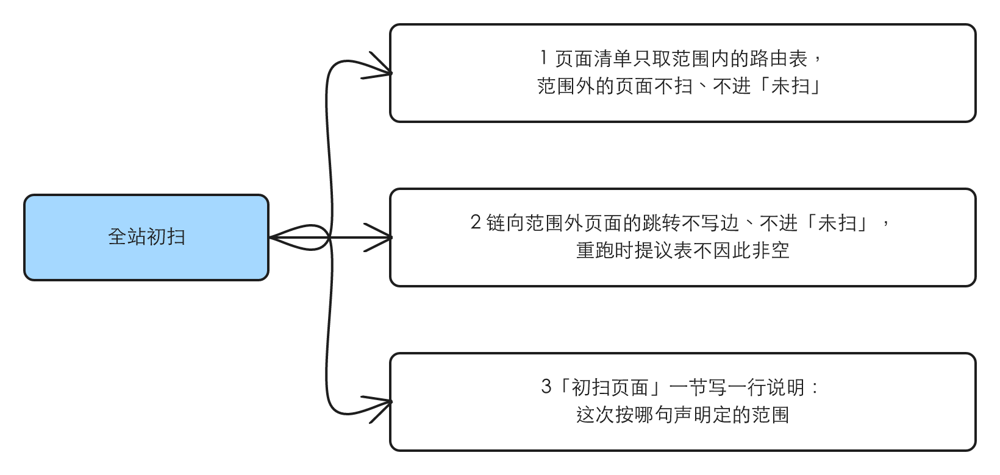
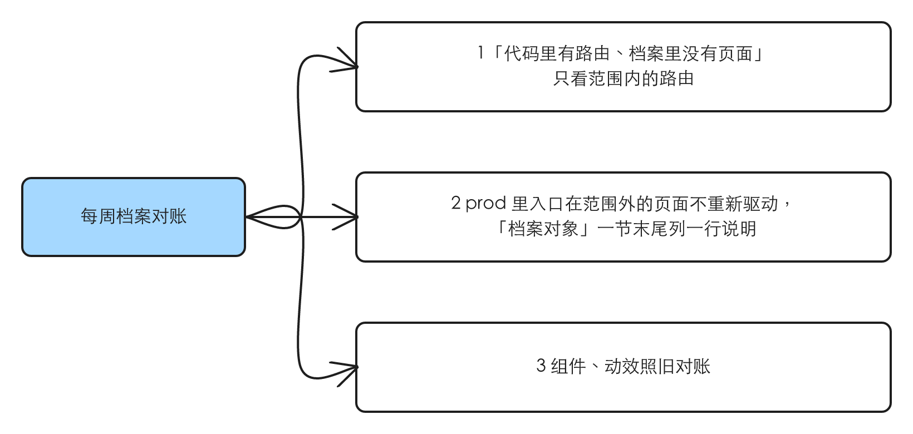

# 设计档案的初扫与对账只覆盖项目声明的范围

## 1 问题

现状核于 2026-10-21，对象是 main（idea-loop 0.0.28）与 TOFEL-demo main（`d649bbb2`）。这是「缺一个能力」，没有界面可截，证据是对现状的核对。

### 1.1 dreaming 的设计档案一步没法只扫项目的一部分

**复现到的**：`dreaming` 设计档案那一步有四处决定「哪些页面被扫、被重新驱动」，都按全站来，没有任何一处读项目对范围的说法：

| 入口 | 现在怎么做 |
|---|---|
| 全站初扫列页面清单 | 从路由表列出全部页面（读路由文件，或 `AGENTS.md` 指的位置） |
| 全站初扫的跨页边 | A 页链到没扫的 B 页：边先不写，记进 `未扫`，等下次扫到 B 再补 |
| 档案对账·源码波 | 「代码里有路由、档案里没有对应页面」→ 当场按初扫扫那一页 |
| 档案对账·实时波 | 对 `prod/` 里**每个**状态交给 UI 审查者重新驱动 |

一个项目同时有 app 和营销站时，营销页一定会被扫进来。设计档案分段那条线（PR guohaonan-shy/harold-skills#63）在 TOFEL-demo 营销站上试跑了五轮：按结构推的切线、漏段都修得稳，但营销页上会动的东西（脚本驱动的首屏演示、轮播、进场计数、滚动驱动段）每轮都冒出新的不稳定来源（issue #64、#65），一次初扫或一次对账大半时间花在拍不稳的营销页上。Harold 2026-10-21 决定：「dreaming 的设计档案重跑先只用在 app 部分，营销部分以后另开会话单独处理」。

TOFEL-demo 的规模：营销页（Astro 站，由 nginx 直接出）有首页、价目页、四个题型介绍页、博客，各带中文版；app 的 SPA 路由表里约 30 条路由。`prod/` 还不存在，下次 dreaming 跑的就是全站初扫。

**本该是**：项目说一句「设计档案只覆盖哪部分」，dreaming 的四个入口都照它；没说的项目照旧全站。

### 1.2 根因

`dreaming-design-reconcile` 落地时假设「一个项目 = 一张路由表 = 一个要建档的界面」，没有考虑同一个仓库里有两个形态差别很大的前端（一个是要每周对账的产品界面，一个是动效重、内容常换的营销站）。

## 2 方案

**交付物**：dreaming 的设计档案一步（全站初扫、每周档案对账）只碰目标仓库声明在范围内的页面；范围由目标仓库自己在 `AGENTS.md` / `CLAUDE.md` 里一句话声明，插件只读。没有这句话的项目，行为跟现在一字不差。

声明长这样（目标仓库自己写，措辞自由，要说清两件事：哪张路由表，以及要排除的路由——没有要排除的可以不写）：

> 设计档案（idea-loop 的 dreaming 初扫与对账）只覆盖 `<前端应用目录>` 的路由表（`<路由表所在>`），不含 `<要排除的路由或应用>`。

范围内外怎么判：一个页面在范围内，当且仅当它的地址能对上声明里那张路由表、且不在排除之列（`:param` 当通配）——就是对账源码波现在对「入口地址在不在路由里」用的那个匹配，换成只对声明的那张表。

**范围（同一行为的其他入口）**：

| 入口 | 纳入 / 排除 |
|---|---|
| 全站初扫列页面清单 | 纳入 |
| 全站初扫的跨页边 | 纳入 |
| 档案对账·源码波 | 纳入 |
| 档案对账·实时波 | 纳入 |
| dreaming 的候选蒸馏、`DESIGN.md` 对账、知识库对账 | 排除：它们不重新驱动页面、不拍图，跟营销页拍不稳无关 |
| `pr-review` 起 UI 审查者做的每轮审查与合并前归档 | 排除：那是某个需求自己改到的页面，需求碰了营销页就该审它；Harold 的决定只说 dreaming 的重跑 |

## 3 User Stories

### 声明范围

1. 作为项目负责人，我在自己仓库的 `AGENTS.md` / `CLAUDE.md` 写一句设计档案覆盖哪个前端应用（路由表在哪、排除哪些路由），dreaming 就只在这个范围里建档和对账，不用改插件。
2. 作为没写这句的项目的负责人，dreaming 的行为和现在一样：全站。

### 全站初扫

1. 作为项目负责人，初扫的页面清单只取声明范围内的路由；范围外的页面不扫，也不进 `未扫`。
2. 作为项目负责人，范围内页面链向范围外页面的跳转不写边，也不记进 `未扫`，所以重跑时提议表不会因为它们永远消不掉。
3. 作为批提议表的人，`初扫页面` 一节有一行说明写着这次按哪句声明定的范围，我能核对它没漏掉、没多扫。

### 每周档案对账

1. 作为项目负责人，源码波的「代码里有路由、档案里没有对应页面」只看范围内的路由，不会每周提议补扫营销页。
2. 作为项目负责人，`prod/` 里已经有、但入口在范围外的页面（比如某个需求经 `pr-review` 归档进来的营销页），每周不重新驱动、不判过期，在 `档案对象` 一节末尾列一行说明，我知道它们这次没对账。
3. 作为项目负责人，组件、动效照旧对账：它们是否还被引用、代码路径在不在，跟页面范围无关。

## 4 实现决策

### 4.1 声明放在目标仓库的 `AGENTS.md` / `CLAUDE.md`

**已定**。依据：

- 路由表的位置本来就从这里读（初扫与源码波现在的原文：「读项目的路由文件，或 `AGENTS.md` 指的位置」），worktree 准备命令也是同一种「插件读目标仓库的声明」（`worktree.md` §2）。范围跟「哪张路由表」是同一件事的两半，放在一起。
- 不放 `prod/index.md` 的 frontmatter：全站初扫正是 `prod/` 为空的时候，`index.md` 还不存在（归档脚本首次归档时才生成，主视口 / 主题 / 语言三个键也是首次归档之后才补）。放在那里，最需要它的那一次读不到。
- 不做成机器可读的键、不加脚本：dreaming 本身由模型按 reference 执行，范围判定（地址对路由表）就是源码波现有的那一步；校验脚本、归档脚本、查询入口都不需要知道范围（默认改动最小，decision-rules §1 第 4 条）。

### 4.2 没有声明，行为照旧

**已定**：dreaming 读不到声明，就按全站，四个入口的文字不变。依据：任务原话「没有声明时行为照旧」。

### 4.3 四个入口各自怎么照范围

**已定**，依据是 Harold 的原话「dreaming 的设计档案重跑先只用在 app 部分」——四个入口都是「重跑」的一部分：

1. **初扫列页面清单**：只列范围内的路由。范围外的不列、不进 `未扫`。
2. **初扫的跨页边**：`to` 指向范围外页面的边，不写，也不记进 `未扫`（它永远不会被扫，记进去只会让 `未扫` 每次都在）。这一屏「应看到什么」照常写看得见的链接，不受影响。
3. **源码波的补扫**：「代码里有路由、档案里没有对应页面」只对范围内的路由比。「页面的入口地址在路由里已经不存在」只查范围内的页面。
4. **实时波**：派给 UI 审查者的状态 id 只取范围内页面的状态。范围外页面不派、不判，源码波也不查它挂的代码路径。

### 4.4 提议表里留一行说明，让人核对范围

**已定**：声明在、且这次因为它少扫了东西时，在对应一节末尾写一行说明（说明行不算「行」，不让表变成非空，proposal-table §1 现有规则，校验脚本已经放行任意说明行）：

- `初扫页面` 一节：`范围：按 <AGENTS.md 或 CLAUDE.md> 的声明，只扫 <路由表>，不含 <排除>`。
- `档案对象` 一节：`范围外、这次没对账：pages/<页面>, …`——只在 `prod/` 里真有范围外页面时写。

依据：dreaming 的判定「必须可证伪」，少扫了什么要让批表的人看得见；说明行是现有形状，`未扫：…` 就是先例。

### 4.5 组件、动效不分范围

**已定**：组件、动效不属于某个页面，源码波照旧查它们的代码路径与是否被引用（`query refs` 也照旧算上范围外页面对它们的引用——范围外的页面还在档案里，删一个它在用的组件照样会让档案坏掉）。依据：默认改动最小；它们的对账不开浏览器，跟拍不稳无关。

### 4.6 改哪些说明文字

`dreaming` 的 SKILL.md 流程第 3 步提一句范围；`initial-scan.md` 第 1 节（列页面清单、跨页边）与第 3 节（说明行）；`archive-reconcile.md` 第 2 节（源码波两行）、第 3 节（派工只取范围内）、第 4 节末（说明行）；`design-archive.md` 不改（档案的结构与「进不去」写法跟范围无关）。插件 README 的 dreaming 一段同步一句，版本 0.0.28 → 0.0.29。

## 5 技术方案总览

### 5.1 后端

不涉及。

### 5.2 前端内部

不涉及。

### 5.3 前端交互

不涉及。

## 6 测试决策

| 变的是什么 | 仪器 | 本次 |
|---|---|---|
| 纯逻辑 / 数据转换 | TDD 单元 | 不涉及：没有脚本改动 |
| API 契约 | TDD API 测试 | 不涉及 |
| DB schema / 迁移 | 真 DB 测试 | 不涉及 |
| LLM 输出质量（prompt 改动） | eval | 不涉及：本仓库对 skill 文字不跑 eval（CLAUDE.md §5） |
| 视觉正确性 | UI 实现环 | 不涉及 |
| 端到端用户流程 | 浏览器测试 | 不涉及 |

- **seam**：插件现有的测试套件（`node --test idea-loop/scripts/`）——尤其「不泄漏项目名」的绊线测试，确认新加的文字和例子里没有项目名。没有新 seam。
- **增量功能测试**（人工验收，落在目标仓库上）：

| 前置 | 步骤 | 期望 | 覆盖 |
|---|---|---|---|
| TOFEL-demo 根 `AGENTS.md` 有范围声明：只覆盖 SPA 的路由表 | 照新的初扫第 1 节，从声明的路由表列一次页面清单 | 清单里没有首页、价目页、四个题型介绍页、博客这些营销页；有登录、注册、练习列表、做题、报告等 app 页面 | 声明范围 1；全站初扫 1 |
| 同上 | 看清单里每一页链向的地址 | 链向营销页的跳转没有出现在「待写的边」或 `未扫` 里 | 全站初扫 2 |
| 同上 | 按 `initial-scan.md` 第 3 节写 `初扫页面` 节末的说明行，过 `proposal-table-check` | 有一行 `范围：…`，校验通过 | 全站初扫 3 |
| 一个没有声明的仓库（插件自己的设计档案测试夹具） | 读改后的 `initial-scan.md` 第 1 节 | 文字明确「没有声明照旧全站」 | 声明范围 2 |

- **prompt / eval 变动**：无 prompt/eval 变动。
- 先例：`worktree.md` §2「先读目标仓库的 `CLAUDE.md` / `AGENTS.md`，找 … 有 / 没有」的写法。

## 7 Out of scope

- `pr-review` 的每轮 UI 审查与合并前归档：需求自己改到的页面，照旧审、照旧归档（§2）。
- 营销站的设计档案怎么建、怎么稳定取证：另开会话，相关问题在 #64、#65。
- 候选蒸馏、`DESIGN.md` 对账、知识库对账：不重新驱动页面（§2）。
- 把范围做成机器可读的键或脚本参数（§4.1）。

## 8 关联

- raw：[[2026-10-21-archive-scope-app-only]]
- 上游：[[dreaming-design-reconcile]]（初扫与对账的出处）；设计档案分段（spec `design-archive-sections` 已 parked，只在已关的 PR #63 的分支上；本 spec 是它的接续决定）
- 相邻：#55（UI 审查改为每轮同步档案、dreaming 拆成编排者 + 专职 agent）还没有 spec。没有重叠；它若后落，范围这几句跟着初扫与对账的说明文字一起搬。#64、#65 是营销页拍不稳的具体问题，本 spec 不碰。
- 目标仓库那一侧：TOFEL-demo 根 `AGENTS.md` 的范围声明单独提交，不进本仓库。
