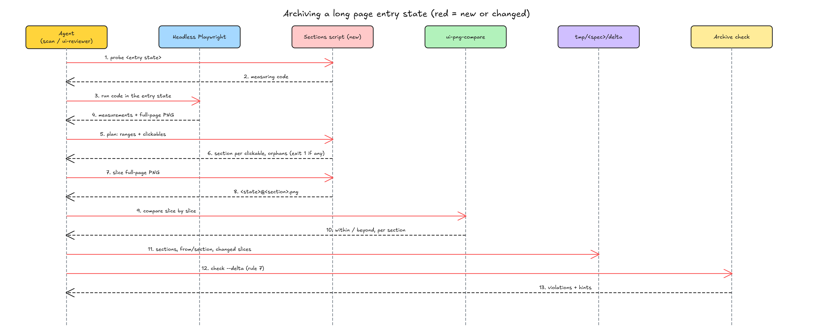

# 设计档案：长页面的可引用分段

## 1 问题

复现在 2026-10-20 做，对象是本分支的起点（main `84b4859`，idea-loop 0.0.27）。这几条都是「档案的模型缺一块」，没有可截的界面：证据是一组对现状的核对，加一组会红的测试，加 #61 里对 TOFEL-demo 实测的页面规模。

先说规模。TOFEL-demo 2026-10-20 的 dreaming 全站初扫（空档案，29 页）里，营销页那 10 页因为下面四条暂不归档。#61 当天在 TOFEL-demo `origin/main d649bbb2`、1440×900 下量过其中三页：

| 页面 | 页高 | 是主视口的几倍 |
|---|---|---|
| /toefl-score | 6616px | 7.4 |
| /listen-repeat | 12198px | 13.6 |
| / | 8106px | 9.0 |

### 1.1 入口状态只拍主视口，首屏以下没有图

**复现到的**：设计档案的 reference 规定 `prod/` 每个状态存「一张主视口截图」（`design-archive.md` §2「`prod/` 只存精简矩阵」），全站初扫和 UI 审查都照这一条拍（`initial-scan.md` §1 第 7 点、`ui-reviewer.md` 归档模式第 1 步与对账模式第 3 步）。往下滚不是边，所以首屏以下的内容也不会变成别的状态。/listen-repeat 存进档案的是 900px 那一截，另外 11298px 在档案里没有任何图；对账时只比这一截，下面改坏了也发现不了。

**本该是**：长页面的入口状态整页都有图，比对也覆盖整页。

### 1.2 边看不出从哪一段出发

**复现到的**：边的字段只有 `id / to / kind / component / locate / action / trigger / how / motion / blocked`（`design-archive.md` §3，解析在 `design-archive.mjs` 的边规范化里，多写的键被丢掉）。首屏的主 CTA、中段的「Explore …」、页脚的链接，在档案里是并排挂在入口状态上的几条边，读档案的人和查询都分不出它们在页面的哪个位置。

在入口状态上加一个 `sections` 列表、在边上写 `from: cookbook#hero`，校验照样通过，`from` 一个字都没被读（复现测试 2：引用一个没声明过的分段，零违规）。

**本该是**：每条从长页面出发的边能说出「从哪一段出发」，写错了校验报出来。

### 1.3 边落不到对方的某一段

**复现到的**：`to` 只能指向状态（校验规则 3）。「跳到 /toefl-score 的换算表」只能写成跳到 /toefl-score 的入口状态，落在哪一段没地方写。

**本该是**：边可以写落到目标状态的哪一段。

### 1.4 页内锚点只能建成假状态

**复现到的**：/toefl-score 上「Read the conversion chart」跳到同页的 `#conversion`。按现在的模型只能建一个新状态（「换算表」），其实它就是入口状态的另一段：画面一样，只是滚到了那里。#61 查过站内：博客和营销页都没有跨页落到某一段的链接，只有 /toefl-score 页内的两处 `#conversion`。

**本该是**：页内锚点写成入口状态的自环，带上落点段，不另建状态。

### 1.5 查询看不到分段

**复现到的**：页面查询返回 `page / regions / components / motions / states / journeys / decisions / candidates`，没有分段（复现测试 3）；反查只接组件名、组件代码路径和动效名，传 `cookbook#hero` 直接报「找不到组件或动效」（复现测试 4）。

**本该是**：页面查询列出这一页的分段，每段带从它出发和落到它的边；反查能按一段（`<页面>#<段>`）或一类段（「所有页的 trust 段」）查。

复现材料：`.tmp/to-spec/design-archive-sections/repro/sections.test.mjs` 与同目录 `output.txt`（四条全红）。

### 1.6 根因

- 1.1：档案的模型只有「页面 → 状态 → 边」，状态的图只有一张主视口截图。长页面在空间上的展开没有对应的结构，往下滚又不该算边（滚动不改状态），于是首屏以下既没有节点，也没有图。
- 1.2、1.3、1.4：边只能把「状态」连到「状态」，比状态更细的位置没有名字可引。
- 1.5：查询建在同一套解析上，解析没有分段，查询也就没有。

修正：#61 正文原先提议分段 id 取自目标项目代码里的 `data-track-section` 属性；Harold 在 #61 的两条修订里撤回了这一点，改成档案自己命名、用可访问性树定位、类型取自闭集。本 spec 以修订为准，§4 不再讨论代码标记。

## 2 方案

**交付物**：长页面在档案里多了一层「分段」。

- 写档案的 agent（全站初扫、UI 审查）进入一个长页面的入口状态时，按内容把页面切成几段，每段起一个 `<类型>` 或 `<类型>-<限定词>` 的名字，类型从一张固定的表里取；整页拍一张长图，按段切成几张图存进档案。
- 从这个入口出发的边都写明从哪一段出发；跳到别处某一段的边写明落到哪一段；页内锚点是入口的自环加落点段。
- 段内的交互（FAQ 展开、切标签）仍然是页面的另一个状态，状态上写它发生在哪一段，截图只拍那一段。
- 校验报出写错的分段引用；写档案之前，页面上每个可点的东西都要落在某一段里，落空的要先补分段。
- 对账和归档按段比对：哪一段变了，只有那一段超出容差、只重拍那一段。
- 页面查询返回分段；反查能按一段或一类段查。

**由哪些输入决定**：分段的范围由页面的可访问性树决定（标题的角色和完整名字、landmark、第 N 个顶层分块）；类型表是插件的约定，跨项目通用；拍长图的视口、主题、语言、动效模式取 `prod/index.md` 的 frontmatter，项目定一次。

**范围**：同一件事「给状态拍图、比对状态的图、读写状态的结构」现在有这些入口，逐个列：

| 入口 | 纳入？ |
|---|---|
| 档案 reference（模型、frontmatter、正文、校验、查询） | 纳入 |
| 解析、校验、查询模块与命令行 | 纳入 |
| `design-archive` MCP 的六个工具 | 纳入：工具说明与入参说明跟着改，行为照旧只转发查询 |
| 归档脚本 | 纳入，但不用改逻辑：分段的图是普通的状态素材，随对象的 `assets/` 一起覆盖；需求差异按段展开（§4.9）由查询模块做 |
| 全站初扫（dreaming） | 纳入 |
| UI 审查的三种模式（每轮审查、归档、对账） | 纳入。每轮审查对冻结画布比对，画布本身不分段，只在「拍实现的图」那一步用分段（§4.7） |
| `uiux-refine` 的 designer 冻结时写的档案 delta | 纳入一句：designer 写长页面入口状态的 delta 时照 reference 写 `sections`；它写的是结构，不拍档案图，没有别的要改 |
| `ui-measure.mjs`（UI 实现环的画布对实现比对） | 排除：它比的是冻结画布与实现，按矩阵格逐格测量，不读档案，跟分段无关 |
| PR 描述里「之前 → 之后」的对照图（`pr-description.md` §5） | 排除：对照图本来就按同宽度重拍，档案图只用来核对拍对了页面；有分段之后用对应那一段的图核对即可，规则不用改 |
| dreaming 的 DESIGN.md 审核页（`review-page.md`）取档案截图 | 排除：它取 `screenshots` 列表里的图，分段图同样在这个列表里，不用改 |

## 3 User Stories

1. 写档案的 agent 进入一个比主视口高的入口状态时，按内容把页面切成分段，每段的名字取自类型表，整页的每一段都有图。
2. 页面上从某一段出发的边写明出发段；写了一个这一页没声明过的段，校验报错。
3. 跳到别的页某一段的边写明落点段；落点段不是目标状态声明过的段，校验报错。
4. 页内锚点写成入口状态的自环加落点段，不另建状态。
5. 段内交互建成页面的另一个状态，状态写明它在哪一段，截图只拍那一段。
6. 写档案之前，入口状态上每个可点的元素都落在某个已声明分段的范围里；有落空的，写档案的 agent 先补分段，不把它静默挂到入口上。
7. 分段名不在类型表里、同一页同一类型出现多次却没加限定词、同页重名，校验报错；用 `content` 兜底、用「第 N 个顶层分块」定位，校验给提示，不拦。
8. 超长的一段切图时不被截断。
9. 拍长图的动效模式定死，写在 `prod/index.md`，每次拍出来的是同一个画面。
10. 对账时一段变了，只有那一段超出容差，只重拍那一段；分段的标题改名导致定位失败，判「进入方式过期」并提议新的定位。
11. 页面查询列出这一页的分段，每段带出发和落入的边、在这一段里的状态、这一段的截图。
12. 反查给一个分段（`<页面>#<段>`）返回从它出发、落到它、发生在它里面的边与状态；给一个类型（`#<类型>`）返回所有页的这一类段。
13. 需求差异把分段按段 id 展开，一段的定位改了，差异里只出现那一段。
14. 进入方式的每一步带上出发段和落点段，照着走的 agent 知道先滚到哪一段再点。

## 4 实现决策

### 4.1 模型：分段是入口状态的组成部分，不自带状态

照 #61 正文的模型：分段是空间维度，状态是时间维度。让分段自带状态，页面状态就变成各段状态的组合，数量会爆炸，也和 reference §1 现有的「组件自己的状态不单独建模」冲突。

- **`sections` 只写在入口状态上**（有 `entry` 的状态），自上而下，顺序即页面顺序。写在非入口状态上，校验报错。
- **一页的分段只由一个入口状态声明**。同一页有两个入口状态都写了 `sections`，校验报错：分段的引用写的是「页面 + 段」，两个入口都声明时引用指不到唯一一处。依据：代价相称——现有档案里没有一页有两个入口（TOFEL-demo 的 `prod/` 还是空的，本仓库的测试夹具每页一个入口），真遇到了再放开。
- **边加两个可选字段**：`from`（从本页哪一段出发）和 `section`（落到目标状态的哪一段）。单屏页面都不写。
- **状态加可选的 `section`**：段内交互的状态写它发生在本页哪一段。入口状态不写（它有 `sections`）。
- **段不进图的拓扑**：可达、进入方式、用户路径都照旧只看状态和边；页内锚点的自环不影响可达。
- **字段名的内外之分**：文件里照 #61 写 `from` / `section`；解析与查询输出里叫 `fromSection` / `toSection`。依据：查询输出里边的 `from` 已经是「出发的状态」（现有契约，UI 审查和 PR 描述都按它读），复用同名会改掉它的含义。

### 4.2 分段的名字：类型取自闭集，引用写「页面 + 段」

照 #61 修订二：

- **`sections` 里每段的 `id` 写 `<类型>` 或 `<类型>-<限定词>`**，类型取自类型表（下），限定词按内容起、kebab-case。同一页同一类型出现多次时每个都要加限定词（`feature-listen-repeat` 和 `feature-interview`，不能一个 `feature` 一个 `feature-interview`）；只出现一次时**建议**不加，校验不拦（后来改：起草时写成「只在多次时加」，review 第 1 轮发现校验不拦单个带限定词的，Harold 定接受现状——拦住它，删掉一个同类段后剩下那段就得改名，连带改一串引用）。
- **类型表放进 `design-archive.md`**，跨项目通用，不进目标项目的 `DESIGN.md`；校验从同一份常量读。19 类：`header` `hero` `social-proof` `problem` `feature` `feature-grid` `demo` `how-it-works` `value-prop` `trust` `testimonials` `comparison` `pricing` `stats` `faq` `related-content` `final-cta` `footer` `content`，每类一句「是什么」照修订二的表；两类判不准时按「这一段主要在回答什么」定（修订二原话：「为什么信你」归 trust，「多少人在用」归 social-proof）。闭集要扩，改这张表和校验的单测，不在档案里自造。
- **类型按最长前缀认**：`feature-grid` 是类型 `feature-grid`，`feature-grid-pricing` 是 `feature-grid` 加限定词 `pricing`；于是 `feature` 不能用 `grid` 当限定词。表里只有 `feature` / `feature-grid` 这一对有前缀重叠，代价只有这一个限定词不能用。
- **引用一个分段写 `<页面>#<段>`**（`mkt-toefl-score#faq`），边的 `from` / `section` 和状态的 `section` 都写全称；`sections` 列表里的 `id` 写短名（它已经在这一页的入口状态里）。用 `#` 不用 `--`：`--` 是状态的分隔符（修订一原话）。全称让「所有页的 trust 段」一次 grep 得到，也让校验能核页面部分写没写对。
- **引用写成普通字符串，不写成 wikilink**。依据：`"[[页面#段]]"` 在 Obsidian 里是「页面文件里名叫『段』的标题」，指向页面文件；解析模块现在把 `#` 后面整个丢掉、只核页面存不存在，写错的段名会静默通过——正是 1.2 的问题。分段不是单独的文件，不占 `docs/` 下 basename 的唯一性（修订一）。

### 4.3 分段的定位与范围

照 #61 修订一，用可访问性树定位，写法同边的 `locate`：

| 段的样子 | `locate` | 范围 |
|---|---|---|
| 有标题 | `{ role: heading, name: <完整名字> }`，精确匹配 | 从这个标题所在的顶层分块的上沿起（这个分块里还有别的分段标题时，从标题本身的上沿起），到下一个分段的起点为止 |
| 顶栏、页脚 | `{ role: banner }` / `{ role: contentinfo }` | 这个 landmark 元素自己的框 |
| 没有标题的段（首屏、纯图片带） | `{ position: N }` | 第 N 个顶层分块自己的框 |

- **顶层分块** = `<main>` 的直接子元素（没有 `<main>` 时取 `<body>` 去掉 banner / contentinfo 之后的直接子元素），只算可见、高度大于 0 的。
- **最后一段的终点**：下一个分段的起点；后面没有分段时，取页面上第一个 `contentinfo` 的上沿（不论声明没声明），没有就到页底。这样没声明页脚时，页脚里的链接会落空、被报出来，而不是静默算进最后一段。
- **提示**：`position` 定位校验时给一条提示（「这条定位比较脆，页面加一个分块就会错位」），不拦。landmark 不提示：一页只有一个 banner / contentinfo，不会错位。修订一说「landmark 或第 N 个顶层分块兜底时给提示」，这里收窄到后者，理由同上；人审时可推翻。
- **标题文案改了导致定位失败**：对账判「进入方式过期」，提议改定位，跟按钮改名的处理一样（修订一）。

### 4.4 什么时候要分段

**页面的滚动高度大于主视口高度，入口状态就要声明分段**；不超过一屏的页面不写，照旧一张主视口截图。依据：1.1 的问题是「首屏以下没有图」，只要有首屏以下就有这个问题，不设倍数阈值。代价：稍微超过一屏的应用页（比如只多出一个页脚）也要写分段，最少是 `header` / `content` / `footer` 三段，写起来不贵。

这一条在拍图时判（要量页高），校验看不到页面，判不了。

### 4.5 校验：加规则 7「分段」

校验现有的输出分「违规」（退出码 1，归档脚本拒绝）和「提示」（只打印），新规则两种都用。哪些算违规、哪些只提示，Harold 2026-10-20 审核时定了（§4.10）：

- **违规**：类型不在闭集；`id` 写法不对（不是 `<类型>` 或 `<类型>-<限定词>`）；同页重名；同页同类型多次却没都加限定词；`sections` 写在非入口状态；同页两个入口状态都声明分段；`locate` 不是上表三种形状之一；边的 `from` 不是本页声明过的段；边的 `section` 不是 `to` 所指状态声明过的段（`to` 不是入口状态也算）；状态的 `section` 不是本页声明过的段；**有分段的入口状态上，`user` 边没写 `from`**。
- **提示**：用 `content` 兜底（多半说明该归进某一类，或者表里缺一类，修订二原话）；`position` 定位（§4.3）。
- 引用写成 wikilink 的（`"[[mkt-home#hero]]"`）报违规，说明要写普通字符串（§4.2）。

### 4.6 落空的可点元素

校验读的是档案文件，看不到页面，所以「每个可点元素都落在某一段里」放在**拍图那一步**判，由新的分段脚本（§4.8）算：给它入口状态上测到的分段框和可点元素框，它按 §4.3 的范围把每个可点元素归到一段，归不进的列成「落空」。

- 归属先看 DOM 包含（在 banner / contentinfo 元素里的归顶栏 / 页脚），再看元素中心的纵坐标落在哪段范围里。
- 落空的处置：**写档案之前清零**（Harold 2026-10-20 定，§4.10）。依据：分段由写档案的 agent 按内容起名、不依赖代码标记，落空总能靠补一段（最差补一段 `content`）解决；而且按 §4.3 的范围，有标题的段从起点一直连到下一段，落空只会出现在第一段之前、landmark 没声明、`position` 分块之间这几处，补起来是一两段的事。
- 归属结果顺带给出「每个可点元素在哪一段」，写档案的 agent 照它给边填 `from`。

### 4.7 截图：入口拍整页长图，按段切图

- **拍法**：照 `ui-implementation-standard.md` §3.1 的三条（同 viewport 与 DPR、等字体、关动画与过渡），再加两步：先整页滚一遍（让懒加载的岛水合、让滚动触发的出现动画都走完），回到顶部，再注入关动画的样式、拍整页长图。动效模式取 `prod/index.md` 的 `motion`，插件的默认值是 `default`（§4.10 已定）。
- **切图**：分段脚本按 §4.3 的范围从长图切出每段一张。超长分段整段一张、不限高（§4.10 已定）。
- **存什么**：`prod/` 只存每段的切图，不存整页长图。依据：`prod/` 只存精简矩阵（reference §2），可点元素全部落在段里，段之间、页顶页底的空隙（没有可点元素的留白）在归属结果的覆盖信息里列出、不拦，所以各段拼起来通常就是整页，再存一份长图是同样的像素存两遍、Git LFS 多涨一倍。长图只留在拍图的临时目录。（后来改：起草时写成「首尾相接、拼起来就是整页」；review 第 1 轮发现没有可点元素的空隙不拦，Harold 定接受现状、只把说法改准——硬拦会让 main 之外的内容补分段也盖不住的页面没法归档。）
- **文件名**：`<入口状态 id>@<段 id>.png`，放入口状态同目录的 `assets/`，例如 `mkt-toefl-score--entry@faq.png`。`@` 不与状态分隔符 `--`、分段引用的 `#` 冲突，在 Markdown 链接里不用转义；带状态 id 前缀，`docs/` 下 basename 照旧唯一。
- **正文**：入口状态的「这一屏」按段排开，每段一个 `###` 小标题（段 id）、一张切图、一两句描述；「应看到什么」照旧几条可判定的话，可以按段写。
- **段内交互的状态**（带 `section` 的）：只拍那一段，截图照旧叫这个状态自己的名字。进入时先滚到那一段。
- **比对**：对账与归档时逐段比，每段用 `ui-png-compare.mjs`，容差照旧（抗锯齿 0.1、像素差 ≤ 1%），尺寸不同算容差外。一段超出容差，只这一段判后续（档案过期 / 产品坏了的判法不变），只重拍这一段；整页都在容差内照旧「一致」，什么都不写。对账时新出现了落空的可点元素（页面多了一块内容），当作画面变了，照「档案过期 / 产品坏了」原来的判法走，判档案过期时一并提议新的分段。

### 4.8 新脚本：分段的确定性部分

新增一个分段脚本，把能单测的部分从浏览器里拿出来，跟 `ui-measure.mjs`（浏览器边界）与 `ui-compare.mjs`（纯逻辑）的分法一样：

- **生成测量代码**：读档案里某个入口状态的 `sections`，打印一段给 Playwright 跑的代码（UI 审查和初扫都用插件自带的无头 Playwright MCP，代码交给它的「执行一段代码」工具）。这段代码按 §4.7 滚一遍回顶，用 `getByRole(role, { name, exact: true })` 等定位每段、取顶层分块与可点元素的框（转成页面坐标）、拍整页长图，返回一份测量结果。初扫时档案里还没有这个状态，就从命令行给分段列表。
- **算范围与归属**：测量结果 → 每段的范围、每个可点元素归哪段、落空列表、定位失败的段。有落空或定位失败时退出码 1。纯函数，单测覆盖。
- **切图**：整页长图 + 范围 → 每段一张 PNG，按 §4.7 命名。PNG 用 node 自带的 zlib 解码编码，同 `ui-png-compare.mjs` 的做法，不引第三方依赖。
- 浏览器那一侧（生成的代码真的跑起来）没有单测，同 `ui-measure.mjs`：靠真的跑一次覆盖（§6）。

### 4.9 查询

- **页面查询**加 `sections`：每段带全称 id、类型、限定词、`locate` 和定位方式（标题 / landmark / 位置）、声明它的入口状态、从它出发的边、落到它的边（含页内自环）、带这个 `section` 的状态、这一段的切图路径。
- **边的视图**加 `fromSection` / `toSection`（§4.1），于是页面查询的出入边、单个状态的进入方式、用户路径的每一步都带上它们（User Story 14）。
- **反查**多接两种参数：`<页面>#<段>` 返回从这段出发的边、落到这段的边、`section` 是这段的状态，以及经过这些边或状态的用户路径；`#<类型>` 返回所有页里这一类段（比如 `#trust`），每段带页面和全称 id。原来的组件 / 动效参数行为不变。名字对不上照旧退出码 1、说清现有哪些段。
- **需求差异**把 `sections` 按段 id 展开成 `sections[<id>].<字段>`，同边按边 id 展开的写法。
- **关键词**不用改：分段引用是 frontmatter 里的普通字符串，已经在它的搜索范围里。
- **MCP**：`design_page` / `design_refs` 的工具说明与 `name` 入参说明写上分段；其余照旧只转发。

### 4.10 审核时定下的三处

> 人的决定（Harold，2026-10-20 审核本 spec）：「三处都按推荐：超长分段整段一张不限高；长图用默认动效模式，先滚一遍再关动画；边缺出发段、落空的可点元素都算违规（写档案前清零）。」下面保留当时的选项与推荐，作为由来。

#### 超长分段怎么切

以 /listen-repeat 的 `demo` 段为例：三档样题，约 3600px，是主视口高度的 4 倍。

- **A 整段一张，不限高（推荐）**：`mkt-listen-repeat--entry@demo.png` 一张 1440×3600。比对单位就是这一段：段里任何地方变了，这一张超出容差。代价：容差按像素比例算，图越高、同样大小的改动占比越小——1% 的预算在 1440×900 是 12960 个像素，在 1440×3600 是 51840 个，一颗 200×48 的按钮整个变色（9600 像素）两种情况下都在容差内，所以这里多稀释的是更大一块的改动。段里的高度变了（多一题），尺寸不同直接算容差外，不受稀释影响。
- **B 超过视口高度就按视口高再切**：切成 `@demo-1` / `@demo-2` / `@demo-3` / `@demo-4` 四张 1440×900。容差预算跟现在单张主视口一样。代价：切线是任意的，段里上半部分高了 40px，下面每一张都会错位、全部超出容差，并且张数会变；「重拍只重拍变了的那一段」退化成整段重拍；文件名多一层编号。

**定了 A。** 推荐理由：分段本来就是按内容划的比对单位，再切一刀引入的是跟内容无关的切线；稀释的代价只落在「段内一大块改了但面积不到 1%」这种情况。

#### 拍长图用哪种动效模式

以 /listen-repeat 的 `hero` 为例：默认模式下示意卡是一张会动的卡（拍图时被关动画样式定在一帧）；系统设成「减少动效」时，页面换成另一种静态版式（#61 实测）。两种模式拍出来不是同一个画面，必须定一种。定下的值写进 `prod/index.md` 的 frontmatter，新键 `motion`，跟 `viewport` / `theme` / `locale` 并列；空档案的初扫照现在提议那三个值的做法，一并提议这个值让人批。

- **A 默认模式 + 先滚一遍 + 关动画样式（推荐）**：档案里是大多数用户看到的那个版式，也和冻结画布、UI 审查现在的拍法一致（UI 审查对账模式第 3 步明写「不另设 `prefers-reduced-motion`」，`ui-measure.mjs` 用同一段关动画样式）。代价：靠 JS 驱动的动画（打字机效果、逐字出现）可能被定在中间某一帧，要靠「先滚一遍、等网络空闲」把它们走完；走不完的段，截图时多等一会，仍不稳定的在状态文件里注明。
- **B 减少动效模式**：拍出来最稳定，不用先滚一遍触发出现动画。代价：档案存的是大多数用户看不到的版式（L&R hero 就是另一种布局），和冻结画布对不上；而且减少动效下的版式往往是后补的，它坏了的时候默认版式可能好好的，档案看不出来。

**定了 A。**

#### 校验报错的严重级别

§4.5 已按推荐写了：分段写错一律违规，`content` 兜底和 `position` 定位只提示，落空在拍图时清零。真正要定的是两条：

- **有分段的入口状态上，`user` 边没写 `from`**
  - **A 违规（推荐）**：以 /toefl-score 为例，一旦声明了 8 段，入口上的每条 `user` 边都必须写出发段，漏一条归档脚本就拒绝。代价：给一个已有档案的页面补分段时，要一次把所有边的 `from` 补齐——但分段脚本的归属结果已经给出了每个可点元素在哪一段，补起来是照抄。
  - **B 只提示**：可以先声明分段、边慢慢补。代价：1.2 的问题会以「有一部分边没写」的样子留下来，没人逼它补完；查询按段反查会漏掉这些边，读的人不知道漏了。
- **落空的可点元素**
  - **A 写档案之前清零（推荐）**：/listen-repeat 若漏了 FAQ 和相关文章两段，分段脚本退出码 1、列出 9 个落空元素，写档案的 agent 补上 `faq`、`related-content` 两段再写。理由见 §4.6：落空总能靠补一段解决，补起来是一两段的事。（后来改：2026-10-20 在营销站试跑发现这个例子不成立——有标题的段一直延伸到下一段，漏声明的两段被前一段静默吞掉，落空是 0。改成由「段内出现没声明的同级标题」拦下，见 §4.12。）
  - **B 只报出来**：初扫把落空个数写进提议表那一行，归档模式写进交回，由人决定补不补。代价：人要为一件机械上总能做完的事拍板；没补的落空元素在档案里没有出发段，跟 B 那条一样留下缺口。

**两条都定了 A。**

### 4.11 文档与版本

- `references/design-archive.md`：§1 模型加「分段」；§2 精简矩阵改成「长页面的入口状态每段一张切图」；§3 入口状态的 `sections`、边的 `from` / `section`、状态的 `section`、`prod/index.md` 的 `motion`；新增类型表；§4 入口状态「这一屏」按段排开；§6 校验表加规则 7 与提示；§8 页面、反查、需求差异的返回加上分段，边的视图加 `fromSection` / `toSection`。
- `skills/dreaming/references/initial-scan.md`：§1 第 2 点（从入口出发的边写 `from`）、第 7 点（长页面先声明分段、跑分段脚本清落空、拍长图切段；空档案时多提议一个 `motion` 值）、§3 空档案那一行说明里多列 `motion`、§4 第 4 点补进 `prod/index.md` 的键多一个 `motion`。这是 dreaming 唯一直接改 `prod/` 的地方，多一个键要同步写明。
- `agents/ui-reviewer.md`：归档模式第 1 步（重拍时长页面入口按段拍、切、只拍改了的段）、对账模式第 3 至第 5 步（按段拍、按段比、定位失败判进入方式过期、新的落空当画面变了）。
- `agents/designer.md`（`uiux-refine` 的执行者）：写长页面入口状态的 delta 时照 reference 写 `sections`，一句话。
- `README.md` 目录树加分段脚本与它的测试，改 `design-archive*.mjs` 几行的说明（规则数从六条变七条）；plugin 版本 0.0.27 → 0.0.28。

### 4.12 营销站试跑之后定下的修正

2026-10-20 用本 spec 的实现对一个真实营销站的 8 个英文页走了一遍初扫的分段流程（64 段，校验全过、落空全为 0），发现三种页面结构会把切线切歪或漏掉内容而不报，另有比对误报和几处照文档做会卡住的地方。

> 人的决定（Harold，2026-10-20）：「按你的分法：前五条在这个 PR 里修（漏声明的同级标题和落空一样拦下），修完在受影响的页面上重跑；原生折叠 FAQ 的定位和滚动驱动段开 issue。」

在这个 PR 里修的：

1. **不占高度的包装元素不算顶层分块**：`display: contents` 的元素（如组件框架的「岛」）展开成它的子元素再取分块。现象：三页的切线全切在标题文字上，眉标和上方留白落进上一段的图，最多多吞 361px。
2. **整页只套一个包装元素时往下钻**：没有 `<main>`、`<body>` 下只有一个可见候选时，往下钻到有多个子元素的那一层再取分块。同一分块里的第一段，起点取「分块上沿」与「上一段终点」中靠下的那个，后面的段仍从标题起。现象：首页没有 `<main>`，11 段全从标题起切，顶栏到 hero 标题之间 256px 不属于任何段。§4.3 的范围表照此改。（后来改：起草这条时写了它也能修好「价目页套餐卡被拦腰切开」，第二次重跑证明不能——套餐卡的标题在卡片里面，切线仍从标题起。那一页的正确处理是把装着几块内容的那个分块声明成一段，见下面「第二次重跑之后」。）
3. **漏声明的同级标题和落空一样拦下**：一段的范围里出现和已声明分段标题同一级、却没被声明的标题，归属结果列出来，退出码 1；处置同落空，补一段或改定位。现象：去掉两段之后被前一段吞掉、落空为 0（§4.10 那个例子据此改正）。
4. **范围统一取整**：段的起止按同一规则取整到整数像素，内容没变的段高度稳定。现象：上方一段变高 18px 后，下面没动过的两段差出 ±1px，被判「尺寸不同」。
5. **照文档做会卡住的几处**：测量结果给每个可点元素带上链接地址；文档写清测量结果怎么存成文件；边的定位（角色 + 名字）在出发段里解析，同名链接（顶栏和页脚都有的 About）因此唯一；段内交互状态的截图范围是「那一段 ∪ 这次交互弹出的浮层」，下拉菜单不再被裁掉；拍之前关掉开发服务器的调试浮层。

开 issue 另做的：原生折叠控件（`
`）按角色定位不到，写不成边——这是边定位方式的通用边界（#64）；滚动驱动、钉住的段在关动画后拍出用户从没见过的混合帧和大片空白——比 §4.10 预想的「定在某一帧」更糟（#65）。

插件版本：main 期间已占用 0.0.28，本 PR 改为 0.0.29。

#### 第二次重跑之后

修完上面五条，在受影响的页面上重跑：岛页面的切线、首页、漏段拦截、可点元素带链接地址都修好了；又发现「同级标题」检查在价目页误报且清不掉，另有比对超差、轮播、页脚越界三处。

> 人的决定（Harold，2026-10-20）：「按照你的建议我们继续修，然后再对应页面上重抛下。」

据此定下的：

1. **同级标题按元素判断，并排的不算漏段**：「这个标题声明过没有」按元素本身判断，不比坐标（坐标相同的另一个标题曾因此漏报）；同一行并排出现的几个同级标题（卡片网格的标题）不算漏声明的段。现象：价目页套餐卡标题（1 Month、3 Months、6 Months）与分段标题同为二级标题，正常 5 段被报出 4 个，补段会切开卡片、改定位也改不了级别，这页写不进档案。
2. **一个分块装着几块内容时声明成一段**：价目页的 hero、套餐卡、免费框在同一个顶层分块里，按三段分切线必然穿过卡片；这种情况写明声明成一段（参考文档与初扫文档写进去）。
3. **拍之前先把轮播这类组件点停**：会自己切换的组件（定时轮播的标签、幻灯片）关动画样式管不住，同一入口两次拍到的不是同一个画面；文档写明拍之前先点停，点不停的在状态文件里注明。
4. **范围按页高截断**：最后一段的终点不超过页高。现象：价目页页脚算成 2396–2514，页高 2513，切图比声明的高度少 1px。
5. **小数像素平移造成的比对超差记成已知代价**：上方一段变高的量不是整数时，下面内容没变的段因文字抗锯齿变化超出 1%（实测 1.31%、1.23%，肉眼看不出差别）。不改比对规则；UI 审查对账时，一段超出容差、又判不出是档案过期，在判「产品坏了」之前先看一眼两张图的差异图，只有看得出的差别才判产品坏了，看不出的记成「一致（小数像素平移）」并在交回里注明。

#### 第三次重跑之后

第二次要修的几处都修好了：价目页正常 5 段不再误报，三段分法被拦下，其余 6 页切线与第二次完全一致。又发现两处：

> 人的决定（Harold，2026-10-20）：「按建议修：分段标题用到的每一级都算同级，保留并排、整块一段两条豁免；测量代码把关动画样式注入同源的内嵌页面，注入不了的在文档里写进点不停的情形。修完在价目页和 /interview 上重跑。」

1. **同级标题：声明过的分段标题用到的每一级都算同级**，不再取一个众数（原来打平时取一级，价目页只声明顶栏、一级标题的 pricing、页脚时，pricing 吞掉下面两个二级标题段，零报告）。保留两条豁免：同一行并排的同级标题不算漏段；一个顶层分块只声明了一段时，块里的标题算这段自己的内容。
2. **关动画样式也注入同源的内嵌页面**：首屏产品演示是内嵌页面里的循环动画，关动画样式只进外层，同一入口连拍两次 hero 差 1.83%。测量代码把同一段样式注入每个同源的内嵌页面；跨域、或注入后仍在动的，文档把它写进「点不停」的情形，在状态文件里注明。

#### 第四次重跑之后：不再追冻结

同级标题修好了；但首屏演示是内嵌页面里由脚本驱动的循环动画，关动画样式冻不住（/interview 连拍两次 hero 差 2.53%），测量摘要还错报「已冻住」；功能标签的「点停」只是悬停暂停，被测量自己的整页滚动重新启动。四轮下来，按结构推算的问题都修得掉，「拍出稳定的图」却每轮冒出新的会动的东西。

> 人的决定（Harold，2026-10-20）：「按你的做法：修摘要的冻住检测和标签组前后记录；还在动的段在档案里标成不稳定，对账时只按应看到什么核、不比像素；把拍不稳的段并进 #65。修完在 /interview 上重跑。」

1. **冻住与否要检查，不靠「注入成功」**：测量代码在关动画之后隔约一秒再拍一次整页，逐段比两张图；画面变了的段列进测量结果的「还在动的段」，内嵌页面同理（摘要里的「冻不住的内嵌页面」以实测为准）。
2. **标签组前后各记一次选中项**：测量开始前与拍完之后各记一次每个标签组选中的是哪个，变了就报出来（说明有轮播在测量中切换）。
3. **还在动的段在档案里标成不稳定**：入口状态 `sections` 里这一段带 `unstable`，写明为什么（哪个东西在动）。校验只核它的形状（写了原因）。切图照存，「这一屏」照写，注明拍到的只是其中一帧。
4. **对账时不稳定段不比像素**：UI 审查对账与归档时，`unstable` 的段跳过像素比对，只按「应看到什么」核；其余段照旧逐段比。标成不稳定不等于不管：「应看到什么」要写得能核。
5. **拍不稳的段并进 #65**：#65 的范围从「滚动驱动的段」扩大到所有拍不稳的段（脚本动画、轮播、悬停才暂停的组件），以后单独处理怎么给它们稳定取证。

## 5 技术方案总览

### 5.1 后端

这里的「后端」是插件里的 agent、脚本，和目标仓库的 `docs/design/`。

红色是本 spec 新增或改动的消息，虚线是响应。

- 写档案的 agent（初扫、UI 审查的归档与对账模式）→ 分段脚本：要测量代码（§4.8）。新增。
- agent → 无头 Playwright：跑测量代码，拿回测量结果和整页长图（§4.7）。新增。
- agent → 分段脚本：算范围与归属，拿回每个可点元素的出发段、落空列表；有落空就补分段再测一次（§4.6）。新增。
- agent → 分段脚本：切图（§4.7）。新增。
- agent → 比对脚本：逐段比（对账、归档时，§4.7）。改动：从比一张变成逐段比，脚本本身不改。
- agent → `tmp/` 的 delta：写 `sections`、边的 `from` / `section`、只写改了的段的切图。
- 校验脚本：加规则 7（§4.5）。查询模块与 MCP：页面、反查、需求差异加分段（§4.9）。归档脚本不改逻辑。

### 5.2 前端内部

不涉及。

### 5.3 前端交互

不涉及。改的是档案的结构和写档案的流程，没有产品界面。

## 6 测试决策

| 变的是什么 | 仪器 | 本次 |
|---|---|---|
| 纯逻辑 / 数据转换 | TDD 单元 | **碰到**：分段 id 的解析（最长前缀、限定词规则）、校验规则 7 的每一条违规与提示、查询的分段返回、反查的两种新参数、需求差异按段展开、分段脚本的范围与归属与落空、切图 |
| API 契约 | TDD API 测试 | **碰到**：MCP 的工具说明与 `tools/call` 结果（沿用现有的 stdio 测试，`design_refs` 传分段 id 结果等于命令行） |
| DB schema / 迁移 | 真 DB 测试 | 不涉及 |
| LLM 输出质量 | eval | 不涉及 |
| 视觉正确性 | UI 实现环 | 不涉及：这里不实现界面 |
| 端到端用户流程 | 浏览器测试 | **碰到一处，人工跑一次**：分段脚本生成的测量代码在真实页面上跑通（见下） |

**seam**：沿用现有三处，不新开——

- 档案的读层：`loadArchive` + `check()` + 查询模块各入口函数（现有 `design-archive-check.test.mjs` / `design-archive-query.test.mjs` 的写法，在共享夹具上「掰」一处看违规）。
- MCP：stdio 起进程（`design-archive-mcp.test.mjs`）。
- 分段脚本：它的纯函数导出 + 命令行退出码（照 `ui-png-compare.test.mjs` 的写法，PNG 现场编码）。

**增量功能测试**（都落在插件的测试套件里）：

| 前置 | 步骤 | 期望 | 覆盖 |
|---|---|---|---|
| 夹具加一个营销页：入口状态 5 段（`header` `hero` `feature-a` `feature-b` `footer`），一条页内锚点自环、一条跨页落到某段的边、一个带 `section: …#feature-b` 的状态（起草时写成 `#faq`，跟这 5 段对不上，实现时按 5 段改） | 跑校验 | 通过，无提示 | 1、2、3、4、5 |
| 同上，逐个掰坏：类型 `closing-band`；`feature` 与 `feature-b` 并存；同页重名；`sections` 挪到非入口状态；`from` 指向没声明的段；`section` 指向目标状态没有的段；`to` 指向非入口却带 `section`；入口上一条 `user` 边删掉 `from`；引用写成 `"[[页#段]]"` | 每次跑校验 | 各报一条规则 7 的违规，点名文件与字段 | 2、3、7 |
| 一段改成 `content`、一段改成 `{ position: 2 }` | 跑校验 | 通过，两条提示 | 7 |
| 夹具营销页 | 页面查询 | `sections` 五项，各带出入边、状态、切图路径；出入边带 `fromSection` / `toSection` | 11、14 |
| 夹具营销页 | 反查 `<页>#hero`、`#feature`、`<页>#nowhere` | 前两个各返回对应的边与段；第三个退出码 1，列出现有段 | 12 |
| delta 里改一段的 `locate` | 需求差异 | `changed` 里只有 `sections[<那段>].locate` | 13 |
| 一份手写的测量结果：5 段，一个可点元素在第一段之前，一个在没声明的页脚里 | 分段脚本算归属 | 两个落空，退出码 1；补上 `header` / `footer` 后零落空，退出码 0；每个可点元素的出发段对 | 6 |
| 同上，某段的标题定位不到 | 分段脚本算归属 | 列出定位失败的段，退出码 1 | 10 |
| 现场编码一张 1440×6000 的长图，5 段，其中一段 3600 高 | 切图 | 5 张，尺寸与范围一致，超长那段整张不截断（1440×3600） | 8 |
| 两组切图，只有一段改了像素 | 逐段比 | 只有那一段超出容差 | 10 |

**人工跑一次**（`implement` 时由执行方做，录进工单的验收证据）：在 TOFEL-demo 的开发环境里对 /toefl-score 跑一遍——生成测量代码、交给无头 Playwright 跑、算归属、切图。期望：8 段左右全部定位到、零落空、切图首尾相接拼回整页。这一步覆盖不了的是别的页面的特殊结构，写进已知限制。

**无 prompt/eval 变动。** agent 与 skill 的文字改了（初扫、UI 审查、designer），但这个仓库的约定是 skill 输出跳过定量 eval（仓库 `CLAUDE.md`「Eval 策略」），也没有现成的 eval 覆盖这几处。

**先例**：校验规则照 `design-archive-check.test.mjs` 的「一条规则一个红夹具」；查询照 `design-archive-query.test.mjs`；分段脚本照 `ui-png-compare.test.mjs`；文档里的命令行对得上 flag，照 `archive-check-flag.test.mjs` 这类绊线测试（新命令出现在文档里时要能被它们扫到的，跟着加）。

mock 只在系统边界：浏览器那一侧不 mock，测量结果用手写的 JSON 喂纯函数。

## 7 Out of scope

- **把页面的 `regions` 并进 `sections`**：营销页上两者常常指同一块，但应用页的区域不一定是纵向的段（侧栏、浮层）；合并是结构性的重排，按 decision-rules §1 第 4 条单独起。
- **分段上挂组件**（#61 正文的 `component`）：修订一的写法里没有它，组件仍由页面的 `regions` 和边的 `component` 记，`usedBy` 的算法不变。
- **跨页落到某一段的真实用法**：模型支持，但 #61 查过站内目前没有；不为它补额外的流程。
- `ui-measure.mjs` 的画布比对、PR 描述的对照图、dreaming 审核页取图：理由见 §2 的范围表。
- 给 TOFEL-demo 那 10 个营销页建档案：这是插件改完之后 dreaming 下一次初扫的事，不在这份 spec 里做。

## 8 关联

- #61 idea-loop 设计档案：长页面要有可引用的分段（入口拍整页、边带出发段和落点段）——本 spec 覆盖它的正文与两条修订。
- [[ui-state-archive]]：档案的模型、校验、查询由它建立，本 spec 在它上面加一层，不改它定下的原则。
- [[dreaming-design-reconcile]]：全站初扫与对账模式由它建立，本 spec 改其中拍图与比对的部分。
- **相邻在飞**（2026-10-20 查）：
  - #55（UI 审查改为每轮照实现同步档案、取消归档模式、删合并前钩子；dreaming 拆成编排者 + 专职 agent）：还没有 spec、没有 `status:*` label。两者都改 `agents/ui-reviewer.md`，有重叠。本 spec 先落：它只改「怎么拍、怎么比」这一层，#55 起草时把归档模式里按段拍、按段比的那几句带进合并后的每轮同步。互不依赖。
  - PR #59（设计调研 agent）：不碰档案，无重叠。
  - #51、#56、#57、#58：不碰档案，无重叠。
