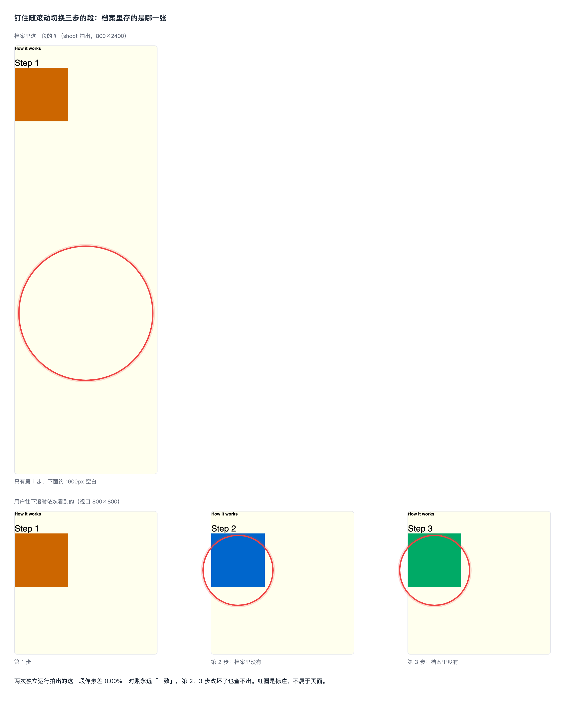
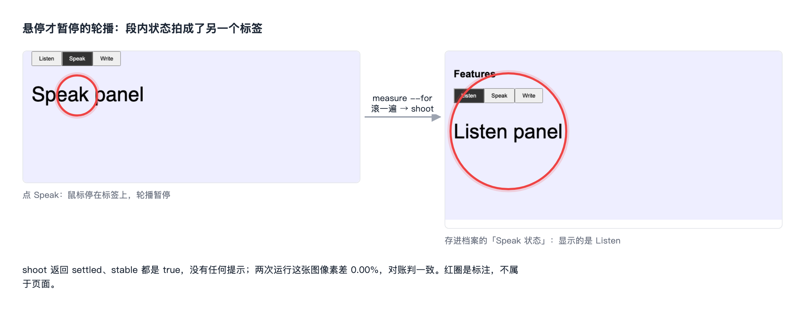
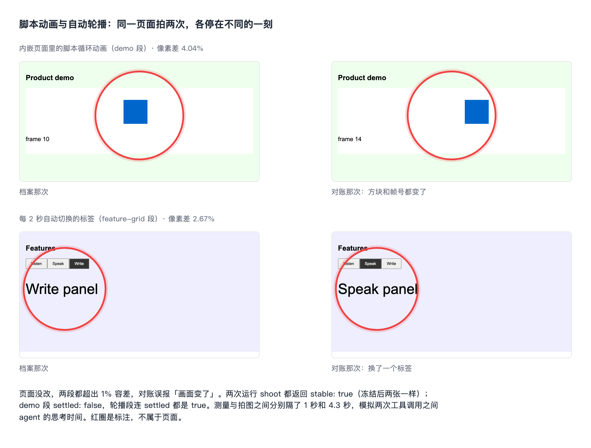

# 设计档案：拍不稳的段怎么稳定取证

## 验证

| issue | 结论 | 证据 |
|---|---|---|
| #65 拍不稳的段（脚本动画、轮播、悬停暂停、滚动驱动）怎么稳定取证 | 存在 | 主分支现在的分段拍法下四类段都复现到了：滚动驱动段只存下第 1 步加约 1600px 空白；点出来的标签状态拍成了另一个标签；脚本动画和自动轮播两次拍出来差 4.04% / 2.67%，对账误报。详情在「问题」 |

复现在 2026-10-26 做，对象是 `main 1444794`（idea-loop 0.1.3 的分段脚本，即 #67 合进来的版本）。issue 正文描述的是 #63 那一版「拍整页长图再切」的拍法；#67 合并前已经按 Harold 2026-10-21 的决定改成「每段单独截：滚到这一段、等内容稳定、冻结页面时钟再截」（[[design-archive-sections]] §4.12），所以这次是对着新拍法重新复现，不沿用 issue 里的数字。

手段：一个夹具页面放四类段，加一个静态对照段，用主分支的 `measure` → `attribute` → `shoot` 原样生成的代码交给本机的 headless Chromium 跑两次（模拟「写档案那次」和「对账那次」），每段用 `ui-png-compare.mjs`（容差 1%）比两次的图。两次之间唯一的差别是测量和拍图之间隔了多久（1 秒 / 4.3 秒）：真实使用时 `measure` 和 `shoot` 是两次分开的工具调用，中间隔着 agent 的思考时间，长短每次不同。

夹具的四类段照 issue 当时试跑的 TOEFLAIR 营销站组件写（对照见 [[2026-10-26-unstable-sections]]）：

| 夹具的段 | 营销站上的原型 | 怎么动 |
|---|---|---|
| How it works（钉住、三步） | /listen-repeat 的三个原因段（`CauseLayers`）；/email-writing 的批注演示（`EmailFeedbackProof`） | 前者钉住后每滚一次滚轮换一张；后者 GSAP 钉住、按滚动位置逐条点亮 |
| Features（悬停暂停的标签） | /interview 的功能段（`InterviewFeatures`）；/toefl-score 的口语标签 | 选中标签的进度线走完就切下一个，悬停或聚焦时暂停 |
| Product demo（内嵌页面的脚本动画） | 四个题型页首屏的产品画面（`HeroShowcase`，iframe 里的 `journey.html`） | `setTimeout` 驱动的循环演示 |

## 问题

### 1 钉住随滚动切换的段：档案里只有第一步，下面是空白



夹具里「How it works」段高 2400px，里面一块 800px 高的内容钉在视口顶上，随滚动依次显示第 1、2、3 步。`shoot` 把这一段的整个文档范围截下来：图里只有第 1 步的那一屏，下面 1600px 是空的背景色。用户滚下去看到的第 2、3 步，档案里没有任何一张图。

两次拍出来像素差 0.00%，对账判「一致」：第 2、3 步改坏了也看不出来。营销站上试跑时，这两段已经各用一种办法凑合：/listen-repeat 把第二张建成了状态、图改成手动按主视口截；/email-writing 写成「不算状态」，另补一张全部点亮的主视口图。两种都绕开了分段脚本。

复现材料：`.tmp/to-spec/design-archive-unstable-sections/repro/`（`repro.mjs`、`out/run1/`、`out/user/`）

### 2 悬停才暂停的轮播：点出来的标签状态拍成了另一个标签



「Features」段的标签每 2 秒自动切一个，鼠标停在标签栏上时暂停。照 `sections.md` 的段内状态拍法：点 Speak，再 `measure --for`、`attribute`、`shoot`。`measure` 和 `shoot` 都要滚动页面，标签栏离开了鼠标下方，轮播恢复，拍的时候已经切走。存进档案的「Speak 状态」画的是 Listen。`shoot` 返回 `settled: true`、`stable: true`，没有任何提示。

营销站上的标签不靠计时器，靠 CSS 进度线动画播完（`animationend`）切到下一个。这一种连页面时钟都管不到，而且截图用的 `animations: 'disabled'` 会把进度线直接拨到结尾、当场切走：/interview 的档案里记着「否则截图会把它快进到底、切到下一个标签」。夹具里加了同样写法的一段，主分支拍法和「只停页面时钟」的拍法下，点出来的 Two 都被拍成了别的标签。

复现材料：同上，`out/run1/p--speak.png`、`out/user/speak-clicked.png`、`proto-css.mjs`

### 3 脚本动画和自动轮播：同一页面拍两次，各停在不同的一刻，对账误报



页面没改，两段都超出 1% 容差，对账会报「画面变了」，走「档案过期 / 产品坏了」的判定。

- 「Product demo」段是一个内嵌页面里约 20 秒一圈的脚本动画。`shoot` 等稳定等满 8 次也等不到（`settled: false`），就在当时那一刻冻结时钟截图。冻结之后两张一样，所以 `stable: true`。
- 「Features」段的自动轮播 2 秒才切一次，`shoot` 相隔 300ms 的两张截图一样，判成 `settled: true`、`stable: true`。

现在的兜底都靠 `stable`：`sections.md` 和初扫说「`stable` 不是 `true` 的段，状态文件注明『截图是某一刻』」，ui-reviewer 对账说「`stable` 不是 `true` 的段，容差外时先再拍一次，两次都超出才算」。这两段 `stable` 都是 `true`，两条兜底都不起作用；就算起作用，再拍一次也只是停在第三个时刻。

复现材料：同上，`repro-gap.mjs`、`out/gap-run1/`、`out/gap-run2/`

### 根因

- **问题 1**：`shoot` 在一个滚动位置截下这一段的整个文档范围。钉住的内容只在当前滚动位置画一份，随滚动切换的内容只画当前这一步，所以一张图里只有一步，钉住容器剩下的高度是空的。档案的模型里一段只有一张图，没有地方放第 2、3 步；分段脚本也不知道哪一段是滚动驱动的。
- **问题 2**：段内状态是点出来的，点完到冻结时钟之间，测量和拍图都要滚动页面，页面时钟一直在走；CSS 动画根本不受页面时钟管，`animations: 'disabled'` 还会把有限次的 CSS 动画拨到结尾、触发它的结束事件。
- **问题 3**：冻结的时刻是「`shoot` 跑到这一段的那一刻」，离页面加载过了多久每次不同。`stable` 比的是冻结之后的两张，冻住了就必然一样，量不出「两次运行会不会停在同一刻」；`settled` 只在 2.4 秒内看有没有变化，比这慢的轮播看不出来。
- 修正：issue 原先认为问题出在「整页长图拍不出随滚动变化的段」和「注入关动画样式冻不住内嵌动画」，那是 #63 版拍法。#67 改成每段单独截、冻结页面时钟之后，内嵌页面里的动画在一次运行之内冻得住，但两次运行之间停的时刻不同；滚动驱动段的问题从「混合帧」变成了「只有一步」。

## 方案

用户（写档案、对账的 agent，和看档案的人）最终得到：

1. **同一个页面、同一个状态，拍几次都是同一张图**，页面没改就判「一致」。自己会动的东西（脚本动画、计时器驱动的轮播、CSS 动画驱动的轮播）每次停在同一个时刻，这个时刻由「页面加载后拨了多少页面时间」决定，不由 agent 什么时候调工具决定。
2. **点出来的状态拍的就是点出来的那个样子**：从点完到截图，页面时间只按固定的小步长走，轮播没有机会切走。
3. **滚动驱动的段，每一步都在档案里有图、都能按像素比**，档案里不再有大片空白的图。
4. **还是拍不稳的会被说出来**：页面时间管不到的东西（视频、WebGL、靠网络推送的内容）在拍图时检出、报出来，对账时按「应看到什么」核，不再靠 `stable` 这个量不出问题的信号。
5. **单屏状态也一样**：不分段的页面上的状态（首屏有自动轮播的登录页一类）用同一套拍法，不再误报。

怎么做：页面打开之前就把页面时钟和 CSS 动画的时间线都停住，之后只按固定步长一起往前拨，拍图时不再拨。夹具上的原型（`proto-clock.mjs`、`proto-css.mjs`）验证过：两次运行分别隔 1 秒和 4.3 秒，脚本动画、计时器轮播、CSS 动画轮播、点出来的两种标签状态，五张图像素差都是 0.00%，点出来的标签两次都拍对。

同类入口：

| 入口 | 处置 |
|---|---|
| 分段脚本的 `measure` / `shoot`（`sections.md`「拍图：分段脚本」） | 纳入：改在这里 |
| ui-reviewer 归档模式第 2 步（重拍精简矩阵，长页面按段拍） | 纳入：单屏状态和分段都用新拍法 |
| ui-reviewer 对账模式第 3、4 步（dreaming 重新驱动也走它） | 纳入：新拍法；「`stable` 不是 `true` 再拍一次」换成新信号 |
| dreaming 初扫第 7 步 | 纳入：新拍法；「`stable` 不是 `true` 注明『截图是某一刻』」换成新信号 |
| uiux-refine 冻结画布上的截图 | 排除：画布是设计稿，不是线上页面，没有自己跑的脚本 |
| `ui-measure` 的 UI 实现环（实现对冻结画布逐格比） | 排除：比的是实现与画布，当场拍、当场比，不跨运行；它的「三条环境约定」留给它自己用 |

## User Stories

只修问题、不加能力的部分，每个问题一行期望行为：

1. 期望行为（问题 1）：钉住随滚动切换的段，档案里每一步都有一张按用户实际看到的样子拍的图（结构相同的步骤照旧只记第一个），没有大片空白；改坏了其中任何一步，对账能按像素查出来。
2. 期望行为（问题 2）：点出来的状态，存进档案的图就是点完那一刻的样子；悬停、聚焦才保持的状态在测量和拍图期间不丢，不论轮播靠计时器还是靠 CSS 动画切换。
3. 期望行为（问题 3）：页面没改时，同一个状态隔多久拍两次，每段（单屏状态是整张）都在容差内；页面时间管不到、仍然两次不同的段，拍图那一步就报出来，写档案和对账都知道它是哪一段、为什么。

## 实现决策

### 页面时间从加载前就停住，只按固定步长拨（已定）

依据：Harold 2026-10-21 在 [[design-archive-sections]] §4.12 定过「当这个章节完全展示出来所有内容（无论是哪一个状态）截取一个图就行，不用考虑动效」（原话）。一张图要能拿来对账，就得每次都是同一张；停住时间、固定步长是让「那一张」可重复的手段，不改「一张图、不考虑动效」这条决定。CSS 动画那一半的依据是营销站 /interview 档案里的现存实例（问题 2）和原型。

- **两条时间一起停**：页面时钟（计时器、`requestAnimationFrame`、`Date`、`performance.now`）停在一个固定的起点；文档的 CSS 动画时间线播放速率设成 0（Chromium 的 DevTools 协议 `Animation.setPlaybackRate`），新起的 CSS 动画和过渡也不走。
- **拨一步 = 两条一起拨**：页面时钟往前走 N 毫秒，同时把每个 frame 里每个还没播完的动画的当前时间加 N。动画因此正常播到结尾、正常触发结束事件，只是发生在固定的页面时间。
- **新的第一步：装时间**。分段脚本加一个子命令，打印一段代码：设视口与配色 → 装停住的页面时钟、停住动画时间线 → 重载 → 按固定步长拨一段让页面起来。用法：`browser_navigate` 到入口之后、做任何交互之前先跑它。一个页面一次会话只装一次，之后所有状态（入口、点出来的、滚出来的）都在这条时间上拍。没装就跑 `measure` 的，`measure` 照旧自己装（入口状态会重载；段内状态装不上，报「装晚了」，拍出来的图标成拍不稳）。
- **测量**：整页滚一遍、等高度不变、等字体，原来等真实时间的地方改成「拨固定步长、再看」，步长和次数是常量。网络请求、图片解码走真实时间，等网络空闲照旧等真实时间。
- **拍图**：不拨时间，不用 `animations: 'disabled'`。每段滚到、截图。
- **点出来的状态**：交互由 agent 用浏览器工具做，做完到下一步之间时间不走。脚本另提供「拨一步」的代码（固定小步长），交互之后要等界面变化（加载、提示出现）时 agent 照它拨，拨到这一屏的「应看到什么」成立为止；`measure --for` 开头固定拨一小步让界面画完，之后测量、拍图都不再拨。
- 原型片段（出自 `proto-css.mjs`，只留带决定的部分）：
  ```js
  await context.clock.install({ time: T0 });          // T0 固定
  await context.clock.pauseAt(T0 + 1000);
  await cdp.send('Animation.setPlaybackRate', { playbackRate: 0 });
  await page.goto(url);
  step(ms) = page.clock.runFor(ms) + 每个 frame 里 document.getAnimations() 未播完的 currentTime += ms
  for (每半个视口) { 滚到这里; step(200) }   回顶; step(1000)
  // 之后拍图不再 step；截图不带 animations: 'disabled'
  ```

### 「还是拍不稳」换一个信号（已定）

依据：decision-rules §1 第 1 条（文档对不上实际做法，本次同步改）。复现里 `stable` 在冻结后必然为真，`sections.md`、初扫、ui-reviewer 三处靠它的兜底都没起作用。

- 每张图拍完，在时间不拨的前提下隔一段真实时间（500ms）再截一张；两张不同，说明有页面时间管不到的东西在动（视频、WebGL、网络推送）。`shoot` 的返回里这一张标 `uncontrolled: true`（替换 `stable`），附上两张图有差异的区域（框），让 agent 一眼知道是哪一块。
- 标出来的：写档案时在状态文件「这一屏」这一段的描述里写明「这一段有页面时间管不到的动态内容：<是什么>，截图是某一刻」；对账时容差外先按「应看到什么」逐条核，都成立就判「一致」，交回里注明这一段没按像素比、为什么；有不成立的照原来的判法走。不再「再拍一次」。
- `settled`（等内容出现并稳定）留着，只做诊断。时间停住之后，它等的只剩图片、字体这类真实时间里到的东西。

### 测量检出滚动驱动的段（已定）

依据：decision-rules §1 第 1 条，同上一条；也照现有做法——落空、重叠这类「不处理就会存下错图」的情况，`attribute` 一律拦（退出码 1）、写档案之前清零（[[design-archive-sections]] §4.11 定的 A）。

- 测量那一遍滚动时，记下每段里有没有钉在视口里的元素（`position: sticky` 或 GSAP 一类加的钉住，且钉住的容器比视口高），以及这一段在不同滚动位置的可见文字是否变了。有一条成立，这一段算滚动驱动。
- 分段的声明多一个可选字段 `scrollDriven: true`。`attribute` 检出滚动驱动、声明里却没写的，退出码 1，提示照下一条建；写了却没检出的，只提示。
- 标准例子：夹具的「How it works」段（2400px 高，里面 800px 钉住，三步）；营销站的 `CauseLayers`、`EmailFeedbackProof` 两段。

### 滚动驱动的段：每一步建成一个段内状态（已定）

依据：人的原话「全部交给你了，你直接开始按照推荐」（2026-10-26，[[2026-10-26-unstable-sections]]），推荐的是这一种；它跟 Harold 定过的「段内交互是页面的另一个状态，写 `section`，截图只拍那一段」是同一种建法，营销站 /listen-repeat 的档案已经这样建了第二张（`mkt-listen-repeat--causes-hold`）。

- 入口状态这一段的图是第 1 步：只截钉住的那一屏（段顶起一个视口高），不截整段的文档范围，所以没有空白。拍法：重载后不走整页滚动，直接滚到段顶再拍（滚轮接管的传送带被整页滚一遍会停到最后一张，这一步就是为它）。
- 第 2 步起每一步一个状态，写 `section: <页面>#<段>`。边按页面怎么驱动它来写：
  - 滚轮一下换一张（`CauseLayers`）：`user` 边，`action` 写「在钉住的这一段上向下滚一次滚轮」，`component` 和 `locate` 指这一段的组件和它的标题。
  - 按滚动位置切换（`EmailFeedbackProof`、夹具）：`system` 边，`trigger` 写「页面滚到这一段的第 n 步」，`how` 写滚到这一段的百分之几。
- 结构相同的步骤照旧只记第一个（Harold 2026-10-21：结构相同的多项只记一个代表）：/listen-repeat 第三张 DELIVER 跟第二张结构相同，不建。
- 这些状态的图：到了这一步，不滚动、不拨时间，直接截当前视口里钉住的那一屏，文件名是状态名。分段脚本给它们一条单独的拍图命令（不经 `measure` / `attribute`：钉住的那一屏里的可点元素，边写 `from` 只在入口状态上要求）。
- 校验规则 7 加两条：`scrollDriven` 只能写 `true`；写了 `scrollDriven` 的段，指向它里面状态的边照常检查。不要求状态个数（结构相同的不建）。

### 不分段的单屏状态一起换拍法（已定）

依据：人的原话，同上一条；推荐理由：误报的原因相同（首屏的自动轮播、脚本动画、CSS 动画），修法相同，分开做要把同一套改动走两遍。

- 单屏状态（页面不比主视口高）也先「装时间」，再到这个状态、拍图。拍图用分段脚本的同一套代码：当成一段、范围是主视口，文件名是状态名，同样返回 `uncontrolled`。
- ui-reviewer 归档与对账、dreaming 初扫里单屏状态的拍法改成这样，不再注入关动画样式；那段样式只留在 `ui-measure` 的 UI 实现环。
- 要停在瞬态（加载中）的状态照旧先拦住请求，再拨时间、拍图。

## 技术方案总览

### 后端

不涉及。

### 前端内部

不涉及（插件脚本生成、交给 headless Playwright 跑的代码，没有缓存与状态层）。

### 前端交互

不涉及。

## 测试决策

| 变的是什么 | 仪器 | 本次 |
|---|---|---|
| 纯逻辑、数据转换、状态机 | TDD 单元测试 | 碰到：`attribute` 对检出滚动驱动、没声明的段退出码 1；`shootTargets` 对 `scrollDriven` 段只出一个视口高的目标；单屏状态当一段出目标；校验规则 7 认 `scrollDriven`；命令行的新子命令与参数 |
| API 契约（路由、schema、序列化） | TDD API 测试 | 碰到：`shoot` 返回的字段（`uncontrolled` 替换 `stable`、差异区域），在浏览器测试里断言 |
| DB schema、迁移、并发与事务语义 | 真 DB 测试 | 不涉及 |
| LLM 输出质量（prompt 改动） | eval（确定性断言） | 不涉及：改的是 agent 与 skill 文档里照做的步骤，没有要打分的输出 |
| 视觉正确性 | UI 实现环 | 不涉及 |
| 端到端用户流程 | 浏览器端到端测试 | 碰到：`design-archive-sections-browser.test.mjs` 加夹具段，见下 |

- **seam**：`design-archive-sections.mjs` 导出的代码生成函数，生成的代码交给真的 Chromium 跑（已有的 `design-archive-sections-browser.test.mjs`）。抓得到：生成的代码在真浏览器里的时序、两条时间、滚动、截图像素；漏掉：真实站点上时间管不到的东西（视频、第三方库），靠下面的手动验收。纯逻辑部分（`attribute`、`shootTargets`、校验）照旧用已有的单元测试 seam。
- **增量功能测试**（浏览器测试的夹具页加问题 1–3 的段：钉住三步、计时器轮播、CSS 进度线轮播、内嵌脚本动画）：
  1. 前置：夹具页；步骤：装时间 → 测量 → 拍图，跑两遍，两遍之间测量与拍图隔不同的真实时间；期望：各段两遍的图像素差在容差内，`uncontrolled` 都是 `false`。覆盖：期望行为 3。
  2. 前置：夹具页，已装时间；步骤：点计时器轮播的第二个标签、点 CSS 进度线轮播的第二个标签，各自 `measure --for` 再拍，期间鼠标移开；期望：两张图里选中的都是第二个标签。覆盖：期望行为 2。
  3. 前置：夹具页；步骤：测量 → `attribute`；期望：钉住的段被列为滚动驱动，没声明 `scrollDriven` 时退出码 1；声明后入口这一段的图高等于视口、内容是第 1 步；滚到第 2 步拍的状态图是第 2 步那一屏。覆盖：期望行为 1。
  4. 前置：夹具页加一段时间管不到的动态内容（循环播放的 `<video>`，或用 `setInterval` 之外的真实时间源改像素，例如在 Worker 里计时）；步骤：拍图；期望：只有这一段 `uncontrolled: true`，带差异区域。覆盖：期望行为 3。
  5. 前置：一个单屏夹具页，首屏有自动轮播；步骤：装时间 → 拍两遍；期望：两遍在容差内。覆盖：期望行为 3。
  6. 手动：在 TOEFLAIR 营销站的开发环境上，对 /listen-repeat、/interview、/email-writing 三页各测量拍图两次；期望：除被标出的段外两次逐段在容差内，`CauseLayers` 与 `EmailFeedbackProof` 被检出为滚动驱动，/interview 点出来的第二个功能标签拍对。覆盖：期望行为 1–3。
- **prompt / eval 变动**：无 prompt/eval 变动。改的是 `sections.md`、`ui-reviewer.md`、`initial-scan.md` 里照做的步骤与判定。
- **照着谁写**：`design-archive-sections-browser.test.mjs` 里「the page clock is frozen for the shot」那条（夹具加自己会动的元素、断言 `shoot` 返回值和像素）。

## Out of scope

- uiux-refine 冻结画布上的截图：画布是设计稿，没有自己跑的脚本。
- `ui-measure` 的 UI 实现环：实现与画布当场拍、当场比，不跨运行。
- 页面时间管不到的动态内容（视频、WebGL、网络推送）做到可按像素比：这次只检出、报出、改按「应看到什么」核；要按像素比得逐类想办法（例如给视频定帧），等真遇到再开。
- 窄的钉住栏里「滚一下换一张、滚回去不退回」的写法检不出滚动驱动（PR #127 review 第 2 轮接受）；随滚动变的窄侧栏会让整段被认成滚动驱动、没有「不是滚动驱动」的声明（#128）：都不丢东西，记成已知限制，后续在 #128 一起处理。
- 非 Chromium 浏览器：停住 CSS 动画时间线用的是 Chromium 的 DevTools 协议，插件自带的 Playwright 只用 Chromium。
- TOEFLAIR 营销站档案里已经凑合拍的那几张图（/listen-repeat 手动截的传送带、/email-writing 补的全亮主视口图）：属于目标项目的档案，下一次 dreaming 重新驱动时按新拍法重拍。
- 内层容器滚动的页面量不到首屏以下（#68）、入口是加载中的长页面（#69）：同一个分段脚本上的另外两个问题，各有自己的 issue。

## 关联

- 覆盖：#65 idea-loop 设计档案：拍不稳的段（脚本动画、轮播、悬停暂停、滚动驱动）怎么稳定取证
- 讨论记录：[[2026-10-26-unstable-sections]]
- [[design-archive-sections]]：分段功能本身（#67 合并，spec 还在等 dreaming 写 ADR）。这份在它的拍图一节上改；它 §4.12 的「截图时机」和「结构相同的多项只记一个代表」是本 spec 两条决定的依据。
- [[dreaming-design-reconcile]]：dreaming 每周重新驱动走 ui-reviewer 对账模式，问题 3 的误报会出现在那里。
- 相邻的未完成 issue：#68（内层容器滚动的页面，分段脚本量不到首屏以下）、#69（入口是加载中的长页面，加载完的状态不能分段）都改分段脚本的测量部分，跟本 spec 改的时间与拍图相邻、互不依赖；#68 已有会话在做，谁后合谁处理冲突。#61（分段功能的原 issue，搁置中）已由 #67 做完，与本 spec 无重叠。
- 复现与原型：`.tmp/to-spec/design-archive-unstable-sections/repro/`（不提交）
