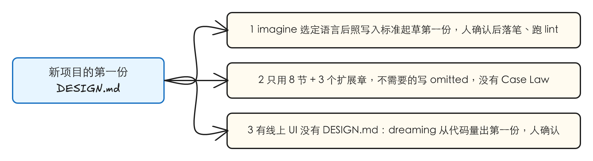
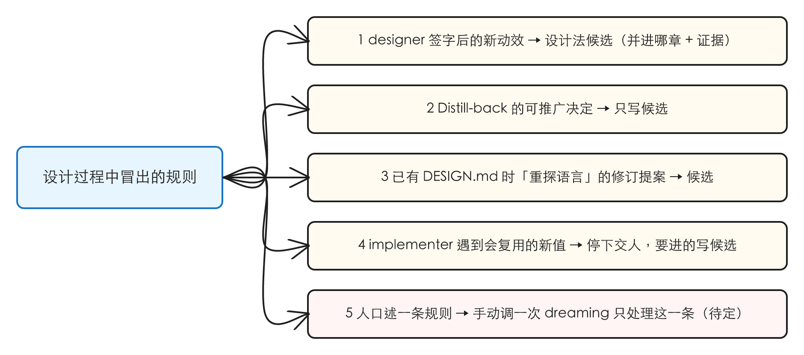
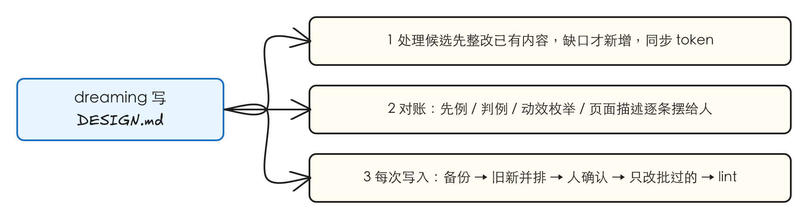
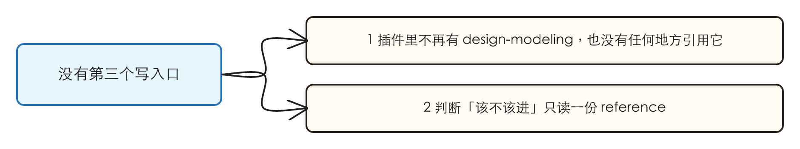
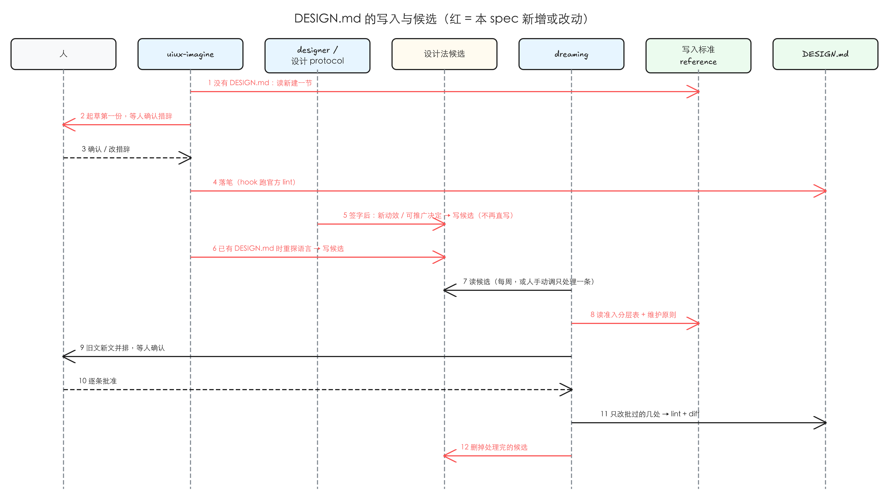

# DESIGN.md 写入口收拢：写入标准成一份 reference，只留两处写

> 从 [[ui-state-archive]] 拆出（#28 的子 issue #49）。grill 已在档案那份 spec 的审核会话里做完：DESIGN.md 的写入标准由一个调研会话（Google design.md 规范加 VoltAgent 84 份样本）跟 Harold 定稿，本 spec 只把它落成插件里的规则和写入口。

## 1 问题

复现在 2026-10-19 做，对象是这个仓库的 idea-loop（0.0.24）和用它的真实项目 Toeflair（本地 TOFEL-demo）。两条都是规则和写入口的问题，没有界面可截，证据是对现状的核对。

### 1.1 能写 `DESIGN.md` 的地方有四处，其中两处不经过人确认措辞

**复现到的**：

| 写入口 | 怎么写 | 人确认措辞吗 |
|---|---|---|
| `design-modeling` skill | 新建 / 蒸馏 / 对账三种模式，每次起草后等人确认 | 是 |
| `uiux-imagine` 选定语言后 | 在同一会话里调 `design-modeling` 的新建模式 | 是（经 design-modeling） |
| designer 动效段签字后 | 新的 in-app 动效模式「带日期进项目 `DESIGN.md` 的动效先例库」，designer 自己写 | **否** |
| designer 收尾的 Distill-back | 「只追加带日期的 T2 判例」，designer 自己写 | **否** |

最后两处和插件自己的设计协议是矛盾的：静态与动效两份 protocol 都写着「新模式先写成候选，经 `design-modeling` 由人决定」，designer 的定义却让它直接写。eval baseline 里就有一次这样的直写记录（「成了 `DESIGN.md` 里第一条带日期的 T2 判例」）。

另外有六份设计 reference、一份实现标准、一个 lint hook 的注释和仓库 `CLAUDE.md` / README 都把 `design-modeling` 当作唯一入口来引用，删掉它要一起改。

**本该是**：只有两处写——项目还没有 `DESIGN.md` 时由 `uiux-imagine` 写第一份；其余（蒸馏、对账、从线上代码量出来新建）都由 `dreaming` 写。两处写之前都读同一份写入标准、都把措辞交人确认。其他想改 `DESIGN.md` 的地方一律先写成「设计法候选」，等 `dreaming` 处理。

### 1.2 现行的写入规则让 `DESIGN.md` 只增不减

**复现到的**：`design-modeling` 的内容规则要求在自定义的 `## Case Law` 一节里「按时间顺序追加」判例，每条带日期和来源页面；designer 往动效先例库追加带日期的条目。Toeflair 的 `toeflair-app/DESIGN.md` 就是这样长出来的：

| 现状（2026-10-19 核对） | 数 |
|---|---|
| 总行数 | 544 |
| Motion 一节里的「in-app motion precedent library」（第 322 行起） | 7 条具体动效，其中 3 条带日期和来源页面（如「2026-07-14, analysis page」「2026-09-30, recording-upload-pipeline freeze」） |
| 另起的「Bounded processing-state ambience (2026-07-14)」小节 | 1 节，标题带日期 |
| 文件末尾的 `## Case Law`（第 483 行起） | 7 条判例 |
| 最近一次写入 | 2026-09-30 提交「admit two in-app motion precedents from the upload-pipeline freeze」 |

调研的结论跟这套规则相反：Google 规范的 8 节里没有动效、日期、判例；VoltAgent 的 84 份样本里 0 份带日期的先例、0 份判例，只有 1 份（tesla）写了动效，而且只写全局原则。具体动效每签一个就多一条，这一节只会越来越长，最后没人能维护。

**修正**：[[ui-state-archive]] §1.4 写的「Toeflair 目前还没有 `DESIGN.md`」不对——上表就是那份文件（见 §4.8）。

**本该是**：`DESIGN.md` 只写设计系统本身（8 节 + 3 个扩展章），不写日期、判例、具体动效的枚举、页面或场景里的组件描述；每次有新内容先整改已有内容，只有缺口才追加；影响渲染的属性必须进 front matter 的 token。

### 1.3 根因

- 1.1：`design-modeling` 被做成一个可以被多处调用的独立 skill，designer 又另开了两条直写的路；「该不该进、怎么写」的规则只写在那个 skill 里，designer 没读它也能写。
- 1.2：写入标准是在没有对照样本的情况下定的，把「判例」当成了设计系统的一部分；具体动效被当成白名单，于是每个新动效都要进文件。

## 2 方案

把 `design-modeling` 删掉，它的规则和定稿的 DESIGN.md 写入标准合成**一份 plugin 级 reference**（暂定名「DESIGN.md 写入标准」）。这份 reference 回答四件事：`DESIGN.md` 是什么、每章写什么不写什么；哪些内容该进、哪些该去别处；一次写入怎么走（备份 → 起草 → 人确认 → 只改批过的 → lint）；一条「设计法候选」长什么样。

写的人只剩两个，都先读这份 reference、都把措辞交人确认：

- **`uiux-imagine`**：项目还没有 `DESIGN.md` 时，选定语言后在同一会话里照 reference 写第一份。
- **`dreaming`**：蒸馏候选、对账、从线上代码量出来新建。

其余想改 `DESIGN.md` 的地方——designer 签字后的新动效、Distill-back 的可推广决定、`uiux-imagine` 已有 `DESIGN.md` 时「重探语言」的修订提案、实现时冒出来的新 token——都改成写一条「设计法候选」，等 `dreaming` 处理。人口述的一条规则，可以手动调一次 `dreaming` 只处理这一条（§4.6）。

## 3 User Stories



**新项目的第一份 DESIGN.md**

1. 作为项目负责人，我在一个还没有 `DESIGN.md` 的项目上跑 `uiux-imagine`、选定一套语言后，同一个会话就照写入标准起草第一份 `DESIGN.md`，等我确认措辞后才落笔，落笔后跑官方 lint。
2. 作为项目负责人，第一份 `DESIGN.md` 只用 8 节加 3 个扩展章，不需要的章用 front matter 的 `omitted` 写明原因，不留空标题，没有 `## Case Law`。
3. 作为项目负责人，有线上 UI 但还没有 `DESIGN.md` 的项目，第一份照样由 `uiux-imagine` 写，按写入标准从线上代码量出来（一致的进、不一致的交我裁决、偶然的不进），同样等我确认；没跑过 imagine 的项目，由 `dreaming` 的定期对账发现没有时量出第一份。



**设计过程中冒出的规则**

1. 作为项目负责人，designer 动效段签字后的新动效模式不再直接进 `DESIGN.md`，而是写成一条设计法候选，带上要并进哪一章和证据。
2. 作为项目负责人，静态设计签字时（Distill-back）可推广的决定也只写成候选，designer 和设计 protocol 都不写 `DESIGN.md`。
3. 作为项目负责人，已有 `DESIGN.md` 时我让 `uiux-imagine`「重探语言」，它的修订提案写成候选，不直接改文件。
4. 作为 implementer，实现时遇到一个会复用、但 `DESIGN.md` 里没有的值，我停下交人判断，要进的写成候选，不在代码里留魔法数，也不改 `DESIGN.md`。
5. 作为项目负责人，我口述一条视觉规则时，能当场手动调一次 `dreaming` 只处理这一条；不调就记成候选等每周那次（§4.6）。



**dreaming 写 DESIGN.md**

1. 作为项目负责人，`dreaming` 处理候选时先在已有章节里找被它影响的内容——矛盾的统一、过时的改写、已覆盖的不加——只有缺口才新增，新增时同步 front matter 的 token。
2. 作为项目负责人，`dreaming` 对账时把不该在文件里的内容（带日期的先例、判例、具体动效的枚举、页面或场景里的组件描述、变更记录）逐条摆给我：被多处遵循的先改写成全局规则并入对应章节，其余移出或删除。
3. 作为项目负责人，`dreaming` 每一次写 `DESIGN.md` 都先备份、并排摆出旧文和新文、等我确认，只改我批过的几处，最后跑 lint 和退化检查。



**没有第三个写入口**

1. 作为插件维护者，插件里不再有 `design-modeling` 这个 skill，任何 skill、agent、reference、脚本、README、仓库 `CLAUDE.md` 都不再把它当入口引用。
2. 作为任何一个要判断「这条该不该进 `DESIGN.md`」的 agent，我只读这一份 reference 就能判断，规则不散在两处。

## 4 实现决策

### 4.1 新 reference：DESIGN.md 写入标准

plugin 级 reference 一份（暂定 `references/design-md.md`），把 `design-modeling` 的规则和定稿标准合在一起，`design-modeling` 原有的内容按下表处置：

| 节 | 内容 | 来源 |
|---|---|---|
| 是什么 | 定义：设计系统本身的自然语言加 token，描述「现在是什么、必须怎么做」；不收设计过程 | 定稿标准 1.1 |
| 结构 | 8 节按 Google 规范的名称和顺序，加 Responsive Behavior / Motion / Known Gaps 三个扩展章；不需要的章用 `omitted` 声明；不设 Iteration Guide | 定稿标准 1.2 |
| 五条写法规则 | 准入判据、一条规则只写一处、数值只在 front matter、每条规则带为什么或边界、只写当前状态 | 定稿标准 1.3 |
| 维护原则 | 整改优先于追加：先找受影响的部分，能整改就整改，缺口才新增，改完通读相关章节；文件大小由「有多少缺口」决定，不随改动次数增长 | 定稿标准 1.4 |
| front matter | 五组 token 加 `name` / `description` / `version` / `omitted`；组件值只引用 token；状态拆成独立条目；**影响渲染的属性必须进 token** | 定稿标准第二章 |
| 每章写什么不写什么 | 11 章各一段定义 / 写什么 / 不写什么，附样本里的好例和坏例（压缩，保留判别句） | 定稿标准第三章 |
| 准入分层表 | 每条内容从上往下问，第一个命中的就是去处：工作流 → plugin 的 skill；通用设计原则 → plugin 的 `references/design/`；**产品设计系统** → `DESIGN.md`；页面或组件的决定 → 设计档案对象的「决定」；现状、缺陷、迁移 → quality-backlog / spec。附两个校准判例 | design-modeling §2，第四层的去处改成档案对象 |
| 明确不进的内容 | 判例、带日期的先例、具体动效的枚举、单页决定与场景里的组件描述、变更记录、采集来源与脚本痕迹、自动生成的示例块；被多处遵循的先例先改写成无日期的全局规则再并入 | 定稿标准第四章 |
| 一次写入怎么走 | 备份 → 起草（旧文新文并排，每处一句为什么落在这一层）→ 停下等人确认 → 只改批过的几处 → 官方 lint + diff 退化检查；CLI 不查的（重复章节、三个扩展章的形态）由写的人守 | design-modeling §5，加上「先整改后追加」一步 |
| 新建 | 两种来源：有线上 UI 就量（一致 / 不一致 / 偶然三桶分开报）；没有就接 `uiux-imagine` 选定的语言（色彩角色、字体与字阶、形状、register、实测对比度，缺一样就问）。两种都不预填 `## Case Law` | design-modeling §3，去掉 Case Law |
| 蒸馏 | 输入是设计法候选（和人口述的规则）；每条过准入分层表，产品设计系统那一层的按维护原则落；通用原则起草 harold-skills 的 issue 文字问人；缺陷起草 quality-backlog；页面决定留在档案对象；驳回写理由；处理完的候选按档案 spec 的规定删 | design-modeling §4，判例写法换成维护原则 |
| 对账 | 法和代码对不上、不该在文件里的内容、被多处遵循的先例、被取代的内容，各自摆给人逐条确认；健康信号是变短的次数和变长一样多 | design-modeling §6，「判例」那两行换成「先例 / 判例 → 改写成全局规则或移出」 |
| 设计法候选的形态 | 见 §4.5 | grill 结论 |
| 谁读、谁写 | 写：`uiux-imagine`（只新建）、`dreaming`（新建 / 蒸馏 / 对账）；其余一律写候选；读：所有设计侧 skill 与 agent 判断「该不该进」时 | 本 spec |

格式仍然只认官方 `@google/design.md` spec，运行时现读，reference 不复述它；lint hook 不变。reference 守 plugin 的「不写具体项目」规则（不点名 Toeflair，样本里的品牌是公开的外部分析，可以引用）。

### 4.2 删掉 `design-modeling`

删 skill 目录。它旧的设计稿（插件 `docs/` 下那份）留作历史，README 里标「已被取代，保留作历史」，跟 pr-review-loop 那份同样处理。skill 数 11 → 10。

### 4.3 `uiux-imagine`：只在没有 `DESIGN.md` 时写，而且自己写

- 语言高度打开、选定语言之后：先实测每一对角色色的对比度（现有步骤不变），再**读 reference，照它的「新建」一节在这个会话里起草第一份 `DESIGN.md`**，摆给人确认措辞后才落笔；hook 跑官方 lint，收尾再跑一次 lint。原来「调 `design-modeling` 的新建模式」那一步换成这个。
- **只要 imagine 开工时项目没有 `DESIGN.md`，第一份就归它写**，不论有没有线上 UI（Harold 2026-10-19 拍板）。有线上 UI 的，照 reference「新建」一节的第一种来源从代码与真 DOM 量（一致 / 不一致 / 偶然三桶分开报，不一致的交人裁决）；没有的，接语言高度选定的语言。`dreaming` 只在定期对账时发现项目没有 `DESIGN.md` 才新建。
- 项目已有 `DESIGN.md`、人显式说「重探语言」：产物从「带日期的修订提案」改成**设计法候选**（每条写明要并进哪一章），等 `dreaming` 处理；imagine 不改文件。营销 register 分支照旧。
- imagine 要写文件，所以它的工具权限要能写 `DESIGN.md`（它是 `disable-model-invocation`，只会被人调起，这一点不变）。

### 4.4 designer 与设计 protocol：只写候选

- designer 动效段签字后的新 in-app 动效模式：不再写动效先例库，改为在冻结记录的「设计法候选」里写一条，形态照 §4.5——写的是背后的规律（可并进 Motion 章的全局原则），具体参数留在冻结记录（档案落地后是动效对象）里。
- designer 收尾的 Distill-back：「只追加带日期的 T2 判例」改成「只写候选，不写 `DESIGN.md`」；空的 Distill-back 照旧要明说「无」。
- 静态 / 动效 / 组件三份 protocol、`design-core`、`expression-framework`、`ui-craft-checklist`、`motion-spec`、实现标准里所有「经 `design-modeling`」的说法，换成「写成候选，由 `dreaming` 照 DESIGN.md 写入标准处理」；「没有 `DESIGN.md` 就建议经 `design-modeling` 建一份」换成「建议跑 `uiux-imagine`（没有线上 UI）或 `dreaming`（有线上 UI）建一份」。
- 设计 protocol 里的分层用语：T1 底线、T3 禁令保留；「T2 判例」改叫「T2 默认做法」（`DESIGN.md` 里不是底线也不是禁令的规则），因为文件里不再有判例。
- 动效 reference 里把项目的「动效先例库」当白名单的说法，改成读项目 `DESIGN.md` 的 Motion 章（全局原则与禁令）；没有 Motion 章时用插件内置的默认白名单（现有那份不变）。

### 4.5 设计法候选的形态

候选**住在哪个对象里、哪一节**归 [[ui-state-archive]]（grill 定的是档案对象正文的「设计法候选」一节）；本 spec 的 reference 只定**一条候选长什么样**，两边按这个接口对齐：

```markdown
- **<一句话规则，已经是 DESIGN.md 能收的形态：无日期、无页面名、可照做>**
  - 并进：<章名>（新增 / 整改哪一条）
  - 为什么：……
  - 证据：<哪些对象这样做，wikilink>
```

- 没有候选写一行「无」。
- 不再有「情境 / 决定 / 理由」三段式和去向行：`dreaming` 处理完就删（grill 已定），去向记在 `dreaming` 那次的执行结果里。
- 本 spec 落地时档案对象还不存在，候选先写在现有冻结记录的「设计法候选」一节，形态已经是新的；档案那份 spec 落地时把住处换成档案对象。

### 4.6 人口述的规则怎么当场落

删掉 `design-modeling` 之后，人在会话里说「以后这类卡片都用 X」，没有一个能当场写 `DESIGN.md` 的入口。

- **A**：一律写成候选，等每周那次 `dreaming`。
- **B**：人可以手动调一次 `dreaming` 并带上这条规则，`dreaming` 只走这一条的蒸馏（读 reference → 起草 → 人确认 → 落笔 → lint），不跑全量对账；人不调，就记成候选等每周那次。

**定 B**（Harold 2026-10-19 拍板）：`dreaming` 本来就是人手动调的 skill，不另开入口；每周一次的节奏下，A 意味着一条人已经想清楚的规则要等最多七天，期间设计侧照旧按老规矩出图。`dreaming` 的单条调用怎么接进它的流程归 [[dreaming-design-reconcile]]，本 spec 在 reference 里写好单条蒸馏要走的步骤。

### 4.7 跟着改的文档

- 仓库 `CLAUDE.md` 对 idea-loop 的那段：skill 数、`design-modeling` 的描述、「模型可调」那组的列举和理由、设计侧写入口。
- idea-loop README：skill 表、模型可调表与那段解释、目录树、「搬过来的东西」表里 DESIGN.md spec 的去处、「退役的」一句。
- 不改插件版本号（三份 spec 合进一个 PR，只升一次）。

### 4.8 [[ui-state-archive]] §1.4 的事实错误

那一节说的就是本 spec 的 §1.1，拆分后归这里。本 spec 的 §1.1、§1.2 已按核对结果写对：Toeflair 已有 `toeflair-app/DESIGN.md`（544 行，带动效先例库与 `## Case Law`），designer 的直写路径有两条（动效先例库、Distill-back 的 T2 判例）。档案 spec 里那一句不在本 spec 的目录里，交给档案那份 spec 的会话改正（或把 §1.4 整节换成指向本 spec 的一句）。

### 4.9 不做的边界（属于另外两份 spec）

- `dreaming` 的 SKILL.md 怎么接蒸馏、对账、新建、单条调用：[[dreaming-design-reconcile]]。本 spec 只交付它要读的 reference。
- 候选与「决定」住在哪个档案对象里、对象长什么样：[[ui-state-archive]]。

## 5 技术方案总览

### 5.1 后端

这里的「后端」是插件里的 skill、agent、reference 和目标仓库的 `DESIGN.md`。



红色是本 spec 新增或改动的消息，虚线是响应。

- 新增 DESIGN.md 写入标准 reference；删掉 `design-modeling`。
- `uiux-imagine` 只在没有 `DESIGN.md` 时读 reference、自己起草、等人确认、落笔；已有时只写候选。
- designer 与设计 protocol 只写候选（§4.4、§4.5）。
- `dreaming` 读 reference 后蒸馏 / 对账 / 新建，每次等人确认（接线在 [[dreaming-design-reconcile]]）。
- 现有的 DESIGN.md lint hook 不变，只改注释里对 `design-modeling` 的引用。

### 5.2 前端内部

不涉及。

### 5.3 前端交互

不涉及。

## 6 测试决策

| 变的是什么 | 仪器 | 本次 |
|---|---|---|
| 纯逻辑 / 数据转换 | TDD 单元 | 碰到：一条绊线测试——插件的 skill、agent、reference、hook、脚本里不再出现 `design-modeling`（历史设计稿与 eval 的存档除外）。照 `no-project-leak.test.mjs` 写（`node --test`）。 |
| API 契约 | TDD API 测试 | 不涉及。 |
| DB schema / 迁移 / 并发 | 真 DB 测试 | 不涉及。 |
| LLM 输出质量 | eval | 碰到但不新建套件：改的都是 skill / agent / reference 的说明，按仓库约定走 vibe 迭代；`uiux-imagine` 与 designer 的说明改了，按 CLAUDE.md §5 对 `idea-loop/evals/` 的 baseline 重跑一次，断言「环还接着」。重跑是付费的批量 `claude -p`，交给 Harold 晚上跑，不在白天跑。 |
| 视觉正确性 | UI 实现环 | 不涉及（不改产品 UI）。 |
| 端到端用户流程 | 浏览器测试 | 不涉及。 |

- **seam**：绊线测试的断言（全插件文本里没有旧入口）是唯一的机械 seam；reference 的内容由人审。
- **增量功能测试**：
  - 旧入口清干净：前置——实现完成；步骤——跑全量 `node --test`；期望——绊线测试绿，且故意在某个 skill 里加一行 `design-modeling` 时变红。覆盖「没有第三个写入口」1。
  - 只有两处写：前置——实现完成；步骤——在插件的 skill、agent、reference 里搜所有「写 / 改 / 追加 `DESIGN.md`」的指令；期望——只出现在 `uiux-imagine`（没有 `DESIGN.md` 时）和 reference 的「谁写」一节（指向 `dreaming`），其余都指向候选。人审时逐条看。覆盖「设计过程中冒出的规则」1–4、「没有第三个写入口」2。
  - reference 覆盖定稿标准：前置——reference 写完；期望——定稿标准的每一章在 reference 里都有对应一节，§4.1 表里每一行都有落点。人审。覆盖「新项目的第一份 DESIGN.md」2、「dreaming 写 DESIGN.md」1–3。
- **prompt / eval 变动**：删 `design-modeling`；改 `uiux-imagine`、designer、六份设计 reference、实现标准、hook 注释、README、`CLAUDE.md`。不新建 eval 轴，只重跑现有 baseline（交 Harold 夜里跑）。
- 先例：`no-project-leak.test.mjs`。

## 7 Out of scope

- 改 Toeflair 的 `DESIGN.md`。它是目标项目，按新标准清理它是 `dreaming` 落地后第一次对账的事。
- `dreaming` SKILL.md 的改动（[[dreaming-design-reconcile]]）；档案对象的结构与候选的住处（[[ui-state-archive]]）。
- 写一个检查 `DESIGN.md` 扩展章形态（日期、判例、章节顺序）的脚本。定稿标准说这三章「靠人或脚本守住」，本 spec 先靠 reference 和人；要脚本另开。
- eval case 里那份最小 `DESIGN.md` 的 `## Case Law` 空节：钉住的 fixture，不动。
- 升插件版本号。

## 8 关联

- #28：父 issue；#49：本 spec 覆盖的子 issue。
- [[ui-state-archive]]：候选与「决定」的住处、档案对象的定义；它 §1.4 的事实错误见本 spec §4.8。
- [[dreaming-design-reconcile]]：`dreaming` 读本 spec 交付的 reference 来写 `DESIGN.md`。
- [[2026-10-19-design-md-standard]]：定稿的 DESIGN.md 写入标准（Harold 已认可），reference 照它写。
- [[2026-10-17-design-md-survey]]：调研依据（Google 规范 + VoltAgent 84 份样本，含对 Toeflair DESIGN.md 的对照）。
