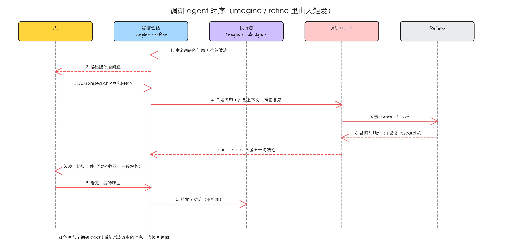

# 设计调研交给一个由人调起的调研 agent，结果以一页 HTML 给人看

> 2026-10-20 与人 grill 过：调研从 imagine / refine 的流程里拿出来，统一由人调 `uiux-research`；先这样协作一阵子，再看怎么把它更好地融进流程。

## 1 问题

复现在 2026-10-18 做，对象是 main（idea-loop 0.0.24）和 2026-10-17 Toeflair（本地 TOFEL-demo）里两场真实的 `uiux-imagine` 会话；2026-10-20 又翻了全部会话记录（含子代理），找出真正调过 Refero 的设计会话，看调研实际帮了什么。这几条都是「缺一个能力」，没有可截的界面，证据是对会话记录的统计和对插件现状的核对。

### 1.1 每查一个具名问题，imagine 会话就多出两三万 token 的调研过程

**复现到的**：把会话记录里相隔 10 分钟内的 Refero 调用算成「一次调研」，数这次调研期间会话的工具调用和上下文增长：

| 会话（spec） | 调研的问题 | 工具调用 | 会话上下文 |
|---|---|---|---|
| 报告页失败状态（`qb-app-analysis-stream-unmount`，imagine 第 4 轮） | 失败页 / 出错插图怎么做 | 7 次（搜 3 次、取图 4 次） | 29.7 万 → 31.6 万 |
| 结束练习确认（`qb-app-lr-end-session-confirm`，第 2 轮） | 退出确认弹窗怎么摆 | 9 次（搜 5 次、取图 4 次） | 20.6 万 → 22.8 万 |
| 同上（第 3 轮） | 暂停后怎么恢复 | 4 次（流程、截图各查一次） | 30.0 万 → 33.1 万 |

取图那一步把参考截图整张塞进会话（单次 1.2–6.5 万字符）。这些图人看过一次就没用了，但它们一直留在会话里，跟着后面的每一轮。

**本该是**：调研的过程留在别处，会话里只多出一份文件的路径和一句结论。

### 1.2 参考图有没有摆给人看，靠每次临场发挥

**复现到的**：同一天两场 imagine：一场在第 4 轮把四张 Refero 参考临时拷到对比页旁边摆出来；另一场第 2 轮把调研结论写成聊天里的一段文字，人看不到原图。refine 里 designer 查过的参考只在 ledger（designer 的打磨日志）里记一行，人看不到。插件里没有「参考图落到哪、怎么摆给人」的约定。

Toeflair 的项目记忆里写着当初刻意把调研留在主会话的原因：人要亲眼看参考图和从中提炼的取舍，才能自己判断、中途纠偏。

**本该是**：每次调研都产出一页人能直接打开的结果：参考截图按 flow 排好，旁边写清这个设计为什么长成这样。

### 1.3 调研几乎都是人发起的，而且只有回答 UX 问题时才有用

**复现到的**：全部会话记录里真正调过 Refero 的设计会话只有 3 场（上面两场，加一场录音上传错误卡片的 imagine），共 6 次调研：

| 问题 | 谁提出 | 结果 |
|---|---|---|
| 退出确认：入口用 X 还是箭头、弹窗怎么摆 | 人点名要查 | 入口改 X、删除按钮改红；人看到 Promova 后整个弹窗照它的骨架做 |
| 暂停后怎么接着练 | 人点名要查 flow | 找到录音前 3-2-1 倒数的 flow，做成变种，人选了它 |
| 失败页要不要卡片 | 人点名要查 | 白底上卡片没有存在理由，人选了无卡片版本 |
| 错误卡标题怎么写得轻松 | 人点名要查 | 人改用「感叹词 + 平实事实」 |
| 失败条目归档动效 | refine 评委的 finding，designer 自己查 | 搜到的全是招聘页，没改任何东西 |
| 弹窗出现时要不要暂停 | 同第一行 | 静态截图答不了 |

- 6 次里 5 次是人看了变种之后点名要查；模型自己卡住主动去查的一次都没有。
- 有用的几次都在回答「别人验证过的做法是什么、为什么」：UX 惯例、一个没画过的流程、一句文案的语气。每次都在下一轮直接变成一个变种或一条裁决。
- 没用的两次都是时间 / 行为维度的问题，静态截图答不了；其中一次是 refine 后期由评委触发的。

**本该是**：调研由人决定什么时候查；执行者拿不准时把问题摆出来，而不是默默猜或自己去查。

### 1.4 调研怎么查，三个调用方各自从同一份契约里读一遍；imagine 那边还指向一个不存在的 agent

**复现到的**：引用研究契约（`references/design/research-backend.md`）的有三处——uiux-imaginer 的「参考研究」一节、designer 遇到 `pattern` 类 finding 时、静态 UI 协议的 C 段。每处都要求执行者自己读契约、自己选层、自己查、自己写三行记录。0.0.25 把 imagine 抽成 uiux-imaginer 时写了「调研由你自己起一个调研 agent 做」，但插件里没有这个 agent。

**本该是**：怎么查、怎么记只写在一处，由一个执行者负责。

复现材料：`.tmp/to-spec/design-research-agent/repro/2026-10-18-findings.md`

### 1.5 根因

- 1.1：调研的执行写在 imagine 的流程里，由执行设计的那一方亲自跑；Refero 取图工具的返回是图片本身，不落盘，所以只能进上下文。
- 1.2：研究契约只规定了文字记录（三行）落在哪，没规定参考图落在哪、谁摆给人。
- 1.3：契约把「什么时候查」交给执行者判断（第一批变种之后、有具名问题时），实际上执行者从不主动查；人想查时又没有自己的入口，只能在对话里让执行者去查。
- 1.4：契约是一份「怎么做」的说明，没有执行者；每个调用方都得自己当执行者。
- 可行性：子代理能调 Refero；搜索结果里带参考截图的下载地址，参考图能落到本地。

## 2 方案

新增一个 skill `uiux-research` 和它背后的调研 agent：

- **入口是 skill**：人在任何会话里调 `/idea-loop:uiux-research <具名问题>`；imagine / refine 之外的普通对话里，模型也可以自己调。imagine / refine 的编排者只在人说要查时才调。
- **执行者是调研 agent**：拿一句具名问题、产品上下文和一个落图目录，查 Refero，把参考图下载下来，写一页 `index.html`——结论、不能回答什么、每个来源一组按 flow 排好的截图配三段解构——交回这页的路径和一句结论。Refero 的调用只发生在它那里。
- **imagine / refine 里不再自己调研**：uiux-imaginer、designer、静态 UI 协议 C 段都不再查参考。拿不准的 UX 问题写成「建议调研的问题」加推荐做法放进交回，不停下等人，先按推荐做法往下走。
- **接回流程由人决定**：编排者把 HTML 发给人；人看完决定转哪些，编排者再把文字结论转给执行者，不给图。imagine 开工前查到的结论以文字写进交给种子子代理的需求。

## 3 User Stories

backlog 模式不画场景树，每条问题一行期望行为，编号对应 §1。

1. **会话只收结果**：作为跑 imagine / refine 的人，调一次 `uiux-research` 之后，会话里只多出一页 HTML 的路径和一句结论，没有搜索和取图的过程，也没有塞进会话的整张截图。
2. **对着原图看为什么**：作为跑 imagine / refine 的人，每次调研我都能打开一页 HTML，按 flow 看到别人的截图，以及每个来源「这个场景下、为了解决什么、所以 UI 长这样、对我们能借什么」。
3. **我决定查什么、转什么**：作为跑 imagine / refine 的人，执行者拿不准的地方会以「建议调研的问题」摆给我；我决定要不要查，看完结果再决定把哪些结论交给执行者。
4. **一处执行**：作为维护 idea-loop 的人，怎么选层、怎么查、怎么记只写在调研 agent 和它读的契约里；uiux-imaginer、designer、静态 UI 协议不再各自带一份调研流程。

## 4 实现决策

issue #46 定下的边界（不下方向结论、不做 reference-averaging、不改画布、不跟人对话、参考图必须落本地）照旧。下面是 grill 里定下、或与 issue 不同的部分。

### 4.1 谁来调：人

- `uiux-research` 不设 `disable-model-invocation`：普通对话里人说「查一下别人怎么做」，模型可以自己调。
- imagine / refine 的编排者**只在人说要查时调**；uiux-imaginer、designer 不起调研 agent，也不调 Refero。
- 与 issue 不同：issue 设想由执行者起调研 agent。改成人调的依据是 §1.3——调研几乎都是人发起的，执行者从不主动查，refine 里执行者自己查的那次没有用处。先这样协作一阵子，再看怎么融进流程。

### 4.2 执行者拿不准时：写「建议调研的问题」

- uiux-imaginer 想 UX 时碰到要拍脑袋的地方，designer 碰到 `pattern` 类 finding 且凭判断定不了，静态 UI 协议 C 段的执行者遇到具名问题：都写成一句具名问题加推荐做法，放进这一轮的交回。
- 不停下等人：先按推荐做法往下做。编排者把它和这一轮的其它取舍一起摆给人。
- designer 的 `pattern` 路由改成：先凭判断改；定不了就写建议调研的问题，按推荐做法改。

### 4.3 调研的范围

- 查：UX pattern、user flow、某一类页面的通常做法、文案语气。走 Refero 的 screens / flows 层。
- 不查：视觉风格（styles 层）。视觉方向交给随机种子和 `DESIGN.md`；研究契约里「选定语言后可选的 styles 压力测试」一并删掉。
- 不再受「第一批变种出现之前不查」限制：调研回答的是 UX 问题，不决定 UI 长什么样，UI 的发散由种子负责。人可以在 imagine 开工前查。
- 时间 / 行为维度的问题（某个动效、某个状态什么时候出现）静态截图往往答不了：调研 agent 照实写进「不能回答什么」，不硬凑参考。

### 4.4 交回：一页 HTML

- `index.html` 单文件，图用相对路径引用同目录下载的截图，`file://` 能直接打开；编排者用发文件的方式给人。
- 页面顶部：这次的具名问题、一句结论、不能回答什么。
- 每个来源一节：一组按 flow 顺序横排的截图，每步下面标这一步在做什么；旁边三段解构：
  1. **场景**：哪个产品、什么用户、要完成什么任务；
  2. **设计逻辑**：用了什么 pattern / flow，它解决了什么问题，所以 UI 长成这样；
  3. **对我们**：能回答什么、不能回答什么；保留 / 修改 / 不要照抄。
- 交回给调用方的只有 `index.html` 的路径和一句结论。
- 研究契约的「三行记录」改成这三段；reference-averaging 禁令保留。

### 4.5 落在哪

- 有 spec 时：`docs/design/tmp/<spec-slug>/research/<问题短名>/`。在 imagine 里调和在 refine 里调用同一个位置。
- 没有 spec 时：`docs/design/tmp/research/<问题短名>/`。
- 都不进 git，随 `docs/design/tmp/` 的生命周期删。uiux-imaginer 里原来的 `imagine/research/` 和它在收工时清理的那一步一并删掉。

### 4.6 接回流程

- 人看完 HTML，说要把哪些转给执行者；编排者把对应的解构文字（不给图）作为这一轮的意见转给 uiux-imaginer 或 designer。人不说，编排者不转。
- imagine 开工前查到的结论：编排者在起 uiux-imaginer 时把文字带上，uiux-imaginer 把它写进交给种子子代理的需求。种子子代理不接触参考图。
- 用上的结论由执行者照现有规矩记下：imagine 记进方向说明的「约束与素材」，refine 记进冻结记录。

### 4.7 模型与工具

- 调研 agent 钉 `opus` · medium（同 implementer 在定义里钉模型的写法）。解构「为什么这样设计」是判断活；调研由人手动触发，次数少。
- 工具：Refero 的几个工具、下载截图的 `curl`、在落图目录里写文件。不给浏览器，不起子代理。

## 5 技术方案总览

### 5.1 后端

这里的「后端」是插件里的 skill、agent、Refero 和本地目录。时序见 §2 的图：红色是本 spec 新增的消息，虚线是响应。

- 新增 `skills/uiux-research/SKILL.md`：把人的话收成一句具名问题，定落图目录，起调研 agent，拿到路径后把 HTML 发给人；在 imagine / refine 会话里，人说要转时把文字结论转给执行者。
- 新增 `agents/uiux-researcher.md`（名字随实现定）：输入具名问题、产品上下文（`DESIGN.md` 路径、一句话描述当前在做什么）、落图目录；输出 `index.html` 路径和一句结论。
- `references/design/research-backend.md` 改成写给调研 agent：去掉「第一批变种之前不读」和 styles 层、三行记录改三段解构、加 HTML 交回格式。
- `agents/uiux-imaginer.md`：§6 改成「不调研；拿不准写建议调研的问题」，删掉 `imagine/research/` 及其清理；交回里的「参考图路径」改成「建议调研的问题」；开工时接编排者带来的调研文字，写进种子子代理的需求。
- `skills/uiux-imagine/SKILL.md`、`skills/uiux-refine/SKILL.md`：编排者在人说要查时调 `uiux-research`，人说要转时转文字。
- `agents/designer.md`：`pattern` 路由改成 §4.2。
- `references/design/static-ui-protocol.md` C 段：同 §4.2。
- README、仓库 `CLAUDE.md` 的 idea-loop 描述：skill 数加一、agent 列表加一。

### 5.2 前端内部

不涉及。

### 5.3 前端交互

不涉及。调研的 HTML 是一份给人读的文件，不是产品界面；imagine 的变种板、refine 的画布都不改。

## 6 测试决策

| 变的是什么 | 仪器 | 本次 |
|---|---|---|
| 纯逻辑 / 数据转换 | TDD 单元 | 碰到一处：如果给 `index.html` 加形状校验脚本（每个来源三段齐、引用的图都存在、有「不能回答什么」），照现有脚本旁的 `*.test.mjs` 写。不加脚本就不涉及。 |
| API 契约 | TDD API 测试 | 不涉及。 |
| DB schema / 迁移 / 并发 | 真 DB 测试 | 不涉及。 |
| LLM 输出质量 | eval | 碰到：新 skill、新 agent 和改动的说明都是提示词改动，按仓库约定走 vibe 迭代；另给 `uiux-research` 建一个 baseline（人的决定，2026-10-20）：取以前真实会话里调研过的几个问题作 default prompt，配最小产品上下文，跑出的 HTML 交给人看、人标注问题，逐步收敛产物该包含什么，不预设内容断言。imagine / refine 原来的 baseline 已于 2026-10-19 删除，这两段的回归改由交付验收时真实跑一轮来看。 |
| 视觉正确性 | UI 实现环 | 不涉及。 |
| 端到端用户流程 | 浏览器测试 | 碰到：在 Toeflair 上跑一轮 imagine，人调一次 `uiux-research`，走一遍「起调研 agent → 图和 HTML 落本地 → 发给人 → 人说转 → 执行者收到文字」。 |

- **seam**：`uiux-research` 的交回（一个 HTML 路径加一句结论）和落图目录是唯一的 seam；有校验脚本的话，seam 是脚本的命令行入口和退出码。
- **增量功能测试**：
  - 会话只收结果：人在 imagine 中途调 `uiux-research`；期望——会话里只出现 HTML 路径和一句结论，没有 Refero 调用和整张截图。覆盖 1。
  - HTML 能读：期望——`file://` 打开即可看到按 flow 排的截图和三段解构，顶部有「不能回答什么」。覆盖 2。
  - 不自动转：人看完不表态；期望——编排者不把结论转给执行者。人说转；期望——执行者收到的是文字，没有图。覆盖 3。
  - 执行者不自己查：跑一轮 imagine 和一轮 refine；期望——uiux-imaginer、designer 的记录里没有 Refero 调用；拿不准的地方以「建议调研的问题」出现在交回里。覆盖 3、4。
  - 开工前调研：人在 imagine 前调一次；期望——种子子代理收到的需求里有调研的文字结论，没有图。覆盖 3。
- **prompt / eval 变动**：新增 skill 与 agent 的定义；改研究契约、uiux-imaginer、uiux-imagine、uiux-refine、designer、静态 UI 协议 C 段。新增 `uiux-research` 的人工标注 baseline。
- 先例：`agents/ui-master.md`（调用方每次新起、交回即结束）、`agents/explorer.md`（在定义里钉模型的写法）。

## 7 Out of scope

- 把调研自动融进 imagine / refine（执行者自己起调研 agent、编排者自动转结论）。先由人调一阵子，再另开 issue。
- 让 ui-master 稳定给出 UX / flow 层面的意见（现在它只看截图和动效帧）。
- `design-modeling` 接这个 agent（styles 压力测试已删）。
- 换掉 Refero 或加别的调研来源。
- 把 imagine 本身抽成 agent（#47，已随 [[uiux-imagine-agent]] 合并）。

## 8 关联

- #46 idea-loop：把设计调研（Refero research）抽成单独的 agent——本 spec 的来源。
- [[uiux-imagine-agent]]（#47，已合并）：uiux-imaginer 现在引用了一个不存在的调研 agent，本 spec 把那一句改掉。
- [[ui-state-archive]]（#28，已合并）：定了 `docs/design/tmp/<spec-slug>/` 这个过程产物目录，§4.5 的落图位置跟着它走。
- [[0002-design-loop-v2-imagine-refine]]：imagine / refine 现在的结构。
