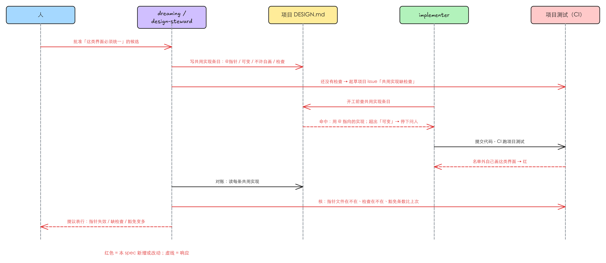
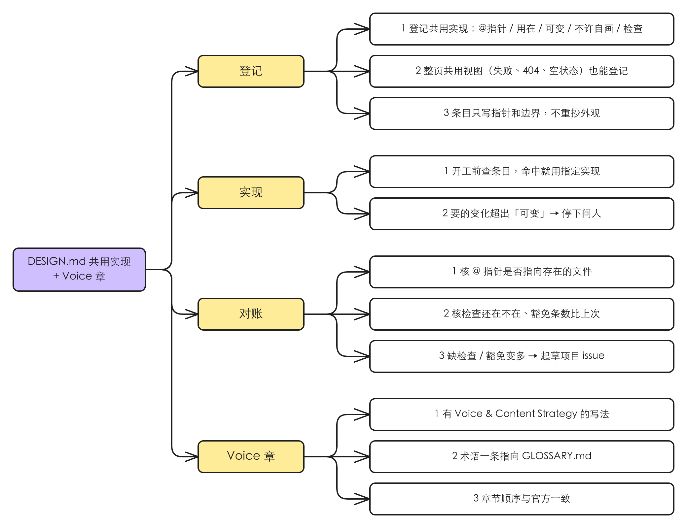

# DESIGN.md 登记共用实现，补 Voice 章

> #366 存在：DESIGN.md 的 Components 只写组件长什么样，没有写法登记「这类界面必须用哪个实现」，对账也查不出页面自己再画了一套，详情在「问题陈述」

## 问题陈述

### 1. 该共用的界面被页面各自手写，规则和对账都发现不了

真实例子（项目侧，Toeflair）：整页失败页。写作、报告用的是共用失败页组件；Interview、Listen & Repeat 做题页一直手写自己的「出错了」版式（感叹号图标、大白容器、没有重试），直到人看交付截图指出「这个设计算作ai slop」，才在 Tofelair PR #1010（2026-11-17 合并）里换成共用组件。改前改后截图在项目侧那份 spec `docs/spec/interview-load-error-i18n/` 的「前端交互」。

插件这边为什么拦不住，2026-11-19 对着 origin/main（`fcb2069`）核：

- `idea-loop/skills/design/design-modeling/references/chapters.md` 的 Components 条目只规定写「颜色、字阶、圆角、内边距、尺寸，一句用途，以及状态」，判别是「配方换到任何一个页面都成立」，并把「页面级结构」排除在外。没有任何写法能说「这类界面必须用某一个实现」；整页失败视图这种被一组页面共用的页面级视图，按现在的判别还进不来。
- `design-modeling/references/reconcile.md` 和 `design-steward` 的对账只拿 DESIGN.md 的数值量代码；页面没用共用实现、手写了一份差不多的，对不出来。
- `implement/references/ui-tickets.md` 只要求「项目已有的类原样复用」「token 归因写得出来」，没有「这块界面有指定实现就用它」。
- 分拣证据：#366 上 2026-11-18 的「🤖 idea-loop：」评论，查重、「不做」清单、是否已实现都核过，结论是真缺口。

外部旁证（2026-11-19 调研，见 raw）：Atlassian 实测 DESIGN.md 只给重新实现的配方，agent 更倾向重画组件而不用现有的；他们靠「告诉 agent 怎么 import 现有组件」加 lint 规则强制。

### 2. 插件的章节表比官方规范少一章 Voice & Content Strategy

- 官方规范（google-labs-code/design.md `docs/spec.md`，2026-11-19 读 main）的章节顺序是 Overview、Colors、Typography、Layout、Elevation & Depth、Shapes、Motion & Micro-interaction、Voice & Content Strategy、Components、Do's and Don'ts。Voice 章管界面文案，其中一条就是「空、加载、错误状态说什么、错误是否给出下一步」。
- 插件 `design-modeling/SKILL.md`「正文」的章节表没有 Voice 章，Motion 标成「扩展」排在 Do's and Don'ts 之后，与官方顺序不一致；`idea-loop/docs/design-modeling.md` 第 109 行列的八章同样没有。失败页的文案规则因此在 DESIGN.md 里没有一处能写。

### 根因

1. Components 的写法照官方早期规范只收「组件原子的配方」。官方 2026-11-17 起允许 Components 用 `` `@<路径>` `` 指向真实实现（PR #180），插件没跟上，也没有对应的检查。
2. 官方 2026-11-17 才加 Voice & Content Strategy 章（PR #183），Motion 也已进入正式顺序；插件的章节表是之前照抄的。

## 方案



改完，用户（维护项目设计规范的人和读它的 agent）得到：

- DESIGN.md Components 章里能写一种新条目「共用实现」：一类界面（组件，或被一组页面共用的整页视图，如整页失败、404、空状态）必须用的那个实现，用官方的 `@` 引用指向它，写明可变的部分、不许自己画的部分，以及拦住违规的那个项目测试。
- 实现 UI 工单前先查这些条目，命中就用指定实现。
- 对账时每条共用实现都被核：指针还在不在、检查还在不在项目测试里、豁免清单比上次多了还是少了。
- 章节表与官方一致：补上 Voice & Content Strategy，Motion 回到正式顺序。界面文案（含错误、空、加载状态说什么）有一处可写。

每条条目由什么决定：

| 输入 | 来自 | 决定什么 |
|---|---|---|
| 这类界面要不要全站统一 | 人（候选经 dreaming 蒸馏时人确认） | 有没有这一条 |
| 共用实现的文件 | 项目代码 | `@` 指针 |
| 允许按场景变的部分 | 人 | 「可变」一行 |
| 会红的检查 | 项目自己的测试 | 「检查」一行；豁免清单在检查旁 |

条目的形状（写进 chapters.md 的例子，通用名字）：

```markdown
- **整页加载失败视图** → `@src/components/FailureView.tsx`
  - 用在：任何一页的数据整页加载失败
  - 可变：插图、标题与说明文案（文案照 Voice & Content Strategy）
  - 不许自画：版式、按钮样式、重试动作
  - 检查：`failure-view-source.test.ts`（名单外自己画整页失败视图就红；存量违规的豁免清单在它旁边，只减不增）
```

同一行为的其他入口：

- `design-modeling` 的「新建」（`references/new.md`，uiux-imagine 开工时写第一份）：**纳入**章节顺序与 Voice 章（照 chapters.md 写）；**不主动登记**共用实现条目，理由：条目要人判「必须统一」并要有项目测试，新建时两样都没有，之后走候选。
- `design-modeling` 的「蒸馏」（`references/distill.md`）：**纳入**。候选里写「共用实现」的，蒸馏时照条目形状落笔；还没有检查的，照写条目，同时在缺陷节起草「共用实现缺检查」的项目 issue。
- `designer`、`uiux-imaginer`、`ui-master` 读 DESIGN.md：**纳入核对，不改**，它们整份读，条目自然可见。
- `pr-reviewer`：**排除**，违规由项目测试在 CI 里拦，review 不重复判。
- `idea-loop/docs/design-modeling.md`（插件的人读文档）：**纳入**，章节列表同步。

## User Stories



**登记**

1. 作为维护设计规范的人，我想在 DESIGN.md Components 里登记一类界面必须用的共用实现（`@` 指针、用在哪、可变、不许自画、检查），以便人和 agent 都知道这类界面不许另画
2. 作为维护设计规范的人，我想让被一组页面共用的整页视图（整页失败、404、空状态）也能这样登记，以便它们不被「页面级结构不进」挡在外面
3. 作为维护设计规范的人，我想让共用实现条目只写指针和边界、不重抄外观配方，以便外观只有共用实现一处

**实现**

1. 作为实现 UI 工单的 agent，我想开工前查 DESIGN.md 的共用实现条目，命中就用指定实现，以便不照着画布再画一份
2. 作为实现 UI 工单的 agent，我想在要的变化超出条目「可变」范围时停下问人，以便不悄悄另起一套

**对账**

1. 作为维护设计规范的人，我想对账时看到每条共用实现的 `@` 指针是否还指向存在的文件，以便指针失效时知道
2. 作为维护设计规范的人，我想对账时看到每条的检查是否还在项目测试里、豁免清单比上次对账多了还是少了几处，以便知道统一的进度
3. 作为维护设计规范的人，我想缺检查或豁免变多时得到一条起草好的项目 issue，以便有人去补

**Voice 章**

1. 作为写 DESIGN.md 的 agent，我想有 Voice & Content Strategy 一章的写法（语气、大小写、按钮文案、空 / 加载 / 错误状态文案、数字日期单位），以便界面文案规则有一处可写
2. 作为写 DESIGN.md 的 agent，我想 Voice 章的术语一条指向项目的 `GLOSSARY.md` 而不重抄，以便一条规则只写一处
3. 作为写 DESIGN.md 的 agent，我想章节顺序与官方一致（Motion 第 7、Voice 第 8、Components 第 9），以便官方 lint 与读它的工具不报顺序问题

## 实现决策

- **条目写在正文 Components 章，不进 front matter。** 依据：`design-modeling/SKILL.md`「Front matter」：front matter 是「设计系统的全部数值」，用途说明写正文；共用实现不是数值。
- **用官方的 `@` 外部引用写指针，不只写组件名。** 依据：官方规范「External References」与「Components」：Components 可用 `@<路径>` 指向组件源码，`broken-ref` 规则核目标在不在（人在本会话认可，raw U3）。路径按官方规定从 DESIGN.md 所在目录解析，不能以 `/` 开头、不能出目录。
- **官方 lint 现在核不了 `@` 指针，对账自己核文件在不在。** 实测 npm 上的 `@google/design.md` 0.4.0（2026-07-27）对缺失的 `@` 目标不报；带 `broken-ref` 的版本发布后，这一步改由官方 lint 报，对账照「官方 lint 的 warning」处理。design-md-hook 用 `@latest`，不用改。
- **Components 的判别加一条：被一组页面共用的整页视图，以共用实现条目进。** 依据：`design-modeling/SKILL.md`「准入分层表」已写产品设计系统层收「页面家族的复用机制……跨页、只属于本产品、能被检查」。普通的页面级结构（首页 hero）仍不进。
- **共用实现条目不重抄外观配方。** 外观由共用实现本身承载；条目只写指针、用在哪、可变、不许自画、检查。依据：五条写法规则第 2 条「一条规则只写一处」，以及 Atlassian 的实测（raw A3）。共用实现内部用到的 token 照旧在 front matter。
- **检查由项目自己写，放在项目测试里跟 CI 跑；插件不提供扫描脚本。** 依据：人认可（raw U3）；插件目录不在项目仓库里，项目 CI 跑不到插件脚本；判断「像不像失败视图」用的是项目自己的写法（先例：Toeflair #764 的转圈图标源码扫描）。chapters.md 只规定检查要满足：名单外自己画就红；先在违规还在的提交上见它红。
- **豁免清单放在检查旁边，不进 DESIGN.md，只减不增。** 依据：`design-modeling/SKILL.md`「明确不进 DESIGN.md 的内容」排除已知缺陷、迁移计划。
- **对账新增一类发现「共用实现」**，写进 `reconcile.md`，`design-steward` 经 dreaming 的 `design-md-reconcile.md` 落成提议表行：
  - 指针失效 → `DESIGN.md 条目` 一行，交人裁决（改指针 / 删条目）。
  - 检查不在了或从没有过 → `缺陷` 节起草项目 issue「共用实现缺检查」。
  - 豁免清单条数：每次对账报当前条数，与上次对账（上一次 dreaming 的提议表）比；变多 → `缺陷` 节起草项目 issue；变少或持平只报不提。
- **实现前查条目。** `implement/references/ui-tickets.md` 加一节：建一块 UI 前查 DESIGN.md 的共用实现条目，命中就用指定实现；要的变化超出「可变」就停下，交人判（加进「可变」还是另起）。
- **补 Voice & Content Strategy 章，章节顺序照官方。** 依据：官方规范「Section Order」，人决定本 issue 一起做（raw U3）。SKILL.md 的章节表与 chapters.md 改成：Overview、Colors、Typography、Layout、Elevation & Depth、Shapes、Motion、Voice & Content Strategy、Components、Do's and Don'ts，后接扩展的 Responsive Behavior、Known Gaps。Motion 去掉「扩展」二字，章名沿用「Motion」（官方列为认可的别名）。
- **Voice 章的术语只指向 `GLOSSARY.md`。** 项目有 `GLOSSARY.md` 的，Voice 章的术语一条写「术语以 GLOSSARY.md 为准」，不重抄词表；没有的才在 Voice 章写。依据：五条写法规则第 2 条；`idea-loop:glossary` 管术语表。
- **改的是给 agent 读的文档**，对的杠杆：chapters.md 与 SKILL.md 章节表是「写法规则」；reconcile.md 与 design-md-reconcile.md 是「流程步骤」；ui-tickets.md 是「开工前的输入」。SKILL.md 主体改后仍 < 5000 字。
- **版本**：新增能力（一种条目、一章、一类对账发现），老用法照常能用，idea-loop `plugin.json` 升 minor。

## 测试决策

| 变的是什么 | 仪器 | 本次 |
|---|---|---|
| 纯逻辑、数据转换、状态机 | TDD 单元测试 | 不涉及 |
| API 契约（路由、schema、序列化） | TDD API 测试 | 不涉及 |
| DB schema、迁移、并发与事务语义 | 真 DB 测试 | 不涉及 |
| LLM 输出质量（prompt 改动） | eval（确定性断言） | 改的是 skill / reference 文字里能机械判定的规则（必含的条目形状、章节顺序、对账发现），走文档检查，不做回放 |
| 视觉正确性 | UI 实现环 | 不涉及 |
| 端到端用户流程 | 浏览器端到端测试 | 不涉及 |

- **seam**：插件文档文字本身，一个文档检查 `design-shared-implementations-doc.test.mjs` 读 `design-modeling/SKILL.md`、`references/chapters.md`、`references/reconcile.md`、`references/distill.md`、`dreaming/references/design-md-reconcile.md`、`implement/references/ui-tickets.md`、`idea-loop/docs/design-modeling.md`。能抓到：条目形状缺字段、章节顺序回退、对账漏掉共用实现、实现前不查条目；漏掉：agent 实际运行时是否真的照做（要回放，不在这次验）。
- **增量功能测试**（都先在 origin/main 上跑，见它红）：
  - 前置：改后的 chapters.md。步骤：跑文档检查。期望：Components 条目里有「共用实现」写法，含 `@` 指针、用在、可变、不许自画、检查五项，并写明整页共用视图以这种条目进、条目不重抄外观。覆盖：登记 1、2、3。
  - 前置：改后的 ui-tickets.md。期望：有「查共用实现条目、命中就用、超出可变就停下」。覆盖：实现 1、2。
  - 前置：改后的 reconcile.md 与 design-md-reconcile.md。期望：对账表有「共用实现」一类，含指针失效、缺检查、豁免条数与上次比三种处置。覆盖：对账 1、2、3。
  - 前置：改后的 SKILL.md、chapters.md、`docs/design-modeling.md`。期望：章节表按官方顺序列出 Motion、Voice & Content Strategy、Components、Do's and Don'ts；chapters.md 有 Voice 章条目，术语一条指向 `GLOSSARY.md`。覆盖：Voice 章 1、2、3。
  - 已有检查不回退：`design-modeling-slim-doc.test.mjs` 对章节表的断言随之更新、仍过；`no-project-leak.test.mjs` 过（例子用通用名字）；SKILL.md 主体 < 5000 字。
- **照着谁写**：`idea-loop/scripts/design-modeling-slim-doc.test.mjs`、`explorer-reads-impl-decisions-doc.test.mjs`。

## Out of scope

- 项目侧的落地（Toeflair 的失败页条目与源码扫描测试）：在 Tofelair#1017 做，按本 spec 定的写法。
- 插件不提供通用的源码扫描脚本（见「实现决策」）。
- 不给已有项目批量回补共用实现条目：靠之后的 retro 候选与 dreaming 蒸馏逐条进。
- 官方 lint 发布带 `broken-ref` 的版本之后，对账里「自己核文件在不在」那一步可以收掉；不在本次做。

## 关联

- raw：[[2026-11-19-design-shared-implementations]]；写入标准：[[2026-10-19-design-md-standard]]
- 项目侧落地：guohaonan-shy/Tofelair#1017（等本 spec 合并后照写法做）
- 相邻未完成的 spec 与 issue：2026-11-19 查，`docs/spec/` 现有 12 份 spec 没有一份动 design-modeling 或 design-steward；`gh issue list --state open --label type:idea-loop/design` 除本 issue 外是 #288（画布控制面板）、#192（一条浏览器测试卡住），都不碰 DESIGN.md 写法，无重叠，谁先谁后不涉及。
