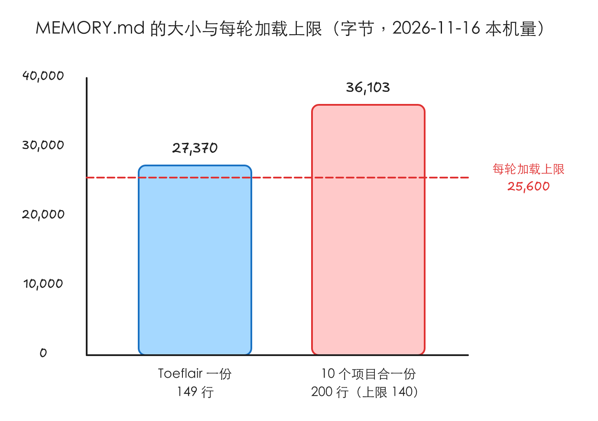
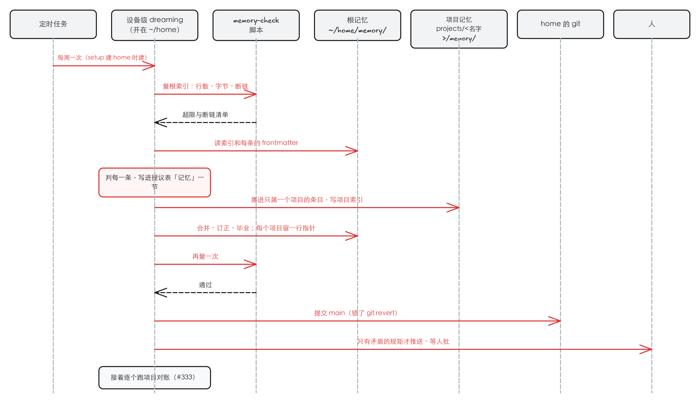
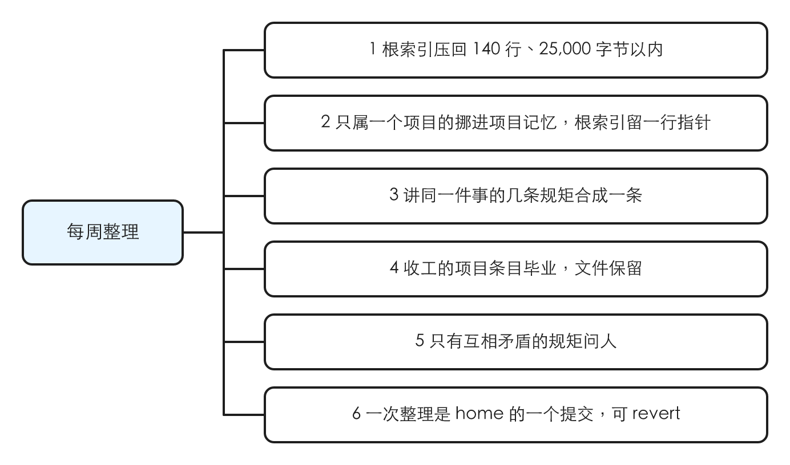
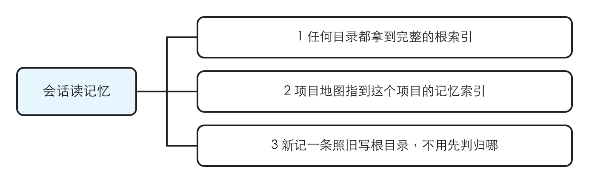

# 记忆一台设备一份：设备级 dreaming 每周整理记忆

> #332 存在：2026-11-16 在本机核：Toeflair 的 `MEMORY.md` 已经 27,370 字节，超过每轮加载的 25 KB，第 142–149 行每轮都读不到；10 个项目的索引合成一份是 200 行、36,103 字节，行数和字节都超上限，也没有任何东西会去压它。详情在「问题陈述」


## 问题陈述

0.2.0 的方向已定（决定记录 `docs/raw/issue-workflow/2026-11-15-home-repo-grill.md` 末尾「本轮决议」的「记忆」「迁移」两行）：用户级 `autoMemoryDirectory` 指到 `~/home/memory/`，全设备一份记忆。配置项由 #252 的 setup 改，10 个项目的旧记忆由 #247 复制进来；这份 spec 管的是合成一份以后谁来让它一直读得下。下面的数字都在 2026-11-16 对本机 `~/.claude/projects/*/memory/` 量。

### 1. 合成一份就超出每轮加载的上限



Claude Code 每轮只加载 `MEMORY.md` 的前 200 行或 25 KB（文档 code.claude.com/docs/en/memory.md）；决定记录 A4 的实测还看到，索引超过 140 行后再写一条，Claude Code 会报错要求压到 140 行以内、会话停下问人。

- 现在就有一份超了：Toeflair 的索引 149 行、27,370 字节，累计到第 142 行时过了 25,600 字节，`## project` 一节的最后 8 行（埋点、PostHog、同意横幅这些在飞的事）每轮都读不到。
- 10 个项目的索引加起来 200 行、36,103 字节，#247 一复制进 `~/home/memory/` 就同时超过 140 行和 25 KB。

### 2. 一个项目里记下的规矩，别的项目看不到；一个项目的事实，别的项目要一起背

记忆按 git 仓库分目录存（同一仓库的 worktree 共用），10 个目录共 253 条。按条目自己写的 `type` 数：feedback（工作方式规则）96 条，其中 71 条在 Toeflair。

- 跨项目的规矩只在一个项目可见：Toeflair 的「只用中文不双语」「PR 开出≠授权合并」只在 Toeflair 的会话里加载，在 harold-skills 开会话看不到。
- 合成一份后反过来：只跟 Toeflair 有关的条目（`is_real_exam` 怎么标、2026-09 新题批次到哪了）会出现在每个项目的每一轮里。Toeflair 一家的 project 类 96 条、reference 类 31 条。
- `type` 不等于归属：feedback 里也有只属一个项目的，例如 Scriben 的「Don't open/merge PRs unprompted」正文第一句是「On Scriben, do NOT push a branch…」。

### 根因

- 问题 1：没有任何流程量索引、压索引。Claude Code 只截断，不压缩；dreaming 的扫描范围是 `docs/` 和几份顶层文件，不含记忆（`idea-loop/skills/productivity/dreaming/SKILL.md` 的「纪律」）。
- 问题 2：记忆的作用域是「git 仓库」，没有「设备」和「项目」两层；`autoMemoryDirectory` 只解决了「合成一份」，没有解决「项目的东西放回项目」。

## 方案

改完后：一台设备上只有一个每周 dreaming 定时任务，开在 `~/home`。它每次先整理记忆，再逐个跑项目清单里各项目的对账（后者怎么跑归 #333）。整理完，根索引 `~/home/memory/MEMORY.md` 只装跨项目的规矩和每个项目一行指针，并且在 140 行、25,000 字节以内；只跟一个项目有关的条目挪进 `~/home/projects/<名字>/memory/`，有它自己的索引，项目地图指过去。整理全自动，直接提交到 home 的 main，错了 `git revert`；只有两条规矩互相矛盾时停下问人。

决定会话看到什么的输入只有两样：根索引（每轮由 Claude Code 自己加载），和会话所在项目的项目地图（#252 的 SessionStart hook 注入，里面一行指到这个项目的记忆索引）。



红色是这份 spec 新增的消息，虚线是返回。最后一格「逐个跑项目对账」是 #333 的，画出来只为说明记忆一段在它之前。

### 整理之后的形状

```
~/home/
├── memory/                         # autoMemoryDirectory（#252 设）
│   ├── MEMORY.md                   # 根索引：跨项目的条目 + 「## 项目」一节每个项目一行指针
│   └── <条目>.md                    # 跨项目的条目
└── projects/<名字>/
    ├── AGENTS.md                   # 项目地图（#252），有一行指到下面的索引
    └── memory/
        ├── MEMORY.md               # 项目记忆索引，格式同根索引，不每轮加载
        └── <条目>.md                # 只跟这个项目有关的条目，文件格式不变
```

根索引的「## 项目」一节，一个有项目记忆的项目一行：`- [toeflair 的项目记忆](../projects/toeflair/memory/MEMORY.md) — 127 条：题库批次、埋点、prod 操作`。这就是决定记录 Q9「原处留链接」的落法：条目挪走，原处留的是这一行。

### 一次记忆整理

dreaming 自己做，不起 agent（跟「漏归档」「retro 候选」同一类），步骤写进 dreaming 自己的一份参考文件，SKILL.md 主体只加一行指针。

1. **量**：跑 `memory-check`（新脚本，见下），拿到根索引的行数、字节数，以及断链、没进索引的文件。
2. **判每一条**：读根索引和每条的 frontmatter；只在要合并、要订正，或要判一条有项目出处（项目前缀、`originSessionId` 对得上某个项目）的条目归不归那个项目时读正文。没有项目出处的条目不为判归属读正文，留在根里。（2026-11-17 review 第 1 轮 S2，人选 A；原写「只在要合并、要订正时读正文」，跟下文「判归属看内容」矛盾。）每条落一行，进提议表新加的一节 `记忆`，建议处置的闭集：

   | 建议处置 | 什么时候 | 执行时做什么 |
   |---|---|---|
   | 挪进项目 | 只跟一个项目有关（判法见「实现决策」） | 文件挪进 `projects/<名字>/memory/`，项目索引加一行，根索引删这一行；那个项目在「## 项目」里还没有指针就加一行 |
   | 合并 | 两条以上讲同一件事 | 保留内容更全的那份的路径，把另一份的内容并进去，删掉另一份，改掉指向它的链接 |
   | 订正 | 事实变了，或写着「下周」「这个月」这类相对时间 | 改正文和索引行，相对时间改成绝对日期 |
   | 毕业 | project 类条目的事已经收工（它点名的 issue / PR 已关闭或合并，或它自己写着已完成、没有待办） | 只从索引删这一行，文件保留；还在根目录的文件移进 `memory/graduated/`（`memory-check` 只查根目录下有没有漏进索引的文件） |
   | 删除 | 整条被别的条目取代，或说的东西已经不存在（文件、功能、流程都查不到） | 删文件和索引行 |
   | 缩短索引行 | 索引行带了该在正文里的细节 | 改写成一句钩子，≤150 字 |
   | 问人 | 两条规矩对同一情形给出相反的做法 | 不动，进问人的小表 |

3. **执行**：除「问人」外的行照建议处置做完，再跑一次 `memory-check`，退出码 0 才往下；仍超上限，按「先毕业、再挪进项目、再合并、最后缩短索引行」的顺序继续压，直到过。然后 `git add` 只加 `memory/` 和 `projects/*/memory/` 下自己改的文件，提交一次（`dreaming <日期>：记忆整理`）；home 有 `origin` 就推上去。
4. **问人**：有「问人」的行才有。照现在 dreaming「问人那份」的做法摆给人、用『推送』通知；人不回不挡任何东西。

**回滚**：人说「回滚某次 dreaming 的记忆整理」，在 home 里 `git revert` 那个提交。

### memory-check 脚本

纯量、不判内容，输入是一个记忆目录（默认 `~/home/memory/`）。报：根索引的行数与字节数是否在 140 行、25,000 字节以内；根索引和每份项目索引里的链接是否都指到存在的文件；根目录下有没有没进索引的条目文件；「## 项目」的每行是否指到存在的项目记忆索引。全过退出码 0，否则 2，逐条点名。没有已在用的工具量记忆索引，所以新增；写法照 `proposal-table-check`（导出纯函数 + 命令行入口）。

### 设备级定时任务

setup 的「每周 dreaming」一节改成：在建 home 的那一步之后建一个设备级任务，id `dreaming-home`，开在 `~/home`，已有就报给人；不再按仓库建 `dreaming-<仓库名>`。所以同一台设备上第二个项目跑 setup，这一步只报「已有」。本机已有的 `dreaming-<仓库名>` 任务由 #247 迁移时取消。

### 同一行为的其他入口

| 入口 | 纳入还是排除 |
|---|---|
| 会话里 agent 自己记一条（Claude Code 的自动记忆） | 纳入：照旧写进 `~/home/memory/` 根目录、不用先判归属，下一次整理再挪 |
| 人在任意会话里调 `/idea-loop:dreaming` | 纳入：全量跑时也先跑记忆一段；人可以说「只跑记忆」，只出 `记忆` 一节 |
| 人手动调 Claude 桌面端自带的 `consolidate-memory` skill | 排除：它在同一个目录上合并、删除条目，按 200 行收索引，不认项目目录；不调用它，见「实现决策」 |
| 会话开在 home 里 | 纳入：根索引照常加载；没有项目地图，所以看不到项目记忆的指针以外的东西，跟 #252 定的「home 里只有设备地图」一致 |
| 子代理 | 排除：子代理不加载自动记忆，照旧从调用方给的指针读 |

## User Stories

### 每周整理



1. 作为人，我想要根索引每周被压回 140 行、25,000 字节以内，以便每轮注入的记忆不被截断、写记忆时不被 Claude Code 报错拦下
2. 作为人，我想要只跟一个项目有关的条目挪进那个项目的 `memory/`、根索引留一行指针，以便别的项目的会话不背它
3. 作为人，我想要讲同一件事的几条规矩合成一条，以便索引不重复
4. 作为人，我想要已经收工的项目条目从索引毕业、文件保留，以便索引只留还在飞的事，翻旧账时文件还在
5. 作为人，我想要只有互相矛盾的两条规矩摆给我定，其余改动不问我，以便我只在会判错的地方花时间
6. 作为人，我想要每次整理是 home 的一个提交，以便错了 `git revert` 一次就回去

### 会话读记忆



1. 作为在任何目录开会话的 agent，我想要每轮拿到完整的根索引，以便跨项目的规矩在每个项目都生效
2. 作为在一个已登记项目里开会话的 agent，我想要项目地图指到这个项目的记忆索引，以便查这个项目的事实时知道去哪读
3. 作为在会话里记一条记忆的 agent，我想要照旧写进根目录、不用先判它归哪个项目，以便写记忆的方式不变

### 定时任务


1. 作为在一台设备上第一次跑 setup 的人，我想要 setup 建 home 时顺带建一个设备级 dreaming 任务，以便这台设备每周整理一次记忆
2. 作为给第二个项目跑 setup 的人，我想要 setup 不再给这个项目建 dreaming 任务，以便同一份记忆不被整理两次

## 实现决策

### 已定

- **设备上只有一个 dreaming 定时任务，全包**：记忆一段和各项目对账都在它里面，项目各自的任务取消。依据：2026-11-16 摆了「项目 dreaming 顺带跑、靠日期去重」和「home 单独一个任务」，人答「我倾向于设备纬度只有一个dreaming任务」；再问范围，人选「只剩一个，全包」。分工：任务的形状和记忆一段在这里；设备级 dreaming 怎么从 home 逐个跑项目对账归 #333；本机取消旧任务归 #247。
- **全自动，只有矛盾问人**：除「问人」外都不问，直接提交 home 的 main。依据：2026-11-16 摆了「全自动，只问矛盾」和「改规矩类都问人」，人选前者；跟 dreaming 现有的「只问会判错的两类」同一个口径（`idea-loop/AGENTS.md` 刻意例外第 1 条）。`proposal-table-check` 的 `splitAskRows` 把 `记忆` 一节里建议处置是「问人」的行判成问人的行，其余归自动。
- **项目记忆只留指针，按需读**：hook 不额外注入项目记忆索引。依据：2026-11-16 摆了「只留指针」和「hook 连项目记忆索引一起注入」，人选前者。代价：在 Toeflair 里问「2026-09 新题批次到哪了」，agent 要先读项目记忆索引再读那条，多 1–2 次 Read；换来 Toeflair 自己的会话每轮也不用背这些条目：它现在的索引里 project 一节 10,562 字节、reference 一节 5,414 字节（2026-11-16 量；摆题时说的「约 7 KB」是估错了，以这里为准）。#252 的 token 测量会覆盖这类问题。
- **项目地图要有一行指到项目记忆索引**：写进 #252 的项目地图模板；之后由 dreaming 重写地图（#333）时保留。这一行是项目记忆在会话里唯一的入口。
- **上限取 140 行、25,000 字节**：140 行是 Claude Code 写记忆时自己卡的线（决定记录 A4 实测）；25 KB 是文档写的加载上限，按小的读法取 25,000 字节。行数和字节两个都要过：Toeflair 现在 149 行就已经被字节卡住。项目索引不每轮加载，不设上限，只照同样的规则毕业和合并。
- **判归属的顺序**：先看出处，再看内容。出处有两种：#247 复制旧记忆时加的项目前缀（Q14「加项目前缀」）；frontmatter 里的 `originSessionId`，在 `~/.claude/projects/*/` 下找同名转录、取它的工作目录、按 git 远端对项目清单。出处只说明「在哪个项目里记下的」，是不是「只跟这个项目有关」看内容：正文点名了这个项目自己的东西（它的表、页面、脚本、产品术语），或像 Scriben 那条一样写着「On Scriben」，换到别的项目不改变做法，才挪。判不准的留在根里：留错多占一行，挪错会让别的项目看不到一条规矩。本机 253 条里 238 条带 `originSessionId`，但能找到转录的只有 60 条（旧转录被清理了），所以老条目靠前缀，`originSessionId` 主要给 #247 之后新记的条目用。
- **dreaming 自己做，不新增 agent**：输入是根索引（≤25 KB）加每条的 frontmatter，只在合并、订正时读正文，放得进编排者的上下文；dreaming 已经有「漏归档」「retro 候选」两段自己做的先例。依据：先扩展已在用的工具（`~/.claude/CLAUDE.md`「做方案」）。
- **不调用 `consolidate-memory`**：它是 Claude 桌面端自带的 skill（装在桌面端的 skills-plugin 目录下），能合并重复、改过期事实、收索引，最接近这件事；不调用它，因为：它只在桌面端有，公司虚拟机上的 CLI 会话和 magi 不一定有；它的规则跟这里的对不上（按 200 行收、把收工的项目条目退掉，而这里要按 140 行收、把项目条目挪进项目目录、矛盾要问人）。取用它的三条做法写进参考文件：合并时保留内容更全的那份的路径、相对时间改绝对日期、索引一行一句钩子。
- **中间物放 `~/home/.tmp/dreaming/<日期>/`**：dreaming 开在 home 里，提议表跟着放 home；home 的 `.gitignore`（#252 的 setup 写）加 `.tmp/`。
- **home 里不开 worktree、不开 PR**：home 只有 main、直接提交、只 add 自己写的文件（决定记录 Q12）。记忆一段只 add `memory/` 和 `projects/*/memory/` 下自己改的路径。
- **版本号**：这个 PR 不升。0.2.0 的版本号由父会话在整条集成分支合进 main 的 PR 里统一升（父 issue #331）；plugin-version 测试在这个 PR 上红是预期内。
- **已知限制**（找不到真实路径，不展开设计，人可以推翻）：dreaming 整理时正好有会话在写记忆，那一条这次不动、下周再整理，它对索引的改动不会被 dreaming 的提交带上（只 add 自己改的路径），但两边同时改同一行索引时以后写的为准；一条规矩同时属于两个项目、又不是全设备通用的，留在根里。

## 测试决策

| 变的是什么 | 仪器 | 本次 |
|---|---|---|
| 纯逻辑、数据转换、状态机 | TDD 单元测试 | 碰到：`memory-check`（行数、字节、断链、没进索引、项目指针）；`proposal-table-check` 新的 `记忆` 节（闭集、问人的判法） |
| API 契约（路由、schema、序列化） | TDD API 测试 | 不涉及 |
| DB schema、迁移、并发与事务语义 | 真 DB 测试 | 不涉及 |
| LLM 输出质量（prompt 改动） | eval（确定性断言） | dreaming 的 SKILL.md、新参考文件、setup 的「每周 dreaming」改了，按 `AGENTS.md` §5 不做 quantitative eval；改动的形状由文档测试守，真实效果由下面在本机跑的那次看 |
| 视觉正确性 | UI 实现环 | 不涉及 |
| 端到端用户流程 | 浏览器端到端测试 | 不涉及 |

- **seam**：
  - `memory-check` 的命令行：输入是一个临时记忆目录，输出是退出码和逐条点名。抓得到：超行、超字节、断链、漏索引、坏指针。漏掉：dreaming 判得对不对——由本机跑的那次看。
  - `proposal-table-check` 的导出函数（已有 seam）：喂一张含 `记忆` 节的表。抓得到：闭集外的处置被拒、「问人」行被 `splitAskRows` 抽出、其余不被抽出。
  - 文档测试（照 `dreaming-autonomous-doc.test.mjs`）：dreaming 的 SKILL.md 有记忆一段的一行指针、参考文件写了闭集和「只 add 自己改的路径」；setup 的「每周 dreaming」写的是 `dreaming-home`、不再出现 `dreaming-<仓库名>`。
- **增量功能测试**：
  - 每周整理 1：前置——临时记忆目录，根索引 150 行、26,000 字节，全部链接有效。步骤——跑 `memory-check`。期望——退出码 2，点名「超 140 行」「超 25,000 字节」两条。覆盖：每周整理 1。
  - 每周整理 2：前置——根索引一行指向不存在的文件，「## 项目」一行指向不存在的项目索引，根目录有一个没进索引的条目。期望——三条都被点名。覆盖：每周整理 2。
  - 每周整理 5：前置——一张提议表，`记忆` 节一行「问人」、一行「挪进项目」。期望——`splitAskRows` 只抽出「问人」那行；把建议处置写成「归档」，校验报闭集外。覆盖：每周整理 5。
  - 每周整理 1–4、6 与会话读记忆 1、2（在本机，#247 迁移时做一次，结果贴进 #247 的 PR）：前置——#247 已把 10 个项目的记忆复制进 `~/home/memory/`、切了 `autoMemoryDirectory`。步骤——在 home 里跑一次 dreaming 的「只跑记忆」。期望——`memory-check` 退出码 0；home 多一个提交、只动 `memory/` 和 `projects/*/memory/`；Toeflair 的「真题内容不可重写」在 `projects/toeflair/memory/`、「只用中文不双语」留在根里；在 harold-skills 开新会话问「回复用什么语言」能答出「只用中文」，在 Toeflair 开新会话问「2026-09 新题批次到哪了」能读到那条。覆盖：每周整理 1–4、6，会话读记忆 1、2。
- **照着谁写**：`memory-check` 照 `idea-loop/scripts/proposal-table-check.mjs` 与它的测试；文档测试照 `idea-loop/scripts/dreaming-autonomous-doc.test.mjs`。

## Out of scope

- `autoMemoryDirectory` 的配置项、`~/home/AGENTS.md` 写「回答前先按地图查」、home 的骨架和项目地图模板本身（#252）。
- 把 10 个项目的记忆复制进 `~/home/memory/`、加项目前缀、切目录、跑第一次整理、取消本机旧的 `dreaming-<仓库名>` 任务（#247）。
- 设备级 dreaming 怎么从 home 逐个跑项目对账、dreaming 重写设备地图和项目地图、项目知识库搬进 home 后的读写（#333）。
- 把记忆提炼成项目知识库里的 ADR、领域文档（记忆整理只挪文件，不改写成别的层）。
- 会话转录纳入记忆的原始材料（决定记录 Q8：这次不纳入）。

## 关联

- raw：[[2026-11-15-home-repo-grill]]（「记忆」「迁移」「查询入口」几行决议）；这次 triage 的三道题记在 `docs/raw/decisions/332.md`。
- 父 issue #331（0.2.0，集成分支 `release/idea-loop-0.2.0`）。
- [[home-bootstrap]]（#252，已合进集成分支）：这一刀依赖它的 home 骨架、项目清单、项目地图模板和 `.gitignore`；它的项目地图模板已有项目记忆指针那一行，`.gitignore` 加 `.tmp/` 由这一刀补。
- #333（triage 中）：设备级 dreaming 的「逐个跑项目对账」和地图的维护归它；「设备上只有一个 dreaming 任务」这条已在 2026-11-16 告诉它的会话。没有代码上的重叠：这一刀只加 dreaming 的记忆一段和 setup 的任务形状。
- #247（triage 中）：复制记忆、切目录、跑第一次整理、取消旧任务；它的 spec 要用这一刀的「只跑记忆」做第一次整理，所以这一刀先合（#252 的 spec 已写这个顺序）。
- [[0047-dreaming-triage-autonomous]]（#298，已合进 main）：定了 dreaming「只问两类、其余自动执行并合并」，这一刀的「只问矛盾」沿用它；home 上「直接提交、不开 PR」改的是它的「开 docs PR 自己合」，那部分归 #333。
