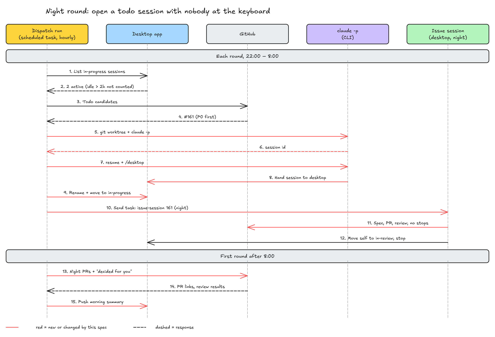
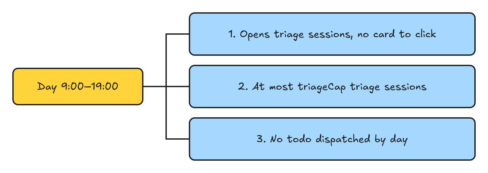
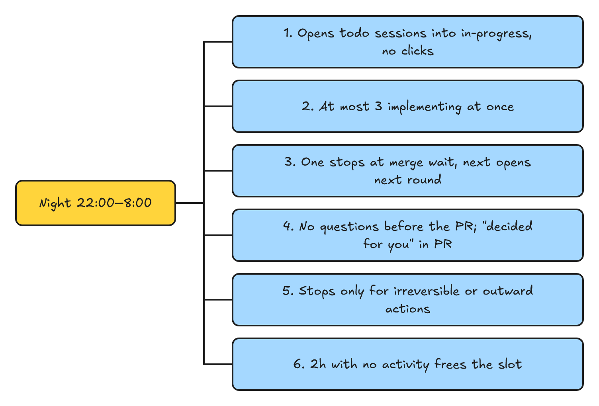
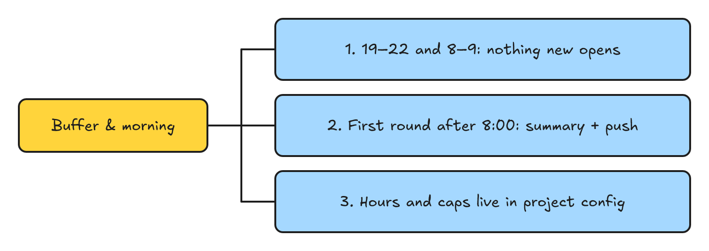

# 调度按时段分两种模式：白天开 triage，夜里开 todo 做到 review 完

> #379 存在：调度不分时段，定时触发的一轮只能出卡片，人睡着时夜里什么都开不起来；详情在「问题陈述」

## 问题陈述

### 1. 白天和夜里混在一起排，triage 排不上

调度每轮把 todo、triage 一起排，todo 先出，一轮最多 3 个。11-13 21:44、11-14 13:26、11-14 14:17、11-15 14:15 这四轮，3 个名额全给了 todo。当时 triage 会话一个都没开，3 个上限全空着，P0 的 #292 在 triage 最前面排着。

### 2. 人不在时开不了会话

定时触发的一轮只能出卡片，人点了会话才开。11-13 21:44 出的 #291 卡片，到 11-15 还没人点。

11-18 夜里人工试跑：00:05 调度会话在人刚说过话的那一轮里开了 3 个 todo 会话（#302、#137、#160）。之后整晚**没补上第 4 个**：调度只在它开的会话全部停下时被叫醒，叫醒的那一轮又开不了会话，00:10 之后下一次被叫醒是 13:56 人发消息。

11-18 triage 会话逐条实测，哪条路能在人不说话时开出一个**待在侧边栏分组里**的会话（Claude Code 2.1.299 → 2.1.327，桌面端，auto mode）：

| 怎么开 | 结果 |
|---|---|
| 定时触发、后台任务叫醒的一轮调 `start_session` | app 拒："Start sessions only on the user's own words to you here; this turn runs an automated event…" |
| 别的会话开出的会话，在第一轮里再开会话 | auto mode 判定拦（"Unsanctioned Communication"） |
| 桌面定时任务到点自己开会话 | 开得起来，但进不了分组："is a scheduled task run … can't be grouped" |
| `claude --bg` 开后台会话 | 跑得起来，桌面端看不见 |
| **`claude -p` 开会话，再在交互模式里 `/desktop` 交到桌面端** | **成：变成普通桌面会话，能改标题、能移进分组；在定时触发的一轮里做，全程没被拦** |

复现材料：`docs/raw/issue-workflow/2026-11-18-dispatch-day-night.md` 的实测表。

### 3. 会话停下来问人，夜里就卡住

todo 会话做到一半停下等人回话，夜里没人回，就占着名额到第二天。11-10 起的会话里，#157、#69 停在问「要不要开 worktree」。

### 根因

- 问题 1：调度只有一种排法，不知道人此刻在不在。
- 问题 2：运行环境里能在人不说话时开会话的，只有 `claude -p` 交到桌面端这一条；调度现在用的是 `start_session` 出卡片。
- 问题 3：issue 会话没有「人不在」的模式，碰到要人定的就停。

## 方案

改完之后，人得到的是：
- **白天 9:00–19:00**：调度只开 triage 会话，开好放进 triage 分组，等人来评估，不用点卡片；
- **夜里 22:00–8:00**：调度只开 todo 会话，每轮（每小时）固定开 1 个（11-20 起不看已经开着几个）。每个会话一路做到 PR review 完，停在等人说合并。整晚不用人点任何东西；
- **两段空档**（19:00–22:00、8:00–9:00）：不开新会话，留给人做缓冲；
- **8:00 之后的第一轮**：调度给人一份夜里的汇总，并推送一句话。

开哪种会话，由三样东西决定：这一轮的时刻落在哪个时段、项目配置里那个时段派什么和上限多少、分组里已经开着几个。

**谁来跑每一轮**：桌面端的定时任务，每小时一次，每次开一个新的调度会话跑一轮，跑完就停。不再用常驻调度会话里的会话内循环（loop），原因有两个：
- loop 会悄悄停掉：它是会话内的定时，工具说明原话是「session-only（in-memory, gone when this Claude session ends）」。11-18 夜里，调度会话 00:10 之后到 13:56 人发消息前一次都没被叫醒。
- loop 7 天到期要人重起；定时任务存在磁盘上，app 重启后还在，也不到期。

**每一轮的做法**：
1. 先看时段，再对账、数会话。
2. 有空位就按顺序取 issue，每个都这样开：
   1. 建 worktree；
   2. 在里面用 `claude -p` 开一个会话，只回一句「就绪」；
   3. 交到桌面端，改标题，移进对应分组；
   4. 用会话间消息把任务发给它。

任务在交到桌面端**之后**才发，是因为 `claude -p` 跑的时候桌面端看不见它，调度数不到它，夜里就会超开。

**同一行为的其他入口：**
- **人在调度会话里说话的那一轮**：纳入，走同一条路开会话，不再分「人说话用 `start_session`、定时用卡片」两套。
- **人自己用 `/idea-loop:issue-session <号>` 接手**：不变，不受时段限制。
- **magi 运行环境**：纳入时段规则。它本来就直接开会话（`magi sessions start`），只改「每一轮派什么」，开会话的做法不动。

## User Stories

### 白天

1. 作为 Harold，我想要 9:00–19:00 的调度直接开 triage 会话并放进 triage 分组，以便我到电脑前就能接着评估，不用点卡片
2. 作为 Harold，我想要白天开着的 triage 会话不超过 `triageCap` 个，以便我陪得过来
3. 作为 Harold，我想要白天不派 todo，以便实现都留到夜里跑

### 夜里

1. 作为 Harold，我想要 22:00–8:00 的调度直接开 todo 会话并放进 in-progress 分组，以便整晚不用我点任何东西
2. 作为 Harold，我想要夜里每小时固定开 1 个 todo 会话，不受已经开着几个、别的项目开了几个影响，以便两个项目互不占名额、一晚的量可控（11-20 改：原先是「同时实现中的不超过 3 个」）
3. ~~作为 Harold，我想要一个会话停在等我说合并时，下一轮之内就开起下一个 todo，以便名额不空着~~（11-20 取消：每轮固定派，不再有名额）
4. 作为 Harold，我想要夜里会话开 PR 前不停下问我，要我定的按推荐走，并在 PR 描述里列成「夜里替你定的」，以便早上逐条看、不同意就改
5. 作为 Harold，我想要夜里会话只在不可逆和对外的事上停下等我，以便不出收不回来的事
6. ~~作为 Harold，我想要一个夜里会话 2 小时没有活动就让出名额，以便一个卡住的会话不拖住整晚~~（11-20 取消：每轮固定派，不再有名额）

### 空档与早上

1. 作为 Harold，我想要 19:00–22:00、8:00–9:00 不开新会话、在跑的照常做完，以便我有缓冲收尾
2. 作为 Harold，我想要 8:00 之后第一轮给我一份夜里的汇总并推送，以便早上一眼看到每个夜里会话的 PR、review 结果、替我定的事和卡在哪
3. 作为 Harold，我想要时段和上限写在项目配置里，以便不同项目、作息变了时改配置就行

## 实现决策

### 时段和上限写在项目配置里

- **写在哪**：`ISSUE_TRACKER.md` 新增「调度」一节，一张表，每个时段一行：开始–结束、派什么（`triage` / `todo`）、上限。
- **没写这一节的项目用默认**：9:00–19:00 派 triage，上限 3；22:00–8:00 派 todo，每轮 1 个（11-20 从 3 改成 1）；其余时间不派。默认值就是 Harold 在 #379 里定的作息。
- **读法**：`issues queues <docs>` 读这一节，多返回「此刻是哪个时段、派什么、上限多少」。另带 `--at=HH:MM` 参数，用来测试和手动核对。
- **依据**：issue 原文「时段和上限写进项目配置，不写死」，加上「先扩展已在用的工具」：上限本来就由 `issues queues` 给出，只是写死在脚本里（`cap` 10、`triageCap` 3）。
- **去掉 `cap` 10**：白天不再派 todo，in-progress 加 in-review 合计的上限没有用处了。
- **跨夜的时段**：22:00–8:00 跨过午夜，按「开始 > 结束即跨夜」判断。

### 每一轮按时段派

- **派 triage 的时段**：只派 triage。空位 = 上限 − triage 分组里的会话。
- **派 todo 的时段**：只派 todo。每轮固定派上限个，不数 in-progress、in-review 里开着几个；已有同号会话的照旧跳过。
  - 为什么不扣减：分组跨项目共用，原先「上限 − in-progress 里最近 2 小时有活动的会话」把两个项目的会话一起数，两个项目抢同一组 3 个名额。11-19 夜里实测：Toeflair 23:27 一轮开了 3 个，之后 harold-skills 每轮只开出 1–2 个，Toeflair 整晚只在 06:14 再开出 1 个（`~/.idea-loop/dispatch/*.json`）。
  - 依据：Harold 11-20 原话「我是想每轮调度3个，但是不受当前in-progress有多少个的影响」，选了「每轮派 3 个」而不是「各项目各 3 个」；随后看到每轮 3 个一晚最多 30 个，又说「就改成每一个小时出1个吧」，默认改成每轮 1 个，一晚最多 10 个。
- **不派的时段**：只对账；跨过 8:00 之后的第一轮出早上汇总。
- **一轮最多开 3 个**：照旧。
- **只数标题匹配「<仓库名>#<号> …」的会话**：照旧。
- **依据**：Harold 11-18 13:56 的原话，加上本次 triage 会话里选定的「两段空档留缓冲」；todo 的派法 11-20 改过，见上。

### claude-desktop 怎么一轮一轮跑

运行环境 `claude-desktop.md` 里「调度」的「怎么一轮一轮跑」换成桌面定时任务，删掉会话内循环和 7 天到期提醒：

- 人敲 `/idea-loop:issue-dispatch` 时，用「定时任务」能力建（已有就更新）一个每小时一次的任务，id `dispatch-<仓库名>`，prompt 是 `/idea-loop:issue-dispatch`，建在主 checkout 里（定时任务的会话用建它的会话的目录）。然后立刻做第一轮。
- 每次运行是一个新会话，跑完一轮就结束；它在侧边栏的 Scheduled 组里，不进分组，也不需要进。
- 间隔的参数不再要：定成每小时一次（Harold 11-18 的原话「每个小时调度一次，每次调度3个」）。
- **装的时候人要加一条允许规则** `mcp__ccd_sidebar__move_sessions`：无人值守时，调度移动别的会话会被 auto mode 拦（实测第 10 条）。`/idea-loop:setup` 照「装与设置」打印这条规则，由人自己加。
- **依据**：实测第 10 条：定时任务的会话无人值守时，`claude -p`、交到桌面端、改标题、发消息都通过，只有移进分组被拦。

### claude-desktop 怎么开会话

运行环境 `claude-desktop.md` 里「调度」的「怎么交出 issue」整段换掉，删掉出卡片的做法。新做法：

1. **建 worktree**：照 magi 已有的规则，建在主 checkout 外面，分支 `issue/<号>-<slug>`，已有分支就接上。
2. **开会话**：在 worktree 里用 Bash 跑 `claude -p "<就绪提示>" --output-format json`，拿到会话 id。要在沙箱外跑，因为它要联网。
3. **交到桌面端**：一个新脚本在交互模式里接回这个会话、敲 `/desktop`。
   - 看到「Opening Claude Desktop」算成功；
   - 超时或没看到，算「交出失败」，写进汇报，这个 issue 下一轮再试。
   - 用交互模式，是因为 `-p` 模式里 `/desktop` 不可用（实测原话："/desktop isn't available in this environment"）。
4. **归位**：桌面端会话的 id 是 `local_<同一个 id>`。调度给它改标题「<仓库名>#<号> <标题>」，移进对应分组。这是调度唯一一次移动别的会话，前提里「不移动任何会话」那句改成这个例外。
5. **发任务**：用会话间消息（`send_message`）发 issue 会话的 prompt。夜里的 todo 会话，prompt 里写明「夜间模式」。

**依据**：实测第 8、9、10 条（`docs/raw/issue-workflow/2026-11-18-dispatch-day-night.md`）。

**已知限制**：交到桌面端时，桌面端会把这个会话打开到前台；白天开 triage 会话时会抢人的窗口，接受。

### 夜间模式的 todo 会话

`issue-session` 加一份参考，讲夜间模式，正文只留一行指过去（正文现在 4464 字，写进去会超 5000）。规则：

- **开 PR 之前不停下问人**：要人定的，照 `decision-rules` 按推荐定。每条写进 PR 描述的「夜里替你定的」一节：选了什么、为什么、另一种是什么。
- **停下等人的只有这些**：合并 PR、删分支或数据、强推、对外发信或在别人的仓库评论、碰这个 issue 以外的项目；另加 `decision-rules`「护栏」里只由人定的几样（术语起名、动生产数据、真实支付、对外发布），夜里同样不替人定，挡着往下走才停。碰到了，写进 PR 描述的「等你定的」，停下。会话留在 in-progress，2 小时后自然让出名额。（护栏这句是 PR #382 第 1 轮 review 后 Harold 11-19 定的补充。）
- **做到哪停**：PR 转 ready、会话移进 in-review，`pr-review` 跑到它自己的停点（有修复就自动再审一轮，最多两轮），停在等人说合并。原写「跑完一轮」，与方案一节「一路做到 PR review 完」不一致，PR #382 第 1 轮 review 后 Harold 11-19 定为统一成后者。不做 retro，不归档，这两样等白天人在场时做。
- **依据**：本次 triage 会话里 Harold 选的「只拦不可逆和对外」，以及 11-18 试跑时三个会话都按「夜里替你定的」写了、两个已被合并（PR #372、#373）。

### 早上汇总

8:00 之后的第一轮，调度列出昨夜开出的每个 issue。

- **昨夜开了哪些**：每次开出会话，调度往 `~/.idea-loop/dispatch/<仓库名>.json` 追加一条：issue 号、会话 id、开出时间、时段。第二天早上读昨晚 22:00 之后的那些条。要写进文件，是因为每一轮是一个新的调度会话，不记得上一轮；放用户主目录，照仓库约定「跨会话持久的用户数据放 `~/.<plugin-name>/`」。
- **每个 issue 列一行**：
  - PR 链接；
  - review 结论（取 PR 描述的审核报告）；
  - 「夜里替你定的」有几条；
  - 没停在 PR 的，写它在哪个分组、最后活动时间、最后一条「🤖 idea-loop：」评论说停在哪。
- **推送一句话**：开了几个、几个等审、几个卡住。完整的表写在调度会话的汇报里。

### magi

magi 只改「每一轮派什么」（时段、上限、空位算法），开会话的做法不动。夜间模式的 prompt 同样带上「夜间模式」。

## 测试决策

| 变的是什么 | 仪器 | 本次 |
|---|---|---|
| 纯逻辑、数据转换、状态机 | TDD 单元测试 | 涉及：读「调度」表、默认值、时刻到时段（含跨夜、边界整点）、`--at` |
| API 契约（路由、schema、序列化） | TDD API 测试 | 涉及：`issues queues` 的 JSON 输出多出时段字段、去掉 `cap` |
| DB schema、迁移、并发与事务语义 | 真 DB 测试 | 不涉及 |
| LLM 输出质量（prompt 改动） | eval | 不涉及：skill 文字改动按仓库约定不做 quantitative eval，靠文档测试和一次真实夜跑 |
| 视觉正确性 | UI 实现环 | 不涉及 |
| 端到端用户流程 | 浏览器端到端测试 | 不涉及浏览器；端到端改成一次真实运行，见下 |

- **seam**：
  - `issues queues <docs> --at=HH:MM` 的 JSON 输出。能抓到配置解析、时段判断、默认值；漏掉调度会话照着做没有。
  - 交接脚本的退出码和输出。用一个假的 `claude` 可执行文件，喂它「打印 Opening Claude Desktop」和「什么都不打印」两种情况。能抓到成功判定和超时；漏掉真桌面端的行为。
  - 文档测试：调度、运行环境、issue-session 的文字。能抓到「出卡片」的说法删干净了、夜间模式的参考存在且被指到；漏掉模型照不照做。
- **增量功能测试**：
  1. 前置：一个项目没写「调度」一节。步骤：`issues queues <docs> --at=23:30`。期望：派 todo、上限 1。覆盖：夜里 2，空档与早上 3。
  2. 前置：同上。步骤：`--at=20:00`、`--at=08:30`。期望：不派。覆盖：空档与早上 1。
  3. 前置：同上。步骤：`--at=10:00`。期望：派 triage、上限 3。覆盖：白天 2、3。
  4. 前置：交接脚本加假 `claude`，打印「Opening Claude Desktop」。期望：退出码 0。再换成不打印的假 `claude`。期望：超时、非零退出码、报「交出失败」。覆盖：夜里 1。
  5. 前置：一个真实 todo issue，已加 `mcp__ccd_sidebar__move_sessions` 允许规则。步骤：建一个一次性的调度定时任务，让它用 `--at=23:30` 跑一轮。期望：
     - 侧边栏 in-progress 分组里出现「<仓库名>#<号> …」，会话收到夜间模式的任务开始工作；
     - 停在 PR review 完时，它在 in-review、PR 描述有「夜里替你定的」；
     - 下一轮补开下一个。

     覆盖：白天 1 的对称情形，夜里 1、3、4。
  6. 前置：上一条跑完。步骤：`--at=08:10` 跑一轮。期望：汇报里有那个 issue 的 PR 链接、review 结论、替你定的条数，并推送。覆盖：空档与早上 2。
- **照着谁写**：`idea-loop/scripts/issues.test.mjs`（`queues` 已有测试）、`idea-loop/scripts/dispatch-triage-cards-doc.test.mjs`（调度文字的 tripwire，本次改写它）、`idea-loop/scripts/browser-lock.test.mjs`（脚本的进程级测试）。

## Out of scope

- **额度保护**：夜里不看剩余额度。11-18 实测时，提示过「本周额度已用 90%」。
- **电脑睡眠**：app 关着、电脑睡着时定时任务不跑（app 下次打开时补跑一次）。保持电脑不睡是人的设置，这里不管。
- **跨项目的上限**：triage 分组跨项目共用、数会话也跨项目算，两个项目配置了不同的白天上限时，以先跑的那一轮看到的为准。不另做协调。夜里的 todo 不数会话，没有这个问题。

## 关联

- 讨论与实测：[[2026-11-18-dispatch-day-night]]。
- 相关 ADR：[[0025-dispatch-triage-cards]]（triage 也由调度交出，出卡片）。本 spec 把其中「出卡片」改成直接开会话，上线后由 dreaming 标它被取代的小节。
- 相邻 issue，查过（2026-11-18）：
  - #295（runtime 没有本机覆盖的落点）：本次改的是插件自带的 `claude-desktop.md`，不涉及本机覆盖，无重叠。
  - #334（多个 issue 合进同一条集成分支）：不碰调度，无重叠。
  - #331（idea-loop 0.2.0，home 与知识库迁移，在 `release/idea-loop-0.2.0` 上）：未见改动调度和 issue-session。合并时以后合的那个 rebase。
