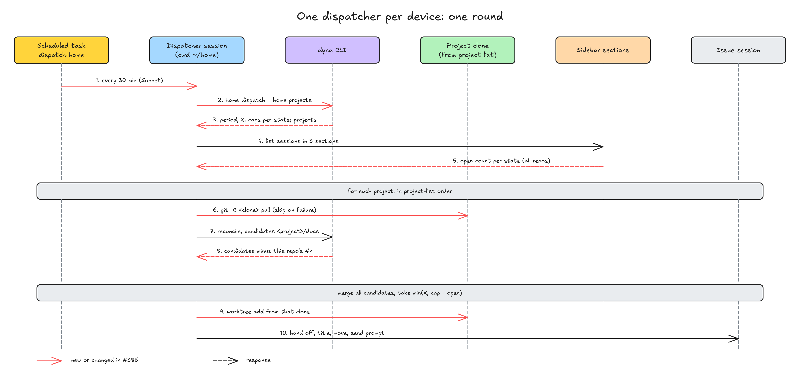

# 一台设备一个调度：dispatch-home 管所有项目

> #386 存在：本机有两个每小时的调度定时任务 `dispatch-harold-skills`、`dispatch-tofelair`，各建在自己的主 checkout 里，各读各的上限；新加一个项目就要在它的主 checkout 里再敲一次 `/idea-loop:issue-dispatch`；详情在「问题陈述」

## 问题陈述

### 1. 有几个项目就要建几个调度定时任务

2026-11-20 用 `list_scheduled_tasks` 查本机：

| 任务 id | 建在哪 | cron | 上次运行 |
|---|---|---|---|
| `dispatch-harold-skills` | harold-skills 主 checkout | `7 * * * *` | 2026-11-20 14:08 |
| `dispatch-tofelair` | Toeflair 主 checkout | `7 * * * *` | 2026-11-20 14:11 |

两个任务跑同一个 skill，只是工作目录不同。人的预期是一台设备一个调度管所有项目（#379 会话，2026-11-19 原话）：「我记得我的预期是所有项目，但是我觉得短期内分开也可以，因为0.2.0 home repo有了之后项目信息就在一块了，那时候一个调度我觉得就可以解决了。」

要再接一个项目（例如 excalidrawer 搬进 home 之后），就得去它的主 checkout 里再敲一次命令，再多一个任务。

### 2. 上限各项目各算，整台设备没有一个数

侧边栏的 triage、in-progress、in-review 三个分组是所有项目共用的，但上限写在各项目的 `ISSUE_TRACKER.md`「调度」表里，各算各的：

- 2026-11-19 18:12 Toeflair 的一轮（#386 评论）：triage 分组 6 个会话，5 个是 harold-skills 的。harold-skills 上限 6、Toeflair 上限 3，Toeflair 白天一个都派不出。
- main 上开着的 PR #400（#398）把上限改成「每轮最多新开几个，开着的会话总数不设上限」，项目间不再互相挤；但两个项目合起来每轮能开多少、整台设备同时开着多少，仍然没有一个数。

人 2026-11-20 定的口径（本次 triage）：每轮新开数整台设备一个数；开着的会话按状态各有上限，「in-triage 我倾向于6个，in-progress 我觉的可以多一些（甚至可以不设置上限），in-review不设置上限」。

### 3. 名额空出来，最多要等一小时才补

会话进了 in-review 就不再占 in-progress 的名额，但调度每小时才跑一轮：23:40 一个会话转 ready，下一个要等 00:07 才开。人想要「让 schedule agent（定时任务）感知事件变化，而不是让执行 agent 来做这个事儿」。

本机桌面定时任务（`create_scheduled_task`）只认 cron、一次性时刻、手动三种触发，没有事件触发。GitHub 事件能触发的是云端 Routine，它跑在云端环境里，碰不到本机的侧边栏和 `~/home`，叫不醒本机调度（2026-11-20 核对工具定义）。

### 4. 认同号会话时不看仓库名

`claude-desktop.md`「怎么数开着的会话」写的是「三个分组里所有匹配的会话号都记下，派的时候跳过」，匹配的是「任何仓库名#<号>」。Toeflair 开着 `Tofelair#280` 的会话，harold-skills 的 #280 会被当成「已有会话」跳过。两个项目的 issue 号区间重叠（harold-skills 到 431，Toeflair 到 900 以上），号码撞上是常态。

### 根因

- 问题 1、2：调度的前提是「工作目录是主 checkout」，`<docs>`、`<仓库名>`、上限都从当前项目取（`issue-dispatch/SKILL.md`「前提与边界」，`ISSUE_TRACKER.md`「调度」）；任务 id 是 `dispatch-<仓库名>`。0.2.0 之前没有一处列出这台设备的全部项目。#252 建了项目清单，#333 的 `dyna home where --project` 能从名字拿到项目目录和本地 clone，这个前提可以去掉了。
- 问题 3：只能靠定时触发；每小时一次是 #379 定的。
- 问题 4：同号跳过沿用了「分组跨项目共用、总数跨项目算」时的「任何仓库名」匹配。

## 方案

改完后：一台设备只有一个调度定时任务 `dispatch-home`，开在 `~/home`，每 30 分钟一轮，调度会话用 Sonnet、思考强度 medium。时段、每轮新开数、各状态的上限都写在 home 的一张表里。每一轮先按整台设备算出这一轮能开几个，再从项目清单里所有项目的候选中按同一个顺序取，派出的会话照旧开在各项目自己的 worktree 里。人在任何目录敲一次 `/idea-loop:issue-dispatch` 就起好；项目搬进 home、登记进项目清单，下一轮就被调度。

决定一轮派什么的输入：

- `~/home/DISPATCH.md` 的调度表（时段、派什么、每轮最多新开几个、各状态上限、不调度的项目）；
- 项目清单（有哪些项目）；
- 侧边栏三个分组里的 issue 会话（算各状态开着几个；同号跳过只认本项目的仓库名）；
- 各项目的候选 issue。

图里六方：定时任务 `dispatch-home`、调度会话（开在 `~/home`）、`dyna`、项目的本地 clone、侧边栏分组、issue 会话。红色是本 spec 新增或改动的消息，虚线是返回。灰条之下对项目清单里每个项目做一遍，最后一段合并候选、按整台设备的数交出。

### 调度表：`~/home/DISPATCH.md`

一份文件，两张表加一行：

| 时段 | 派什么 | 每轮最多新开 |
|---|---|---|
| 09:00–19:00 | triage | 3 |
| 22:00–08:00 | todo | 3 |

| 状态 | 同时开着最多 |
|---|---|
| triage | 6 |
| in-progress | 不设 |
| in-review | 不设 |

不调度的项目：（项目清单里的名字，逗号分隔；空着就是全部调度）

时段的读法照现行规则（左闭右开、开始晚于结束即跨午夜、没覆盖的时间不派、重叠时靠前的一行算）。没有这份文件的设备按上面的默认值走。

### 调度会话一轮做什么

1. **读配置**：`dyna home dispatch` 读调度表，给出此刻的 `dispatch`（`triage`、`todo` 或 `null`）、每轮最多新开 X、各状态上限、不调度的项目、三个分组名。`dyna home projects` 列出项目清单里每个项目的名字、项目目录、`owner/repo`、本地 clone、在不在 home。
2. **数会话**：照「会话管理」列三个分组，只认标题是「<仓库名>#<号> …」的会话：
   - 各状态开着几个：triage 分组的个数、in-progress 分组的个数（任何仓库名都算，整台设备一个数）；
   - 各项目的同号会话：按仓库名分开记（问题 4）。
3. **每个项目对账、取候选**：按项目清单的顺序，跳过不调度的；对每个项目：
   1. **跑不了的跳过**：不在 home、本地 clone 不存在、clone 不在默认分支上、`git -C <clone> pull --ff-only` 失败，记一行进汇报，接着下一个项目。照 #333「dreaming-home 对账各项目」的「跑不了的项目」。
   2. **对账**：照现在第 1 步，`<docs>` 是这个项目的 `<项目目录>/docs/`。
   3. **没有会话的 issue**：照现在第 4 步。
   4. **取候选**：`dispatch` 是 `triage` 或 `todo` 时，照现在第 5 步取这个项目这一状态的全部候选，去掉这个项目的同号会话。
4. **按整台设备交出**：这一轮能开的个数 = min(X, 这一状态的上限 − 这一状态开着的个数)；上限是「不设」就是 X。≤ 0 就不开。所有项目的候选合成一张表，按现行的候选顺序排（指派给本人的在前，P0 → P2 → 没有优先级，同级在这一状态停留久的在前），取前这么多个。建 worktree、交出、归位、发任务的做法不变，`<主 checkout>` 换成那个 issue 所在项目的本地 clone。
5. **早上汇总**：照现在第 6 步，上一轮时刻读 `dispatch-home` 的上次成功运行，记录文件仍是各项目的 `~/.idea-loop/dispatch/<仓库名>.json`；汇总按项目分节。
6. **汇报和推送合成一份**：汇报写此刻的时段、各状态开着几个 / 上限、这一轮交出的（带仓库名）、每个项目的对账和要人处理的事；推送只发一句合计。

`dispatch` 是 `null`、也不是早上第一轮的：只做第 3 步的对账，不数会话、不取候选。

### 起调度

人敲 `/idea-loop:issue-dispatch`（在哪个目录都行）：

1. 用「定时任务」在 `~/home` 建（已有就更新）`dispatch-home`：标题 `issue 调度`，cron `7,37 * * * *`（每 30 分钟，分钟避开 0 和 30），prompt `/idea-loop:issue-dispatch`，模型 Sonnet、思考强度 medium。
2. `~/home/DISPATCH.md` 不存在就照默认值建一份，提交到 home。已有项目的 `ISSUE_TRACKER.md` 里有「调度」一节的，把它的数并进来前先给人看改前改后（harold-skills 白天每轮 6 就在这里），人同意后写入，并删掉项目里那一节。
3. 列出已有的 `dispatch-<仓库名>` 任务，逐个停用（只停用不删，照 #247 停用 `dreaming-<仓库名>` 的做法），汇报里列出停了哪几个。不停的话，旧任务和 `dispatch-home` 各跑各的，会给同一个 issue 各开一个会话。
4. 立刻做第一轮。

### 同一行为的其他入口

| 入口 | 处理 |
|---|---|
| 桌面端定时任务（`claude-desktop.md`「调度」三处） | 纳入：任务 id、cron、模型；数会话改成按状态、整台设备；`<主 checkout>` 换成各项目 clone |
| magi（`magi.md`「调度」三处） | 纳入：同样一个 `dispatch-home`，`magi cron` 的工作目录是 `~/home`，同样的表和算法；`magi sessions start --cwd` 照旧是 issue 的 worktree |
| 人在调度会话里说话的那一轮 | 纳入：走同一条路 |
| 已有的 `dispatch-<仓库名>` 任务 | 纳入：起调度时停用 |
| 项目 `ISSUE_TRACKER.md` 的「调度」一节、setup 的两份模板 | 纳入：删掉这一节，setup 不再生成；起调度时把已有的数并进 `DISPATCH.md` |
| `dyna issues queues` 返回的时段字段 | 纳入：时段改由 `dyna home dispatch` 给，`queues` 去掉 `dispatch`、`limit`、`period` |
| `pr-review` 把会话移进 in-review | 排除：人定了由调度自己感知名额空出，不让执行会话去叫调度 |
| 每个项目各一个的 `triage-<仓库名>`、`seo-scan-<仓库名>` 定时任务 | 排除：#386 只说调度；要不要并成设备级另开 issue |
| 没搬进 home 的项目 | 排除：#333 定了只认 home，跳过并写进汇报 |

## User Stories

只改结构、不加能力，每个问题一行期望行为：

1. 问题 1：一台设备只有一个 `dispatch-home` 定时任务；项目清单里每个已搬进 home、没写进「不调度」的项目都在同一轮里被派；新登记一个项目，下一轮就被派，不用再敲命令。
2. 问题 2：一轮新开的会话，所有项目合计不超过调度表里的「每轮最多新开」；triage 分组里所有项目的会话合计不超过 triage 的上限（默认 6）；in-progress、in-review 默认不封顶，人在表里写了数就按它封顶。
3. 问题 3：一个会话进了 in-review、空出名额后，最迟 30 分钟内调度补开下一个，不靠 issue 会话去叫。
4. 问题 4：只有标题是「<这个项目的仓库名>#<号> …」的会话让这个项目的同号 issue 跳过。

## 实现决策

### 已定

- **任务 id `dispatch-home`，开在 `~/home`**：照 #332 定的 `dreaming-home`（「我倾向于设备纬度只有一个dreaming任务」），设备级任务开在 home、id 带 `-home`。定时任务的会话用建它的会话的目录（`claude-desktop.md`「定时任务」）。
- **每 30 分钟一轮，Sonnet、思考强度 medium**：人 2026-11-20 原话「我觉的可以先搞成30分钟，schedule的模型可以换成sonnet，思考强度可以换成low/medium」。人给的是 low 或 medium，这里取 medium：一轮里要跨项目排候选、判分组，取高的一档；人可以推翻。模型和思考强度钉在定时任务上：人 2026-11-20 确认「定时任务的模型和思考强度可以固定，这个是没问题的」；建任务、更新任务时一起设。
- **不接 webhook**：人想要调度自己感知事件（「我倾向于让schedule agent（定时任务）感知事件变化」）。本机定时任务只有 cron、一次性时刻、手动三种触发；能挂 GitHub 事件的是云端 Routine，碰不到本机侧边栏和 `~/home`。所以先靠把间隔缩到 30 分钟，见「Out of scope」。
- **配置在 `~/home/DISPATCH.md`，项目里不再有「调度」一节**：人选「全搬进 home 一张表」。单独一份文件，不写进 `~/home/AGENTS.md`：后者是每个会话都注入的设备说明，「## 设备地图」由 dreaming 重写，调度表不该进每个会话的上下文，也不该被 dreaming 改。文件名照 home 顶层 `AGENTS.md` 的大写写法。人可以推翻文件名。
- **每轮新开数按时段写**：harold-skills 现在白天每轮 6、夜里 3（`ISSUE_TRACKER.md`「调度」，2026-11-20 集成分支），白天和夜里本来就不一样，所以 X 留在时段那一行。
- **各状态的上限数整台设备、任何仓库名**：人说的是「in-triage 6 个」，没有按项目分。in-progress 的上限设了数时，分组里的会话全算，不再有「2 小时没活动不算」（#400 已删）。
- **跨项目怎么分一轮的名额：合成一张表按现行顺序取**：候选顺序本来就有规则（指派给本人的在前、按优先级、同级按停留时间），把它从「一个项目里」扩到「所有项目」，不另造轮流规则。例：白天 triage 剩 2 个名额，Toeflair 最早一个 triage 停了 9 天、harold-skills 最早一个停了 2 天，先开 Toeflair 那个。代价：候选多的项目可能连着几轮占满。人可以推翻成按项目轮流。
- **列项目扩展 `dyna home`**：加 `projects`（项目清单每行加 `where --project` 的结果）和 `dispatch`（读 `DISPATCH.md`，带 `--at=HH:MM`）。依据：「先扩展已在用的工具」；#333 已有 `where`，`dreaming-home` 也要同样的项目列表。时段的解析从 `dyna issues queues` 挪过来，不新增脚本。
- **不调度的项目写在 `DISPATCH.md`**：2026-11-20 项目清单里只有 harold-skills，#247 搬完加 Toeflair，两个都在用调度，没有要排除的真实项目；留一行开关，默认全调度。
- **同号只认本项目仓库名**：问题 4，正确性修复。
- **停用旧任务放在起调度里，不放 #247**：调度是人敲命令才起的，不随搬家；在起 `dispatch-home` 的同一步停用旧的，两个调度不会并存。告诉 #247 会话不用管 `dispatch-<仓库名>`。
- **前提「工作目录是主 checkout、只读」改写**：调度会话在 `~/home` 只读，只在起调度时提交 `DISPATCH.md`；对每个项目的 clone 只做 `git -C <clone> pull --ff-only` 和建 worktree，不切分支、不改文件。
- **取代 11-19 的「triage 不看上限」**：#386 评论里记的 Toeflair 调度会话 11-19 的决定（triage 每轮 3 个、不封顶）被人 11-20 的「in-triage 我倾向于6个」取代，`issue-dispatch` 照新口径写。

## 测试决策

| 变的是什么 | 仪器 | 本次 |
|---|---|---|
| 纯逻辑、数据转换、状态机 | TDD 单元测试 | 涉及：`DISPATCH.md` 解析、默认值、时刻到时段（跨夜、整点边界）、「不设」、不调度的项目；`dyna home projects` 的清单解析 |
| API 契约（路由、schema、序列化） | TDD API 测试 | 涉及：`dyna home dispatch --json`、`dyna home projects --json` 的字段，在 `dyna registry` 登记；`dyna issues queues` 去掉时段字段 |
| DB schema、迁移、并发与事务语义 | 真 DB 测试 | 不涉及 |
| LLM 输出质量（prompt 改动） | eval | 不涉及：skill 文字改动按仓库约定不做 quantitative eval，靠文档测试和一次真实运行 |
| 视觉正确性 | UI 实现环 | 不涉及 |
| 端到端用户流程 | 浏览器端到端测试 | 不涉及浏览器；端到端是一次真实运行，见下 |

- **seam**：
  - `dyna home dispatch --at=HH:MM` 的 JSON：抓得到配置解析、时段、上限；漏掉调度会话照不照做。
  - `dyna home projects` 的 JSON：抓得到清单解析、在不在 home；漏掉 clone 的实际状态。
  - 文档测试（`dispatch-by-period-doc.test.mjs` 一类）：断言调度、`claude-desktop.md`、`magi.md` 里不再有 `dispatch-<仓库名>`、「工作目录是主 checkout」、`ISSUE_TRACKER.md` 的「调度」，有 `dispatch-home`、`DISPATCH.md`、按状态的上限、同号只认本项目仓库名；setup 模板里没有「调度」一节。漏掉模型照不照做。
- **增量功能测试**：
  1. 前置：临时 home，没有 `DISPATCH.md`。步骤：`dyna home dispatch --at=10:00`、`--at=23:30`、`--at=20:00`。期望：triage / 每轮 3 / triage 上限 6；todo / 每轮 3 / in-progress 不设；不派。覆盖：问题 2。
  2. 前置：临时 home，项目清单两行，一个有 `docs/`、一个没有。步骤：`dyna home projects --json`。期望：两行都在，第二行标「没搬」并带原因。覆盖：问题 1。
  3. 前置：本机 home 已登记 harold-skills 和 Toeflair，旧的两个 `dispatch-*` 开着，harold-skills 的 `ISSUE_TRACKER.md` 有「调度」一节。步骤：在任意目录敲 `/idea-loop:issue-dispatch`。期望：`dispatch-home` 在 `~/home`、cron `7,37 * * * *`；先给人看 `DISPATCH.md` 的改前改后；两个旧任务 `enabled: false`；第一轮汇报写各状态开着几个 / 上限。覆盖：问题 1、2。
  4. 前置：白天，triage 分组已有 5 个会话（两个项目合计），两个项目都有 triage 候选。步骤：跑一轮。期望：只交出 1 个，是两个项目候选里停留最久的那个。覆盖：问题 2。
  5. 前置：夜里，一个 todo 会话 PR 转 ready、移进 in-review。步骤：等下一个 `:07` 或 `:37`。期望：那一轮补开下一个 todo。覆盖：问题 3。
  6. 前置：Toeflair 有一个号为 N 的会话在 triage 分组，harold-skills 的 #N 是 triage 候选。步骤：白天跑一轮。期望：harold-skills 的 #N 被交出。覆盖：问题 4。
- **照着谁写**：`dyna/internal/home/home_test.go`、`registry_test.go`（`where` 的测试与登记）；`dyna/internal/issues` 里 `queues` 的时段测试（挪到 `home dispatch`）；`idea-loop/scripts/dispatch-by-period-doc.test.mjs`。

## Out of scope

- **事件触发**：本机调度收不到 GitHub、Linear 的 webhook。真正的事件接入（比如本机常驻一个进程收 webhook 或轮询，再「立即运行」`dispatch-home`）另开 issue 评估。
- **额度保护**：同 #379，夜里不看剩余额度。
- **`triage-<仓库名>`、`seo-scan-<仓库名>` 并成设备级**：同样一个项目一个，但不是调度；要做另开 issue。
- **公司虚拟机**：magi 一侧照「同一行为的其他入口」改文字；真机验证由人在虚拟机上做，本 spec 只在本机验证。

## 关联

- 讨论：[[2026-11-20-dispatch-one-per-device]]。
- 相关 spec：[[dispatch-day-night-modes]]（#379，现行调度；本 spec 改它的「时段和上限写在项目配置里」「怎么一轮一轮跑」和前提）、[[skills-read-home]]（#333，`where`、项目目录、dreaming-home 逐个项目的写法）、[[home-bootstrap]]（#252，项目清单）、[[idea-loop-cli]]（#339，`dyna` 命令与登记表）。
- 相邻还没完成的，查过（2026-11-20）：
  - PR #400（#398，main，open）：上限改成每轮新开数、总数不设上限。它管的是 main 上 0.1.x 的单项目调度，照合；同步进 `release/idea-loop-0.2.0` 时，本 spec 的「每轮最多新开」沿用它的口径，「各状态上限」是本 spec 在它之上加的设备级封顶。#386 从 #400 同步进集成分支之后的提交做。
  - #340（skill 合并与重写，PR #432）：06 号工单重写 `issue-dispatch`、`issue-session`，运行环境的调度三处改成 `dyna` 命令。**#340 先合**，本 spec 在它重写后的文字上改，避免两边同时改同一份文件。
  - #247（迁到 home，todo）：不用停用 `dispatch-<仓库名>`，由起调度那一步做；项目 `ISSUE_TRACKER.md` 的「调度」一节也由起调度时并进 `DISPATCH.md`，#247 搬家时原样搬过去即可。
  - #332（dreaming-home）：同为设备级任务，`dyna home projects` 它也能用，没有重叠。
