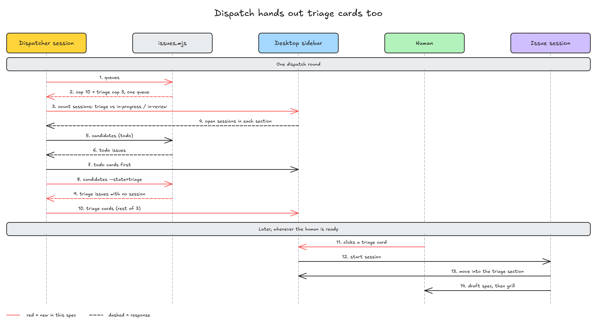

# 调度给 triage 的 issue 出会话卡片

> #266 存在：调度只给 todo 出卡片，triage 的 issue 只在汇报里记一行，没有卡片可点，人不记得手开就一直停在 triage，详情在「问题陈述」

## 问题陈述

对着 origin/main 93c2125（idea-loop 0.1.11）核过，2026-11-09。

### 1. 批进 triage 的 issue 没有入口

分拣（`issue-triage`）批表时有一种去向是「triage + P1 或 P2」，那一行的做法写着「人自己开 triage 会话」（`idea-loop/skills/engineering/issue-triage/SKILL.md` 第 31 行）。调度这边：

- `issue-dispatch` SKILL.md 第 11 行：「`triage` 的 issue 在等人评估，由人自己开会话，不归你派」。
- 每一轮第 4 步（第 31 行）把没有会话的 triage issue 写进汇报一行字；第 5 步（第 32 行）只从 `issues candidates` 取 todo 出卡片，`candidates` 在脚本里只筛 `state === 'todo'`。
- `issue-session` 的会话表里，triage 会话「谁开的」是「人」，todo 会话是「调度」。

所以 issue 进了 triage 之后，侧边栏里什么都不出现。人要推进，得自己记得号码，新开一个带 worktree 的会话，敲 `/idea-loop:issue-session <号>`。没开，issue 就一直停在 triage，翻不到 todo，调度也就永远派不到它。

例子（issue 原文记录的一次真实分拣）：一张 15 行的分拣表，5 个批进了 triage；批完之后这 5 个没有一张卡片，只能人逐个手开。分拣是每周一次，triage 里只进不出。

还有一条路也进 triage：todo 会话起草 spec 时冒出要人定的，会把 issue 翻回 triage 并收尾（`issue-session` 的「todo 会话」一节）。这样的 issue 同样没人接。

### 根因

调度把「triage 由人评估」理解成「triage 的会话由人开」。人要的只是讨论的时机由人定；卡片本身要人点才开会话（桌面端 `start_session` 出的是卡片），已经满足这一点，不需要连入口一起拿掉。

## 方案

改完之后：调度每一轮除了给 todo 出卡片，也给没有会话的 triage issue 出卡片。卡片长得一样、点开走的也是同一个 `issue-session`，它按 issue 的状态（triage）走 triage 会话：起草 spec、跟人 grill、设计，做完翻 todo。人什么时候点，讨论就什么时候开始。

（图在定完「待定」后补）

一轮的顺序：

1. 对账、列队列，照旧。
2. 数开着的会话：三个 section（triage、in-progress、in-review）照旧都数。
3. 没有会话的 issue：只报 in-progress、in-review 的；triage 的不再报，它们会拿到卡片。
4. 交出 todo，照旧。
5. **新**：交出 triage。候选是 `issues candidates <docs> <空位> --state=triage`：没有同号会话、没有还没点的卡片的 triage issue，顺序跟 todo 一样（指派给本人的在前，按优先级，同一级里在 triage 停得久的在前；指派给别人的不派）。空位怎么算见「待定：triage 卡片占不占主队列的上限」。
6. 一轮合计最多 3 张卡片不变，todo 先交，剩下的给 triage。

同一行为的其他入口：

- **分拣**（`issue-triage` 批表的 triage 那一行）：纳入，把「人自己开 triage 会话」改成「调度会给它出卡片」。
- **todo 会话翻回 triage**：纳入，不用改流程：翻回之后它就是一个没有会话的 triage issue，下一轮拿到卡片；它的分支和评论照旧由 triage 会话接上（`issue-session` 开场的「接分支」）。
- **人手动 `/idea-loop:issue-session <号>`**：纳入，照旧可用；开了会话就不会再出卡片（数会话时数到了它）。
- **跳过 triage 的项目**（`ISSUE_TRACKER.md` 写了「triage：跳过」）：排除，没有 triage 的 issue，第 5 步取不到候选。
- **Linear 项目**：纳入，候选照 `idea-loop:issues` 的 Linear 做法按 Triage 状态取，顺序同 todo。
- **magi 运行环境**：见「待定：magi 里 triage 的 issue 怎么交出」。

## User Stories

只修问题、不加能力：

1. 期望行为（对应问题 1）：issue 批进 triage（或从 todo 会话翻回 triage）之后，下一轮调度在侧边栏给它出一张会话卡片；人点了才开 triage 会话，不点就一直在，一周过期后下一轮重出。

## 实现决策

- **卡片的 prompt 不分状态**：todo 和 triage 用同一句 prompt（「用 Skill 工具调 idea-loop:issue-session，参数 <号>，按它从开场做起」）。依据：`issue-session` 开场已经按状态分路，triage 走 triage 会话，不需要卡片告诉它。卡片的 `background` 改成「你派的是 todo 或 triage 的 issue：todo 会话认领后从 spec 做到 PR 合并，triage 会话陪人评估，做完翻 todo」。
- **还没点的卡片**：从「调度出过、issue 还是 todo 的」改成「调度出过、issue 还是出卡片时那个状态（todo 或 triage）、也没有同号会话的」，汇报里按队列、按状态记。依据：triage 卡片和 todo 卡片一样会过期、一样会被点开，记法同一套。
- **一轮最多 3 张，todo 先**：依据：每轮上限是为了不一次刷出一屏卡片，triage 不改变这个理由；todo 已经评估完、可以直接做，先派它。
- **`issues candidates` 加 `--state=triage`**：默认仍是 todo；triage 时「停留时间」读 `status:triage` 最后一次加上的时间，读法同 todo。依据：顺序规则跟 todo 是同一条（`issue-dispatch` 第 5 步），只换状态。
- **`issue-session` 会话表**：triage 会话「谁开的」改成「人或调度卡片」。开场的认领、归位照旧（triage 会话归到 triage section）。
- **改的文档**：`issue-dispatch` SKILL.md（第 11 行的边界、第 4、5 步、汇报）、`runtime` 两份 reference 的「调度」、`issue-session` 会话表、`issue-triage` 批表那一行、README 的三行（issue-dispatch、issue-session、issue-triage）和状态一节里「only `todo` is dispatched」。

### 待定：triage 卡片占不占主队列的上限

现状：主队列上限 10，数的是 triage、in-progress、in-review 三个 section 里的 issue 会话，也就是 triage 会话今天已经占主队列的位。

- **A. 共用上限（不改数法）**：triage 卡片跟 todo 卡片抢同一个空位，todo 先。走一遍：主队列开着 8 个会话，一轮有 2 个空位、3 个 todo、5 个 triage → 出 2 张 todo 卡片，triage 一张没有；todo 一直有货时 triage 永远轮不到。
- **B. triage 单独一个上限 3（推荐）**：每个队列另有一个 triage 上限 3，只数 triage section 的会话和还没点的 triage 卡片；队列原来的上限（主队列 10）只数 in-progress、in-review。走一遍：同样 8 个会话（其中 2 个在 triage）、3 个 todo、5 个 triage → todo 空位 10 − 6 = 4，出 3 张 todo 卡片；triage 空位 3 − 2 = 1，但一轮 3 张已用完，下一轮出 1 张 triage。triage 最多同时 3 个，不会挤掉实现。

推荐 B。理由：triage 会话要人在场 grill，人一次接不住太多，单独的小上限正好卡住这一点；共用上限下 todo 有货时 triage 会被饿死，又回到「推进不到 todo」。

### 待定：magi 里 triage 的 issue 怎么交出

magi 没有卡片：调度直接 `magi sessions start` 开会话，不等人点（`runtime` 的 `references/magi.md`「调度」）。

- **A. 也直接开（推荐）**：magi 的调度照样给 triage 开会话。会话开场起草 spec、自校验，碰到「需要 grill」「待定」就推送一句话停下等人（`issue-session` 的 `references/draft-spec.md`「跟人定要 grill 的」）。走一遍：周一分拣批 5 个进 triage，下一轮开 3 个（上限 3），各自写好 spec 草稿停住；人周三有空时打开其中一个，从 grill 开始。讨论时机仍是人的，只是草稿先写好了。
- **B. magi 不派 triage**：magi 的调度只派 todo，triage 照旧只在汇报里记一行，人在 magi 里手开。走一遍：同样 5 个进 triage，汇报写「5 个 triage 没有会话」，人手开前什么都不发生；跟今天一样。

推荐 A。理由：B 在 magi 里留下的正是这个 issue 要修的问题；A 只是把「点卡片」换成「会话已开好、停在等人那一步」，人决定什么时候开口的这一点没变。代价是每个 triage 会话先花一次起草的额度，由上限 3 卡住。

## 测试决策

| 变的是什么 | 仪器 | 本次 |
|---|---|---|
| 纯逻辑、数据转换、状态机 | TDD 单元测试 | `issues candidates --state=triage` 的筛选和顺序；定了 B 的话 `issues queues` 返回每个队列的 triage 上限 |
| API 契约（路由、schema、序列化） | TDD API 测试 | 不涉及 |
| DB schema、迁移、并发与事务语义 | 真 DB 测试 | 不涉及 |
| LLM 输出质量（prompt 改动） | eval（确定性断言） | 不涉及：改的是调度 skill 的步骤，不是 prompt 产出的结构；没有对应的回放用例（retro 回放只验收 retro 批出的规则改动） |
| 视觉正确性 | UI 实现环 | 不涉及 |
| 端到端用户流程 | 浏览器端到端测试 | 不涉及 |

- **seam**：`issues.mjs` 导出的 `candidates(gh, limit, { state })` 和 `queues(types)`，用 `issues.test.mjs` 现有的 `fakeGh` 喂 issue 列表。抓得到筛选、顺序、上限；抓不到调度 skill 照不照做。
- **文档守护**：照 `issue-session-implement-doc.test.mjs` 的写法加一个 doc 测试，断言 `issue-dispatch` SKILL.md 不再写「由人自己开会话」、第 5 步之后有交出 triage 的一步，`issue-triage` 的 triage 那一行不再写「人自己开 triage 会话」。抓得到文字被改回去；抓不到调度实际跑出几张卡片。
- **增量功能测试**：
  - 前置：harold-skills 里有一个开着的 `status:triage` issue，没有同号会话。
  - 步骤：调度会话跑一轮 `/idea-loop:issue-dispatch`。
  - 期望：汇报里主队列一行写出这一轮给它出了一张 triage 卡片；侧边栏出现标题「harold-skills#<号> …」的卡片；点开后会话归到 triage section，issue 状态仍是 triage。
  - 覆盖：期望行为 1。
- **照着谁写**：`issues.test.mjs` 里 `candidates` 的几个测试（第 509–605 行一带）。

## Out of scope

- 改 triage 会话本身的流程（起草、grill、设计、翻 todo）。
- triage 的 issue 自动翻 todo：仍要人评估完、spec 没有「需要 grill」「待定」。

## 关联

- [[issue-triage]]：定了分拣和「triage + P1/P2」这条去向；本 spec 给这条去向补上入口。
- [[runtime]]：调度的三处做法在 runtime 的 reference 里，本 spec 改其中的「怎么交出 issue」「怎么数开着的会话」。
- 相邻还没完成的 spec 与 issue：无。2026-11-09 查过 `status:triage` / `todo` / `in-progress` / `in-review` 四个状态，开着的只有 #266 本身；名字带 dispatch 的远端分支只有 `impl/retro-batch-dispatch`，已合进 main。
