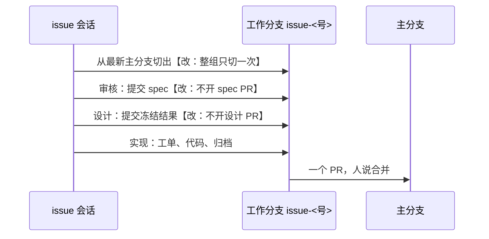

# 知识库改动跟代码一个 PR，setup 问要不要知识库

> #244 存在：一个需求的 spec、冻结的设计各经一个只改 `docs/` 的 PR 先合进主分支，实现再从主分支开分支；详情在「问题陈述」。issue 标题里「知识库绑在代码仓库里」那一半，Harold 2026-11-05 定了：不搬知识库，单仓库模式照旧；只让 setup 问要不要知识库、放在哪，放仓库外的由人照原格式维护。随 0.1.10 发，不进 0.2.0。

## 问题陈述

### 一个需求要开三个 PR

idea-loop 0.1.9（对着 main 8860a9e 查，2026-11-05）里，一个碰 UI 的需求走完要开三个 PR：

| 阶段 | 规则出处 | PR |
|---|---|---|
| 审核 | `issue-verify`「合进主分支」、`to-spec/references/land-on-main.md` | spec PR，只改 `docs/`，检查过就合 |
| 设计 | `uiux-refine`「冻结之后」第 1–4 步 | 设计 PR，只改 `docs/`，检查过就合 |
| 实现 | `implement`、`pr-review` | 实现 PR |

`issue-session` 的「换阶段」每个 PR 合并后从最新主分支切下一段的分支（`spec/`、`design/`、`impl/`）；`decision-rules` 把「只改 `docs/` 的 PR（spec PR、设计 PR）检查全过就合并」写成不用问人的一条。spec 和设计在实现之前就进了主分支：需求后来放弃或改方向，主分支上已经留着半成品 spec 和画布，别的 worktree 读到的也是它们。

### 根因

「下一段从主分支开分支」是唯一能拿到上一段产出的路径，所以每一段的产出都得先合进主分支。Harold 的决定（0.2.0 重构 grill 的 Q41、U9，2026-11-05 在 #244 会话里确认保留）：知识库改动先放分支，跟着代码一起合进主分支，「不然每个 feature 搞一堆 doc、design 的提交不好维护」。

### 公司仓库放不进这套文件

`setup` 不问就在仓库里建 `docs/` 骨架（`setup/SKILL.md`「写」）。仓库要照公司标准维护时，人没有办法说「知识库不放这里」。

## 方案

改完之后：一个需求一个工作分支。spec、raw、冻结的设计、工单、设计档案归档都提交在这个分支上，代码也在这里，最后**一个 PR** 合进主分支；不再有 spec PR、设计 PR。

规则只写一次，在 `wiki-conventions` 新的「知识库落地」一节；别处写「照 `idea-loop:wiki-conventions` 的『知识库落地』」。

**没有代码可跟的**，照旧自己开一个只改 `docs/` 的 PR，检查全过就合：

- 父 issue 拆完子 issue（spec 与设计定稿）：子 issue 的会话从主分支读父 spec（决定记录 Q24、Q42）；
- 验证为不存在、或人决定不做的 issue；
- dreaming 的执行段；不在 issue 会话里的 retro 决定记录。

**setup 问知识库**：「问人」加一题「要不要知识库，放在哪」，三选一：仓库里的 `docs/`（推荐，照旧）、仓库外的目录或仓库（不建骨架，`## idea-loop` 块记位置，人照原格式维护）、不要。idea-loop 的 skill 只读写仓库里的 `docs/`，后两种在交回时说清 spec、设计、dreaming 在这个仓库里用不了。

被改的地方：`setup`（SKILL、`references/questions.md`）、`wiki-conventions`（新一节，`design/tmp` 两句）、`to-spec`（SKILL 与 `land-on-main.md`）、`issue-verify`（「落地」一节、分支名）、`issue-session`（阶段表、分支只切一次、「换阶段」不切新分支）、`uiux-refine`（SKILL、`freeze.md`、`refine-canvas.md`）、`implement/references/ui-tickets.md`、`to-ticket`、`pr-review/references/merge.md`、`decision-rules`、`retro`、`dreaming/references/missed-archive.md`、idea-loop `README.md`。

同一行为的其他入口：

- `pr-review` 交报告前「spec 翻完成、删工单」那个提交、合并前归档的提交：本来就推在 PR 分支上，跟代码一个 PR。纳入（只改措辞）。
- `seo-outreach`：实现阶段本来就由那条流程开 PR；人直接调用时没有代码可跟，照旧只改 `docs/` 的 PR。不改。
- `dreaming` 的执行段、retro 写进 harold-skills 候选池：没有代码可跟，照旧。不改。
- `spec-status`、`issues.mjs` 里「待设计 / 待实现照主分支挂」的状态：#242 整个换掉状态机，这里不动。
- 业务根目录、知识库独立成仓库、skill 去仓库外读写知识库、说明文件加载：推迟，不做。

## User Stories

### 场景：一个需求的落地

1. 作为人，我想要一个需求只有一个 PR，以便 spec、设计、代码一起看、一起合
2. 作为人，我想要 spec 和设计在需求合并前不进主分支，以便放弃的需求不在主分支上留下半成品
3. 作为 issue 会话，我想要从审核到实现都在同一个分支上，以便下一段直接读到上一段的 spec 和画布
4. 作为父 issue 的会话，我想要拆完子 issue 就把 spec 和设计合进主分支，以便子 issue 的会话从主分支读到
5. 作为 skill 的维护者，我想要这条规则只写在 `wiki-conventions` 一处，以便改一次就全改

### 场景：setup 问知识库

1. 作为在公司仓库里跑 setup 的人，我想要能说「知识库不放仓库里」，以便仓库照公司标准维护
2. 作为人，我想要知识库放仓库外时 setup 记下位置、并告诉我哪些流程用不了，以便不在跑到一半时才发现

## 实现决策

- **分支名** `issue-<根号>`：一组一个分支，从审核用到实现；原来按阶段的 `spec/`、`design/`、`impl/` 前缀不再用。依据：一个分支承载三段，按阶段起名会名不副实。
- **「完成」的 spec**（issue 不存在）照旧开只改 `docs/` 的 PR 合：没有代码可跟，不合就没人看得到验证证据。
- **`issues advance`** 读的是传入的 `<docs>`，在同一个分支上照样能翻状态；dispatcher 照主分支对账的那部分，由 #242 的新状态机处理。
- **护栏不变**：合并改了代码的 PR 仍要人说；没有代码的只改 `docs/` 的 PR 检查全过就合（`decision-rules`「不自动的」）。

## 测试决策

| 变的是什么 | 仪器 | 本次 |
|---|---|---|
| 纯逻辑、数据转换、状态机 | TDD 单元测试 | 不涉及 |
| API 契约（路由、schema、序列化） | TDD API 测试 | 不涉及 |
| DB schema、迁移、并发与事务语义 | 真 DB 测试 | 不涉及 |
| LLM 输出质量（prompt 改动） | eval（确定性断言） | 文档测试 `knowledge-base-landing-doc.test.mjs`：skill、agent、README 里不再有「开设计 PR」「经设计 PR」「spec PR、设计 PR」「经一个只改 docs/ 的 PR 合进主分支」；各入口指向「知识库落地」；「没有代码可跟」的清单只在 wiki-conventions；issue 会话只切一次分支 |
| 视觉正确性 | UI 实现环 | 不涉及 |
| 端到端用户流程 | 浏览器端到端测试 | 不涉及 |

- **seam**：skill 文本本身（文档测试读文件断言）。抓得到旧说法回来、指针丢了、规则被抄到第二处；漏掉模型是否照做（要真跑一次 issue 会话才看得到）。
- **照着谁写**：`scripts/setup-single-source.test.mjs`、`scripts/to-spec-by-deliverable-doc.test.mjs`。

## Out of scope

- 知识库搬出代码仓库、业务根目录、多仓库共用一份知识库、skill 读写仓库外的知识库、说明文件的加载与「两份都读」：留给以后单独处理知识库的 issue（业务根目录那版实现在分支 `impl/business-knowledge-base` 的 f4e97c4）。
- 0.2.0 的状态机、`issue-triage`、拆插件。

## 关联

- 决定出处：0.2.0 重构 grill 的决定记录（在 `release/idea-loop-0.2.0` 上，`docs/raw/issue-workflow/2026-11-04-idea-loop-0-2-0-restructure-grill.md`，Q24、Q41–Q43、U9、U14、U15），不在 main 上，所以不链。
- 0.2.0 里还在改的：#242 的 `issue-session`、`spec-status`；#243 的 `issue-verify`；#241 搬 `uiux-refine` 到 design 插件。0.1.10 合进 main 后，它们从 main 合过去时会碰到这里改的「怎么落地」那几句。
