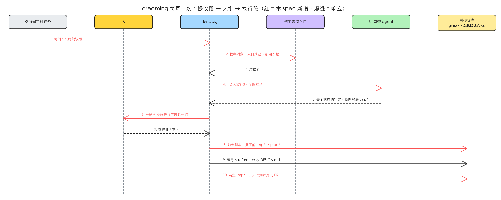

# dreaming 每周对账设计档案与 DESIGN.md

从 [[ui-state-archive]] 拆出（#28 的第 3 个子 issue），依赖另外两份：设计档案的结构与查询入口以 [[ui-state-archive]] 为准，`DESIGN.md` 的写入规则以 [[design-md-write-entry]] 落下的写入 reference 为准（已合进集成分支）。本 spec 用到它们的地方都只写「要什么」，对不上的列在共享笔记的接口问题里，不在这里替它们定。

## 1 问题

复现在 2026-10-19 做，对象是 main（idea-loop 0.0.24）。这几条都是「缺一个能力」，没有可截的界面，证据是对现状的核对。

### 1.1 设计档案建起来之后，没有人定期核对它还对不对

**复现到的**：`dreaming` 现在的扫描范围是 `docs/` 下的 spec / 工单 / ADR / 术语表、`CLAUDE.md` 和插件 references，判定手段是「抽出文档承诺的代码物，去 grep」。它不读 `docs/design/`，也不开浏览器。档案那份 spec 只在**合并前**写入一次；之后有三种情况会让档案悄悄变错，现在没有任何一步能发现：

- 绕过流程的改动：直接改了组件、没走 `tmp/` 的提交（比如别的仓库工具、手改热修）。
- 环境变化：依赖升级、后端返回变了，同样的代码渲染出不一样的东西。
- 产品本身坏了：某个状态进不去、点了没反应。这种不该把档案改成「坏了的样子」，而应该报出来。

**本该是**：每周对 main 上的 `prod/` 逐个状态在开发环境里沿着图重新驱动一遍，分清是档案过期、进入方式过期，还是产品坏了；前两种提议改档案，第三种报告给人，不在档案里遮过去。

### 1.2 一个还没有档案的项目，没有办法建出第一份

**复现到的**：档案那份 spec 只定了「每次 UI 改动合并前写回」，写入的单位是一个需求的差异。一个已经上线、但 `prod/` 还是空的项目，要等每个页面都被某个需求碰一次才会慢慢有档案，没碰过的页面永远没有。

**本该是**：`prod/` 为空时做一次全站初扫：能导航进的状态先建；进不去的按档案的规则写明缺什么前置条件、试过什么路线。

### 1.3 档案对象里的「设计法候选」没有人处理

**复现到的**：按 grill 定下的说明格式，页面、组件、动效每个对象正文都有一节「设计法候选」，写成 `DESIGN.md` 可以收的形态，「dreaming 处理完即删」。现在的 `dreaming` 不知道有这一节；原来处理候选的 `design-modeling` 读的是 `docs/design/<slug>/*-design.md` 冻结记录，路径和格式都对不上，而且它会被 [[design-md-write-entry]] 删掉。另外两类蒸馏也没人做：同一种做法在多个档案组件里重复出现（该抽成 `DESIGN.md` Components 章的配方），同一个动效被很多边引用（该抽成 Motion 章的全局原则）。

**本该是**：`dreaming` 按 `DESIGN.md` 的写入标准处理候选，**先整改已有内容，有缺口才追加**；处理完从档案对象里删掉。

### 1.4 `DESIGN.md` 跟代码对不对得上，没有定期核对

**复现到的**：对账现在是 `design-modeling` 的一个模式，只在人想起来时手动调。用 idea-loop 的一个真实项目里，`DESIGN.md` 有五百多行，动效一节里逐条列着先例和带日期的 Case Law——按新的写入标准这些都不该在里面，但没有任何定期的步骤会提出来。

**本该是**：每周拿 `DESIGN.md` 去量代码，法和代码对不上、不该在文件里的内容、可以并成一条的规则，都进提议表；没有 `DESIGN.md` 的项目从线上代码量出来新建。

### 1.5 「每周」这件事现在是空的，定时跑起来也不能自己动手

**复现到的**：`dreaming` 的触发一节同时写着「Harold 在 Claude 桌面端挂的 weekly schedule」和「不挂定时」，实际上没有挂。它的 frontmatter 是「不许模型调用」，桌面端定时任务的提示词是一段文字，调不起一个不许模型调用的 skill，也没有写定时任务该怎么挂。另外它的执行结果怎么落进仓库没有写：直接提交到 main、还是开 PR，SKILL.md 里没有一句。

**本该是**：每周定时跑一次；定时那次没人在场，只出提议表（推送通知 + 一页可看的提议），人回来逐行批了才执行；执行结果走一个只改知识库的 PR。

复现材料：`.tmp/to-spec/dreaming-design-reconcile/repro/2026-10-19-code-state.md`

### 1.6 根因

- 1.1、1.2：`dreaming` 当初只对账「文档 vs 代码」，那时还没有一份要对着**运行中的界面**核的东西；档案的写入只挂在合并前，没有一个与需求无关的、从 main 出发的入口。
- 1.3、1.4：候选蒸馏和 `DESIGN.md` 对账住在 `design-modeling` 里，由人想起来时调；档案把候选的位置和格式都换了，[[design-md-write-entry]] 又把 `design-modeling` 拆成 reference，这两件事需要一个新的定期执行者。
- 1.5：「不挂定时」的理由是「没有外部时钟压力，定时跑会变成噪音」；现在有了一份每次 UI 改动都可能让它失真的档案，加上定时那次只出提议表、不动手，噪音的顾虑可以靠「提议表为空就只发一句话」解决（见 §4.6）。

## 2 方案

`dreaming` 保留现有的知识库对账，在它之后加四件事，全部走同一张提议表：

1. **档案对账**：先做源码一侧的便宜检查（代码路径还在不在、有没有没被引用的对象、代码里有没有档案没收的路由），再在开发环境里逐个状态沿图重新驱动，每个状态判成「一致 / 档案过期 / 进入方式过期 / 产品坏了 / 进不去」之一。
2. **全站初扫**：`prod/` 为空时代替档案对账，从代码的路由出发建第一份档案（已上线项目的第一份 `prod/` 就由它从头建）。
3. **候选蒸馏**：处理档案对象里的「设计法候选」，加上组件重复做法、动效高引用这两类从档案结构里数出来的候选，照 `DESIGN.md` 写入标准先整改后追加。
4. **`DESIGN.md` 对账**：拿法量代码，同时按写入标准查文件里有没有不该在的内容；对账时发现项目还没有 `DESIGN.md` 就新建（第一份通常由 `uiux-imagine` 开工时写，这里只兜底）。

所有重拍的截图、动图和初扫建出来的对象文件**先放 dreaming 自己的 `docs/design/tmp/<目录>/delta/`**（跟一个需求的差异同构），提议表里并排给出「档案里的样子 / 现在跑出来的样子」；人在会话里逐行批了，才经档案的归档脚本替换旧的或新增到 `prod/`——dreaming 不直接写 `prod/`；没批的随目录一起丢。进行中需求的 `tmp/<spec-slug>/` 不归 dreaming 管，它们在各自合并前归档。容差以内的不重拍、不替换——这是控制 Git LFS 增长的主要手段。

每周定时跑一次，定时那次只做到提议表为止；人批了以后在同一个会话里执行，结果开一个只改知识库的 PR。

## 3 User Stories

每条问题一行期望行为，编号对应 §1。

1. **每周抓档案漂移**：作为项目负责人，我每周收到一份档案对账结果：每个状态是否还对，对不上的分清是档案过期、进入方式过期还是产品坏了，并排看到档案里的样子和现在的样子；产品坏了的单独列出来，起草成报告，档案不被改成坏掉的样子。
2. **空档案能建起来**：作为一个已经上线、还没有档案的项目的负责人，第一次跑就能拿到一份按页面组织的初扫档案草稿，进不去的状态写明缺什么、试过什么；我按页面批准后才进 `prod/`。
3. **候选有人处理**：作为项目负责人，档案对象里的设计法候选、重复的组件做法、被大量引用的动效，每周都会被整理成对 `DESIGN.md` 的修改提议，先改已有内容、缺了才加，处理过的候选从档案里删掉。
4. **`DESIGN.md` 每周对一次**：作为项目负责人，`DESIGN.md` 跟代码对不上、写了不该写的内容时，我会在提议表里看到，由我判是改法还是改代码；没有 `DESIGN.md` 的项目会收到一份新建提议。
5. **定时只提议**：作为项目负责人，定时那次跑完我收到一条推送和一页提议；没有要处理的就只有一句话。我逐行批准后它才执行，执行结果是一个只改知识库的 PR；没批的重拍产物不进仓库。

## 4 实现决策

### 4.1 一次运行的顺序与提议表

一次运行分两段，中间停在人身上：

- **提议段**（定时那次只跑这一段）：`git fetch` → 在一个从 `origin/main` 新切的 worktree 里工作 → 知识库对账（现状不变）→ 档案对账或全站初扫 → 候选蒸馏 → `DESIGN.md` 对账 → 写出提议表。
- **执行段**（人在会话里批过之后）：只执行批了的行 → link sweep、刷各层 `index.md` → 只改知识库的一个 PR。

在自己的 worktree 里跑有两个原因：`tmp/` 只在本地，放在自己的 worktree 里不会跟某个进行中需求的 `tmp/` 混；开发环境要跑 main 的代码，不能跑某个功能分支。浏览器与端口照 `implement` 的现有做法（浏览器排队锁、编排者分配端口）。

**提议表是这一次运行唯一的输出**，所有部分共用一个形状：一行一个对象（文件、状态、候选、`DESIGN.md` 的一处），列为「对象 / 发现 / 证据 / 建议处置 / 选项」。证据对档案行是两张图并排（`prod/` 里的、`tmp/` 里新拍的），对其余行是路径或引文。建议处置取自每一部分自己的闭集（见下面各节），不允许写闭集外的处置。提议表量大时发 Artifact，人在会话里逐行回「批 / 不批 / 改成…」。提议表的形状由一个校验脚本守（行类型、处置闭集、档案行必须有两张图且第二张在 `tmp/` 里）。

### 4.2 档案对账：两波，借 pstack 的 maintain-verification-skill

**源码波**（不开浏览器，便宜，先跑）：经档案的查询入口枚举全部对象，逐条查：

| 发现 | 建议处置 |
|---|---|
| 对象挂的代码路径不存在了 | 改档案（路径改名就改指向；组件删了就提议删对象并列出引用它的节点、边） |
| 组件或动效没有被任何节点、边、路线引用 | 提议删 |
| 代码里有路由 / 页面，档案里没有对应页面 | 提议补扫（这一页走初扫的做法，产物进 `tmp/`） |
| 页面的入口地址在路由里已经不存在 | 标「进入方式过期」，交给实时波确认 |

**实时波**（必跑，即使源码波干净）：对每个状态，用查询入口算出从入口节点到它的路径，在开发环境里照着走；到了之后对「应看到什么」逐条核对，再用现有的界面比对脚本按它的容差比截图。驱动统一由 UI 审查 agent 做（档案那份 spec 新增的 agent），dreaming 给它一组状态 id，不给需求差异。每个状态判成下面之一：

| 判定 | 信号 | 建议处置 |
|---|---|---|
| 一致 | 应看到的都在，截图在容差内 | 无（**不重拍**，不产生新的 LFS 对象） |
| 档案过期 | 画面或行为变了，而且引用的代码路径自状态文件上次改动以来有提交、那次改动看起来是有意的 | 用 `tmp/` 里的新图与新描述替换（带出那次提交，人判） |
| 进入方式过期 | 产品行为是对的，但路径上某条边照写的做法执行不了（按钮换了名字、前置数据变了） | 改那条边或入口节点的前置条件；改完在实时波里再走一遍确认，才进提议表 |
| 产品坏了 | 控制台报错、请求失败、空白页、点了没反应，或者应看到的东西消失而代码路径没有对应的有意改动 | **不改档案**，起草一份报告（见 §4.5），提议表里单列一节 |
| 进不去 | 照「进不去」的规则：路径上有边标了执行不了，或者这次也没走通 | 档案里原本就标了 → 无；原本没标 → 补上缺什么和试过什么（漏写前置条件本身算漂移） |

分不清「档案过期」和「产品坏了」时，**按产品坏了报**，并在发现一列写出两种解释，由人判。宁可多报一条，也不把一次回归写进档案。

驱动的三条不变量照抄 pstack：每次意外之后先确认开发环境健康再接着驱动；已经拍下的证据在任何清理之后都还在 `tmp/` 里；驱动启动的东西不活过这次运行。

### 4.3 全站初扫

`prod/` 为空（或源码波报出整页缺失）时做。从代码的路由表出发，每个页面：

1. 入口节点：地址 + 前置条件（账号、数据、开关），能直达的先建。
2. 从入口节点出发，沿可交互组件做广度优先的探索，建状态与边；每个异步动作按档案的规则写加载 / 失败 / 空分支，或标「不适用」。
3. 进不去的状态写明缺什么前置条件、试过哪些路线。
4. 截图只拍档案规定的精简矩阵，完整矩阵留在 `tmp/`。

初扫的产物整页一行进提议表，人**按页面**批。唯一的例外：首次初扫后 `prod/` 的索引里主视口、主题、语言三个键由 dreaming 直接写（归档脚本只保留不生成），值由人批（Harold 定，2026-10-19）。一次运行扫不完的页面留到下一次（提议表末尾写「未扫：…」），不为一次扫完放宽质量。

### 4.4 候选蒸馏

三种来源：

- 档案对象正文「设计法候选」一节里的条目；
- 多个档案组件里重复出现的同一种做法（源码波顺带数）；
- 被多条边、节点引用的同一个动效（查询入口的反查数引用次数）。

每一条照写入 reference 的蒸馏一节过准入分层表，然后**先整改后追加**：先在 `DESIGN.md` 里找受它影响的已有内容（矛盾、过时、已覆盖），能改写或删除的就改写或删除，已覆盖的什么都不加；只有缺 seam 才新增，并同步 front matter 的 token。不进 `DESIGN.md` 的，按那份 reference 的去向分走（页面或组件自己的「决定」、通用原则的 harold-skills issue 草稿、现状缺陷、驳回）。处理完的候选从档案对象里删掉，去向记在这次执行的结果里、不留在候选上；整节删空时写一行「无」（写入 reference 的规定）。**写 `DESIGN.md` 永远停在人身上**：写入 reference 规定「模型可以起草，不能自己落笔」，所以定时那次只把旧文与新文并排放进提议表，人批了才落笔。

蒸馏的阈值（重复几次、被引用几次才提议抽）不定成数字：提议表里列出次数和引用方，由人判。原因是档案刚建时次数都很小，定死的阈值要么永远不触发，要么一建好就全触发。

`dreaming` 写 ADR、删 spec 时，顺带把档案里「决定」的来源链接从那份 spec 改到新 ADR（现有 link sweep 的延伸）。

### 4.5 `DESIGN.md` 对账与「产品坏了」的报告去处

这一件和候选蒸馏方向相反：蒸馏是把候选往 `DESIGN.md` 里收，对账是拿 `DESIGN.md` 现有的内容去量代码、按写入标准体检（Harold 确认保留，2026-10-19）。已有 `DESIGN.md` 里带日期的动效先例和 Case Law 就只有这一件能清到。对账的发现与处置照 [[design-md-write-entry]] 落下来的对账表（法和代码对不上 / 不该在文件里的内容 / 可以并成一条的规则 / 被取代的），每处一行进提议表，写入流程（备份 → 起草 → 人确认 → 只改批过的 → lint）照同一份 reference，`dreaming` 不另写一套。

「产品坏了」与「法对、代码错」两类报告都去**目标仓库的 GitHub issue**（Harold 定，2026-10-19；`docs/quality-backlog.md` 已废弃）：dreaming 起草标题与正文（哪个状态 / 哪条规则、现在是什么样、本该是什么样、两张图或一段引文），作为提议表的一行；人批了才 `gh issue create` 到目标仓库，开出来的 issue 由 `issue-dispatch` 接进起草流程。dreaming 不给 issue 打 `status:*` label（那归 `issue-dispatch`）。同一个问题上周已经开过 issue 而且还开着的，不重复起草，在提议表里写「已有 #N」。

### 4.6 定时与调用

- **每周一次**，用桌面端的定时任务挂，提示词写明「跑 dreaming 的提议段」。
- **保持「不许模型调用」**（Harold 定，2026-10-19）。桌面端定时任务的提示词是一段文字，调不起锁定的 skill，所以提示词改成让模型**直接读 dreaming 的 SKILL.md 照做**。为了不在提示词里写死带版本号的插件缓存路径（插件一升级就失效），提示词写的是「在插件缓存里找 idea-loop 版本号最高的那份 dreaming SKILL.md」，由 SKILL.md 的「定时」一节给出这段提示词的标准写法，人照抄去挂。仓库 `CLAUDE.md` 里「四个不许模型调用」那条不变。

- 提议表为空时只推一句「本周无事」，不发 Artifact——回应「定时跑会变成噪音」的旧顾虑。
- 手动调用不变，且可以只跑其中一部分（比如只跑候选蒸馏）。**单条蒸馏**：人在会话里口述一条视觉规则、想当场落，就手动调一次 dreaming 只处理这一条（[[design-md-write-entry]] 里 Harold 定的）；不调就记成候选，等每周那次。单条蒸馏不开浏览器、不跑其它部分，步骤照写入 reference 的单条蒸馏一节。

### 4.7 执行段怎么落进仓库

批了的行在 dreaming 的 worktree 上执行：先把没批的对象从 dreaming 的 `delta/` 里删掉，再调档案那份 spec 的归档脚本整目录并进 `prod/`（它负责覆盖、删除、重算 `usedBy` 与索引、查 LFS、清掉这个 `tmp/` 目录，dreaming 不另写一套搬运）；`DESIGN.md` 照写入 reference 的流程改；删 spec 前先写 ADR（现有规则）。然后提交，开一个只改 `docs/`、`DESIGN.md`、`GLOSSARY.md` 的 PR。没批的 `tmp/` 内容随目录一起删。这个 PR 合并时同样过合并前钩子：`tmp/` 非空就会被拦，保证不会有人审过的东西留在本地而没进仓库，或者没人审过的东西进了仓库。

### 4.8 SKILL.md 的形状

SKILL.md 守 5000 字：只留纪律、流程骨架（两段、各部分的顺序）、提议表的形状与触发。四件事的细节各放一份 reference：档案对账（含判定表与驱动不变量）、全站初扫、候选蒸馏、`DESIGN.md` 对账（大部分是指向 [[design-md-write-entry]] 那份 reference 的指针，只写 dreaming 特有的部分：每周、只出提议）。现有的知识库对账留在 SKILL.md 正文里，不挪。

## 5 技术方案总览

### 5.1 后端

这里的「后端」是插件里的 skill、agent、脚本，和目标仓库的 `docs/design/`、`DESIGN.md`。

红色是本 spec 新增的消息，虚线是响应。

- 定时任务 → dreaming：提示词让模型读 SKILL.md，只跑提议段（§4.6）。
- dreaming → 查询入口：枚举对象、算入口路径、反查引用次数（档案那份 spec 提供，见共享笔记的接口问题）。
- dreaming → UI 审查 agent：给一组状态 id，回每个状态的判定、截图、文字描述；截图写进 dreaming 的 `tmp/` 目录（§4.2）。
- dreaming → 提议表校验脚本：新增（§4.1）。
- 人批过之后 dreaming → 归档脚本：把批了的行从 `tmp/` 并进 `prod/`（§4.7）。
- dreaming → `DESIGN.md`：照写入 reference 的流程写，写后 hook 跑官方 lint（现有）。

### 5.2 前端内部

不涉及。

### 5.3 前端交互

不涉及。提议表是一页工具性的 Artifact，不是产品 UI。

## 6 测试决策

| 变的是什么 | 仪器 | 本次 |
|---|---|---|
| 纯逻辑 / 数据转换 | TDD 单元 | 碰到：提议表校验脚本（行类型闭集、各部分处置闭集、档案行必须带 `prod/` 与 `tmp/` 两张图、「产品坏了」行不许带替换处置、空表的判定）。照现有脚本旁的 `*.test.mjs` 写（`node --test`）。 |
| API 契约 | TDD API 测试 | 不涉及（查询入口与 UI 审查 agent 的接口由档案那份 spec 测）。 |
| DB schema / 迁移 / 并发 | 真 DB 测试 | 不涉及。 |
| LLM 输出质量 | eval | 碰到但不新建套件：dreaming 是提示词改动，按仓库约定走 vibe 迭代。 |
| 视觉正确性 | UI 实现环 | 不涉及（不改产品 UI；截图比对复用现有脚本与容差）。 |
| 端到端用户流程 | 浏览器测试 | 碰到：在一个用 idea-loop 的真实项目上手动走一遍，见下面的增量功能测试。 |

- **seam**：确定性的部分只有一个新 seam——提议表校验脚本的命令行入口（输入一份提议表，退出码 + 逐条问题）。驱动、判定、蒸馏都是提示词行为，在真实项目上手动验。
- **增量功能测试**（都在真实项目的开发环境里做）：
  - 档案漂移：前置——`prod/` 里某个状态的截图与描述对应一个旧版本，代码里那个组件有一次有意的改动；步骤——跑提议段；期望——这个状态判「档案过期」，提议表里两张图并排，`prod/` 没被改；批准后执行，`prod/` 里换成新图，`tmp/` 清空。覆盖 1。
  - 产品坏了：前置——在开发环境里拦掉某个状态依赖的请求，使它报错；期望——判「产品坏了」，提议表单列一节并附报告草稿，没有替换档案的处置。覆盖 1。
  - 一致不重拍：前置——没有任何改动；期望——档案部分全部「一致」，`tmp/` 里没有新截图，执行段不产生素材提交。覆盖 1、5。
  - 初扫：前置——`prod/` 为空；期望——按页面出草稿，进不去的状态写明缺什么，批一个页面只有那一页进 `prod/`。覆盖 2。
  - 候选蒸馏：前置——某个组件对象里有一条候选，它和 `DESIGN.md` 已有的一条规则矛盾；期望——提议是改写那条已有规则而不是追加新规则；批准后候选从对象里删掉。覆盖 3。
  - `DESIGN.md` 对账：前置——一份现有 `DESIGN.md`（含带日期的 Case Law）；期望——这些内容作为「不该在文件里」进提议表。覆盖 4。
  - 定时：前置——挂一个一次性的定时任务；期望——只产出提议表与推送，仓库里没有任何写入；空表时只有一句推送。覆盖 5。
- **prompt / eval 变动**：改 `dreaming` 的 SKILL.md、新增它的四份 references；调用开关不变（§4.6）。不新建 eval 轴；`uiux-imagine` / `uiux-refine` 的 baseline 不受影响，不重跑。
- 先例：`direction-note-check.test.mjs`、`review-check.test.mjs`（同样是「校验一份 markdown 产物的形状」）。

## 7 Out of scope

- 档案的目录、对象格式、查询入口、UI 审查 agent、归档脚本、合并前钩子——都归 [[ui-state-archive]]。
- `DESIGN.md` 的写入标准、写入流程、对账表本身——归 [[design-md-write-entry]]；本 spec 只调用。
- 视觉回归基线库 / 自动像素回归（截图是派生物）。
- 每天跑（issue #28 原文写的是每天，grill 改成了每周）。
- 迁移已有项目里按 spec 命名的冻结记录（档案那份 spec §4.3 推荐不迁，由初扫从实现建）。
- 提议表的 Artifact 做成可在页面上直接批准的交互页：批准仍在会话里做。

## 8 关联

- #50 idea-loop：dreaming 每周对账设计档案与 DESIGN.md——本 spec 覆盖的子 issue。
- #28：父 issue，「对账：dreaming 每天跑」一节是本 spec 的来源（频率已改为每周）。
- [[ui-state-archive]]：档案结构、查询入口、UI 审查 agent、归档脚本。
- [[design-md-write-entry]]：`DESIGN.md` 写入标准与写入 reference。
- pstack 的 maintain-verification-skill（https://github.com/backnotprop/pstack ）：两波（源码 / 实时）、三类分诊（文档漂移 / 驱动缺口 / 产品缺口）、驱动不变量的出处。
