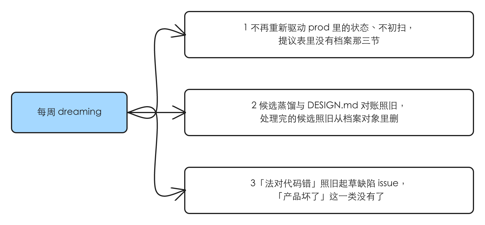
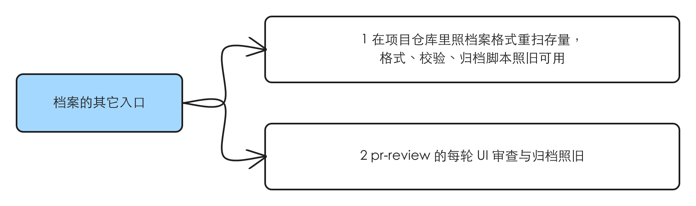

# dreaming 暂时不做设计档案的对账与初扫

## 1 问题

现状核于 2026-10-21，对象是 main（idea-loop 0.0.28）。这是「拿掉一个能力」，没有界面可截，证据是对现状的核对。

### 1.1 每周的档案对账与全站初扫，成本远高于它现在能给的

**现状**：`dreaming` 提议段第 3 步是设计档案（`docs/design/prod/`）的对账：`prod/` 有对象就做档案对账（源码波 + 实时波，实时波起 `idea-loop:ui-reviewer` 的对账模式，对每个状态在开发环境里重新驱动、拍图、比对，判成五种之一）；`prod/` 为空就做全站初扫（从路由表出发，一页一页沿可交互组件广度优先建档案草稿）。两者产出提议表的 `档案对象`、`档案状态`、`初扫页面` 三节和 `缺陷` 里的「产品坏了」。

设计档案分段那条线（PR guohaonan-shy/harold-skills#63，已关）在 TOFEL-demo 营销站上试跑了五轮：按结构推的切线、漏段都修得稳，但会动的东西（脚本驱动的首屏演示、轮播、进场计数、滚动驱动段）每轮都冒出新的不稳定来源（issue #64、#65）。一次初扫或对账的大半时间花在拍不稳的页面上。

Harold 2026-10-21 先决定「dreaming 的设计档案重跑先只用在 app 部分」，随后改为（原话）：「先把dreaming里涉及到prod对账的内容删掉，我准备暂时不在对账里处理设计的内容，我会直接在TOEFLAIR的项目仓库要求它根据我们定义的格式内容，先将存量的内容重新扫一遍」；并选定对账与初扫一起删、候选蒸馏与 `DESIGN.md` 对账保留、原先的「只扫 app」范围声明不做。

**本该是**：每周的 dreaming 不再重新驱动页面、不拍图、不初扫；存量档案由人在项目仓库里按档案格式自己发起重扫。

### 1.2 根因

不涉及（这是一次取舍，不是缺陷）。

## 2 方案

**交付物**：`dreaming` 的提议段从「知识库对账 → 档案对账 / 全站初扫 → 候选蒸馏 → `DESIGN.md` 对账 → 写提议表」变成「知识库对账 → 候选蒸馏 → `DESIGN.md` 对账 → 写提议表」。提议表的节少三类，`缺陷` 只剩「法对代码错」一类。`idea-loop:ui-reviewer` 从三种模式变成两种（每轮审查、归档），都由 `pr-review` 起。只为对账存在的说明文字、脚本与测试一并拿掉。

存量档案怎么来：人在项目仓库里直接让 agent 按设计档案的格式（档案 reference：目录、frontmatter、正文、进入方式、「进不去」的写法）重扫；格式、校验脚本、归档脚本、查询入口都不动，照旧可用。

**范围（同一行为的其他入口）**：

| 入口 | 纳入 / 排除 |
|---|---|
| dreaming 的档案对账（源码波、实时波） | 纳入：删 |
| dreaming 的全站初扫 | 纳入：删 |
| `ui-reviewer` 的对账模式与只为它存在的截图比对脚本 | 纳入：删 |
| 提议表的 `档案对象` / `档案状态` / `初扫页面` 三节、`缺陷` 里的「产品坏了」，以及校验脚本里对应的检查 | 纳入：删 |
| dreaming 的候选蒸馏 | 排除：保留。它读 `prod/` 里档案对象的「设计法候选」并在处理后删掉，是写 `DESIGN.md`，不重新驱动页面 |
| dreaming 的 `DESIGN.md` 对账、知识库对账 | 排除：保留，与设计档案的页面无关 |
| `pr-review` 的每轮 UI 审查与合并前归档 | 排除：保留，是需求自己改到的页面 |
| 设计档案的格式、校验、归档、查询（档案 reference 与它的脚本、MCP） | 排除：保留，人在项目仓库里重扫要用 |

## 3 User Stories

### 每周 dreaming

1. 作为项目负责人，每周的 dreaming 不再起开发服务、不重新驱动 `prod/` 里的状态、不做全站初扫，提议表里没有 `档案对象`、`档案状态`、`初扫页面` 三节。
2. 作为项目负责人，候选蒸馏与 `DESIGN.md` 对账照旧；处理完的候选照旧经 dreaming 的 tmp 目录与归档脚本从档案对象里删掉。
3. 作为项目负责人，`DESIGN.md` 对账里的「法对代码错」照旧起草成缺陷 issue；「产品坏了」这一类不再出现。

### 档案的其它入口

1. 作为项目负责人，我在项目仓库里让 agent 按档案格式重扫存量页面；格式规则、校验脚本、归档脚本、查询入口照旧可用。
2. 作为项目负责人，`pr-review` 的每轮 UI 审查与合并前归档照旧。

## 4 实现决策

### 4.1 删到哪一层

**已定**（人的选择）：档案对账与全站初扫一起删；候选蒸馏与 `DESIGN.md` 对账保留；原先打算的「项目声明设计档案只覆盖 app」不做——dreaming 不再扫页面，就不需要范围。

### 4.2 只为对账存在的东西一起删

**已定**，依据 decision-rules §1 第 1 条「删掉的东西没有调用方、也没人读」：

- dreaming 的两份 reference：档案对账、全站初扫。
- `ui-reviewer` 的对账模式一整节，以及它描述、输入、共用步骤、交回格式、「不做」里所有「对账模式：…」的括注。
- 截图比对脚本 `ui-png-compare`（和它的单测）：它的注释写明只给对账模式用，插件里没有别的调用方。`ui-compare` 的像素层不动（`ui-measure` 在用）。以后恢复对账，从 git 历史取回。
- 提议表 reference 里：三节的闭集行、「发现」以判定开头的 `档案状态` 规则、两张图并排、产品坏了不改档案、初扫行指向 tmp、`删对象` 与「进不去」的证据要求、样例表里的三节与「产品坏了」那行、执行段里档案三类行与「缺陷（产品坏了）」两行。
- 校验脚本里对应的检查：三节从合法节名里去掉（旧表若还有这三节，按未知节名报错——这是想要的行为），两张图检查、「产品坏了不许带替换档案」检查、`缺陷` 开头只剩 `法对代码错：`；单测同步改。

### 4.3 保留但要改措辞的地方

**已定**，依据「spec、说明文字跟已定做法对不上：本次同步改」：

- dreaming SKILL.md：描述、流程第 3 步（删）、后面步骤的编号、缺陷那句只剩「法对代码错」、「手动调用可以只跑某一部分」的举例。
- 候选蒸馏：「多个档案组件重复的做法」现在写着「对账的源码波顺带数」——改成自己用查询入口数（读 `prod/index.md` 的组件清单，逐个读组件对象）。
- `DESIGN.md` 对账：去处那句把「产品坏了」去掉。
- 提议表执行段里「档案对象文件的任何改动都走 `delta/` 加归档脚本」保留（候选蒸馏还在用），措辞改成只说候选。
- 插件 README：dreaming 那一行、`ui-reviewer` 与 dreaming 的目录注释、scripts 列表里的比对脚本。
- 其它 reference 里提到「dreaming 对账」「对账模式」「初扫」的地方逐个改（实现时 grep 一遍，清单不在这里写死）。
- `docs/`（历史记录，含 `dreaming-design-reconcile` spec）不改：它记的是当时的设计，由 dreaming 的知识库对账照常处理。

### 4.4 版本

0.0.28 → 0.0.29（main 上当前 0.0.28；PR #63 用过 0.0.29 但已关、未发布）。

## 5 技术方案总览

### 5.1 后端

不涉及。

### 5.2 前端内部

不涉及。

### 5.3 前端交互

不涉及。

## 6 测试决策

| 变的是什么 | 仪器 | 本次 |
|---|---|---|
| 纯逻辑 / 数据转换 | TDD 单元 | 提议表校验脚本：合法节名去掉三节、两张图与「产品坏了」检查删掉、`缺陷` 开头只认「法对代码错：」。先改单测（旧三节变成报错、只带「产品坏了：」的缺陷行变成报错），再改脚本 |
| API 契约 | TDD API 测试 | 不涉及 |
| DB schema / 迁移 | 真 DB 测试 | 不涉及 |
| LLM 输出质量（prompt 改动） | eval | 不涉及：本仓库对 skill 文字不跑 eval（CLAUDE.md §5） |
| 视觉正确性 | UI 实现环 | 不涉及 |
| 端到端用户流程 | 浏览器测试 | 不涉及 |

- **seam**：插件现有的测试套件（`node --test idea-loop/scripts/*.test.mjs`）。提议表样例由校验脚本的单测直接跑，改样例就是改 seam 上的输入。没有新 seam。
- **增量功能测试**：

| 前置 | 步骤 | 期望 | 覆盖 |
|---|---|---|---|
| 改后的插件 | 对提议表 reference 的样例跑校验脚本 | 退出码 0；样例里没有三节档案节 | 每周 dreaming 1 |
| 同上 | 一张带 `## 档案状态` 节的表跑校验 | 退出码 2，点名未知节 | 每周 dreaming 1 |
| 同上 | `缺陷` 节一行以「法对代码错：」开头 | 通过；以「产品坏了：」开头的报错 | 每周 dreaming 3 |
| 同上 | 在插件的 skills / agents / references / README 里搜对账模式、全站初扫、两份已删 reference 的文件名、比对脚本名 | 搜不到（`docs/` 历史除外） | 每周 dreaming 1；档案的其它入口 2 |
| 同上 | 全量单测 | 全绿，含「不泄漏项目名」与「无遗留入口」绊线 | 全部 |

- **prompt / eval 变动**：无 prompt/eval 变动。
- 先例：校验脚本已有的单测写法。

## 7 Out of scope

- 存量档案的重扫：Harold 在项目仓库里自己发起，不进插件。
- 按项目声明范围只扫 app：不做了（§4.1）。
- 营销站档案怎么稳定取证：#64、#65 照旧挂着。
- 候选蒸馏、`DESIGN.md` 对账、`pr-review` 的 UI 审查与归档：保留不动（§2）。
- 设计档案的格式、校验、归档、查询：不动。

## 8 关联

- raw：[[2026-10-21-archive-scope-app-only]]
- 上游：[[dreaming-design-reconcile]]（档案对账与初扫的出处，仍是 `在飞`；本 spec 合并后，它的这两部分由 dreaming 的知识库对账照常判）。设计档案分段（spec `design-archive-sections` 已 parked，只在已关的 PR #63 的分支上）。
- 相邻：#55（UI 审查改为每轮同步档案、dreaming 拆成编排者 + 专职 agent）还没有 spec。有重叠：它要拆的 dreaming 里少了档案对账这一块，`ui-reviewer` 少了对账模式；本 spec 先落，#55 起草时以删后的样子为准。#64、#65 不碰。
