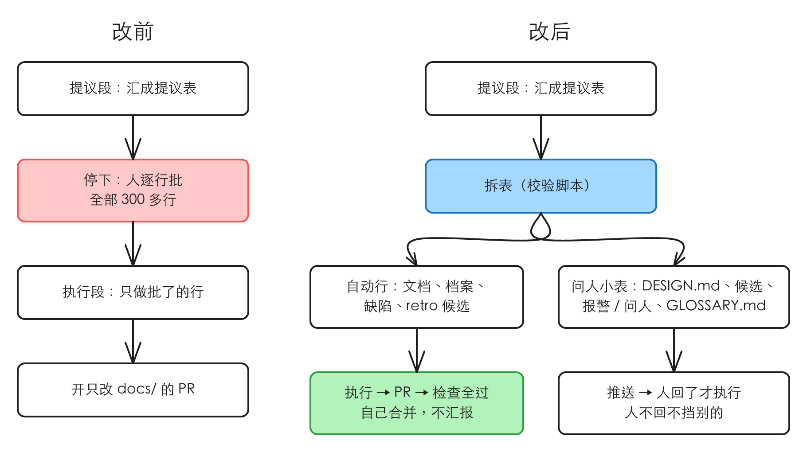

# dreaming 和每周分拣不再等人逐行批

> #298 存在：dreaming 的提议表和每周分拣表每次都停下等人逐行批，人几乎都照推荐批，详情在「问题陈述」

## 问题陈述

### dreaming 每次都停在人身上，而人几乎都照推荐批

现在的 dreaming 分两段：提议段出一张提议表，停下；人逐行回「批 / 不批 / 改成…」后，执行段只执行批了的行，开一个只改 `docs/` 的 PR（出处：`idea-loop/skills/productivity/dreaming/SKILL.md`「流程：两段，中间停在人身上」，对 `origin/main` a7c8129 读，2026-11-13）。`wiki-conventions` 的「人机分工」把这条写成通则：「提议 → 人批准 → 机械执行」。

人改过提议的次数（#298 正文，对 6 次 dreaming 执行 PR 的描述查，2026-11-12）：

| PR | 行数 | 人改过的 |
|---|---|---|
| harold-skills #281（11-10） | 50 | 无 |
| Tofelair #844（11-04） | 126 | 无 |
| Tofelair #862（11-09） | 26 | DESIGN.md 1 处 |
| Tofelair #726（10-26） | 95 | DESIGN.md 2 处、1 处改开 issue；1 条报警不批；1 份 spec 改成直接删、不写 ADR |
| Tofelair #508（10-21） | 31 页初扫 + 若干 | 5 个旧布局目录没批删除 |
| Tofelair #495（10-20） | 未写 | PR 里没记偏差 |

300 多行里，人改过的集中在 `DESIGN.md` 和「报警」；「文档」节的写 ADR、删 spec、订正没有一行被改过。等人的代价：Tofelair 10-26 那张 95 行的表，人从 10-27 到 10-31 分几天才批完。

### 每周分拣也停在人身上

`issue-triage` 第 5 步「等人批」：15 个 issue 查完拼一张表，推送「N 个 issue 等你批」，停下（出处：`idea-loop/skills/engineering/issue-triage/SKILL.md`，同上版本）。人改建议去向的次数没量到：分拣表的批复只留在会话里，没落盘。SEO 这一类有数：#291 记的 7 场决定记录里 6 场人回的是「照推荐」。

### 根因

两处的「人批」都是当初为了防误删、误改设的统一闸门，没按风险分：会出错的只有 `DESIGN.md` 和文档里的冲突，其余行的建议本来就是按规则机械判出来的，人只是照着点头。

## 方案

人的方向（2026-11-12，#286 的 grill 会话，原话在 #298 正文）：只问 `DESIGN.md` 和文档里的矛盾、冲突，其余不问、不提；分拣自主完成。

### dreaming

**人得到什么**：每周 dreaming 跑完，人只在有 `DESIGN.md` 或文档冲突要定时收到一次推送和一张小表；其余改动已经合进主分支，不出现在汇报里。

1. **行分两类**，按行类型和建议处置机械地分，不由 dreaming 临场判断：

   | 问人 | 自动执行 |
   |---|---|
   | `候选` 整节 | `文档`：写 ADR 删 spec、写 ADR 未采纳删 spec、订正、标注被取代、删漏网工单、迁移布局、删除 |
   | `DESIGN.md 条目` 整节 | `档案对象`、`档案状态`、`初扫页面`、`漏归档` 整节 |
   | `文档` 里建议处置是「报警」「问人」的行 | `缺陷`：开成 backlog issue（「已有 #N」的不开） |
   | `文档` 里对象是 `GLOSSARY.md` 的行（术语只由人定，`decision-rules` 护栏） | `retro 候选`：按建议处置执行（开 issue 的开成 backlog issue、驳回的改状态、留在池里的不动） |

   自动执行的行，「批了」就是按它自己的建议处置执行；下游各 reference 里「只执行批了的行」不用逐处改语义。
2. **提议段照旧**：三个 agent 和 dreaming 自己的检查汇成一张完整提议表，过 `proposal-table-check`。完整表是执行段的输入、PR 描述的来源，不摆给人。
3. **拆表**：`proposal-table-check` 加一个输出，把问人的行抽成一张只含这两类的小表（形状同提议表，空节不写）。拆表规则只在脚本里写一份。
4. **自动那份立刻执行**：照提议表的「执行段」执行全部自动行，开一个只改 `docs/`、`DESIGN.md`、`GLOSSARY.md` 的 PR（这一份不会碰后两个文件，因为它们的行都问人）。
5. **自己合并**：本地跑目标仓库 `REVIEW.md` 的验证命令、`spec.mjs check`、link sweep、有设计档案时 `design-archive-check`；仓库有 CI 的再等 CI 全绿。全过就按 `DEVELOPMENT.md` 的合并方式合并；有一条没过就不合并，PR 留着，推送一句。
6. **问人那份**：有行才用『推送』通知人，摆法照现在（小表在会话里按节摆，`候选` 与 `DESIGN.md 条目` 有行时另做审核页）。人不回不挡任何东西；人回了，只执行批了的那几行，再开一个只改知识库的 PR，按第 5 步同样的规则合并。
7. **推送只在三种情况**：有问人的行、PR 没合成、哪一部分没跑成。都没有就不推送，「这次无事」也不发。
8. **回滚**：人说「回滚某次 dreaming」，开那个 PR 的 revert PR，按第 5 步的规则合并。
9. **`.tmp/dreaming/<日期>/` 什么时候删**：问人的行处理完（或没有问人的行）且自动那份已合并才删；没删的，下一次照现有规则写「上一次的提议表还没处理」。

### 每周分拣

**人得到什么**：每周分拣跑完，查过的 issue 都已翻好状态；要人评估的进 triage，由调度照常出会话卡片；人只在有 issue 等他补信息、或有疑似 P0 时收到推送。

1. **建议去向直接执行**，不拼表等人批。`issue-triager` 交回的去向照现在的表执行（todo / triage 带优先级、canceled 带理由、留在 backlog 什么都不做）。
2. **不替人拒需求**：`issue-triager` 的 canceled 只有重复、命中 `docs/records/out-of-scope/`、已实现、复现不出四种来源，这已经是它现在的规则；本次在 `issue-triage` 写明「拿不准值不值得做的翻 triage，不 canceled」。
3. **「记不做」挪走**：现在第 6 步「人拒掉一个需求就写 `out-of-scope` 记录」依赖分拣表，没表就没有触发点。人拒需求现在只发生在 triage 会话里（`issue-session` 的 `draft-spec.md`「人决定不做」），记录挪到那里写，走只改 `docs/` 的 PR。
4. **`全部`**：不再「批完一张才跑下一批」，一批接一批跑完。
5. **推送**：只在有「留在 backlog」的 issue（triager 评论里写了「还要你补」）或疑似 P0 时推送，点名这几个号；都没有不推送。

### 同一行为的其他入口

- **人手敲 `/idea-loop:dreaming`**：纳入，跟定时任务同一条流程。
- **单条蒸馏**（人口述一条视觉规则当场落）：排除，本来就不出提议表、人就在场。
- **`/idea-loop:issue-triage P0 <号>`**：排除，本来就不等人批。
- **`seo-scan` 开出的 `type:seo/*` issue**：排除，#291 让 seo-scan 自己分拣它们。
- **`retro`**（issue 会话收尾）：排除，候选批不批由人定不变。

## User Stories

只改流程、不加能力，每个问题一行期望行为：

- **dreaming 每次都停在人身上**：每周 dreaming 跑完，自动执行的行已由它自己合进主分支；会话里只剩 `DESIGN.md` 与文档冲突两类的小表，没有这两类就没有表、也没有推送。
- **每周分拣也停在人身上**：每周分拣跑完，backlog 里被查过的 issue 都已翻好状态（判不了的留在 backlog），没有等人批的表。

## 实现决策

- **拆表放进 `proposal-table-check`，不新做脚本**：扩展已有的校验脚本（加一个导出函数和一个 CLI 选项），依据：全局约定「先扩展已在用的工具」。问人的判据是行类型加建议处置加对象，三样都是表里的字段，能机械判。
- **`GLOSSARY.md` 的行归问人**：依据 `decision-rules` 护栏「术语：起名、改名、定稿」只由人定。判据是「对象」格以 `GLOSSARY.md` 开头。
- **`retro 候选` 归自动**：依据人的原话把它跟缺陷一起列在「直接开成 backlog issue」。建议处置是「驳回」的也直接改状态；候选池的计数和证据都是机械取的，驳回由 dreaming 按规则判，人仍可在 backlog 里看到开出去的 issue。
- **合并前的检查写成「目标仓库 `REVIEW.md` 的验证命令」**：#298 写的 `node --test` 是本仓库的验证命令，插件里不能写某个项目的命令（`no-project-leak` 守着），按 `REVIEW.md` 取就把它包进去了。
- **不改 `decision-rules` 护栏**：dreaming 的 PR 本来就符合「只改 `docs/` 的 PR 检查全过就合并」；`GLOSSARY.md` 继续问人。依据 #298「影响范围」。
- **不改 ADR 0011、0023**：它们写的「人逐行批」会被下一次 dreaming 的 `adr-reconciler` 判成被本 spec 取代，标注被取代由那里做。
- **要改的文档**（每处标对的是哪条杠杆）：
  - `dreaming/SKILL.md`：description 删「人批过才执行」（路由）；「流程」改成提议段 → 拆表 → 自动执行与合并 / 问人推送（步骤）；「写 `DESIGN.md` 和开 issue 都停在人身上」一段只留 `DESIGN.md`（规则）。
  - `dreaming/references/proposal-table.md`：「放哪、谁看」改成只摆问人小表、推送三种情况；加「行分两类」表；「执行段」加自己合并、回滚（步骤）。
  - `dreaming/references/` 下 `retro-candidates.md`、`candidate-distillation.md`、`initial-scan.md`、`archive-reconcile.md`、`missed-archive.md` 里「人批了才…」的句子：改成「执行段执行的行」，或指回分类表（规则一致）。
  - `wiki-conventions`「人机分工」：改成「提议 → 按风险分：问人的人批准、其余机械执行」，并点名 dreaming 只问哪两类（规则）；「`design/prod/` 只走归档脚本（人批过之后）」补上 dreaming 对账的例外。
  - `design-archive/SKILL.md` 与 `references/archive-script.md` 里「人批过之后才写 `prod/`」：补 dreaming 对账的例外（规则一致）。
  - `issue-triage/SKILL.md`：开头一句、第 4–7 步、`全部` 一行、完成条件（步骤）。
  - `issue-session/references/draft-spec.md`「人决定不做」：加写 `out-of-scope` 记录（步骤搬家）。
  - `issues/SKILL.md` 状态表「分拣后人定」一行改成「分拣按建议直接翻」（规则）。`issues/SKILL.md` 主体 4921 字，只改字不加行。
  - `setup/SKILL.md`「每周分拣」、`setup/references/weekly-dreaming.md`、`weekly-triage.md` 里告诉人「等人逐行批」的句子（交代）。
  - 根目录 `AGENTS.md` 第 1 条：dreaming「出口仍停在人身上」、seo-scan「仍由人分拣」两句。
  - `idea-loop/README.md` 里 dreaming 与 issue-triage 的描述（REVIEW.md 额外要求）。
- **跟 #291 的交界**：两边都改 `issue-triage/SKILL.md`。#291 只动 seo 那一类的分拣入口，本 spec 动等人批的那几步；后合并的那个 rebase。

## 测试决策

| 变的是什么 | 仪器 | 本次 |
|---|---|---|
| 纯逻辑、数据转换、状态机 | TDD 单元测试 | 碰到：`proposal-table-check` 的拆表 |
| API 契约（路由、schema、序列化） | TDD API 测试 | 不涉及 |
| DB schema、迁移、并发与事务语义 | 真 DB 测试 | 不涉及 |
| LLM 输出质量（prompt 改动） | eval（确定性断言） | 碰到但不加 eval：改的是 skill 文字，验收是下一次每周 dreaming 与分拣的实跑（#298「验收」）；没有历史决策点可做回放用例，问题出在流程设计而不是 skill 在某个点做错 |
| 视觉正确性 | UI 实现环 | 不涉及 |
| 端到端用户流程 | 浏览器端到端测试 | 不涉及 |

- **seam**：`proposal-table-check.mjs` 的导出函数（纯函数，喂提议表 markdown，读回问人小表与自动行）。能抓到：分类错了的行（`GLOSSARY.md` 的订正漏进自动、「报警」漏进自动）；漏掉：dreaming 有没有真的照小表摆、照自动行执行。
- **增量功能测试**：
  - 前置：样例提议表（`proposal-table.md` 的样例，加一行对象是 `GLOSSARY.md` 的「订正」、一行「报警」）。步骤：拆表。期望：小表只有 `候选`、`DESIGN.md 条目` 两节，加 `文档` 节里的那两行；`档案状态`、`漏归档`、`retro 候选`、`缺陷`、其余 `文档` 行都不在小表里。覆盖：dreaming 一行。
  - 前置：只有自动类行的表。期望：小表为空（脚本报「无问人的行」）。覆盖：dreaming 一行。
  - `no-project-leak.test.mjs` 照常过。
- **照着谁写**：`idea-loop/scripts/proposal-table-check.test.mjs`（已有用例从样例表读）。

## Out of scope

- 分拣时人改建议去向的次数怎么落盘：本次让分拣不再有人批这一步，没有要记的批复。
- 查询入口和 `raw/` 能不能召回（#286 的 Q3、Q4）：并到 home repo 模式的讨论里。

## 关联

- 来源：#286 的 grill 会话（#298 正文「从哪发现」）。
- [[269]]：2026-11-09 人把「分拣不等人批」关成 canceled，先用定时任务顶上；#298（11-12）是人重新给的方向，本 spec 照 #298。
- [[0011-dreaming-design-reconcile]]、[[0023-issue-triage]]：写着「人逐行批」，会被本 spec 取代，由下一次 dreaming 标注。
- #291（seo-scan 自己分拣 `type:seo/*`，会话在做、分支还没推）：都改 `issue-triage/SKILL.md`，没有逻辑重叠，后合并的 rebase。
- 相邻 spec：`docs/spec/` 下 `docs-ride-code-pr`、`implement-resume-landed`、`seo-draft-reads-principles`，查过，没有重叠。
