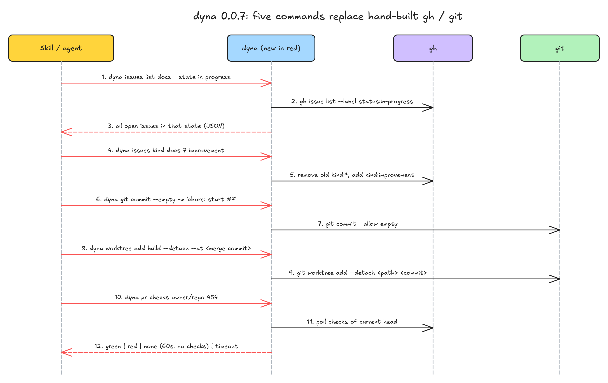
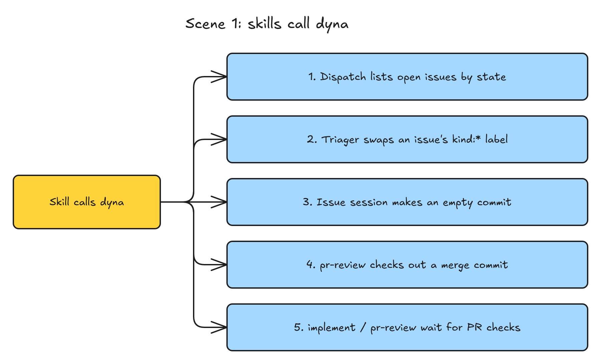
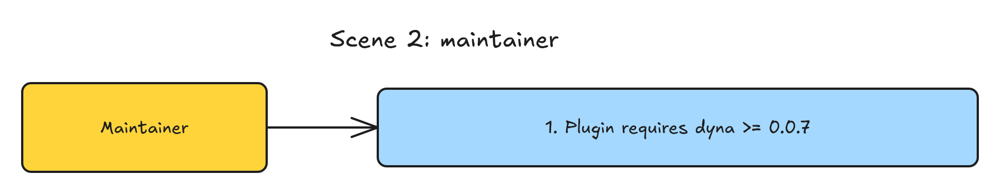

# dyna 补上 skill 里还在手拼 gh / git 的五个命令

> #437 存在：dyna 0.0.6 的登记表里没有这五样，skill 走到这五步只写「要达到什么结果」，agent 每次自己拼 `gh` / `git`；详情在「问题陈述」

## 问题陈述

核对对象：`origin/release/idea-loop-0.2.0` 的 760f26d2（2026-11-23），dyna 0.0.6，登记表 `dyna/registry/0.0.6.json` 共 120 条命令。dyna 目前只在这条 release 分支上，main 没有。分拣评论（2026-11-22，[#437 评论](https://github.com/guohaonan-shy/harold-skills/issues/437)）核过的结论这里复核一遍，结论一致。

### 1. 按状态列开着的 issue

issue-dispatch 第 4 步要列「开着、`status:in-progress` / `status:in-review` 的 issue」，对照侧栏里的会话找没人管的 issue。dyna 能列的只有 `issues backlog`（没有 `status:*` 的）和 `issues candidates`（只收 todo / triage、去掉被挡路的、去掉指派给别人的、还排了序）。第 4 步要的是这两个状态下的全部 issue，包括指派给别人的，所以两条都用不上，skill 写成「照 `idea-loop:issues` 的 GitHub 做法」，agent 每小时一轮自己拼 `gh issue list --label`。

### 2. 给已有 issue 打 `kind:*`

issue-triager 第 5 步给已有 issue 打类型 label。`issues type` 只换 `type:*`，`kind` 只有开 issue 时的 `issues new --kind`。`idea-loop:issues` 的 GitHub 参考（`references/github.md` 的「类型」一行）写的写法就是 `gh issue edit --add-label`。手拼时只加不去，原来带着一个 `kind:bug` 的 issue 改判成 improvement 会同时带两个 `kind:*`；`issues priority` 的做法是先去掉旧的再加新的。

### 3. 空提交

issue-session「实现」第 1 步：新建的 issue 分支先提一个空提交（`chore: 开工 #<号>`）再推送，因为 0.2.0 起 spec 提交在 home 里，代码分支此刻比主分支没有新提交，开不了 PR。`dyna git commit` 要求给文件、只提交给定的文件，提不了空提交，skill 正文里留着一个标「坑」的 `--allow-empty`。

### 4. 把指定提交检出成 worktree

pr-review 合并后的「上线后自查」（`pr-review/references/merge.md`「准备」第 2 步）要把 PR 的合并提交检出到 `.tmp/live-check/<PR 号>/build` 去构建期望产物。`dyna worktree add --detach` 只能游离在 `origin/<基准分支>` 上，不能指定提交，skill 只写「把它检出到独立 worktree」，agent 自己拼 `git worktree add --detach <路径> <提交>`。删的时候 skill 又写 `dyna worktree remove`，建删两边不是同一套工具。

### 5. 等一个 PR 的检查跑完

四处要「等这个 head 的检查跑完」：implement 的「等 CI」（`implement/references/stop-and-resume.md`）、pr-review 的前提（`pr-review/SKILL.md`）、交报告前的「等 CI 绿」（`pr-review/references/deliver.md` 第 2 步）、SEO 自动合并（`pr-review/references/seo-auto-merge.md`）。`pr view` 只给状态、是否 draft、分支、合并提交。agent 只能自己用 `gh pr checks --watch`，它有两处容易判错（gh 2.83.2，2026-11-23 本机核）：

- 这个仓库没有任何 CI（没有 `.github/workflows/`），`gh pr checks 454` 打印「no checks reported on the 'sync/main-to-0.2.0-batch2' branch」。skill 写「没有检查就不等」，但刚推完、检查还没注册时 gh 也是这句话，agent 分不清「这个 PR 永远没有检查」和「检查还没起来」。
- 检查没跑完时 `gh pr checks` 退出 8，不带 `--watch` 的轮询会把 8 当失败。

### 根因

#340 重写 skill 时定了「dyna 没有对应命令的地方写成要达到什么结果，由 agent 自己选工具」（skill-rewrite 的 05、06 号工单交回），这五样当时 dyna 0.0.4 没有，到 0.0.6 也没加。

修正：issue 原先认为「没有 `gh` 登录的回放 worker 会卡在这几步」，实测不是这个原因。回放 runner 故意不给 worker gh 登录（`replay-gh-isolation` spec），而 dyna 的 `issues`、`pr` 命令内部也调 `gh`，同样会得到「未登录」；补了命令，回放里这几步照样读不到线上。补命令换来的是：每次照同一条命令走、不再判错 gh 的退出码、`kind` 不再叠加两个。

## 方案

改完：skill 走到这五步各写一条 `dyna …`，agent 不再拼 `gh` / `git`。dyna 升到 0.0.7、存 0.0.7 的登记表，插件的 `idea-loop/dyna-version` 下限从 0.0.4 提到 0.0.7，五处 skill 原文改成命令。

五样东西，按「已在用的命令能不能补上」分两类（依据：`~/.claude/CLAUDE.md`「做方案」：先扩展已在用的工具，不为一件事新增组件）：

| 缺口 | 做法 | 是扩展还是新增 | 改哪处 skill |
|---|---|---|---|
| 3 空提交 | `dyna git commit` 加 `--empty`：不给文件、只提交说明；跟文件一起给就拒 | 扩展已有命令 | issue-session「实现」第 1 步，删掉「坑」那句 |
| 4 按提交检出 | `dyna worktree add` 的 `--detach` 加 `--at <提交>`：游离在这个提交上，不用给 `--base` | 扩展已有命令 | pr-review `merge.md`「准备」第 2 步 |
| 2 打 kind | `dyna issues kind <docs> <号> <bug\|feature\|improvement>`：换成这个 `kind:*`，旧的去掉 | 新增，形状照 `issues priority` | issue-triager 第 5 步；`issues` 的 GitHub 参考「类型」一行 |
| 1 按状态列 | `dyna issues list <docs> --state <状态>`：JSON，这个状态下的全部开着的 issue（号、标题、指派人），不过滤、不排序 | 新增：`candidates` 的过滤和排序是给派活用的，这里要的是全部 | issue-dispatch 第 4 步 |
| 5 等检查 | `dyna pr checks <owner/repo> <号>`：等这个 PR 当前 head 的检查跑完，打印结论 | 新增 | implement「等 CI」、pr-review 前提、`deliver.md` 第 2 步、`seo-auto-merge.md` |

同一行为的其他入口：

- **Linear 项目**：排除。1、2 两样在 Linear 上走 MCP（`idea-loop:issues` 的 Linear 做法），跟 `issues type`、`issues priority` 一样只管 GitHub。
- **`issues new --kind`**：纳入不变，开 issue 时照旧一次打上；`issues kind` 只管已有的 issue。
- **implement 拍「之前 → 之后」的 base 检出**（`stop-and-resume.md`，`worktree add base --detach --base`）：不变，它要的就是基准分支的最新。
- **merge.md 回滚用的 `git revert -m 1`**：排除，不在这五样里。

## User Stories

### 场景一：skill 照命令走

1. 作为 issue 调度会话，我想要一条命令列出某个状态下所有开着的 issue，以便找出没有会话的 in-progress / in-review issue
2. 作为 issue-triager，我想要一条命令把已有 issue 的类型换成另一个，以便改判后不会同时带两个 `kind:*`
3. 作为 issue 会话，我想要用 `dyna git commit` 提一个空提交，以便新分支能开出 draft PR
4. 作为 pr-review，我想要把合并提交检出成一个 worktree、用 `dyna worktree remove` 删掉，以便建删走同一套命令
5. 作为 implement / pr-review，我想要一条命令等这个 PR 的检查跑完并告诉我绿、红还是没有检查，以便不再判错 gh 的退出码

### 场景二：维护者

1. 作为维护者，我想要插件的 dyna 下限提到含这五样的版本，以便旧 dyna 上跑新 skill 时被拦下并提示升级

## 实现决策

- **一个 PR 合进 `release/idea-loop-0.2.0`**：dyna 只在这条分支上（main 没有 `dyna/`），dyna 相关的 PR #387、#432 都以它为基准。分支 `issue/437-dyna-missing-commands` 从它切出。命令改动、升 dyna 版本、存登记表、提插件下限、改 skill 在同一个 PR 里（依据：REVIEW.md「额外要求」：改了 `dyna/` 同一个改动里升版本并存登记表；下限只要求那一版的登记表已存）。
- **`git commit --empty`**：带 `--empty` 时不收文件参数，给了文件就报错并给出不带 `--empty` 的写法；不带 `--empty` 时文件照旧必填。暂存区里有别的改动时，空提交也不带进去（跟现在「只提交给定文件」的承诺一致）。
- **`worktree add --detach --at <提交>`**：`--at` 只在 `--detach` 时有效；给了 `--at` 不读 `--base`。路径上已经是游离 worktree 就直接给回路径（跟现在一样），不核它游离在哪个提交上。提交在本地找不到时先 `fetch origin` 再找，还找不到就报错。
- **`issues kind`**：参数只收 `bug` / `feature` / `improvement`；先去掉 issue 上所有别的 `kind:*` 再加这个，已经是这个就什么都不做。项目里还没有这个 label 时报错，指向 `dyna issues labels`（跟 `issues priority` 一样）。
- **`issues list`**：`--state` 收 `triage` / `todo` / `in-progress` / `in-review`；`backlog` 不收，指向 `issues backlog`。输出每条 `{number, title, assignees}`，号从小到大。

- **范围：五个一个 PR 做完**（Harold 2026-11-23 选「五个一起 (Recommended)」）。
- **命令名照草稿**：`issues list`、`issues kind`（Harold 2026-11-23 选「就这样 (Recommended)」）。
- **`pr checks` 等多久、结论怎么报**（Harold 2026-11-23 选「等 60 秒再判没有 (Recommended)」）：
  - 等的是 PR **当前 head** 的检查。结论四种：`green`（全过，skipped 算过）、`red`（有一个失败或取消，列出名字和链接）、`none`（推完 60 秒还一个检查都没有）、`timeout`。
  - 默认等 30 分钟，`--timeout` 可改。退出码：green / none 退出 0，red 退出 1，timeout 退出 124（跟 `agent claude run` 一致）。
  - 第一个失败就返回 red，不等其余的跑完：调用方拿到 red 就去回工单，其余的结果用不上。
  - 「60 秒」从命令开始算：GitHub 不给推送时刻，调用方都是推完就调，60 秒覆盖检查注册的那段空档。
  - 例子：本仓库 PR #454 没有 CI，`dyna pr checks guohaonan-shy/harold-skills 454` 打印 `none`、退出 0，implement 照「PR 上没有检查」在本机跑全量。

## 测试决策

| 变的是什么 | 仪器 | 本次 |
|---|---|---|
| 纯逻辑、数据转换、状态机 | TDD 单元测试 | 碰到（`go test`）：`pr checks` 由检查列表判出四种结论；`issues kind` 算要去掉、要加的 label；`issues list` 的过滤 |
| API 契约（路由、schema、序列化） | TDD API 测试 | 碰到：五条命令的输出与退出码；`registry --json` 里有这五样；`dyna-scan.test.mjs` 对 0.0.7 登记表扫 skill |
| DB schema、迁移、并发与事务语义 | 真 DB 测试 | 不涉及 |
| LLM 输出质量（prompt 改动） | eval | 不涉及：只把 skill 里的结果描述换成命令，不改判断规则 |
| 视觉正确性 | UI 实现环 | 不涉及 |
| 端到端用户流程 | 浏览器端到端测试 | 不涉及 |

- **seam**：沿用 dyna 已有的两个。① 模块的 `Deps` 注入假 `gh` / 真临时 git 仓库，从命令入口喂参数、读输出和退出码：能抓到判定和参数解析错，漏掉真 GitHub 的检查注册时序。② `dyna-scan.test.mjs` 拿插件下限那一版的登记表扫 skill：能抓到 skill 写了登记表里没有的命令或参数，漏掉命令行为本身。
- **增量功能测试**：
  1. 前置：临时 git 仓库，暂存区里有一个改动。步骤：`dyna git commit --empty -m "chore: 开工 #1"`。期望：多一个没有文件改动的提交，暂存区那个改动还在。覆盖：场景一 3。
  2. 前置：同上。步骤：`dyna git commit --empty -m x a.txt`。期望：报错，退出 1，提示去掉 `--empty`。覆盖：场景一 3。
  3. 前置：临时仓库有两个提交。步骤：`dyna worktree add build --detach --at <第一个提交> --path <路径>`，再 `dyna worktree remove <路径> --force`。期望：worktree 的 HEAD 是第一个提交；删得掉。覆盖：场景一 4。
  4. 前置：假 gh，issue 7 带 `kind:bug`。步骤：`dyna issues kind docs 7 improvement`。期望：issue 7 只剩 `kind:improvement`。覆盖：场景一 2。
  5. 前置：假 gh，三个 open issue：#1 `status:in-progress` 指派给别人、#2 `status:in-review`、#3 `status:in-progress` 被挡路。步骤：`dyna issues list docs --state in-progress`。期望：#1、#3 两条都在。覆盖：场景一 1。
  6. 前置：假 gh 按次返回检查列表（第一次空、之后一个 pending、再之后 pass）。步骤：`dyna pr checks o/r 9`。期望：打印 green，退出 0。另三例：一直空 → none；出现一个 fail → red 并列出它，退出 1；一直 pending 到超时 → timeout，退出 124。覆盖：场景一 5。
  7. 前置：`idea-loop/dyna-version` 下限 0.0.7，`dyna/registry/0.0.7.json` 已存。步骤：跑 `scripts/dyna-scan.test.mjs`。期望：绿；把某处 skill 写成 `dyna pr checks --foo` 时红。覆盖：场景二 1。
- **照着谁写**：`issues priority` 的测试（`dyna/internal/issues/issues_test.go`，假 gh）；`worktree add --detach` 的测试（`dyna/internal/app/git_worktree_test.go`，真临时仓库）；`agent claude run` 的超时退出 124。

## Out of scope

- skill 里其余手写的 `gh` / `git`（2026-11-23 在 release 分支上数到 23 处，如 setup 的预检、pr-review 发给 Codex 的 `git diff`）：不在 #340 交回的这五处里，要收另开 issue。
- 让回放 worker 能用这几条命令：回放故意不给 gh 登录（见「根因」的修正）。

## 关联

- 来源：#340 / [[skill-rewrite]]（PR #432 的 05、06 号工单交回）；命令行本身见 [[idea-loop-cli]]。
- [[replay-gh-isolation]]：回放不带 gh 登录，是「根因」修正的依据。
- 相邻未完成（2026-11-23 查 `gh pr diff`）：两个都开着、以 release 分支为基准，都会跟这里抢 dyna 的版本号和登记表，后合的那个重新升版、重存登记表。
  - PR #455「一台设备一个调度」：把 issue-dispatch 第 4 步「没有会话的 issue」挪进新的设备级调度 skill（写成「照现在第 4 步」），也改 `dyna/internal/issues/cmd.go`。它先合，`issues list` 要改的就是新位置的那一句。
  - PR #458「skill 文件的结构检查」：改了 `implement/references/stop-and-resume.md`，跟问题 5 的「等 CI」同一份文件，合入时对一下。
