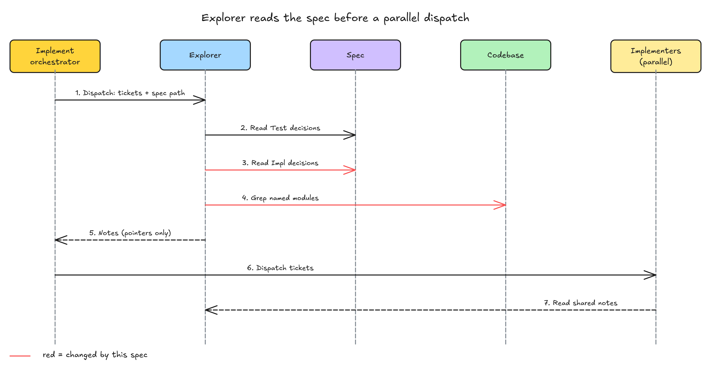

# explorer 加读 spec 的「实现决策」

> #161 存在：explorer 定义仍写「spec 只读『测试决策』」，implementer 已改成 spec 任何一节可读，详情在「问题陈述」

## 问题陈述

### 1. explorer 和 implementer 对同一份 spec 的读法不一致

explorer 是 implement 并行派工前起的探路子代理：替接下来几个并行的 implementer 把大家都要重复找的位置和命令先找一遍，写成只含指针的共享笔记。

- 2026-11-16 对着 origin/main（`a032e45`）核：`idea-loop/agents/explorer.md`「你收到」第二条末句是「spec 只读「测试决策」。」；`idea-loop/agents/implementer.md`「输入」里 spec 那条是「spec 是背景，任何一节都可以读……做什么的范围以工单为准」。
- 来由：2026-10-14 `d0d579c` 加 explorer 时，implementer 也只读「测试决策」，explorer 照抄了同一句，两边是对齐的。2026-10-28 `adcf0f5`（#147，spec implementer-reuse-and-compact，决定见 ADR-0039）把 implementer 放开成全文可读；explorer 不在那份 spec 的范围里，没跟着改，同一分钟由那次实现开出 #161。
- 例子：一份 spec 的「实现决策」写「改 timer 模块和提交接口」。implementer 现在会读到这句，三个并行的 implementer 各自去搜一遍 timer 在哪；explorer 读不到这句，只能从工单的行为描述里猜关键词去搜，没把这份重复的活先做掉。

没查到哪次实现因此出过错（只有 git 历史可查，没有运行记录）；问题是 explorer 没覆盖到 implementer 放开后新增的那份重复查找。

### 根因

explorer 那句读法是从当时的 implementer 抄来的，implementer 改了、explorer 没跟着改（见上面来由一条）。

## 方案

改完，explorer 写的每张工单的现状笔记，除了按工单行为描述找到的位置，也覆盖 spec「实现决策」里点名要动的模块、接口在代码里的位置；几个并行的 implementer 读同一份笔记，不再各自搜一遍。笔记仍只写指针（`路径:行号`、命令、URL），不写方案结论。

只改 explorer 的定义：

- 「你收到」那句改成：spec 读「测试决策」和「实现决策」两节，后者只用来知道要动哪些模块、接口，拿它们当找位置的起点；其余节不读。带一句理由：笔记只含指针，其余节（问题陈述、方案、前端交互、User Stories）产生不了位置指针。
- 「读什么」表里「每张工单描述的现状在代码里对应哪几处」那一行，去哪找加上「spec『实现决策』点名的模块与接口」。

同一读法的其他入口：

- implement 派 explorer 的那句（给 spec 路径）：纳入核对，不用改，它只给路径、不规定读哪节。
- idea-loop 的 `README.md` 里 explorer 的介绍：纳入核对，现在只写「pointer-only shared notes」，不提读哪节，不用改。

## User Stories

只修问题，不加能力：

1. 期望行为（对应问题 1）：explorer 定义里 spec 的读法是「测试决策」+「实现决策」，「实现决策」只当找位置的起点，并写明为什么其余节不读；笔记仍只含指针。

## 实现决策

- **读「测试决策」+「实现决策」，不全放开**：人在本会话选了「加读实现决策」（raw `2026-11-16-explorer-reads-impl-decisions` U3）。依据是 explorer 的本意（替并行 implementer 先做重复的查找）：implementer 拿来找位置的是「实现决策」点名的模块；其余节不产出指针，读了只多上下文，explorer 跑在 haiku 上，读到方案也更可能往笔记里写结论。
- **「实现决策」只当起点，不当结论**：explorer 定义里「不写行为结论、只写位置」的规矩不变；从「实现决策」读到的模块名只用来 grep，笔记里不复述它的决定。
- **改的是 agent 定义**：照 `writing-for-agents` 的「调用方式」不动 frontmatter（description 只路由，读法不进 description）；改动对的杠杆是「输入」（它收到什么、读哪些）。
- **版本**：只改一个 agent 定义里的读法，idea-loop `plugin.json` 升 patch。

## 测试决策

| 变的是什么 | 仪器 | 本次 |
|---|---|---|
| 纯逻辑、数据转换、状态机 | TDD 单元测试 | 不涉及 |
| API 契约（路由、schema、序列化） | TDD API 测试 | 不涉及 |
| DB schema、迁移、并发与事务语义 | 真 DB 测试 | 不涉及 |
| LLM 输出质量（prompt 改动） | eval（确定性断言） | 改的是 agent 定义里的读法，属于能机械判定的规则（必含的写法、禁用的旧写法），走文档检查，不做回放 |
| 视觉正确性 | UI 实现环 | 不涉及 |
| 端到端用户流程 | 浏览器端到端测试 | 不涉及 |

- **seam**：`idea-loop/agents/explorer.md` 的文字本身，用一个文档检查读它。能抓到：读法写回「只读测试决策」、漏了「实现决策」、丢了理由句；漏掉：explorer 实际跑时是否真的用了「实现决策」找位置（要判断，不在这次验）。
- **增量功能测试**：
  - 前置：origin/main 上的 `explorer.md`。步骤：跑新加的文档检查。期望：失败，报「仍写只读测试决策」（先见它红）。覆盖：期望行为 1。
  - 前置：改后的 `explorer.md`。步骤：同上。期望：通过——「你收到」里同时出现「测试决策」「实现决策」，出现「起点」这一用法和其余节不读的理由，不再出现「只读「测试决策」」。覆盖：期望行为 1。
- **照着谁写**：`idea-loop/scripts/*-doc.test.mjs` 同类文档检查，如 `skill-edit-acceptance-doc.test.mjs`。

## Out of scope

- 不改 implementer 的读法，也不改 explorer 的模型、工具和交回格式。
- 不验 explorer 实际运行时笔记质量是否变好（要回放，成本不对等）。

## 关联

- raw：[[2026-11-16-explorer-reads-impl-decisions]]
- ADR：[[0039-implementer-reuse-and-compact]]（implementer 放开读法的来源）、[[0058-skill-edit-acceptance]]（改 agent 定义的工单带三格验收）
- 相邻未完成的 spec 与 issue：2026-11-16 查，`docs/spec/` 在 origin/main 上没有别的 spec；`gh issue list --state open --search explorer` 只返回 #161 自己，没有别的 issue 动 explorer 的定义，谁先谁后不涉及。
