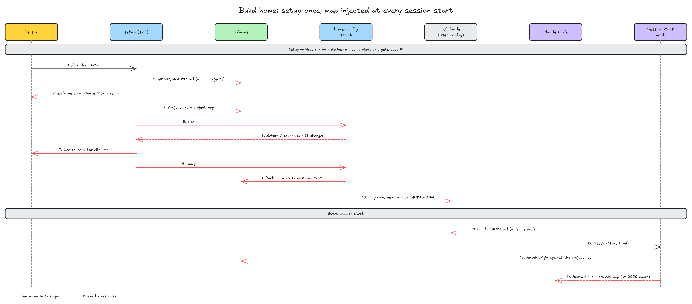
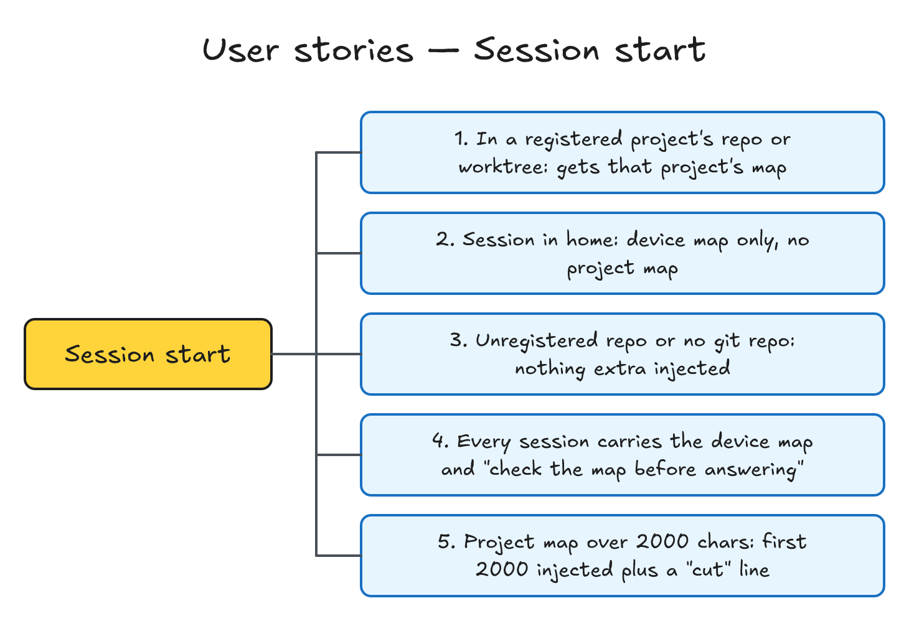
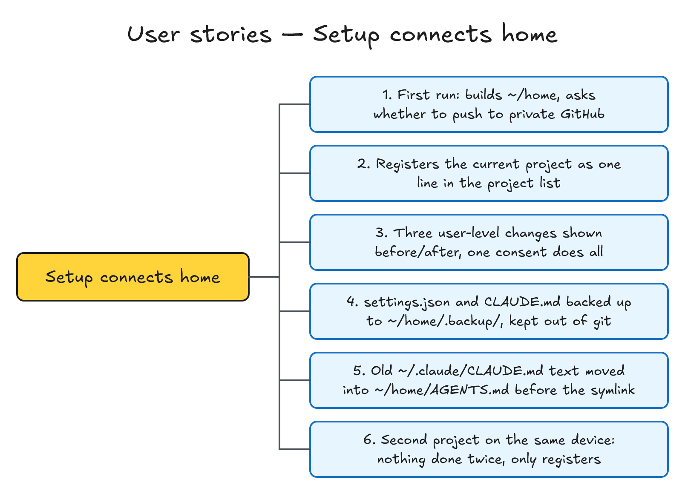
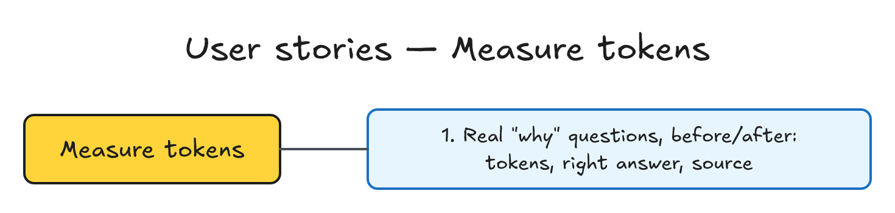

# 建 home：设备地图、按项目注入的项目地图、setup 改用户级配置

> #252 存在：2026-11-15 在本机核：`~/home` 不存在；idea-loop 只在 Toeflair、harold-skills 两个仓库各自项目级启用；SessionStart hook 只注入一行运行环境，会话开始时拿不到任何「知识放在哪、怎么查」的地图，详情在「问题陈述」


## 问题陈述

0.2.0 的方向已定（决定记录 `docs/raw/issue-workflow/2026-11-15-home-repo-grill.md` 末尾的「本轮决议」）：一台设备一个私有仓库 home（`~/home`），知识库、记忆、各项目的引导文件都住进去，代码仓库是指针。这一刀是地基：home 本身、它的入口文件、会话怎么拿到它、setup 怎么把设备接上它。下面三个问题都对着 `release/idea-loop-0.2.0` 的 `64208e8`、本机 Claude Code 2.1.299 在 2026-11-15 核过。

### 1. 会话开始时没有「东西放在哪」的地图

现在一个会话开始时，idea-loop 往上下文里放的只有一行：「当前运行环境：claude-desktop，用到能力时照 idea-loop:runtime 做」（SessionStart hook 跑 `runtime-detect.mjs --line`，`idea-loop/hooks/hooks.json` 里唯一一条 SessionStart）。知识库在哪、记忆在哪、哪类问题该去哪查，agent 要靠项目根目录的 `CLAUDE.md` 和自己 grep。

真实例子：#286 的验收题「为什么分拣不等人批」，答案在 harold-skills 的 `docs/spec/dreaming-triage-autonomous/` 和 `docs/raw/decisions/298.md`；harold-skills 的 `docs/` 有 130 份 md、约 34 万字，入口只有 668 字的 `docs/index.md`（#286 正文，2026-11-11 量）。会话没有地图，只能整份读或者 grep。

### 2. 设备上还没有 home，跨项目的东西没有地方放

`~/home` 不存在（`ls ~/home`，2026-11-15）。这台设备上跨项目的规矩只有 `~/.claude/CLAUDE.md` 一个地方，它是一份 1617 字的普通文件，不在任何 git 仓库里，改了没有历史。

### 3. 用户级配置还是按项目的样子

`~/.claude/settings.json`（2026-11-15 读）：

| 配置 | 现在 | 要成的样子 |
|---|---|---|
| `enabledPlugins` 里的 idea-loop | 没有这一项；只在 Toeflair 的 `.claude/settings.json`、harold-skills 的 `.claude/settings.local.json` 里项目级启用 | 用户级启用，任何目录开会话都有 idea-loop 的 hook 和 skill |
| `autoMemoryDirectory` | 没设：记忆按 git 仓库分在 10 个项目目录里 | `~/home/memory/`，全设备一份 |
| `~/.claude/CLAUDE.md` | 普通文件 | 软链到 `~/home/AGENTS.md` |

`~/.claude/CLAUDE.md` 为什么非软链到内容文件不可：决定记录 A8 的实测，软链指向一个只写 `@AGENTS.md` 的文件时 AGENTS.md 加载不到，直接指向内容文件才行。

## 方案

改完后：人在一台设备上第一次跑 `/idea-loop:setup`，setup 建好 `~/home`，把当前项目登记进项目清单、起草它的项目地图，再一次列出三处用户级改动的改前改后，人同意一次就全做（先备份）。之后这台设备上任何一个会话都带着设备地图（因为 `~/.claude/CLAUDE.md` 就是 `~/home/AGENTS.md`）；会话开在一个已登记项目的代码仓库或它的 worktree 里时，idea-loop 的 SessionStart hook 按 git 远端认出项目，把这个项目的地图注入进来；会话开在 home 里时只有设备地图。

决定会话拿到什么的输入只有三样：会话开在哪个目录（它的 git 远端、它是不是 home）、`~/home/AGENTS.md` 的项目清单、`~/home/projects/<名字>/AGENTS.md` 这份项目地图。



上半段是第一次在一台设备上跑 setup，下半段是之后每个会话开始；红色是这份 spec 新增的消息，虚线是返回。

### home 的形状

```
~/home/
├── AGENTS.md              # 设备地图 + 项目清单 + 人原来写在 ~/.claude/CLAUDE.md 的内容
├── .gitignore             # 忽略 .backup/
├── .backup/<时间>/        # setup 改用户级配置前的备份，不进 git
├── memory/                # autoMemoryDirectory 指到这里（这一刀只建空目录，内容由 #332、#247 搬）
└── projects/<名字>/
    └── AGENTS.md          # 这个项目的项目地图
```

`~/home` 只有 main，改了直接提交、只 add 自己写的文件（决定记录 Q12）。Mac 上推到 GitHub 的私有仓库，公司虚拟机上本地 git 不连远端（Q1）：setup 问一次推不推远端。

### `~/home/AGENTS.md`

人的内容和 idea-loop 管的两节并存。idea-loop 只写自己的两节，人的内容原样保留：

- **`## 设备地图`**（≤2000 字）：home 里每一层放什么、什么问题去哪查（项目事实和过去的决定 → 项目地图指的那几层；跨项目的规矩 → 记忆索引；`docs/raw/` 不每轮读、上层查不到时才 grep），以及一句「回答关于过去决定或项目事实的问题前，先按地图去查」（Q31）。
- **`## 项目`**：一个项目一行，照 aihero 的写法：`<名字>（<是什么>）: <本地路径>. Clone from <远端> if missing.`。例：`harold-skills（Claude Code 插件 marketplace）: ~/projects/harold-skills. Clone from https://github.com/<owner>/harold-skills if missing.`。

home 里不放 `CLAUDE.md`（Q7）。

### SessionStart hook

在 idea-loop 已有的 SessionStart 里加一条命令，跟运行环境那一行并排（扩展已在用的 hook，不新增组件，Q5）。它的判断顺序：

| 会话开在哪 | 注入什么 |
|---|---|
| 不在 git 仓库里，或这台设备没有 `~/home` | 什么都不加 |
| home 本身（git 顶层目录就是 `~/home`） | 什么都不加：设备地图已经由 `~/.claude/CLAUDE.md` 加载 |
| 代码仓库或它的 worktree，`origin` 的远端对上项目清单的某一行 | 那个项目的 `projects/<名字>/AGENTS.md` 全文；超过 2000 字只注入前 2000 字，末尾加一行「项目地图超过 2000 字，已截断」 |
| 对上了，但项目地图文件还没有 | 一行：这个项目在 home 里的目录在哪、地图还没写 |
| 对不上任何一行 | 什么都不加 |

远端比较前统一成 `主机/owner/仓库名`（去掉协议、`git@主机:` 写法、末尾的 `.git`，主机名小写），所以 SSH 和 HTTPS 两种 clone 认成同一个项目。worktree 的 `origin` 跟主 checkout 一样，所以 worktree 也认得出。

### setup

setup 加一节「home」，步骤放进它自己的参考文件，SKILL.md 主体只留这一节的一行指针和完成条件（setup 的 SKILL.md 主体改前 4949 字，贴着 5000 字的上限，不再往主体里加步骤）。三步：

1. **建 home**（`~/home` 不存在时）：`git init`，写 `AGENTS.md`（只有 `## 设备地图`、`## 项目` 两节）、`.gitignore`（`.backup/`），建 `memory/`、`projects/`，提交。问人推不推到 GitHub 私有仓库：推荐「推」当 `gh auth status` 已登录，否则推荐「只留本地」；人选推，用 `gh repo create` 建私有仓库 `home` 并推上去。
2. **登记当前项目**：`## 项目` 里还没有当前仓库这一行，就加一行（名字取远端的仓库名转小写，「是什么」从 `PRODUCT.md` 的第一句推、问人确认），建 `projects/<名字>/`，照模板起草第一版项目地图（见「实现决策」的「第一版项目地图由 setup 照模板起草」）。提交到 home。
3. **改三处用户级配置**：交给一个脚本做机械部分（下文「home-config 脚本」）。setup 先让脚本出一张改前改后的表，三处一起摆给人；人同意一次，脚本先备份再全改。已经是目标值的项在表里写「已是」，不再问；三处都已是，这一步跳过。所以同一台设备上第二个项目跑 setup，只走第 2 步。

**home-config 脚本**有两个动作：

- 出表：列出三处的改前、改后；不写任何东西。
- 执行：把 `~/.claude/settings.json` 和 `~/.claude/CLAUDE.md` 原样复制进 `~/home/.backup/<时间>/`，然后：在 `enabledPlugins` 里加 idea-loop（键名从插件自己的安装路径推出 `<插件>@<marketplace>`，不写死）；`autoMemoryDirectory` 设成 `~/home/memory/` 的绝对路径；`~/.claude/CLAUDE.md` 是普通文件的，把它的内容搬进 `~/home/AGENTS.md`（放在 idea-loop 两节之外、原样），再把它换成指向 `~/home/AGENTS.md` 的软链。`settings.json` 里别的键原样保留。

### 同一行为的其他入口

| 入口 | 纳入还是排除 |
|---|---|
| 代码仓库里 idea-loop 生成的引导文件和 `## idea-loop` 块（`CLAUDE.md` 里那段指针） | 排除：这一刀不动它们，项目照旧能用；搬进 home 是 #247，skill 改读 home 是 #333 |
| `claude -p` 起的无头会话（规则回放、`uiux-research` 的 baseline） | 纳入：SessionStart hook 在这里同样跑。回放的改前、改后两边开在同一个仓库，注入的地图相同，条件仍然对等 |
| magi 运行环境 | 纳入：hook 只读文件和 git，不依赖运行环境 |
| 子代理 | 排除：SessionStart 不对子代理触发，子代理拿不到项目地图；它们照旧从调用方给的指针读 |
| Codex 等别的 agent 读 `AGENTS.md` | 排除：不在 idea-loop 的范围 |

## User Stories

### 会话开始



1. 作为在一个已登记项目的代码仓库或 worktree 里开会话的 agent，我想要会话一开始就拿到这个项目的地图，以便回答项目事实前知道去哪查
2. 作为在 home 里开会话的 agent，我想要只拿到设备地图、不被注入任何一个项目的地图，以便跨项目的活不被一个项目占上下文
3. 作为在没登记的仓库或不在 git 仓库里开会话的 agent，我想要 idea-loop 不多注入东西，以便没登记的地方不多花上下文
4. 作为人，我想要这台设备上每个会话都带着设备地图和「回答前先按地图查」，以便 agent 回答过去的决定时先查，不凭印象
5. 作为人，我想要项目地图超过 2000 字时只注入前 2000 字并带一行提示，以便每轮的负担有上限、超限看得见

### setup 接上 home



1. 作为第一次在这台设备上跑 setup 的人，我想要 setup 建好 `~/home` 并问我推不推到 GitHub 私有仓库，以便 Mac 和公司虚拟机各按各的来
2. 作为人，我想要 setup 把当前项目登记成项目清单里的一行，以便 hook 认得出这个项目
3. 作为人，我想要三处用户级改动一次摆出改前改后、我同意一次就全做，以便不用逐项点
4. 作为人，我想要改之前 `settings.json` 和 `CLAUDE.md` 先备份进 `~/home/.backup/`、备份不进 git，以便改坏了能还原、`settings.json` 里的东西不被推上远端
5. 作为人，我想要我原来 `~/.claude/CLAUDE.md` 里的内容搬进 `~/home/AGENTS.md` 再软链，以便我的全局规矩一个字不丢
6. 作为在同一台设备上给第二个项目跑 setup 的人，我想要已经做过的不再问，以便第二次只登记项目

### 量 token



1. 作为人，我想要拿几个真实的「为什么」问题，在改前、改后各量一次花了多少 token、答对没有，以便判断地图够不够用、要不要扩展 `design-archive` MCP（#286 的验收）

## 实现决策

### 已定

- **hook 是新的一条命令，不并进运行环境那条**：两件事各管各的输入（一个看环境变量，一个看目录和 git），并在同一个 SessionStart 下。依据：「先扩展已在用的工具」——扩展的是 idea-loop 已有的 SessionStart hook，不另起机制。
- **home 的位置固定为 `~/home`，环境变量 `IDEA_LOOP_HOME` 可以覆盖**：覆盖只为测试能在临时目录里跑；决定记录 Q1 定的就是 `~/home`。
- **认项目只看 `origin`**：没有 `origin` 的仓库不注入（见「已知限制」）。依据：决定记录 Q11「hook 用当前目录的 git 远端认项目」。
- **项目名取远端的仓库名转小写**：#333 正文的例子 `~/home/projects/toeflair/` 就是这个规则。
- **项目地图叫 `projects/<名字>/AGENTS.md`**：跟设备层的 `~/home/AGENTS.md` 同名同义——「进这个目录先读的那份」；会话开在 home 里、读到这个项目的文件时，Claude Code 自己会加载它（本机 `pluginConfigs` 里 `instructionFiles` 是 `claude-md-and-agents-md`），跟 hook 注入的是同一份。
- **2000 字的上限按 `## 设备地图` 一节、和每份项目地图各自算**：人搬进来的原 `CLAUDE.md` 内容（现在 1617 字）不算在内，项目清单一个项目一行、不算在内。超限的处理照 Claude Code 自己对 `MEMORY.md` 的做法：截断加提示，不报错。
- **`.backup/` 不进 git**：`~/.claude/settings.json` 有 `env` 一节，可能有密钥；home 在 Mac 上会推到 GitHub。
- **`~/.claude/CLAUDE.md` 已经是软链、但不指向 `~/home/AGENTS.md` 的**：脚本不动它，出表时这一项写「已是别处的软链，要人处理」，setup 把它交回给人。
- **版本号**：这个 PR 不升 idea-loop 的版本。依据：父 issue #331 定了 0.2.0 由父会话在集成分支合进 main 的那个 PR 里一次升；子 PR 合进的是 `release/idea-loop-0.2.0`，不是 main（2026-11-17 父会话转达，推翻 triage 时写的「第一个子 PR 就升到 0.2.0」）。
- **已知限制**（找不到真实路径，不展开设计，人可以推翻）：仓库没有 `origin`（本机 `~/projects` 下的仓库都有）；同一个仓库被登记成两行；会话开在 home 里时设备地图被 `~/.claude/CLAUDE.md` 和 `~/home/AGENTS.md` 各加载一次（2026-11-17 本机 `claude -p` 在 `~/home` 里实测：两个路径各一份，约 2200 字多算一遍；只在 home 里开会话时发生，开在代码仓库里只有一份）。

### 第一版项目地图由 setup 照模板起草，dreaming 之后接管

setup 登记项目时，读这个项目现在的 `docs/index.md`、目录树和引导文件，照一份地图模板（几层、每层放什么、什么问题去哪查）写出第一版，≤2000 字，路径指向东西现在在哪（还在代码仓库的 `docs/`）；模板里有一行指向 `projects/<名字>/memory/MEMORY.md`（这个项目自己的记忆索引，由 #332 填，2026-11-16 #332、#333 定）；#247 搬家时改路径，#333 让 dreaming 每周重写它。例：harold-skills 的地图写「决定记录在 `~/projects/harold-skills/docs/raw/decisions/`」。这样 token 测量在这一刀就能做完，#333 动工前就知道要不要扩展 `design-archive` MCP。

依据：决定记录 Q5 定了地图「由 dreaming 生成」，但 dreaming 读写 home 归 #333；2026-11-16 摆了「setup 起草」和「只建机制、测量挪到 #247 之后」两个选项，人选前者：「都按推荐没问题」。

### 本机实测时不切记忆目录，等 #247 搬记忆时一起切

setup 的三处改动照决定写全、有测试，home-config 脚本支持只做其中几处；这一刀在本机实测，只软链 `CLAUDE.md`，`autoMemoryDirectory` 不动；用户级启用 idea-loop 等本机升到 0.2.0 再做（2026-11-17 人定：现装的 0.1.14 没有新 hook，启用只是把它铺到所有目录；原写「只启用插件、软链两处」）。#252 到 #247 之间，在 Toeflair 开会话照旧读得到它的记忆索引。

什么时候切：#247 在本机跑迁移时，同一次里按「复制 10 个项目目录的记忆进 `~/home/memory/`（加项目前缀）→ 切 `autoMemoryDirectory` → 跑一次 dreaming 把索引压到 140 行内」的顺序做。压缩必须紧跟着切：本机 10 份 `MEMORY.md` 加起来正好 200 行（2026-11-16 `wc -l` 数），合成一份就顶到每轮只加载前 200 行的上限，也超过 Claude Code 要求的 140 行（决定记录 A4 的实测：超限后再写会报错、会话停下问人）；压缩的能力在 #332，按 #331 的顺序 #332 先于 #247 合进集成分支。这条顺序写进 #247 的 spec。

依据：2026-11-16 摆了「本机先不切」和「三处一起切」两个选项，人选前者：「都按推荐没问题」，并问「记忆目录什么时候切？」，答案即上一段。

## 测试决策

| 变的是什么 | 仪器 | 本次 |
|---|---|---|
| 纯逻辑、数据转换、状态机 | TDD 单元测试 | 碰到：hook 认项目（远端统一、home 判断、截断、清单解析）；home-config 脚本的出表与执行（备份、`settings.json` 只改两个键、内容搬家、软链、已是目标值不重做） |
| API 契约（路由、schema、序列化） | TDD API 测试 | 不涉及 |
| DB schema、迁移、并发与事务语义 | 真 DB 测试 | 不涉及 |
| LLM 输出质量（prompt 改动） | eval（确定性断言） | 不涉及：setup 的 SKILL.md 和参考改了，按 `AGENTS.md` §5 不做 quantitative eval；token 测量见下 |
| 视觉正确性 | UI 实现环 | 不涉及 |
| 端到端用户流程 | 浏览器端到端测试 | 不涉及；用一次真实的 `claude -p` 确认 hook 的输出真的进了会话上下文 |

- **seam**：
  - hook 脚本的命令行：输入是当前目录和 `HOME` / `IDEA_LOOP_HOME`，输出是 stdout 的注入文字。测试在临时目录里建假的 home 和带远端的假 git 仓库（含 worktree）。抓得到：认没认对项目、home 里不注入、截断。漏掉：Claude Code 有没有真把 stdout 放进上下文——由一次 `claude -p` 补。
  - home-config 脚本的命令行：在临时 `HOME` 下跑出表和执行。抓得到：备份内容、`settings.json` 其余键不变、软链指向、内容一字不丢、第二次执行不重复。漏掉：setup 对话里怎么问人——由 setup 的文档测试守「三处一次问」和「只留一行指针」。
- **增量功能测试**：
  - 会话开始 1：前置——临时 home 里登记了 `example-app`，远端 `https://github.com/acme/example-app`；在一个 `origin` 是 `git@github.com:acme/example-app.git` 的仓库的 worktree 里跑 hook。期望——stdout 含 `projects/example-app/AGENTS.md` 的全文。覆盖：会话开始 1。
  - 会话开始 2：在临时 home 本身跑 hook。期望——stdout 没有项目地图。覆盖：会话开始 2。
  - 会话开始 3：在远端不在清单里的仓库、和不在 git 仓库的目录各跑一次。期望——两次都没有项目地图。覆盖：会话开始 3。
  - 会话开始 5：项目地图写 2500 字。期望——注入前 2000 字和一行「已截断」。覆盖：会话开始 5。
  - setup 3、4、5：临时 `HOME` 下放一份带 `env`、`enabledPlugins` 的 `settings.json` 和一份普通的 `CLAUDE.md`，出表再执行。期望——出表不写文件；执行后 `.backup/<时间>/` 下两份原文件逐字相同、`settings.json` 只多了两个键、`CLAUDE.md` 是软链、`~/home/AGENTS.md` 含原 `CLAUDE.md` 全文、`git status` 里 `.backup/` 不出现。覆盖：setup 3、4、5。
  - setup 6：同一个临时 `HOME` 再执行一次。期望——出表三项都是「已是」，执行什么都不改。覆盖：setup 6。
  - 会话开始 4 与量 token 1（在本机，实现落地后做一次）：前置——本机按「本机实测时不切记忆目录」只软链 `CLAUDE.md` 跑完 setup（用户级启用等升到 0.2.0，测量用本分支的插件目录加载），harold-skills 已登记、有项目地图。步骤——在 harold-skills 的同一个提交上，用同一个模型、每题一个全新的 `claude -p --output-format stream-json` 会话，问三个真实问题：「为什么每周分拣不等人批」（#298）、「改了插件的 PR 按什么升版本」（#305）、「为什么取消了夜间回放队列」（#174）；改前（本机跑 setup 之前）、改后各跑一遍。每次记总 token（输入含缓存读写、加输出）、工具调用次数、答案有没有引到对的出处。判定：三题改后都答对且引到出处、三题改后 token 的中位数不高于改前，算「地图够」；任一不满足算「不够」，开一个扩展 `design-archive` MCP 的 issue 挂到 #331 下，不在这一刀做。结果贴进 PR 描述并评论到 #331。覆盖：会话开始 4、量 token 1。
- **照着谁写**：hook 脚本照 `idea-loop/scripts/runtime-detect.mjs` 与它的测试（导出纯函数 + 命令行入口）；在临时目录里建 git 仓库的测试照 `idea-loop/scripts/issues.test.mjs`；setup 的文档测试照 `idea-loop/scripts/setup-single-source.test.mjs`。

## Out of scope

- 记忆的整理与压缩、`MEMORY.md` 压在 140 行内（#332）；把各项目的记忆复制进 `~/home/memory/`（#247）。
- skill、agent、脚本改读 home 里的知识库和引导文件，spec 改为直接提交到 home 的 main，`ISSUE_TRACKER.md`「仓库」表并进项目清单，dreaming 生成和维护两份地图（#333）。
- 搬 Toeflair、harold-skills 的引导文件和 `docs/`，清理用户级 skill、`~/.claude/skills` 改软链到 `~/home/skills/`，删项目级的 idea-loop 启用（#247）。
- idea-loop 认父子 issue、按父 issue 取基准分支（#334）。

## 关联

- raw：[[2026-11-15-home-repo-grill]]（全部决议），这次 triage 会话的两道题记在 `docs/raw/decisions/252.md`。
- 父 issue #331（0.2.0，集成分支 `release/idea-loop-0.2.0`）。兄弟 issue #332、#333、#247 都依赖这一刀，这一刀先合；跟它们的边界写在「Out of scope」。#332 的正文也写了「`~/home/AGENTS.md` 写『回答前先按地图查』」：这句在这一刀写进设备地图，#332 不再写。#332 的正文写了用户级 `autoMemoryDirectory` 指到 `~/home/memory/`：配置项在这一刀由 setup 改，#332 只管记忆的内容。
- [[0050-docs-ride-code-pr]]（#244 的 spec，「spec 跟代码一个 PR、setup 问知识库放哪」）：0.2.0 推翻了它的「业务根目录」方向；它问的「知识库放哪」被 home 取代，删它归 #247 迁移时的 dreaming。没有代码上的重叠。
- [[0047-dreaming-triage-autonomous]]（#298）：token 测量的第一个问题取自它；它由人另行调度、走 main，不在 0.2.0。
- #286（已关）：查询入口、raw、文章其余建议三题的结论并进了这一刀，token 测量是它的验收。
- #334（走 main）：认父子 issue；在它合并前，这一刀的会话由人点明基准分支。
