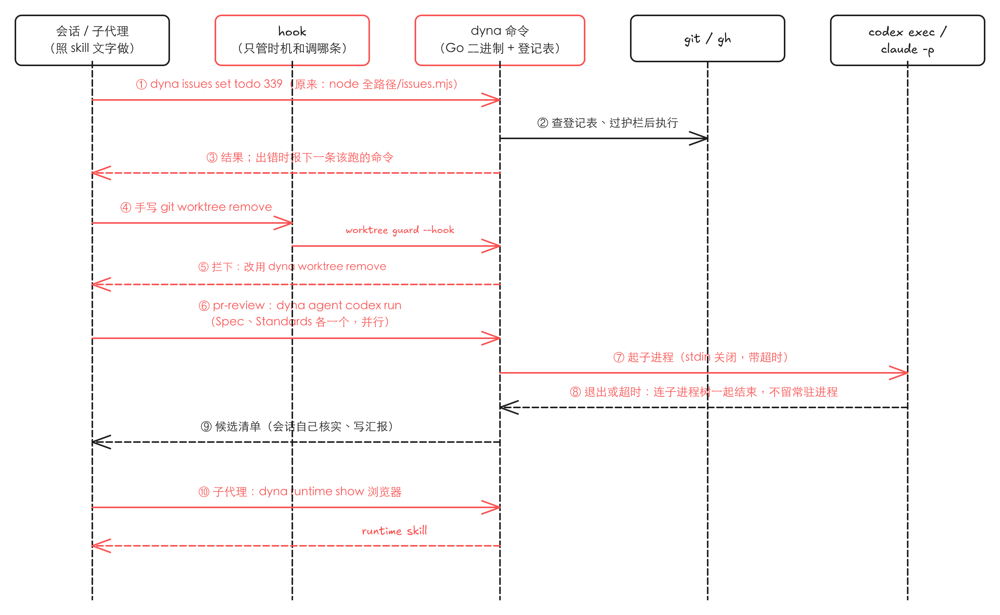
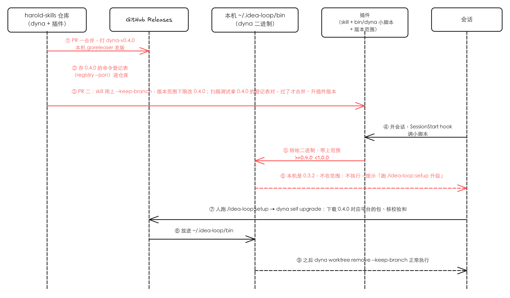

# idea-loop 命令行 dyna

> #339 存在：2026-11-18 对着 `release/idea-loop-0.2.0` 的 `da89648` 数，`idea-loop/skills` 和 `idea-loop/agents` 里 `${CLAUDE_PLUGIN_ROOT}/scripts/` 出现 154 次、分布在 89 个文件（issue 写时对着 main `a032e45` 是 127 次、77 个文件，#333 合入后又多了）。详情在「问题陈述」。

## 问题陈述

下面的数都是 2026-11-18 在 `release/idea-loop-0.2.0` 的 `da89648` 上用 grep 查的，范围是 `idea-loop/skills` 和 `idea-loop/agents`。

### 1. 脚本只能用全路径调，参数抄在 skill 文字里

`idea-loop/scripts/` 下不算测试有 57 个 `.mjs`。skill 和 agent 要调它们，只能写 `node "${CLAUDE_PLUGIN_ROOT}/scripts/<名字>.mjs" …`，一共 154 处。最多的三个是 `seo-md.mjs` 17 处、`issues.mjs` 16 处、`design-archive-sections.mjs` 15 处。

脚本的参数也抄在 skill 文字里。例子：`issue-session` 的 SKILL.md 开头要专门写一句「下文 `issues` 指 node …/issues.mjs」，下面再逐条写 `issues set <docs> todo <号> --comment=…`。脚本一改参数，这些文字就过期了，也没有测试会红。

### 2. 容易出错的操作每次手写

`git`、`gh` 的操作在 skill 里手写，每处写法不一样：

| 手写的操作 | 处数 |
|---|---|
| `git worktree …`（建、删 worktree） | 17 |
| `git -C <目录> …` | 19 |
| `git push` / `merge` / `commit` | 11 |
| `gh pr …` | 15 |
| `gh issue …` | 24 |
| 挡路关系（`gh api …/dependencies/blocked_by`） | 3 |
| 起静态服务器（`python -m http.server` 等） | 4 |
| DESIGN.md 官方 lint / diff（`npx @google/design.md`） | 5 |

知识库还有三条规则只靠 agent 手动 grep：`docs/` 下 slug 全局唯一、删文件后查死链、ADR 文件名四位编号递增。#302 定了把这三条交给命令行（#339 的评论，来源 PR #372），现在 `wiki-conventions` 的「slug 与链接」和 dreaming 的 `index-md.md` 里各留了一行「由 #339 包装」的占位。

### 3. 调 Codex 留下常驻进程，从不退出

pr-review 现在经 Codex 插件的 companion 脚本起 Codex。companion 每次起一个常驻 broker，从不退出。2026-11-18 本机查到 154 个 broker，连同子进程一共 1205 个进程、约 3.76 GB 内存，最老的跑了 23 天（父会话查到并已清理）。

### 4. 运行环境的做法是一个 skill，子代理要自己去读

`idea-loop:runtime` 是一个 skill：正文 3636 字，每种运行环境一份参考（`claude-desktop` 13938 字、`magi` 11183 字）。主会话开场由 SessionStart hook 注入。子代理收不到注入，要自己跑 `runtime-detect.mjs`，再去翻参考找那一节。skill 和 agent 里 `idea-loop:runtime` 出现 39 次、`idea-loop:browser` 20 次。

### 根因

idea-loop 的脚本没有一个统一的入口：调用方只能拿全路径找它们，参数只能抄在文字里（问题 1）；没有入口，就没地方给易错操作加护栏（问题 2）、没地方管子进程的生死（问题 3）、没地方让子代理按能力查运行环境（问题 4）。

## 方案

改完后，skill 和 agent 里只写 `dyna <模块> <命令>`。参数靠 `dyna <模块> <命令> --help` 查；skill 只写查不到的约定、理由和坑。易错的操作做成带护栏的子命令，出错时直接告诉调用方下一条该跑什么。hook 只做两件事：拦手写的易错操作，跑 lint。

图里五方：会话（照 skill 做的主会话或子代理）、hook、`dyna` 命令、git / gh、Codex / Claude 命令行。红色是这份 spec 新增或改动的。

- ①–③：调命令代替调全路径脚本，出错时返回下一条命令。
- ④⑤：hook 拦手写的易错操作，告诉它该用哪条命令。
- ⑥–⑨：pr-review 主会话自己起两个 Codex 进程，不再经 pr-reviewer 子代理和 companion。
- ⑩⑪：子代理按能力查运行环境，不再读 runtime skill。

一次调用怎么走，只由三样决定：调的命令和参数、当前目录（用它的 git 远端认项目，#333 的「项目目录」）、运行环境（每次运行时自己判断，不在 setup 写死）。

### 入口、分发与版本

命令叫 `dyna`（Harold 2026-11-19：「因为我很喜欢奥特曼（特摄迷），你可以叫tiga或者dyna，dyna会好一些hhh」）。插件仍叫 idea-loop，skill 仍写 `idea-loop:<skill>`，只有命令换名；本机和 Homebrew 上都没有叫 `dyna` 的命令（2026-11-19 查）。`GLOSSARY.md` 加一条：dyna 是 idea-loop 的命令行。

命令行用 Go 写，编译成二进制单独发布；skill 留在插件里单独升级。Harold 2026-11-19 定：「我倾向于分开，二进制是二进制，skill是skill」，并选了「代码放在 harold-skills 里一个目录」「用 Go」。这推翻了父会话 2026-11-18 的「不照搬二进制分发」。参考的是 poteto/noodle（`82d2921`）：Go 写，用 goreleaser 一次出 6 个平台的包（v0.1.5 每个约 4.3–4.7 MB），Mac 用 brew、Linux 从 GitHub Releases 下载；skill 和二进制在同一个仓库、走两条发布渠道。

- **代码**：harold-skills 里一个顶层目录，不是插件（`marketplace.json` 不列它；`AGENTS.md` 的「Repository Purpose」加一句说明）。改命令行和改用到它的 skill 可以在同一个 PR 里 review。
- **发布**：打 `dyna-v<版本>` 标签，在本机跑 goreleaser 出 Mac（arm64、amd64）和 Linux（amd64、arm64）的包，传到 GitHub Releases，附校验和。不加 GitHub Actions：仓库现在没有 Actions，检查和评估都在本地跑。发版是对外发布，每次由人说了才发。本机现在是 Go 1.20.7、没装 goreleaser：`DEVELOPMENT.md` 写明要的 Go 版本和 goreleaser，开发前装好。
- **给 skill 用的文字留在插件，二进制只放逻辑**：runtime 各环境的数据、pr-review 的 Codex prompt 模板、开场注入的 decision-rules 正文，都是跟着 skill 改的文字，放在插件里；小脚本把插件目录（`IDEA_LOOP_PLUGIN_ROOT`）传给二进制，命令从那里读。这样改这些文字只升插件，不用发命令行。
- **装在哪**：`~/.idea-loop/bin/dyna`。插件目录会随升级换路径，所以二进制放用户主目录（`AGENTS.md` 定的「跨会话持久的用户数据」位置）。这个目录不加进人的 PATH：官方文档写插件 `bin/` 排在人自己的 PATH 之后，加进去的话会话会绕过插件的小脚本直接调到二进制，版本核对就没了。
- **谁来装**：插件的小脚本自己带 `dyna self install` / `self upgrade` 两条（用 `curl` 下载对应平台的包、`shasum` 核校验和，不需要二进制在场），setup 在人同意后调它。所以第一次装不依赖命令行本身。
- **怎么调到它**：插件的 `bin/dyna` 是一个几行的 sh 小脚本。实测（2026-11-18，Claude Code 2.1.327，临时插件 + `claude -p --plugin-dir`）插件 `bin/` 在 Bash 的 PATH 上，官方文档 plugins/components.md 的「Executables」也这样写，所以会话里直接敲 `dyna xxx`，不用改人的 shell 配置。小脚本只做一件事：带上插件要的版本范围，转给 `~/.idea-loop/bin/dyna`。hook 写 `"${CLAUDE_PLUGIN_ROOT}/bin/dyna" <模块> <命令> --hook`（hook 进程里有这个变量；会话的 Bash 里没有，所以 skill 只写 `idea-loop`）；hook 只管什么时候触发、调哪条命令，命令本身就是各模块里的那条（见「hook 只拦不做事」的对照表）。

**skill 要求命令行最低版本，这样维护**：

1. **版本号**：命令行用语义化版本。同一个大版本里只加不删：不删命令、不改参数的含义；要改名，新名字先上，旧名字留至少一个小版本，调用时照常执行并提示「改用 X」。删除和改含义只在大版本。
2. **插件里写一行版本范围**：插件根目录一个文件写插件要的命令行版本，如 `>=0.4.0 <1.0.0`。只有 skill 开始用一条新命令、新参数时才提高下限；命令行升大版本时，等 skill 跟上了再放开上限。
3. **每次调用都核**：小脚本把这个范围交给二进制；二进制不在范围里就不执行，说出本机版本、要的范围和下一步（「跑 `/idea-loop:setup` 升级命令行」或「插件比命令行旧，去 `/plugin` 更新插件」）。没装就说「跑 `/idea-loop:setup` 装命令行」。SessionStart 的 hook 也经小脚本调，所以开场第一件事就会把不对的版本告诉人。lint、`guard` 这类 hook 在版本不对时不拦、不报错，只在 stderr 留一行，不打断会话。
4. **发布前对得上**：每次发命令行，把这一版的命令登记表（`dyna registry --json`，命令、参数、调用方）存进仓库，按版本号一份。skill 那边的扫描测试拿「插件写的最低版本」那份登记表，对 skill、agent、README、`hooks.json` 里写的每条 `dyna …`：命令或参数在那一版里没有就红。最低版本还没发布（没有那份登记表）也红，所以顺序被钉死：先合命令行的改动、发版，再合提高下限的 skill 改动。
5. **例子**：要给 `worktree remove` 加 `--keep-branch`。PR 一：改命令行，合并后发 `dyna-v0.4.0`，存 0.4.0 的登记表。PR 二：skill 开始写 `--keep-branch`，插件的范围下限改成 0.4.0，扫描测试拿 0.4.0 的登记表对上，过了才合并、升插件版本。另一台机器更新了插件、命令行还是 0.3.2：开会话时 SessionStart 就提示「命令行要 >=0.4.0，本机 0.3.2，跑 `/idea-loop:setup` 升级」。

### 模块

现有 57 个脚本的功能去向（全部用 Go 重写，现有的 `.mjs` 实现和它们的测试在命令行对上之后删掉）：

| 去向 | 个数 | 脚本 |
|---|---|---|
| 进命令，给会话调 | 41 | 见下表 |
| 进命令，只由 hook 调 | 6 | lint 本体 `design-lint`、`glossary-check` 成为各自模块的命令；4 个 hook 入口 `design-lint-hook`、`design-md-hook`、`glossary-check-hook`、`seo-check-hook` 并进对应命令的 `--hook` 方式，不再是单独的文件入口 |
| 进命令的 `test` 模块，给改插件的人和测试调 | 2 | `design-archive-fixture`、`skill-doc-check` |
| 命令行内部的包，没有自己的子命令 | 5 | 都在命令行的代码里，作为 Go 包被命令引用：`ui-compare`、`ui-measure-concurrency`（`ui measure` 的内部，`ui measure` 本身是 `idea-loop` 的命令，不单独处理）、`design-archive`（设计档案的解析）、`claude-stream`（读 `claude -p` 的事件流，`agent claude run` 用；两个 eval runner 改调 `dyna agent claude run`）、`github-app`（以 bot 身份发言，`pr loop archive` 用） |
| 设计档案 MCP | 1 | `design-archive-mcp`：命令行里单独一个 Go 包，以 MCP 协议提供七个查询工具，由 `dyna mcp design-archive` 起（见下面「设计档案 MCP」） |
| 删掉 | 2 | `codex-companion`（见「包装别的命令行」）；`mini-yaml`（Go 直接用现成的 YAML 库） |

hook 入口和测试用具进命令是 Harold 2026-11-19 定的：「hook启动的这几个，我觉的也可以整理成命令行，方便hook调用吧，二者并不冲突」「测试用具，也可以专门构建一个test模块」；hook 不单设模块：「不是，我并不是让你增加一个hook模块，而是这些功能可能都是在原有的模块，hook控制触发世纪以及调用哪个命令」。

进命令的按模块分。「新增」是现在没有脚本、skill 手写的操作。

| 模块 | 收进来的脚本 | 新增 |
|---|---|---|
| `issues` | `issues` | `guard`：拦手改 status label；挡路关系：标、去、列（包 `gh api …/dependencies/blocked_by`）；`gh issue` 的读、开、评论 |
| `spec` | `spec`、`ticket-ledger` | — |
| `home`（知识库） | `project-map`（where / commit / map）、`home-config`、`memory-check`、`glossary-check`（`glossary check`） | 各层 `index.md` 生成；`adr new`（四位编号递增）；`commit` 加护栏：slug 重名、死链就拒绝 |
| `pr` | `pr-body`、`review-loop`、`evidence`、`changed-lines`、`review-check` | `gh pr` 的开、转 ready、看、合并 |
| `git` | — | 落地：只 add 给定的文件、提交、推送（代码仓库的 `git commit/push/merge`、`git -C`） |
| `worktree` | — | 建、删、列（删时先解锁、再删分支）；`guard`：拦手写 `git worktree remove` |
| `design` | `design-archive-check/query/write/sections`、`direction-note-check`、`critic-score`、`flow-compose`、`design-lint`（`lint`） | DESIGN.md 官方 lint / diff（`md lint`、`md diff`） |
| `ui` | `ui-measure`、`ui-png-compare`、`browser-lock` | — |
| `serve` | — | 起、停静态服务器（自己挑空闲端口，打印地址） |
| `research` | `research-check` | — |
| `dreaming` | `proposal-table-check` | — |
| `seo` | `seo-md`、`seo-baseline`、`seo-budget`、`seo-check`、`seo-content-scope`、`seo-context`、`seo-due`、`seo-gaps`、`seo-issues`、`seo-live-check`、`seo-live-record`、`seo-meta-provenance` | — |
| `retro` | `retro-install`、`retro-pool-count`、`retro-pool-reopened`、`session-digest` | — |
| `runtime` | `runtime-detect`（`name`、`inject`） | `show <能力>`（见「运行环境」） |
| `agent` | `codex-prompt` | `codex run`、`codex image`、`claude run`（见「包装别的命令行」） |
| `test` | `design-archive-fixture`（写出一份虚构的设计档案到给定目录）、`skill-doc-check`（查一份 skill 的主体字数和被指向的小节在不在） | `run`：跑插件自己的 `*.test.mjs`，可带匹配 |

### 设计档案 MCP

Harold 2026-11-19 定：「design-archive-mcp 这个我觉的可以单独在idea-loop下封装一个package，这个package 以MCP协议提供工具能力」，做法照推荐（「mcp就按照你说的推荐来」）。当时推荐的是「插件里一个 Node package，不发布 npm」；改用 Go 以后照同一个意思落成：

- 命令行代码里单独一个 Go 包，只管以 MCP 协议提供七个查询工具（页面、状态、用户路径、需求差异、反查、关键词、受影响）；七个工具的名字、参数、返回不变。
- 查询逻辑只有一份：MCP 包和命令 `dyna design archive query` 都用设计档案那个包。
- 由同一个二进制起：`.mcp.json` 写 `"${CLAUDE_PLUGIN_ROOT}/bin/dyna" mcp design-archive`，不单独发布，跟命令行同一个版本。

### 登记表与扫描测试

照 poteto/noodle（`82d2921`）的做法：一份登记表列出所有模块、命令和参数，`--help` 从它生成；一条测试扫所有 skill、agent、README、`hooks.json`、`.mcp.json` 里写的 `dyna <模块> <命令>`，拿插件要求的最低版本那份登记表对，没有的就红（见「入口、分发与版本」第 4 条）。登记表给每条命令标调用方：只由 hook 调的命令（lint、`guard`、`inject`、`map`）只许 `hooks.json` 引用，skill、agent 里写了也红；`test` 模块只许测试、`REVIEW.md`、`DEVELOPMENT.md` 引用。不照搬 noodle 的二进制分发和「靠环境变量开护栏」。

### hook 只拦不做事

hook 只管两件事：什么时候触发、调哪条命令。命令都在各自的模块里；带 `--hook` 时，命令从 stdin 读 hook 事件（工具名、命令或文件路径），按 hook 的格式回话（放行、拦下并说理由、附加上下文）；不带 `--hook` 就是普通调用。改完后 `hooks.json` 是这样：

| 触发时机 | 调的命令 | 原来 |
|---|---|---|
| SessionStart | `runtime inject decision-rules`、`runtime inject runtime`、`runtime inject reference` | `runtime-detect.mjs --inject …` |
| SessionStart | `home map` | `project-map.mjs` |
| PreToolUse（Bash） | `issues guard --hook`、`worktree guard --hook` | 新加 |
| PreToolUse、PostToolUse（Bash） | `seo check --hook` | `seo-check-hook.mjs` |
| PostToolUse（Write / Edit） | `design lint --hook` | `design-lint-hook.mjs` |
| PostToolUse（Write / Edit） | `design md lint --hook` | `design-md-hook.mjs` |
| PostToolUse（Write / Edit） | `home glossary check --hook` | `glossary-check-hook.mjs` |

新加的两条 `guard` 只拦两种手写操作，拦下时告诉它该用哪条命令：

- 用 `gh issue edit` 加、去 `status:*` label → `dyna issues set`；
- 手写 `git worktree remove` → `dyna worktree remove`。

lint 只由自动触发器跑（现在只有 hook；仓库没有 GitHub Actions），skill 里不再显式调 lint：`design-lint` 的 6 处、`glossary-check` 的 1 处删掉，由已有的 PostToolUse hook 经 `design lint --hook`、`home glossary check --hook` 跑。要等一组改动做完才能判的检查（删文件后查死链等），放进落地命令当护栏（`dyna home commit` 有死链就拒绝）。

skill 里显式调的 5 个格式检查挪进交回或落地那一步的命令：

| 检查 | 现在谁调 | 改成 |
|---|---|---|
| `direction-note-check` | uiux-imagine、uiux-refine | `dyna design note submit`：校验过了才算交回 |
| `research-check` | uiux-researcher | `dyna research submit` |
| `proposal-table-check` | dreaming 与三个对账 agent | `dyna dreaming table submit`、`… table split`（拆出问人的行） |
| `review-check` | pr-reviewer | `dyna pr candidates submit`（由 pr-review 主会话调） |
| `critic-score` | uiux-refine、design-change-sync | `dyna design critic round`（它决定这轮停不停，本来就是一步，不是 lint） |

### 包装别的命令行

`dyna agent codex run|image`、`dyna agent claude run`：直接起 `codex exec` / `claude -p` 子进程，stdin 关掉（不关会卡住等输入），带超时，退出或超时时连子进程树一起结束。不再用 Codex 插件的 companion：`codex-companion.mjs` 删掉，setup 的预检改查 `codex` 命令在不在。

实测（codex-cli 0.166.0）：

| 测什么 | 在哪跑 | 结果 |
|---|---|---|
| `codex exec --sandbox read-only`，stdin 关掉（父会话测） | 主会话、子代理各一次 | 都执行成功、没被拦；主会话 27 秒退出 0；没有残留进程 |
| `codex exec --sandbox workspace-write` 生图，stdin 关掉（本会话 2026-11-18 测） | 子代理 | 没被拦，退出 0，89 秒；用 Codex 内置生图工具出了一张 1254×1254 的 PNG 放进目标目录；跑完没有残留 `codex exec` 进程 |

所以子代理可以自己生图：uiux-imaginer 定义里「`codex exec` 在子代理里会被权限拦下，写进请编排者代办」这条作废，改成自己调 `dyna agent codex image`；uiux-imagine 里替它代办生图的那一条一起删。

**去掉 pr-reviewer 子代理**（Harold 2026-11-18 定：多余）。pr-review 主会话自己跑一轮：机械检查 → 用 `dyna agent codex run` 并行起 Spec、Standards 两个 Codex 进程 → 等 UI 走查的发现文件 → 核实候选、`dyna pr candidates submit` 校验 → 写汇报。pr-reviewer 定义里这一轮的做法（约 1 万字）挪进 pr-review 自己的 references，SKILL.md 主体（现在 4705 字）只加指针，守在 5000 字以内。

### 运行环境

runtime 不再是 skill。

- 能做成命令的做成命令：认环境（`runtime-detect`）、浏览器锁、静态服务器、magi 的 worktree。
- 每种运行环境「能力 → 工具」的对照表（现在的两份参考）变成命令自带的数据。SessionStart hook 照旧把当前环境那份注入主会话；子代理用 `dyna runtime show <能力>` 取那一节；不带能力打印能力清单和退路。
- `idea-loop:browser` 的三条规矩（给人看、无头、并行时）并进每份数据的「浏览器」一节。
- 删掉 `runtime`、`browser` 两个 skill。skill 和 agent 里 `idea-loop:runtime` 的 39 处、`idea-loop:browser` 的 20 处改成 `dyna runtime show <能力>`。

### 跟 #340 怎么分

| 这些事 | 归谁 | 理由 |
|---|---|---|
| 删 `runtime`、`browser`、`seo-check` 三个 skill | #339 | 三个都是内容变成了命令或命令数据，删 skill 跟建命令是同一件事。`seo-check` 只留检查命令和构建后 hook |
| 删 `pr-reviewer` agent，做法挪进 pr-review 的 references | #339 | 它被 `agent codex run` 取代 |
| 154 处全路径调用改成命令；会被新 hook 拦的手写操作（`git worktree remove` 6 处、手改 status label）改成命令；`codex exec` 3 处改成命令 | #339 | 不改的话命令一上线 skill 就调不通，或者被 hook 拦住 |
| 其余手写的 `git`、`gh`、静态服务器、DESIGN.md lint 改成新命令 | #340 | #340 要逐份重写所有 skill，在重写时一起改；#339 只保证命令在、登记表在、扫描测试在 |
| `evidence`+`decision-rules`、`glossary`→`wiki-conventions`、`seo-brief`+`seo-writing`、`seo-coach`→`seo-setup`、`link-prospecting`→`seo-outreach` 五组合并，逐份重写 | #340 | skill 之间合内容，不涉及命令 |
| implementer 定义精简 | #340 | — |

#339 改 implementer（主体 4999 字）和 dreaming（4987 字）时，只能做等长或更短的替换：一条全路径命令换成 `dyna …` 本来就更短，不往里加新句子。

### 同一行为的其他入口

- **hook**（`hooks/hooks.json`）：纳入。每条都改成 `"${CLAUDE_PLUGIN_ROOT}/bin/dyna" <模块> <命令> --hook`，不再直接写脚本路径。
- **测试**：纳入。命令行自己的测试用 `go test`，`REVIEW.md` 的验证命令加上它；照 `plugin-version.test.mjs` 加一条「改了命令行代码就必须升命令行版本」；skill 文本的测试（现在的 `*-doc.test.mjs` 等）照旧用 `node --test`，它们读的是 skill 文本，不是命令行代码。共用的测试用具改经 `dyna test` 调。改命令行时要用本仓库编出来的二进制跑：`~/.idea-loop/bin/` 里的是已装的发布版，不是正在改的。
- **evals 的 runner**（`evals/retro`、`evals/uiux-research`）：纳入。它们现在直接 import `claude-stream.mjs`，那份实现要删，改成调 `dyna agent claude run`。
- **plugin 的 `README.md`**：纳入，命令写法同步改；扫描测试也扫它。
- **design-archive MCP 服务器**：纳入，做成单独的 package（见「设计档案 MCP」）。

## User Stories

### 场景一：照 skill 调命令

1. 作为照 skill 做事的会话，我想要用 `dyna <模块> <命令>` 调 idea-loop 的命令，以便不用读一大串全路径
2. 作为照 skill 做事的会话，我想要用 `--help` 查参数，以便 skill 文字里不再抄参数
3. 作为调命令的会话，我想要命令出错时告诉我下一条该跑什么，以便不用自己猜怎么补救
4. 作为子代理，我想要跟主会话一样直接调 `dyna`，以便不用调用方把路径传进来
5. 作为在 magi 或本机桌面端跑的会话，我想要命令自己判断当前运行环境，以便同一份 skill 在两边都对

### 场景二：易错操作有护栏

1. 作为手写 `gh issue edit --add-label status:…` 的会话，我想要被拦下并被告知用 `dyna issues set`，以便 issue 的状态只从一个地方改
2. 作为手写 `git worktree remove` 的会话，我想要被拦下并被告知用 `dyna worktree remove`，以便不漏解锁、不漏删分支
3. 作为往 home 提交知识库的会话，我想要 `dyna home commit` 在有死链、有重名 slug 时拒绝提交并说出是哪几处，以便坏链接进不了 home
4. 作为起草 ADR 的会话，我想要 `dyna home adr new` 给出下一个编号，以便不靠推断已有文件名
5. 作为子代理交回产物，我想要交回命令（`design note submit`、`research submit`、`dreaming table submit`）当场校验格式，以便格式不对的交不出去

### 场景三：调别的命令行

1. 作为 pr-review 主会话，我想要用 `dyna agent codex run` 并行起 Spec、Standards 两个 Codex 进程，以便不用再起 pr-reviewer 子代理
2. 作为这台机器的主人，我想要 Codex 进程跑完或超时就连子进程一起结束，以便机器上不再堆积常驻进程
3. 作为 uiux-imaginer 子代理，我想要自己用 `dyna agent codex image` 生图，以便不用请编排者代办

### 场景四：查运行环境

1. 作为子代理，我想要用 `dyna runtime show <能力>` 取当前运行环境这一项能力的做法，以便不用读 runtime skill 再翻参考
2. 作为主会话，我想要开场照旧被注入当前运行环境的做法，以便行为跟现在一样

### 场景五：维护者

1. 作为改 skill 的人，我想要 skill 里写了登记表里没有的命令时测试变红，以便命令改名后 skill 不会悄悄过期
2. 作为改插件的人，我想要用 `dyna test` 跑测试、取测试用具，以便不用记哪个 mjs 文件做什么
3. 作为改 hook 的人，我想要 hook 调的就是各模块里的命令，以便 hook 只写触发时机，检查逻辑跟命令只有一份
4. 作为让 skill 用上一条新命令的人，我想要最低版本还没发布时扫描测试就红，以便不会先发出一个要求不存在版本的插件

### 场景六：命令行与插件版本对不上

1. 作为更新了插件、命令行还是旧版的人，我想要开会话时就被告知要升到哪一版、跑哪条命令，以便不会在流程中途才撞上缺命令
2. 作为升了命令行大版本、插件还是旧版的人，我想要被告知去更新插件，以便旧 skill 不会调到含义变了的命令
3. 作为没装命令行的人，我想要被告知跑 `/idea-loop:setup` 装，以便不用自己去找下载地址

## 实现决策

- **用 Go 写**（Harold 2026-11-19 选「Go (Recommended)」；设计档案 MCP 也确认改成 Go 包：「MCP 就按你说的改成 Go 包吧」）：goreleaser 一次出各平台的包，交叉编译不用另装工具链；参数解析、子命令用标准库或一个常用的子命令库，YAML 用现成的库（`mini-yaml` 删掉）。依赖由 Go 模块管理，编进二进制，用户机器上不装任何运行时。
- **代码架构：按模块分包**（Harold 2026-11-19 选「按模块分包 (Recommended)」）：顶层目录下一个 Go 模块；`cmd/` 下的 main 只把各模块的命令拼成一棵命令树；每个模块（issues、home、pr、git、worktree、design、ui、serve、research、dreaming、seo、retro、runtime、agent、test）一个内部包，放它的命令和逻辑；设计档案 MCP 单独一个包；共用的东西（GitHub 身份、进程树管理、版本范围判断、「报错带下一条命令」的错误类型）一个共用包；另有每版一份的命令登记表、命令行版本号、goreleaser 配置。加一个模块就是加一个包。noodle 也是按领域分包。
- **命令框架用 cobra**（Harold 2026-11-19 选「cobra (Recommended)」）：嵌套子命令、`--help`、参数校验现成；命令登记表从 cobra 的命令树导出，只有一份来源；每条命令带一个「谁能调」的标注（会话 / 只由 hook / 只给测试），扫描测试按它判。gh、noodle 都用 cobra。
- **按模块分包的细节**：每个模块一个 Go 包，命令的实现和它内部用的东西放在一起；只被引用、没有动作的（`claude-stream`、`github-app`、`ui-compare` 等）作为共用的包（Harold 2026-11-19：「放在命令行package里面作为模块package被引用」）。对调用方来说只有 `idea-loop` 一个入口。
- **重写的验收照现有测试**：现有 123 个测试文件（21893 行，其中约一半测脚本行为、一半测 skill 文本）里测脚本行为的那些，是 Go 实现的行为基准：逐个模块把它们的断言搬成 `go test`，过了才删对应的 `.mjs`。测 skill 文本的那些照旧。
- **命令名用英文**，模块名照上面「模块」表。子命令按动作起名（`set`、`submit`、`run`），不按脚本名。
- **登记表是唯一来源**：`--help`、扫描测试都读它；每条命令写：名字、参数、一句话说明、出错时提示的下一条命令。
- **不留旧路径的兼容**：0.2.0 一次发布，全路径调用一次改完（依据：#333 定的「只认 home、不留中间状态」）。idea-loop 0.2.0 合进 main 之前，命令行的第一版必须已经发布，插件的版本范围从它开始。
- **护栏报错的写法**：说出哪条规则没过、哪几处（文件、行）、下一条命令。例：`home commit` 拒绝时列出死链所在文件和它指向的 slug。
- **hook 拦截的范围只有两条**（Harold 定）：手改 status label、手写 `git worktree remove`。其余易错操作靠 skill 写命令、靠 #340 重写，不加 hook。
- **`agent codex run` 的超时**默认 20 分钟，跟 pr-reviewer 现在等 companion 的上限一样；到点结束整个进程组，报超时和已写出的部分输出位置，这一轴记「未完成」（跟现在一样）。
- **runtime 数据仍是 markdown**，每种环境一份、每个能力一节，跟现在的两份参考同形；`runtime show` 按节名取。新加运行环境还是多写一份数据、把名字加进认环境的名单（现在 runtime skill 的「加一种运行环境」挪进命令的 `--help`）。
- **SessionStart 的三条注入**（decision-rules、runtime、reference）里 runtime 那条改成注入命令数据；decision-rules 那条不动（#340 合并 `evidence`+`decision-rules` 时再改）。
- **wiki-conventions、dreaming 里「由 #339 包装」的两处占位**改成指向新命令；dreaming 的 `index-md.md` 删掉（各层索引由 `dyna home index` 生成）。dreaming 主体只删不加。
- **已知限制**：
  - Codex 插件自己的 `codex:rescue` 等命令仍走 companion，仍会留 broker；那是 Codex 插件的事，idea-loop 管不到。
  - Codex 生图会在 `~/.codex/generated_images/` 留一份原图（本会话实测看到），不清理。
  - 公司虚拟机能不能连 GitHub Releases 没核过；连不上时 setup 下不了二进制，只能人手拷一份到 `~/.idea-loop/bin/`。
  - 没装命令行或版本不对时，lint、拦截这几条 hook 不起作用，开场的 runtime、项目地图也注入不进来（只留一行「跑 `/idea-loop:setup`」），直到人装好或升级。
  - 官方文档写 claude.ai 和 Cowork 不装带顶层 `bin/` 的插件；idea-loop 现在只在桌面端 Code 和 magi 里用，不受影响。
  - 只测了一次可写沙箱生图；批量连续生图在子代理里会不会越拦越多（TOEFL-demo 记忆里记过）没测。

## 测试决策

| 变的是什么 | 仪器 | 本次 |
|---|---|---|
| 纯逻辑、数据转换、状态机 | TDD 单元测试 | 碰到（`go test`）：登记表、参数解析、版本范围判断、护栏（死链、slug 重名、ADR 编号）、`runtime show` 取节、hook 的拦截判定、进程树超时；现有脚本行为测试的断言逐个搬过来 |
| API 契约（路由、schema、序列化） | TDD API 测试 | 碰到：命令的输出与退出码就是契约；`registry --json` 的形状；MCP 七个工具的返回 |
| DB schema、迁移、并发与事务语义 | 真 DB 测试 | 不涉及 |
| LLM 输出质量（prompt 改动） | eval（确定性断言） | 不涉及：pr-review 的 Codex prompt 模板原样搬，不改内容；skill 文字只换命令写法 |
| 视觉正确性 | UI 实现环 | 不涉及 |
| 端到端用户流程 | 浏览器端到端测试 | 不涉及；端到端用「临时插件 + `claude -p` 调 `dyna`」代替 |

- **seam**：
  - `dyna` 命令本身（起子进程调编出来的二进制，读输出和退出码）：能抓到登记表和实现对不上、参数解析错、版本范围判断错；漏掉的是插件小脚本转发和 Claude Code 把 `bin/` 放上 PATH 这两步。
  - 插件的小脚本（起子进程调 `bin/dyna`，用一个假二进制）：能抓到版本范围没传过去、没装时的提示；漏掉的是真二进制的行为。
  - 登记表扫描测试（读 skill、agent、README、`hooks.json`、`.mcp.json` 文本和最低版本的登记表）：能抓到 skill 写了不存在的命令、还留着全路径调用；漏掉的是命令语义对不对。
- **增量功能测试**：
  1. 前置：一个装了这版 idea-loop 的临时插件目录，`~/.idea-loop/bin/` 里放这一版的二进制。步骤：`claude -p --plugin-dir <它>` 让会话跑 `dyna issues --help`。期望：打印 issues 模块的命令表，退出 0。覆盖：场景一 1、2、4。
  2. 前置：一份 skill 文本写了 `dyna issues frobnicate`。步骤：跑扫描测试。期望：红，报出文件和行。覆盖：场景五 1。
  3. 前置：`docs/` 里一份文件链到已删除的 slug。步骤：`dyna home commit <文件>`。期望：拒绝，列出死链所在文件和 slug，不产生提交。覆盖：场景二 3。
  4. 前置：PATH 上放一个假 `codex`，它再起一个睡眠子进程。步骤：`dyna agent codex run` 带 2 秒超时。期望：报超时，假 codex 和它的子进程都已不在。覆盖：场景三 2。
  5. 步骤：把 `gh issue edit 1 --add-label status:todo`、`git worktree remove x` 分别喂给 `issues guard --hook`、`worktree guard --hook`。期望：两条都被拦，提示里有对应的 `idea-loop` 命令；`gh issue edit 1 --add-label kind:bug` 不拦。覆盖：场景二 1、2。
  6. 步骤：`IDEA_LOOP_RUNTIME=magi dyna runtime show 浏览器`。期望：打印 magi 数据的「浏览器」一节，包含原 browser skill 的三条规矩。覆盖：场景四 1、场景一 5。
  7. 步骤：`grep -r 'CLAUDE_PLUGIN_ROOT}/scripts/' idea-loop/skills idea-loop/agents idea-loop/hooks`。期望：没有输出。覆盖：场景一 1。
  8. 前置：一份 skill 文本写了 `dyna design lint`。步骤：跑扫描测试。期望：红，报「这条命令只许 hooks.json 引用」。覆盖：场景五 1。
  9. 步骤：`dyna test fixture design-archive <空目录>`，再 `dyna design archive check <那个目录>`。期望：写出两页的虚构档案，校验退出 0。覆盖：场景五 2。
  10. 前置：插件版本范围写 `>=0.4.0 <1.0.0`，`~/.idea-loop/bin/` 里是 0.3.2。步骤：`dyna issues show docs 1`。期望：不执行，输出本机 0.3.2、要 >=0.4.0、跑 `/idea-loop:setup` 升级；换成 1.0.0 时输出去 `/plugin` 更新插件；删掉二进制时输出跑 `/idea-loop:setup` 装。覆盖：场景六 1、2、3。
  11. 前置：插件版本范围下限写一个还没发布的版本（仓库里没有它的登记表）。步骤：跑扫描测试。期望：红，报「最低版本 X 还没发布」。覆盖：场景五 4。
- **照着谁写**：命令行的测试照各脚本已有的 `*.test.mjs`（如 `issues.test.mjs`）的断言搬；扫 skill 文本的写法照 `no-project-leak.test.mjs`；hook 的测试照 `design-lint-hook.test.mjs`；runtime 照 `runtime-detect.test.mjs`。

## Out of scope

- skill 的合并、逐份重写、implementer 精简：#340。
- 其余手写 `git`、`gh` 等改成新命令：#340 重写时一起做。
- 结构检查：#341。
- 知识库迁移：#247。
- 用 brew 装：要多维护一个 tap 仓库，setup 直接下载够用。
- 用 GitHub Actions 发版。

## 关联

- 决定记录：[[339]]（Harold 在父会话定的命令行方案、本会话的两次实测）；[[2026-11-15-home-repo-grill]] 的「本轮决议」。
- [[skills-read-home]]（#333，已合入集成分支）：项目目录、`project-map` 的 where / commit 由它建，`home` 模块收进来、在上面加护栏。
- [[home-bootstrap]]（#252）、[[device-memory]]（#332）：已合入；`home-config`、`memory-check` 收进 `home` 模块，行为不变。
- 相邻还没完成的：#340（skill 合并与重写）在 #339 之后，分工见「跟 #340 怎么分」；#341（结构检查）在 #340 之后，没有重叠；#247（迁移）最后，它要调的 setup 脚本改成命令，没有别的重叠。四个都被 #331 挡着。
