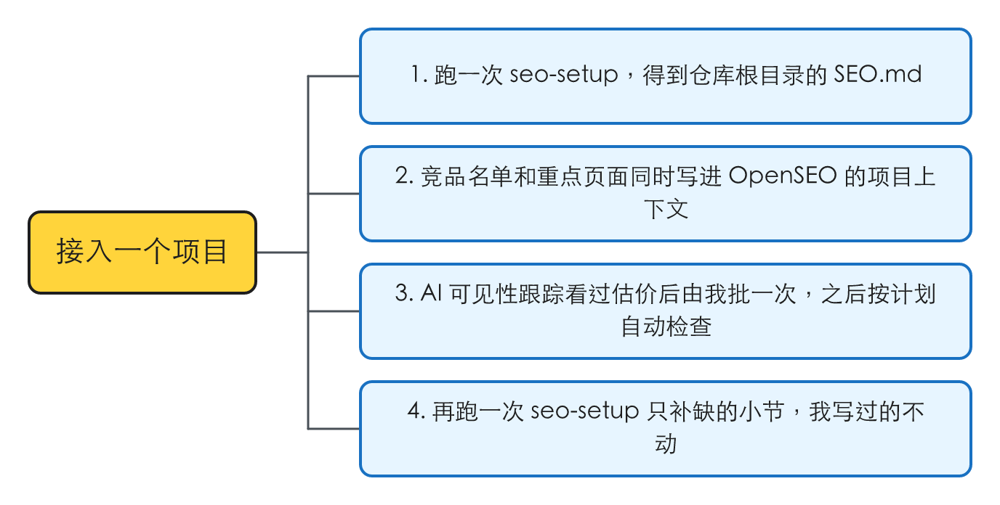
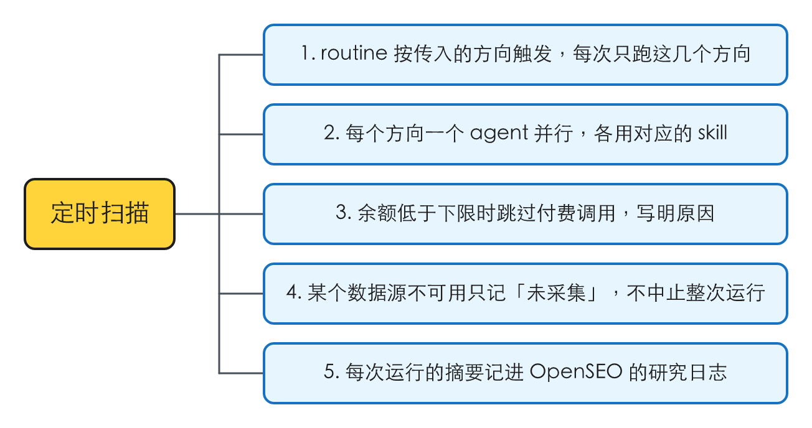
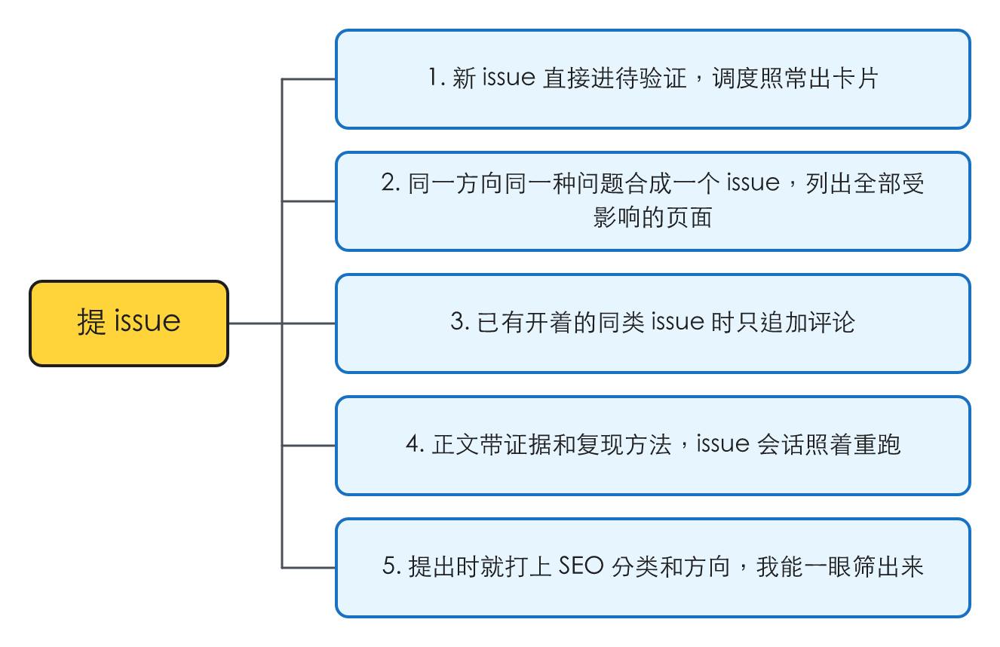
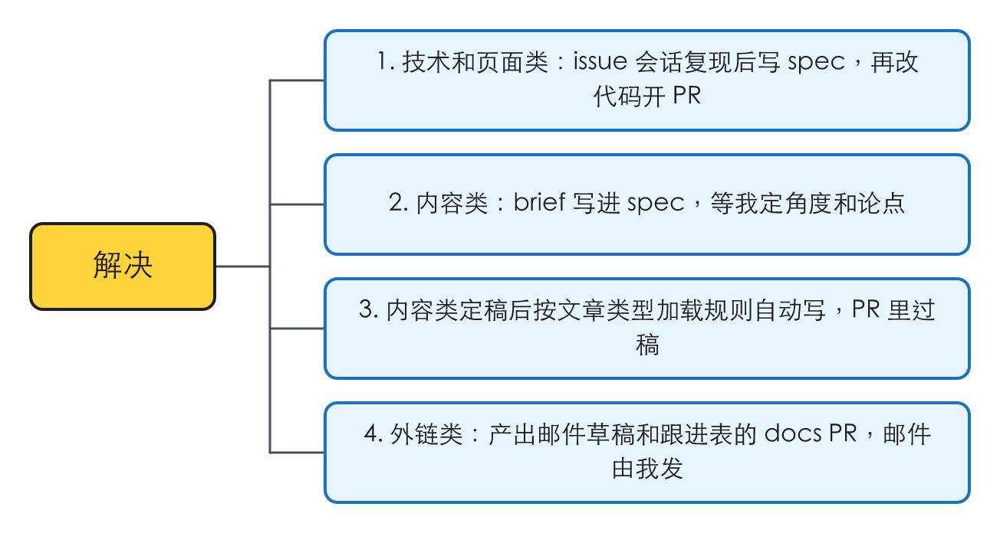
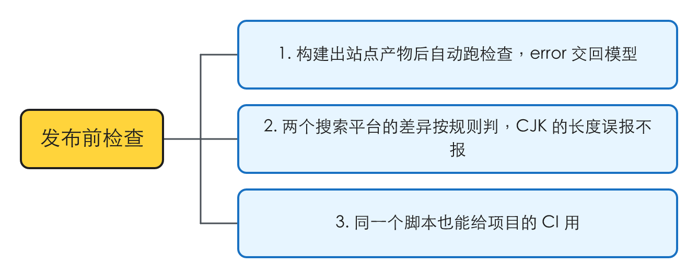
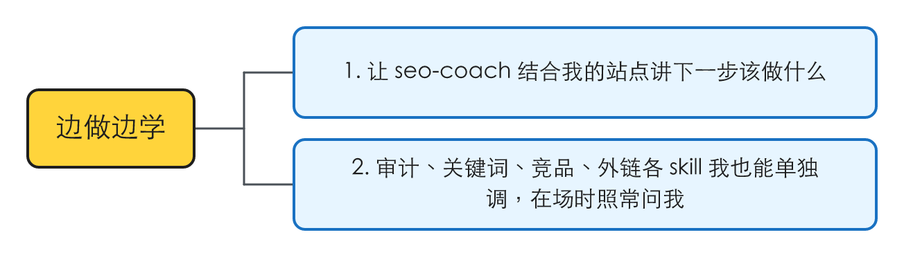
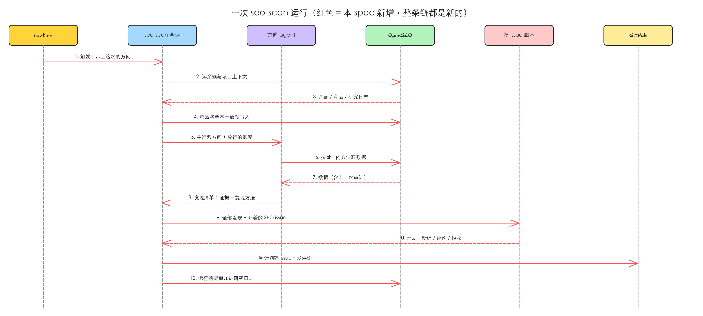
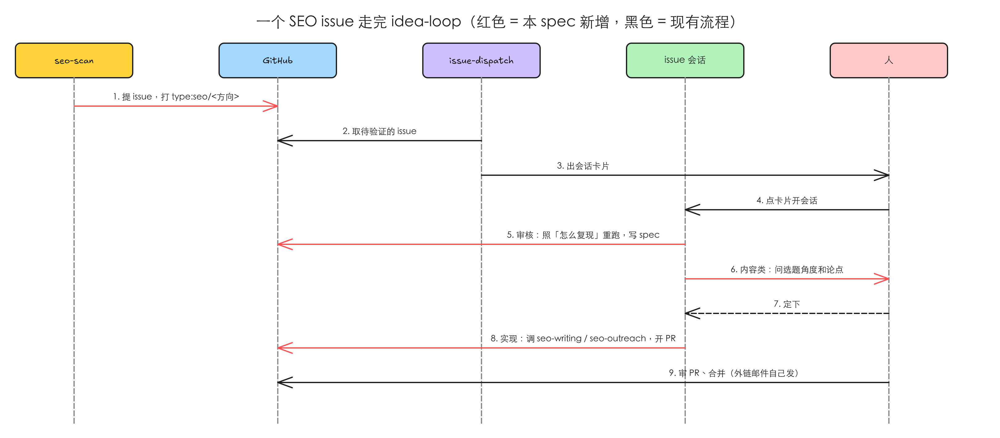
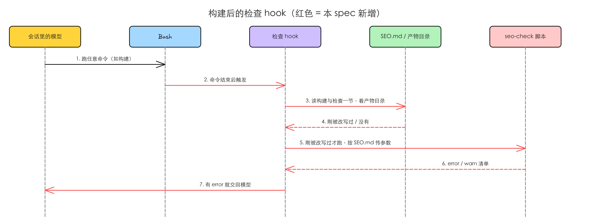

# idea-loop 的 seo 分类：OpenSEO 负责发现，idea-loop 负责解决

> 2026-10-22 与 Harold grill 过，决议见 [[2026-10-22-grill-idea-loop-seo]] 末尾的表。本 spec 里的「issue 会话」「`type:` 分类」「`issues type`」都按 idea-loop 0.1.1 来写（2026-10-22 已合并，PR #71）。项目侧的接入（第一个项目是 TOEFLAIR）另写一份 spec，等本 spec 的实现合并后再写。

## 问题

用户是在自己项目里用 idea-loop 的站点运营者，SEO 不是他的专长（原话：「毕竟我也不算是专家」）。他要的是：SEO 的问题被定期发现、像 bug 一样进 issue、在 issue 会话里被解决。现在这三段各自断着。

### 1. idea-loop 没有 SEO 能力，项目只能自己拼一套，拼出来的停了一个月没人发现

第一个接入的项目（TOEFLAIR）为此自建了一个项目级插件，2026-10-21 查到的状态：

| 项 | 现状 |
|---|---|
| 周报 skill | 578 行，按数据源分五段采集，产出「工单」和「洞察」两类 |
| 定时 | launchd 每周日 22:00 起一个会话；日志里最后一次启动是 2026-09-06，之后没有「session ended」，那个进程 2026-10-21 仍在，后面的每个周日都没跑 |
| 最后一次产出（2026-09-17，手动跑） | 2 张工单、16 段洞察；最强的几条（一组关键词展现涨了 5 倍差一篇文章、一个页面三源同指缺一轮诊断）都落在洞察里，没有人接 |
| 下游执行 | 自带的执行链调用的两个 idea-loop skill 已被合并改名，按名字调用的目标不存在（项目 issue #435） |

这套东西的规则、方法、写作规范都绑在那个项目里，第二个项目要做 SEO 只能再拼一遍。

### 2. OpenSEO 的方法写成了人在场的一次性报告，不能无人值守地跑

OpenSEO 插件 1.0.0（MIT）是 9 个 skill 共约 930 行，加一个远程 MCP。它的数据接口正是需要的，但 skill 是按「人坐在对面」写的：

- 缺信息就问人：seo-audit 要「在一个问题里跟用户确认业务是做什么的」；keyword-research、competitor-analysis、link-prospecting 缺项目上下文时都先问。
- 写入前征求同意：keyword-research、keyword-clustering「存关键词前先问」。
- 交付物是给人读的报告：seo-audit 的产物是一页 HTML，围绕「这周只做一件事」。
- 付费动作要人批：MCP 说明里写明 AI 可见性的初次配置、单次检查、定期跟踪都要用户批准，单批超过 2,000 credits 要先问。

routine 里没有人可问，产物也不是 issue，发现的问题进不了任何流程。

### 3. 发布前的检查规则锁在一个项目里

TOEFLAIR 有一套「Google 与 Bing 两个平台的标准不同」的检查：一个 157 行的知识型 skill（例如 Bing 查长度、Google 不查；CJK 页面在 Bing 上会被误报「太短」），附一个 287 行的构建产物 lint 脚本，按字宽（CJK 记 2）判标题和描述。它在三处跑：营销站 PR 的 CI、本地回合结束的 hook、写博客的人自己按清单跑。规则本身对任何站点都成立，但只有这个项目能用。

### 根因

- 1：idea-loop 只覆盖「从想法到合并」这一条工程流程，没有任何领域能力；项目要 SEO 只能在项目里自建发现和执行两段，执行那段又重复造了 idea-loop 已有的东西，并且随 idea-loop 改名而断掉。停摆一个月没被发现，是因为它的产物（周报快照）不进任何有人看的队列。（launchd 卡住的具体位置未复现：会话转录是终端控制序列，读不出最后一步；依据：日志无对应的「session ended」、进程仍在。）
- 2：OpenSEO 的 skill 面向「人来问、拿一份报告走」的场景，提问、征求同意、HTML 报告都写在步骤里，没有「无人时」的分支，也没有结构化的输出。
- 3：检查脚本和知识写在项目的营销站目录里，阈值和路径写死在源码里；插件里没有它的位置。

## 方案

装了 idea-loop 的项目跑一次 seo-setup，得到根目录的一份 SEO.md，此后：

- **发现**：seo-setup 建的定时任务每周触发一次 seo-scan，seo-scan 按研究日志挑出这周该跑的方向。每个方向一个 agent 并行，按从 OpenSEO 蒸馏来的方法取数据、判断，交回发现清单。
- **入队**：一个脚本把发现清单变成 GitHub issue：同类合并、撞上开着的就评论，不设上限。issue 不带状态标签，直接是「待验证」，提出时就打上 `type:seo/<方向>`，正文写明证据和复现方法。
- **解决**：issue-dispatch 照常出卡片，但 SEO issue 在自己的独立队列里排（上限 5），不占主队列的 10 个名额；issue 会话照常走审核、（设计、）实现，待在「seo 审核中」这类带前缀的 section 里。SEO 带进来的只是领域能力：内容类在审核阶段由 seo-brief 写方案、由人定角度，实现阶段由 seo-writing 写；外链类的实现产出邮件草稿；任何会话构建出站点产物后，检查 hook 自动跑 seo-check。

结果由这几样输入决定：项目的 SEO.md、当次从 OpenSEO 取到的数据（含它保存的上一次审计和研究日志）、GitHub 上开着的 SEO issue。

五个方向沿用 [[2026-10-21-seo-workflow-discussion]] 定下的划分：

| 方向（子类） | 管什么 | 方法 |
|---|---|---|
| 技术 SEO 与索引（technical） | 审计问题、索引、sitemap、重点页面相对上一次审计的回退 | seo-audit |
| 已有页面优化（pages） | 排名 5–20 位的词、CTR 与标题、自相蚕食、内链缺口、核实超期的对比文 | competitor-analysis、Search Console |
| 关键词挖掘与新内容（keywords） | 新词发现、按 SERP 重合度聚类、并入已有页还是新开 | keyword-research、keyword-clustering |
| 外链（backlinks） | 竞品有我们没有的引用域、外联候选 | link-prospecting |
| AI 搜索可见性（geo） | 被 AI 引用的情况与来源、schema、llms.txt | seo-geo |

同一行为的其他入口：

| 入口 | 处置 |
|---|---|
| issue-dispatch、issue-session、issue-verify、to-spec、implement | **排除**：一行不改。SEO issue 靠正文里的指引（复现方法、该调哪个 skill）在原流程里走通 |
| 项目里已有的 SEO 检查脚本、它的回合结束 hook、它的 CI | **排除**：本期不动，项目接入那份 spec 再决定退役；CI 由项目和用户自己配（原话：「PR的CI 将给项目和用户自己配置」） |
| OpenSEO 的 local-seo | **排除**：本地商家用，五个方向里没有它 |
| OpenSEO 的 competitive-landscape | **纳入**：并进 competitor-analysis |
| claude-seo 的其余模块（电商、地图、程序化页面、图片生成……） | **排除**：只取 GEO 部分 |
| 项目自己的 blog 写作 skill | **排除**：它的项目专属内容由项目接入那份 spec 迁出，seo-writing 只放通用规则 |

## User Stories

角色都是站点运营者，下面省略「作为站点运营者」。

### 接入一个项目



1. 我想要跑一次 seo-setup 就得到仓库根目录的 SEO.md，以便项目的 SEO 设定只在一处。
2. 我想要竞品名单和重点页面同时写进 OpenSEO 的项目上下文，以便 OpenSEO 那边的方法看到的和 SEO.md 一致。
3. 我想要 AI 可见性跟踪在我看过估价后批一次、之后按计划自动检查，以便无人值守的扫描不用再花钱也不用再问我。
4. 我想要再跑一次 seo-setup 时只补缺的小节，以便我手改过的内容不被覆盖。

### 定时扫描



1. 我想要只有一个每周的定时任务，由 seo-scan 自己按上次跑的时间挑方向，以便贵的方向不必每周都跑，也不用配两个定时。
2. 我想要每个方向由一个 agent 并行完成、各用对应的 skill，以便一个方向的数据不挤掉另一个方向的判断。
3. 我想要余额低于下限时跳过付费调用并写明原因，以便无人值守也不会把额度花光。
4. 我想要某个数据源不可用时只记「未采集」，以便一个源坏了不耽误其他方向。
5. 我想要每次运行的摘要记进 OpenSEO 的研究日志，以便下一次运行和我自己都看得到上次查了什么。

### 提 issue



1. 我想要新 issue 直接进待验证、调度照常出卡片，以便 SEO 的活和 bug 走同一条路。
2. 我想要同一方向同一种问题合成一个 issue、列出全部受影响的页面，以便三十个页面缺描述不变成三十个 issue。
3. 我想要已有开着的同类 issue 时只追加评论，以便同一件事不出现两个 issue。
4. 我想要正文带证据和复现方法，以便 issue 会话能照着重跑、独立核实。
5. 我想要提出时就打上 SEO 分类和方向，以便我一眼筛出 SEO 的活。

### 解决



1. 我想要技术和页面类 issue 在 issue 会话里复现后写 spec、再改代码开 PR，以便它们和普通 bug 一样被审。
2. 我想要内容类的 brief 写进 spec、等我定选题角度和论点，以便最需要判断的地方由我来定。
3. 我想要内容类定稿后按文章类型加载规则自动写、我在 PR 里过稿，以便写作不用我在场。
4. 我想要外链类的产出是邮件草稿和跟进表的 docs PR、邮件由我自己发，以便对外的每封信都经过我。

### 发布前检查



1. 我想要任何会话构建出站点产物后自动跑检查、error 交回模型，以便带着 SEO 错误的改动在会话里就被改掉。
2. 我想要两个搜索平台的差异按规则判、CJK 的长度误报不报，以便检查结果不需要我再人工甄别。
3. 我想要同一个检查脚本也能给项目的 CI 用，以便以后 CI 换成它不用再写一份。

### 边做边学



1. 我想要让 seo-coach 结合我的站点讲下一步该做什么，以便不是专家也知道该往哪用力。
2. 我想要审计、关键词、竞品、外链各 skill 我也能单独调、我在场时照常问我，以便临时想查一件事不必等扫描。

## 实现决策

### 分类目录、登记与出处

- 新开分类目录 `skills/seo/`，插件清单的 `skills` 加上这个目录；维护约定的「skill 分类」补一条 seo：「SEO 的发现、入队和解决用的领域能力；产出是 issue、站点内容或检查结果」（依据：维护约定「新开一个分类要把目录加进去」）。
- `skills/seo/README.md` 写出处，**不在每个文件头上写**（原话：「我们在idea-loop/seo/readme.md 注明出处」）：OpenSEO 1.0.0（仓库地址、MIT、蒸馏自哪几个 skill）和 claude-seo（仓库地址、MIT、seo-geo 与它的两份 reference），各写蒸馏日期；再写一句「上游更新时显式重新蒸馏，运行时不读上游」。
- 插件的 MCP 配置加上 OpenSEO 的远程 MCP（http，地址同 OpenSEO 插件）。原 OpenSEO 插件由人卸载（原话：「我会卸载openseo原来的插件」），否则同名 skill 会出现两份。代价：每个装 idea-loop 的项目都多一个 OpenSEO 连接，没连上时 SEO 以外的 skill 不受影响。
- 所有 skill 和 agent 都按 `writing-for-agents` 写，agent 走 `agent-builder`（原话：「用writing-for-agent 来自己写」）。示例一律用虚构产品，过 `no-project-leak` 测试。

### skill 清单

| skill | 来源 | 人在场时 | 被 agent 调用时 |
|---|---|---|---|
| seo-audit | OpenSEO 蒸馏 | 照原样（可问、可出报告） | 不问，交回发现清单 |
| keyword-research | OpenSEO 蒸馏 | 同上 | 同上 |
| keyword-clustering | OpenSEO 蒸馏 | 同上 | 同上 |
| competitor-analysis | OpenSEO 蒸馏，并入 competitive-landscape | 同上 | 同上 |
| link-prospecting | OpenSEO 蒸馏 | 同上 | 同上 |
| seo-coach | OpenSEO 蒸馏 | 照原样，只改一处：先读 SEO.md 和项目上下文，不再从头问站点是做什么的 | 不被调用 |
| seo-setup | OpenSEO 的 seo-project-setup 改写 | 只在人在场时跑 | — |
| seo-geo | 以 claude-seo 的 seo-geo 为底，数据换成 OpenSEO，自己写 | 可问 | 交回发现清单 |
| seo-scan | 自己写 | 人也能手动触发，可指定方向 | 每周定时任务触发，不带参数 |
| seo-brief | 自己写 | 可手动调 | issue 会话审核阶段调 |
| seo-writing | 自己写，规则从项目的 blog 写作 skill 提炼成通用版 | 润色、多语言镜像 | issue 会话实现阶段调 |
| seo-outreach | 自己写 | 可手动调 | issue 会话实现阶段调 |
| seo-check | 自己写，由项目的两平台检查 skill 和 lint 脚本合并提炼 | 可手动调 | 检查 hook 调它的脚本 |

命名：蒸馏的照上游原名，自己写的保留 `seo-` 前缀。去掉前缀的话 setup 与 idea-loop 已有的 `setup` 撞名，scan / brief / writing / check 在一个装着工程类 skill 的插件里看名字认不出是 SEO 的（Harold 同意的命名表，见 raw 的 Q22）。

### 蒸馏副本只改两处

1. **无人时不提问**：原 skill 里每一处「问用户」「先征求同意」，改成两支：人在场照原样；被方向 agent 调用时用 SEO.md 的值，SEO.md 没有就按 MCP 的默认值，写进发现清单的「假设」一栏，不写入、不保存任何东西（关键词、聚类标签都不存）。
2. **交回发现清单**：被 agent 调用时不出 HTML 报告，交回下一节的发现清单。

其余步骤、工具选择、花费建议原样保留，以便上游更新时能逐段对照重新蒸馏。提 issue 的逻辑不写进任何副本。

### 发现清单

每条发现的形状（方向 agent 交回、提 issue 脚本读入）：

```
direction    technical | pages | keywords | backlinks | geo
kind         问题种类的短名，同一方向内唯一，合并和去重靠它（例：missing-meta-description）
title        一句话，不懂 SEO 的人能读懂
targets[]    受影响的网址或关键词
evidence     查了什么（工具与参数）、什么时候查的、拿回的数值
ratio?       凡用比例陈述的：{ numerator, denominator }
repro        照着就能重跑的步骤：调哪个 OpenSEO 工具、什么参数；或用什么 UA 请求哪个网址、看哪一行
fix          建议的修法；还没定的写「需要诊断」或「需要决定：…」
acceptance[] 能逐条独立检查的验收标准
assumptions? 无人时代替提问用了哪些默认值
content?     内容类才有：目标词、页面类型、新开还是改已有页
```

「需要诊断」「需要决定」不挡发现进 issue：issue 会话里有人，诊断和拍板在那里做（依据：[[2026-10-21-seo-workflow-discussion]] A1，旧周报把这类全落成「洞察」是它停滞的原因之一）。

### 方向 agent

五个，每个方向一个，只读：不提 issue、不改文件。page-optimizer 的判定阈值（排名 5–20 且展现 ≥ 50；排名 ≤ 10 且点击率不到本站同排名中位数的一半；同一查询 ≥ 2 个页面各 ≥ 20 次展现；站内入链 ≤ 2；对比文核实超过 90 天）是默认值，写在 agent 里，先跑几轮看噪音再调（Harold 同意）。名字：technical-auditor、page-optimizer、keyword-miner、backlink-analyst、geo-analyst。每个的定义只写四样：用哪个（几个）skill、读 SEO.md 的哪几节、本次放行的额度、按上一节的格式交回。方法全在 skill 里（Harold 同意：方法在 skill，agent 是薄包装）。

起 agent 的理由（`agent-builder`「先判断它该不该是 agent」）：每个方向要读大量工具输出，不该进 seo-scan 的上下文；五个要并行。

不设单独的核验 agent：每个 issue 都会进 issue 会话的审核阶段，由 issue-verify 照「怎么复现」独立重跑，这本身就是独立核验；蒸馏来的 seo-audit 自己也要求「每条发现先对着线上页面核过」（Harold 同意去掉）。

### seo-scan 的一次运行

只有一个入口：seo-setup 在项目主 checkout 里建一个 Claude 桌面 app 的定时任务，每周调一次不带参数的 seo-scan（定时任务的会话用建它的会话的目录，2026-10-22 查 TOEFLAIR 已有的定时任务实测）。不带参数时由挑方向脚本读研究日志里以前各次扫描的「采集」行，technical、pages 每次都跑，keywords、backlinks、geo 距上次采集满四周才跑；只有采集到的才算跑过，预算跳过或数据源坏了的下周再跑。节奏是插件的，不写进 SEO.md，也不写进定时任务（原来是两个定时任务各传方向，Harold 改为「一个统一入口」，见 raw 的 U13–U15）。带参数时只跑给的方向，供人手动补跑。

1. **预算**：`whoami` 读余额，交给预算脚本，按 SEO.md 的余额下限和各方向单次额度算出这次每个方向放行多少。各方向放行之和不超过 2,000 credits：OpenSEO 要求超过这个数先问人，定时任务里没人可问。余额低于下限，付费调用全部不放行，免费的照常。
2. **竞品与重点页面同步**：读项目上下文，交给比对脚本和 SEO.md 比；不一致就用 `update_project_context` 把 SEO.md 的写进去。单向，SEO.md 为准（依据：[[2026-10-21-seo-workflow-discussion]] 决议「SEO.md 为准、单向同步」）。
3. **并行派方向 agent**，带上放行额度。某个方向的数据源不可用，记「未采集：原因」，不中止。
4. **提 issue**：全部发现加上开着的 `type:seo` issue 交给提 issue 脚本，得到计划，照计划建 issue、发评论。
5. **研究日志**：本次的摘要用 `update_project_context` 追加进 OpenSEO 的研究日志：跑了哪些方向、各自是否采集、花了多少、建了哪些 issue、拒收了哪些（一句原因）。

运行状态不存进项目仓库：研究日志 OpenSEO 本来就有，蒸馏来的 skill 也按它判断「30 天内查过的不重买」；上一次审计 OpenSEO 也保存着（2026-10-22 查：这个项目存着 4 次审计，最近一次 2026-09-16）。这样定时任务不需要往仓库提交任何东西，提 issue 就是唯一的产出（原话：「直接提issue即可」）。

不发布 Artifact，不写「洞察」。

### 重点页面相对上一次审计的回退

技术方向把重点页面在本次审计和上一次审计里的数据逐页比较，由基线比对脚本判严重度。审计的逐页数据里有状态码、title、description、是否可索引、是否在 sitemap（2026-10-22 对这个项目的最近一次审计实测），没有 canonical、hreflang、JSON-LD：

- **严重**：状态码不是 200、变成不可索引、从 sitemap 消失、重点页面不在本次审计里。严重的直接成为发现。
- **警告**：title 或 description 变了。作为发现交回，由 issue 会话判断是不是有意的改动。
- canonical、hreflang、JSON-LD 不在这里比：它们在发布前由 seo-check 查，线上的由审计自己的问题列表报。

### 提 issue 脚本

seo-scan 里唯一写 GitHub 的地方。输入发现清单和开着的 `type:seo` issue，输出一份计划，再执行计划：

- **拒收**：缺 `evidence`、缺 `repro`、`acceptance` 为空、文字里出现百分比却没带 `ratio`。拒收的只进研究日志。
- **合并**：同一 `direction` 加 `kind` 的发现合成一个 issue，`targets` 取并集，正文列出全部受影响的页面或词。
- **去重**：issue 正文末尾带一个隐藏标记，内容是 `direction` 加 `kind`。开着的 issue 带着同一标记的，在它下面评论本次的新数据和新增的 `targets`，不新开。
- **不设数量上限**：并发由 issue-dispatch 限（原话：「扫描端不需要限制issue数目，issue调度那边会限制数目」）。为了一次扫描提出一批也挤不掉别的 issue，SEO 走调度的独立队列，见下节。
- **标签**：不打任何 `status:*`，新 issue 就是「待验证」；用 `issues type <号> seo/<方向>` 打分类。分类不在项目的「issue 分类」里时，`issues type` 会拒绝，脚本照样建 issue，在研究日志里写明「项目没有 seo 分类，跑一次 seo-setup」。
- **正文模板**：问题、证据、怎么复现、建议的修法、验收标准；内容类再加一节「审核阶段」：「起草 spec 时用 `idea-loop:seo-brief` 写方案；spec 开头写『需要 grill：选题角度和论点』」；外链类加一节「实现阶段」：「用 `idea-loop:seo-outreach`，产出只改 `docs/` 的 PR」。issue 会话里的 skill 按 issue 原文做，所以这几行就是给它的指引。
- gh 调用通过注入的函数进来，测试换成假的。

### 调度的独立队列

seo-scan 不限 issue 数，一次扫描提出十几个是常态；和别的 issue 共用调度的 10 个名额，产品 issue 会排不上（Harold：「SEO相关的问题，我倾向于跟issue-dispatcher可以分开队列」）。做成通用机制，不在调度里写 SEO：

- 项目「issue 分类」里一个父类的说明末尾注「（独立队列，上限 N）」，这个分类的待验证 issue 就单独排队，最多同时开 N 个会话。seo-setup 给 `seo` 注上限 5。
- 每个队列有自己的三个 section，名字是分类名加阶段（「seo 审核中」「seo 设计中」「seo 实现中」）。侧边栏的 section 不能嵌套（`create_section` 只收一个名字），所以用前缀，不用子 section。调度按 section 分别数各队列开着的会话，空位各算各的，一轮所有队列合计最多 3 张卡片，主队列先出。
- `issues queues` 列出队列（上限、section 名），带 issue 号时返回它在哪个队列；`issues candidates --queue=<分类>` 只取那个队列的待验证 issue，不带时只取主队列的。issue 会话归位和换阶段时都按它找 section，审核时分类改了，下一段就进新队列的 section。

### 分类：`type:seo/<方向>`

seo-setup 往项目 AGENTS.md（或 CLAUDE.md）的「issue 分类」一节加父类 `seo`、子类 technical、pages、keywords、backlinks、geo，格式照 setup 的「issue 分类」模板（父类、子类各一行，名字放反引号里，子类缩进两格）。seo-scan 提 issue 时就打上；审核阶段 issue-verify 照常再判一次，可以替换（例：一个「技术」issue 复现后其实是页面文案问题）。原来议过的 `seo`、`seo:<方向>` 两种项目标签不用（依据：Harold 同意 Q24；0.1.1 的 `labels --prune` 会删分类和保留名单以外的标签）。

### SEO.md

仓库根目录，由 seo-setup 生成，之后人直接改；格式的模板放在 seo-setup 的 references 里。六节：

| 节 | 内容 | 谁读 |
|---|---|---|
| 站点 | 域名、语言版本和各自的 URL 规则、Search Console 与 Bing 的站点标识 | 全部 |
| OpenSEO | 项目 id、每个方向单次额度、余额下限 | seo-scan、预算脚本 |
| 竞品 | 域名加一句定位；SEO.md 为准，单向同步进 OpenSEO | 页面、关键词、外链、GEO |
| 重点页面 | 要守的页面和各自的头词 | 技术、页面 |
| 构建与检查 | 构建产物目录（相对仓库根）、各语言传给 seo-check 的参数 | 检查 hook |
| 写作 | 本项目文风文件、文章类型字段名与取值到通用类型的映射、失败案例文件，都是指向项目文件的路径 | seo-writing、seo-brief、seo-outreach |

不放：扫描节奏（插件固定，在挑方向脚本里）、issue 标签（插件固定）、方向的方法（在 skill 里）。

### seo-setup

只在人在场时跑。步骤：读 SEO.md（有就只补缺的小节，人写过的原样保留，和 idea-loop 的 setup 同一条规矩）→ 读 OpenSEO 项目上下文，从里面推各节的推荐值 → 逐节问人，一次最多三个 → 写 SEO.md → 同步竞品和重点页面进 OpenSEO → 在「issue 分类」加 seo 父类和子类 → AI 可见性：先用估价工具报价，人批了才建跟踪并设成定期检查（原话：「Q8 - Q9 没问题」，即付费在 setup 时由人批一次）。改动留在工作区，人说提交才提交。

### seo-geo

以 claude-seo 的 seo-geo（约 400 行）和它的两份 reference（AI 搜索优化指南、llms.txt 证据）为底，数据全部换成 OpenSEO 的 AI 可见性接口，压到百行左右。被 agent 调用时只读已有的跟踪结果、引用来源和趋势，不发起新的付费检查；没有跟踪或读不到，AI 引用数据那一段记「未采集：没有 AI 可见性跟踪，跑一次 seo-setup」，不为它提 issue；免费的站点自检（AI 爬虫放行、原始 HTML、schema、llms.txt、可抽取段落）照跑，查出的问题照常提 issue（Harold 同意，2026-10-22）。

### seo-brief

两种模式：新开页、改已有页。内容：目标词、搜索意图、页面类型、前 10 名的大纲和缺口、我们能补的独有信息、内链建议、建议的 title 和 description、生成日期。审核阶段起草 spec 时调，写进 spec 的「方案」（依据：idea-loop 的「issue 里不放 spec 正文」）。实现时 brief 超过 14 天的，seo-writing 先重查一次 SERP。

### seo-writing

- **入口**：按 brief 写（实现阶段）；局部润色；多语言镜像（后两个不要 brief）。
- **规则分两层**：插件里只放通用规则；项目的文风、失败案例从 SEO.md 的「写作」读，叠在通用规则上，冲突时项目的为准。
- **按类型加载 reference**：四份通用类型规则：对比与研究、数据研究、故事、教程。对比与研究要求实际试用过竞品、记下核实日期（超过 90 天算未核实，和页面方向报超期的期限一致）、讲清各自适合谁而不宣布赢家、有对比表；数据研究要求每个数字可追溯、比例带分子分母；故事要求事实准确；教程用通用规则加步骤可复现。
- **类型从哪来**：有 brief 取 brief 的页面类型；润色和镜像读文章 frontmatter 里 SEO.md 指定的那个字段，按映射换成通用类型；都没有就先说出判断的类型再动笔。
- 写完跑一次 seo-check（构建后 hook 也会兜底）。

### seo-outreach

每个目标站点一份邮件草稿，加一张跟进表（站点、联系方式及其来源网址、角度、状态、更新于），放在项目的 `docs/records/outreach/<资产>/` 下，经只改 `docs/` 的 PR 合并；合并即 issue 关闭。**永不发送**，草稿开头写明「由人发送」。

跟进表有两个读者：人拿它发信、记状态；backlink-analyst 每次扫描先读全部跟进表，表里已有的站点不再提名，只有状态为「无回应」且超过 90 天的可以再提一次。不读它的话，issue 关闭后下个月的扫描会把同一批站点再提一遍。`records/` 是 wiki-conventions 新增的目录：会话起头、之后由人持续更新的台账，不进 spec 的生命周期（Harold 同意，2026-10-22）。

### seo-check 与构建后的检查 hook

- **skill**：两个平台的标准差异与每条检查的理由（例如 Bing 查长度、Google 不查；FAQPage 不再给 Google 富结果；hreflang 必须互相指向且自指；CJK 记 2 个字宽，Bing 的「太短」在 CJK 页面上是误报），加检查脚本。
- **脚本**：扫构建产物里的每个 HTML，按路由出 error / warn / info，每条标明关心它的平台。全部配置走命令行参数：产物目录、各语言的参数、是否 strict、只报哪些路由；不读 SEO.md，所以项目的 CI 以后也能直接调它。阈值作为默认值写在脚本里，参数可覆盖。error 退出码 1。
- **hook**：任何 Bash 命令结束后触发（原话：「hook我倾向于在npm run build 构建产物之后在run check」）。判断要不要跑：
  1. 命令所在的仓库根目录有 SEO.md，且「构建与检查」写了产物目录；否则放行。
  2. 产物目录里有文件的修改时间晚于这条命令开始的时间；否则放行。命令的开始时间由同一条命令执行前的 hook 按工具调用的 id 记下；文档没保证执行前后两次的 id 一定相同，找不到记录时用执行后 hook 收到的命令耗时倒推。学生端之类别的构建不碰这个目录，不会触发；构建命令怎么写都不影响。
  3. 按「构建与检查」的参数跑 seo-check 脚本；有 error 就把清单交回模型（命令已经跑完，拦不住它，只能反馈），只有 warn 放行。
  - 工作目录取 hook 收到的 `cwd`，照合并闸门 hook 的写法。

## 技术方案总览

### 后端



- 第 2–4 步：预算与竞品同步（「seo-scan 的一次运行」1、2）。
- 第 5–8 步：方向 agent 与发现清单（「方向 agent」「发现清单」）。
- 第 9–11 步：提 issue 脚本（「提 issue 脚本」）。
- 第 12 步：研究日志。



- 黑色是 0.1.1 的现有流程，本 spec 不改；红色是 SEO 带进来的：提 issue 时打分类、审核阶段照「怎么复现」重跑并由 seo-brief 写方案、实现阶段调 seo-writing / seo-outreach。



- 全部为新增（「seo-check 与构建后的检查 hook」）。

接口变化：插件新增 OpenSEO 的 MCP 声明、一对 Bash 前后的 hook。新增的对外写操作只有 OpenSEO 的 `update_project_context`（竞品、重点页面、研究日志）、AI 可见性跟踪的创建（仅 seo-setup、人批后）和 GitHub 的 issue、评论、分类标签。

### 前端内部

不涉及。

### 前端交互

不涉及。

## 测试决策

| 变的是什么 | 仪器 | 本次 |
|---|---|---|
| 纯逻辑、数据转换、状态机 | TDD 单元测试 | **涉及**：提 issue 脚本（拒收、合并、去重、标签计划）、预算脚本、竞品比对、基线比对、检查 hook 的触发判断、seo-check 脚本的各条检查 |
| API 契约 | TDD API 测试 | 不涉及：没有 API |
| DB schema、迁移 | 真 DB 测试 | 不涉及 |
| LLM 输出质量 | eval | 不建：skill 与 agent 都是新写或蒸馏的，没有可比的基线；发现清单的结构由提 issue 脚本的测试守住，内容质量靠首次真实运行由人审 |
| 视觉正确性 | UI 实现环 | 不涉及 |
| 端到端用户流程 | 浏览器端到端测试 | 不涉及；端到端验收是项目接入那份 spec 里的首次真实运行 |

### seam

- **脚本的函数加命令行边界**：每个脚本导出纯函数，输入 JSON（发现清单与开着的 issue；余额与配置；两份名单；两次审计的逐页数据；hook 的 payload 与产物目录状态；一个构建产物目录），输出一份计划或结果。gh、OpenSEO、文件系统的读取通过注入的函数进来，测试换成假的。抓得到：规则判错、合并去重错、触发条件错；漏掉：模型交回的发现质量、OpenSEO 真实返回的字段和假的不一致（由首次真实运行发现）。
- **`no-project-leak` 与插件结构测试**：照现有的 tripwire，新目录自动在扫描范围内，不新建 seam。

### 增量功能测试

| 用例 | 前置 | 步骤 | 期望 | 覆盖 |
|---|---|---|---|---|
| 同类合并 | 技术方向交回 30 条发现，`kind` 都是缺描述，各一个网址 | 跑提 issue 脚本 | 计划只建 1 个 issue，正文列出 30 个网址 | 提 issue 2 |
| 撞上开着的 | 有一个开着的 issue，标记是「pages + low-ctr」 | 本次又有同一 direction 和 kind 的发现，多了两个网址 | 只计划一条评论，列出新增的两个网址，不新建 | 提 issue 3 |
| 比例必须带分子分母 | 发现文字写「CTR 1.1%」，没有 `ratio` | 跑脚本 | 拒收，原因写明缺分子分母 | 提 issue 4 |
| 缺复现方法 | 发现没有 `repro` | 跑脚本 | 拒收 | 提 issue 4 |
| 不打状态标签、打分类 | 一条合格的 keywords 发现 | 跑脚本 | 计划里新 issue 没有任何 `status:*`，分类是 `seo/keywords` | 提 issue 1、5 |
| 项目没有 seo 分类 | 假的 `issues type` 拒绝 | 跑脚本 | issue 照建，结果里多一条「跑一次 seo-setup」 | 提 issue 5 |
| 低余额 | 余额 800，下限 1000 | 跑预算脚本 | 付费调用全部不放行，原因写「余额」；免费的放行 | 定时扫描 3 |
| 不超过 2,000 | 五个方向的单次额度加起来 2,600 | 跑预算脚本 | 放行之和 ≤ 2,000，按传入的方向顺序截断，截掉的写明原因 | 定时扫描 3 |
| 竞品单向同步 | SEO.md 6 个，OpenSEO 5 个且其中 1 个 SEO.md 没有 | 跑比对 | 计划写入 1 个、删掉 1 个，不从 OpenSEO 回写 | 接入一个项目 2 |
| 基线回退 | 上次审计里某重点页可索引，本次不可索引；另一页只改了 title | 跑基线比对 | 前者严重，后者警告 | 定时扫描 2 |
| hook：别的构建不触发 | 仓库有 SEO.md，产物目录的文件都早于命令开始 | 喂一条命令结束的 payload | 放行，不跑检查 | 发布前检查 1 |
| hook：站点构建触发 | 产物目录有文件晚于命令开始，检查有一个 error | 同上 | 退出码 2，stderr 里有那条 error | 发布前检查 1 |
| hook：没有 SEO.md | 仓库没有 SEO.md | 同上 | 放行 | 发布前检查 1 |
| CJK 误报 | 中文页标题 28 个字，宽度在范围内 | 跑 seo-check | 不报 warn，只出一条 Bing 误报的 info | 发布前检查 2 |
| 描述过宽 | 英文页描述宽度超出默认上限 | 跑 seo-check | error，退出码 1；用参数调高上限后通过 | 发布前检查 2、3 |
| 独立队列 | 分类一节里 `seo` 注了「（独立队列，上限 5）」；开着 seo、bug、未分类的待验证 issue | 跑 `issues queues`、`issues candidates` 带和不带 `--queue=seo` | 两个队列，上限 10 和 5；主队列只出 bug 和未分类的，seo 队列只出 seo 的 | 提 issue 1 |
| 按节奏挑方向 | 研究日志里两周前一次扫描采集了全部五个、上周一次只采集了 technical 和 pages | 跑挑方向脚本 | 只挑 technical、pages；满四周后五个都挑；某方向那次是「未采集」的，算没跑过 | 定时扫描 1 |
| 不泄漏项目名 | 新 skill 全部写完 | 跑 `no-project-leak` | 通过 | 全部 |

### prompt / eval 变动

新增 13 个 skill、5 个 agent 的提示词；不新建 eval（理由见上表）。蒸馏的 6 个 skill 逐段对照上游，只改「蒸馏副本只改两处」里的两处。

### 照着谁写

- 脚本与测试：`issues.mjs` 和它的测试（注入的 gh 函数、node:test）；hook 照 `merge-gate-hook.mjs` 和它的测试（读 stdin 的 payload，退出码 0 / 2）。
- 检查脚本的规则：项目里现有的那份 lint（按字宽判、按平台标注），去掉写死的路径和项目注释。
- agent：照 `agent-builder` 和现有的 `explorer`、`uiux-researcher` 的定义。

## Out of scope

- 项目侧的接入：写 TOEFLAIR 的 SEO.md、迁出它的写作规范、退役它的周报插件与 launchd、跑 seo-setup 建每周定时任务、建 AI 可见性跟踪。另写一份 spec，本 spec 的实现合并后再写。
- 改 issue-verify、to-spec、implement：SEO issue 靠正文指引走通原流程。issue-dispatch 和 issue-session 只加了独立队列，是通用机制，不认识 SEO。
- 项目的 CI：由项目和用户自己配。
- 项目里已有的 SEO 检查脚本、回合结束 hook：本期不动。
- 自动发送外联邮件：永远由人发。
- 扫描端的数量上限：由调度限并发。
- OpenSEO 的 local-seo、claude-seo 的其余模块：五个方向用不上。
- 周报、Artifact、「洞察」：issue 就是交付物。

## 关联

- 讨论：[[2026-10-22-grill-idea-loop-seo]]（本 spec 的决议）、[[2026-10-21-seo-workflow-discussion]]（前一天，方向划分和写作分型来自这里，位置与队列被推翻）。
- 前置：idea-loop 0.1.1（PR #71，2026-10-22 已合并）：issue 会话、`type:` 分类、`issues type`、setup 的「issue 分类」模板。seo-setup 写「issue 分类」时照 setup 的格式，不另起一套。
- 相邻在飞的 spec：查过 2026-10-22 主分支上的全部 spec（设计档案分段、DESIGN.md 写入口、设计调研 agent、dreaming 设计对账、PR review 跟进、UI 状态档案、uiux-imagine agent），都在 design 分类或 review 流程里，和 seo 分类无重叠。
- 相邻的 issue：harold-skills 上没有 SEO 相关的 issue（2026-10-22 查）。项目侧的 issue #435（旧执行链调用的 skill 不存在）由项目接入那份 spec 覆盖。
- 外部来源：OpenSEO 插件 1.0.0（MIT，github.com/every-app/open-seo）；claude-seo（MIT，github.com/AgriciDaniel/claude-seo）。
