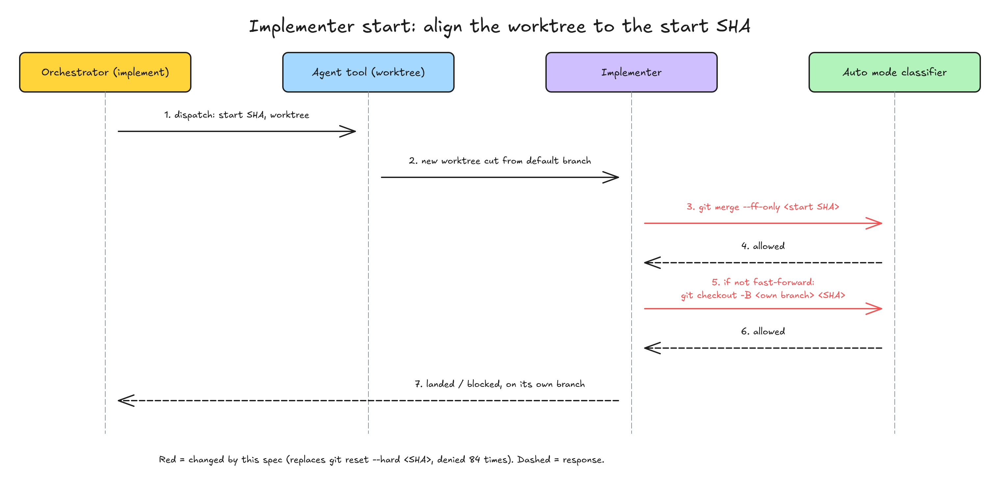

# implementer 开工对齐起点：换掉 git reset --hard

> #160 存在：implementer 开工第一步 `git reset --hard <起点 SHA>` 在 auto mode 下被分类器拦了 84 次（最近一次 2026-11-15），详情在「问题陈述」

## 问题陈述

### 1. 开工第一步被拦，执行方要绕路才开得了工

`idea-loop:implementer` 的定义（`idea-loop/agents/implementer.md`「开工前」第 1 步，对着 origin/main a032e45 核过）让执行方先跑 `git reset --hard <起点 SHA>`，把从默认分支切出的新 worktree 对齐到集成分支。auto mode 的分类器把这条命令判成「Irreversible Local Destruction」或「Destructive or Unwanted Actions」，直接拒绝。

2026-11-16 扫了本机全部会话记录（`~/.claude/projects/` 下的主会话和子 agent 记录），统计带 `git reset --hard` 的 Bash 调用的结果：

| 结果 | 次数 |
|---|---|
| 放行 | 713 |
| 被 auto mode 分类器拒绝 | 84（10 月 33 次、11 月 21 次、无日期的子 agent 记录 30 次） |
| 其他报错 | 60 |

被拒的几乎全是开工检查串，例：2026-11-15 一个执行方跑 `git status --short | head; git rev-parse HEAD; git reset --hard 127feab… && git rev-parse HEAD; …`，被拒，理由「Destructive or Unwanted Actions」。

被拒之后执行方接下来 5 条命令里换了什么写法（只看子 agent 记录）：

| 被拒之后 | 次数 |
|---|---|
| 原样重试 `git reset --hard`，又被拒 | 47 |
| 改用 `git merge --ff-only <SHA>`，放行 | 22 |
| 改用 `git checkout -B …`，放行 | 6 |
| 改用 `git switch -C …`，放行 3、被拒 1 | 4 |
| 其他（查 `merge-base --is-ancestor` 等） | 17 |

也就是说执行方最后大多能开工，但每次要多花几轮试错，原样重试的那 47 次是纯浪费；`git switch -C` 也被拒过一次（2026-10-17，理由「Interfere With Workloads」）。

复现材料：扫描脚本和输出在本会话 scratchpad，结论按上表；分拣评论（2026-11-10）当时没能核出次数，这次核出了。

### 根因

implementer 定义里写死的是一条带「丢弃改动」语义的命令。分类器只看命令本身和上下文，不知道这个 worktree 刚建、干净、没有可丢的东西，于是按破坏性操作拒绝。修正：issue 原先统计的是 2 天内 6 次，全量扫下来是 84 次，问题比原先估的普遍。

## 方案

改完：执行方开工对齐起点不再被分类器拦，一次就过；对齐后 `git rev-parse HEAD` 照样等于起点 SHA，执行方仍在派给它的那条分支上（停下时的半成品、落地用的 commit 都在这条分支上，不变）。

做法：把「开工前」第 1 步的对齐命令换成两步，都不丢东西：

1. 先核 `git status --short` 为空（刚建的 worktree 本来就是空的，这一核让上下文里写明「没有可丢的改动」）。
2. `git merge --ff-only <起点 SHA>`：worktree 的起点是默认分支，集成分支从默认分支切出且之后默认分支没前进时，这一步就是快进，最常见；它从不丢东西，历史上被拒后改用它 22 次全放行。
3. 快进不了（默认分支在集成分支切出后又前进了，worktree 的起点不是起点 SHA 的祖先）：`git checkout -B <你的分支> <起点 SHA>`。第 1 步核过工作区是空的，这一步只是把自己这条分支指到起点 SHA，原来指向的提交仍在默认分支上，不丢东西；历史上 6 次全放行。

然后照旧核 `git rev-parse HEAD` 等于起点 SHA。

同一行为的其他入口：

- implementer 定义里另两处提到 reset（第 25 行「在 reset 之后 `git merge --squash`」、第 26 行「不用再 reset」）：**纳入**，措辞跟着改成「对齐起点之后」「不用再对齐起点」。
- `idea-loop:issue-dispatch` 的 SKILL.md 写着主 checkout 里绝不用 `git reset --hard`：**排除**，那是禁令，不是开工步骤，没被拦的问题。
- 落地前「做成一个能 fast-forward 的 commit」里的 `reset --soft`：**排除**，没在被拒记录里出现（扫描只命中 `--hard`）。
- 其他 skill、agent 里：`grep` 过 `idea-loop/` 下除 `evals/` 外的全部文件，`reset --hard` 只出现在上面两处。

## User Stories

1. 期望行为（对应问题 1）：auto mode 下派出的 implementer，开工对齐起点一次通过、不被分类器拒绝；对齐后 HEAD 等于起点 SHA，执行方仍在自己的分支上。

## 实现决策

- **用改写法，不在 `/idea-loop:setup` 里给 `git reset --hard` 加允许规则。** 依据：分拣评论（2026-11-10）把两条路摆给了人，当时差的是「换写法是否真被放行」的证据；这次的会话记录扫描给了这份证据（`merge --ff-only` 22/22、`checkout -B` 6/6 放行）。允许规则改的是用户的权限配置，会让同项目里任何会话（包括 issue-dispatch 明令不许 reset 的主 checkout）的 `git reset --hard` 都免检，范围大得多。
- **两步而不是一步 `checkout -B`。** 依据：`merge --ff-only` 按构造就不可能丢东西，分类器最没理由拦；`checkout -B` 只在快进不了时用，用之前已核工作区为空。
- **不用 `git switch --detach`。** 分拣评论提过它；但执行方停下时要把半成品提交在「派给你的这一条」分支上（implementer 定义「停下时把半成品提交在你的分支上」），detached HEAD 上的提交不在任何分支上，会断掉这条路。
- **不用 `git switch -C`。** 历史上被拒过一次，`checkout -B` 没被拒过。
- 改动只在 `idea-loop/agents/implementer.md`。照 `writing-for-agents`：这是一条步骤，完成条件「`git rev-parse HEAD` 等于起点 SHA」不变；只换命令和两处跟着变的措辞，正向写出要跑什么，不写「别用 reset --hard」（否定会把被禁的命令拖进上下文）。
- 插件版本：idea-loop `plugin.json` 的 `version` 升一档 patch（只改 agent 定义里的一步命令，行为不变）。

## 测试决策

| 变的是什么 | 仪器 | 本次 |
|---|---|---|
| 纯逻辑、数据转换、状态机 | TDD 单元测试 | 不涉及 |
| API 契约（路由、schema、序列化） | TDD API 测试 | 不涉及 |
| DB schema、迁移、并发与事务语义 | 真 DB 测试 | 不涉及 |
| LLM 输出质量（prompt 改动） | eval（确定性断言） | 改的是 agent 定义里一条命令，不是模型的判断：不加 eval，也不走 retro 回放（被拦的是分类器，不是 skill 的决策点） |
| 视觉正确性 | UI 实现环 | 不涉及 |
| 端到端用户流程 | 浏览器端到端测试 | 不涉及 |

- **seam**：implementer 开工那一步在 auto mode 下的真实执行。
- **增量功能测试**：
  - 前置：auto mode 开着；一份有两张以上工单的 spec，集成分支从默认分支切出后默认分支又前进过（两条路径都能走到）。
  - 步骤：`/idea-loop:implement` 派工；之后用同一扫描脚本统计这次运行的子 agent 记录。
  - 期望：没有 `git reset --hard`；`merge --ff-only` / `checkout -B` 没有被分类器拒绝；每个执行方交回的 commit 都能 fast-forward 进集成分支。
  - 覆盖：期望行为 1。这条是合并后的下一次实现运行顺带观察，由人在 PR 交付验收里看。
- **机械检查**：`grep -n 'reset --hard' idea-loop/agents/implementer.md` 无输出。
- **照着谁写**：无同类先例（agent 定义里的 git 命令以前没有测试）。

## Out of scope

- 给 implement 的编排者（派工、落地、回收）里的 git 命令做同样的排查：它们没有出现在被拒记录里。
- 改 Claude Code 的 worktree 从哪里切出（让它直接从集成分支切）：那是 Agent 工具的行为，不归插件。

## 关联

- 起源：spec `implementer-reuse-and-compact`（已合并、目录已删）里查 token 时发现，那份 spec 当时把这条记为「另开 issue」。
- 相邻还没完成的 spec 与 issue：`docs/spec/` 下当前没有别的 spec；查过开着的 issue，没有改 `implementer.md` 开工步骤的，无重叠。
