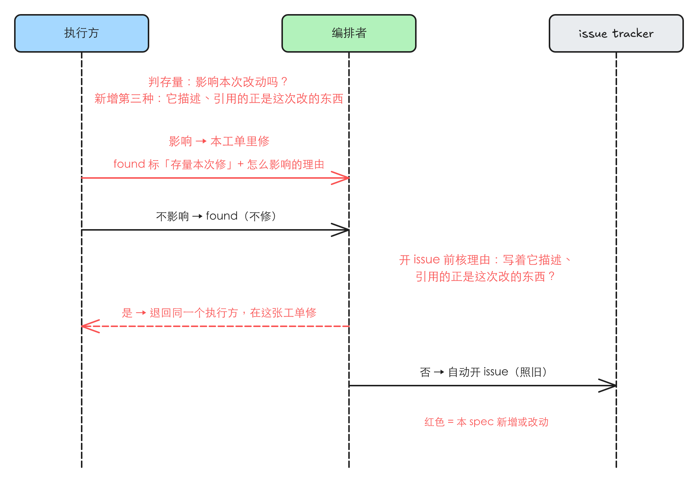

# 影响本次改动的存量问题在本 PR 里修

> #428 存在：执行方的判据只有「污染输入或结论、让 CI 变红」两种，别处写死的、正被这次改掉的东西（如「读出八节」）两种都不沾，被记成无关存量、自动开成另一个 issue，详情在「问题陈述」

## 问题陈述

### 1. 被这次改动带错的引用，漏进 backlog

真实经过（#163 工单 02，2026-11-20）：工单给 `SEO.md` 的格式加「配图」一节（九节变十节）。执行方发现 seo 组另外 6 个 skill（keyword-research、keyword-clustering、competitor-analysis、link-prospecting、seo-audit、seo-coach）还写着「读出八节」，交回原文：「……工单范围以外，没改。」编排者照分拣表自动开了 #404。人看审核报告时让当场修掉（PR #403，提交 `9a7b1169`），#404 关闭。人在 retro 里说：「这个我遇到了好几次，就是issue改动发现因为改动衍生的相关问题，我觉的是需要在pr里面修复的。」

本该是：这次改的正是节数，别处写死的节数跟着错，属于「影响本次改动」，执行方在这张工单里一并改掉。

现状核对（2026-11-23，对着 `origin/main` `f2da838e`，分拣评论 [#428 issuecomment-7086958185](https://github.com/guohaonan-shy/harold-skills/issues/428#issuecomment-7086958185) 同样核过）：判这件事的四处规则文本都只认两种影响，原文还在：

- 执行方定义的处置表「存量问题」一行：「不修，记进 `found`；污染了这张的输入或结论、或让 CI 变红的，这次修」。交回格式里 `found` 的注释同样写「为什么跟这张工单无关」。
- implement 的分拣表：「其余 `found`（跟这次无关的存量） | 开 issue」。
- implement 的落地参考「跟这次无关的存量问题」一节：直接开 issue，没有「开之前核理由」这一步。
- pr-review 的 review 规范「改动行以外的存量问题」：例外只有「污染输入或结论」「让 CI 变红」两种，说不出就不报。

### 根因

判据只覆盖「它让这次的结果错」，漏了「它描述、引用的正是这次改的东西，这次一改它就跟着错」这一类；编排者开 issue 前也不复核执行方的理由，执行方判错就直接漏进 backlog。

## 方案

改完，人在审核报告里不会再看到「被这次改动带错、却开成另一个 issue」的条目：这类存量在同一个 PR 里修掉，「已按规则处理」里写明它怎么影响本次改动；真正跟这次无关的照旧自动开 issue。

由一条判据决定：**影响本次改动**＝污染了这张的输入或结论、让 CI 变红，或它描述、引用的正是这次改的东西。三处判这件事的地方用同一条判据、同一个说法：

- **执行方**（杠杆：要求强度。判据从两种扩到三种，配一个任何项目都懂的例子；用正向写法说该修什么）：处置表「存量问题」一行换成 #428 给的新文；标记从「spec 缺口 · 存量本次修」改成「存量本次修」，交回格式 `found` 的两行注释跟着改。
- **编排者**（杠杆：完成条件。开 issue 前多一道可检查的复核）：分拣表、落地参考换成「不影响本次改动的存量」，落地参考加「开之前核一遍理由，写着它描述或引用的正是这次改的东西的，退回同一个执行方在这张工单里修」。
- **review**（杠杆：要求强度，同执行方）：例外从两种扩到三种，第三种同上。

同一判断的其他入口：

| 入口 | 纳入 / 排除 |
|---|---|
| implement 正文里「为无关存量开的 issue」「跟这次无关的存量要自动开 issue」两处措辞 | 纳入：改成「不影响本次改动的存量」（引导词统一，单一说法） |
| implement 的停下与续上参考里指向落地参考小节名的一句 | 纳入：小节改名，指针跟着改；那里「失败跟这次无关」说的是 CI 失败，不动 |
| pr 的审核报告写法里「本次修的存量问题（依据写它怎么污染了这张工单）」 | 纳入：依据改成「它怎么影响本次改动」 |
| issues 的「开一个 issue」里「跟这次无关的存量问题」 | 纳入：同一措辞 |
| review 规范的 `pollutes` 字段校验提示 | 纳入：提示语里的「输入、结论或 CI」加上第三种 |

## User Stories

1. 期望行为（问题 1）：执行方遇到它描述、引用的正是这次改的东西的存量（例：别处写死的节数），在本工单里改掉，`found` 标「存量本次修」并写清它怎么影响本次改动；执行方仍记成无关存量的，编排者开 issue 前核出来，退回同一个执行方修；review 也把它当要报的存量。

## 实现决策

- **新文照 #428 正文**：执行方、implement 分拣表、落地参考三处用 #428 给的新文（人在 #163 retro 批过）。
- **标记改成「存量本次修」**：依据是 #428 的新文；implement 分拣表本来就按「存量本次修」认，不用改。
- **review 规范一并扩到三种**：AI 照推荐定：review 是同一判断的第三道关，判据不同步，执行方和编排者漏掉的，review 也照旧不报；改动只加一条例外，跟另两处同一说法。另一种是只改 #428 点名的三处，review 留两种，代价是同类漏网到 review 也拦不住。
- **回放用例的输入起点用 `2a2f06be`**：用例的 `commit` 是决策发生时的仓库状态（`idea-loop/evals/retro/cases.mjs` 的字段说明）。#428 写「当时的提交 `59132ae1`；起点 `2a2f06be`」：`59132ae1` 是工单 02 做完的结果，那时 SEO.md 的新键已经加好；工单 02 开工时的状态是 `2a2f06be`（工单 02 不被别的工单挡，`2a2f06be` 上「读出八节」在 6 个 skill 里都在）。
- **插件版本升 patch**：改已有流程的行为、老用法照样能用（`REVIEW.md`「额外要求」的 patch 档）。

## 测试决策

| 变的是什么 | 仪器 | 本次 |
|---|---|---|
| 纯逻辑、数据转换、状态机 | TDD 单元测试 | `review-check.mjs` 只改提示语，不改判断逻辑：跑它已有的测试 |
| API 契约 | TDD API 测试 | 不涉及 |
| DB schema、迁移、并发与事务语义 | 真 DB 测试 | 不涉及 |
| LLM 输出质量（prompt 改动） | eval | 改的是执行方定义和 implement、pr-review 的规则文本：加一个 retro 回放用例（AGENTS.md「第二个有意例外」），改前答否、改后答是 |
| 视觉正确性 | UI 实现环 | 不涉及 |
| 端到端用户流程 | 浏览器端到端测试 | 不涉及 |

- **seam**：retro 回放的 runner（`idea-loop/evals/retro/retro-replay.mjs`）。能抓到：执行方在真实工单上是否把「读出八节」当影响本次改动的存量改掉；漏掉：编排者的复核那一步（回放停在执行方交回），review 那一步。后两处是同一判据的文本对齐，靠 review 核措辞一致。
- **增量功能测试**：回放用例 `implementer-in-scope-legacy`
  - 前置：仓库在 `2a2f06be`，`split-blog-publisher` 工单 02 开工。
  - 步骤：编排者只给指针起执行方做工单 02，等它交回。
  - 期望：改前插件跑出来答「否」（记成「工单范围以外，没改」），改后答「是」（6 个 skill 的「读出八节」在本工单里改了）。
  - 覆盖：期望行为 1。
  - 大小：大（要起插件 agent），PR 开出后由编排者当场跑。
- **照着谁写**：`idea-loop/evals/retro/cases/implementer-reads-standards/`（同样是起执行方做一张历史工单、问它做没做某件事）。

## Out of scope

- 不加机械检查：「影响本次改动」要判断，不能机械判定。「读出八节」这一具体实例已有 `seo-md-section-count-doc.test.mjs` 守着。
- 不改「已按规则处理」的结构，只改依据的措辞。

## 关联

- #163（来源：retro 候选 2）、#404（被误开的 issue，已关）、PR #403。
- 相邻还没完成的：#456（改了 skill 有没有生效没人必须验）讲回放跑不跑的规则，本 spec 只是照现行规则加一个用例，不重叠；#341（改 skill 的 PR 的结构检查）不重叠。查过 `docs/spec/` 当前没有别的未了结 spec。
