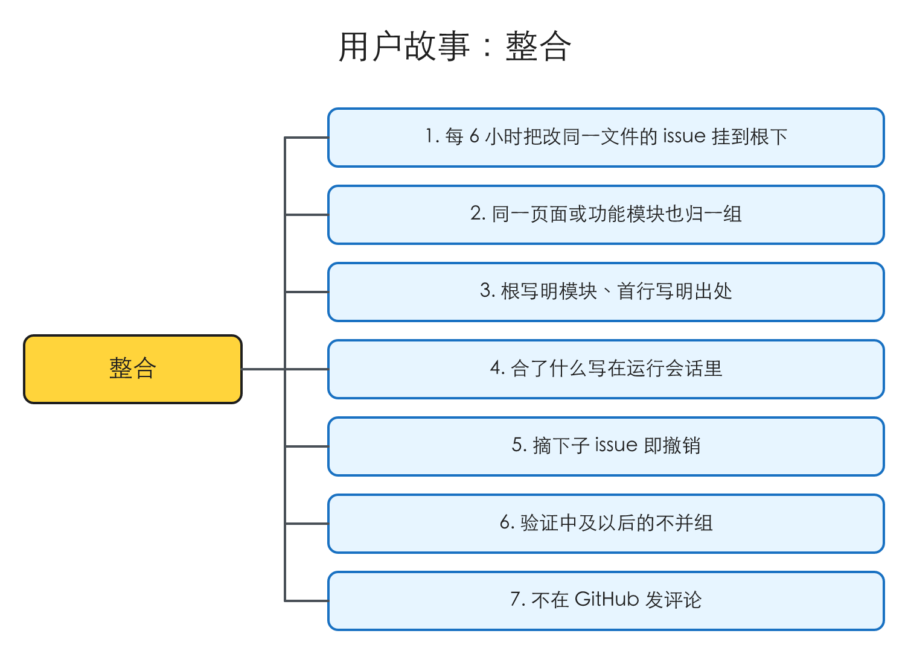
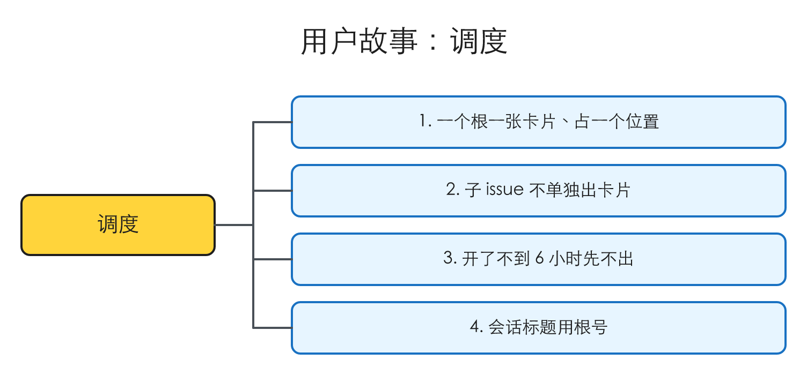
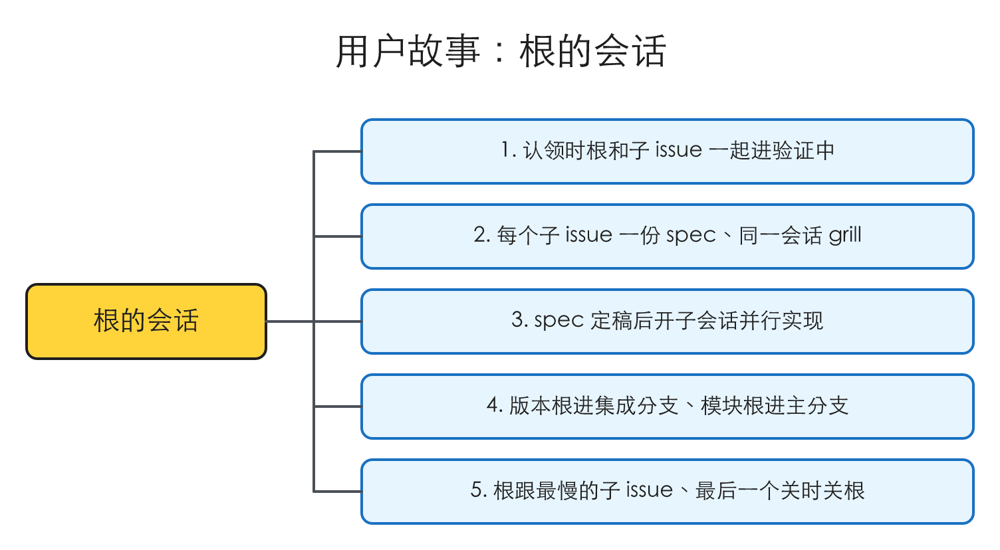
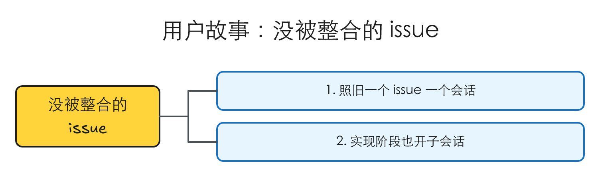
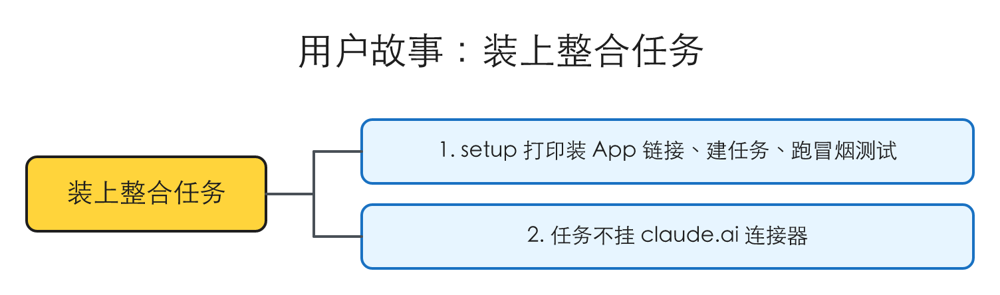
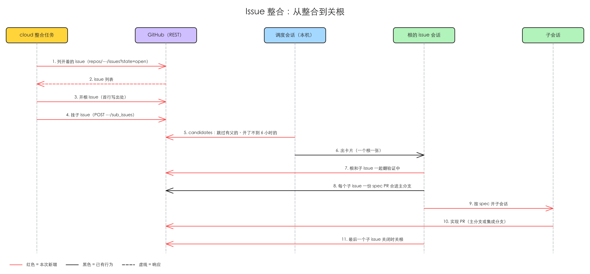

# 相关 issue 整合成根 issue，调度按根 issue 出会话

## 验证

| issue | 结论 | 证据 |
|---|---|---|
| #165 idea-loop：定时任务在 cloud 上把相关 issue 整合成根 issue + 子 issue，调度按根 issue 出会话 | 存在 | 调度的取活函数逐个取待验证 issue、没有任何分组；当前 24 个待验证 issue 里至少 5 组改的是同一个 skill；详情在「问题」 |

## 问题

2026-10-30 对着 `origin/main`（09ce9aa）核过：读 `idea-loop/scripts/issues.mjs` 与 `issue-dispatch` 的 SKILL.md，`gh issue list --state open` 拉全部开着的 issue，`gh api graphql` 探 sub-issue 字段。

### 1. 调度一张卡片只装一个 issue，同一 skill 的几个 issue 各开各的会话

调度每轮取「最早的待验证 issue」，一个号一张卡片。取活的 `candidates` 只按「没有 status label、没有 spec 列着、不是 spec issue、属于这个队列」过滤，按号排序截断，没有任何「这几个该一起做」的概念；仓库里也没有任何地方用 GitHub 的 sub-issue（探了 #147：`subIssuesSummary.total = 0`，`parent = null`）。

今天开着的 29 个 issue 里 24 个是待验证，按改的地方能看出至少 5 组：

| 改的地方 | 待验证的 issue |
|---|---|
| implement / implementer 派工 | #157、#160、#161（同一处的 #147、#149 已在一个会话里实现中） |
| writing-for-agents 与 agent 文档的写法 | #154、#155、#156 |
| 设计档案的分段 | #69、#128、#91（#61 搁置） |
| issue-verify 的起草规则 | #148、#151 |
| SKILL.md 主体字数上限 | #132、#137 |

照现在的调度，这 13 个会开出 13 个会话，第一组的三个会话会同时改 implementer 定义。

### 2. 合并全靠人在调度会话里说

人最近几次手动把相关 issue 合进一个会话：#106 + #108；#147 + #149（后来又并进 #153，落成一份 spec implementer-reuse-and-compact，覆盖三个 issue）。每次都要人先看出它们相关、再在调度会话里说「这几个放一个会话」，调度自己不会合。

复现材料：`.tmp/to-spec/issue-consolidation/repro/`（开着的 issue 清单、sub-issue 探测结果）

### 根因

不涉及（新能力）。调度的单位写死成单个 issue，见问题 1。

## 方案

人最终得到：

- 每 6 小时，一个跑在 cloud 上的定时任务看一遍开着的待验证 issue，把改同一个文件、或改同一个页面 / 功能模块的几个挂到一个新开的根 issue 下面（GitHub 原生 sub-issue）。每次合了什么、为什么合，写在那次运行的会话里，人在桌面应用侧边栏的 Scheduled 组里看；分错了，在 GitHub 上把子 issue 摘下来。
- 调度一张卡片对应一个根 issue（或一个没被整合的 issue），一个会话。
- 根的会话里，每个子 issue 各起草一份 spec，人在这一个会话里 grill 完；都定稿后，会话按 spec 开子会话并行实现，PR 合进主分支或这个根的集成分支。
- 没被整合的 issue 照旧一个 issue 一个会话，实现阶段同样放进子会话。

由哪些输入决定：开着的 issue 的标题、正文、开了多久、状态 label，和是否已有父 issue；整合依据（同一文件，或同一页面 / 功能模块）。

分两块：

1. **整合**：cloud 定时任务（见「cloud 定时任务」）。
2. **按根调度与会话**：调度出卡片、数会话、issue 会话认领、审核、实现、换阶段，都把「一个根和它的子 issue」当一个单位。

同类入口：

- `issues candidates`（调度取待验证）：纳入，跳过有父 issue 的、开了不到 6 小时的；根 issue 照常作为候选。
- `issues set`：纳入，认领根时根和子 issue 一起翻；根的状态跟着最慢的子 issue。
- `issues queue`（待设计 / 待实现）、`reconcile`、`advance`：纳入，要认得根 issue（没有 spec 列着它），不把它当成「没有会话的 issue」报出来，最后一个子 issue 关闭时关根。
- `issue-dispatch`：纳入，按根出卡片，卡片的 prompt 带上子 issue 号。
- `issue-session`：纳入，开场认领整组；审核阶段每个子 issue 调一次 `issue-verify`；实现阶段一律开子会话；收尾关根。
- `issue-verify`：纳入，在根的会话里对每个子 issue 各起草一份 spec。
- `setup`：纳入，加一步建整合定时任务：打印装 Claude GitHub App 的链接，用 RemoteTrigger 建任务、清掉连接器、「Run now」跑一次冒烟测试。
- retro 开 issue、review 里「开 issue」：排除，照旧开单个待验证 issue，由整合任务下一轮归组。

## User Stories

### 场景：整合

1. 作为维护者，我想要定时任务每 6 小时把改同一个文件的待验证 issue 挂到一个根 issue 下，以便它们在一个会话里一起做，不再几个会话改同一份文件
2. 作为维护者，我想要改同一个页面或功能模块的待验证 issue 也被归到一组，以便一个模块的改动一起设计
3. 作为维护者，我想要根 issue 写清改的是哪个页面或模块、正文第一行写明由整合定时任务开出，以便一眼看出这组是什么、不是我本人写的
4. 作为维护者，我想要每次运行合了什么、为什么合写在那次运行的会话里，以便在侧边栏 Scheduled 组里核对
5. 作为维护者，我想要分错时在 GitHub 上摘下子 issue 就算撤销，以便不用另学一套操作
6. 作为维护者，我想要已经在验证中及以后的 issue 不被并进新组，以便正在做的会话不被打乱
7. 作为维护者，我想要整合任务不在 GitHub 上发评论，以便不以我的身份说话

### 场景：调度

1. 作为维护者，我想要一个根 issue 只出一张卡片、占一个会话位置，以便会话数按「一组活」算
2. 作为维护者，我想要已经挂在根下的子 issue 不再单独出卡片，以便同一件事不开两个会话
3. 作为维护者，我想要开了不到 6 小时的 issue 先不出卡片，以便整合至少看过它一次
4. 作为维护者，我想要会话标题用根号，以便调度和我都按根认出这个会话

### 场景：根的会话

1. 作为维护者，我想要认领根时根和全部子 issue 一起进入验证中，以便 GitHub 上一眼看出这组在做
2. 作为维护者，我想要每个子 issue 各起草一份 spec、在同一个会话里 grill，以便一次把相关的决定想清楚
3. 作为维护者，我想要所有 spec 定稿后会话按 spec 开子会话并行实现，以便几份改动同时推进、实现不背审核的历史
4. 作为维护者，我想要根代表一个版本时 PR 合进集成分支、代表一个模块时直接进主分支，以便一起发的改动一起发
5. 作为维护者，我想要根的状态跟着最慢的子 issue、最后一个子 issue 关闭时根也关闭，以便根不会挂着没人管

### 场景：没被整合的 issue

1. 作为维护者，我想要没被整合的 issue 照旧一个 issue 一个会话，以便零散的问题不用等整合
2. 作为维护者，我想要它进入实现阶段时也开子会话去实现，以便所有 issue 走同一条路

### 场景：装上整合任务

1. 作为维护者，我想要 setup 打印装 Claude GitHub App 的链接、等我装好后替我建好定时任务并跑一次冒烟测试，以便我只需要在 GitHub 上点一次
2. 作为维护者，我想要建出的定时任务不挂我 claude.ai 上的任何连接器，以便它碰不到我的邮箱和数据库

## 实现决策

### 整合由定时任务直接做，不等人批

人在本会话定下（2026-10-30）：「Q2 直接整合」。任务每次运行直接在 GitHub 上把一组 issue 挂到根 issue 下，调度下一轮就按根出卡片；人觉得分错了，在 GitHub 上把子 issue 摘下来。

### 整合的依据：改同一个文件，或改同一个页面、同一个功能模块

人在本会话定下（2026-10-30）：「一个标准是修改的是同一个文件（包括md文件、代码文件），还有一个规则就是这块内容改的是一个页面、一个功能模块（这个你可以参考toeflair那个仓库，100多个issue了）」。

两条满足一条就合：

- **同一个文件**：md 和代码都算。例：#154、#155、#156 都改 writing-for-agents 的 SKILL.md。
- **同一个页面或功能模块**：例：Tofelair 现在 125 个开着的 issue 里，「Email 报告」「Email 批注」「Email 问题编码表」「Email 要求覆盖」「Email 打分」是同一个 Email 功能的 6 个 issue；「Stripe 付款回调不幂等」和「Stripe 回调收到 checkout.session…」是同一个付款回调；「分析完成后的体验」「分析页完成态到达缺少整体编排」「口语和写作交卷后统一直接进分析页」是同一个分析页。Tofelair 的 `type:*` 分类（seo、debt、feature…）切的是性质不是模块，标题里大多也没有模块前缀（86 个没有「X：」前缀），所以判模块要读标题和正文，不能只看 label。

### 根 issue：新开一个，写改哪个页面或模块；具体要改什么放在子 issue

人在本会话定下（2026-10-30）：「这个可能需要新开一个，这个issue可能主要描述修改什么页面、模块，具体的内容得放在sub issue了」。关系用 GitHub 原生 sub-issue（实测 cloud 上经 REST 能挂）。先例：excalidrawer#15「0.6.0 feature list」就是这样一个根，下面挂着 #12、#13、#26、#27、#35、#36、#38 七个子 issue。

### 一个子 issue 一份 spec，一个会话 grill 完，再拆成子会话并行实现

人在本会话定下（2026-10-30）：「我倾向于spec验证审核的时候就按照一个sub issue 一个spec来拆分好（但此时仍然只有一个会话，我们在这个会话里面grill），待spec 都没问题。，会话下可以拆分成多个子会话并行处理多个spec实现。类似于这次excalidrawer 0.6.0的方式。」

- **审核**：根 issue 一个会话。会话里每个子 issue 各起草一份 spec，人在这一个会话里把它们都 grill 完。
- **实现**：spec 都定稿后，会话按 spec 开子会话，各自切工单、实现、开 PR，并行。
- 先例 excalidrawer 0.6.0：#12 一份 spec（new-diagram-types）拆成 registry、state-machine、high-level、pyramid、chart 五个实现 PR，加上 skill-layers、connector-and-gate-fixes 两份 spec 的 PR，都合进集成分支 `release/0.6.0`，最后一个 PR（excalidrawer#52）合回 main。

### 根和子 issue 的状态：子 issue 各走各的 spec，根跟着最慢的那个

人在本会话定下（2026-10-30）：「是，这一轮都按推荐」。

- 调度出卡片、会话认领时，根和全部子 issue 一起翻成「验证中」。之后每个子 issue 跟着自己的 spec 走各自的阶段。
- 根没有自己的 spec，它的 `status:*` 跟着阶段最靠前（最慢）的那个子 issue；最后一个子 issue 关闭时，会话关掉根（GitHub 不会自动关父 issue）。
- spec frontmatter 的 `issues:` 只写它对应的那一个子 issue，`reconcile` / `advance` 不用为整合改。
- 只整合待验证的 issue；验证中及以后的不动。例：#157 待验证、#147 已实现中，同改 implementer，也不把 #157 并进 #147 那组。

### 实现一律放在子会话里

人在本会话定下（2026-10-30）：「是，这一轮都按推荐」。

不管是整合后的根，还是没被整合的单个 issue，进入实现阶段时都开子会话去实现。

> 后来改了（2026-10-30，#131 的审核）：原先写「issue 会话自己只管合并和收尾」。改成：子会话自己跑它那个 PR 的 pr-review、人在子会话里说合并；根的会话管前期 grill、版本根的集成 review 和合回主分支、最后关根。分工表见 [[no-decision-autopilot]]「审核报告写进 PR 描述」。
子会话只拿一份简报起步，不背审核阶段的历史，所以 [[implementer-reuse-and-compact]] 里「进 implement 前压缩上下文」（#153）那部分不再需要；它的其余部分（不写死 skill 清单、卡住的工单复用原执行方）照做。

### 实现 PR 合到哪：根代表一个版本的进集成分支，代表一个页面或模块的直接进主分支

人在本会话定下（2026-10-30）：「是，这一轮都按推荐」。

- 根代表一个版本（要一起发）：子会话的 PR 先合进集成分支（例：`release/idea-loop-<版本>`），最后由根的会话把集成分支合回主分支并升版本号。先例 excalidrawer 0.6.0。
- 根代表一个页面或模块：子会话的 PR 各自合进主分支，有前置依赖的按依赖顺序合。

### 根 issue 由整合任务以人的账号开出，正文第一行写明出处

人在本会话定下（2026-10-30）：「是，这一轮都按推荐」。

cloud 任务开出的 issue 作者显示为人本人的账号（实测评论就是这样）。接受，但根 issue 正文第一行写「由整合定时任务开出」，让人一眼看出不是本人写的。

### 调度：一个根一张卡片，只出开了 6 小时以上的，一组不设上限

人在本会话定下（2026-10-30）：「按推荐来，一组最多挂的issue我建议先不限制，如果限制、拆分的话，我建议按照前置依赖拆分 以及 用户感知不要受影响为前提考虑」。

- 一个根 issue 一张卡片、一个会话，占一个位置；会话标题用根号（「<仓库名>#<根号> …」）。
- `issues candidates` 跳过有父 issue 的子 issue（本机能用 GraphQL，查父 issue 不受 cloud 限制）。
- 调度只给开了 6 小时以上的 issue 出卡片：保证至少一次整合跑过它，不用新 label。
- 一组挂几个子 issue 不设上限。以后要限制、要拆，按前置依赖拆，并以用户感知不受影响为前提。

### cloud 定时任务：用 Claude 的 cloud 定时任务，每 6 小时跑一次，指令写在 prompt 里，GitHub 调用只走 REST

人在本会话定下（2026-10-30）：「Q1 我倾向于用cloud定时任务」「Q3 用prompt自带吧」「Q4 我觉的每6个小时跑一次就行」。

- **任务**：Claude 的 cloud 定时任务（claude.ai/code/routines）。Anthropic 的调度器按 cron 触发，在 Anthropic 的 VM 上全新 clone 目标仓库跑；每次运行是一个会话，列在桌面应用侧边栏的 Scheduled 组，电脑关着也跑。用量算订阅。
- **频率**：每 6 小时。cron 按 UTC 读，写 `7 */6 * * *`（北京时间 2:07 / 8:07 / 14:07 / 20:07；偏开整点是文档建议，启动会晚几分钟）。
- **指令**：整合规则和要调的接口全写在定时任务的 prompt 里。cloud 会话不装仓库 settings 里声明的插件，idea-loop 的 skill 和 `issues.mjs` 在别的目标仓库的 clone 里都不存在；prompt 自带就不用往目标仓库提交东西。
- **GitHub 权限**：Claude GitHub App，只装在要整合的仓库上。装 App 只能人在 github.com/apps/claude/installations/new 上点，没有命令行或 API 能代劳。建定时任务本身能由 idea-loop 用 RemoteTrigger 建好。
- **GitHub 调用只走 REST，且只走仓库范围的接口**：列开着的 issue 用 `repos/<仓库>/issues?state=open`，不用 `search/issues`；挂子 issue 用 `POST repos/<仓库>/issues/<根>/sub_issues`（`sub_issue_id` 是 issue 的数据库 id，不是号）。`issues.mjs` 不动，照旧只在本机跑。
- **建任务时清掉连接器**：建出来的定时任务默认挂上账号在 claude.ai 上连的全部连接器（实测挂了 Gmail、Supabase 等），整合任务一个都不用，建完要清掉。

实测（2026-10-30，一次性 cloud 任务，测试 issue #166、#167，测完关掉）：

| 调用 | 没装 Claude GitHub App 时 | 装上之后 |
|---|---|---|
| REST 读 issue、读子 issue 列表 | 成功（公开仓库） | 成功 |
| 挂子 issue / 加 label / 发评论 | 403 Resource not accessible by integration | 成功，读回 #166 的子 issue 是 [167] |
| GraphQL、`gh issue view` | 拒：Claude Code 会话不支持 GraphQL | 同左 |
| `search/issues` | 拒：会话只能调绑定仓库的接口 | 同左 |
| `node` | v22.22.0 | 同左 |

装上之后发的评论，作者显示为人本人的 GitHub 账号，正文末尾自动加了一行「Generated by Claude Code」。

- **不发评论**：人在本会话定下（2026-10-30）：「Q1 不发评论」。实测装上 App 后发的评论作者是人本人的账号，跟仓库 AGENTS.md「从不以人的身份说话」冲突。整合任务只改结构（挂子 issue；要不要新开根 issue 见「根 issue 是什么」），每次合了什么、为什么合，写在那次运行的会话里，人在桌面应用侧边栏的 Scheduled 组里看。

复现材料：`.tmp/grill/2026-10-30-cloud-schedule/cloud-run-result.md`

### 跟 #131：同一个根下的两个子 issue，一起进这个 patch 版本

人在本会话说（2026-10-30）：「我觉的可以一起放在这个patch版本」，并接受了推荐的放法（「是，这一轮都按推荐」）。#131 和 #165 改的都是「issue 会话与调度」这个模块，符合整合依据：新开一个根 issue，把两者挂成子 issue；#131 另起一份 spec，同样在这个会话里 grill；两份都定稿后开两个子会话并行实现，PR 合进集成分支，一起发一个 patch 版本。这份 spec 只管 #165。

## 技术方案总览

### 后端

红色是本 spec 新增的消息，虚线是响应。

- cloud 整合任务只调仓库范围的 REST：`GET repos/<仓库>/issues?state=open`、`POST repos/<仓库>/issues`（开根）、`POST repos/<仓库>/issues/<根>/sub_issues`。不调 GraphQL、不调 `search/issues`、不发评论（「cloud 定时任务」）。
- `issues candidates`：跳过有父 issue 的、开了不到 6 小时的（「调度」）。
- `issues set` 认领根时连同子 issue 一起翻；`reconcile` / `advance` 认得根，最后一个子 issue 关闭时关根（「根和子 issue 的状态」）。
- 根的会话按 spec 开子会话实现（「实现一律放在子会话里」）；PR 合进主分支或集成分支（「实现 PR 合到哪」）。

### 前端内部

不涉及。

### 前端交互

不涉及（插件没有 UI；侧边栏和卡片是 Claude 桌面应用的，调度只调它的工具）。

## 测试决策

| 变的是什么 | 仪器 | 本次 |
|---|---|---|
| 纯逻辑、数据转换、状态机 | TDD 单元测试 | 碰到：`issues.mjs` 的 candidates 跳过子 issue 和不到 6 小时的；认领根时连同子 issue 一起翻；根跟着最慢的子 issue；最后一个子 issue 关闭时关根 |
| API 契约（路由、schema、序列化） | TDD API 测试 | 不涉及 |
| DB schema、迁移、并发与事务语义 | 真 DB 测试 | 不涉及 |
| LLM 输出质量（prompt 改动） | eval（确定性断言） | 碰到：整合任务的判组 prompt。按仓库 AGENTS.md §5 不做 quantitative eval，靠人看几轮运行会话 |
| 视觉正确性 | UI 实现环 | 不涉及 |
| 端到端用户流程 | 浏览器端到端测试 | 不涉及 |

- **seam**：`issues.mjs` 的导出函数，喂一个假的 `gh`（已有测试的写法），读它出的候选、翻的 label、关的 issue。抓得到：子 issue 不单独出卡、新 issue 等满 6 小时、根和子一起翻、最后一个子 issue 关时关根。漏掉：整合任务判组判得对不对、cloud 上真实的权限（这两样靠下面的冒烟测试和人看运行会话）。
- **增量功能测试**：
  1. 前置：一个根 issue 挂着两个待验证子 issue，另有一个开了 1 小时的待验证 issue。步骤：跑 `issues candidates`。期望：只出根，不出两个子 issue，也不出开了 1 小时的那个。覆盖：调度 1、2、3。
  2. 前置：同上的根。步骤：`issues set <docs> 验证中 <根号>`。期望：根和两个子 issue 都是验证中。覆盖：根的会话 1。
  3. 前置：根下两个子 issue，一个已关闭、一个实现中。步骤：`advance` 关掉后一个。期望：根也关闭。覆盖：根的会话 5。
  4. 前置：装好 Claude GitHub App，setup 建好整合任务。步骤：「Run now」，测试仓库里有两个改同一个 SKILL.md 的待验证 issue。期望：新开一个根 issue（首行写出处），两个挂成子 issue，没有任何评论，运行会话里写了合并理由。覆盖：整合 1、3、4、7，装上整合任务 1、2。
- **prompt / eval 变动**：新增整合任务的 prompt（由 setup 写进定时任务）；不加 eval。
- **照着谁写**：`idea-loop/scripts/issues.test.mjs`。

## Out of scope

- retro / review 开 issue 的方式不变：照旧开单个待验证 issue，由整合任务下一轮归组。
- 已关闭的 issue 不回溯整合。
- 已经在验证中及以后的 issue 不并进新组（「根和子 issue 的状态」）。
- 一组子 issue 数不设上限；拆组规则（按前置依赖、用户感知不受影响）等真遇到再定。
- #131（无决定题的 issue 一路做到 PR）由同一个根下的另一份 spec 管，不在这份里。

## 关联

- raw：[[2026-10-30-issue-consolidation-grill]]
- 覆盖：#165 idea-loop：定时任务在 cloud 上把相关 issue 整合成根 issue + 子 issue，调度按根 issue 出会话
- 根 issue：#168 idea-loop：issue 会话与调度的工作流（根 issue），子 issue #165、#131
- 相邻未完成：
  - #131（全程无决定题的 issue 一路照规则做到 PR）：同一个根下的另一份 spec，一起进这个 patch 版本；两者都改 issue-session，实现时要排依赖。
  - [[implementer-reuse-and-compact]]（#147、#149 实现中，PR #162）：本 spec 定的「实现一律放在子会话里」让它的「进 implement 前压缩上下文」不再需要，那个会话已撤掉这部分，#153 关成 not planned；其余不重叠。
