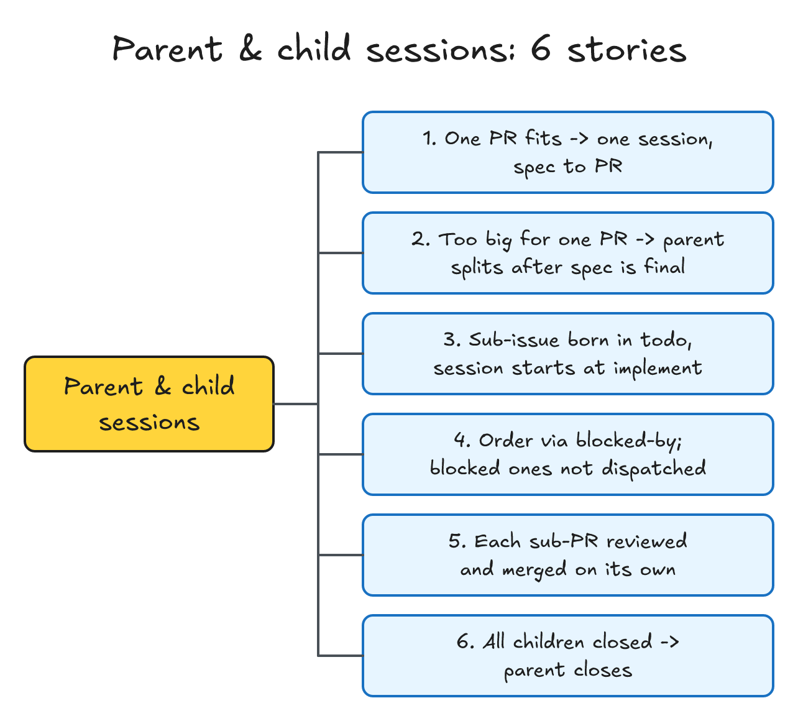

# issue 模型：issue 状态是唯一真相，子 issue 只用来拆分

> #242 存在：未完成的 9 份 spec 里 7 份 frontmatter 写「实现中」，它们的 issue 都已关闭为完成；开着的根下 27 个子 issue 多是整合进来、不是拆出来的，详情在「问题陈述」

## 问题陈述

对着 origin/release/idea-loop-0.2.0（16812ce，与 main 的 idea-loop 0.1.9 同一份插件代码）与 GitHub 上 harold-skills 的 issue 核，2026-11-04 取数见决定记录 A1，2026-11-05 复核 label 分布。

### 1. 一件事有两套状态，spec 那套没人维护

spec 的 frontmatter `status`（草稿 → 审核中 → 正式 → 实现中 → 完成）和 issue 的 `status:*` label（待验证 → 验证中 → 审核中 → 待设计 → 设计中 → 待实现 → 实现中 → 搁置）各由一个脚本写：`spec-status.mjs` 与 `issues.mjs`。`issues.mjs` 的「待」字头状态又是照 spec 的 `status` 推出来的，两套互相牵着。

实际上 spec 那套跟着 issue 走、又落在后面：未完成的 9 份 spec 里 7 份还写「实现中」，它们覆盖的 #28 #34 #46 #47 #48 #49 #50 都已关闭为完成。读 spec 的人（dreaming 判上线没有、人看 index）拿到的是过期的状态。

### 2. 子 issue 被当成「归成一组」用

整合定时任务（`setup/references/consolidation-prompt.md`）每 6 小时把「改同一处」的待验证 issue 挂到一个根下，调度按根出会话，一组一份 spec。结果父子关系表达的是「相关」，不是「拆出来」：开着的 10 个根下 27 个子 issue，例如根 #184「设计档案：长页面的分段」下挂着 #192「测试在 darwin 本机卡住」，并不是从 #184 拆出来的。版本（0.2.0）和模块（某个 skill）也没有别的表达方式，只能靠整合。

### 3. 新状态与「先放着」

2026-11-05 harold-skills 开着的 issue：42 个没有 `status:*`、7 个 `status:todo`（0.2.0 的 7 个需求，人手打的）、4 个 `status:搁置`（#237 Codex、#227 cmux、#226 Linear、#61 长页面分段）。决定记录定的九个新状态里没有「搁置」，这 4 个的去处要定（见「实现决策」）。

### 根因

- spec 的状态是 issue 状态的复制品：两者描述的是同一件事走到哪，却分两处写、两个脚本改（问题 1）。
- 「一组一个会话」靠子 issue 表达，没有 milestone、分类 label 这些别的分组手段可用，于是父子关系被挪去表达相关（问题 2）。

## 方案

改完之后：

- **只看 issue 的状态 label 就知道一件事走到哪**。spec 只是文档，frontmatter 里只留 `issues:`，没有 `status`；`spec-status.mjs` 删掉。spec 了结 = 它 `issues:` 里的 issue 全关了。
- **九个状态**：backlog、todo、spec、design、implement、review、blocked、done、canceled，label 写成 `status:<名>`。
- **子 issue 只用来拆分**：一块能单独交一个 PR 的部分。版本用 milestone，模块用分类 label，issue 之间的关联写正文链接，先后用平台的 blocked by。整合停掉。
- **父会话拆、子会话做**：父 issue 一个会话负责 spec、grill、设计、拆子 issue；每个子 issue 一个会话照父 spec 实现、开 PR。一个 PR 装得下的 issue 不拆，一个会话从 spec 做到 PR。
- **issue 实体写成通用的**：skill `issues`（原 `spec-status`）讲实体、状态、父子、分类；GitHub、Linear 各一份 reference 写平台上怎么表达。Linear 本身这次不接。

图：九个状态和每一步谁来翻。实线是会话或脚本翻，虚线是人或每周分拣（#243）翻。

| 从 | 到 | 谁、什么时候 |
|---|---|---|
| （新开） | backlog | agent 发现的、人在平台上直接开的；没有 `status:*` 的开着的 issue 也算 backlog |
| backlog | todo / canceled | 每周分拣后人定（#243）；P0 直接进 todo（#243） |
| todo | spec | 调度派出的会话认领一个没有父 issue 的 issue |
| todo | implement | 调度派出的会话认领一个子 issue（父 spec 已定） |
| todo | design / implement / review | 从 backlog 或 blocked 回来的 issue，新会话按「停在哪」评论接着做 |
| spec | design | spec 定稿、碰 UI、装了 design 插件 |
| spec | implement | spec 定稿、不碰 UI（或没装 design 插件，汇报里写明跳过了设计）；父 issue 拆完子 issue 也是这一步 |
| design | implement | 设计冻结 |
| implement | review | PR 转 ready、第一轮 Review 汇报交给人 |
| review | done | PR 合并（人说「合并」）；等联调的子 PR 停在 review |
| implement | done | 父 issue：子 PR 全部合完（父会话翻），或子 issue 全关后由调度对账补关 |
| spec / design / implement / review | backlog | 人说先放着：会话评论停在哪个阶段、分支名，然后归档 |
| 任意开着的 | blocked | 被别的 issue 挡（记成 blocked by 关系）或等人给条件（评论「等你：X」）；会话评论停在哪后归档 |
| blocked | todo | 挡路的 issue 全关了，调度对账翻；等人给条件的由人翻 |
| 任意开着的 | canceled | 人决定不做；验证为不存在 |

同一行为的其他入口，逐个标：

- **纳入**：`issues.mjs`（重写）；`spec-status.mjs`（删，读 spec 内容的函数挪进新的 `spec.mjs`）；skill `spec-status` → `issues`；`issue-session`、`issue-dispatch` 的分组与阶段；`issue-verify`、`to-spec`、`to-ticket`、`implement`、`pr-review`（deliver、merge）、`uiux-imagine`、`uiux-refine`、`dreaming` 与 `adr-reconciler`、`wiki-conventions`、`retro`、`seo-setup`、`seo-issues.mjs` 里读写 spec 状态或旧 issue 状态的句子；`setup`：删整合定时任务与 `consolidation-prompt.md`，`issue-tracker.md` 模板换状态表，`survey.md` 不再查 spec 状态；harold-skills 根目录的 `ISSUE_TRACKER.md`、`AGENTS.md`「issue 分类」；`README.md`。
- **排除**：开 issue 的统一写法、backlog 的每周分拣、优先级、调度的派发顺序，归 #243（`issue-triage`）；这里只把「开一个待验证的 issue」改成开进 backlog，文字留给 #243 重写。知识库落地（分支、合进知识库 main），归 #244；这里不改「合进主分支」那些句子的落点，只改其中翻状态的部分。已在用的仓库怎么迁（旧 label 换新、spec 去 `status`、解散整合的组），归 #247；这里给出对照表。

### 后端

`issues.mjs`（唯一写 `status:*` 与 `type:*` 的地方）的命令：

| 命令 | 做什么 |
|---|---|
| `labels <docs> [--prune]` | 建缺的九个 `status:*` 和 `type:*`；多余的列出，`--prune` 删 |
| `type <docs> <号> <分类>...` | 不变 |
| `show <docs> <号>` | JSON：状态、父 issue、子 issue（各自状态）、blocked by（各自开关）、milestone；取代 `group` |
| `set <docs> <状态> <号>... [--comment=<文字>]` | 核过的翻法；done、canceled 同时关闭（completed / not planned）；翻 backlog、blocked 必须带 `--comment`（停在哪 / 等什么），评论带 AI 前缀；前提见「实现决策」 |
| `split <docs> <父号> <标题> <正文文件>` | 开一个子 issue：`status:todo`，继承父的 `type:*`、`priority:*` 与 milestone，挂成父的子 issue；打印新号 |
| `block <docs> <号> <挡路的号>...` | 记 blocked by 关系，翻 blocked |
| `candidates <docs> [<上限>]` | JSON：开着的 todo、没有开着的挡路 issue，最早的在前；#243 在这里加优先级 |
| `reconcile <docs>` | 对账只做两件机械的事：blocked 且挡路的全关了 → todo（评论写明）；开着的父 issue、子 issue 全关了 → done。旧中文 label、一个 issue 两个 `status:*` 作为问题报出 |
| `queues <docs> [<号>]` | 不变，section 名换成 spec、design、implement、review |

删掉：`advance`、`resume`、`handoff`、`unhandoff`、`drop`、`queue`、`group`。`open`（「spec：」issue）由 #243 删，这里不动它的去留，只让它开出的 issue 带 `status:spec`。

`spec.mjs`（新，原 `spec-status.mjs` 去掉状态机）：读 spec 内容的函数（frontmatter、`issues:`、开头的存在 / 不存在结论、「需要 grill」「待定」、碰不碰 UI、冻结摘要）和两个命令：`index <docs>` 刷 `docs/spec/index.md`；`check <docs>` 报旧平铺布局和还带 `status` 行的 spec（#247 迁移用）。

## User Stories

只修问题、不加能力的部分一个问题一行期望行为；父子会话是新能力，单列一棵树。

1. 期望行为（问题 1）：一件事走到哪只有 issue 的 `status:*` 一处；spec 没有 `status`；`spec-status.mjs` 不存在，任何 skill 不再翻 spec 状态。
2. 期望行为（问题 2）：子 issue 只表达「从父 issue 拆出、单独交一个 PR」；没有整合定时任务；版本用 milestone、模块用分类 label。
3. 期望行为（问题 3）：「先放着」回 backlog 并留评论，issue 上不再出现 `status:搁置`。

### 场景：父会话与子会话

1. 作为人，我想要一个 PR 装得下的 issue 由一个会话从 spec 做到 PR，以便小事不被拆碎
2. 作为人，我想要装不下的需求由父会话在 spec 定稿后拆成子 issue、拆法写进汇报，以便我能推翻拆法
3. 作为人，我想要子 issue 一开出来就在 todo、被调度派成子会话、子会话直接从 implement 开始，以便不重复验证和写 spec
4. 作为人，我想要子 issue 之间的先后用 blocked by 表达，挡路的合了才派后面的，以便子会话不在没合的代码上开工
5. 作为人，我想要 spec 测试计划写「联调：要」时子 PR 开出先不合、父会话联调后我逐个说合并，写「联调：不要」时子 PR 各自合，以便只在接口跨仓库时等待
6. 作为人，我想要子 issue 全关后父 issue 自动关，以便父 issue 的进度条和状态不落后

### 场景：issue 的分类（harold-skills）

1. 作为维护者，我想要分类的子类是 skill 或 agent 名（如 `type:idea-loop/issue-verify`），跨几个的只打父类，以便按「插件 + skill」渐进迭代

## 实现决策

### 状态与 label

- 九个状态的 label 是 `status:backlog` … `status:canceled`；done、canceled 的 issue 同时关闭，reason 分别是 completed、not planned，label 也留着，好让 Linear 那种「关闭也是一个状态」的平台照搬。开着却没有 `status:*` 的算 backlog（人在 GitHub 上直接开的就是这样）。依据：决定记录「状态」一行（Q19）、「开 issue 的状态」一行（Q28、Q32）。
- `set` 允许的翻法照「方案」的表；不在表里的拒绝，并列出能翻成什么。done、canceled 之后不再翻（重开是人的事）。
- `set` 读文件核的前提（原来在 `spec-status.mjs` 里，挪到这里，因为 spec 不再有自己的状态，前提改成卡在 issue 的翻法上）：翻出 spec（→ design、→ implement）时，issue 的 spec 不能还有「需要 grill」或「待定」；→ design 要求 spec 碰 UI；spec 碰 UI 而没有冻结摘要时 → implement 要带 `--skip-design`（没装 design 插件时用，#241）。issue 的 spec 是 `issues:` 列着它的那份；子 issue 用父 issue 的。依据：原 `transitionError` 的同名检查。
- 翻 backlog、blocked 必须带 `--comment`：Q1、Q2 定了「停在哪 / 等什么」写在评论里，新会话靠它接上，没写就接不上。AI 写的评论带前缀「🤖 idea-loop：」（决定记录「借 Matt 的 triage」一行，#243 定前缀的统一写法时可以改这一处）。

### 先放着与 blocked

- 「先放着」= backlog（Q1）：会话评论停在哪个阶段、分支名，然后归档，分支留着；人在周汇总里重新放进 todo，新会话读评论直接认领到那个阶段（todo → design / implement / review）。
- blocked（Q2）：被别的 issue 挡用平台的 blocked by 关系（`issues block`），等人给条件只写评论。blocked 不占会话。`reconcile` 只自动解除有 blocked by 关系、且挡路的全关了的；只有评论的由人翻回 todo。`candidates` 也跳过还被开着的 issue 挡着的 todo，所以子 issue 2 在子 issue 1 合并前不会被派出去。

### 父 issue 与子 issue

- **子 issue** 是从父 issue 拆出、能单独交一个 PR 的一块；**工单**是一个 PR 里的切片（`GLOSSARY.md`）。父子只有两层：子 issue 不再拆。
- **何时拆**（Q3）：父会话在 spec 定稿（碰 UI 的设计冻结）后判断一个 PR 装不装得下；跨仓库一定拆（Q44）；AI 判，拆法写进汇报，人能推翻。拆了的 spec 加一节「子 issue」：每块一行，写范围、在哪个仓库、被哪块挡着。
- **子 issue 的路径**（Q4）：`issues split` 开在 todo；子会话认领 todo → implement，走 implement → review → done。工单由子会话自己切，放父 spec 目录的 `tickets/<子号>/`，几个子会话的知识库分支不碰同一个文件；子 PR 合并时只删自己那个目录。
- **父 issue**（Q5）：拆完翻 implement，会话不归档；联调（要的话）由父会话做；子 PR 全部合完父会话翻 done。父会话没了（被人归档）时，子 issue 全关后 `reconcile` 补关。
- **合到哪**（U2）：子 PR 各自合进所在仓库的主分支，不开父级集成分支。
- **联调**（Q9）：to-spec 在测试决策里写一行「联调：要。<要一起测的仓库和场景>」或「联调：不要」，grill 时人能改。父会话拆子 issue 时读它：要的，子会话开出 PR 后停在 review 不合，等父会话；不要的，子 PR 各自 review、人说合并就合。联调本身怎么开 worktree 照 Q46，写在 `issue-session` 的父 issue 一节。
- spec 的 `issues:` 写父 issue 的号（没有父子的写它自己）；子 issue 不写进去，从平台的父子关系找到。spec 了结 = `issues:` 里的全关了：dreaming（`adr-reconciler`）按这个判上线、写 ADR、删目录，取代「spec 是完成」。

### issue-session 与 issue-dispatch

- **会话认的单位从「组」改成一个 issue**：会话标题「<仓库名>#<号> <标题>」，号就是它自己的号。会话按 issue 的种类走三条路：没有父子的（spec → design → implement → review → done）；父 issue（spec → design → 拆 → 等子 PR / 联调 → done）；子 issue（implement → review → done）。开场 `issues show` 看它是哪一种、现在在哪。
- **侧边栏 section** 换成状态名：spec、design、implement、review。独立队列照旧在前面加分类名。
- **调度** 一个 todo issue 一张卡片，卡片的 prompt 和 background 写明是父、子还是单个；子 issue 的卡片写父号和父 spec。「没有会话的 issue」报的是 spec、design、implement、review 却没有同号会话的；blocked、backlog、todo 本来就没有会话，不报。每轮对账跑 `issues reconcile`。
- 调度谁先派、出几张归 #243；这里只改分组、阶段名和卡片内容。

### harold-skills 的分类

根目录 `AGENTS.md`「issue 分类」写成 #241 拆完后的形状：父类是插件（idea-loop、design、seo、excalidrawer、content-creator、interview-coach、happy-life），子类是该插件的 skill 名与 agent 名，跨几个的只打父类。依据：决定记录「harold-skills 的分类」一行（Q33、Q37）与本场 Q7。

### 平台差异

skill `issues` 正文只讲通用的实体：号、标题、正文、状态、分类、父 / 子、blocked by、milestone、评论。`references/github.md` 写 GitHub 上各自怎么表达（label、sub-issue API、dependencies API、milestone、关闭 reason）；`references/linear.md` 写 Linear 的对应（workflow state、label、sub-issue、blocks 关系、Release 或 Project milestone、模块用 Project），标明这次只写对照、脚本不接 Linear。依据：决定记录「整合」「版本与模块」两行（Q3、Q17）、「版本范围」一行（Q38）。

### 迁移对照（给 #247）

| 旧 | 新 |
|---|---|
| 开着、没有 `status:*`（待验证） | backlog（不打也行） |
| 验证中、审核中 | spec |
| 待设计 | todo（会话接上时直接认领到 design） |
| 设计中 | design |
| 待实现 | todo（接上时认领到 implement） |
| 实现中 | implement（PR 已开、等人看的为 review） |
| 搁置 | backlog，补一条「停在哪」评论 |
| 关闭·完成 / 关闭·不存在 | done / canceled（补 label 可选） |
| spec frontmatter 的 `status` | 删掉这一行（`spec.mjs check` 列出还有的） |
| 整合出来的根与子 issue | 解除父子关系；根若只为归组而开，关成 canceled |

## 测试决策

| 变的是什么 | 仪器 | 本次 |
|---|---|---|
| 纯逻辑、数据转换、状态机 | TDD 单元测试 | 碰：`issues.mjs` 的翻法表、前提、reconcile 计划、split / block 的 gh 调用、candidates 过滤；`spec.mjs` 的读法与 index、check |
| API 契约（路由、schema、序列化） | TDD API 测试 | 不涉及（gh 调用在单元测试里用假 gh 断言参数） |
| DB schema、迁移、并发与事务语义 | 真 DB 测试 | 不涉及 |
| LLM 输出质量（prompt 改动） | eval（确定性断言） | 改了 issue-session、issue-dispatch、issues 等 skill 文本：不跑 eval（本仓库 §5 跳过 quantitative eval）；用文档 tripwire 测试钉住「不再出现旧状态名、spec-status、整合」 |
| 视觉正确性 | UI 实现环 | 不涉及 |
| 端到端用户流程 | 浏览器端到端测试 | 不涉及 |

联调：不要。

- **seam**：`issues.mjs` 导出的纯函数（`NEXT`、`transitionError`、`reconcilePlan`、`candidatesOf`）加注入假 `gh` 的命令函数，照现有 `issues.test.mjs` 的写法；文档用 tripwire 测试读 skill 文本。能抓到状态机、前提、gh 参数写错；漏掉真 GitHub 上 sub-issue 与 dependencies 接口的行为，靠实现时在本仓库对一个临时 issue 手跑一次 `split` 和 `block` 补上。
- **增量功能测试**：
  - 前置：spec 有「需要 grill」，issue 在 spec。步骤：`set implement`。期望：拒绝并说出还等人定的那一行。覆盖：问题 1。
  - 前置：#2 被 #1 挡、#1 刚关。步骤：`reconcile`。期望：#2 回 todo 并评论；#1 还开着时 `candidates` 不出 #2。覆盖：父会话与子会话 4。
  - 前置：父 #10 在 implement，子 #11 #12 都关。步骤：`reconcile`。期望：#10 关成 done。覆盖：父会话与子会话 6。
  - 前置：父 #10 带 `type:idea-loop`、`priority:P1`、milestone。步骤：`split`。期望：新 issue `status:todo`、带同样的分类、优先级、milestone，挂成 #10 的子 issue。覆盖：父会话与子会话 3。
  - 前置：插件全部文件。步骤：tripwire 扫描。期望：没有 `spec-status`、`待验证`、`待设计`、`待实现`、`验证中`、`整合` 的旧用法，没有 `consolidation-prompt.md`。覆盖：问题 1、2、3。
- **照着谁写**：`idea-loop/scripts/issues.test.mjs`（假 gh）、`idea-loop/scripts/setup-consolidation-doc.test.mjs`（文档 tripwire，本次改写成新模型的版本）。

## Out of scope

- 每周分拣、开 issue 的统一正文、优先级与派发顺序（#243）。
- 知识库分支与合进知识库 main 的写法（#244）。
- 已在用的仓库的迁移动作本身（#247）；这里只给对照表和 `spec.mjs check`。
- 脚本接 Linear（0.2.x 补丁版本）。

## 关联

- raw：[[2026-11-05-issue-model-grill]]，[[2026-11-04-idea-loop-0-2-0-restructure-grill]]（Q1–Q3、Q17、Q19、Q24、Q37、Q44–Q46）。
- 被取代：[[issue-consolidation]]（整合定时任务、按根出会话）。
- 相邻：#243 建在本 spec 的状态机上，排在后面；#244（PR #251）改了 `issues.mjs` 的 gh 仓库来源和多处「合进主分支」，本 PR 在它合进 release 后重放；#241（PR #250）搬走 design、seo 目录，本 PR 对那两处的改动跟着搬；#245（PR #249）改了 `issue-verify`、`to-spec`、`retro`、`wiki-conventions` 的其他段落，冲突时保留它的段落、只换状态相关的句子；#247 用本 spec 的迁移对照。
