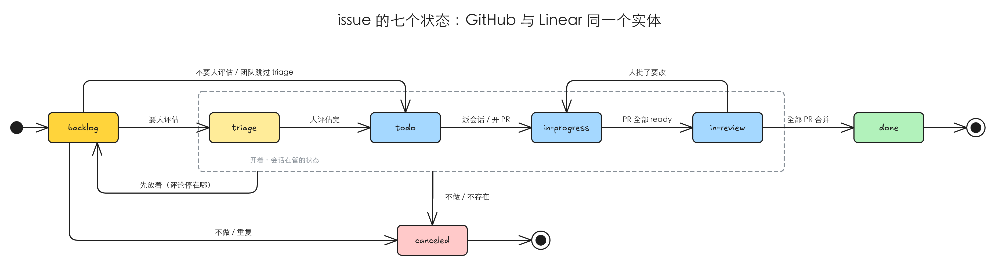

# issue 模型：issue 状态是唯一真相，GitHub 与 Linear 同一个实体

> #242 存在：未完成的 spec 里多数 frontmatter 写「实现中」，它们的 issue 早已关闭；子 issue 被拿来归组而不是拆分；状态名只有 GitHub 上的一套中文 label，Linear 团队对不上，详情在「问题陈述」

> 需要 grill：「待定」开头的三节（迁移、类型与模块的 label 名、blocked 与先放着）

## 问题陈述

对着 main（b4c612a，idea-loop 0.1.9）、GitHub 上 harold-skills 与 Tofelair 的 issue、Linear 工作区 Hanabi AI 的 Agent Platform（FA）核，取数日期 2026-11-05，过程在 [[2026-11-05-issue-model-regrill]]。

### 1. 一件事有两套状态，spec 那套没人维护

spec 的 frontmatter `status`（草稿 → 审核中 → 正式 → 实现中 → 完成）由 `spec-status.mjs` 写，issue 的 `status:*` label（待验证 → 验证中 → 审核中 → 待设计 → 设计中 → 待实现 → 实现中 → 搁置）由 `issues.mjs` 写，「待」字头的 label 又是照 spec 的 `status` 推出来的。spec 那套落在后面：2026-11-04 未完成的 9 份 spec 里 7 份写「实现中」，它们覆盖的 #28 #34 #46 #47 #48 #49 #50 都已关闭为完成。

### 2. 子 issue 被当成「归成一组」用

整合定时任务（`setup/references/consolidation-prompt.md`）把「改同一处」的待验证 issue 挂到一个根下，调度按根出会话。开着的 10 个根下 27 个子 issue，例如根 #184「设计档案：长页面的分段」下挂着 #192「测试在 darwin 本机卡住」，并不是从 #184 拆出来的。Linear 上同样：FA 最近 60 天 250 个 issue 里 52 个有父，父的除了 `[Epic]`（FA-475）还有汇总单（FA-559「Agent 页面走查问题汇总」下 10 个）。

### 3. 状态只有一套 GitHub 中文 label，跟团队的平台对不上

- 八个中文状态里设计、实现各拆成「待」「中」两个，Linear 团队的 workflow state 没有对应的。FA 的状态是 Backlog / Todo / In Progress / In Review / Done / Canceled / Duplicate，没开 Triage。
- FA 的 In Progress、In Review、Done 不靠人翻，由 PR 推：FA-575 Backlog → In Progress（02:07）→ In Review（02:17）→ Done（04:13 合并）。idea-loop 现在等 PR 合并后才翻状态，PR 由 `pr-review` 在实现全部做完后才开。
- 一个 issue 常在几个仓库各一个 PR：抽到的 13 个完成的 FA issue 里 4 个（FA-520、FA-524、FA-505、FA-571）在 fish-agent、platform-api、platform-web 各开一个。idea-loop 一个会话只认一个仓库、一个 PR。
- 开着的 issue 里 Tofelair 有实现中 4、审核中 2、待实现 2、搁置 7，harold-skills 有搁置 5、`status:todo` 7（0.2.0 时人手打的，main 上的脚本不认，`set 验证中 242` 被拒）。

### 根因

- spec 的状态是 issue 状态的复制品，分两处写（问题 1）。
- 「一组一个会话」靠子 issue 表达，没有别的分组手段（问题 2）。
- 状态模型是照 idea-loop 自己的阶段起的，不是照 issue 平台的通用状态起的；PR 被当成流程的终点，不是 issue 的一部分（问题 3）。

## 方案

改完之后：

- **只看 issue 的状态就知道一件事走到哪**。spec 只是文档，frontmatter 只留 `issues:`，没有 `status`；`spec-status.mjs` 删掉，读 spec 内容的函数留在新的 `spec.mjs`。spec 了结 = 它 `issues:` 里的 issue 全关了。
- **七个状态，GitHub 和 Linear 上是同一个实体**：backlog → triage → todo → in-progress → in-review → done，另有 canceled。backlog 可以直接到 todo；团队没有 Triage 的，项目文档里写明跳过 triage。
- **triage 是人评估的那一段**：grill、设计都在这里做，做完翻 todo；调度只派 todo。
- **实现一开始就开 PR**（draft），PR 正文写上 issue 号，平台据此把 PR 挂到 issue 上。转 ready 进 in-review，全部 PR 合并进 done。
- **一个 issue 每个要改的仓库各一个 PR**，一个会话做完全部仓库；项目文档列出这个产品的仓库。
- **不用父子关系归组**：一个 issue 一个会话、一份 spec。版本用 milestone，模块用分类 label，关联写正文链接。整合停掉。平台上已有的父子关系照常读，不当成组。
- **issue 正文统一格式**，必填四节，见「实现决策」。
- **skill `spec-status` 改名 `issues`**，正文写通用的 issue 实体；GitHub、Linear 的表达各一份 reference。Linear 走 MCP，setup 时把团队的状态整理进项目文档（#226）。

| 状态 | 意思 | GitHub | Linear（默认名，按项目文档对） |
|---|---|---|---|
| backlog | 新进来、没验证；或先放着 | open，没有 `status:*` | Backlog |
| triage | 验证过，要人评估（grill、设计） | `status:triage` | Triage；团队没开就跳过 |
| todo | 可以被调度 | `status:todo` | Todo |
| in-progress | 会话在做，PR 已开（draft） | `status:in-progress` | In Progress（集成推） |
| in-review | PR 转 ready、等人看 | `status:in-review` | In Review（集成推） |
| done | 全部 PR 合并 | closed，completed | Done（集成推） |
| canceled | 不做；验证为不存在；重复 | closed，not planned | Canceled / Duplicate |

| 从 | 到 | 谁、什么时候 |
|---|---|---|
| （新开） | backlog | agent 或人开的；没有 `status:*` 的开着的 issue 也算 |
| backlog | triage / todo / canceled | 每周分拣后人定（#243）；不要人评估的直接 todo |
| triage | todo | 人评估完：spec 里没有「需要 grill」「待定」，碰 UI 的设计已冻结 |
| todo | in-progress | 调度派出的会话认领，开 draft PR |
| in-progress | in-review | PR 全部转 ready，第一轮 Review 汇报交给人 |
| in-review | in-progress | 人批了要改、会话回去改（Linear 上集成照样推） |
| in-review | done | 全部 PR 合并 |
| 任意开着的 | backlog | 人说先放着：评论停在哪、分支名 |
| 任意开着的 | canceled | 人决定不做；验证为不存在 |



图：七个状态和每一步的转移。虚线框里是开着、有会话在管的状态，从框里任一状态都能「先放着」回 backlog，或「不做」进 canceled。

同一行为的其他入口，逐个标：

- **纳入**：`issues.mjs`（重写）；`spec-status.mjs`（删，读法挪进 `spec.mjs`）；skill `spec-status` → `issues`；`issue-session`、`issue-dispatch`、`issue-verify`；`to-spec`、`to-ticket`、`implement`、`pr`、`pr-review`（deliver、merge）里读写 spec 状态或旧 issue 状态、开 PR 的句子；`uiux-imagine`、`uiux-refine`、`uiux-research`；`dreaming` 与 `adr-reconciler`、`wiki-conventions`、`retro`；`seo-setup`、`seo-scan`、`seo-geo`、`seo-issues.mjs`；`setup`（删整合定时任务与 `consolidation-prompt.md`，`issue-tracker.md` 模板换状态表、加「仓库」节，`survey.md`）；`review-loop.mjs`、`proposal-table-check.mjs`；harold-skills 根目录的 `ISSUE_TRACKER.md`、`AGENTS.md`、`idea-loop/AGENTS.md`、`idea-loop/README.md`；evals 里引用旧状态的用例文本。
- **排除**：开 issue 的统一入口、每周分拣（backlog → triage / todo）、优先级与派发顺序，归 #243；这里只定正文格式和状态。setup 选平台、Linear 授权、把团队状态整理进项目文档、Linear 上用 MCP 做每个操作，归 #226；这里定实体和 GitHub 的实现，Linear reference 只写对照。

### 后端

`issues.mjs`（GitHub 上唯一写 `status:*` 的地方）：

| 命令 | 做什么 |
|---|---|
| `labels <docs> [--prune]` | 建缺的四个 `status:*` 和分类 label；多余的列出，`--prune` 删 |
| `type <docs> <号> <分类>...` | 不变 |
| `show <docs> <号>` | JSON：状态、标题、分类、挂着的 PR（各自仓库、draft / ready / merged）、覆盖它的 spec 与分支；取代 `group` |
| `check <docs> <状态> <号>` | 只核前提、不改：平台无关，Linear 上会话先跑它再用 MCP 翻 |
| `set <docs> <状态> <号>... [--comment=<文字>]` | 核过前提再翻；done、canceled 同时关闭（completed / not planned）；翻 backlog 必须带 `--comment`，评论带「🤖 idea-loop：」前缀 |
| `candidates <docs> [<上限>]` | JSON：开着的 todo，没有开着的 blocked by，最早的在前（#243 加优先级） |
| `reconcile <docs>` | 对账：全部 PR 都合并了却还开着的 → done；PR 都 ready 却还是 in-progress 的 → in-review；旧中文 label、一个 issue 两个 `status:*` 作为问题报出 |
| `queues <docs> [<号>]` | 不变，section 名换成 triage、in-progress、in-review |

删掉：`advance`、`resume`、`handoff`、`unhandoff`、`drop`、`queue`、`group`。`open`（「spec：」issue）由 #243 删，这里只让它开出的 issue 带 `status:todo`。

`spec.mjs`：读 spec 内容的函数（frontmatter、`issues:`、开头的存在 / 不存在结论、「需要 grill」「待定」、碰不碰 UI、冻结摘要）和两个命令：`index <docs>` 刷 `docs/spec/index.md`；`check <docs>` 报旧平铺布局和还带 `status` 行的 spec。

## User Stories

只修问题、不加能力的部分一个问题一行期望行为。

1. 期望行为（问题 1）：一件事走到哪只有 issue 的状态一处；spec 没有 `status`；`spec-status.mjs` 不存在。
2. 期望行为（问题 2）：不用父子关系归组；一个 issue 一个会话；没有整合定时任务。
3. 期望行为（问题 3）：状态名跟 Linear 的 workflow state 一一对上；实现一开始 PR 就挂在 issue 上；一个 issue 能在几个仓库各有一个 PR，全部合并才 done。

### 场景：多仓库的 issue

1. 作为维护者，我想要一个改动跨 worker、API、前端三个仓库的 issue 由一个会话做完、每个仓库一个 PR，以便不用为每个仓库各开一个 issue
2. 作为维护者，我想要每个 PR 一开就挂在 issue 上，以便在 issue 上看到它改到了哪

### 场景：issue 正文

1. 作为读 issue 的人，我想要每个 issue 都写清问题、证据、影响范围、从哪发现，以便分拣时不用回头找上下文

## 实现决策

### 状态与 label

- GitHub 上开着的四个状态各一个 label：`status:triage`、`status:todo`、`status:in-progress`、`status:in-review`。backlog 是开着、没有 `status:*`（人在 GitHub 上直接开的就是这样）；done、canceled 只看关闭 reason，不留 label。依据：U2 的状态线；GitHub 关闭本身已经带 reason。
- `set` 允许的翻法照「方案」第二张表；不在表里的拒绝，并列出能翻成什么。done、canceled 之后不再翻（重开是人的事）。
- 前提（原来在 `spec-status.mjs` 的 `transitionError`，挪到 `check`，`set` 先跑它）：triage → todo 时，issue 的 spec（`issues:` 列着它的那份，在 issue 的分支上）不能还有「需要 grill」或「待定」，碰 UI 的要有冻结摘要，没装设计时带 `--skip-design`；→ done 时它挂着的 PR 全部合并。
- 团队有没有 triage 写在项目文档（`ISSUE_TRACKER.md`）的状态表里；写了「跳过」的，`set triage` 拒绝，backlog 只能到 todo。依据：U3 第 1 条。

### issue 正文

```
标题：一句现象，用户视角：什么情况下，出了什么事；不写方案

## 背景        可选：读懂问题要先知道的链路或现状
## 问题        必填：看到了什么，带一个具体例子；在哪（页面、接口、文件或 skill）
## 证据        必填：查询、日志、截图的摘要和出处；没有就写「无，待验证」
## 影响范围    必填：多少次、多少用户；查不到写原因
## 从哪发现    必填：哪个会话、哪次扫描、哪个 PR；人开的写「人」
## 已确认原因  可选：验证后补
```

类型（Bug / Feature / Improvement）、模块、优先级不写在正文里，用平台的字段或 label。格式写在 skill `issues` 里；开 issue 时校验必填四节（`issues new`）归 #243。依据：U3、U4（「必填没问题」）；四节取自 FA 的写法（背景 / 问题 / 已确认原因 / 影响范围）和 #243 定的「从哪发现」「证据」。

### 一个 issue 一个会话，PR 从实现开始就挂着

- **分支**：一个 issue 一条 `issue/<号>-<slug>` 分支，每个要改的仓库各一条同名分支。spec、设计、工单、代码都提交在上面（`idea-loop:wiki-conventions` 的「知识库落地」）。
- **triage 会话**：人开（#243 周汇总里的卡片，或人直接调 `issue-session`）。认领后起草 spec、grill、设计都在这里；做完 push 分支、翻 todo、在 issue 上评论分支名，归档。
- **todo 会话**：调度派。认领 in-progress；有 triage 留下的分支就接着它，没有就自己起草 spec（这时没有要人定的；起草中冒出要人定的，翻回 triage 并评论）。spec 提交后立刻对每个要改的仓库开 draft PR（`idea-loop:pr` 的描述写法），然后切工单、实现。实现全部落地、第一轮 review 汇报交给人时 PR 转 ready，翻 in-review。人说合并时逐个合并，全部合并后 `set done`。
- **PR 挂 issue**：GitHub 上 PR 正文写 `Refs <owner>/<repo>#<号>`，不写 `Closes`（合一个就会关 issue）；Linear 上标题前缀 `[<号>]`、正文第一行 `Linear: <号>`，照 FA 现有 PR 的写法。依据：A3 查到的 fishaudio/fish-agent#298。
- **侧边栏 section** 换成 triage、in-progress、in-review；独立队列照旧在前面加分类名。
- **调度** 一个 todo issue 一张卡片；「没有会话的 issue」报的是 triage、in-progress、in-review 却没有同号会话的。每轮对账跑 `issues reconcile`。

### 多仓库

- `ISSUE_TRACKER.md` 加「仓库」一节：仓库名、本地路径、主分支、管什么。知识库（`docs/`）在第一行那个仓库里。没有这一节的项目就是一个仓库。
- 会话的 worktree 开在知识库所在的仓库；要改别的仓库时，`git -C <路径> worktree add` 在那个仓库里开同名分支的 worktree，路径记进 spec 的「实现决策」。工单写明改哪个仓库，`implement` 让 implementer 在对应的 worktree 里做。
- `pr-review` 一轮 review 看全部 PR，汇报按仓库分节；合并逐个做，最后一个合并后 `set done`。
- 已知限制：不支持各仓库知识库各自一份；跨仓库的联调（先合哪个、灰度）写在 spec 里由人定，脚本不排序。0.1.10 发版后拿 FA-577 dogfood（U4）。

### 待定：已在用仓库的旧 label

Tofelair 开着的 issue 里有实现中 4、审核中 2、待实现 2、搁置 7；harold-skills 有搁置 5、`status:todo` 7。升到 0.1.10 后旧 label 调度认不出。推荐 `issues migrate <docs> [--apply]`：默认只列出会怎么改，`--apply` 才改，对照如下；发版时在 harold-skills 上跑，Tofelair 先把列表给人看再跑。

| 旧 | 新 |
|---|---|
| 开着、没有 `status:*`（待验证） | backlog（不动） |
| 验证中、审核中、待设计、设计中 | triage |
| 待实现 | todo |
| 实现中 | in-progress；挂着 ready PR 的为 in-review |
| 搁置 | backlog，补一条「从搁置迁回」评论 |
| spec frontmatter 的 `status` | 删掉这一行 |
| 整合出来的根与子 issue | 解除父子关系；根若只为归组而开，关成 not planned |

另两种做法：留给 #247（0.1.10 前 Tofelair 不能升级）；或脚本把旧 label 当别名读（双轨一直留着）。

### 待定：类型与模块的 GitHub label 名

实体里类型（Bug / Feature / Improvement）和模块是两个字段，Linear 上 FA 用的是 `type` 单选组和模块 label。GitHub 上现在 `type:*` 表达的是模块（harold-skills 的 `type:idea-loop/engineering`）。推荐模块照旧用 `type:*`（不改已有的 54 个 issue），类型用新的 `kind:bug` / `kind:feature` / `kind:improvement`。另一种做法：模块改名 `module:*`、类型用 `type:*`，名字跟 Linear 一致，代价是迁移时改全部已打的分类 label。

### 待定：blocked 与先放着

推荐不设状态：被别的 issue 挡用平台的 blocked by（GitHub dependencies、Linear blocks），调度跳过还被挡着的 todo；等人给条件的在 issue 上评论「等你：X」并回 backlog。先放着回 backlog，评论写停在哪个阶段、分支名；人重新放进 todo 后，新会话读评论接上分支。

### 平台差异

skill `issues` 正文只讲通用实体：号、标题、正文、状态、类型、模块、优先级、blocked by、PR、评论。`references/github.md` 写 GitHub 上各自怎么表达（label、关闭 reason、dependencies API、`Refs` 链接）；`references/linear.md` 写 Linear 的对应（workflow state、label 组、blocks、标题前缀与集成推状态），标明 MCP 操作与 setup 归 #226。

## 测试决策

| 变的是什么 | 仪器 | 本次 |
|---|---|---|
| 纯逻辑、数据转换、状态机 | TDD 单元测试 | 碰：`issues.mjs` 的翻法表、前提、`check`、跳过 triage、reconcile 计划、PR 解析与 done 前提、migrate 计划；`spec.mjs` 的读法与 index、check |
| API 契约（路由、schema、序列化） | TDD API 测试 | 不涉及（gh 调用在单元测试里用假 gh 断言参数） |
| DB schema、迁移、并发与事务语义 | 真 DB 测试 | 不涉及 |
| LLM 输出质量（prompt 改动） | eval（确定性断言） | 改了多个 skill 文本：不跑 eval（本仓库 §5）；用文档 tripwire 测试钉住不再出现旧状态名、`spec-status`、整合 |
| 视觉正确性 | UI 实现环 | 不涉及 |
| 端到端用户流程 | 浏览器端到端测试 | 不涉及 |

- **seam**：`issues.mjs` 导出的纯函数（翻法表、`transitionError`、`reconcilePlan`、`migratePlan`、PR 解析）加注入假 `gh` 的命令函数，照现有 `issues.test.mjs` 的写法；文档 tripwire 读 skill 文本。漏掉的：真 GitHub 上 PR 搜索与 dependencies 接口的行为，实现时在 harold-skills 对一个临时 issue 手跑一次（要 Harold 同意）；多仓库靠 FA-577 dogfood。
- **增量功能测试**：
  - 前置：spec 有「需要 grill」，issue 在 triage。步骤：`set todo`。期望：拒绝并说出还等人定的那一行。覆盖：问题 1。
  - 前置：`ISSUE_TRACKER.md` 写了跳过 triage。步骤：`set triage`。期望：拒绝，提示只能到 todo。覆盖：问题 3。
  - 前置：issue 挂着两个仓库的 PR，一个已合并、一个开着。步骤：`set done`；再合并第二个后 `reconcile`。期望：先拒绝并列出没合的 PR；后一步翻成 done 并关闭。覆盖：问题 3。
  - 前置：旧 label 实现中、搁置各一个。步骤：`migrate`、`migrate --apply`。期望：先只列出、不调 `gh issue edit`；后换成 in-progress、backlog 并评论。覆盖：问题 3。
  - 前置：插件全部文件。步骤：tripwire 扫描。期望：没有 `spec-status`、八个旧状态名、整合的旧用法，没有 `consolidation-prompt.md`。覆盖：问题 1、2。
- **照着谁写**：`idea-loop/scripts/issues.test.mjs`（假 gh）、`idea-loop/scripts/setup-consolidation-doc.test.mjs`（文档 tripwire，本次改写成新模型的版本）。

## Out of scope

- 开 issue 的统一入口与正文校验、每周分拣、优先级与派发顺序（#243）。
- setup 选平台、Linear 授权与状态整理、Linear 上的 MCP 操作（#226）。
- 父 issue / 子 issue 拆分与父子会话（[2026-11-05 九个状态的 grill](https://github.com/guohaonan-shy/harold-skills/blob/claude/optimistic-northcutt-c71462/docs/raw/issue-workflow/2026-11-05-issue-model-grill.md) 的结论留着，以后再做）。
- 各仓库各一份知识库、跨仓库联调的排序。

## 关联

- raw：[[2026-11-05-issue-model-regrill]]（本 spec 的依据），[2026-11-05 九个状态的 grill](https://github.com/guohaonan-shy/harold-skills/blob/claude/optimistic-northcutt-c71462/docs/raw/issue-workflow/2026-11-05-issue-model-grill.md)（九个状态的旧方案，被取代）。
- 被取代：[[issue-consolidation]]（整合定时任务、按根出会话）。
- 相邻：#243 建在本 spec 的状态和正文格式上，排在后面；#226 在本 spec 的实体上接 Linear；#247 若做，用本 spec 的迁移对照。
