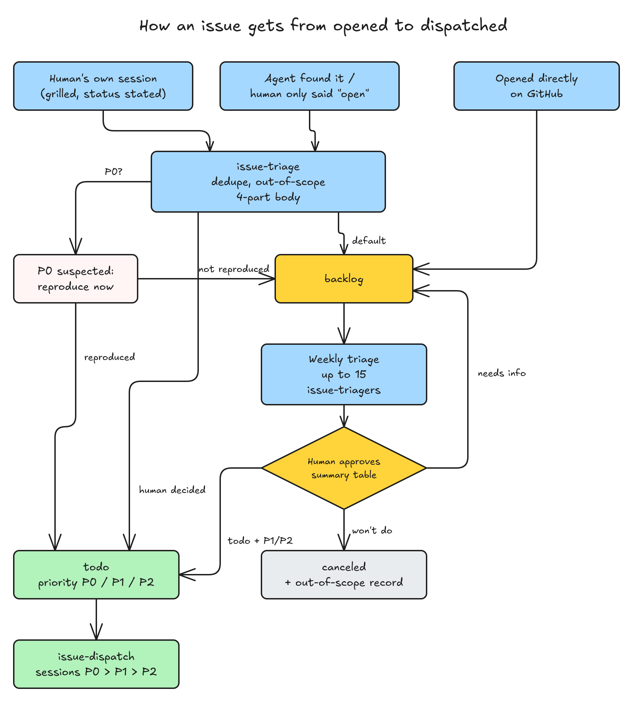

# issue-triage：开 issue 只有一个入口，验证挪到每周分拣，由人放行进 todo

> #243 存在：开 issue 的 7 处入口各写各的正文；验证藏在 issue 会话开头，新 issue 不经人放行就会被调度派成会话；开着的 53 个 issue 里 42 个没有状态 label，详情在「问题陈述」

## 问题陈述

对着 origin/release/idea-loop-0.2.0（1a7496b，跟 main 上 idea-loop 0.1.9 的插件代码是同一份）和 GitHub 上 harold-skills 的 issue 核过，取数日期 2026-11-05。新状态机以 #242 的 spec（提交 e84fa07）为准。

### 1. 开 issue 的入口有 7 处，各写各的正文

| 入口 | 谁触发 | 开出的 issue 现在怎样 |
|---|---|---|
| `spec-status`「开一个待验证的 issue」 | `issue-session` 的「边界」、`pr-review` 里人批的「开 issue」 | 正文写「是什么、在哪、怎么复现、为什么这次不做」，不带 label |
| `implement` 的存量问题 | 每张工单交回的 `found` 里，跟这张工单无关的那些 | 不问人，逐条自动开，走上一行的写法 |
| `to-spec` 的 `issues open` | spec 一个 issue 都没覆盖时 | 开一个「spec：」issue，只为让 spec 有个号 |
| `seo-scan` 的 `seo-issues.mjs` | 每周的 SEO 扫描 | 脚本按自己的模板写正文，不带状态 label |
| `retro` 的「批·开 issue」 | issue 会话收尾时 | 走第一行的写法 |
| `dreaming` 的「缺陷」行、`design-modeling` 提炼出的原则 | 每周对账、写 `DESIGN.md` 时 | 前者走第一行；后者自己 `gh issue create`，写「现状、在哪、来源」 |
| 人在 GitHub 上直接开 | 人 | 什么格式都有 |

结果是正文缺什么全看入口：分拣的人要回头查的「从哪发现」只有 `design-modeling` 写了；「证据」只有 `seo-issues.mjs` 一定会带。

### 2. 验证藏在会话开头，没有人放行这一步

现在新 issue 不带 `status:*`，就是「待验证」。调度每轮把最早的待验证 issue 派成会话，会话开头由 `issue-verify` 复现。一个 issue 值不值得做、先做哪个，没人看过就占了一个会话位。2026-11-05 开着的 53 个 issue 里 42 个没有 `status:*`，按 0.2.0 的新规则它们都算 backlog。

另外，调度按号码先进先出（`issues candidates` 按号码排序后截断），线上坏了的 issue 和三周前的文案小改谁号码小谁先派。

### 根因

- 入口没有共用的一步：每处入口自己调 `gh issue create`，所以正文格式和开出来的状态都各不相同（问题 1）。
- 「验证」和「做」是同一个会话的前后两段，中间没有一个由人决定放不放行的状态（问题 2）。#242 加了 backlog 和 todo，谁来把 issue 从前者翻到后者、怎么定先后，归这份 spec。

## 方案

改完之后：

- **开 issue 只有一个入口 `issue-triage`**。所有入口都调它，正文统一四节：现象、在哪、从哪发现、证据。开之前先查重，再查「不做」清单。
- **开出来是什么状态，看谁定的**：人在这场会话里 grill 过、并且明说了状态的，直接开成人说的 todo（同时问优先级）、已关闭或搁置（搁置就是回 backlog，并写明停在哪）。其余一律进 backlog，包括人只批了一句「开」的。
- **P0 不等周会**：开 issue 的一方判断是 P0（线上坏了、安全问题），就当场复现一次。复现到了，打 `status:todo` 和 `priority:P0`，并 PushNotification 通知人；复现不出，降成普通 backlog。
- **每周分拣**：桌面 app 的定时任务每周跑一次 `/idea-loop:issue-triage`。每次取最早的 15 个 backlog issue，每个交给一个 `idea-loop:issue-triager` 子代理，同时最多跑 5 个。子代理依次查重、查「不做」清单、查是否已实现、复现、打分类，然后在 issue 上贴证据评论。分拣会话把结果拼成一张汇总表，人逐行定：进 todo 加 P1 / P2、关闭、或留在 backlog。判不了的写成「已查清 / 还要你补」两栏，留在 backlog；人没补新评论、没改过它，下周就不再查。
- **存量先分批跑一遍**：上线后人敲 `/idea-loop:issue-triage 全部`，每 15 个一张表，批完一张接着下一张。
- **调度按 P0 → P1 → P2 派 todo**，同一级里最早的先派。`issue-verify` 删掉，issue 会话的 spec 阶段直接起草 spec，输入是分拣时贴在 issue 上的证据评论。



图：issue 从各个入口开出，到被调度派成会话。虚线框是人拍板的地方。

同一行为的其他入口，逐个标：

- **纳入**：问题 1 那张表里的 6 个由 agent 开 issue 的入口；`issue-session` 的 spec 阶段（原来调 `issue-verify`）；`issue-dispatch` 的派发顺序；`setup` 加装每周分拣的定时任务；`ISSUE_TRACKER.md` 模板加优先级一节；harold-skills 根目录的 `ISSUE_TRACKER.md`；`README.md`。
- **排除**：
  - 人在 GitHub 上直接开的：平台上没法插一步。它开出来不带 `status:*`，#242 已经定了「开着、没有 `status:*` 的也算 backlog」，每周分拣照样会取到它。
  - 「本期焦点」：release 分支上没有这一节（加它的 PR guohaonan-shy/harold-skills#240 已关闭、没合），没东西可删。

### 后端

`issues.mjs` 在 #242 的新形状上加这几处（命令名跟 #242 的风格一致）：

- `new <docs> <标题> <正文文件> [--state=backlog|todo|canceled] [--priority=P0|P1|P2] [--type=<分类>]...`：先校验正文的四节都在、都不空，再开 issue。默认开成 backlog；开成 todo 时必须带 `--priority`；开成 canceled 的开出来就关成 not planned。没有 `status:*` 以外别的路子能开 issue。
- `priority <docs> <P0|P1|P2> <号>...`：换掉原来的 `priority:*`，同一个 issue 只有一个优先级。
- `backlog <docs> [<上限>]`：JSON 列出开着的 backlog issue，最早的在前。跳过最新一条评论是分拣的「还要你补」、之后 issue 没再更新过的。
- `note <docs> <号> <正文文件>`：在 issue 上贴一条评论，前缀「🤖 idea-loop：」，跟 #242 的 `set --comment` 同一个前缀。
- `candidates`：排序从「最早在前」改成先按优先级（P0、P1、P2、没有优先级），同一级里再最早在前。
- `labels`：多建 `priority:P1`、`priority:P2`（`priority:P0` 已有）。
- 删掉 `open`（「spec：」issue）。
- `seo-issues.mjs`：正文改成四节，开成 backlog。

## User Stories

### 场景：开 issue

1. 作为 agent（实现、review、retro、dreaming、SEO 扫描），我想要只调一个入口开 issue，以便正文和状态不因入口而异
2. 作为读 issue 的人，我想要每个 issue 都写清现象、在哪、从哪发现、证据，以便不用回头找上下文
3. 作为人，我想要在自己的会话里 grill 完就直接开成 todo、已关闭或搁置，以便定过的事不再进分拣
4. 作为人，我想要 agent 发现的、我只批了一句「开」的 issue 都进 backlog，以便放不放行只在周会定
5. 作为人，我想要重复的 issue 不再被开出来、我拒过的需求被认出来，以便 backlog 里没有重复的问题
6. 作为人，我想要 P0 当场复现、复现到就进 todo 并通知我，以便线上坏了不用等周会

### 场景：每周分拣

1. 作为人，我想要每周一份汇总表，每个 backlog issue 一行，写结论、证据链接和建议去向，以便我一次批完
2. 作为人，我想要每个结论都有一条贴在 issue 上、带「🤖 idea-loop：」前缀的证据评论，以便一眼分出哪些话是机器写的
3. 作为人，我想要判不了的写成「已查清 / 还要你补」两栏，我没补就不再来问，以便同一件事不每周问一遍
4. 作为人，我想要拒掉的需求记进「不做」清单，以便下次再有人开同类 issue 能被认出来
5. 作为人，我想要每次最多 15 个、上线时用「全部」把存量分批跑完，以便一张表批得完

### 场景：调度

1. 作为人，我想要调度只派 todo，按 P0 → P1 → P2 派，以便会话位先给最要紧的
2. 作为 issue 会话，我想要拿分拣贴的证据评论直接起草 spec，以便不再复现一遍

## 实现决策

### `issue-triage` 一个 skill 两个分支

- **开 issue**（被各入口调用）：查重 → 查「不做」清单 → 按四节写正文 → 定状态 → `issues new`。这个分支每个入口都要走，正文写在 SKILL.md 里。
- **每周分拣**（不带参数，或带 `全部`）：放在 reference 里，只有定时任务和人手敲时才读。

skill 可以被模型调用：7 处入口都要调它开 issue（依据：Q3 的推荐，人同意了）。description 只做路由：开 issue、每周分拣两个触发词。

### 正文四节

```
## 现象
<看到了什么，用户视角，一个具体例子>
## 在哪
<页面、接口、文件或 skill>
## 从哪发现
<哪个会话、哪次扫描、哪个 PR；人开的写「人」>
## 证据
<截图、查询、日志的摘要和出处；没有就写「无，待分拣复现」>
```

`issues new` 和 `seo-issues.mjs` 都按四个标题校验，缺一节或空一节就拒绝。依据：决定记录的「分拣」一行定了这四样，机械判定能做的就做成检查。

### 定状态

| 情况 | 开成 |
|---|---|
| 人在这场会话里 grill 过，明说了「做」 | todo，同时问人 P0 / P1 / P2 |
| 人明说不做 | canceled，同时问要不要记进「不做」清单 |
| 人明说先放着 | backlog，评论写停在哪（#242 的「先放着」） |
| 开的一方判断是 P0 | 先开成 backlog；当场起一个 `issue-triager` 复现：存在就 `set todo` 加 `priority P0` 并通知，否则留在 backlog，评论写「疑似 P0，没复现到」 |
| 其余（agent 发现的、人只批了一句「开」的） | backlog |

依据：Q2、Q4，以及决定记录的「开 issue 的状态」一行。P0 的判断标准沿用旧标准：线上坏了，或安全问题（权限、付款、数据越权）。拿不准的不判 P0。

### `idea-loop:issue-triager`

新 agent，sonnet、思考强度 medium，钉在定义里（依据：U3）。一次只查一个 issue，按顺序做，命中一项就停：

1. **查重**：有开着的同一个问题 → 建议关闭，写「跟 #N 重复」。
2. **「不做」清单**：命中 → 建议关闭，附上清单那一份的链接。
3. **是否已实现**：查代码、已合并的 PR、ADR → 已实现就建议关闭，附上出处。
4. **复现**：复现手段沿用 `issue-verify` 那张表（逻辑写一个会红的测试、界面截图、线上数据查询），输出放 `.tmp/triage/<号>/`。
5. **打分类**：照「issue 分类」一节打，走 `issues type`。

做完用 `issues note` 贴一条证据评论：结论、证据、建议去向。判不了的，评论写成「已查清 / 还要你补」两栏。交回的只有一句结论、评论链接、建议去向（todo 加建议优先级 / 关闭 / 留在 backlog），复现的原始输出留在文件里。只读代码，不改代码，不翻状态。

### 汇总与人批

汇总表摆在定时任务开出的会话里，每行一个 issue：号码和标题、结论、证据评论的链接、建议去向。人逐行回「是」或改，分拣照批的执行：

- 进 todo：`issues set todo`，再 `issues priority`；
- 关闭：`set canceled`；人说「不做」的，同时写进「不做」清单；
- 留在 backlog：什么都不做。

写完 PushNotification 一句「N 个 issue 等你批」。依据：Q3。没在 1 小时内批完的不催，表留在会话里，人什么时候回都行。

### 每次 15 个，`全部` 分批

不带参数时取 `issues backlog <docs> 15`。带 `全部` 时把 backlog 每 15 个一批跑完，每批一张表，人批完一张才跑下一批。同时最多 5 个 `issue-triager`。依据：Q6、U3。

### 「不做」清单

放在知识库 `docs/records/out-of-scope/<slug>.md`，`type: record`，一个概念一份文件，写这个概念是什么、为什么不做、相关的 issue 号；同一个概念以后又被提，就往同一份里追加号码。放进已有的 `records/<kind>/`，不另开顶层目录：它跟 `records/` 一样是会话起头、之后由人维护的台账，不进 spec 的生命周期（依据：`wiki-conventions` 对 `records/` 的定义）。Q5 定的是「知识库里、一个概念一份文件」，这里只是选了 `records/` 下面这个位置，人可以推翻。

### 每周定时任务由 `setup` 装

照每周 dreaming 的装法：`setup` 问人装不装，id 是 `triage-<仓库名>`，默认每周一 9 点左右（分钟避开 0 和 30），prompt 是 `/idea-loop:issue-triage`。不在桌面 app 里时，把 prompt 交给人自己建。依据：Q3。

### `issue-verify` 删掉

复现和打分类挪进 `issue-triager`，起草 spec 那段并进 `issue-session` 的 spec 阶段：调 `to-spec`，输入是 issue 正文加分类时贴的证据评论；spec 里有要人定的，就在会话里 grill。依据：Q1。

### 入口怎么改

| 入口 | 改成 |
|---|---|
| `issues` skill（原 `spec-status`）的「开进 backlog」一节 | 删掉，改成一句：开 issue 走 `idea-loop:issue-triage` |
| `implement` 的存量问题、`issue-session` 的「边界」、`pr-review` 的「开 issue」 | 调 `issue-triage`，开进 backlog |
| `to-spec` 没覆盖 issue 时 | 不再开「spec：」issue：人在场就调 `issue-triage` 按人说的开成 todo；不在场就停下问人 |
| `retro` 的「批·开 issue」 | 调 `issue-triage` 开进 backlog，只开在插件仓库（决议的「retro」一行） |
| `dreaming` 的「缺陷」、retro 候选的「开 issue」、`design-modeling` 提炼的原则 | 调 `issue-triage` 开进 backlog |
| `seo-issues.mjs` | 脚本内部开：正文四节、`status:backlog` |

## 测试决策

| 变的是什么 | 仪器 | 本次 |
|---|---|---|
| 纯逻辑、数据转换、状态机 | TDD 单元测试 | `issues.mjs` 的 `new`（四节校验、状态与优先级）、`priority`、`backlog`（排序、上限、跳过「还要你补」）、`note`（前缀）、`candidates` 的优先级排序；`seo-issues.mjs` 的四节正文与 backlog label |
| API 契约（路由、schema、序列化） | TDD API 测试 | 不涉及 |
| DB schema、迁移、并发与事务语义 | 真 DB 测试 | 不涉及 |
| LLM 输出质量（prompt 改动） | eval（确定性断言） | 改了 skill 与 agent 文字，不加 eval（顶层 AGENTS.md §5：跳过量化 eval）；用文档测试钉住各入口都指向 `issue-triage`、`issue-verify` 已无引用 |
| 视觉正确性 | UI 实现环 | 不涉及 |
| 端到端用户流程 | 浏览器端到端测试 | 不涉及 |

- **seam**：`issues.mjs` 导出的纯函数加注入的 `gh`（沿用 `issues.test.mjs` 的假 `gh`），能抓到正文校验、label 组合、排序、跳过规则，抓不到 GitHub 真实的搜索和评论时间；文档测试（`*-doc.test.mjs`）抓「入口指向哪」，抓不到模型实际照不照做。
- **增量功能测试**：
  - 前置：假 `gh` 里 3 个 todo，分别是 P2 #5、P0 #9、没有优先级的 #3。步骤：`candidates`。期望：顺序是 #9、#5、#3。覆盖：调度 1。
  - 前置：正文缺「从哪发现」一节。步骤：`new`。期望：拒绝，报缺哪一节，不调 `gh issue create`。覆盖：开 issue 2。
  - 前置：#7 最新一条评论是「🤖 idea-loop：…还要你补…」，之后没更新过；#8 在那之后人补了评论。步骤：`backlog`。期望：只出 #8。覆盖：每周分拣 3。
  - 前置：开成 todo 但没带 `--priority`。步骤：`new`。期望：拒绝。覆盖：开 issue 3。
  - 前置：全仓库 grep。期望：没有 `issue-verify`、`issues open`、「开一个待验证的 issue」。覆盖：开 issue 1、调度 2。
- **照着谁写**：`issues.test.mjs`（假 `gh`）；`issue-group-skills.test.mjs`（文档测试）。

## Out of scope

- Linear 上开 issue（0.2.x 的补丁版本）。
- 已在用的仓库把旧 label 迁到新状态（#247）。

## 关联

- 决定记录：[[2026-11-04-idea-loop-0-2-0-restructure-grill]]（Q9、Q18、Q25、Q27、Q28、Q31、Q32、Q35、Q36）；这场 grill：[[2026-11-05-issue-triage-grill]]。
- [[issue-model]]（#242）：本 spec 建在它的九个状态和 `issues.mjs` 上，排在它后面；动手实现前它的 PR 要先合进 release。
- [[issue-intake-priority]]：前一版的入口与优先级 spec（焦点、挂模块根、想法 label），已被 0.2.0 的决定取代。这份 spec 合并时把它删掉，不写 ADR，原因是它从没实现过、决定都已经在决定记录里了。
- 相邻、有重叠：#241（PR #250）把 `seo-scan`、`design-modeling` 搬进新插件，这两处入口改在搬过去之后的位置；#244（PR #251）改了 `wiki-conventions` 和「合进主分支」的那些句子；#245（PR #249）改了 `decision-rules`「存量问题开 issue」那一条。这三个都在本 PR 之前合，本 PR 在它们之上改。#247 的迁移要给存量 issue 打 `status:backlog`，提示人跑 `全部`。
