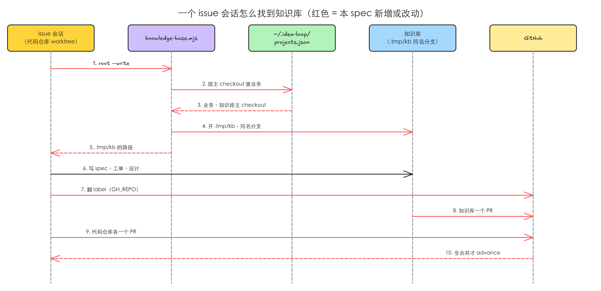
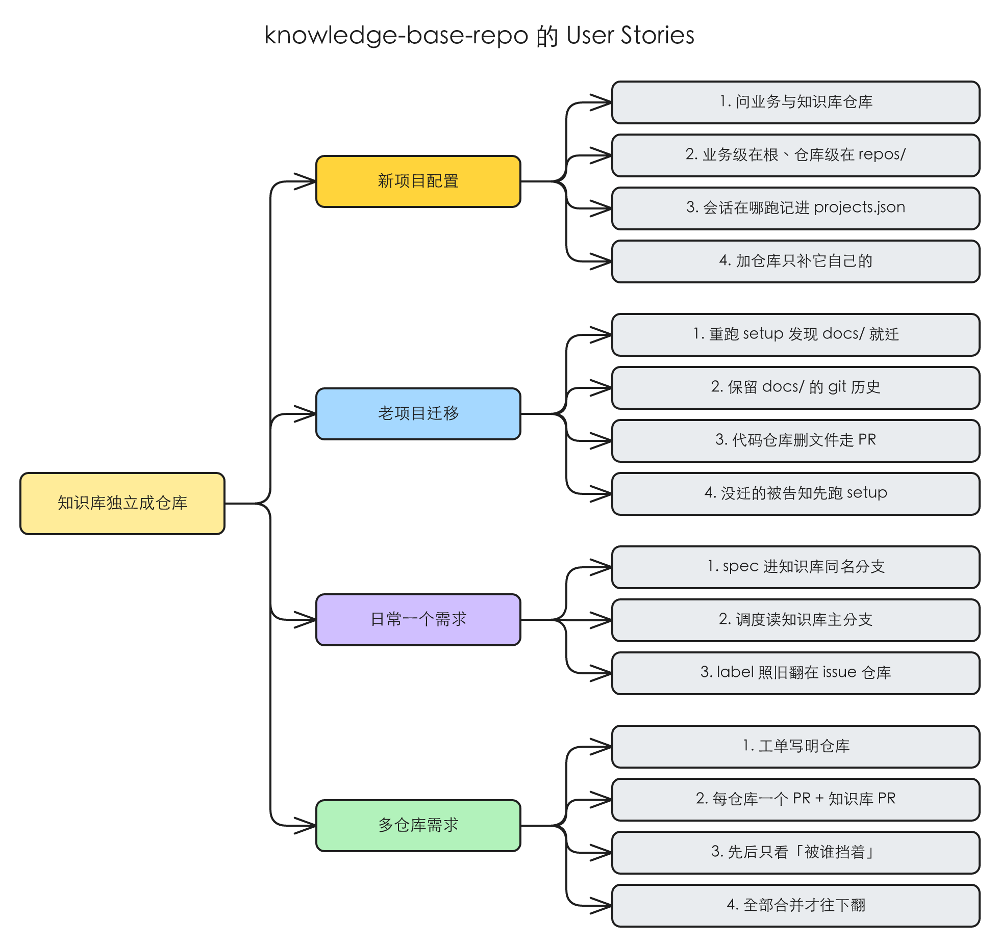

# 知识库独立成仓库：按业务分，代码仓库只留指针和自己的开发设置

> #228 存在：2026-11-03 对着 release/idea-loop-0.2.0（da85785，idea-loop 0.1.9）核过，setup 只会往代码仓库根目录写设置、建 `docs/`，skill 和脚本都在当前 checkout 里找它们，一个需求跨几个仓库时没有地方放共用的 spec，详情在「问题陈述」

这是 idea-loop 0.2.0 的 F5（release 计划 [[idea-loop-0-2-0-release]]），也覆盖 #222 的第 3 个需求点。决定全部出自 [[2026-11-03-idea-loop-0-2-0-grill]] 的「本轮决议」表，本 spec 不重开；其中「代码仓库不留 idea-loop 文件」一条，人在 2026-11-03 改为保留代码仓库的 `AGENTS.md`、在里面放指向知识库的指针（决定记录 U11），本 spec 已照改；「仓库级设置进知识库 `repos/<仓库名>/`」一条，人在同一天改为留在代码仓库（决定记录 U12，见「实现决策」的「业务级与仓库级的划分」）。

## 问题陈述

2026-11-03 在 `feature/knowledge-base`（从 release/idea-loop-0.2.0 da85785 切出）里用 grep 数的。

### 1. 设置和知识库只能放在代码仓库里

`/idea-loop:setup` 在代码仓库根目录写 7 份文件（`DEVELOPMENT.md`、`REVIEW.md`、`CODING_STANDARDS.md`、`ISSUE_TRACKER.md`、`PRODUCT.md`、`AGENTS.md` 的「issue 分类」一节、`CLAUDE.md` 的 `## idea-loop` 块），建 `docs/` 骨架。之后 65 份 skill / agent 定义、18 个脚本按「当前 checkout 的 `docs/`」找 spec、工单、设计档案，62 份 skill / agent 按「仓库根目录」找那几份设置。

例子：公司的一个业务由前端、后端、配置三个仓库组成。人想把这个业务的 spec 和设计档案放一处，现在只能挑一个仓库放 `docs/`，在另外两个仓库里开的会话找不到它；三个仓库各跑一次 setup，就是三份互不相干的 `PRODUCT.md`。人的原话（2026-11-03）：「我不想让每一个仓库都留一个docs/，而且公司我维护的很多repo是一个大业务，每次改一个需求，可能需要改几个仓库。上下文可能不再是一个仓库，而是几个仓库」。

本该：一个业务一份知识库，放在自己的 git 仓库里；哪个仓库里开的会话都找得到它；代码仓库里除了代码，只有人维护的 `AGENTS.md`（里面一个指向知识库的指针）和这个仓库自己的开发设置。

### 2. 一个需求只能落在一个仓库里

`idea-loop:implement` 写死「一份 spec 一条分支、一个 PR」（「前提」第 2 条），工单没有「改哪个仓库」这一格，`issues advance` 在那一个 PR 合并后就把 issue 翻到下一段或关掉。

例子：同一个需求要同时改后端接口和前端页面。按现在的规则只能开一个 PR，另一个仓库的改动没有地方放；即使人手动另开一个，前端 PR 合并时 spec 就被判完成，后端那个还开着。

本该：每个仓库一个 PR，知识库一个 PR；谁先谁后看工单的「被谁挡着」；全部合并才算这份 spec 做完。

### 根因

- 问题 1：「知识库在哪」没有单独的一层，所有读它的地方都假定它就是当前 checkout 的 `docs/`，设置文件就在 `git rev-parse --show-toplevel` 下。
- 问题 2：工单、实现、合并三处都假定一个需求只有一个代码仓库。

## 方案



改完 Harold 得到：

- 每个业务一个知识库仓库。个人业务的知识库只在个人电脑上，公司业务的只在虚拟机上（grill U6 Q20）。
- 代码仓库里留下的 idea-loop 内容：`AGENTS.md` 里一个指针块（这个仓库属于哪个业务、知识库仓库在 GitHub 上叫什么），以及仓库自己的 `DEVELOPMENT.md`、`REVIEW.md`、`CODING_STANDARDS.md`（照旧在根目录）。没有 `docs/`，也没有 `PRODUCT.md` 这类业务级设置。`AGENTS.md` 的其余内容由人照常维护。
- 已经装过 idea-loop 的仓库（harold-skills、Toeflair）升级插件后重跑 `/idea-loop:setup`，setup 问清业务、知识库仓库、会话在哪跑，把 `docs/` 和业务级设置搬进知识库，再开一个 PR 把它们从代码仓库删掉、写上指针块。「docs 在代码仓库里」这种做法不再支持：没迁的仓库跑任何 idea-loop skill，都会被告知先跑 setup。

### 知识库仓库长什么样

```
<知识库>/
├── idea-loop.json          业务名、issue 所在的 GitHub 仓库、业务里的代码仓库
├── PRODUCT.md  GLOSSARY.md  DESIGN.md  ISSUE_TRACKER.md
├── AGENTS.md               「issue 分类」一节；几个代码仓库的业务另有「仓库」一节
└── docs/                   原来代码仓库里的 docs/，结构不变：spec/ adr/ design/ raw/ domain/ records/ index.md
```

- **业务级**（整个业务一份）：`PRODUCT.md`、`GLOSSARY.md`、`DESIGN.md`、`ISSUE_TRACKER.md`、「issue 分类」、`docs/` 下的一切。
- **仓库级**（每个代码仓库一份）：`DEVELOPMENT.md`、`REVIEW.md`、`CODING_STANDARDS.md`，不进知识库，照旧在代码仓库根目录。多仓库需求里，在哪个仓库的 worktree 里做事就读那个仓库的这三份。
- `idea-loop.json` 是知识库的标记：一个 git 仓库根目录有它，就是知识库。
- **「仓库」一节**（业务里有两个以上代码仓库时才有，写在知识库根的 `AGENTS.md`）：每个代码仓库一条，写它叫什么、GitHub 名、管哪块功能、跟别的仓库怎么依赖（如「前端调后端的接口」）。`idea-loop.json` 的 `repos` 给脚本读名字，这一节给会话读意思：会话开在知识库里时它随 `AGENTS.md` 自动进上下文，切工单时按它决定每张工单落在哪个仓库。（决定记录 U16；人 2026-11-03，PR #233 review 第 1 轮 S1：「如果一个业务有多个代码仓库，我觉得业务的根目录需要有一个业务包含的仓库/模块的说明文件吧。」追问后选：S1 选 A；说明放知识库 AGENTS.md 的一节）

### 代码仓库怎么指向它：`AGENTS.md` 的指针块

代码仓库的 `AGENTS.md`（没有就是 `CLAUDE.md`）里一节：

```markdown
## idea-loop

- 业务：`<业务>`
- 知识库：`<owner/name>`

这个仓库的 spec、设计档案、产品说明、issue 分类都在知识库里；开发设置（`DEVELOPMENT.md`、`REVIEW.md`、`CODING_STANDARDS.md`）在本仓库根目录。本机路径用 idea-loop 的 `knowledge-base.mjs root` 取。
```

块里只写跟机器无关的两样：业务名和知识库的 GitHub 名；本机路径因机器而异，不写进仓库。setup 写这一块，迁移老项目时把原来的 `## idea-loop` 块换成它。

### 每台机器把它放在哪：`~/.idea-loop/projects.json`

```json
{
  "<业务>": {
    "knowledgeBase": "<知识库主 checkout 的绝对路径>",
    "home": "<会话在哪跑：调度和 issue 会话开在哪个 checkout>",
    "repos": { "<仓库名>": "<这个代码仓库主 checkout 的绝对路径>" }
  }
}
```

每台机器一份，setup 写，只放跟机器有关的项：知识库和各代码仓库 clone 在本机哪里、会话在哪跑。「这个仓库属于哪个业务」不在这里查，看代码仓库的指针块。`home` 是「会话在哪跑」：调度在这个 checkout 里起，调度出的 issue 会话也开在它下面；只有一个代码仓库的业务推荐填那个代码仓库，几个仓库的推荐填知识库。F4（工作环境）往同一个业务里再加 cmux group、ssh 主机这些字段，本 spec 只定这三个。

### 一个会话怎么拿到知识库：`knowledge-base.mjs`

新脚本，skill 和脚本里所有「知识库在哪」都问它：

| 子命令 | 输出 |
|---|---|
| `root` | 读用的知识库根：当前 checkout 就是知识库 → 它自己；当前 worktree 下有 `.tmp/kb/` → 它；否则 → `projects.json` 里这个业务的知识库主 checkout |
| `root --write` | 写用的知识库根：当前 checkout 就是知识库 → 它自己；否则保证 `.tmp/kb/` 是知识库的一个 worktree、分支名跟当前分支相同（分支不存在就从知识库的默认分支开），输出它 |
| `worktree <仓库名>` | 保证 `.tmp/repos/<仓库名>/` 是那个代码仓库的 worktree、分支名同当前分支，输出它 |
| `business` | JSON：业务名、知识库、`home`、每个代码仓库的 GitHub 名和本机路径 |

当前 checkout 属于哪个业务，读它 git 根下 `AGENTS.md`（或 `CLAUDE.md`）的指针块；再到 `projects.json` 里取这个业务的知识库在本机的路径。没有指针块，报「这个仓库还没配进任何业务：跑 `/idea-loop:setup`」；有指针块、本机没有这个业务，报「这台机器还没 clone 知识库 `<owner/name>`：跑 `/idea-loop:setup`」；都非 0 退出。`<仓库名>` 是当前仓库 `origin` 的 GitHub 名在知识库 `idea-loop.json` 的 `repos` 里对上的那个名字，对不上就取 `origin` 的仓库名。

读的地方（调度对账、`spec-status check`、设计档案查询）用 `root`；写的地方（to-spec 写 spec、to-ticket 切票、uiux-refine 冻结、pr-review 删工单和归档）用 `root --write`。这样会话 worktree 的 `.tmp/kb/` 就是这个需求在知识库里的分支，lifecycle 跟着会话 worktree 走。

### 多仓库需求

- 业务里有两个以上代码仓库时，每张工单写明「仓库：<仓库名>」，按知识库 `AGENTS.md` 的「仓库」一节判它落在哪个仓库；只有一个仓库的业务不写。
- 会话可以开在知识库里（几个仓库的业务推荐这样）：这时主分支取知识库远端的默认分支；碰代码的步骤（实现、验证、按提交挑要重拍的界面）读工单写的那个仓库自己的 `DEVELOPMENT.md`、`REVIEW.md`、`CODING_STANDARDS.md`，在那个仓库的 `.tmp/repos/<仓库名>/` worktree 里做。（决定记录 U16；人 2026-11-03，PR #233 review 第 1 轮 S1：「如果一个业务有多个代码仓库，我觉得业务的根目录需要有一个业务包含的仓库/模块的说明文件吧。」追问后选：S1 选 A；说明放知识库 AGENTS.md 的一节）
- implement 每个仓库一条集成分支，名字都跟会话分支相同：会话所在的仓库就是会话 worktree，别的仓库用 `knowledge-base.mjs worktree <仓库名>` 开；每个仓库一个 PR，知识库的改动（工单勾格、设计变更、归档）一个 PR。
- 工单之间的先后只看「被谁挡着」，跨仓库也一样：挡着它的那张没落地，它就不派。
- spec 的 issue 等这份 spec 的全部 PR（每个代码仓库的、知识库的）都合并后才 `issues advance`；中途合了一个，只在 Review 汇报里记「还剩哪几个没合」。

### issue 在哪个 GitHub 仓库

`issues.mjs` 以前在 `docs/` 所在的目录里跑 `gh`，就作用在那个仓库。知识库搬出去后，那个目录变成知识库仓库，所以 `issues.mjs` 改为从 `<知识库>/idea-loop.json` 的 `issues` 读 issue 所在的 GitHub 仓库（`owner/name`），设成 `GH_REPO` 再跑 `gh`。harold-skills 和 Toeflair 的 issue 都还在原来的代码仓库上，setup 迁移时就填它。

### 同一行为的其他入口

| 入口 | 纳入 / 排除 |
|---|---|
| `seo-issues.mjs`（seo 扫描结果开成 issue） | 纳入：跟 `issues.mjs` 共用同一个 `gh`，一起改 |
| 设计档案的 MCP 与查询、写入、校验、分区截图脚本 | 纳入：它们的「仓库根」默认取 `knowledge-base.mjs root`；其中「按提交挑状态」（`affected`）比的是代码改动，改动和代码文件从代码仓库取、档案从知识库取 |
| `design-lint-hook`（写画布时的检查） | 纳入：按路径里的 `docs/design/tmp/<slug>/canvas/` 认画布，搬进知识库后路径照样匹配，不用改 |
| 夜间规则回放（`retro-replay`）、GitHub App 代发 PR 评论 | 排除：它们作用在 PR 上，PR 在哪个仓库就在哪个仓库，跟知识库位置无关 |
| idea-loop 插件自己的 `idea-loop/docs/`（插件说明） | 排除：那是插件源码的一部分，不是哪个业务的知识库 |
| issue 调度出哪些 issue、阶段名、怎么开会话 | 排除：归 F1、F2、F4，本 spec 只改它们读知识库的路径 |

## User Stories



### 场景：新项目配置

1. 作为 Harold，我想要 setup 先问这个仓库属于哪个业务、知识库仓库是哪个，并在代码仓库的 `AGENTS.md` 写一个指向知识库的指针块，以便一个业务的几个仓库共用一份知识库、换台机器也认得出
2. 作为 Harold，我想要 setup 把业务级设置写到知识库根目录、仓库级设置照旧写在代码仓库根目录，以便一个业务的产品说明只有一份、每个仓库的开发命令各管各的
3. 作为 Harold，我想要 setup 问清会话在哪跑并记进 `~/.idea-loop/projects.json`，以便调度和 issue 会话在对的 checkout 里起
4. 作为 Harold，我想要往已有业务里加一个代码仓库时，setup 只写这个仓库的指针块、仓库级设置和本机映射，以便不重写业务级设置

### 场景：老项目迁移

1. 作为 Harold，我想要升级插件后重跑 setup，它发现 `docs/` 还在代码仓库里，就带我迁到知识库，以便不用手动搬
2. 作为 Harold，我想要迁移保留 `docs/` 的 git 历史，以便 dreaming 和我还能翻到每份 spec 的来历
3. 作为 Harold，我想要代码仓库里删 `docs/` 和设置文件走一个 PR，我看过再合，以便误删能在 review 里拦下
4. 作为 Harold，我想要没迁的仓库跑任何 idea-loop skill 都被告知先跑 setup，以便不会有一半在老位置、一半在新位置

### 场景：日常一个需求

1. 作为 Harold，我想要在代码仓库的会话里写 spec 时，spec 落进知识库的同名分支、经知识库的 PR 合并，以便代码分支只带代码
2. 作为 Harold，我想要调度在 `home` 里对账、出卡片，读的是知识库主分支，以便调度看到的 spec 跟合并结果一致
3. 作为 Harold，我想要 issue 的 label 照旧翻在 issue 所在的仓库上，以便知识库搬家不改变我在 GitHub 上看到的东西

### 场景：多仓库需求

1. 作为 Harold，我想要跨几个仓库的需求，每张工单写明改哪个仓库，以便实现者在对的仓库里动手
2. 作为 Harold，我想要每个仓库一个 PR、知识库一个 PR，以便每个仓库各自 review、各自合并
3. 作为 Harold，我想要工单的先后只按「被谁挡着」，跨仓库也一样，以便后端接口没合，前端那张不会先做
4. 作为 Harold，我想要这份 spec 的 PR 全部合并后 issue 才往下翻，以便不会合了一个就当做完了
5. 作为 Harold，我想要知识库根目录有一份业务包含哪些仓库、各管什么的说明，以便开在知识库里的会话知道一张工单该落在哪个仓库
6. 作为 Harold，我想要会话开在知识库里时照样能开场、能实现，以便几个仓库的业务按推荐把会话放在知识库不会一开场就停下

## 实现决策

### 知识库里保留 `docs/` 这一层

知识库根目录放设置和 `idea-loop.json`，原来的 `docs/` 原样搬进 `<知识库>/docs/`，不拍平到根。

依据：本仓库 AGENTS.md「插件里不出现任何项目的信息」之外，idea-loop 的 18 个脚本、65 份 skill / agent 都按 `docs/spec/…`、`docs/design/…` 这种相对路径写，脚本的 `<docs>` 参数和「仓库根下有 `docs/`」的检查也都现成。保留这一层，变的只是「相对谁」：从「当前 checkout」改成「知识库根」，脚本内部的路径和测试夹具不用动，迁移时 `docs/` 的历史也能按原路径接上。拍平到根只换来少一层目录，代价是改动面翻几倍。

### 业务级与仓库级的划分

业务级，进知识库根：`PRODUCT.md`、`GLOSSARY.md`、`DESIGN.md`、`ISSUE_TRACKER.md`、「issue 分类」（写在知识库根的 `AGENTS.md`）。仓库级，留在代码仓库根目录：`DEVELOPMENT.md`、`REVIEW.md`、`CODING_STANDARDS.md`。

依据：grill 决议原定「仓库级设置进知识库 `repos/<仓库名>/`」（U7 Q22），人 2026-11-03 原话（决定记录 U12）：「我觉得DEVELOPMENT.md、REVIEW.md、CODING_STANDARDS.md 这些仍然放在project 纬度吧，之后再考虑将一部分通用的内容拆分到业务这块。」其中通用的部分以后再考虑拆到业务级，不在本 spec。`GLOSSARY.md` 的「业务」词条写明一个业务共用 spec、ADR、设计档案、产品说明、issue 分类。分支、合并方式、验证命令、代码规范随仓库的语言和工具链不同，所以按仓库分。`DESIGN.md` 跟设计档案一样描述线上界面，归业务。

### 「issue 分类」留在知识库根的 `AGENTS.md`

`issues.mjs` 现在读 `<docs>` 上一层的 `AGENTS.md`（或 `CLAUDE.md`）里的「issue 分类」。`<docs>` 变成 `<知识库>/docs` 后，上一层就是知识库根，读法不用改。知识库自己的 `AGENTS.md` 只放这一节和一句「这是 <业务> 的知识库」。

### issue 所在仓库写在 `idea-loop.json`，不写进 `ISSUE_TRACKER.md`

依据：`issues.mjs` 要机器读它；`ISSUE_TRACKER.md` 是给 agent 读的散文，F3 会改写它（写 issue 来源是 GitHub 还是 Linear，release 计划 F3 行）。F3 若要把 Linear 的 team / project 也放进 `idea-loop.json`，照这个字段往下加。

### `.tmp/kb/` 与 `.tmp/repos/<仓库名>/`

会话 worktree 之外的仓库都开在会话 worktree 的 `.tmp/` 下，分支名跟会话分支相同。

依据：`idea-loop:wiki-conventions` 的「中间产物」：`.tmp/` 跟着 worktree 走、已在本地忽略、不放系统 `/tmp`。会话 worktree 删掉后，知识库里留下的 worktree 记录由 `knowledge-base.mjs` 下次开 worktree 前 `git worktree prune` 清掉。

### 迁移：`git subtree` 带历史，设置文件复制

setup 对老项目：

1. 问人：业务名（推荐仓库名）、知识库仓库（推荐 `<owner>/<业务>-kb`，私有）、知识库在本机 clone 到哪（推荐跟代码仓库主 checkout 同级的 `<业务>-kb/`）、会话在哪跑（见上面 `home` 的推荐）。建 GitHub 仓库前，把要跑的 `gh repo create` 原样给人看，人说建才建（它在 GitHub 上立刻生效）。
2. 在代码仓库里 `git subtree split --prefix=docs` 出一条只含 `docs/` 历史的分支，在知识库里 `git subtree add --prefix=docs` 接进来：路径不变，历史保留。`git subtree add` 要求知识库已有至少一个提交、工作区干净：刚建的空仓库，先把第 3 步的 `idea-loop.json` 提交成第一个 commit，再接 `docs/`（其余设置文件在 `subtree add` 之后补，一并提交）。
3. 业务级设置文件复制进知识库根（仓库级的三份不动），写 `idea-loop.json`、知识库的 `AGENTS.md`、`.gitattributes`（设计档案图片走 LFS）、`.gitignore`（`docs/design/tmp/`）；提交、推送到知识库主分支（知识库是新建的，没有要 review 的旧内容）。
4. 写 `~/.idea-loop/projects.json`。
5. 在代码仓库开一个分支，删掉 `docs/`、业务级设置文件（`PRODUCT.md`、`ISSUE_TRACKER.md`、`GLOSSARY.md`、`DESIGN.md`）、`AGENTS.md` 里的「issue 分类」一节、`.gitattributes` 与 `.gitignore` 里 `docs/` 的行，把 `CLAUDE.md` / `AGENTS.md` 里原来的 `## idea-loop` 块换成指针块；推送、开 PR，交给人合并。代码仓库 `AGENTS.md` 里人写的别的内容原样留着。
6. 核对：`spec-status check <知识库>/docs` 与迁移前同一组 spec、零问题；`issues labels <知识库>/docs` 不建也不列出新 label；在代码仓库主 checkout 跑 `knowledge-base.mjs root` 输出知识库。

依据：grill 决议「老做法删掉；老项目重跑 setup 迁移（harold-skills、Toeflair 都迁）」（U7 Q24、U8 Q24b）；指针块：人 2026-11-03 原话「我倾向于仓库的agent.md仍然维护，但是知识库可以一个指针指向对应的地方即可～」（决定记录 U11）。历史保留：dreaming 判一份 spec 上线没有要翻它的提交历史（`idea-loop:dreaming` 的对账）。`git subtree` 是 git 自带的，不用装 `git filter-repo`。

### 老布局在哪被拦下

不在每个 skill 里各写一遍：所有 skill 都要先拿知识库根，`knowledge-base.mjs` 查不到业务就报「先跑 `/idea-loop:setup`」并非 0 退出，skill 照这个停下。setup 的预检多一行「`docs/` 还在代码仓库里」，有就进迁移。

### 每份 spec 什么时候算全部合并

implement 开 PR 时把这份 spec 的每个 PR（每个代码仓库的、知识库的）写进 PR 描述的 `reference` 区；pr-review 合并一个 PR 后，`gh pr view` 逐个查其余的，全合了才 `issues advance`。依据：grill 决议「全部合并 spec 才完成」（U7 Q23）；PR 描述已经是 pr-review 每轮读的东西（`idea-loop:pr`），不另建状态文件（`idea-loop:implement` 的「账本」：不另建状态文件）。

## 测试决策

| 变的是什么 | 仪器 | 本次 |
|---|---|---|
| 纯逻辑、数据转换、状态机 | TDD 单元测试 | `knowledge-base.mjs`：读指针块查业务、`root` 的三种结果、`--write` 开 worktree、`worktree` / `business`、查不到时的报错；`issues.mjs` 从 `idea-loop.json` 取 `GH_REPO` |
| API 契约（路由、schema、序列化） | TDD API 测试 | `projects.json` 与 `idea-loop.json` 的形状由 `knowledge-base.mjs` 的单元测试覆盖 |
| DB schema、迁移、并发与事务语义 | 真 DB 测试 | 不涉及 |
| LLM 输出质量（prompt 改动） | eval（确定性断言） | 不涉及：本仓库对 skill 跳过量化 eval（AGENTS.md §5）；改了路径说法的 skill 由文档测试守「不再出现当前 checkout 的 `docs/`」 |
| 视觉正确性 | UI 实现环 | 不涉及 |
| 端到端用户流程 | 浏览器端到端测试 | 不涉及；换成 harold-skills 合并 0.2.0 后由人重跑 setup 迁移，那一次就是端到端验收 |

- **seam**：`knowledge-base.mjs` 的命令行。测试在临时目录里建真 git 仓库（带指针块的代码仓库、知识库）和一份临时 `projects.json`（`IDEA_LOOP_HOME` 环境变量指过去），跑子命令读输出。抓得到：业务查错、`.tmp/kb/` 开在错的分支、查不到时没报错；漏掉：真 GitHub 上建仓库与推送。
- **增量功能测试**：
  - 前置：临时目录里一个代码仓库 `app`（`AGENTS.md` 的指针块写业务 `biz`；在分支 `feature/x` 的 worktree）、一个知识库 `biz-kb`、`projects.json` 写了 `biz` 的知识库路径。步骤：在 `app` 的 worktree 里跑 `root`，再跑 `root --write`，再跑 `root`。期望：第一次输出 `biz-kb` 主 checkout；第二次输出 `<worktree>/.tmp/kb`，那里是 `biz-kb` 的 `feature/x` 分支；第三次输出 `.tmp/kb`。覆盖：日常一个需求 1。
  - 前置：同上但 `app` 没有指针块；另一次是有指针块、`projects.json` 里没有 `biz`。步骤：各跑 `root`。期望：都非 0 退出，输出里有「/idea-loop:setup」，第二次还点名知识库的 GitHub 名。覆盖：老项目迁移 4。
  - 前置：`biz-kb/idea-loop.json` 的 `issues` 是 `o/app`。步骤：`issues.mjs` 用默认 `gh` 起一次（假 `gh` 记下环境）。期望：`GH_REPO=o/app`。覆盖：日常一个需求 3。
  - 前置：业务里有 `app`、`api` 两个仓库。步骤：在 `app` 的 worktree 跑 `worktree api`。期望：`.tmp/repos/api` 是 `api` 的 `feature/x` 分支。覆盖：多仓库需求 2。
- **照着谁写**：`idea-loop/scripts/retro-install.test.mjs`（临时目录里建真 git 仓库）、`idea-loop/scripts/issues.test.mjs`（假 `gh`）、`idea-loop/scripts/*-doc.test.mjs`（对 skill 文本的断言）。

## Out of scope

- 挂载虚拟机上的知识库到 Mac（F4，grill U7 Q21 说到时候再说）。
- 在知识库上做索引、图谱搜索（人在 U8 Q24b 提到的以后的方向）。
- 两台机器之间同步同一份知识库：公司的只在虚拟机、个人的只在个人电脑（U6 Q20），不同步。
- 阶段名、一个会话一个 PR、spec 和设计不再单独开 PR（F2）；调度出哪些 issue（F1）；Linear（F3）。本 spec 照现有阶段写，只换知识库位置。

## 关联

- 决定记录：[[2026-11-03-idea-loop-0-2-0-grill]]；release 计划：[[idea-loop-0-2-0-release]]。
- [[issue-intake-priority]]（审核中，F1 改它）：改 `issues.mjs` 的候选与挂根。跟本 spec 改同一个脚本的不同处（本 spec 只改 `gh` 在哪个仓库跑），本 spec 先合进 release，F1 在它上面改。
- #222 交接笔记里的草稿 setup-platform-env（没提交）：其中「docs 和设置放仓库还是用户维度、两者都留」的设想已被 grill 推翻（U7 Q24「删掉老做法」），本 spec 不沿用。
- #226（Linear，F3）、#227（工作环境，F4）：都往 `~/.idea-loop/projects.json` 或 `idea-loop.json` 里加字段，在本 spec 之后做。
- 相邻 ADR：无同话题的。
