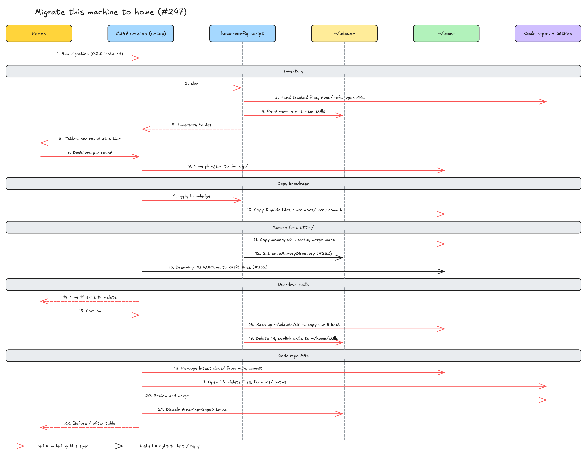
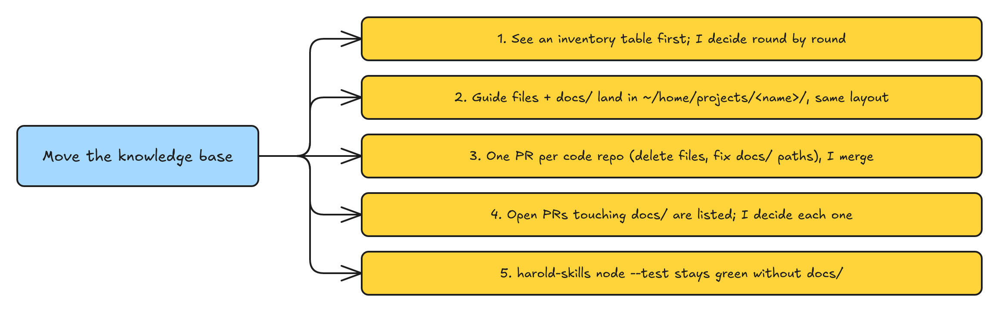
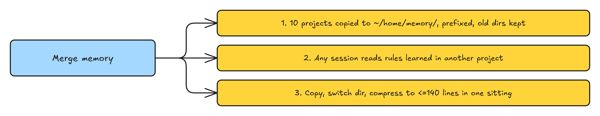
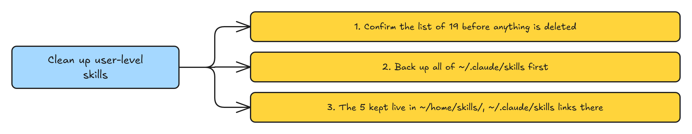

# 迁到 home：知识库、记忆、用户级 skill

> #247 存在：本机的知识库、记忆、用户级 skill 都还在 0.1.x 的老位置，#252 合并后 setup 只会建 home、不会搬；2026-11-16 在本机核，详情在「问题陈述」

> **2026-11-25 重核**（对着 `release/idea-loop-0.2.0` 0df934ff 和本机）：#252、#332、#333、#339、#280、#386、#420、#471、#490 都已合进集成分支，下面按合进去的版本改了这几处：home-config 脚本已是 Go 命令 `dyna home config`（四项 `plugin`、`memory`、`claude-md`、`rules`）；setup 已有「迁移」一节（只停下，步骤待补），正文 3969 字；代码仓库 `AGENTS.md` 的 `## idea-loop` 一块 #333 起不再写，搬时删掉；`EVAL.md` 留在代码仓库根（#420）；home 有私有远端 `guohaonan-shy/home`，`dyna home commit` 会推；对账改由设备级 `dreaming-home`，调度改由 `dispatch-home`。本机数字见各表的「11-25」列。

## 问题陈述

0.2.0 的方向已定（决定记录 `docs/raw/issue-workflow/2026-11-15-home-repo-grill.md` 末尾「本轮决议」）：一台设备一个私有仓库 home（`~/home`），知识库、记忆、各项目的引导文件都住进去，代码仓库是指针。#252 建好 home 本身，#332 管记忆怎么压，#333 让 skill 从 home 读；这一刀把本机已有的东西搬进去。下面的数字都是 2026-11-16 在本机查的。

### 1. 知识库和引导文件还在代码仓库里

| | Toeflair（私有，`~/projects/TOFEL-demo`） | harold-skills（公开，`~/projects/harold-skills`） |
|---|---|---|
| 根目录里 idea-loop 写的引导文件 | `CODING_STANDARDS.md`、`DEVELOPMENT.md`、`GLOSSARY.md`、`ISSUE_TRACKER.md`、`REVIEW.md`、`SEO.md` | `CODING_STANDARDS.md`、`DEVELOPMENT.md`、`GLOSSARY.md`、`ISSUE_TRACKER.md`、`PRODUCT.md`、`REVIEW.md` |
| `docs/` | git 跟踪 1595 个文件（748 份 md），167 MB；`docs/design/prod/` 的截图走 Git LFS（11-25：1725 个文件、175 MB，其中 LFS 370 个、约 79 MB） | git 跟踪 187 个文件（main 上），4.1 MB |
| 根目录里不归 idea-loop 的 | `EVAL.md`（ai-eval 的，#420 定留在代码仓库根） | — |
| 项目级启用 idea-loop | `.claude/settings.json`（提交在仓库里） | `.claude/settings.local.json`（本机文件，不进 git） |

搬的时候会碰到三样仓库自己的东西：

- **仓库自己的工具里写死了 `docs/` 路径**：Toeflair 的本地插件和 skill 里有 21 个文件指着 `docs/`，例如 `toeflair-growth` 插件的 `growth-weekly` 往 `docs/records/weekly/` 写周报、`qa` 插件的 `interview` 读 `docs/domain/interview.md`、`practice-producer` 插件读 `docs/adr/0008-practice-tag-taxonomy.md`。`docs/` 搬走后它们会读不到、或者在代码仓库里又建出一个 `docs/`。
- **harold-skills 有两个测试读本仓库的 `docs/`**：`decision-rules-who-decides-doc.test.mjs` 读 `docs/records/retro-candidates/`，`retro-candidate-verify-doc.test.mjs` 读 `docs/records/index.md`。`docs/` 删掉后 `node --test` 会红。
- **还开着、改了 `docs/` 的 PR**：Toeflair 现在 6 个开着的 PR 里 4 个改了 `docs/`（#977、#966、#784、#486；11-25 开着的是 #1165、#1143、#1077、#1051、#784、#486，哪些改了 `docs/` 在盘点那一步现查）。代码仓库删掉 `docs/` 后，它们合并时会把文件加回来，或者碰上「这边删了、那边改了」的冲突。harold-skills 11-16 没有开着的 PR；11-25 有 #451、#452、#478 等 0.2.0 收尾的 PR 开着、改了 `docs/`，同样进这张表。

### 2. 记忆分在 10 个项目目录里

自动记忆按 git 仓库分目录存在 `~/.claude/projects/<路径>/memory/`。本机有记忆的 10 个目录：

| 目录（`~/projects/` 下） | 文件数（含 `MEMORY.md`） | `MEMORY.md` 行数 |
|---|---|---|
| `TOFEL-demo`（Toeflair） | 205 | 149 |
| `content-creation` | 10 | 9 |
| `design-lib` | 10 | 9 |
| `content` | 9 | 8 |
| `harold-skills` | 9 | 8 |
| `scriben` | 6 | 7 |
| `videos-excalidrawer` | 6 | 5 |
| `takehome-voice-runtime` | 4 | 3 |
| `harold-personal` | 2 | 1 |
| `travel` | 2 | 1 |
| 合计 | 263 | 200 |

在 harold-skills 开的会话读不到 Toeflair 目录里的跨项目规矩，例如「操作主 checkout 用 `git -C`，不 `cd` 过去」。另有 145 个空的 `memory/` 目录（临时目录、回放用的假项目），不用搬。

10 份索引合起来正好 200 行（11-25：同样 10 个目录，260 条记忆、索引合计 207 行，Toeflair 一份 156 行）：顶到 Claude Code 每轮只加载 `MEMORY.md` 前 200 行的上限，也超过它要求的 140 行（决定记录 A4 实测：超限后再写会报错、会话停下问人）。

### 3. 用户级 skill 24 个，近 30 天只用过 1 个

`~/.claude/skills/` 下 24 个 skill，9 个是指向 `~/.agents/skills/` 的软链。近 30 天的会话转录里只有 `use-railway` 被调用过（4 个会话，决定记录 A10）。它们每个会话都占上下文里的 skill 清单。

### 4. 有了 home 也不会自己搬

#252 合并后，setup 会建 `~/home`、登记项目、起草项目地图（地图里的路径指向东西现在在哪）、改四处用户级配置（`dyna home config`）；它不复制文件、不碰记忆内容、不碰 `~/.claude/skills/`。#252 还特意让本机先不切记忆目录，等这一刀复制完记忆再切（`docs/raw/decisions/252.md` 题 2）。11-25 本机：`~/home` 已建、只登记了 harold-skills（`dyna home projects` 报 `not-moved`），Toeflair 还没登记；`autoMemoryDirectory` 没设，`rules` 三节还没写进 `~/home/AGENTS.md`。setup 的「迁移」一节认得出 0.1.x 的项目，但只停下，步骤「待补进这一节」。

### 根因

- 0.2.0 换了东西住在哪，但没有从老位置到新位置的搬家步骤：setup 只会建新的，不会搬旧的。
- 搬家牵涉代码仓库、`~/.claude/` 和 home 三处，其中删 `docs/`、删 skill 不能撤销，要有人确认和备份兜底。

## 方案

改完后：本机的两个项目在 home 里各有一个目录（`~/home/projects/tofelair/`、`~/home/projects/harold-skills/`），装着原来的引导文件和 `docs/`；代码仓库里这些文件删掉了，只剩自己的 `AGENTS.md`、`CLAUDE.md` 和自己的工具。全设备的记忆在 `~/home/memory/` 一份，索引压在 140 行内；用户级 skill 剩 5 个，住在 `~/home/skills/`。

决定搬什么、搬到哪的输入：每个代码仓库 git 跟踪的文件、`~/.claude/projects/*/memory/`、`~/.claude/skills/`，以及人在盘点表里每一轮的决定。

红色是这份 spec 新增的消息，虚线是返回。

### 什么时候跑

**0.2.0 装上后一次做完**（2026-11-16 人选的，见「实现决策」）：这一刀的 PR（setup 的搬家一节、脚本、测试）先合进 `release/idea-loop-0.2.0`；四个子 issue 都合完，`release/idea-loop-0.2.0` 合进 main，人把本机的 idea-loop 升到 0.2.0、在 Toeflair 主 checkout 跑过 #252 的 setup（建好 home、登记项目）之后，#247 的会话在本机一口气跑完下面五步。issue 等这五步跑完、两个代码仓库的删文件 PR 合并后才 done。

11-25 的排法（发 0.2.0-beta.1 当天）：#247 的 PR 合进集成分支 → 父会话把集成分支合进 main、发 beta.1 → 人把本机 idea-loop 升到 0.2.0-beta.1 → 这个会话照「迁移」一节在本机跑完五步。跑完的判据：在 harold-skills、Toeflair 的 worktree 里 `dyna issues show docs <号>` 不再报「这个项目还没搬进 home」，`dyna home projects` 两行都是 `inHome: true`。

**必须紧接着跑，没有中间状态**：#333 定了 0.2.0 的 skill 和脚本只认 home、不留回退（Harold 原话：「我在想能不能0.2.0上线的时候就把知识库迁移，省着我们自己还需要维护一个中间状态」）。一个项目还没搬，idea-loop 的 skill 和脚本在它里面会停下，让人先跑 `/idea-loop:setup` 迁移。所以 0.2.0 装上后，本机和公司虚拟机上已经在用 0.1.x 的每个项目都紧接着跑这一节；这期间本机的调度、分拣、dreaming 定时任务碰到没搬的项目都会停。判一个项目搬没搬，#333 只看 `~/home/projects/<名字>/docs/` 在不在，所以每个项目要一次搬完（第 2 步）。

### 五步

setup 已有的「迁移」一节把「待补」换成一行指针和完成条件，步骤放进参考文件 `references/migrate.md`（正文 3969 字，线 4500）。机械部分交给 `dyna home config`（扩展它，不新写命令，见「实现决策」）。迁移跑在 setup 的「home」一步之前的位置上：项目先登记，`config` 的 `memory` 项（切 `autoMemoryDirectory`）留到第 3 步复制完记忆再做，不在「home」一步里先切。每一步都是「出表 → 人看 → 先备份 → 执行」，跟 #252 改用户级配置一样。

1. **盘点**（只读）：照 aihero 文章的四类（共享、重复、仓库专属、安装来的），给每个已登记项目出一张盘点表：每份文件归哪类、去哪；另外三张小表——仓库自己工具里写死 `docs/` 的文件、还开着且改了 `docs/` 的 PR、要搬的记忆目录。人分轮定，定完的表存进 `~/home/.backup/<时间>/plan.json`。
2. **复制知识库**（一个项目一次搬完）：把每个项目 git 跟踪的 `docs/` 和 8 份引导文件（`DEVELOPMENT.md`、`REVIEW.md`、`CODING_STANDARDS.md`、`PRODUCT.md`、`ISSUE_TRACKER.md`、`GLOSSARY.md`、`DESIGN.md`、`SEO.md`，有几份搬几份）复制进 `~/home/projects/<名字>/`，相对位置不变（`docs/` 还叫 `docs/`）。同时改两处（#333 定的位置）：代码仓库 `AGENTS.md` 的「issue 分类」一节的条目挪进 home 里 `ISSUE_TRACKER.md` 的「分类 label」一节（两个项目现在这一节只有一句指向 `AGENTS.md` 的话，换成 setup 模板 `references/issue-tracker.md` 的那段说明加原来的条目和「保留的 label」一行，`dyna issues` 照这个格式读）；`ISSUE_TRACKER.md` 的「仓库」一节删掉（改从项目清单读）；「调度」一节照搬，起 `dispatch-home` 时它并进 `DISPATCH.md`（#386）。`docs/` 最后一个落位：先全部写进项目目录下的临时目录，引导文件就位后再把它改名成 `docs/`，中途失败就没有 `docs/`，#333 照旧当它没搬，重跑从头来。然后提交到 home，项目地图里的路径改成新位置。
3. **记忆**：照 #252 定下的顺序，同一次里做完：
   1. 10 个目录的记忆复制进 `~/home/memory/`，文件名加项目前缀，10 份索引合成一份 `MEMORY.md`；旧目录不删；
   2. 只切 `autoMemoryDirectory` 一项（`dyna home config apply --only memory`）；
   3. 跑一次 #332 的压缩（`idea-loop:dreaming` 的记忆一段，`dyna home memory check` 量），把 `MEMORY.md` 压到 140 行内。
   三小步之间不开别的会话。
4. **用户级 skill**：出一张 24 行的表（名字、留还是删、是不是软链、指向哪、近 30 天调用几次）给人确认；人确认后先把整个 `~/.claude/skills/` 备份进 `~/home/.backup/<时间>/skills/`，再把留下的 5 个复制进 `~/home/skills/`、删掉其余 19 个、把 `~/.claude/skills` 换成指向 `~/home/skills/` 的软链。
5. **代码仓库的 PR**：每个代码仓库开一个从它主分支切的 PR：删掉搬走的引导文件和 `docs/`，去掉项目级启用 idea-loop，把仓库自己工具里写死的 `docs/` 路径改成 home 里的路径，`AGENTS.md` 删掉已挪走的「issue 分类」一节和 idea-loop 写的 `## idea-loop` 一块（#333 起 setup 不再写它，`setup-new-project-doc.test.mjs` 守着）；harold-skills 的 PR 还要把两个读 `docs/` 的测试改成不依赖仓库的 `docs/`。人合。合之前对着主分支最新的 `docs/` 再复制一次（盖掉第 2 步之后进主分支的改动），提交到 home。

harold-skills 的 `.claude/settings.local.json` 不进 git，第 5 步直接改本机文件（先备份进 `~/home/.backup/<时间>/`），不在 PR 里。

搬完一个项目，停用本机给它建的 dreaming 定时任务（#332/#333：对账改由设备级 `dreaming-home` 做，setup「定时任务」表那一行建它）：本机现在有 `dreaming-tofel-demo`（每周一）和 `dreaming-harold-skills`（每周日）两个（2026-11-16、11-25 列定时任务都在、都启用）。只停用不删，交回里写上名字，删由人点。`dispatch-<仓库名>` 不用管：本机两个 11-25 已停用，起 `dispatch-home` 时调度自己停（#386）；`triage-<仓库名>`、`seo-scan-<仓库名>` 照旧是项目级的，不动。

### 同一行为的其他入口

- **全新项目第一次跑 setup**：没有老位置要搬，setup 直接把文件建在 home 里，归 #333，不进「迁到 home」这一节。排除。
- **同一台设备上 setup 再跑一次**：已经搬过的项目（`~/home/projects/<名字>/docs/` 在），盘点表里每行都是「已在 home」，什么都不做。纳入。
- **公司虚拟机**：上面已经在用 0.1.x 的项目，0.2.0 装上后同样紧接着跑这一节（每台设备一个 home）。纳入，但这一刀只在本机真跑和验证；虚拟机上由人跑，交回里写一句。
- **`~/.agents/skills/`**：用户级 skill 里 9 个软链指向这里，`~/.agents/skills/` 下还有 21 个目录，可能被别的工具读。排除：只动 `~/.claude/skills/`（决定记录 Q28、Q30 说的是它），`~/.agents/skills/` 不碰。
- **空的记忆目录、旧记忆目录**：排除：空的不搬；有记忆的旧目录复制后不删（决定记录 Q14）。

## User Stories

### 搬知识库

1. 作为人，我想要搬之前看到一张盘点表，每份文件归哪类、去哪，按轮由我定，以便搬什么我说了算
2. 作为人，我想要引导文件和 `docs/` 原样进 `~/home/projects/<名字>/`、相对位置不变，以便 `docs/` 里的相对链接和图都不断
3. 作为人，我想要每个代码仓库的删文件、去掉项目级启用、改仓库工具里 `docs/` 路径的改动开成一个 PR 由我合，以便代码仓库的改动我审过
4. 作为人，我想要盘点表列出还开着、改了 `docs/` 的 PR，每个由我定先合还是把它的 `docs/` 改动搬进 home，以便进行中的 spec 不丢
5. 作为 harold-skills 的维护者，我想要删掉 `docs/` 后 `node --test` 照样全过，以便仓库不因为搬家变红

### 合并记忆

1. 作为人，我想要 10 个项目的记忆复制进 `~/home/memory/`、文件名带项目前缀、旧目录不删，以便搬错了原件还在
2. 作为在任何一个项目开会话的 agent，我想要读得到在别的项目里学到的规矩，以便同一个纠正不用在每个项目各说一遍
3. 作为人，我想要复制、切目录、压到 140 行内在同一次里做完，以便没有一个会话读到超限的索引或读不到记忆

### 清理用户级 skill

1. 作为人，我想要删之前看到 19 个要删的 skill 的清单并确认，以便不误删
2. 作为人，我想要删之前整个 `~/.claude/skills/` 先备份，以便删错了能还原
3. 作为人，我想要留下的 5 个住进 `~/home/skills/`、`~/.claude/skills` 指过去，以便它们进 home 的 git 历史

### 在本机跑完

1. 作为人，我想要 0.2.0 装上后一次跑完五步，以便插件和文件位置同时换、中间没有空档
2. 作为人，我想要跑完拿到一张改前改后的对照，以便知道真的搬完了

## 实现决策

### 什么时候在本机跑：0.2.0 装上后一次做完

本机装的 idea-loop 是 0.1.14（11-25 是 0.1.45，`~/.claude/plugins/cache/harold-skills/idea-loop/0.1.45/`），它从代码仓库的 `docs/` 读写；调度开的会话也一直往 `docs/` 写。等 0.2.0 装上再搬，插件和文件位置同时换，复制和删除之间没有新内容进 `docs/`，只需第 5 步合并前再复制一次兜底。

依据：2026-11-16 摆了「0.2.0 装上后一次做完」和「#247 实现时就跑、harold-skills 删 `docs/` 跟 #247 的 PR 进 release」两个选项，人选前者（记在 `docs/raw/decisions/247.md` 题 1）。

### harold-skills 的公开历史不改写

删文件的 PR 只删当前版本，「变私有」从合并那天起算；旧提交、已合并 PR 的 diff 照旧公开。

依据：2026-11-16 摆了「不改写」和「用 git filter-repo 改写、强推」两个选项，人选前者（`docs/raw/decisions/247.md` 题 2）。GitHub 上已合并 PR 的 diff 改写历史也去不掉，改写还会让本机几十个 worktree 和 issue 里指向旧提交的链接失效。

### 扩展 `dyna home config`，不新写命令

#252 的 home-config 脚本在 #339 收成了 Go 命令 `dyna home config plan|apply [--only …]`（`dyna/internal/home/config.go`），已经是「出表 / 执行、执行前备份进 `~/home/.backup/<时间>/`、已是目标值的不重做」，四项 `plugin`、`memory`（切 `autoMemoryDirectory`）、`claude-md`、`rules`。这一刀给它加三项，都照这个模式；三项只在 `--only` 点名时做，不进不带 `--only` 的默认四项（全新项目跑 setup 时不出这三张表）：

| 新加的项 | 出表时列什么 | 执行做什么 |
|---|---|---|
| 知识库（每个已登记项目一项） | 每份 git 跟踪的文件、分到哪类、去哪；仓库工具里写死 `docs/` 的文件；还开着且改了 `docs/` 的 PR | 按人定过的盘点表复制进 `~/home/projects/<名字>/`，提交到 home |
| 记忆 | 每个有记忆的目录、项目前缀、文件数、索引行数 | 复制、合索引，提交到 home |
| 用户级 skill | 24 行：名字、留或删、是不是软链、指向哪、近 30 天调用次数 | 备份整个目录、复制留下的、删其余、换软链 |

新增和扩展的对比：新写一个 `dyna home migrate` 要新增一个命令、一套出表与备份逻辑和它的测试；扩展 `dyna home config` 只新增三项和它们的测试，出表、备份、幂等复用已有的。改了 dyna 就在集成分支当时的版本上升一档、存登记表、提 `dyna-version` 下限（11-25 是 0.0.15）。

开删文件的 PR（切分支、`git rm`、`gh pr create`）不进脚本，setup 照参考文件用 `git` 和 `gh` 做：它要在代码仓库的主 checkout 之外开 worktree，跟 setup 现有开 PR 的写法一样。

### 盘点的分类规则

照 aihero 文章的四类，按下面的顺序判，第一条成立就停；判不了的留空，由人在那一轮定：

| 情况 | 归类 | 去哪 |
|---|---|---|
| setup 模板写的引导文件（`DEVELOPMENT.md`、`REVIEW.md`、`CODING_STANDARDS.md`、`ISSUE_TRACKER.md`、`PRODUCT.md`）和 idea-loop 别处建的（`GLOSSARY.md`、`DESIGN.md`、`SEO.md`） | 安装来的 | `~/home/projects/<名字>/` |
| `docs/` 下 git 跟踪的文件 | 仓库专属的知识 | `~/home/projects/<名字>/docs/` |
| 仓库自己的 `AGENTS.md`、`CLAUDE.md`、`README*`、`.claude/` 下的 hook、本地插件和 skill | 仓库专属的工具 | 留在代码仓库 |
| 两个项目里内容一样的文件 | 重复 | 由人定放 home 顶层还是各留一份 |
| `EVAL.md`（ai-eval 的） | 仓库专属的工具 | 留在代码仓库（#420） |
| 其余根目录文件 | 判不了 | 人定 |

只复制 git 跟踪的文件：`docs/design/tmp/` 这类被 `.gitignore` 忽略的不搬。Toeflair 的 `.gitattributes` 里 `docs/design/prod/` 走 LFS 的三条规则，加上 `projects/tofelair/` 前缀写进 home 的 `.gitattributes`（home 推到私有远端，LFS 对象约 79 MB 跟着推上去）；`.gitignore` 里指 `docs/` 的几条同样处理。

依据：决定记录 Q3「代码仓库只留自己的 `AGENTS.md` / `CLAUDE.md` 和自己的工具」、Q14「照文章四类盘点，人分轮定方案表」。

### 项目目录里的布局照 #333（已合）

`~/home/projects/<名字>/` 下保持代码仓库里的相对位置：8 份引导文件在这一层，`docs/` 还叫 `docs/`，所以 `docs/` 里的相对链接和图片路径不用改。项目地图 `~/home/projects/<名字>/AGENTS.md`（#252）跟它们并排，不冲突：代码仓库自己的 `AGENTS.md` 不搬。

#333 定下、这一刀照做的（#333 的 spec `skills-read-home`，已合进集成分支）：

- 判一个项目搬没搬只看 `~/home/projects/<名字>/docs/` 在不在，所以 `docs/` 最后落位（第 2 步），一个项目不能先搬一半。
- 代码仓库 `AGENTS.md` 的「issue 分类」一节挪进 `ISSUE_TRACKER.md` 的「分类 label」一节；`ISSUE_TRACKER.md` 的「仓库」一节删掉；`AGENTS.md` 里 idea-loop 写的 `## idea-loop` 一块删掉（合进去的 #333 不再写这一块，也没有新模板）。
- 插件只认 home、不留回退：没搬的项目里 skill 和脚本停下让人跑 setup，所以 0.2.0 装上后紧接着跑。
- 全新项目由 setup 直接建在 home 里，归 #333；这一刀只管已经在用 0.1.x 的项目。

### 仓库自己的工具里写死的 `docs/` 路径改成 home 的路径

Toeflair 的 21 个文件（本地插件 `toeflair-growth`、`practice-producer`、`qa`、`content-creator`，skill `announcement`、`blog-publisher`）在第 5 步的 PR 里改成 `~/home/projects/tofelair/docs/...`。只改指向本仓库 `docs/` 的；指向外部网站的（如 `reui`、`seo-geo-check` 里的 `docs/registry`、`docs/appearance/...`，是第三方文档的网址路径）不动。工具留在代码仓库，只是改读写的位置，依据同上一条 Q3。

### 还开着、改了 `docs/` 的 PR

盘点表列出来，人在那一轮逐个定：「先合，再跑第 5 步的再复制」，或「把它的 `docs/` 改动搬进 home，PR 里删掉这些改动」。第 5 步的 PR 等这张表里每个都处理完才开。

### 记忆的前缀与索引

- 前缀：目录对应的仓库的 `origin` 对上项目清单里某一行，用那一行的名字（`TOFEL-demo` → `tofelair`）；对不上的，用目录名最后一段转小写（`content-creation`）。文件名写成 `<前缀>--<原文件名>`。`MEMORY.md` 里的链接一起改。
- 合并的索引：每个项目一节（`## <前缀>`），节内保留原来的行和顺序。合出来正好 200 行左右，所以紧接着就切目录、压缩（第 3 步）。
- 不覆盖：`~/home/memory/` 里已有同名文件就停下报出来，不覆盖。

### 用户级 skill：留 5 删 19

- 留：`refero-design`、`pricing-strategy`、`cloudflare`、`wrangler`、`use-railway`。其中三个（`refero-design`、`pricing-strategy`、`use-railway`）是指向 `~/.agents/skills/` 的软链，复制进 `~/home/skills/` 时复制它指向的内容，home 里存实体：home 的 git 历史里要有它们。
- 删：gstack 一组 11 个（`autoplan`、`browse`、`connect-chrome`、`design-consultation`、`document-generate`、`gstack`、`gstack-upgrade`、`landing-report`、`learn`、`office-hours`、`setup-browser-cookies`），以及 `find-skills`、`prompt-engineering-patterns`、`frontend-design`、`ui-ux-pro-max`、`chrome-devtools`、`ui-ux-designer`、`video-bg-section`、`synced`。删的是 `~/.claude/skills/` 下的目录或软链本身；软链指向的 `~/.agents/skills/` 下的内容不动。
- **删除前必须把清单给 Harold 确认**：出表那一步摆出 19 行，人说「删」才执行；表里的清单在真跑那天重新生成（本机这段时间可能装了新的），跟上面的名单对不上的行标出来由人定。

依据：决定记录 Q28、Q30，「删前再确认清单」。

### 实现时在本机真的搬、真的删

这一刀不只是写代码：五步要在本机真跑，算进完成标准。删 `docs/`、删用户级 skill 不能撤销，所以每一步执行前出表给 Harold，确认后才做；用户级 skill 的删除清单单独确认一次。

### 版本号

插件不改版本号：#252 已把 idea-loop 升到 0.2.0，发 beta 时由父会话写 0.2.0-beta.1。dyna 改了就升一档（见上面「扩展 `dyna home config`」）。

### 已知限制

- harold-skills 的旧 `docs/` 在公开历史里一直看得到（上面「公开历史不改写」）。
- 0.2.0 装上到每个项目搬完之间，本机的调度、分拣、dreaming 定时任务碰到没搬的项目会停下（#333 只认 home）：所以五步紧接着跑完，不隔夜。
- 第 3 步合出来的索引在压缩完成前会顶到 200 行：三小步之间不开别的会话，压缩失败就把 `autoMemoryDirectory` 改回去（备份里有原值），记忆原件都还在旧目录。

## 杠杆诊断

改给 agent 读的文档只有 setup 的两处（2026-11-25 review 第 1 轮补写）：

1. setup 正文「迁移」一节：「待补」换成一行指向迁移参考的指针和完成条件（渐进披露：只有 0.1.x 项目走得到的步骤放进参考文件）。验证：检查——`setup-migrate-doc.test.mjs` 先对改前的 setup 见红、改后转绿。
2. 新的迁移参考：六步，每步「出表 → 人看 → 先备份 → 执行」，每步以可检查的完成条件收尾；`memory` 项在记忆复制完才切；删 skill 的清单单独再确认一次。验证：检查——同一份文档测试逐条核这几句在、顺序对；本机真迁移那一次（「在本机跑完」）补它在真会话里走不走得通。

## 测试决策

| 变的是什么 | 仪器 | 本次 |
|---|---|---|
| 纯逻辑、数据转换、状态机 | TDD 单元测试 | 碰到：`dyna home config` 的三项新出表与执行（分类规则、前缀与索引合并、只复制 git 跟踪的文件、LFS 规则加前缀、同名不覆盖、skill 备份后只删确认过的、软链指向、第二次执行不重做） |
| API 契约（路由、schema、序列化） | TDD API 测试 | 碰到：定过的盘点表 `plan.json` 的形状，`dyna home config` 执行时读它 |
| DB schema、迁移、并发与事务语义 | 真 DB 测试 | 不涉及 |
| LLM 输出质量（prompt 改动） | eval（确定性断言） | 见下面「杠杆诊断」各处的验证 |
| 视觉正确性 | UI 实现环 | 不涉及 |
| 端到端用户流程 | 浏览器端到端测试 | 不涉及；改由本机真跑一次（下面「在本机跑完」） |

- **seam**：
  - `dyna home config` 的命令行（扩三项）：在临时 `HOME` 下放假的代码仓库（带 git 跟踪和被忽略的 `docs/` 文件、`.gitattributes`）、假的 `~/.claude/projects/*/memory/`、假的 `~/.claude/skills/`（含软链），跑出表和执行。抓得到：分类、复制范围、前缀、索引、备份、删除范围、软链、幂等。漏掉：真机上 Claude Code 是不是从新目录读记忆、skill——由「在本机跑完」补。
  - setup 的文档测试：「迁到 home」一节在参考文件里、SKILL.md 主体只有一行指针、写明删除前出清单等人确认。
- **增量功能测试**：
  - 搬知识库 1、2：前置——临时 home 登记了 `example-app`，它的仓库根有 `DEVELOPMENT.md`、`EVAL.md`，`docs/` 下两个跟踪的文件和一个被忽略的文件，`.gitattributes` 有一条 `docs/design/prod/**` 的 LFS 规则。步骤——出表，再按表执行。期望——出表不写文件、`EVAL.md` 一行归类为空；执行后 `projects/example-app/` 下有 `DEVELOPMENT.md` 和两个跟踪的文件、没有被忽略的那个，home 的 `.gitattributes` 有加了前缀的规则，home 多了一个提交。覆盖：搬知识库 1、2。
  - 搬知识库 2（一次搬完）：前置——同上，再让复制 `docs/` 的第二个文件时失败。步骤——执行知识库项，再执行一次。期望——第一次失败后 `projects/example-app/docs/` 不存在；第二次执行后它在、文件齐全。另一个前置：仓库 `AGENTS.md` 有「issue 分类」一节、`ISSUE_TRACKER.md` 有「仓库」一节；执行后 home 里 `ISSUE_TRACKER.md` 的「分类 label」一节是原「issue 分类」的内容，「仓库」一节没了。覆盖：搬知识库 2。
  - 搬知识库 3、4：前置——假仓库里一个本地 skill 写着 `docs/records/weekly/`、一个写着外部网址 `https://example.com/docs/registry`；假 `gh` 返回一个改了 `docs/` 的开着的 PR。步骤——出表。期望——第一个进「写死 `docs/` 的文件」表，第二个不进；PR 进「开着的 PR」表。覆盖：搬知识库 3、4。
  - 合并记忆 1：前置——两个假记忆目录，各有 `MEMORY.md` 和一条记忆，其中一个的仓库 `origin` 对上项目清单。步骤——执行记忆项两次。期望——`~/home/memory/` 下两条带前缀的文件、一份分两节的 `MEMORY.md`、链接指向带前缀的文件名；旧目录原样；第二次什么都不改。覆盖：合并记忆 1。
  - 清理用户级 skill 1、2、3：前置——假 `~/.claude/skills/` 有一个留下的软链、一个留下的目录、两个要删的。步骤——出表，执行时只给一个要删的确认。期望——出表四行、标出软链指向；执行后备份里四个都在、留下的两个在 `~/home/skills/` 且是实体、确认过的那个删了、没确认的那个还在并报出来、`~/.claude/skills` 是指向 `~/home/skills/` 的软链。覆盖：清理用户级 skill 1、2、3。
  - 搬知识库 5：在 harold-skills 删掉 `docs/` 的分支上跑 `node --test`。期望——全过。覆盖：搬知识库 5。
  - 在本机跑完 1、2（完成标准，在本机做一次）：前置——0.2.0 已装上，Toeflair 主 checkout 跑过 #252 的 setup。步骤——跑完五步；然后在 harold-skills 的一个 worktree 里开一个全新的 `claude -p` 会话，问「操作主 checkout 时 git 命令怎么跑」。期望——改前改后对照表：两个项目搬进 home 的文件数等于代码仓库里 git 跟踪的数（Toeflair 的 `docs/` 1595 个以真跑那天为准）、`~/home/memory/` 的记忆条数等于 10 个目录之和（今天 253 条，不含索引）、`MEMORY.md` ≤140 行、`~/.claude/skills` 下 5 个、两个删文件的 PR 已开、`dreaming-tofel-demo` 和 `dreaming-harold-skills` 两个定时任务已停用；`claude -p` 的回答用到 Toeflair 那条「用 `git -C`」的记忆。对照表贴进 PR 描述并评论到 #331。覆盖：在本机跑完 1、2，合并记忆 2、3。
- **照着谁写**：`dyna home config` 的新三项照 `dyna/internal/home/config_test.go`（临时 `HOME`）；在临时目录里建 git 仓库、假 `gh` 照 `dyna/internal/home/commit_test.go` 与 `dyna/internal/issues` 的测试；setup 的文档测试照 `idea-loop/scripts/setup-new-project-doc.test.mjs`。

## Out of scope

- 记忆怎么压到 140 行内、项目事实怎么下沉到项目知识库（#332）；这一刀只调用它。
- skill、agent、脚本改从 home 读知识库和引导文件，dreaming 生成和维护两份地图（#333）；这一刀照它定的位置搬。
- 建 home、登记项目、改三处用户级配置（#252）。
- 改写 harold-skills 的 git 历史（人定了不改写）。
- 会话转录（`~/.claude/projects/*/*.jsonl`）：决定记录 Q8，这次不纳入。

## 关联

- raw：[[2026-11-15-home-repo-grill]]（全部决议，迁移相关是 Q3、Q13、Q14、Q28、Q30）；这次 triage 的两道题记在 `docs/raw/decisions/247.md`。
- [[home-bootstrap]]（#252，已合）：`dyna home config`、项目清单、`~/home/.backup/` 都用它的；它定了记忆目录在这一刀的同一次里切。
- #332（记忆整台设备一份，已合）：第 3 步的压缩用它的。
- #333（skill 从 home 读，已合）：只认 home、判搬没搬的标准、8 份引导文件、「issue 分类」挪进 `ISSUE_TRACKER.md`、取消各项目的 dreaming 任务，都照它定的；它先合。
- 父 issue #331：四个子 issue 全合进 `release/idea-loop-0.2.0`、合进 main、本机装上 0.2.0 之后，这一刀才在本机真跑，所以 #247 是最后一个 done 的子 issue。
- 旧 spec `upgrade-from-0-1`（只在分支 `backup/247-migration-spec` 上，没进过 main）：它迁的是 0.1.x 的状态 label、spec 的 `status`、整合出来的组，这些 0.1.x 的 `issues.mjs migrate` 已经做了（#247 2026-11-13 的分拣评论）；它的「先出计划表、人确认再一步一步做、改动有备份」沿用在这里，其余不再适用，不并进来。
- #298、#291：走 main，不在 0.2.0。它们若在本机真跑之前合进 main、改了 harold-skills 的 `docs/`，第 5 步的再复制会带上。
