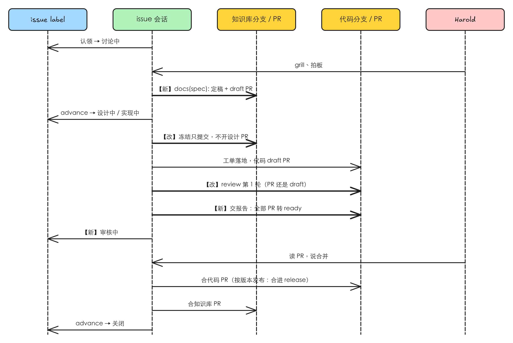
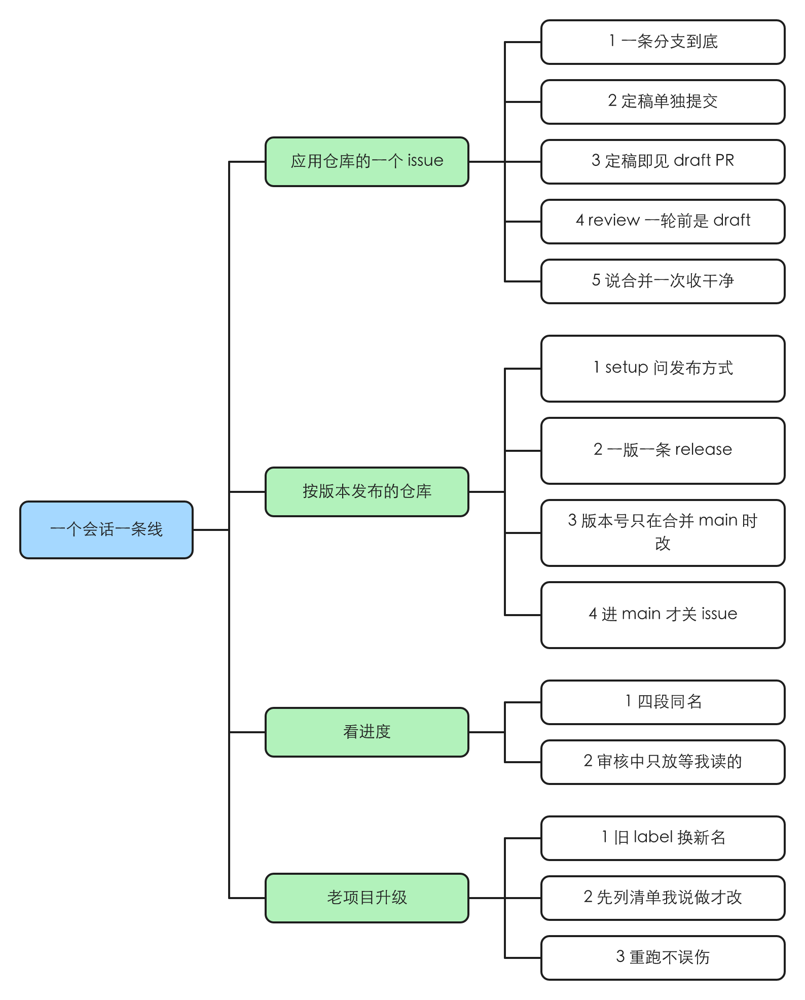

# 一个会话一条线：spec、设计、实现不再各开 PR，阶段按人看到的四段走

> #232 存在：2026-11-03 对着 release/idea-loop-0.2.0（861c5ee，F5 已合入）核过，issue 会话的三段各在知识库开一个 PR 先合进主分支（spec 一个、设计冻结一个、实现时再一个知识库 PR 加代码 PR），issue 的 label 有 7 种、名字跟人说的阶段对不上，详情在「问题陈述」

这是 idea-loop 0.2.0 的 F2（release 计划 [[idea-loop-0-2-0-release]]）。决定全部出自 [[2026-11-03-idea-loop-0-2-0-grill]] 的「本轮决议」表（「通用流程」「发布方式写哪」「spec」「阶段」四行），本 spec 不重开。知识库已经是单独的仓库（F5，[[knowledge-base-repo]]），下文的 spec、工单、设计产物都在知识库里，代码在代码仓库里。

## 问题陈述

2026-11-03 在 `feature/one-session-one-line`（从 release/idea-loop-0.2.0 861c5ee 切出）里读 skill 与脚本、查 harold-skills 的 GitHub label 得到。

### 1. 一个 issue 要开三到四个 PR，人要在主分支上一段一段放行

`idea-loop:issue-session` 的阶段表写着三段各自「做完的标志」：审核段「spec 经知识库的 PR 合进知识库的主分支」，设计段「冻结结果经设计的知识库 PR 合进知识库的主分支」，实现段「实现的 PR 全部合并」。`idea-loop:issue-verify` 的「合进主分支」、`idea-loop:to-spec` 的 `land-on-main.md`、`idea-loop:uiux-refine` 冻结后的「设计 PR」三处各自 `gh pr create` 再 `gh pr merge`。每段换阶段前还要 `git fetch` 最新主分支、切一条新分支（`spec/issue-<号>` → `design/<slug>` → `impl/<slug>`）。

例子：#220 的会话把 spec 单独开成 PR #224（`docs(spec): 起草 issue-intake-priority（#220 #217）`，只改 `docs/`），实现还得再开。人的原话（2026-11-03，#232）：「docs，design 不要单独开pr，一个会话从spec、design、implement 都是一个pr。」grill 时核过：本仓库最近合并的 60 个 PR 里 40 个是 `docs(...)`。

本该：一个会话从头到尾一条分支；spec、设计、实现在同一条线上，最后一起合并；人拍板 spec 的那一刻留成一次单独的提交。

### 2. 发布方式只有一种：每个 PR 直接进主分支

`DEVELOPMENT.md` 的「分支」节只有「基准分支」「合并方式」两行（`idea-loop/skills/engineering/setup/references/development.md`）。本仓库这种按版本发插件的项目，一组改动要攒成一个版本再上主分支、在那次合并里改版本号；idea-loop 没有地方写这一点，0.2.0 这一组是 #220 的会话手工排的（release 分支、feature PR 合进它）。

本该：`DEVELOPMENT.md` 说清这个仓库按版本发布还是一个会话一个 PR，setup 问清写入，会话照它走。

### 3. issue 的状态名跟人说的阶段对不上

`issues.mjs` 的 `STATES` 有 7 个 label：验证中、审核中、待设计、设计中、待实现、实现中、搁置；侧边栏 section 只有三个：审核中、设计中、实现中。「审核中」现在指「spec 里有要人定的、在 grill」，人说的「审核中」是「PR 开出来了、等我读」。「待设计」「待实现」是对账按主分支上的 spec 挂的，spec 不先合进主分支以后就没有东西能挂它们。

本该：label 和 section 都是人说的四段：讨论中 → 设计中 → 实现中 → 审核中（人的原话，grill U3 Q9：「我倾向于按照项目状态，讨论中、设计中、实现中、审核中重新调整section/workspace group」）。

### 根因

- 问题 1、3：「待」字头的状态和「先合进主分支」是同一个设计的两面：让调度只看主分支就能把下一段交给任何会话。一个会话陪到底以后，这个交接点不再需要，两样都可以去掉。
- 问题 2：「分支」节没有「发布方式」这一行，会话只会照「一个 PR 进主分支」走。

## 方案



改完 Harold 得到：

- **一个会话一条分支、一组 PR。** issue 会话开场就在自己的分支上（代码仓库的会话 worktree，知识库里同名的分支，F5 的 `root --write`），讨论、设计、实现都提交在这条线上，中途不开 PR 合进主分支。代码 PR 和知识库 PR 都从开出那一刻起是 draft，review 跑过一轮才转 ready。
- **spec 定稿是一次单独的提交。** 讨论定完，spec 翻「正式」，提交 `docs(spec): <slug> 定稿`，推送并开出知识库的 draft PR。人在 GitHub 上随时能读到定稿的 spec；之后 spec 再改，各自是后来的提交，定稿那一刻看那一次提交就行。
- **四段阶段。** issue 的 `status:*` label 和侧边栏 section 都叫：讨论中、设计中、实现中、审核中。「审核中」是 PR 已经开出、review 跑过一轮、等人读。
- **两种发布方式**，写在 `DEVELOPMENT.md` 的「分支」节，setup 问清写入：
  - **应用**：一个会话一条线，代码 PR 进主分支，人说合并就合。
  - **按版本发布**：一个会话对应一个版本、一条 `release/` 分支；版本里每个 feature 一份 spec、一条 `feature/<slug>` 分支、一个 PR，base 是 release 分支；全部 feature 合进 release 后，会话把 release 合进主分支，版本号只在这次合并里改。
- **老项目升级后重跑 setup**，它把已有的 label 换成新名字、把侧边栏的「审核中」section 改名「讨论中」。

### 阶段与谁翻

| 阶段 | label / section | 进入时 | 这一段做完的标志 |
|---|---|---|---|
| 讨论 | 讨论中 | 会话开场认领（`issues set 讨论中`） | spec 定稿提交、知识库 draft PR 开出 |
| 设计 | 设计中 | 定稿的 spec 碰 UI（`issues advance`） | 冻结结果提交在知识库的分支上 |
| 实现 | 实现中 | 定稿的 spec 不碰 UI，或冻结已提交（`issues advance`） | 工单全部落地、review 跑过一轮 |
| 审核 | 审核中 | 交审核报告时 PR 转 ready（`issues set 审核中`） | 人说合并，这一条线的 PR 全部合并 |

合并之后 `issues advance` 关掉 issue（spec 完成，或验证为不存在）。「搁置」照旧。覆盖的 issue 全都不存在的 spec，定稿后知识库 PR 是这条线唯一的 PR：会话照 F5 的「知识库 PR」直接合（不 review），issue 关成 not planned。

### 两种发布方式怎么走

`DEVELOPMENT.md` 的「分支」节：

```markdown
## 分支

- 基准分支：`main`
- 合并方式：`merge`
- 发布方式：按版本发布
- 版本号：`idea-loop`：`idea-loop/.claude-plugin/plugin.json`
```

`发布方式` 取「应用」或「按版本发布」；「按版本发布」的再写「版本号」：每个独立发版的单元一行，写单元名和存版本号的文件（只有一个单元的写一行文件路径）。

**应用**（例：一个网站仓库修一个页面的 bug）：

1. 会话开在从主分支开出的 worktree 里，分支 `issue/<根号>`；知识库的同名分支由 `knowledge-base.mjs root --write` 开。
2. 讨论 → 定稿提交 → 知识库 draft PR（base 知识库主分支）。
3. 设计（碰 UI 时）：冻结结果提交在知识库分支上。
4. 实现：implement 开代码 draft PR（base 主分支），工单落地，pr-review 跑第一轮；交审核报告时代码 PR、知识库 PR 一起转 ready，issue 进审核中。
5. 人说合并：代码 PR 照 `合并方式` 合，知识库 PR 随后由会话 squash 合（F5 的「知识库 PR」）；`issues advance` 关 issue。

**按版本发布**（例：本仓库的 idea-loop 0.2.0，release 计划 [[idea-loop-0-2-0-release]]）：

1. 版本会话（一组 issue 的会话）讨论出这一版有哪些 feature、版本号多少，版本号由人定；从主分支切出 `release/<单元>-<版本>`（只有一个单元的写 `release/<版本>`），计划写进知识库 `docs/records/releases/<单元>-<版本>-release.md`。
2. 每个 feature：一份 spec，分支 `feature/<slug>` 从 release 分支切出，走上面应用的第 2–4 步，只是代码 PR 的 base 是 release 分支。feature 可以由版本会话开出的 feature 会话做（0.2.0 就是这样），也可以在版本会话里一个一个做；会话怎么开归 F4（`idea-loop:workspace`）。feature 会话做到审核中就停。
3. 人说合并某个 feature：版本会话把它的代码 PR 合进 release 分支。它的知识库 PR 先不合，issue 留在审核中。
4. 全部 feature 合进 release：版本会话开 release → 主分支的 PR，在合并提交里把「版本号」那一行的文件改成新版本，人说合并就合；然后把各 feature 的知识库 PR 依次合进知识库主分支，对每份 spec 跑 `issues advance` 关 issue。
5. release 分支落后主分支时，版本会话把主分支合进 release，feature 分支再从 release 同步。

### 同一行为的其他入口

| 入口 | 纳入 / 排除 |
|---|---|
| `idea-loop:issue-session`、`issue-verify`、`to-spec`、`uiux-refine`、`implement`、`pr-review` 的开 PR 与合并 | 纳入：本 spec 改的就是它们 |
| `issues.mjs` 的状态、翻法、`reconcile`、`advance`、`resume`、`queue` | 纳入：状态换名、删「待」字头、加 `migrate`；`queue` 只服务「待」字头，删掉 |
| `idea-loop:issue-dispatch` 里提到阶段名的地方（section 名、「没有会话的 issue」那一列状态） | 纳入，只换名字；出哪些 issue、名额怎么算归 F1 |
| `idea-loop:setup`：「分支」节、`ISSUE_TRACKER.md` 里 label 的说明、老项目迁移 | 纳入 |
| `spec-status.mjs` 与 spec 的五个状态（草稿、审核中、正式、实现中、完成） | 排除：spec 的状态说文档成熟度，没在决议里改；spec 的「审核中」与 issue 的「审核中」同名不同义，见「Out of scope」 |
| `seo-issues.mjs`、dreaming、retro 里只是提到状态名的句子 | 纳入，只换名字 |
| 开会话、侧边栏与 cmux workspace group 的分组 | 排除：归 F4；本 spec 只定 section 叫什么 |

## User Stories



### 场景：应用仓库的一个 issue

1. 作为 Harold，我想要一个 issue 会话从讨论到合并只在一条分支上，以便不用一段一段放行只改 docs 的 PR
2. 作为 Harold，我想要 spec 定稿时单独提交一次、状态翻正式，以便日后能指出我拍板时 spec 的样子
3. 作为 Harold，我想要定稿后就在 GitHub 上看到一个 draft PR，以便不在会话里也能读到 spec
4. 作为 Harold，我想要 PR 在 review 跑完一轮之前一直是 draft，以便 ready 的 PR 都是该我读的
5. 作为 Harold，我想要我说合并时，代码 PR 和知识库 PR 都合掉、issue 关掉，以便一条线一次收干净

### 场景：按版本发布的仓库

1. 作为 Harold，我想要 setup 问我这个仓库按版本发布还是一个会话一个 PR，并写进 `DEVELOPMENT.md`，以便会话照对的方式开分支
2. 作为 Harold，我想要一个版本一条 release 分支，每个 feature 的 spec 和实现在同一个 feature PR 里、合进 release，以便一个版本的改动攒在一起上线
3. 作为 Harold，我想要版本号只在 release 合进主分支的那次合并里改，以便 feature PR 互相不冲突在版本号上
4. 作为 Harold，我想要 feature 合进 release 之后 issue 还留着，release 合进主分支才关，以便 issue 关掉时改动真的到了主分支

### 场景：看进度

1. 作为 Harold，我想要 issue 的 label 和侧边栏 section 都叫讨论中、设计中、实现中、审核中，以便一眼知道每个会话在哪一段
2. 作为 Harold，我想要「审核中」只放 PR 已开出、review 过一轮、等我读的，以便知道哪些在等我

### 场景：老项目升级

1. 作为 Harold，我想要升级插件后重跑 setup，它把旧 label 换成新名字，以便不用一个个手改
2. 作为 Harold，我想要迁移先列出每个 issue 要从什么换成什么，我说做才改 GitHub，以便改错能在动手前拦下
3. 作为 Harold，我想要迁移跑两次不会把新的「审核中」又改成「讨论中」，以便中途失败可以放心重跑

## 实现决策

### 状态与翻法

open 的 issue 只有这几种：待验证（没有 `status:*`）、讨论中、设计中、实现中、审核中、搁置。

| 从 | `issues set` 能翻成 | `issues advance` 翻成 |
|---|---|---|
| 待验证 | 讨论中、搁置 | |
| 讨论中 | 待验证、搁置 | 设计中、实现中、关闭（照会话分支上的 spec） |
| 设计中 | 搁置 | 实现中（冻结已提交）、关闭 |
| 实现中 | 审核中、搁置 | 关闭 |
| 审核中 | 实现中、搁置 | 关闭 |
| 搁置 | （走 `resume`） | |

- `advance` 读传进去的 `<docs>`：会话里就是 `knowledge-base.mjs root` 给的会话分支（`.tmp/kb/`），不要求先合进主分支。spec「正式」碰 UI 没冻结 → 设计中；「正式」已冻结或「实现中」→ 实现中，但 issue 已经是审核中的留在审核中；「完成」或结论「不存在」→ 关闭。依据：决定记录 A1「`issues advance` 读传进去的那份 `docs/`，不写死 main」；关闭只在合并之后跑，由 pr-review 的合并流程保证（它在全部 PR 合并后才调 `advance`）。
- 审核中 → 实现中：人读报告后要回工单重做一大块时由会话翻回（PR 转回 draft）；平常的批示修复在审核中里做完，不翻。
- `reconcile` 只做主分支（知识库主分支）能定的事：spec「完成」或结论「不存在」的关掉，根跟着子 issue。不再挂任何状态，也不再报「中」字头却没有主分支上的 spec 列着它（现在这是常态：spec 在会话分支上）。
- `resume`：搁置的 issue 按知识库主分支上的 spec 关掉，主分支上有「正式」「实现中」的 spec 列着它（只有老流程留下的）就回设计中 / 实现中，都没有就回待验证。
- `handoff` 照旧只认待验证、讨论中。`open` 开出的 spec issue 当场挂讨论中：开它的对话就是它的会话（以前要等 spec 合进主分支由对账挂）。
- 删 `queue` 子命令；`STAGE_SECTIONS` 是四个：讨论中、设计中、实现中、审核中。

依据：决议「阶段」行（U3 Q9、U5 Q15）；「待」字头被删是因为它只能由主分支上的 spec 挂，决议「spec」行让 spec 不先进主分支。

### 会话的分支与 PR

- 应用：issue 会话开场的 worktree 分支叫 `issue/<根号>`，整条线不换分支；知识库那边用同名分支（F5 的 `root --write`）。issue-verify 不再改名成 `spec/issue-<号>`，换阶段不再 `git fetch` + 切新分支。
- 按版本发布：版本会话的分支是 `release/<单元>-<版本>`；feature 的是 `feature/<slug>`，从 release 分支切出。依据：决定记录「发布」行与 release 计划「分支怎么走」节（现存实例）。
- spec 定稿：`spec-status set 正式`（覆盖的 issue 全不存在的翻「完成」），只提交这份 spec 的目录、`docs/spec/index.md`、这次写的 raw，提交信息 `docs(spec): <slug> 定稿`；推送，知识库还没有这条线的 PR 就 `gh pr create --draft`。依据：决议「spec」行（U2 Q4、U7 Q25、U9）。
- 设计冻结：uiux-refine 照旧在知识库里提交冻结结果（`docs(design): <slug> 冻结`），推送，不开设计 PR、不合并。
- implement：代码 PR 照旧 `--draft` 开；知识库已有这条线的 draft PR 就用它，不另开。全部落地后**不转 ready**，直接调 pr-review 跑第一轮。
- pr-review：前提从「PR 是 open（draft 说明没落地完）」改成「工单全部落地；PR 可以是 draft」；交审核报告时把这条线的每个 PR `gh pr ready`，再 `issues set 审核中`。人在报告之后要修的，照旧在 ready 的 PR 上修。
- 合并：应用照旧；按版本发布时 feature 代码 PR 的 base 是 release，合进 release 后不跑 `advance`，等 release 合进主分支。
- 版本号：只有 release → 主分支那次合并改，在合并提交里改「版本号」那一行写的文件。feature PR 不碰版本号。

### release 分支上的知识库

按版本发布时，feature 的知识库 PR 照旧开在知识库主分支上（`root --write` 从知识库默认分支开同名分支，不用改），release 合进主分支之后才由版本会话合。依据：决定记录 U22「知识库PR不用review 直接合并即可」与 F5 的「人说合并最后一个代码 PR 后由会话合」：按版本发布时最后一个代码 PR 就是 release → 主分支。知识库不设 release 分支：它没有版本号，也没有人从它装插件。

### 版本会话的根 issue：一组多份 spec

按版本发布时一组 issue 是一个版本，每个 feature 一份 spec，根下的子 issue 分在几份 spec 里（0.2.0：#220 下 F1–F6 各一份）。`reconcile` / `advance` 遇到子 issue 分在两份以上 spec 里的根，不再报「分组和 spec 对不上」，根不动，留在版本会话认领时的讨论中；子 issue 全部关掉时根照旧随着关闭。只有一份 spec、却有子 issue 不在里面的，照旧报（应用仓库里那是分组错了；版本会话里第二份 spec 还没写出来时也会报，是过渡期的提示，不改动任何东西）。依据：决议「通用流程」行「一个会话一个版本」与 release 计划的 feature 表（现存实例）。

### `发布方式` 写在哪、谁写

`DEVELOPMENT.md` 的「分支」节加「发布方式」，按版本发布的再加「版本号」。setup 问：推荐值看仓库里有没有带 `version` 的清单文件（`package.json`、`plugin.json` 等）且最近的合并里有改它的提交，有就推荐按版本发布，否则应用。依据：决议「发布方式写哪」行（U3 Q7）。读它的是 issue-session（开分支）、pr-review（合并、改版本号）。

### 老项目的 label 迁移

新子命令 `issues migrate <docs> [--apply]`：

- 判断是不是老 label：仓库里还有 `status:验证中`、`status:待设计`、`status:待实现` 中任何一个 label，就是没迁过；一个都没有就输出「已经是新阶段名」，什么也不做。这样迁完再跑，新的「审核中」不会被当成老的。
- 对每个 open 的 issue：验证中、审核中（老意思：spec 在 grill）→ 讨论中；待设计 → 设计中；待实现 → 实现中；设计中、实现中、搁置不动。
- 不带 `--apply` 只列出要做的翻法和要删的 label；带 `--apply` 才改：先建「讨论中」、改「审核中」的描述，再逐个 issue 换 label，最后删三个老 label。中途失败重跑，老 label 还在，接着迁。
- setup 预检加一行「`status:验证中` / `待设计` / `待实现` 还在」，有就进迁移：先把不带 `--apply` 的清单给人看，人说做才 `--apply`（GitHub 上立刻生效，`idea-loop:setup` 的规矩）；侧边栏里叫「审核中」的 section（含「<分类> 审核中」）用 `rename_section` 改成「讨论中」，里面的会话都是在讨论的。

harold-skills 的真实情况（2026-11-03 查）：open 的 issue 里 8 个 `status:审核中`（#217 #220 #222 #226 #227 #228 #232 #237，都是 0.2.0 这一组），1 个搁置，42 个没有状态；没有待设计、待实现。迁移会把这 8 个翻成讨论中。Toeflair 的 GitHub 仓库名这次查不到（`gh` 对 `guohaonan-shy/Toeflair` 报不存在），迁移时由 setup 现场列清单。老流程留下的「待设计」「待实现」issue 迁成设计中 / 实现中后没有会话，调度不会出卡片：人用 `/idea-loop:issue-session <号>` 接上（issue-session「人直接调的你」那一支）。harold-skills 没有这种 issue，记为已知限制。

### issue-session 的开场接上已有的 spec

人直接调 `/idea-loop:issue-session <号>`、issue 已是讨论中且会话分支上的知识库里已有列着它的「正式」spec（比如从对话里写的 spec），跳过 issue-verify，直接去「换阶段」。

## 测试决策

| 变的是什么 | 仪器 | 本次 |
|---|---|---|
| 纯逻辑、数据转换、状态机 | TDD 单元测试 | `issues.mjs`：`STATES`、`NEXT`、`targetOf`、`reconcilePlan`、`advancePlan`、`STAGE_SECTIONS`，新增 `migratePlan`（老 / 新 label 的判断、每种翻法、重跑不动新的审核中） |
| API 契约（路由、schema、序列化） | TDD API 测试 | 不涉及 |
| DB schema、迁移、并发与事务语义 | 真 DB 测试 | 不涉及（label 迁移的逻辑在 `migratePlan` 的单元测试里） |
| LLM 输出质量（prompt 改动） | eval（确定性断言） | 不涉及：本仓库对 skill 跳过量化 eval（AGENTS.md §5）；改了的 skill 由文档测试守：不再出现老状态名、不再有「spec / 设计经 PR 合进主分支」 |
| 视觉正确性 | UI 实现环 | 不涉及 |
| 端到端用户流程 | 浏览器端到端测试 | 不涉及；换成 0.2.0 合并后 harold-skills 重跑 setup 迁移，那一次就是验收 |

- **seam**：`issues.mjs` 导出的纯函数（`reconcilePlan`、`advancePlan`、`migratePlan` 等），喂假的 issue 列表和 spec 文本，读出动作列表。抓得到：翻错状态、漏关、迁移重跑误伤；漏掉：真 GitHub 上的 label 增删。另一个是文档测试（读 skill 文件断言），抓得到老状态名和老流程句子残留；漏掉：句子改对了但 agent 理解偏。
- **增量功能测试**：
  - 前置：一组 open issue，label 是验证中、审核中、待设计、待实现、设计中各一个，仓库里有老 label。步骤：`migratePlan`。期望：前两个 → 讨论中，待设计 → 设计中，待实现 → 实现中，设计中不动，要删三个老 label。再对迁移后的结果跑一次：期望什么也不做。覆盖：老项目升级 1、3。
  - 前置：spec「正式」不碰 UI，issue 讨论中。步骤：`advancePlan`。期望：→ 实现中。spec 改成「实现中」、issue 已是审核中：期望不动。spec「完成」：期望关闭。覆盖：应用仓库 1、5。
  - 前置：知识库主分支上没有 spec 列着一个实现中的 issue。步骤：`reconcilePlan`。期望：没有动作、没有问题。覆盖：应用仓库 1。
  - 文档测试：`idea-loop/skills`、`agents`、`README.md` 里不出现「验证中」「待设计」「待实现」；issue-verify、to-spec、uiux-refine 不再 `gh pr merge` spec / 设计 PR；setup 的 `development.md` 有「发布方式」。覆盖：看进度 1、按版本发布 1。
- **照着谁写**：`idea-loop/scripts/issues.test.mjs`（现有的 `reconcilePlan` / `advancePlan` 用例）、`idea-loop/scripts/to-spec-by-deliverable-doc.test.mjs`（读 skill 文件断言的文档测试）。

## Out of scope

- spec 的状态（草稿、审核中、正式、实现中、完成）不改名。spec 的「审核中」（有待定要 grill）与 issue 的「审核中」（PR 等人读）同名不同义，靠上下文区分（`idea-loop:spec-status` 里两张表分开写）。决议只改了 issue 的阶段。
- 调度出哪些 issue、审核中不占名额、「等你的」汇报：F1。
- 会话怎么开、侧边栏 section 与 cmux workspace group 怎么建和移动：F4。本 spec 只定名字。
- release 分支落后主分支时怎么自动同步：照上面「两种发布方式」第 5 步由版本会话手动做，不做成脚本。

## 关联

- 决定记录 [[2026-11-03-idea-loop-0-2-0-grill]]、release 计划 [[idea-loop-0-2-0-release]]。
- [[knowledge-base-repo]]（F5，已合进 release）：知识库分支、知识库 PR 由会话合，本 spec 在它之上改。
- [[issue-intake-priority]]（F1 改它）：同改 `issues.mjs` 与 `idea-loop:issue-dispatch`。F1 改出哪些 issue（`candidates`、对账补挂根、汇报），本 spec 改状态名与翻法；谁后合进 release，谁照 release rebase。
- F4（#227，`idea-loop:workspace`）：会话开在哪、section / workspace group 怎么建。本 spec 定的四个名字它照用。
- #237（F6，Codex 跑 issue 会话）：排在 F4 之后，无重叠。
