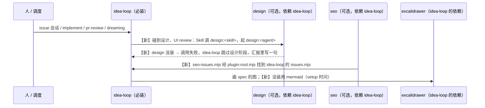

# idea-loop 拆成 idea-loop、design、seo 三个插件

> #241 存在：装 idea-loop 就连带装上 7 个设计 skill、14 个 seo skill、11 个设计 / seo agent 和 OpenSEO 的 MCP 连接，不做设计或 SEO 的项目也关不掉（对着 release/idea-loop-0.2.0 1a7496b，2026-11-05）

## 问题陈述

### 不用设计、SEO 的项目也得装上它们

idea-loop 0.1.9 的 `plugin.json` 把 `skills/engineering|design|productivity|seo` 四个目录都登记进一个插件；`.mcp.json` 同时起设计档案和 OpenSEO 两个 MCP；`hooks.json` 里 seo-check、design-lint、design-md 三个 hook 每次 Bash / Write 都跑。Claude Code 能开关的最小单位是整个插件，`skillOverrides` 不管插件里的 skill（决定记录 A1），所以一个只要 spec → 实现 → review 的项目，skill 列表里照样多出 21 个它用不上的 skill，每个会话多一个 OpenSEO 连接。

量（2026-11-05 对 1a7496b 数）：idea-loop 41 个 skill 里 design 6 个 + `ui-measure`、seo 14 个；15 个 agent 里设计 6 个、seo 5 个。

### 根因

插件边界按「一个仓库的一套流程」划，没按「哪些项目要用」划：设计与 SEO 是可选能力，却和必选的 spec → 合并流程装在同一个插件里。

## 方案

改完人得到的：只装 idea-loop 的项目，skill 列表里只有 spec → 合并流程和共用能力，没有 OpenSEO 连接；要设计就再装 design，要 SEO 就再装 seo，装哪个由 `plugin.json` 的 `dependencies` 连带装上 idea-loop。

三个插件放同一个 marketplace（harold-skills），各管：

| 插件 | skill | agent | MCP / hook |
|---|---|---|---|
| idea-loop | engineering、productivity 两类（去掉 `ui-measure`） | adr-reconciler、explorer、implementer、pr-reviewer | glossary-check hook |
| design | uiux-imagine、uiux-refine、uiux-research、design-change-sync、design-archive、design-modeling、ui-measure | uiux-imaginer、uiux-researcher、designer、ui-master、ui-reviewer、design-steward | 设计档案 MCP；design-lint、design-md hook |
| seo | 14 个 seo skill | 5 个方向分析员 | OpenSEO MCP；seo-check hook |

调用名改了：被搬走的 skill / agent 一律从 `idea-loop:<名>` 改成 `design:<名>` / `seo:<名>`。

同一行为的其他入口：

- **idea-loop 里碰到设计的地方**（纳入）：issue 会话的设计阶段、`implement` 的 UI 工单与「设计变更」、`pr-review` 的 UI 走查和合并前归档、`dreaming` 的档案对账与 `DESIGN.md` 维护、`to-spec` 测试表里「视觉正确性」一行、`wiki-conventions` 的 `docs/design/` 目录说明。每处写一句：design 没装（调 `design:` 的 skill 报不存在）就跳过这一步，在汇报里写明跳过了什么。
- **excalidrawer**（纳入）：idea-loop 在 `dependencies` 里依赖它；没装时 spec 的图用 mermaid；setup 时问人要不要装。
- **评测**（纳入）：`evals/uiux-research` 跟着 `uiux-research` 去 design；`evals/retro` 留在 idea-loop。

### 脚本层

插件之间的调用走 skill / agent 名字，不走脚本路径：skill 正文里的 `${CLAUDE_PLUGIN_ROOT}` 只指自己插件。三处脚本跨插件 import，各自处理：

- **design 的档案脚本用 `mini-yaml.mjs`**：design 复制一份；仓库测试守两份逐字节一致。设计档案 MCP 启动时不依赖找另一个插件。
- **seo 的 `seo-issues.mjs` 用 idea-loop 的 `issues.mjs`**：经 `plugin-root.mjs` 找 idea-loop 的根（seo 依赖 idea-loop，它一定在）；`seo-setup` 建 label 改成 `seo-issues.mjs labels`，同样由它转给 `issues.mjs`。
- **idea-loop 的 `flow-compose.mjs --archive` 用 design 的 `design-archive.mjs`**：经 `plugin-root.mjs` 找 design；找不到就报「`--archive` 要 design 插件」并退出。不带 `--archive` 不受影响。

`plugin-root.mjs` 依次找：环境变量 `<插件名大写>_PLUGIN_ROOT`；同级目录 `../<插件名>`（仓库、`--plugin-dir`、marketplace 克隆）；插件缓存的 `../../<插件名>/<最高版本>`。idea-loop 与 seo 各放一份，仓库测试守一致。

### agent 读别的插件的文档

design 的 agent 原来用 `${CLAUDE_PLUGIN_ROOT}` 读 idea-loop 的参考（ui-reviewer 读 pr-review 的 `review-standards.md`，design-steward 读 dreaming 的提议表格式并跑 `proposal-table-check.mjs`）。改成由起它的 idea-loop skill 把这些文件的绝对路径放进指针里给它。

## User Stories

只改插件边界，不加能力。期望行为：

1. 只装 idea-loop 的项目里，skill 列表没有设计和 seo 的 skill，没有 OpenSEO、设计档案 MCP，Write 不跑 design-lint。
2. 装 design（或 seo）会连带装上 idea-loop；三者都能用 `--plugin-dir` 一起加载。
3. 只装 idea-loop 时 issue 会话、implement、pr-review、dreaming 走到设计那一步就跳过并在汇报里写明，不报错停住。

## 实现决策

- **目录**：新插件拍平成 `skills/<slug>/`，不再套分类目录；idea-loop 保留 `engineering/`、`productivity/` 两类。理由：分类目录是为了在一个插件里分组，拆开后 design、seo 各只有一类。
- **搬迁一律 `git mv`**，保住历史；与 #246（原地改 `uiux-refine/references/design/`、`agents/ui-reviewer.md`）谁后合进 release 谁解冲突。
- **测试**：跟着脚本走，设计 / seo 的测试搬进各自插件的 `scripts/`；读文档的测试改路径。全量命令 `node --test '*/scripts/*.test.mjs'` 不变，自动带上新插件。
- **`no-project-leak` 守三个插件**：design、seo 同样不出现项目信息。
- **版本号**：新插件 `plugin.json` 起步 `0.2.0`，与 idea-loop 这次发版对齐；idea-loop 的版本号不在这里改（release 合 main 时统一改）。
- **design 在不在的判断**：不写检测脚本，按决定记录 A1 实测：调 `design:<skill>` 不存在时调用方能判断出来，判断后跳过。
- **excalidrawer 依赖的写法**：excalidrawer 在 marketplace 里来源是 GitHub 仓库，同一 marketplace 内按名字依赖。

## 测试决策

| 变的是什么 | 仪器 | 本次 |
|---|---|---|
| 纯逻辑、数据转换、状态机 | TDD 单元测试 | `plugin-root.mjs` 的查找顺序；`seo-issues labels` |
| API 契约（路由、schema、序列化） | TDD API 测试 | 不涉及 |
| DB schema、迁移、并发与事务语义 | 真 DB 测试 | 不涉及 |
| LLM 输出质量（prompt 改动） | eval（确定性断言） | 不涉及：只改调用名和边界，不改 prompt 内容 |
| 视觉正确性 | UI 实现环 | 不涉及 |
| 端到端用户流程 | 浏览器端到端测试 | 不涉及；改用 `claude --plugin-dir` 实际加载三个插件 |

- **seam**：全量测试命令；新增一个仓库级测试「插件边界」：idea-loop 里不出现 `idea-loop:<已搬走的名字>`，三个插件的 `plugin.json` 的 `skills` 目录都存在、`dependencies` 写对，`mini-yaml.mjs` / `plugin-root.mjs` 的副本一致。抓得到漏改的调用名和漏搬的文件；抓不到运行时跳过设计的措辞对不对。
- **增量功能测试**：
  - 前置：仓库根。步骤：`claude --plugin-dir idea-loop --plugin-dir design --plugin-dir seo -p` 让它列出可用的 `design:` 与 `seo:` skill。期望：都在。覆盖 2。
  - 前置：只 `--plugin-dir idea-loop`。步骤同上。期望：没有 `design:` / `seo:` skill。覆盖 1。
- **照着谁写**：`idea-loop/scripts/setup-single-source.test.mjs`、`skill-private-references.test.mjs` 这类读文件树的测试。

## Out of scope

- design 内容的合并瘦身（#246）、decision / evidence 的改写（#245）、状态机（#242）、issue-triage（#243：seo-scan 开 issue 将来改走它）、知识库（#244）、setup 的迁移（#247）。
- design 入口只能人敲、设计档案用得少这两处（决定记录 Q34：这次不改）。

## 关联

- raw：[[2026-11-04-idea-loop-0-2-0-restructure-grill]] 的 Q10、Q15、Q16 与「本轮决议」的插件拆分、图表依赖两行。
- 相邻：#246 搬动前原地改 design 的文件，有重叠，谁后合谁解冲突；#245 改 evidence（这里只动 `flow-compose` 的调用名与 excalidrawer 回退一句）；#242、#243、#247 会改到 `issues.mjs`、setup，与这里改的调用名可能冲突。
