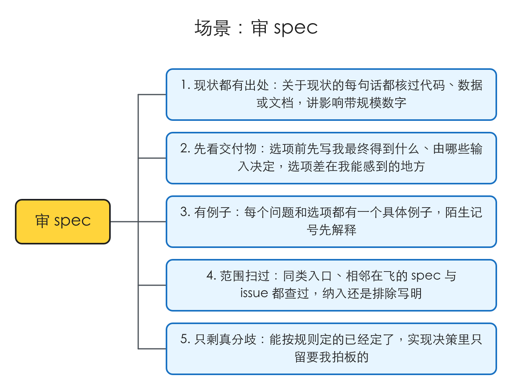
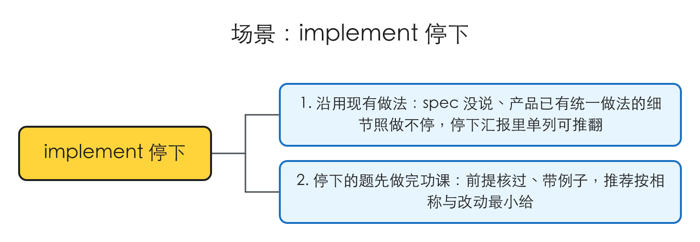
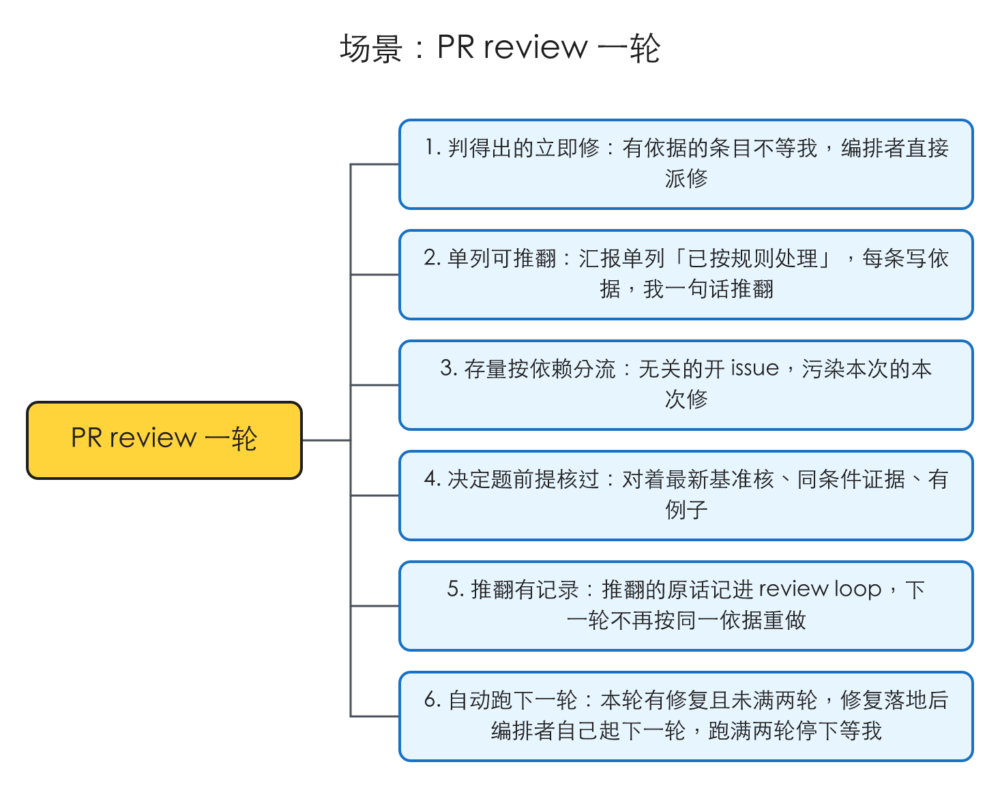
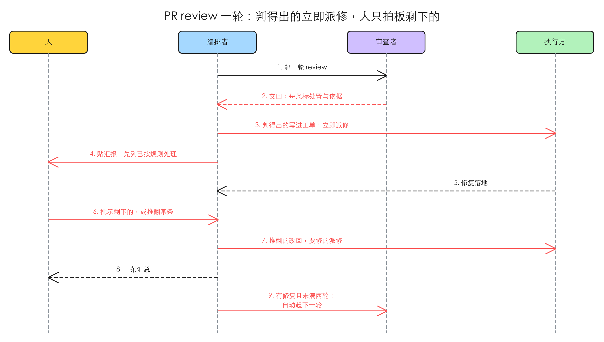

# PR 流程里 agent 自己定什么、交给人之前先做完什么

## 1 问题

证据来自 Toeflair（私有仓库）最近的 10 个审核会话。这些都是流程问题，没有界面可截，证据是对会话与 PR 归档的统计。逐条的记录不进本仓库，复现材料见 §1 末尾。

### 1.1 审 spec 到切工单之间，人要追问、纠正、重新拍板约 30 次

**复现到的**：导出 6 个审核会话，从 spec 起草完到调用切工单之间，逐条看人的发言，挑出追问、纠正、补信息、重定选项的那些：

| 来源 | 次数 | 例子 |
|---|---|---|
| 现状事实起草时没查，人问了才去查 | 约 12 | spec 写「提示词说等权重」，人问了才查明分数本来就是代码机械算的，模型只是抄写；spec 把一个现有做法写成了缺陷，审核时才发现那就是现在的行为，用户故事和测试一起删掉；「卡住的分析有多少」人问了才去查生产库，非写作只有 1 条，整节方案被拿掉 |
| 问题和选项没给具体例子，陌生记号没解释 | 约 8 | 「原句里有重复词」没给例子，人读成了学生结巴；「目标词一个都对不上」人说没读懂；选项用 R1 / R2 / R3 指代 |
| 先列做法，没先写要交付什么，方案形状被人重定 | 约 7 | 重练判定先拆成两次独立调用，再讨论并行还是串行，三轮后人指出「给学生的反馈要结合前后分数」，整个改成一次调用；「分数要不要服从判定结果」这个维度，选项里没有出现 |
| 范围没扫同类入口 | 约 4 | spec 只覆盖两个口语做题页，人问写作页怎么样，才查出写作页点返回也会丢掉已写的文字，范围扩到四页 |
| 决定牵出的后续没写，改了 spec 没同步图和测试表 | 约 4 | 选了「弹窗时暂停」之后，作废半截录音、取消后从听题重放都没写；时序图停在审核前的版本，切工单前才重画 |

另有 3 次 implement 停下问人的决定，本该在 spec 里就定：文案大小写、分数颜色规则、画布缺了几格怎么比。前两件，产品里本来就有统一的做法。

### 1.2 PR 过程中约 80 个决定，大部分是重复的

**复现到的**：同一批 PR（共 10 个）合并时归档的 review loop 里，每次停下、每轮 review 摆给人的决定：

| 情形 | 次数 | 人怎么定的 |
|---|---|---|
| Standards 违规，仓库有明文规则 | 10 | 10 次都是「修」 |
| spec、工单、说明文字跟已定的做法对不上 | 4 | 4 次都是本 PR 补改（其中 1 次 agent 推荐合并后另提交，人要求本 PR 改） |
| 跟这次无关的存量问题 | 7 | 7 次都是开 issue 或进待办，本 PR 不动 |
| 存量问题，但让这次改动拿到的输入是错的 | 1 | 本 PR 一起修（agent 推荐另立项，人推翻） |
| 执行方顺手删了东西 | 2 | 没有调用方的死代码，接受；删掉的是给人看的出处说明，恢复 |
| 只在兜底路径或罕见异常里出现、不丢东西的边缘情形 | 5 | 5 次都接受成已知限制（其中 2 次 agent 推荐加机制，人推翻：「毕竟只是一个 fallback」「没有用户的录音，就没必要弹窗」） |
| 起名、人验素材、分类体系怎么切、人提出第三条路 | 约 20 | 只能人定 |

整体约 85% 是「按推荐」。

### 1.3 PR 过程中人追问约 20 次，多数是汇报没讲清

**复现到的**：同一批归档里人的追问，常见的几类：
- 选项的前提已经过时：放量的基础设施已经合进 main，汇报给的两个选项都建立在旧前提上。
- 证据不在同条件下：拿英文画布去比中文实现，人指出差异不准。
- 机制没说清：哪个请求被取消、哪条测试为什么变红。
- 要人评判文案，却没给评判标准：图注跟搜索引擎的关系。

复现材料：`.tmp/to-spec/pr-review-report-followups/repro/`（PR 决定记录两份、spec 审核摩擦记录两份、一份 PR 归档原文）

### 1.4 根因

- **「谁来定」没有规则，默认全交给人。** 起草方「修法有分歧的给选项和推荐，留给人定」；审查者每条 Spec 都写「要你决定」；Standards 只给「建议」，修不修等人批示；编排者「人批示之前不修任何东西」；执行方「行为没定就停」，没有区分「spec 没写、但产品已有统一做法」的情形。1.2 里能从规则或已有决定推出来的那些，都走了一遍人。
- **存量问题一刀切。** 执行方「存量问题不修」，审查者「不报改动行以外的存量」，都没有「它污染了这次改动」的例外。
- **起草只要求复现问题，不要求核对方案依赖的现状。** backlog 模式要求每条问题先复现；但方案、选项、范围依赖的现状事实（代码现在怎么做、影响有多大、同类入口、相邻在飞的 spec）没有要求，于是在审核时由人一条条问出来（1.1 第一行）。
- **选项的写法只规定了形状，没规定先写什么。** 现在要求「至少两个选项、给推荐、前提说清那条规定是干什么用的」；没有要求先写交付物和它依赖的输入，也没有要求配例子。1.1 第二、三行与 1.3 都出在这里。
- 修正：起草时以为 #34 的五件事都还没做；逐节核对 main 之后发现都已落地（见「建议关闭」），这份 spec 改做上面这件事。

## 2 方案

插件里新增一份**共享的决策规则**，分两半：

- **自己定**：四条原则，判得出来的就照办。用在起草方、执行方、审查者、编排者四处。
- **交给人时**：三条原则，一道题摆给人之前要先做完的功课。用在起草 spec 和写汇报两处。

现在散在各处的「谁来定」判断删掉，改成引用它。PR 流程里照规则判得出的条目，编排者**不等人**，立即派修；汇报里单列「已按规则处理」，每条写依据，人一句话就能推翻（原话见 raw 的 U3）。

人这边能感到的变化：
- 审 spec 时，现状都有出处，选项有例子，§4 只剩真正要拍板的分歧。
- 停下汇报和 review 汇报里，「要你决定」变少，多出一节「已按规则处理」，看一眼、不同意就推翻。

## 3 User Stories

### 场景：审 spec

1. **现状都有出处**：作为审 spec 的人，我想要 spec 里关于现状的每句话都已经核过代码、数据或文档，讲影响时带规模数字，以便我不用一条条追问「现在到底是怎么做的」「有多少」。
2. **先看交付物**：作为审 spec 的人，我想要选项之前先写清我最终得到什么、它由哪些输入决定，选项之间差在我能感到的地方，以便我在对的层次上拍板，而不是三轮之后才发现方案形状不对。
3. **有例子**：作为审 spec 的人，我想要每个问题和每个选项都配一个具体例子，陌生的记号先解释，以便我不会误读问题。
4. **范围扫过**：作为审 spec 的人，我想要同类入口、相邻在飞的 spec 与 issue 都已经查过，spec 里写明纳入还是排除，以便我不用凭印象补范围。
5. **只剩真分歧**：作为审 spec 的人，我想要能按规则定的（边缘情形、沿用现有做法、改动最小）已经定好并注明依据，实现决策里只留要我拍板的，以便审核只花在真正的取舍上。

### 场景：implement 停下

1. **沿用现有做法**：作为看停下汇报的人，我想要 spec 没说、但产品已有统一做法的细节（文案写法、颜色规则），执行方直接照现有做法做、不停下，停下汇报里单列出来让我可以推翻，以便我不为这类细节被打断。
2. **停下的题先做完功课**：作为看停下汇报的人，我想要真正要我定的题前提已经核过、带例子，推荐按「代价跟用户损失相称」「改动最小」给出，以便我一次就能答。

### 场景：PR review 一轮

1. **判得出的立即修**：作为拍板的人，我想要有依据的条目（有明文规则的 Standards 违规、说明文字跟已定做法对不上、执行方顺手的删除）不等我，编排者直接派修，以便一轮 review 只剩我真正要定的事。
2. **单列可推翻**：作为拍板的人，我想要汇报里单列「已按规则处理」，每条一句做了什么和依据，我说一句「推翻某条」就改回，以便自动处理不会悄悄越过我。
3. **存量按依赖分流**：作为拍板的人，我想要跟这次无关的存量问题自动开 issue，污染了这次改动输入或结论、或让 CI 变红的存量问题在这次修，以便我不用每次重复说「记个 issue」。
4. **决定题前提核过**：作为拍板的人，我想要留给我的每道题都对着最新的基准分支核过前提，比对类证据在同条件下做，带一个具体例子，以便我不用追问「这是什么」「为什么会这样」。
5. **推翻有记录**：作为拍板的人，我想要我推翻的原话逐字记进 review loop，下一轮不再按同一依据重做，以便同一件事不被反复自动处理。

## 4 实现决策

### 4.1 一份共享规则文件，两半

新增插件级 reference，暂名「决策规则」（`decision-rules.md`），分「自己定」「交给人时」两半。读者与替换掉的现有条文：

| 读者 | 现在的写法 | 改成 |
|---|---|---|
| 起草方（to-spec 两种模式、issue-explorer） | 修法有分歧的给选项和推荐留给人 | 先按「自己定」处置能判的，§4 只留真分歧；写法按「交给人时」 |
| 执行方（implementer） | 行为没定就停；存量问题不修 | 有现成做法的沿用；存量按依赖分流；停下的题按「交给人时」写 |
| 审查者（pr-reviewer、review 标准） | 每条 Spec 写「要你决定」；Standards 写建议；不报改动行以外的存量 | 每条标处置（照规则 / 要你决定）并写依据；存量按依赖报 |
| 编排者（pr-review、implement） | 人批示之前不修任何东西；「进 backlog」追加到待办文件 | 照规则的条目立即处理；进 backlog 改为开 issue |
| 汇报写法（pr-description 的停下汇报、review 轮次） | 至少两个选项、给推荐、说清前提 | 多一节「已按规则处理」；「要你决定」按「交给人时」写 |

### 4.2 「自己定」的四条

一条处置能从下面推出来，就照办，不问人：

1. **有依据就照办**。依据只认三种：仓库写下来的规则原文、人在这份 spec 或这个 PR 里已经做过的决定（原话）、产品里已有的统一做法（能指出至少一处现存实例）。由此：
   - 有明文规则的 Standards 违规：修。
   - spec、工单、说明文字跟已定做法对不上：本次同步改。spec 里交代由来的历史段落保留，标明后来改了。
   - spec 没说的界面细节（文案写法、颜色规则等），产品已有统一做法：沿用。
   - 执行方超范围的删除：删掉的东西没有调用方、也没人读，接受并补记进工单；删掉的是有人读的信息，或改变了行为，恢复。
2. **归不归这次，看依赖**。这次引入的，这次修。存量问题开 issue，例外是：它让这次改动拿到错数据、让这次的结论站不住，或让 CI 变红，这次修。
3. **代价跟用户会失去的东西相称**。会丢用户已交的内容、数据、钱：修。只在兜底路径或罕见异常里出现、又不丢东西：接受，写成已知限制。等待时间、体验上的小代价：接受，上线后看数据。在 PR 流程里用法见 4.8。
4. **默认改动最小**。结构性的重排（目录重构、换框架）不顺手并进来，要做就单独起。

依据不成立（规则有歧义、两条规则冲突、找不到现存实例）时，不算判得出，照旧交给人。

### 4.3 「交给人时」的三条

5. **现状先查清**。题里每句关于现状的话都核过代码、数据或文档，能说出出处；讲影响带规模数字；同一行为的其他入口查过，写明纳入还是排除；相邻在飞的 spec、issue 查过；出题前对着最新的基准分支再核一次。
6. **先写交付物，再列做法**。先写用户最终得到什么、由哪些输入决定，再列实现方式；选项之间要有用户能感到的差别；每个选项牵出的后续写全；改了 spec，图和测试表同步改。
7. **每个问题、每个选项都配一个具体例子**。陌生记号先解释，不用裸编号指代选项；比对类证据在同条件下做；要人评判文案或素材时，先给评判标准。

### 4.4 审查者：每条标处置

Spec 与 Standards 的每个候选多一个「处置」：

- **照规则**：带「依据」（三种依据之一的原文或位置）和「动作」（修 / 同步改 / 接受并补记 / 恢复 / 开 issue），不写「要你决定」。
- **要你决定**：照旧写前提、选项和推荐；写法按 4.3。

有明文规则、没有歧义的 Standards 条目一律「照规则 · 修」。规则有歧义的，照旧进折叠区的「规则有歧义」。

校验脚本跟着改：「照规则」的条目必须有依据和动作、不要求选项；依据是规则原文的，照旧要在规则文件里找得到；正文同样不许出现代码层面的指称。

### 4.5 编排者：照规则的条目立即处理，人可以推翻

一轮 review 交回之后：

1. 照旧把汇报记进 review loop 文件。
2. 「照规则」的条目**立即**按动作处理：要修的写进对应工单、派执行方（照现在的「修」那条路）；开 issue 的在目标仓库开；同步改、补记的直接提交。
3. 在会话里贴汇报，「已按规则处理」放在 Spec 与 Standards 之前，每条一句：做了什么、依据是什么、提交或 issue 链接。
4. 人批示剩下的条目。人说「推翻某条」，当作一条新批示：原话逐字记下，按人的意思改回或改做（改回同样写进工单、派执行方）。
5. 下一轮审查者从 review loop 读到推翻记录，不再按同一依据把它当「照规则」处理。

pr-review「不做」里的「不在人批示之前修任何东西」改为：除了「照规则」的条目。「进 backlog」改为在目标仓库开 issue（近期都是开 issue，issue-dispatch 也以 issue 为入口）。

### 4.6 执行方与停下汇报

- **「行为没定」收窄**：spec 和工单没说、但产品已有统一做法的，沿用，不停下。写进交回，编排者放进停下汇报的「已按规则处理」一节，人可以推翻。
- **「存量问题不修」补上 4.2 第 2 条的例外**：污染这张工单的输入或结论、让 CI 变红的，作为 spec 缺口交回，编排者按「照规则 · 本次修」处理并写进汇报。
- 停下汇报的决定题按 4.3 写。

### 4.7 起草方

to-spec 两种模式共用：
- §1 根因与正文里关于现状的陈述带出处；讲影响带规模数字。
- §2 方案之前写清交付物和它依赖的输入。
- §4 先按「自己定」处置能判的，写成已定的决定并注明依据；只把依据不成立的写成选项。边缘情形按 4.2 第 3 条在 spec 里定好，不留给 implement 停下。
- 范围写明同类入口纳入还是排除，相邻在飞的 spec、issue 写进 §8 关联。
- 「建议关闭」的每条带三样：现象、现状证据（为什么现在不成立）、怎么验证的。
- 改了 spec 的文字，图和测试表一起改。

issue-explorer 的自检加三项：§4 里每个选项都说明了为什么依据不成立；范围一节写明了同类入口；「建议关闭」每条带现象、现状证据和验证方式。

### 4.8 「代价相称」在 PR 流程里只决定推荐

起草时由起草方直接按 4.2 第 3 条定（人审 spec 时会看到）。在 PR 流程里（停下汇报和 review），边缘情形照旧是「要你决定」，这条只用来定推荐，不进「已按规则处理」。

> 人的决定（2026-10-19）：4.8 选 A：PR 流程里「代价相称」只用来定推荐，边缘情形照旧问我。

理由：这条的数据只有 5 次，判断「用户会不会丢东西」本身可能判错，判错的代价是丢用户数据。等 #51 的沉淀积累更多推翻记录，再考虑升级成自动处置。

### 4.9 不自动的

照旧只由人定：
- 起名定稿（新词只在 grill 里加）
- 人验素材
- 分类体系怎么切
- 方案形状被人提出第三条路的
- 对外发布
- 动生产业务数据
- 下一轮 review
- 合并

## 5 技术方案总览

### 5.1 后端

这里的「后端」是 PR 流程里的几个角色：人、编排者（调 pr-review / implement 的会话）、审查者、执行方。

红色是本 spec 新增或改动的消息，虚线是响应。

- 审查者交回的每条候选多出处置、依据、动作（4.4）。
- 编排者在贴汇报之前就把「照规则」的条目派出去（4.5 第 2 步），所以第 3 步早于第 4 步。
- 人的批示多一种「推翻某条」，走的是现有「修」的路径（4.5 第 4 步）。
- 停下汇报（implement）同理：执行方交回的「沿用现有做法」与「本次修的存量」，编排者先处理、再在汇报里单列（4.6）。

### 5.2 前端内部

不涉及。

### 5.3 前端交互

不涉及。

## 6 测试决策

| 变的是什么 | 仪器 | 本次 |
|---|---|---|
| 纯逻辑 / 数据转换 | TDD 单元 | 碰到：review 候选的校验脚本多认一种「照规则」的形状（4.4）。照它旁边现有的单测写。 |
| API 契约 | TDD API 测试 | 不涉及。 |
| DB schema / 迁移 / 并发 | 真 DB 测试 | 不涉及。 |
| LLM 输出质量 | eval | 不涉及：改的是 skill 与 agent 的说明文字，不在 `idea-loop/evals/` 的 baseline 范围内（那里只钉了 prototype / uiux-imagine / uiux-refine）。 |
| 视觉正确性 | UI 实现环 | 不涉及。 |
| 端到端用户流程 | 浏览器测试 | 不涉及浏览器；端到端用一次真实跑通代替，见下。 |

- **seam**：review 候选的 JSON 与它的校验脚本（审查者和编排者之间唯一的结构化交接），以及 review loop 文件里的汇报与批示。起草这边没有结构化的 seam，用 issue-explorer 的自检清单。
- **增量功能测试**：
  - 照规则的候选：前置——一条带依据和动作、没有「要你决定」的候选；期望——校验通过。依据是规则原文却在规则文件里找不到，期望——丢弃。缺依据或缺动作，期望——要求改写。覆盖「PR review 一轮」1、2。
  - 要你决定的候选：照旧的形状要求不变，现有单测全绿。覆盖「PR review 一轮」4。
  - 真实跑一次 PR：在 Toeflair 的下一个 PR 上跑 implement 到 pr-review 第一轮；期望——汇报里有「已按规则处理」一节、每条有依据和链接，照规则的条目在人批示前已经派出去；人推翻一条，期望——改回并记下原话，下一轮不再按同一依据处理；对比 1.2，「要你决定」的条数明显减少。覆盖「PR review 一轮」1–5、「implement 停下」1–2。
  - 真实起草一次：issue-dispatch 下一轮起草的 spec，期望——自检三项都过，§4 只剩依据不成立的选项；审核时记下人的追问次数，跟 1.1 对比。覆盖「审 spec」1–5。
- **prompt / eval 变动**：改 to-spec（含 backlog 模式）、issue-explorer、implementer、implement、pr-reviewer、pr-review、review 标准、PR 描述与汇报写法；新增决策规则 reference；README 与仓库 CLAUDE.md 里 idea-loop 的描述同步。无 eval 变动（理由见上表）。
- 先例：review 候选校验脚本现有的单测；review 标准里「准入：机械校验」一节的写法。

## 7 Out of scope

- 从会话里持续沉淀规则（回看已合并 PR、提议新规则或改规则）：归 dreaming，issue #51。本 spec 的「推翻记录」是它的输入。
- 起名、术语表的规则不改，新词照旧只在 grill 里加。
- 改 grill 的访谈方式。
- 回填存量 spec。已经在审的 spec 不按新写法重写。
- 项目自己的授权（比如「评测固定输入可以定点上传到评测存储桶」）不写进插件。项目要放开，就写进自己的 AGENTS.md / CLAUDE.md，按 4.2 第 1 条它就成了「写下来的规则」。

## 8 关联

- 讨论记录：[[2026-10-19-pr-decision-friction]]
- #34 idea-loop pr-review / to-spec：PR 描述不放 review 小节、thread 写给拍板的人看（固定四段、不出现代码指称）、素材图点开能放大、定稿后不保留 .excalidraw——见「建议关闭」。
- #51 idea-loop dreaming：回看已合并 PR 的 review loop，把人反复做的决定沉淀成规则——本 spec 的下游。
- 相邻在飞的 spec：[[ui-state-archive]]、[[design-research-agent]]、[[uiux-imagine-agent]]，都不改 PR 流程的决策规则，互不依赖。

## 建议关闭

### #34 PR 描述 / review 汇报 / 素材图 / spec 图的五处改动——都已落地

逐节对着 main 核过（2026-10-16，idea-loop 0.0.24），五件事都已经在后续版本里做了，有两处被更晚的决定取代：

| issue 里的哪一节 | 现在的样子 |
|---|---|
| 一、PR 描述不放 review | 已做。描述固定四节（一句话 / 改了什么 / 要你做的事 / 参考），写入脚本把旧的 review 节当作废弃节拒写。issue 写的是五节，后来改成了四节。 |
| 二、汇报写给拍板的人看 | 已做。开头一句结论、标题即用户后果、正文不出现代码指称、范围与丢弃候选收进折叠区；非行为问题配了图会被校验脚本拒掉。issue 要的「thread 根评论 edit 子命令」不再需要：review 已整体从 GitHub thread 搬到会话 + 本地文件，合并时才归档成 PR 评论。 |
| 三、spec 图不留 .excalidraw | 已做。spec 图的规则写明定稿后 `docs/` 里只留 PNG，源文件留在 `.tmp/`。 |
| 四、素材图点开能放大 | 已做。素材改放每个 PR 一条的孤儿分支，用 `blob/…?raw=true` 嵌图，规则里写明了为什么 release 附件做不到。 |
| 五、批示处理完只回一条汇总 | 已做。pr-review、implement 和 review loop 的规则都写「只回一条汇总，不要一个点回一条」。 |

现象：issue 列的五处改动。现状证据：上表每行对应的规则在 main 上都能找到。验证：2026-10-16 逐节读 main 的对应文件核对。建议关成已解决（completed）；本 spec 合并后由调度会话关闭。
