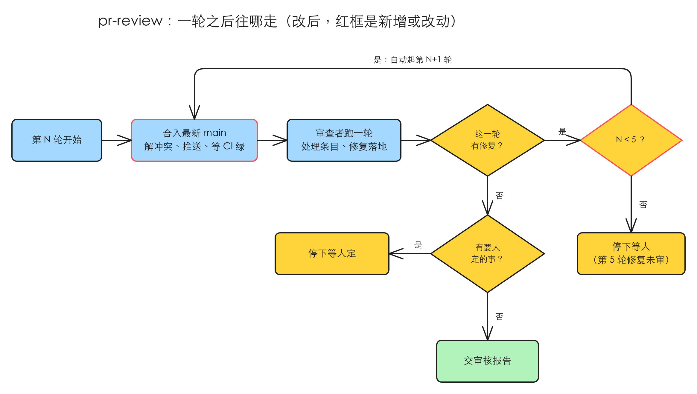

# pr-review 自动 review 放到最多 5 轮，每轮先合入最新主分支

> #271 存在：pr-review 只自动起到第 2 轮，第 2 轮的修复落地后没人审就摆「合并 / 再跑一轮」；2026-11-16 对着 main a032e45 核过，上限还写在 pr-review、pr-reviewer、review 汇报模板、merge 四处，详情在「问题陈述」

## 问题陈述

### 1. 第 2 轮之后的修复没经过 review 就问人合并

pr-review 一轮里有要修的，修复落地后自动起下一轮，但只起到第 2 轮。第 2 轮的修复落地后，编排者停下问「再跑一轮还是合并」，这次修复没人审过。

两次真实记录，人都没选直接合并：

- Tofelair#493（PR #880，2026-11-09）：第 2 轮修复后问「再跑一轮还是合并」，人回「再跑一轮」；第 3 轮修复后编排者推荐直接合并，人回「先处理下和main的冲突，再review这次的修复」。第 4 轮 0 条后才合并。
- harold-skills PR #300（2026-11-13）：第 2 轮修复后人回「除了冲突之后再进行一轮review」；第 3 轮查出一处漏拍，第 4 轮查出第 3 轮修复带来的多拍，第 4 轮修复落地后人说合并。

出处：两段 review loop 都已归档成 PR 评论（Tofelair PR #880、harold-skills PR #300）；分拣核对见 #271 的第一条「🤖 idea-loop：」评论（对着 main a7c8129）。本次 2026-11-16 对着 main a032e45 再核：pr-review 的 SKILL.md「一轮之后往哪走」第 1 点写着「下一轮编号不超过 2……已跑满两轮、第 2 轮的修复刚落地且还没人看过，就停下」。

期望行为：一轮有修复，修复落地后自动起下一轮，直到某一轮没有要修的、或有要人定的事；最多自动跑到第 5 轮，第 5 轮的修复落地后才停下等人。

### 2. 审完摆「合并」时 PR 已经跟主分支冲突

review 期间主分支被别的 PR 推进，编排者没查 PR 还能不能合就摆了「合并 / 再跑一轮」。

- harold-skills PR #300：第 2 轮修复后摆题时，主分支已被 #298 推进，PR 是 CONFLICTING；人回「除了冲突之后再进行一轮review」，合入主分支解冲突后的第 3 轮又查出问题。
- Tofelair#522（PR #916，2026-11-11）：报告交出后主分支合进 3 个 PR，spec 索引同一位置各加一行导致冲突；人说「合并吧，先处理冲突在合并」。记在候选池 `docs/records/retro-candidates/2026-11-11-merge-check-conflicts-first.md`。

现在 pr-review 的「前提」只要求 CI 全绿、worktree 干净、HEAD 已推送，不要求 PR 跟最新主分支没冲突（2026-11-16 对着 a032e45 核）。

期望行为：每一轮 review 开审前，先把最新主分支合进 PR 分支、解掉冲突、推送、等 CI 绿；这一轮审的就是合并后的改动。人说合并时再核一次。

### 根因

1. 自动起下一轮的上限定在 2：依据是 ADR 0038 记的「10 个 PR 里 5 个跑了第二轮……没有一个跑到第三轮」，已被上面两次跑到第 4 轮的记录推翻。
2. 「前提」里没有「PR 跟最新主分支没冲突」这一条，冲突只在人点出来时才处理。

## 方案

改完人得到：PR 摆到面前问「合并」时，最后一次修复已经被 review 过（除非跑满 5 轮），而且 PR 跟当前主分支不冲突。决定它的输入：这一轮有没有修复、有没有要人定的事、轮次编号（人说「再跑一轮」触发的也计入）。

改的都是给 agent 读的文档，按 `writing-for-agents` 的杠杆标明：

1. **上限从 2 放到 5，只写在一处**（单一事实来源）：pr-review 的 SKILL.md「一轮之后往哪走」第 1 点改成：这一轮有修复，修复落地后自动起下一轮，直到某一轮没有要修的（走第 2 点交审核报告）或有要人定的事（第 3 点停下）；`review-loop next` 给的编号超过 5 就不再自动起：第 5 轮的修复落地后停下，在会话里说「已跑满 5 轮，第 5 轮的修复还没审，要再跑或合并请直接说」，等人。上限只约束自动起，不约束人。
2. **删掉重复的轮数提示**（重复 → 单一事实来源）：pr-reviewer 的定义里「N ≥ 2 时，末尾加一句『已跑满两轮…』」、`pr` skill 的 review 汇报模板里「第 2 轮及以后加一句：已跑满两轮…」都删掉。审查者不知道这一轮之后会不会停，停不停只由编排者在第 1 点判，那句话由编排者在停下时说。
3. **同步改提到两轮的句子**（相关性）：SKILL.md「什么时候跑」的「不受两轮上限约束」改成「不受自动轮数上限约束」；「设计变更」末尾「第 2 轮之后人要核就说『再跑一轮』」删掉（新画布跟代码一致不一致，在下一轮 UI 走查里核，下一轮现在会自动起）；merge 参考里「比如跑满两轮停下后人直接说合并」改成「比如跑满 5 轮停下后人直接说合并」。
4. **每轮开审前合入最新主分支**（新的一步，放在「前提」，在 CI 那条之前，因为合入后要重新等 CI）：`git fetch`，把最新主分支合进每个 PR 分支；有冲突就解决，索引这类由脚本生成的文件重新生成、不手拼；推送；再往下等 CI。已经是最新的，什么都不做。merge 参考的「合并」第 1 步引用这一条，人说合并时再做一次（报告交出后主分支可能又前进了）。

同一行为的其他入口：

- 人调 `/idea-loop:pr-review` 或说「再跑一轮」：纳入，同样计入轮次、同样先合入主分支（走同一个「前提」）。
- implement 收尾转 ready 前：排除。它的合并冲突归 implementer（合进集成分支时解决），转 ready 后第 1 轮开审前会再合入一次主分支，不用在 implement 里重复。
- ADR 0038 里「上限两轮」的说法：排除，由 `/idea-loop:dreaming` 合并后对账时订正（ADR 归 dreaming，见 to-spec）。

## User Stories

只修问题，不画树。

1. 期望行为（对应问题 1）：一轮有修复时自动起下一轮，直到某一轮没有要修的或有要人定的事；第 5 轮的修复落地后才停下，停下时说明第 5 轮的修复还没审。
2. 期望行为（对应问题 2）：每一轮开审前和人说合并时，PR 都已合入最新主分支、没有冲突、CI 绿。

## 实现决策

- **上限是 5，不是不设上限**：依据人的原话（#271 第二条评论，2026-11-13 harold-skills#69 的 retro）：「放开agent review轮次的限制到5轮（最多），终止条件是没有问题」。正文原来提的保险丝（同一条发现连续两轮复现时停下）由这个上限回答，不另加。
- **终止条件**：这一轮没有要修的，也没有要人定的事，交审核报告；不变，只是不再被 2 截断。
- **轮次计数**：人触发的轮次也计入，沿用现在的写法。例：人在第 1 轮后说「再跑一轮」，那是第 2 轮，自动最多再起到第 5 轮。
- **谁合入主分支、谁解冲突**：编排者在 PR 的 worktree 里做，跟 deliver 里编排者往 PR 分支推 docs 提交是同一个人；依据是人给的做法原话「每次review之前先基于最新的main处理冲突」，以及 PR #300、Tofelair#522 两次都是编排者合入解决。生成文件重新生成，依据同一条评论「索引这类生成文件重新生成，不手拼」。冲突落在代码里、编排者判断不了该保留哪边的，照 `decision-rules` 停下问人（这是已有规则，不新写）。
- **合入方式**：`git merge` 最新主分支进 PR 分支，不 rebase：PR 已推送、可能有人在看，改历史会让 review loop 文件里记的提交链接失效。
- **插件版本**：改了流程行为（第 2 轮后不再停、每轮多一步合入），老用法照样能用，按 `REVIEW.md` 是 minor；#327 记着人连续三次把这类改成 patch，review 时按那边届时的结论定。

## 测试决策

| 变的是什么 | 仪器 | 本次 |
|---|---|---|
| 纯逻辑、数据转换、状态机 | TDD 单元测试 | 文档测试：`pr-review-slim-doc.test.mjs` 现在断言「一轮之后往哪走」里有「跑满两轮 / 不超过 2」，改成断言上限 5；新增断言「前提」里有合入最新主分支那一条、merge 参考引用它；断言 pr-reviewer 定义和汇报模板里不再出现「跑满两轮」 |
| API 契约（路由、schema、序列化） | TDD API 测试 | 不涉及 |
| DB schema、迁移、并发与事务语义 | 真 DB 测试 | 不涉及 |
| LLM 输出质量（prompt 改动） | eval（确定性断言） | 改的是 skill 文字；按 AGENTS.md §5 不做 baseline eval。retro 回放在 `idea-loop/evals/retro/` 有用例框架，这条有历史决策点（PR #300 第 2 轮修复后），是否加回放用例在 review 时看 |
| 视觉正确性 | UI 实现环 | 不涉及 |
| 端到端用户流程 | 浏览器端到端测试 | 不涉及 |

- **seam**：仓库已有的文档测试（`node --test idea-loop/scripts/*.test.mjs`）读 SKILL.md 按小节断言，复用它。能抓到：规则文字回退成 2、合入步骤被删、重复的提示又被加回去；漏掉：agent 实际跑的时候是否照做。
- **增量功能测试**：
  - 前置：pr-review SKILL.md 改完。步骤：跑文档测试。期望：「一轮之后往哪走」含上限 5、不含「不超过 2」；「前提」含合入主分支；pr-reviewer.md 与 review-report.md 不含「跑满两轮」。覆盖：期望行为 1、2。
- **照着谁写**：`idea-loop/scripts/pr-review-slim-doc.test.mjs` 的 `section('一轮之后往哪走')` 断言。

## Out of scope

- 合并时机、是否自动合并：合并仍只由人说。
- 「修—审」不收敛的其他保险丝（同一发现连续复现就停）：上限 5 已回答。

## 关联

- ADR：`docs/adr/0038-pr-review-report-followups.md`（「上限两轮」由本 spec 推翻，合并后 dreaming 订正）。
- 候选池：`docs/records/retro-candidates/2026-11-11-merge-check-conflicts-first.md`（合并前查冲突），本 spec 的期望行为 2 是它的推广，合并后可从池里移出。
- 相邻 open issue：#276、#280 讲 review 里的小题要不要问人，跟轮数无重叠，可并行；#327 讲插件版本档位，影响本 PR 升 minor 还是 patch，不挡本 spec；#292 讲子 agent 交回后编排者停住，跟自动起下一轮相邻但无重叠。
