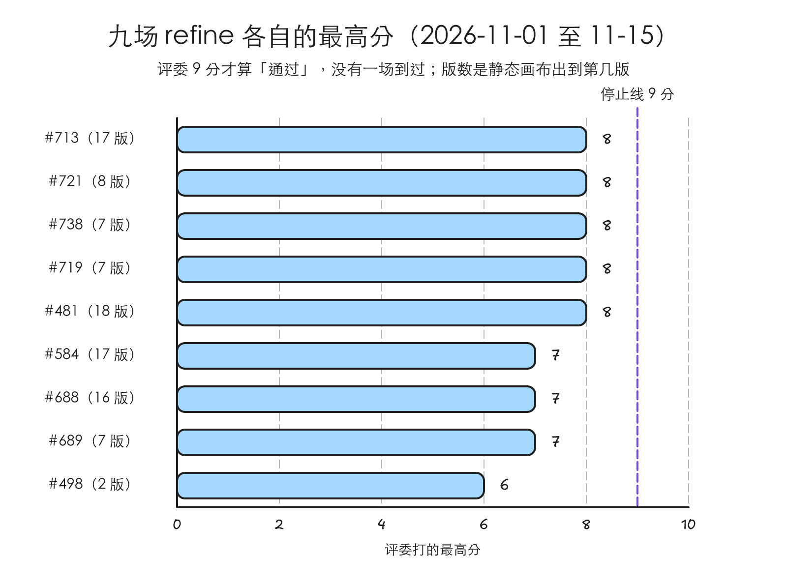
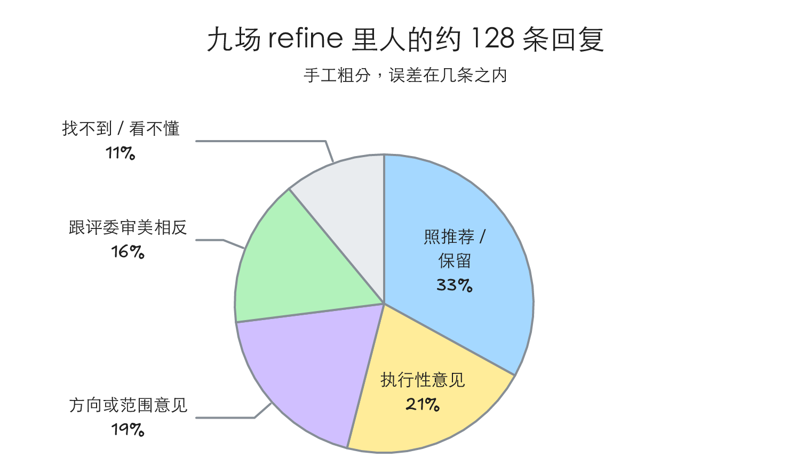
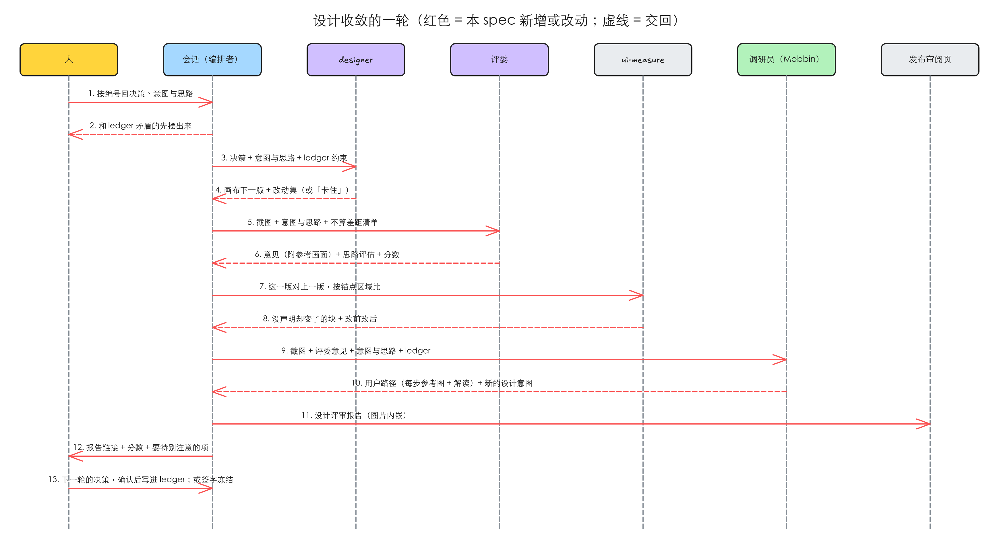
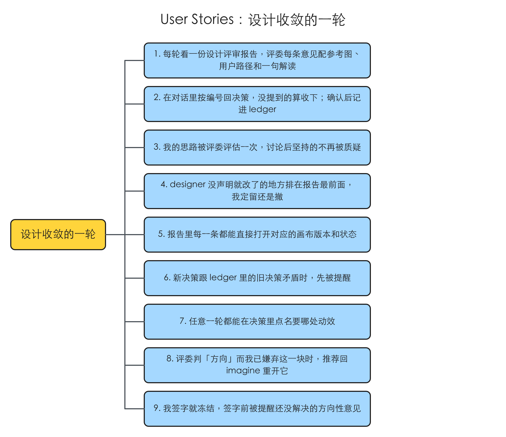
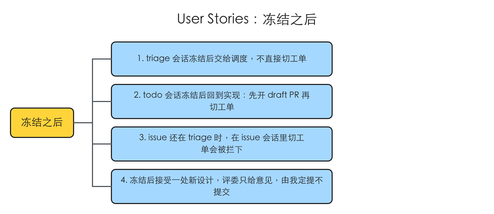
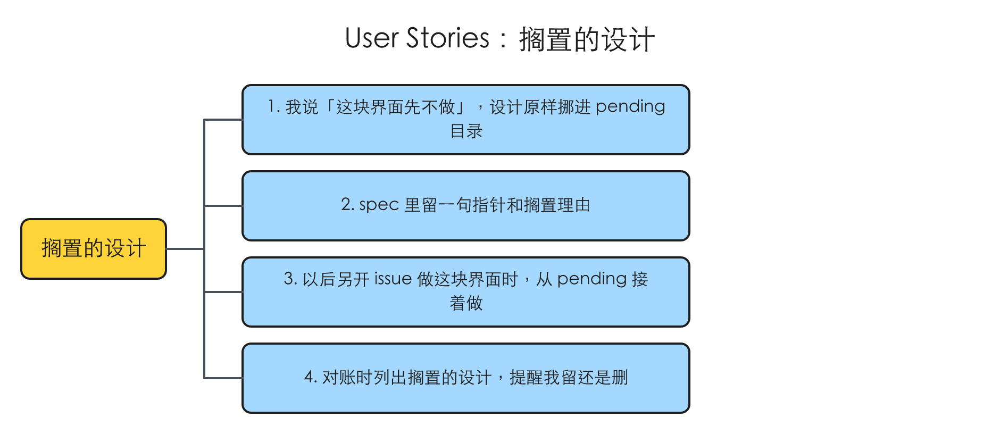
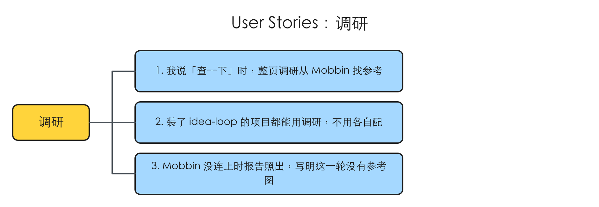

# 设计收敛改由人定：评委降为顾问，每轮交设计评审报告

> #230 存在：评委判「方向」、人在这次 refine 里已经嫌弃过那一块时，`uiux-refine`「碰到人选定项的意见」那张表仍只给「保留 / 改」两个选项，照表只能推荐「保留」；2026-11-16 对着 origin/main（a032e45）读规则核的，详情在「问题陈述」
> #287 存在：冻结后的那句话仍把 triage 会话引向「换到实现阶段」，并把「自己调 to-ticket」列成选项，to-ticket 也不看 issue 状态；2026-11-16 对着 origin/main（a032e45）读 `after-freeze` 与 `to-ticket` 核的，详情在「问题陈述」
> #289 存在：知识库约定里一份设计只有「冻结后归档」和「放弃只丢画布」两种结局，全仓库没有一处提到 `docs/design/pending/`；2026-11-16 对着 origin/main（a032e45）搜的，详情在「问题陈述」

这份 spec 改的是 `uiux-refine` 设计收敛的流程，以及挨着它的冻结后出口、搁置的设计、设计调研的数据源。画布外壳（#288）不在这里：流程改完后，用新流程把外壳本身设计一遍，当作第一次 dogfood，外壳要什么在那时长出来。

## 问题陈述

下面的「9 场 refine」指 2026-11-01 到 11-15 在 Toeflair 里真跑了 refine 的 9 个会话：#713、#721、#738、#719、#584、#688、#481、#689、#498。数字由子代理逐场读会话记录得出，其中三句原话我对着记录核过。

### 1. 评委的分数决定停不停，可 9 场里没有一场停得下来



现在一轮 refine 停不停，由评委的分数说了算：9 分「通过」，连续 3 轮没超过之前的最好分算「瓶颈」，判了「方向」也停。9 场里没有一场到过 9 分，最高的停在 8 分；#584 出到第 17 版，连续 10 轮停在 7 分。

评委的意见不经过人，直接交给 designer 改。一轮轮累积下来，人回头一看不对，就整体回退，9 场里有 6 次：
- #481 人说「将画布推回到v1，我们从v1作为基准进行微调～」，v2–v7 期间的 22 条决定全部作废。
- #584 人说「没有imagine 定稿的那个胶囊版本精致了…先改回来」。
- #689 评委的方向意见把范围越带越大，人最后说「超出了spec的范围」，回到不动界面。

评委自己也会来回摆：#584 的 v9–v13 里「每一版评委都挑另一头」；#738 评委上一轮嫌锁图标「实心太重」，下一轮嫌「线条太轻」，人最后把锁整个删了。

复现材料：`docs/raw/design-workflow/2026-11-16-refine-advisor-grill.md` 的 A1。

### 2. 人看不懂评委在说什么，手上也没有参考去判断



人不是专业设计师。评委的审美和人的审美有差距，而评委的意见只有文字，没有一张真实产品的画面能说明「它要的是什么样」。9 场里，人约 128 条回复中：
- 33% 只说「照推荐」或「保留」；
- 16% 明确跟评委的审美相反；
- 11% 是「找不到在哪看 / 看不懂指的是什么」，共 12 次，例如 #688「总结三卡是什么？」「渐变遮罩是…那个阴影？」。

每次停下，编排者交的都是一份长文字清单（「评委原话大意 / 撞上的是 / 我的推荐」），再加一个状态地址，改了哪里要人自己找。

designer 为了回应评委，有时会做人没要过的改动，也不说。#688 评委嫌卡片太高，designer 就在手机端加了收起和展开，事先没讲；人发现后问「为什么移动端卡片内的内容比桌面端少」，接着说「不要搞这种收起、展开的操作」。

### 3. 评委判「方向」、人已经嫌弃那一块时，规则推荐「保留」（#230）

Toeflair #738：人进 refine 时说「我觉得主要看新加的徽章我觉这个徽章目前比较难看」。评委判了「方向」，点名的正是这个徽章。徽章是人在 imagine 里选定的，编排者照规则表推荐「保留原样」。人回：「既然方向有问题，我们就暂停refine，重新回到imagine的状态…」。重开 imagine 后，第二轮发散做出纯文字的点名句，最后冻结签字。

### 4. 冻结之后，triage 会话被引去直接切工单（#287）

Toeflair #688 的 triage 会话里，refine 冻结并提交后，编排者没有走「推送分支 → 翻 todo → 交给调度」，直接切了 10 张工单。人发现后说：「理论上spec冻结之后，issue的状态不是应该进入todo，等待下一次调度吗？怎么直接走到了ticket拆分」。结果 issue 停在 triage，分支上却已经有工单，也跳过了 todo 会话「先开 draft PR 再切工单」的顺序。

### 5. 设计做到一半先不做了，没地方放（#289）

Toeflair #689 里 imagine 了四轮、refine 做到 v7 后，人看了线上数据：近 30 天 466 份报告里，6.0 分的只有 14 份，约 3%。人决定「回到不动界面」。设计成果留在 `docs/design/tmp/<spec-slug>/` 里，会被当成进行中的设计，合并前的归档会把它清掉；删掉，以后要做这块界面又得从头 imagine。当时人要求挪到 `docs/design/pending/<spec-slug>/`，但没有任何约定认识这个目录。人在 issue 上定了：「先放在local吧～」。

### 6. 调研的数据源只配在一个项目里，素材也旧

调研员的工具写死了 Refero（`mcp__refero__*`），插件自己却不带 Refero：它只配在 Toeflair 项目自己的配置里。在别的项目里起调研员，会直接失败；这场 grill 第一次起调研员就是这样失败的。人对 Refero 的判断是「很多素材很老」，已经改订了 Mobbin：「我觉的mobbin的审美作品要比refero好很多」。

### 根因

- 问题 1：停止判定写在评委的打分脚本里（9 分通过、3 轮不涨算瓶颈），编排者照判定决定停或继续；意见在人看到之前就交给了 designer。
- 问题 2：每轮交给人的只有文字。designer 和评委手上都没有参考画面，也没有任何一步负责去找。designer 交付时也不用逐条说明改了哪里，没人比对它实际改了什么。
- 问题 3：`uiux-refine`「碰到人选定项的意见」表里，冲突项只有「保留 / 改」两个选项；没有一行要求先看人在这次 refine 里是不是已经嫌弃过这一块。
- 问题 4：`after-freeze` 那句话叫 issue 会话「换到实现阶段」，指向的是 `issue-session` 里并不存在的小节「换阶段」；同一句还把「自己调 to-ticket」列成选项。to-ticket 只核「没有待定」「设计已冻结」，不看 issue 状态。
- 问题 5：`wiki-conventions` 的目录约定里只有「冻结后归档」和「放弃的需求只丢画布」两种结局。
- 问题 6：调研员的工具清单写死了 Refero 的工具名，插件的 MCP 配置里没有任何调研数据源。

## 方案



改完之后，人在 refine 里每一轮会拿到一份**设计评审报告**：一页单独的页面。
- 评委的每条意见都配有调研员从 Mobbin 找来的真实产品截图、一条用户路径（看到什么 → 做了什么 → 接着看到什么）和一句解读，最后是一句新的设计意图。
- designer 没声明就改了的地方排在报告最前面，带改前改后截图。
- 人在对话里按编号回决策，确认后记进 ledger，进下一轮。
- 人签字就冻结。评委的分数只是参考，不再决定停不停。

一轮怎么走（图里 13 步）：
1. 人按编号回决策，带上意图和思路。会话先拿新决策对一遍 ledger，跟旧决策矛盾的先摆出来，人定了再往下。
2. 会话把决策、意图与思路、ledger 里的约束交给 designer。designer 出画布的下一版和改动集；做不下去就交「卡住」，说卡在哪，由会话摆给人。第一轮没有决策，designer 照 imagine 的交接画布起手出 v1。
3. 会话把这一版各状态的截图、人的意图与思路、「不算差距」清单（从 ledger 抽出）交给评委。评委交回：
   - 意见，每条附一句「什么样的真实画面能说明这一点」；
   - 对人每条思路的评估；
   - 分数。
4. 会话用 ui-measure 拿这一版跟上一版按锚点区域逐个比，第一轮跟 imagine 的交接画布比；变了却不在改动集里的块，就是「没声明却变了的地方」。
5. 会话把截图、评委意见、意图与思路、ledger 交给调研员。调研员只查这一轮评委意见碰到的部分，交回用户路径（每步 1–2 张 Mobbin 图加一句解读）和一句新的设计意图；要推翻 ledger 里的某条决策，单独标出并写理由。
6. 会话把上面的东西拼成设计评审报告，经「发布审阅页」发出去，在对话里只放报告链接、分数和要特别注意的项（推翻 ledger 的提议、方向性意见、没声明的改动）。

designer 和评委的上下文里不放参考图，也不放调研：人的原话是「这些内容进入上下文会破坏designer、reviewer的上下文，会引导agent作出偏移人设计意图的内容」。参考图只给人看。

同一行为的其他入口：
- **冻结之后的设计变更（`design-change-sync`）**：纳入。评委不再当关卡，只给意见，由人定提不提交。
- **`uiux-imagine`**：排除，它不用评委。唯一相关的是从搁置的设计接着做（问题 5）。
- **整页调研（人说「查一下」）**：纳入，数据源同样换成 Mobbin，页面契约不变。
- **画布外壳**：排除，理由见开头。这期间报告里的链接照旧外壳的写法，只能打开「哪一版、哪个状态」，切不到视口和主题。

## User Stories

### 设计收敛的一轮



1. 作为设计的负责人，我想要每轮看一份设计评审报告、评委每条意见都配参考图、用户路径和一句解读，以便看懂评委要的是什么样
2. 作为设计的负责人，我想要在对话里按编号回决策、没提到的算收下，并在我确认后记进 ledger，以便我的决策集中在一处
3. 作为设计的负责人，我想要评委评估我的思路一次、讨论后我仍坚持的不再被质疑，以便我的思路能被纠正，又不被反复纠缠
4. 作为设计的负责人，我想要 designer 没声明就改了的地方排在报告最前面、带改前改后截图，由我定留还是撤，以便画布上没有我不知道的改动
5. 作为设计的负责人，我想要报告里每一条都能直接打开对应的画布版本和状态，以便不用自己找
6. 作为设计的负责人，我想要新决策跟 ledger 里的旧决策矛盾时先被提醒，以便不会无意中推翻自己
7. 作为设计的负责人，我想要在任意一轮的决策里点名要哪处动效，以便不用等静态全部定下才看到动效
8. 作为设计的负责人，我想要评委判「方向」、而我在这次 refine 里已经嫌弃过这一块时，报告推荐回 imagine 重开这一块，以便不在一个错的方向上一轮轮地磨
9. 作为设计的负责人，我想要我签字就冻结、签字前被提醒还没解决的方向性意见，以便停不停由我定，又不漏掉大问题

### 冻结之后



1. 作为设计的负责人，我想要 triage 会话冻结后把 issue 交给调度、不直接切工单，以便实现照常由 todo 会话来做
2. 作为设计的负责人，我想要 todo 会话冻结后回到实现、先开 draft PR 再切工单，以便顺序跟别的实现一致
3. 作为设计的负责人，我想要 issue 还在 triage 时，在 issue 会话里切工单会被拦下，以便不会再出现「状态是 triage、分支上已有工单」
4. 作为设计的负责人，我想要冻结后接受一处新设计时，评委只给意见、由我定提不提交，以便冻结后和冻结前一样由我说了算

### 搁置的设计



1. 作为设计的负责人，我想要说「这块界面先不做」时，设计原样挪进 pending 目录，以便几轮的成果不被清掉
2. 作为设计的负责人，我想要 spec 里留一句指针和搁置理由，以便以后知道它在哪、为什么停
3. 作为设计的负责人，我想要以后另开 issue 做这块界面时从 pending 接着做，以便不用从头 imagine
4. 作为设计的负责人，我想要对账时列出搁置的设计、提醒我留还是删，以便它们不会被遗忘在角落

### 调研



1. 作为设计的负责人，我想要说「查一下」时，整页调研从 Mobbin 找参考，以便看到更新、更好的作品
2. 作为设计的负责人，我想要装了 idea-loop 的项目都能用调研，不用各自配数据源，以便换个项目也能起调研员
3. 作为设计的负责人，我想要 Mobbin 没连上时报告照出、写明这一轮没有参考图，以便一轮不会因为数据源卡住

## 实现决策

### 角色和停止

- **评委是顾问**。它交意见、对人思路的评估和分数；分数只当参考，不再有「通过」「瓶颈」两种判定。依据：人的原话「Q33 目前先按照签字吧～」。
- **人签字就冻结**。签字前，会话把还没解决的方向性意见列给人看一遍（还没解决 = 评委判过「方向」、ledger 里没有对应决策的意见），人仍签就冻结。
- **designer 合人的意图和评委的审美**。designer 照人的决策实现；做不下去（两条决策打架、决策跟设计法冲突）就交「卡住」，说卡在哪，不自行取舍。依据：人的原话「如果遇到矛盾的点就是需要和人讨论（并不是立马实现，而是讨论清楚再实现）」。
- **评委每轮都问「哪里可以没有」，并留意 AI tells**。这两项从单独的步骤变成评委的常设角度，取消单独的减法轮。designer 的「清 AI tells」改成每版交付前的自检。定稿后只剩素材单和签字前检查两步。依据：人的原话「其实现在的责任本身就应该包括减法和清AI tells吧」。
- **动效是每轮决策里的一种**，没有单独的阶段。人在哪一轮点到哪处，designer 就做哪处，交评委时给那几处配定格帧。依据：Q42 人「我同意」。

### 评委交回的格式

评委只交一个 JSON，由打分脚本校验格式。形状（出自 grill 的定稿，字段名实现时可改，语义不改）：

```
{
  findings: [{
    kind: "direction" | "pattern" | "craft",
    state: <状态名>, where: <这个状态里的哪一块>, detail, why,
    reference: <一句话：什么样的真实画面能说明这一点>
  }],
  reasoning: [{ id: <人的思路编号>, verdict: "成立" | "存疑", why }],
  score: 1–10,
  note
}
```

- `state` 必须是画布状态清单里的名字：报告里的链接靠它打开对应的状态。
- `reasoning` 对人这一轮写下的每条思路各给一项；ledger 里标了「讨论后坚持」的思路不出现，不再质疑。
- 打分脚本只做两件事：校验格式（缺字段、枚举越界、`state` 不在清单里都算不合格），标出有没有 `direction`。脚本不再输出「继续 / 通过 / 瓶颈」。

### ledger

- 只记**讨论后定下的决策**，按轮次分节，不写日期。每条一行：编号（`<轮次>.<序号>`）、哪个状态的哪一块、决定、人的原话；人坚持的思路标「讨论后坚持」。
- 由编排者在人确认后写，designer 和评委只读。designer 每版的流水账（做了什么、改动集）另放在这一轮自己的目录里，不进 ledger。
- 评委的「不算差距」清单从 ledger 抽出：凡是 ledger 里定过的，评委不再当成差距提。
- 取消方向说明里的「人保留」行和它的参考文档；方向说明只管方向。正在进行中的 refine 里已有的「人保留」行，第一次跑新流程时搬进 ledger 的第 0 轮。

### 改动集和没声明的改动

- designer 每版交一份改动集：逐条对应人上一轮的决策（ledger 编号），写明动了哪些状态、哪些锚点。
- 会话用 ui-measure 比对两版画布：每个状态、每个锚点比计算样式，再按锚点区域截图比像素；变了却不在改动集里的锚点，列为「没声明却变了的地方」，附两版的区域截图。第一轮拿 imagine 的交接画布当上一版。
- 这要给 ui-measure 加两样能力（#223 的第 1 条，以及「两版画布对比」）：矩阵的一格能只截某个锚点的区域；两边都可以是画布地址。现有「画布对实现」的用法不变。
- 没声明的改动只在查出来时出现，放在报告最前面，由人定留还是撤；撤的写进 ledger，下一轮 designer 照撤。

### 调研员的两种用法

- **每轮的轻用法**：会话每轮自动起，不用人批。这一条推翻了 ADR-0016「调研由人调起」的那部分，依据是人在 grill 里对 Q35 的回答（「四个都没有问题」）。调研员仍是单独的 agent，会话只收它交回的文件，守住 ADR-0016 担心的「调研撑大会话」。
  - 输入：这一版各状态的截图、评委意见、人的意图与思路、ledger。
  - 只覆盖这一轮评委意见碰到的部分。每条意见（几条讲同一件事的可以并成一项）交一条用户路径：每步写看到什么、做了什么、接着看到什么，配 1–2 张 Mobbin 截图和一句解读，最后一句新的设计意图。
  - 要推翻 ledger 的某条决策，单独标出编号和理由。
  - 交回一个结构化文件，由现有的调研页校验脚本加一种模式来校验（每项都有路径、每步都有图和解读、每项都有设计意图、推翻项都有理由）。用已有的校验器扩展，不另做一个。
- **整页调研**：人说「查一下」时才做，页面契约不变，只是数据源换成 Mobbin。

### 设计评审报告

- 由一个脚本拼出：输入是评委 JSON、调研员的交回、没声明改动的比对结果、画布的地址；输出是一页 HTML，图片全部内嵌。之所以用脚本、不让会话每轮手写：报告每轮结构相同，图片要内嵌，手写每轮都会长得不一样。
- 顺序：没声明却变了的地方（改前改后、留还是撤）→ 评委意见逐条（评委原话、调研员的用户路径和参考图、新的设计意图、一个画布链接）→ 对人思路的评估 → 分数与评委的总评。每条有编号，人按编号回。
- 方向性意见那一条：人在这次 refine 里对这一块表示过不满意（会话记录或 ledger 里有人的原话），推荐「回 imagine 重开这一块」，并把评委的方向意见原文交给新的 imaginer；没表示过才推荐保留（#230）。
- 发出：走运行环境已有的「发布审阅页」能力（桌面端是 Artifact，magi 用 `magi artifact push`，都没有就写成本地 HTML 让人用浏览器打开）。不新增能力。
- 对话里只放三样：报告链接、分数、要特别注意的项。人在对话里按编号回，没提到的算收下，也就是照调研员给的那句新设计意图定。
- 报告页的样子不在这份 spec 里定死：先做出能用的版本，外壳的 dogfood 里一起打磨。

### Mobbin 进插件

- Mobbin 的远程 MCP 写进插件的 MCP 配置，跟 OpenSEO 同一种写法。装了插件的项目都有这个连接，人第一次用时登录授权（要 Mobbin 的付费计划）。
- 调研员的工具从 Refero 的五个换成 `mcp__plugin_idea-loop_mobbin__*`（跟 SEO 的几个 agent 写 `mcp__plugin_idea-loop_openseo__*` 一样）。在 magi 里，起调研员的会话把 `magi mcp call` 的写法放进 prompt（照运行环境「调用 MCP」的做法）。
- Mobbin 没连上：轻用法跳过，报告照出，写明「这一轮没有参考图：Mobbin 没连上」；整页调研停下，告诉人怎么连。依据：仓库约定里 OpenSEO「没连上时只有 seo 分类受影响」的先例。
- 调研页契约里 Refero 的层次（screens / flows）、截图地址的规律，换成 Mobbin 的（screens / flows / sections），按实测写。
- setup 的预检、运行环境的「装与设置」、README、仓库 `AGENTS.md` 里「唯一带 `.mcp.json`」那条，一并改成 Mobbin。Toeflair 项目里的 Refero 配置不迁移。

### 冻结后的出口（#287）

- 冻结后告诉人的那句话按会话类型分：triage 会话 → 回 `issue-session` 的「交给调度」（推送、翻 todo、收尾）；todo 会话 → 回「实现」（先开 draft PR 再切工单）；不在 issue 会话里 → 人自己定。删掉不存在的「换阶段」，也删掉「自己调 to-ticket」这个选项。`issue-session` 开头那句泛指的「换阶段」一并对齐。
- to-ticket 加一条前提：在 issue 会话里时，issue 还在 triage 就停下，指回「交给调度」。人直接调 to-ticket、不在 issue 会话里时，不核状态。

### 搁置的设计（#289）

- 人说「这块界面先不做」时，编排者把 `docs/design/tmp/<spec-slug>/` 原样挪到 `docs/design/pending/<spec-slug>/`，不清理里面的东西；spec 里写一句指针和搁置理由。
- 只放本地，跟 `docs/design/tmp/` 一样加进 `.git/info/exclude`，不提交。依据：人在 issue 上的原话「先放在local吧～」。
- 设计档案的校验对 `pending/` 跳过。
- `uiux-imagine`、`uiux-refine` 的「中断与恢复」认得 `pending/<slug>/`，从那里接着做。

### 待定：搁置的设计放在哪个 checkout、怎么被找回和对账

pending 只在本地，可每个 issue 会话在自己的 worktree 里跑，worktree 用完会被清掉。triager 在 #289 上指出两个没定的点：dreaming 每次在新切的 worktree 里跑，看不到旧 worktree 里的 pending；另开 issue 做同一块界面时，新 worktree 里也没有它。

- **A. 固定放在主 checkout（`git worktree list` 的第一行）里**（推荐）。挪的时候挪到主 checkout 的 `docs/design/pending/<slug>/`；接着做时从那里复制回当前 worktree；dreaming 读主 checkout 的 pending，列出每一份和它的 spec 是否已了结，spec 已了结的提议删。走一遍：#689 那样的设计停下时，被挪到主 checkout；三周后另开 issue，新会话在它的 worktree 里起 imagine，先看到「主 checkout 有一份 pending/l-r-report，要接着做吗」。
- **B. 留在当时的 worktree 里**。不挪位置；dreaming 用 `git worktree list` 扫所有 worktree 的 pending。worktree 被清掉，设计就没了。
- **C. 放到用户主目录下的固定位置（`~/.idea-loop/`）**。跨仓库、跨 worktree 都在，但离开了仓库，dreaming 和归档脚本要多认一个地方。

推荐 A：主 checkout 不会被清理，所有 worktree 都能用同一个路径找到；本地忽略规则是整个仓库共用的，主 checkout 里同样不提交。

### 待定：插件版本升哪一档

照 `REVIEW.md` 的升档规则：「装了它的项目不改自己的配置或用法就会坏」算 major（1.0.0）。Refero 换 Mobbin 正好落在这一档：只配了 Refero 的项目，不去登录 Mobbin，调研就用不了了。可是 minor（0.1.20 → 0.2.0）又跟正在进行的 `release/idea-loop-0.2.0` 撞号。

- **A. 按 minor 升，版本号让开 0.2.0**（推荐）：从 main 当时的版本升 patch 位，在 PR 描述里写明「按规则应为 major / minor，因 0.2.0 已被发布分支占用而让开」。
- **B. 按规则升 major，到 1.0.0**：插件第一次到 1.x，早于正在做的 0.2.0。
- **C. 等 0.2.0 发布后再合，从 0.2.x 升 minor 到 0.3.0**：这份 spec 要排在 0.2.0 后面。

推荐 A：0.x 期间行为改动本来就常走 patch（「0.x 行为改动升 patch」在 retro 候选池里出现了 3 次，见 #327）。0.2.0 留给已经立项的发布，不把这份 spec 卡在它后面。

### 文档改动的诊断

照 `writing-for-agents` 逐份写：谁读它、读哪几块，对的是哪条杠杆。

| 文档 | 谁读、读哪块 | 杠杆与改法 |
|---|---|---|
| `uiux-refine` 的 SKILL.md | 编排会话，从头读到尾 | **完成条件**：「评委 9 分」换成「人签字」，可检查；**信息层级**：每轮六步留在主体，报告的结构、ledger 的格式、比对的命令外置成参考；**剪枝**：删掉「碰到人选定项的意见」表、停止判定表、定稿后的减法和清 AI tells 两步；主体保持 < 5000 字 |
| `uiux-refine` 的参考：画布、冻结、冻结之后、「人保留」 | 编排会话按指针读 | 「人保留」整份删掉，内容并进 ledger 的格式；冻结之后按会话类型分（#287）；画布参考写每轮目录和 ledger 位置 |
| designer 的 agent 定义 | designer 子代理，每次任务读 | **完成条件**：每版交付以「改动集逐条对上决策编号」结束；**剪枝**：删掉清 AI tells 和减法两种任务，改成交付前自检；**否定**：「不看图」写成正向的「只照决策和 ledger 做」 |
| 评委的 agent 定义 | 评委子代理，每轮新起 | **要求强度**：「每条意见都有 reference、每条思路都有评估」；输入加人的思路和 ledger 抽出的清单；删掉减法轮，加两个常设角度 |
| 调研员的 agent 定义、`uiux-research` 与它的调研页契约 | 调研员子代理；人或会话起它 | 工具换 Mobbin；**分支**：轻用法和整页调研是两个分支，主体只写分支怎么分，各自的交回格式放参考 |
| `design-change-sync` | 冻结后的会话 | 删掉评委当关卡的判定表，换成「评委给意见，人定」 |
| `to-ticket`、`issue-session` | 切票会话；issue 会话 | 加 triage 前提；对齐「换阶段」 |
| `wiki-conventions`、`uiux-imagine`、`dreaming`、设计档案校验 | 各自的会话 | pending 目录、本地忽略、接着做、对账（落点等「待定」定了再写） |

## 测试决策

| 变的是什么 | 仪器 | 本次 |
|---|---|---|
| 纯逻辑、数据转换、状态机 | TDD 单元测试 | 碰到：打分脚本的新格式与去掉停止判定；ui-measure 的锚点区域截图与两版画布比对；调研校验脚本的轻用法模式；报告拼装脚本 |
| API 契约（路由、schema、序列化） | TDD API 测试 | 不涉及 |
| DB schema、迁移、并发与事务语义 | 真 DB 测试 | 不涉及 |
| LLM 输出质量（prompt 改动） | eval（确定性断言） | 碰到：评委、designer、调研员的定义和 `uiux-refine` 改了。按仓库约定这些 skill 不做定量 eval，只做两件：(1) `uiux-research` 的 baseline 用 Mobbin 重跑一遍，交人标注；(2) #230、#287 是规则改动，各加一个 retro 回放用例，改前判「否」、改后判「是」才算 |
| 视觉正确性 | UI 实现环（逐格比对冻结画布） | 不涉及：这次不改任何界面；报告页的样子留给外壳的 dogfood |
| 端到端用户流程 | 浏览器端到端测试 | 碰到一条：在一个示例项目上真跑一轮新 refine（见下） |

- **seam**：
  - 打分脚本的命令行：喂评委 JSON，读「合格 / 不合格 + 有没有方向」。抓得到格式和字段语义；抓不到意见本身好不好。
  - ui-measure 的矩阵入口：喂两版画布的矩阵，读变化的锚点清单和区域截图。抓得到「变了没」；抓不到变得好不好。
  - 报告拼装脚本：喂三份输入，读 HTML。抓得到结构、编号、链接、图片是否内嵌、没声明的改动是否排第一；抓不到页面好不好看。
  - 调研校验脚本的轻用法模式：抓得到缺路径、缺图、缺解读、推翻项没理由；抓不到参考图选得对不对。
- **增量功能测试**：
  1. 前置：一个有 imagine 交接画布的示例需求，Mobbin 已连上。步骤：起 refine，走完第一轮。期望：拿到一份设计评审报告链接；每条意见都有参考图、用户路径和一句设计意图；报告里的链接能打开对应版本和状态；对话里只有链接、分数、要注意的项。覆盖：设计收敛的一轮 1、5，调研 1。
  2. 前置：同上，第二轮让 designer 多改一处没被要求的地方。期望：报告第一条是这处改动，带改前改后。覆盖：设计收敛的一轮 4。
  3. 前置：Mobbin 断开。期望：报告照出，写明没有参考图。覆盖：调研 3。
  4. 前置：triage 状态的 issue 会话，refine 冻结。期望：会话走「交给调度」，不切工单；在这个会话里直接调 to-ticket 被拦下。覆盖：冻结之后 1、3。
- **照着谁写**：打分脚本的测试照现有的打分测试；ui-measure 照现有的比对测试；调研校验照现有的调研校验测试；回放用例照 `idea-loop/evals/retro/cases/` 里已有的用例。

## Out of scope

- 画布外壳（#288）：流程落地后，用新流程把外壳设计一遍，当作第一次 dogfood。
- 外壳的对比模式：不做，人觉得需要时再提。
- 往 Claude 桌面端加 mod，把画布放进侧栏：不做，桌面端面板没有能嵌页面或图片的元素。
- ui-measure 的颜色空间归一化和减弱动效（#223 的第 2、3 条）。
- imagine 每轮收尾必须取舍：从 #288 拆出去，另开 issue。

## 关联

- raw：[[2026-11-16-refine-advisor-grill]]（这场 grill）；[[2026-09-11-lenny-ai-world-class-designer]]（博客原文）。
- #223：这份 spec 做它的第 1 条（只比锚点区域），合并后在 #223 上评论说明，第 2、3 条留在原 issue。它不写进 `issues:`，免得这份 spec 了结时把它关掉。
- #288：不在这份 spec 里；它依赖这份 spec 先合并，作为新流程的第一次 dogfood。
- #216、#299：跟这份 spec 一样，想让人看到可视化的改动，但范围覆盖全部 spec 和 PR，没有重叠的落点，谁先谁后无关。
- `release/idea-loop-0.2.0`（#331）：不改同一批文件，只在版本号上相撞，见「待定：插件版本升哪一档」。
- 相关 ADR（2026-11-16 查 `docs/adr/` 里的 refine、评委、critic、Refero）：
  - [[0002-design-loop-v2-imagine-refine]] §2.4：「执行者对评委跑双模型打磨环」和「静态构图冻结之后才接动效段与素材段，再各跑一轮减法与 AI tells」这两句被这份 spec 推翻：评委降为顾问，动效并进每轮决策，减法和 AI tells 变成每轮的常设角度。§2.7「人拥有方向，机器拥有执行」不变，这份 spec 是往这条原则上收。
  - [[0016-design-research-agent]] §2：「由人调起」被部分推翻：每轮的轻用法由会话自动起，整页调研仍只在人说「查一下」时起。它担心的「调研撑大会话」照旧守住：调研员仍是单独的 agent，会话只收一个文件；designer 和评委仍不调研。数据源从 Refero 换成 Mobbin。
  - 这两处的 ADR 取代，留给 spec 了结后的 dreaming 写。
