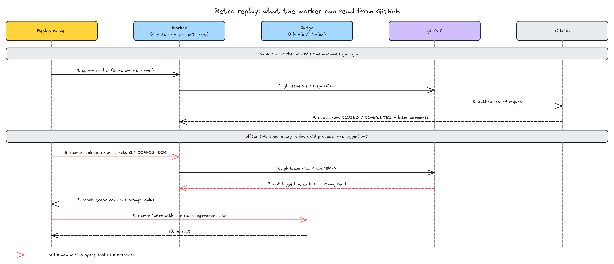

# 规则回放：worker 和判定会话不带 gh 登录

> #275 存在：在回放那样的无远端项目副本里，`gh issue view` 照样读到线上现状（harold-skills#148 停在起草前的副本读到它后来被关成 completed）；详情在「问题陈述」

## 问题陈述

### 1. 回放里的 worker 能读到用例提交之后才发生的事

一次规则回放把项目拷到用例的提交，让 worker（`claude -p`）在里面重演当时那一步，改前、改后各一遍，再由判定会话回答一道是/否题。项目副本停在过去，但 worker 用的 `gh` 还是跑回放这台机器的登录态，能读线上 issue 和 PR 的**现在**。

例子：用例 `draft-spec-orphan-capability`（项目停在提交 `b9602e50`，issue 还没起草 spec）。2026-11-10 #148 工单 01 的回放里，改后那一遍的 worker 查 GitHub，读到这个 issue 已被关成 completed、评论写着「spec 已实现并合并」，并在汇报里引用了它（#275 原文，run dir `/tmp/idea-loop-retro/draft-spec-orphan-capability/20261110T070338`；那一遍的 `result.txt` 现在已不在，2026-11-16 查的）。这个 issue 今天对 `gh` 的回答仍是 `CLOSED / COMPLETED`，关于 2026-10-27。

分拣时的复现（2026-11-13，[分拣评论](https://github.com/guohaonan-shy/harold-skills/issues/275)）：把 main 的 `docs/` 用 `git archive` 解到新目录、`git init` 成跟回放一样的无远端副本，在里面跑 `gh issue view 148 -R guohaonan-shy/harold-skills`，读到它在 2026-11-10 被关成 completed。

影响面：13 个用例的 prompt 都只禁了「gh 的任何写操作」，读没禁（2026-11-16 对 main 逐个 `grep` 的）；凡是 prompt 里点名了 issue 的用例，worker 都能这样读到后来的事。改前那一遍要是读到「后来人决定删掉」并照抄，改前就答「是」，用例会被误判成「没抓住问题」。目前实测读到的只有上面这 1 次。

### 根因

1. runner 起 worker 和判定会话时把自己的整个环境原样传给子进程，没清 `GH_TOKEN` / `GITHUB_TOKEN`，也没换 `GH_CONFIG_DIR`，所以子进程里的 `gh` 是已登录的（`idea-loop/evals/retro/retro-replay.mjs` 的 `runClaude`、`runCodexJudge`，2026-11-16 对 `origin/main` 读的）。

## 方案

改完：回放里 worker 跑 `gh issue view`、`gh pr view` 这类命令一律得到「未登录」，读不到任何线上 issue 与 PR；它能依据的只有用例提交时的项目和 prompt 里给的 issue 正文。判定会话同样不带登录。用例 prompt 不用再写「别查线上」。

由一样东西决定：runner 交给子进程的环境。做法：runner 起每个子进程（worker、Claude 判定、Codex 判定）时，用同一份环境：在自己的环境上去掉 `GH_TOKEN`、`GITHUB_TOKEN`、`GH_ENTERPRISE_TOKEN`、`GITHUB_ENTERPRISE_TOKEN`，把 `GH_CONFIG_DIR` 指到这次回放 run dir 下一个空目录。`gh` 找不到 token 也找不到登录配置，就报「To get started with GitHub CLI, please run: gh auth login」退出 4（2026-11-16 在本机用这组设置实测）。

其他入口：

- `--case`（小用例当场跑）、`--run-large`（大用例）：都走同一段起子进程的代码，纳入。
- Codex 判定：纳入。它不需要 GitHub；Codex 自己的登录不在这几个变量里。
- `idea-loop/evals/uiux-research/run.mjs`（设计调研的 baseline）：排除。它不重演过去的某一刻，项目是一份最小的产品上下文，不存在「读到之后的事」。
- 不走 `gh` 的读法（WebFetch、`curl` 公开仓库的网页或 API）：不在这里拦，见「实现决策」的已知限制。

## User Stories

1. 期望行为（对应问题 1）：回放里的 worker 和判定会话执行任何 `gh` 读命令，都得到未登录的失败，读不到线上 issue 与 PR 的现状；跑回放那台机器自己的 `gh` 登录不受影响。

## 实现决策

- **隔离在环境层，不在 prompt 层**：不往 worker prompt 里加「不要查线上」。依据：已有测试钉着「worker prompt 只有人的原话，不说自己在被测」（`retro-replay.test.mjs`「the worker prompt is the human words and nothing else」）；加一句会泄露它在回放里。
- **一份环境给所有子进程**：worker、Claude 判定、Codex 判定用同一个函数造出的环境，不各写一遍。依据：#275 分拣建议「判定会话同样处理」；判定读到线上现状同样会偏向某一边。
- **清哪些变量**：`GH_TOKEN`、`GITHUB_TOKEN`（gh 认的 github.com token），`GH_ENTERPRISE_TOKEN`、`GITHUB_ENTERPRISE_TOKEN`（企业版，同理一并清），再把 `GH_CONFIG_DIR` 指到空目录让 gh 找不到 `hosts.yml` 里的登录（含存在钥匙串里的那份，gh 要先从配置里知道用户名才会去钥匙串取）。依据：gh 手册的环境变量一节；本机实测这组设置下 `gh issue view` 退出 4。
- **其余环境照传**：`PATH`、`HOME`、`CLAUDE_CONFIG_DIR`、`IDEA_LOOP_RUNTIME` 等不动。依据：worker 要靠它们找到 claude 的登录和运行环境检测（runner 里 `sessionRuntime` 的注释写着子进程继承这份环境）。
- **空目录放在 run dir 下**：跟 run dir 一起留着、一起清，不另找位置。
- **已知限制：公开仓库的网页读法不拦**。harold-skills 是公开仓库，worker 理论上能用 WebFetch 或 `curl` 读 GitHub 网页拿到同样的现状；目前没有观察到任何一次回放这样读（唯一一次实测是 `gh`）。拦它要禁掉 WebFetch 和网络，会误伤要上网的用例。记下，不做；真出现了再开 issue。

## 测试决策

| 变的是什么 | 仪器 | 本次 |
|---|---|---|
| 纯逻辑、数据转换、状态机 | TDD 单元测试 | 碰到：造子进程环境（去掉哪几个变量、`GH_CONFIG_DIR` 指向空目录、其余照传） |
| API 契约（路由、schema、序列化） | TDD API 测试 | 不涉及 |
| DB schema、迁移、并发与事务语义 | 真 DB 测试 | 不涉及 |
| LLM 输出质量（prompt 改动） | eval（确定性断言） | 不涉及：不改任何 prompt |
| 视觉正确性 | UI 实现环 | 不涉及 |
| 端到端用户流程 | 浏览器端到端测试 | 不涉及 |

- **seam**：`idea-loop/scripts/retro-replay.test.mjs` 已有的 e2e（假 `claude`、假 Codex 由 runner 起），一个就够；它抓得到「runner 交给每个子进程的环境」，漏掉真 `gh` 在那份环境里的行为（那靠本机实测，已做）。
- **增量功能测试**：
  - 前置：跑测试时给 runner 的环境设上 `GH_TOKEN`、`GITHUB_TOKEN`、`GH_CONFIG_DIR=<一个有内容的目录>`，以及一个无关变量。步骤：跑一个用例，假 `claude`（worker 两遍和 Claude 判定）与假 Codex 各记下自己看到的这几个变量。期望：每个子进程都看不到两个 token；`GH_CONFIG_DIR` 指向一个存在的空目录、不是传进来的那个；无关变量照原样在。覆盖：期望行为 1。
  - 跑完后 runner 自己的 `process.env` 没被改动。覆盖：期望行为 1（机器自己的登录不受影响）。
- **照着谁写**：同文件的「e2e: both runs get exactly the case prompt, in a work dir that does not say it is a test」和假 Codex 那几条。

## Out of scope

- 删掉 13 个用例 prompt 里「不要 gh 的任何写操作」那句：写操作在未登录下本来也做不成，但那是用例输入的改写，要按用例的「prompt 改写记录」走，另起。
- 拦 WebFetch / 网络读：见「实现决策」的已知限制。

## 关联

- #212（todo，分支 `issue/212-replay-snapshot-plugin`，spec `replay-snapshot-plugin-sync`）：同一个 runner 的另一个泄漏通道（快照里的旧插件文件），改的是准备项目那一段；本 spec 改的是起子进程那一段。没有行为重叠，谁先合都行，后合的那边 rebase。
- #148（已关）：发现本问题的那次回放。
- 没有别的开着的 spec 碰这个 runner（`docs/spec/` 下 `seo-autopilot`、`subagent-handback-lost-turn` 都不涉及，2026-11-16 查的）。
