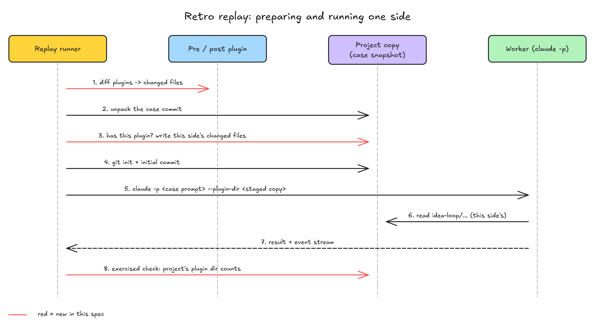

# 规则回放：快照里的插件文件跟着被比对的那一版走

> #212 存在：用例 `writing-branch-by-caller` 的快照（提交 `570e135`）自带旧版 `writing-for-agents/SKILL.md`，agent 直接读它，改前改后读到同一份规则，两次回放两边都答「否」；详情在「问题陈述」

## 问题陈述

### 1. prompt 只点 skill 名时，规则改动传不到回放里的 agent

一次回放把用例提交时的仓库拷两份，一份配主分支的插件（改前）、一份配分支的插件（改后），各跑一遍，再问一道是/否题：改前该答「否」、改后该答「是」。

harold-skills 自己的用例，被回放的仓库就是这个仓库，快照里本身就有一份 `idea-loop/`。13 个用例里 11 个是这样（另 2 个 `draft-spec-orphan-capability`、`to-ticket-walk-request-chain` 的提交不在本仓库，快照里没有插件；2026-11-16 对 `origin/main` 逐个 `git cat-file` 查的）。

例子：#180 那组工单改了 `writing-for-agents` 的规则，用例 `writing-branch-by-caller` 的 prompt 写「精简照 `idea-loop:writing-for-agents` 的写法」。agent 没有调 Skill，而是直接读当前目录里的 `idea-loop/skills/productivity/writing-for-agents/SKILL.md`。那是快照 `570e135` 里的旧文件，跟主分支的那份差 7 行（`git diff --stat 570e135 origin/main`），改前改后都读到它，`--plugin-dir` 指向的那份新规则没被读到。用例的 `annotations.md` 记了两次这样的回放（`20261031T082300`、`20261031T082801`），两边都答「否」。

现在的绕法是在 prompt 里加一句「用 Skill 工具调它，不要去读仓库里的那份文件」，已经加了三处（`writing-branch-by-caller`、`writing-prune-references`、`writing-no-project-info`）。漏一次就是一整轮付费回放：#180 那组多跑了 6 次，回放费从估计的 $3–10 涨到 $14.96（issue 原文）。

复现材料：分拣评论 https://github.com/guohaonan-shy/harold-skills/issues/212 （「🤖 idea-loop：」那条）、`idea-loop/evals/retro/cases/writing-branch-by-caller/annotations.md` 的「材料怎么拼的」。本次没有重跑回放（一次约 $1.5 以上，两次失败跑已有记录）。

### 根因

1. 回放准备项目时只把用例提交原样解包，不动其中的 `idea-loop/`；两边只靠 `--plugin-dir` 区分，而 agent 直接读项目里的文件时用不到 `--plugin-dir`（`idea-loop/evals/retro/retro-replay.mjs` 的 `prepareProject`，2026-11-16 对 `origin/main` 读的）。

## 方案

改完：同一个用例，改前那一遍在项目目录里读到的被改动文件是主分支的版本，改后那一遍读到的是分支的版本，prompt 不用再写「用 Skill 工具调」。被改动以外的插件文件保持快照时的样子，用例要处理的旧输入不变。

由三样决定：用例的提交（快照）、改前插件、改后插件。做法：

1. runner 已经算出改前、改后两份插件；先比出两份插件之间**所有**不同的文件（增、改、删，整个插件目录，不只 `skills/`、`agents/`）。
2. 解包快照后、提交成项目的初始状态之前：快照里在同一相对位置有这个插件（`<插件在仓库里的目录>/.claude-plugin/plugin.json` 存在且 `name` 相同）时，把上一步的每个文件换成这一边的版本：这一边有就写入，没有就删掉。快照里没有这个插件的，不动。
3. 「用到了改动」的核对，把项目里那份插件目录也算作改后插件的位置：读项目里的被改动文件，也算用到了。

为什么不整个换掉 `idea-loop/`：`writing-branch-by-caller`、`writing-prune-references` 要 agent 精简的是快照里超长的旧 `design-archive/SKILL.md`（`570e135` 到主分支已删了 180 多行）。整个换成主分支版，输入就成了已精简过的那份，用例失效。

其他入口：

- `--case`（小用例当场跑）和 `--run-large`（大用例）都走同一段准备项目的代码：纳入。
- 判定会话不读项目目录：不涉及。
- 用例 prompt 里已有的三句绕法：保留，不改用例输入（见 Out of scope）。

## User Stories

1. 期望行为（对应问题 1）：回放 harold-skills 自己的用例时，agent 在项目里读到的被改动插件文件，改前那一遍是主分支的版本、改后那一遍是分支的版本；没被改动的插件文件和项目其余文件跟快照一样；快照里没有这个插件的用例，项目跟现在一样原样解包。

## 实现决策

- **换哪些文件**：改前、改后两份插件之间所有不同的文件，按插件内的相对路径；依据：issue 要的是「规则改动传到 agent 眼前」，规则可能在 `skills/`、`agents/`，也可能在脚本、hook 的说明里；只换不同的，是为了不动用例的旧输入（见「方案」里的反例）。
- **怎么判断快照里有这个插件**：插件在它的仓库里的目录（runner 已经用 `rev-parse --show-prefix` 求出）在快照里存在，且其中 `.claude-plugin/plugin.json` 的 `name` 跟改后插件一致。依据：两个外部仓库的用例快照里没有它，必须原样不动。
- **换在提交之前**：项目解包后先换，再做初始提交；这样 run 结束后列「agent 写了哪些文件」时，换进去的文件不会被当成 agent 的产出。
- **「用到了改动」的位置**：项目里那份插件目录的绝对路径加入核对用的位置列表；Bash 命令里写的是相对路径（如 `cat idea-loop/skills/…`）的，也按「项目目录下的插件目录」认。依据：这次修好后，agent 照旧直接读项目里的文件时，读的就是改后版本，不算进去会被误判成「用例没测到改动」。

### 整体修法：runner 只换两份插件之间不同的文件

分拣时摆过两种：A 是 runner 把快照里的插件整个换掉，B 是只在用例写法说明里要求 prompt 让 agent 用 Skill 工具调。查代码后发现整个换会让 `writing-branch-by-caller` 失效，所以 A 收窄成只换被改动的文件，不走 B（B 已经靠人记了三次，漏一次就白跑一整轮付费回放）。依据：人在 #212 的 triage 会话里选了「只换被改动文件」（2026-11-16）。代价：快照里的插件目录变成「快照加上被改动文件的这一边版本」的混合，跟当时那一刻不完全一样。接受。

## 测试决策

| 变的是什么 | 仪器 | 本次 |
|---|---|---|
| 纯逻辑、数据转换、状态机 | TDD 单元测试 | 碰到：比出两份插件不同的文件、在快照里换成这一边的版本、判断快照里有没有这个插件 |
| API 契约（路由、schema、序列化） | TDD API 测试 | 不涉及 |
| DB schema、迁移、并发与事务语义 | 真 DB 测试 | 不涉及 |
| LLM 输出质量（prompt 改动） | eval（确定性断言） | 不涉及：不改任何 prompt |
| 视觉正确性 | UI 实现环 | 不涉及 |
| 端到端用户流程 | 浏览器端到端测试 | 不涉及 |

- **seam**：`idea-loop/scripts/retro-replay.test.mjs` 已有的 e2e 测试（假 `claude` 在项目目录里跑、记下看到的文件），一个就够；它抓得到「两边在项目里读到的文件内容」，漏掉真 agent 会不会去读那份文件（那靠下一次真回放）。
- **增量功能测试**：
  - 前置：一个测试仓库，提交里带插件目录，其中被改动的 `skills/x/SKILL.md` 写「旧」、没被改动的 `skills/y/SKILL.md` 写「快照」；改前插件的 x 写「改前」，改后插件的 x 写「改后」，另有一个只在改后插件里新增的文件。步骤：跑一个用例，假 `claude` 读项目里的 x、y 和新增文件。期望：改前那一遍读到 x =「改前」、新增文件不存在；改后那一遍读到 x =「改后」、新增文件存在；两边 y 都是「快照」；agent 的产出里不出现这些换进去的文件。覆盖：期望行为 1。
  - 前置换成提交里没有插件目录：两边项目跟原样解包一致。覆盖：期望行为 1。
  - 假 `claude` 用 Bash 以相对路径读项目里的被改动文件：结果记「用到了改动」，不是 `not-exercised`。覆盖：期望行为 1。
- **照着谁写**：同文件的「e2e: the worker sees the project as of the case commit and what it wrote is judged」和 `changeSetOf` 那条单元测试。

## Out of scope

- 删掉三个用例 prompt 里已有的「用 Skill 工具调」那句：那是用例输入的改写，要按用例的「prompt 改写记录」走，另起。
- #275（worker 读到用例提交之后的线上 issue 与 PR）：同一个 runner 的另一个泄漏通道，不在这里修。

## 关联

- #275（开着）：同在 `retro-replay.mjs` 准备 worker 环境的那一段，可能改到相邻代码；没有行为重叠，谁先都行，后做的那边 rebase。
- #180 那组工单（spec writing-for-agents-pruning-layers）：本问题的来源，已合并。
- 没有别的开着的 spec（`docs/spec/` 下只有 `index.md`，2026-11-16 查的）。
