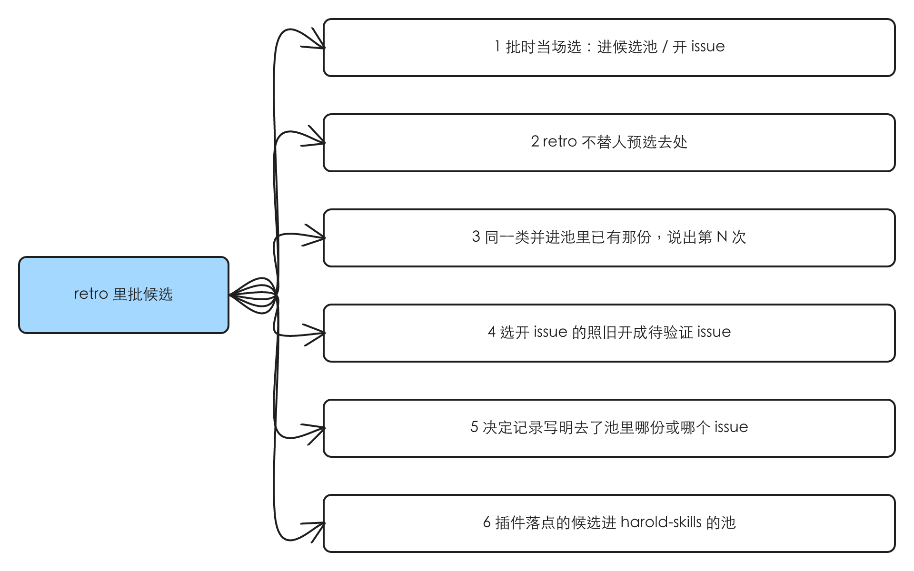
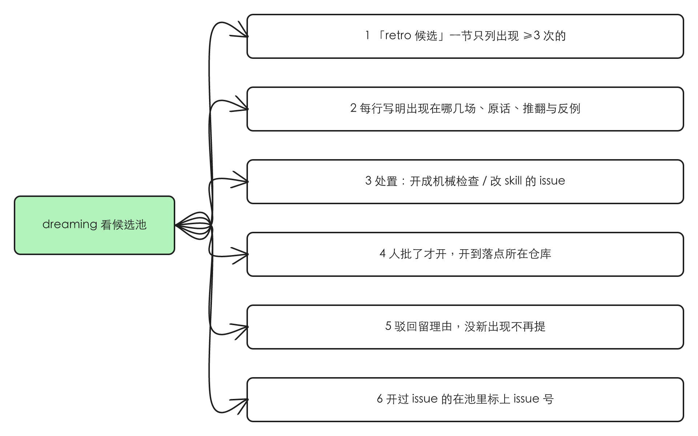

# retro 批的候选先进候选池，由 dreaming 数次数、提议开成 issue

## 验证

| issue | 结论 | 证据 |
|---|---|---|
| #115 idea-loop retro：批了的候选先进 docs/ 的候选池，由 dreaming 判断能不能进 skill；进候选池还是直接开 issue 由人在 retro 里定 | 存在 | 2026-10-26 对着 `origin/main`（9af1ba1）读 skill 原文：retro 第 5 步把批了的候选一律开成 issue，没有别的去处；dreaming 的流程里没有一处读 retro 候选。候选池目录已经手工建起来、有 20 份，没有任何 skill 读它。详情在「问题」 |

## 问题

### 1. retro 批了的候选只有「开 issue」一个去处

retro 第 5 步原文：「批了的开成 issue……照 `idea-loop:spec-status` 的『开一个待验证的 issue』开」，做完条件是「每条批了的候选都有 issue 链接，或一句开不成的原因」。第 4 步给人的回复只有批 / 不批 / 改成三种，没有「批了但先别开」。

人两次在 retro 里想要第三种去处，都只能绕开 skill 手工做：

| 哪场 retro | 人的原话 | 实际怎么落的 |
|---|---|---|
| harold-skills#108（2026-10-26） | 「留在候选吧。」（候选 3、4） | 手写成 `docs/raw/retro-candidates/` 下两份文件，决定记录里写「改成（进候选池）」 |
| Tofelair#538（2026-10-26） | 「我觉得最好是按照编号先沉淀在本地……需要修改harold-skills那时候再提issue。」 | 4 条批了的候选没开 issue，留在 Tofelair 的 `docs/raw/decisions/538.md`，再由 harold-skills 的 PR #118 抄进 `docs/raw/retro-candidates/` |

批了就开 issue 的代价，issue 正文里 #102 是实例：#55 的 retro 按 3 次「接受」开出，2026-10-26 回看时 3 次里 2 次被人推翻，依据只剩 1 次。

### 2. 候选池没人读

`docs/raw/retro-candidates/` 现在有 20 份：13 份是撤回 retro 整合时关掉的 issue 原文（#82–#109 那批，按 issue 正文的格式），1 份是 #86，6 份是 #108 与 Tofelair#538 的 retro 新写的（按决定记录的候选格式加旧文、新文、例子）。`docs/raw/index.md` 对它的说明是「它们以后由谁、怎么判断能不能进 skill，见 #115」。dreaming 的提议段只派 ui-reviewer、adr-reconciler、design-steward 三个 agent，加漏归档与全站初扫两项自己做的，都不碰它。

### 根因

retro 的设计前提是「批了就该进 skill」（spec [[retro]]；撤回的 [[retro-batch-dispatch]] 也是这个前提），所以批和开 issue 是一步。人现在把两者分开：批只说明这条值得记，进不进 skill 要等同一类攒够次数再判（issue 正文；Tofelair#538 评论里人的原话：「dreaming可以根据哪些内容出现超过两次，对内容进行机械化校验的抽象、skills的优化等」）。

## 方案

人得到的：retro 里批一条候选时，当场选它去候选池还是直接开 issue；去候选池的，下一次 dreaming 数它出现了几次，超过两次的摆进提议表，人批了才开成正式的 issue，再走 issue 流程改 skill。dreaming 自己不改 skill。

整条链路（人在 Tofelair#538 评论里的原话）：「retro -> 候选 -> dreaming -> 正式成为idea-loop的issue」。

入口逐个：

| 入口 | 纳入 / 排除 |
|---|---|
| `idea-loop:retro` 第 1 步（读以前的东西） | 纳入：加读候选池，认出已经在池里的同一类 |
| `idea-loop:retro` 第 4、5 步（摆给人、批了怎么办） | 纳入：批的时候选去处；去候选池的写进池，不开 issue |
| `idea-loop:retro` 第 6 步（决定记录） | 纳入：候选的「结果」多一种写法，链到池里那一份；落点是插件、retro 又不在 harold-skills 里跑的，多开一个 harold-skills 的 `docs/` PR |
| `/idea-loop:dreaming` 提议段与执行段 | 纳入：数池、提议、人批了开 issue |
| `proposal-table-check.mjs`（提议表校验） | 纳入：认新的一节和它的处置闭集 |
| 候选池里已有的 20 份 | 纳入：移到 `docs/records/retro-candidates/`，一次性整理成同一个形状 |
| `idea-loop:design-steward` 的设计法候选蒸馏 | 排除：那是档案里的视觉规则进 `DESIGN.md`，来源、判据、落点都不同；只借它「提议 → 人批 → 执行」的形状 |
| `issue-dispatch` 调度 | 排除：候选池不产生会话卡片，开出的 issue 按普通待验证 issue 进队列 |

## User Stories

### 场景：retro 里批候选

1. 作为在 retro 里审候选的人，我想要批一条候选时当场选「进候选池」或「开 issue」，以便依据还不稳的先攒着、已经确定要改的马上进流程
2. 作为人，我想要 retro 不替我预选去处，以便这个判断始终是我做的
3. 作为人，我想要一条候选跟池里已有的某一份是同一类时，retro 告诉我「这是第 N 次，并进 <那一份>」，以便次数攒在一处，而不是池里多一份重复的
4. 作为人，我想要选「开 issue」的候选照旧开成待验证 issue，以便现在的路不变
5. 作为以后的 retro，我想要决定记录里候选的结果写明去了池里哪一份或哪个 issue，以便数次数、认驳回时找得到
6. 作为在 Tofelair 里做 retro 的人，我想要落点是插件的候选自动进 harold-skills 的池，以便同一类在不同项目里出现也攒在一处

### 场景：dreaming 看候选池

1. 作为跑 dreaming 的人，我想要提议表里有一节「retro 候选」，只列出现超过两次的候选，以便没攒够的不来打扰我
2. 作为人，我想要每行写明出现在哪几场会话、原话、被推翻或反例的情况，以便一眼核对次数
3. 作为人，我想要每行的建议处置是「开成机械检查的 issue」或「开成改 skill 的 issue」之一，以便知道它进流程后会变成什么
4. 作为人，我想要我批了的行才开成 issue，开到落点所在的仓库，以便 dreaming 不自己改 skill
5. 作为人，我想要我驳回的候选在池里留下驳回和理由，下次没有新的出现就不再提，以便不反复看同一条
6. 作为人，我想要开过 issue 的候选在池里标上 issue 号，以便池里看得出哪些已经处理

## 实现决策

### 候选池里一份文件一条候选，形状统一

一条候选一份文件。形状沿用池里已有的 6 份新写的（#108、Tofelair#538 的 retro 写的，两处现存实例）：frontmatter 加信号、落点、旧文、新文、例子，外加一节「出现」，每次出现一行：哪个仓库哪个 issue、日期、原话（逐字）、那次的决定记录链接。

- 一条候选的「出现次数」= 「出现」里不同会话的行数，减去后来被人推翻的行（推翻的行留着，标「已推翻」和推翻时的原话）。依据：issue 正文里 #102 的实例，3 次里 2 次被推翻后「依据只剩 1 次」。
- 文件还有一行「状态」：`在池里` / `已开 issue（<链接>）` / `驳回（<理由>）`。开过 issue、驳回的不删，留作以后数次数时认得出。
- 池里已有的 13 份 issue 原文和 #86：实现时一次性改写成这个形状，原文的链接保留在文件里；它们的「出现」从原文里的次数列表取。理由：dreaming 和计数脚本只认一种形状（`idea-loop:decision-rules`「默认改动最小」之外，两种形状会让计数规则分叉）。

### 同一类在 retro 写入时归并，次数靠脚本数

判「是不是同一类」要读懂内容，放在 retro 里做、摆给人时说出来（场景「retro 里批候选」第 3 条），人批的时候顺带核了。之后的次数是机械的：数「出现」的行、去掉已推翻的，交给一个脚本，dreaming 和 retro 都调它。依据：仓库规则「能机械判定的优先做成检查」（`idea-loop:retro`「候选的形状」的落点表）。

### dreaming 的门槛：超过两次

出现次数 ≥ 3 的候选才进提议表。依据：人在 Tofelair#538 评论里的原话「哪些内容出现超过两次」。反例（同一类里人选了相反的处置）照 retro 第 2 步现有的规矩：说得出差别的提成「规则 + 例外」，说不出的不提，在「发现」格写明。

### dreaming 不改 skill，批了的开成 issue

提议表新加一节 `retro 候选`，处置闭集：`开 issue：机械检查` · `开 issue：改 skill` · `留在池里` · `驳回`。人批了的执行段照 `idea-loop:spec-status` 的「开一个待验证的 issue」开：落点是插件的开到 harold-skills，落点是目标仓库的开到目标仓库；开完回写候选文件的「状态」。依据：人的原话「dreaming没啥问题，需要修改harold-skills那时候再提issue」；dreaming 已有同样的路（设计法候选的「起草通用原则 issue」开到 harold-skills，人批了才开）。

这一节由 dreaming 自己做、不起 agent，跟漏归档并列：读池、调计数脚本、补「发现」格，用不着专职 agent 的判断。细节放进 dreaming 的一份新 reference，SKILL.md 只加一行指针（dreaming 主体已超 5000 字，见 #93）。

### retro 第 4、5 步怎么问

第 4 步人回复的「批」拆成两个：**批·进候选池**、**批·开 issue**；不批、改成不变（改成的，改完再摆一次时同样二选一）。retro 不给推荐。依据：人的原话「我觉得retro过程中进入候选还是直接进入issue需要由我来判断」；两次现存实例里，「纠正与追问」这类按现在的门槛该直接开的候选，人都选了进池（#108 候选 3，Tofelair#538 候选 1–4），推不出一条「哪类该开 issue」的推荐规则。

第 5 步：选开 issue 的照旧开；选进候选池的写进池（新的一份，或在已有的那份「出现」里加一行），不开 issue。第 6 步决定记录里候选的「结果」写成 `批·进候选池（<池里那一份的链接>，第 N 次）` 或 `批·开 issue（<链接>）`。

### 候选池按落点分仓库，放在 `docs/records/retro-candidates/`

人定的（2026-10-26，本会话审核阶段）：「候选池按落点分：插件的进 harold-skills，目标仓库的进目标仓库；目录移到 docs/records/retro-candidates/。」

- **仓库按落点分**：落点是插件（idea-loop 的 skill、agent、reference、脚本）的候选，进 harold-skills 的池；落点是目标仓库自己的规则文件的，进目标仓库的池。这样插件的同一类不管在哪个项目里出现，都在 harold-skills 一处数。以 Tofelair#538 为例：4 条落点都是 `seo-outreach`，进 harold-skills 的池；harold-skills 跑 dreaming 时数它们。
- **跨仓库写**：retro 跑在目标仓库、又有候选进 harold-skills 的池时，第 6 步除了目标仓库的决定记录 PR，再给 harold-skills 开一个只改 `docs/` 的 PR，检查全过就合并（`idea-loop:decision-rules`「不自动的」：只改 `docs/` 的 PR 检查过了就合并）。用 `gh` 远程建分支、写文件、开 PR，不检出 harold-skills；开不成的，记下原因、把候选全文留在目标仓库的决定记录里交给人。retro 跑在 harold-skills 自己里时，两个池是同一个，只开一个 PR。
- **dreaming 两边各看各的池**：目标仓库的 dreaming 只数目标仓库的池；插件的候选只有在 harold-skills 里跑 dreaming 时才数。dreaming 不跨仓库读池。
- **目录 `docs/records/retro-candidates/`，文件 `type: record`**：池里的文件要加「出现」的行、改「状态」，跟 `raw/` 的「忠实，不编辑」冲突；`records/` 的约定是「会话起头、之后由人持续更新」的台账（现存实例：seo-outreach 的跟进表 `docs/records/outreach/`）。harold-skills 现有的 20 份 `git mv` 过去，wiki-link 按文件名解析不断；`docs/raw/index.md` 里 `retro-candidates/` 那段说明移走，`docs/records/` 建 `index.md` 说明它收什么。

## 技术方案总览

### 后端

不涉及。没有服务；涉及的「接口」是 `gh` 命令和仓库里的文件。

### 前端内部

不涉及。

### 前端交互

不涉及。

## 测试决策

| 变的是什么 | 仪器 | 本次 |
|---|---|---|
| 纯逻辑、数据转换、状态机 | TDD 单元测试 | 碰到：计数脚本（读候选文件、数出现、去掉已推翻、筛 ≥3）；提议表校验认新的一节与处置闭集 |
| API 契约（路由、schema、序列化） | TDD API 测试 | 不涉及 |
| DB schema、迁移、并发与事务语义 | 真 DB 测试 | 不涉及 |
| LLM 输出质量（prompt 改动） | eval（确定性断言） | 碰到：retro 第 4–6 步的规则改动，走 retro 回放（`idea-loop/evals/retro/`），见下 |
| 视觉正确性 | UI 实现环 | 不涉及 |
| 端到端用户流程 | 浏览器端到端测试 | 不涉及 |

- **seam**：
  - 计数脚本的命令行（喂一个候选目录，读它输出的每条候选次数与是否过门槛）。抓得到计数、推翻、门槛的错；抓不到 retro 归并同一类时判错。
  - `proposal-table-check.mjs` 的命令行（喂一张表，读退出码与报错）。抓得到新一节的列和处置写错；抓不到 dreaming 有没有把该进表的候选放进来。
  - retro 回放：一个用例，取 harold-skills#108 的 retro（人说「留在候选吧」的那一步），是/否题「批了的候选有没有问人去候选池还是开 issue，选了候选池的写进池而没开 issue」；改前应答「否」、改后「是」。
- **增量功能测试**：
  1. 前置：一个候选目录，含一条出现 3 次（其中 1 次已推翻）、一条出现 3 次都成立的。步骤：跑计数脚本。期望：前者 2 次不过门槛，后者 3 次过。覆盖：dreaming 看候选池 1、2。
  2. 前置：一张提议表，`retro 候选` 一节有一行处置写「改进 skill」。步骤：跑校验。期望：非零退出，报处置不在闭集里。覆盖：dreaming 看候选池 3。
  3. retro 回放用例如上。覆盖：retro 里批候选 1、2、4。
- **prompt / eval 变动**：retro、dreaming 的 SKILL.md 与新 reference 是 prompt 改动；加一个 retro 回放用例。
- **照着谁写**：`idea-loop/scripts/` 下各 `*.test.mjs`（如 `issues.test.mjs`）；回放用例照 `idea-loop/evals/retro/cases/explain-mechanism`。

## Out of scope

- design-steward 的设计法候选蒸馏：来源与落点不同（见「方案」）。
- 调度：候选池不出卡片。
- dreaming 自己改 skill：人明确说开 issue。
- 回溯检查池里已有候选的「出现」是否被推翻：整理已有 20 份时照原文搬，不重新审；人以后在 retro 或 dreaming 里推翻时再标。

## 关联

- 覆盖：#115 idea-loop retro：批了的候选先进 docs/ 的候选池，由 dreaming 判断能不能进 skill；进候选池还是直接开 issue 由人在 retro 里定
- 相关 spec：[[retro]]（retro 本身，已完成待 dreaming）、[[retro-batch-dispatch]]（retro 整合，已撤回，它撤回的原因就是这份）
- raw：[[2026-10-26-retro-candidate-pool-grill]]（候选池放哪的 grill）
- 决定记录：[[108]]（候选 3、4、5）；Tofelair `docs/raw/decisions/538.md` 的候选 1–4
- 相邻还没完成的：
  - #93 dreaming 的 SKILL.md 主体超过 5000 字：重叠在 dreaming 主体，这份只加一行指针、细节进 reference，不加重它；谁先都行
  - #87 session-digest locate 找到别的会话的记录：retro 第 1 步的脚本，不重叠
  - #80 decision-rules 拆分「交给人时」：不重叠
