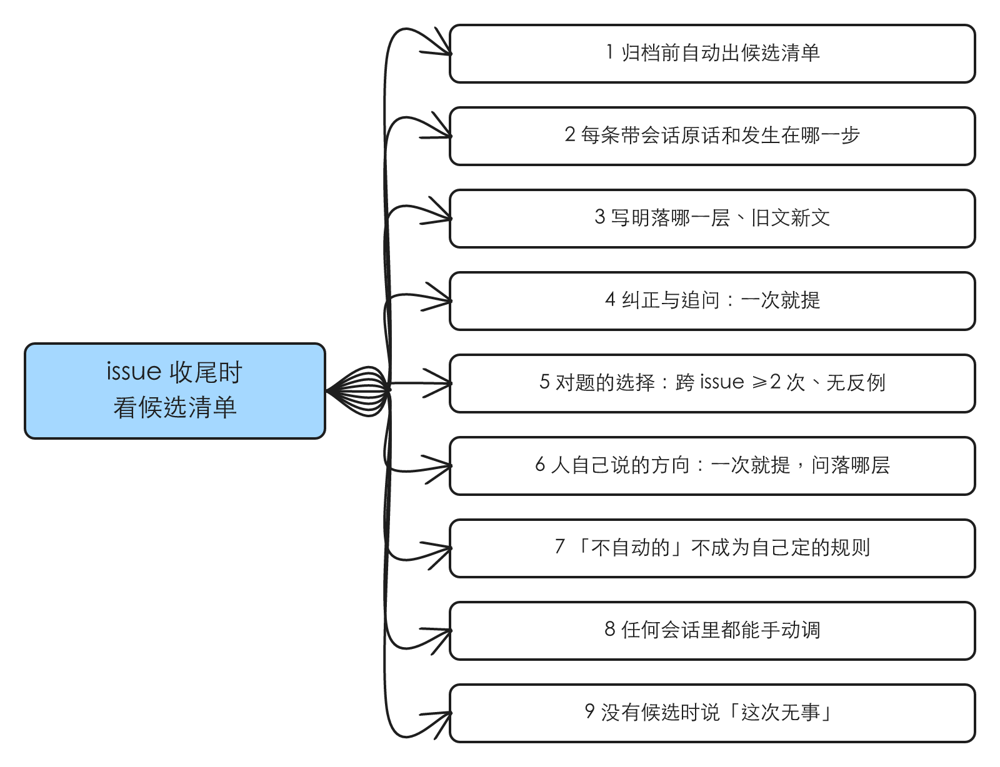
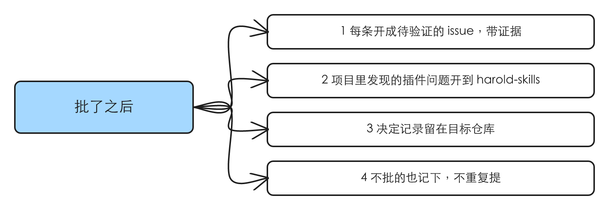
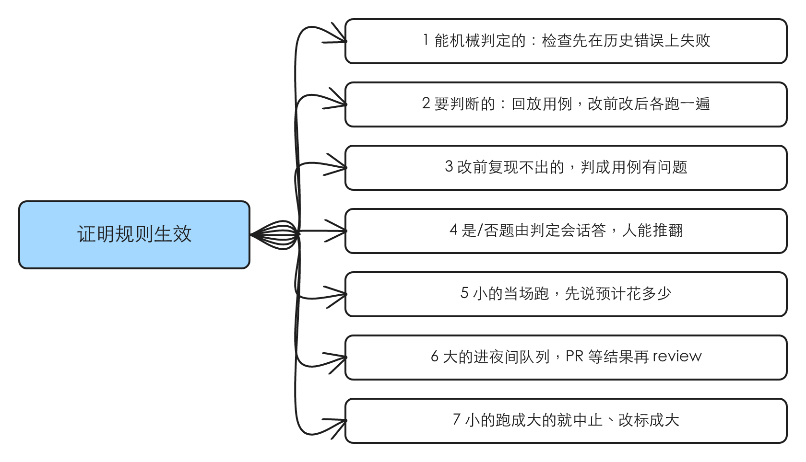
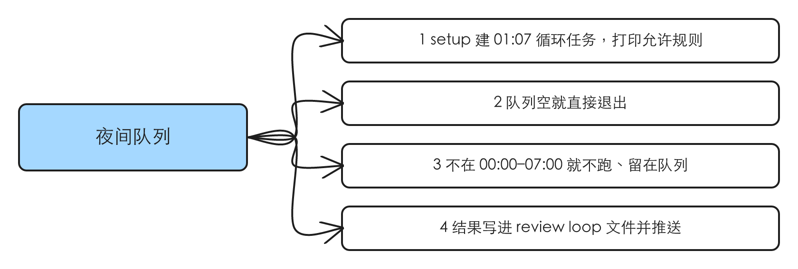
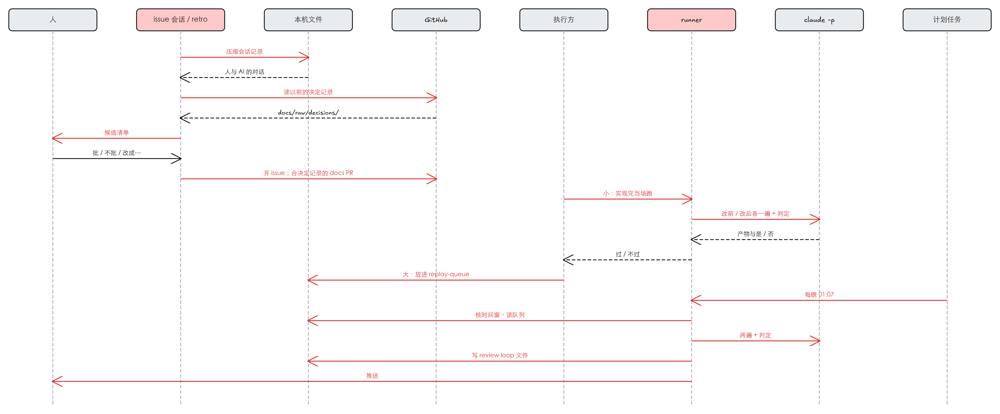

# retro：从实际决策里把问题和决策点整理成规则，迭代 skill

## 验证

| issue | 结论 | 证据 |
|---|---|---|
| #51 idea-loop retro：从实际决策里把问题和决策点整理成规则，迭代 skill | 存在 | idea-loop 里没有任何一步回看会话里人的纠正和决定；唯一一次提炼规则是手工做的，改出来的 skill 也没有办法证明它生效（详见「问题」） |

## 问题

### 1.1 人在会话里的纠正和决定，没有一个环节收回来

**复现到的**（2026-10-22，对 `origin/main` 96d66f2）：

- idea-loop 的 skill 里没有一个读会话记录、回看人的纠正或决定（在 `idea-loop/skills/` 下搜 `retro`、`会话记录`，无结果）。
- 唯一一次从人的决定里提炼规则，是 2026-10-19 手工做的：导出 Tofelair 的 6 个审核会话、翻 10 个已合并 PR，统计出审 spec 时约 30 次追问和纠正、PR 里约 80 个决定（[[pr-review-report-followups]] 的 1.1、1.2），产物是现在的 `decision-rules`。下一类同样重复的事，要等人哪天再手工翻一次。
- 这些东西都在会话里：issue 会话从验证一直陪到关闭，grill、审 spec、停下汇报、review 轮次都在同一场会话里。会话记录在本机落成文件（`~/.claude/projects/<项目>/<会话>.jsonl`），会话被压缩或恢复之后，文件里仍有从开场起的全部原话（核的是 #51 自己的会话：它没有被压缩过，但恢复过两次，每次恢复新起一份文件并带上之前的全部历史，开场那句 `issue-session 51` 和之后每一轮人的原话都在最新一份里；压缩记录的结构由执行方在本机另一份被压缩过的记录里核过）。

例子：#51 自己这场会话里，人第一次回复就把第一版 spec 的前提改掉了（「这个用不用 dreaming，我觉得不重要根本」）；之后人追问「`claude -p` 起的是什么样的会话」「subagent 跟 `claude -p` 的区别」，都是汇报没讲清机制。这类信号现在会话一归档就没了。

### 1.2 改了 skill，没有办法证明它真的变了

**复现到的**：

- 仓库根 `AGENTS.md` §5 规定 skill 跳过 quantitative eval，只给 `uiux-research` 开了例外；`decision-rules` 落地时没有任何一次「拿当时出问题的输入再跑一遍」。
- 能复用的跑法只有 `idea-loop/evals/uiux-research/run.mjs`：`claude -p` 加 `--plugin-dir` 指工作树、在 `/tmp` 下的干净项目副本里跑。
- 实测（2026-10-22，Claude Code 2.1.299）：

| 试了什么 | 结果 |
|---|---|
| 子代理加载 `idea-loop:spec-status` | 加载的是装好的 `~/.claude/plugins/cache/harold-skills/idea-loop/0.1.1/`，验不了分支上的规则 |
| `claude -p … --plugin-dir <工作树>/idea-loop` | 加载的是工作树里的 skill；空跑一次 $0.33 |
| 桌面 app 一次性计划任务里跑同一条命令 | 命令以 `claude -p` 开头、匹配上允许规则时通过（$0.48）；前面加了别的命令就被 auto 分类器拦下 |

复现材料：`.tmp/grill/2026-10-22-retro/`（两次 `claude -p` 的输出），讨论全文见 [[2026-10-22-retro-grill]]。

### 根因

- 收集人的反馈只有一次性的手工整理，没有一个固定的环节（1.1）。
- skill 的改动只有「写进去」，没有「跑一遍看它变了没有」；能跑分支版本的只有 `claude -p`，子代理加载的是装好的旧版（1.2）。
- 修正：#51 原先认为该由 dreaming 定期读 PR 归档；grill 里人定为一个独立的 skill，读会话记录，dreaming 不参与（[[2026-10-22-retro-grill]] U1、U2）。

## 方案

**人得到什么**：

1. issue 会话收尾时，会话里出现一份 retro 的候选清单：每条是一个要改的地方（改哪一层、改成什么、旧文新文并排），证据是会话里的原话和时刻。人逐条批。
2. 批了的每条成为一个待验证的 issue，开到对应的仓库，走正常的 loop。
3. 改 skill 的那张工单验收里有一个回放用例：改前的插件复现出当时的问题，改后的不再出现。小的执行方当场跑，大的夜里跑，早上结果在 review loop 文件里。

**由什么决定**：

| 输入 | 决定什么 |
|---|---|
| 这场会话的会话记录文件 | 有哪些信号（纠正与追问、对摆好的题的选择、人自己说的方向） |
| 目标仓库 `docs/raw/decisions/` 里以前的 issue 留下的决定记录 | 「对题的选择」够不够 2 次、有没有反例 |
| 目标仓库与插件现有的规则文件、检查脚本 | 落哪一层、是不是已经有了 |

**同类入口**：

| 入口 | 纳入 / 排除 |
|---|---|
| issue 会话收尾时 | 纳入：自动跑 |
| 人在任何会话里手动调 `/idea-loop:retro` | 纳入 |
| PR 的归档评论 | 排除：同样的内容在会话记录里都有（U2「可以通过读会话记录来判断」） |
| dreaming | 排除：人定的（U1） |

## User Stories

### 场景：issue 收尾时看候选清单

1. 作为收尾 issue 的人，我想要会话归档之前自动出一份候选清单，以便这场会话里我纠正过、决定过的东西不会随归档丢掉。
2. 作为收尾 issue 的人，我想要每条候选带着会话里的原话和发生在哪一步，以便我一眼核对它归纳得对不对。
3. 作为收尾 issue 的人，我想要每条候选写明落在哪一层（插件 skill、目标仓库规则文件、确定性检查）和旧文新文，以便我批的就是最终要改的那句话。
4. 作为收尾 issue 的人，我想要我的纠正和追问出现一次就成为候选，以便 skill 做错的地方立刻被指出来。
5. 作为收尾 issue 的人，我想要我对摆好的题的选择，跨 issue 同一类出现 2 次、没有反例才成为候选，以便一次性的取舍不会被写成规则。
6. 作为收尾 issue 的人，我想要我自己说出的方向出现一次就成为候选，并问我落到哪一层，以便我随口定下的原则不会丢。
7. 作为收尾 issue 的人，我想要「不自动的」那几类即使重复也不成为「自己定」的候选，以便它们永远留在我手里。
8. 作为任何会话里的人，我想要随时手动调 retro，以便不是 issue 会话的地方也能收。
9. 作为收尾 issue 的人，我想要没有候选时它说一句「这次无事」，以便我知道它跑过了。

### 场景：批了之后

1. 作为拍板的人，我想要批了的每条候选变成一个待验证的 issue，开到对应的仓库，正文带着证据，以便改 skill 跟改代码一样过 spec 和 review。
2. 作为拍板的人，我想要在目标项目（例如 Tofelair）里发现的插件问题开到 harold-skills，以便插件的改动回到插件仓库。
3. 作为拍板的人，我想要这个 issue 的决定记录留在目标仓库里，以便以后的 retro 能数到同一类决定出现了几次。
4. 作为拍板的人，我想要我不批的候选也记下来，以便下次不拿同样的证据再提一次。

### 场景：证明规则生效

1. 作为审规则改动的人，我想要能机械判定的规则做成检查，并且这个检查先在那次历史错误上失败过，以便我知道它真的抓得住。
2. 作为审规则改动的人，我想要要判断的规则带一个回放用例，用改前、改后的插件在当时的输入上各跑一遍，以便我看到 skill 的行为真的变了。
3. 作为审规则改动的人，我想要改前那一遍复现不出当时问题的用例被判成用例有问题，以便一个本来就不会红的用例不被当成证明。
4. 作为审规则改动的人，我想要每个用例有一道从我当时原话写出的是/否题，由判定会话回答并引出处，我能推翻，以便我不用每次读全部产物。
5. 作为白天在工作的人，我想要小的回放在执行方实现完时当场跑完，跑之前说一句预计花多少，以便小改动不用等到第二天。
6. 作为白天在工作的人，我想要大的回放进夜间队列，PR 等早上的结果出来再进 review，以便它不占我白天的额度。
7. 作为白天在工作的人，我想要标成小的回放一旦起了 agent、开了浏览器就中止并改标成大，以便「小」的不会跑成大的。

### 场景：夜间队列

1. 作为装 idea-loop 的人，我想要 setup 建一个每晚 01:07 的循环计划任务，并打印 runner 的允许规则让我自己加，以便夜里不用人管、权限设置仍只由我改。
2. 作为装 idea-loop 的人，我想要夜间任务读队列，队列空就直接退出，以便没有活的夜里不花钱。
3. 作为装 idea-loop 的人，我想要 app 夜里关着、第二天早上补跑时，runner 发现不在 00:00–07:00 就不跑、留在队列里，以便漏掉的那晚不会挪到白天。
4. 作为第二天早上的人，我想要结果写进那个 PR 的 review loop 文件并发一条推送，以便我在那个 issue 会话里接着看。

## 实现决策

下面的决定都来自 [[2026-10-22-retro-grill]]，依据写人的原话所在的轮次。

### 4.1 一个新 skill：`retro`

放 `idea-loop/skills/productivity/retro/`。可以被模型调用：issue-session 的「收尾」要调它，人在普通对话里说「retro 一下」也该起它。依据：U2「Q3 同意」（收尾自动跑 + 人随时手动调）；idea-loop `AGENTS.md`「skill 分类」：几条流程都要用的归 productivity。根目录 `AGENTS.md` 的「调用方式按出口定」一节要加上它：它的出口停在人身上（候选要人批），但它是被 issue-session 调起的，跟 `grill` 一样解锁「谁能调」。

issue-session 的「收尾」在归档之前加一步：调 `retro`，人批完候选、开完 issue 之后再归档。

### 4.2 读会话记录文件，不靠上下文

retro 读这场会话本机的会话记录文件，先用一个脚本把它压成「人的每一条发言，加上它前面那一条 AI 回复的结论部分」，只读压过的。依据：U2「Q2 我觉得可以通过读会话记录来判断」；会话会被压缩，上下文里已经没有开场那几轮，但文件里有（1.1 的实测）；#51 的会话记录文件约 3MB，原样读不进来，压过之后只剩对话本身。

找不到唯一的那份文件时，退回 `export_transcript`。

### 4.3 三种信号，三种门槛

| 信号 | 例子 | 门槛 | 去处 |
|---|---|---|---|
| 人的纠正与追问 | 「哪两个边缘 case？」「subagent 跟 `claude -p` 的区别能跟我讲一下吗」 | 出现一次就提 | 修那个 skill（汇报没讲清的，修汇报写法） |
| 人对摆好的题的选择 | 「S1 接受，S2 接受：都按推荐」 | 跨 issue 同一类 ≥2 次、没有反例 | 「自己定」的规则：插件的 `decision-rules`，或目标仓库的规则文件 |
| 人自己说出的方向 | 「agent.md/claude.md 应该只保留影响模型在该仓库工作的内容」 | 出现一次就提 | 候选里问人落哪一层 |

依据：U3「Q6 同意」「Q7 同意」。门槛借自 `/correct` 的「同类出现两次」，只用在「对题的选择」上：纠正说明 skill 已经做错，等不起第二次。

有反例、而且反例的原话能说出它跟其余几次差在哪的，提成「规则 + 例外」；说不出差别的不提。`decision-rules`「不自动的」那几类，照样记，但不提成「自己定」的规则。依据：`decision-rules`「宁可多问，也不靠推断凑出一个依据」与「不自动的」原文。

### 4.4 决定记录：每个 issue 一份，进目标仓库的 `docs/raw/decisions/`

「对题的选择」要跨 issue 数次数，所以每次 retro 把这场会话里摆给人的每道题记下来：摆给人的是什么、选项与推荐、人的原话、最后怎么做的、归纳出的「情形 / 处置 / 理由」，以及人这次批了或没批的候选。文件 `docs/raw/decisions/<issue 号>.md`（`type: raw`）。依据：U3 接受了 Q7 的推荐（「累积的记录放目标仓库的 `docs/raw/decisions/`，一个 issue 一份」）。

这份文件经一个只改 `docs/` 的 PR 合进主分支，检查过了就合并。依据：`decision-rules`「不自动的」：只改 `docs/` 的 PR 检查全过就合并。

### 4.5 落三层，按问题出在哪定

| 问题出在 | 落点 |
|---|---|
| idea-loop 的流程本身 | 插件的 skill / agent / reference |
| 只跟这个项目有关 | 目标仓库的 `CODING_STANDARDS.md`、`REVIEW.md`、`AGENTS.md`（或 `CLAUDE.md`） |
| 能机械判定 | 优先做成检查（脚本、lint、校验脚本的单测），两边都一样 |

依据：U2「Q1 没问题」。

### 4.6 只出候选，批了的开 issue

retro 不改任何规则文件。候选在会话里逐条摆出，人回「批 / 不批 / 改成…」。批了的每条照 `idea-loop:spec-status` 的「开一个待验证的 issue」开出去：插件的开到 harold-skills，项目的开到目标仓库；正文写候选、落点、旧文新文和会话里的原话。依据：U4 接受了 Q9（「retro 只出候选；你批了的，每条开成一个待验证的 issue」）；retro 所在的 issue 会话收尾后就归档，改动在那里没人跟。

### 4.7 证明生效：检查要先失败，回放要改前红改后绿

改规则的那张工单，验收里写清它用哪一种证明：

- **能机械判定的**：做成检查，并在一次复现那次历史错误的输入上先看到它失败。依据：U2 接受了 Q5 的这一半；poteto `create-formal-verification-skill`「A check that you have never seen fail proves nothing」。
- **要判断的**：写一个回放用例 `idea-loop/evals/retro/cases/<用例>/case.json`，记：提交号（决策发生时的仓库状态）、prompt（当时让 skill 产出东西的那句话）、停在哪（skill 把东西交给人的那一刻）、一道是/否题（从人当时的原话写出）、大或小及凭哪一条。依据：U4「Q10 同意」。
- **跑法**：runner 照 `uiux-research` 的 `run.mjs`：在 `/tmp` 下按提交号拷一份项目副本，`claude -p` 用 `--plugin-dir` 分别指主分支和 PR 分支的插件各跑一遍；再起一个 `claude -p` 判定会话，读两份产物答是/否并引出处。改前「否」（问题复现）、改后「是」才算过；改前就「是」的，判成用例没抓住问题，先修用例。依据：U4「Q11 同意」；1.2 的实测（子代理加载装好的旧版，只有 `claude -p` 能跑分支）。
- **人能推翻判定**：推翻记进用例旁边的 `annotations.md`。

根目录 `AGENTS.md` §5 加上第二个例外：retro 的回放。理由跟 `uiux-research` 那条不同：不打分，只判一条规则对应的那一个点；它是规则改动的验收，不是质量基线。

### 4.8 大小机械地判，小的当场跑、大的夜里跑

| | 判据 | 什么时候跑 |
|---|---|---|
| 小 | 回放只驱动一个 skill 到交给人的那一刻，不起插件 agent、不开浏览器、不调付费外部服务 | 执行方实现完当场跑；跑之前在会话里说一句预计花多少 |
| 大 | 碰到上面任何一样 | 执行方写好用例、放进夜间队列，交回时写「回放在队列里」；PR 等结果出来再进 pr-review |

runner 跑「小」的用例时，从 `stream-json` 里看到起了 agent 或开了浏览器，就中止、把用例改标成大、放进队列。依据：U5「只有大任务的修改……我们需要放到晚上」「小的任务……立马就跑了」；U6「Q16-Q17都同意」。

### 4.9 夜间队列与计划任务

- 队列：`~/.idea-loop/replay-queue/`，一个等回放的 PR 一个文件（仓库、PR 号、worktree 路径、用例列表）。依据：U5 接受了 Q14 的 B（大的）；根目录 `AGENTS.md`：跨会话的运行时状态落用户主目录。
- 计划任务：`/idea-loop:setup` 建一个桌面 app 的循环计划任务，每晚 01:07，prompt 只跑一条 runner 命令。依据：同上。
- 时间窗：runner 开跑前核本机时间，不在 00:00–07:00 就不跑、队列原样留着。依据：U3「在本机时间的00:00-07:00跑」；计划任务的会话改不了计划任务（1.2 的实测），所以只能「不跑、等下一晚」。
- 结果：写进那个 PR 的 review loop 文件，发一条推送；跑完的从队列删掉。
- 权限：runner 装在固定位置 `~/.idea-loop/bin/`（setup 从插件里拷过去），setup 打印它的允许规则（形如 `Bash(node ~/.idea-loop/bin/retro-replay.mjs:*)`），人自己加进 `~/.claude/settings.json`。依据：U5「Q15 同意」；1.2 的实测：不匹配允许规则的命令会被 auto 分类器拦下。

小的回放也走同一个 runner、同一条允许规则，只是由执行方当场调用。

## 技术方案总览

### 后端

这里的「后端」是 issue 会话、retro、本机文件、GitHub、计划任务与 `claude -p`。

红色是本 spec 新增的消息，虚线是响应。

- 收尾：issue-session 调 retro（4.1）→ 压会话记录（4.2）→ 读以前的决定记录（4.4）→ 出候选 → 人批 → 开 issue、合决定记录的 docs PR（4.6、4.4）。
- 改规则的那个 issue 走正常 loop；implement 时执行方写回放用例，小的当场调 runner，大的放进队列（4.7、4.8）。
- 每晚 01:07 计划任务调 runner：核时间窗 → 读队列 → 每个用例两遍 `claude -p` 加一次判定 → 写 review loop 文件、推送（4.9）。

接口变化：新增会话记录压缩脚本、回放 runner（带 `--queue` 与单 PR 两种用法）、`case.json` 的格式；setup 多建一个计划任务、多打印一条允许规则。

### 前端内部

不涉及。

### 前端交互

不涉及。

## 测试决策

| 变的是什么 | 仪器 | 本次 |
|---|---|---|
| 纯逻辑、数据转换、状态机 | TDD 单元测试 | 碰到：会话记录压缩（4.2）；`case.json` 校验（4.7）；runner 的时间窗判断、大小改标、队列读写、两遍结果加判定合成过不过（4.7–4.9） |
| API 契约（路由、schema、序列化） | TDD API 测试 | 不涉及 |
| DB schema、迁移、并发与事务语义 | 真 DB 测试 | 不涉及 |
| LLM 输出质量（prompt 改动） | eval（确定性断言） | 碰到：retro 本身不做 eval（按 `AGENTS.md` §5）；它产出的规则改动用 4.7 的回放验收。本 spec 交付时用一个真实用例冒烟一次 runner（见下） |
| 视觉正确性 | UI 实现环 | 不涉及 |
| 端到端用户流程 | 浏览器端到端测试 | 不涉及 |

- **seam**：
  - 会话记录压缩脚本：喂一份会话记录文件，读压出来的对话。抓得到压缩后丢了人的发言、混进工具输出；漏掉「哪一份文件是这场会话」的定位。
  - runner 的纯函数：喂 `case.json`、两遍运行的结果摘要、当前时间、队列目录，读决定（跑 / 不跑 / 过 / 不过 / 改标成大）。抓得到时间窗、改标、过不过的判断错；漏掉 `claude -p` 本身的行为（由冒烟覆盖）。
- **增量功能测试**：
  - 前置：一份含压缩标记的会话记录。步骤：压缩。期望：压缩标记之前的人的原话都在，工具调用和输出都不在。覆盖：场景「issue 收尾时看候选清单」2。
  - 前置：当前时间 09:12。步骤：runner 以 `--queue` 运行。期望：不起任何 `claude -p`，队列文件原样。覆盖：场景「夜间队列」3。
  - 前置：队列空。期望：立即退出，不起任何 `claude -p`。覆盖：场景「夜间队列」2。
  - 前置：标成小的用例，第一遍的 `stream-json` 里出现起 agent 的工具调用。期望：中止，用例改标成大，进队列。覆盖：场景「证明规则生效」7。
  - 前置：改前判定「是」。期望：结果是「用例没抓住问题」，不算过。覆盖：场景「证明规则生效」3。
  - 前置：改前「否」、改后「是」。期望：过，结果写进 review loop 文件。覆盖：场景「证明规则生效」2、4；「夜间队列」4。
  - 冒烟：用 #51 会话里一条真实的纠正写一个小用例，runner 当场跑一次，改前红、改后绿。覆盖：场景「证明规则生效」2、5。
- **prompt / eval 变动**：新增 `idea-loop/evals/retro/`（runner 与用例的家）；`AGENTS.md` §5 加例外。retro 的 SKILL.md 是 agent 的步骤，不另做 eval。
- **照着谁写**：`idea-loop/evals/uiux-research/run.mjs`（`claude -p` 加 `--plugin-dir`、`/tmp` 下的项目副本、`stream-json`）；`review-loop.test.mjs` 与 `proposal-table-check.test.mjs`（脚本纯函数的单测写法）。

## Out of scope

- dreaming 读 PR 归档：人定的，dreaming 不参与（U1）。
- 跨仓库汇总决定记录：每个仓库各记各的；插件级的问题靠开 issue 汇到 harold-skills。
- 「规则 ↔ 由什么强制」的对照表（`/correct` 的做法）：这次不建；规则被重犯时，retro 照样以「纠正」信号提出来。
- 自动改规则：每条都要人批（U4 接受了 Q9）。
- 用子代理做回放：加载的是装好的旧版（1.2）。

## 关联

- 覆盖：#51 idea-loop retro：从实际决策里把问题和决策点整理成规则，迭代 skill
- raw：[[2026-10-22-retro-grill]]（这场 grill）、[[2026-10-19-pr-decision-friction]]（手工回看那次）
- [[pr-review-report-followups]]（实现中）：`decision-rules` 的来源；它的 4.9 说「代价相称」等推翻记录多了再升级，以后由 retro 的「对题的选择」信号提出来。不改它的内容，先后无依赖。
- [[dreaming-design-reconcile]]（实现中）：没有重叠，这份不再碰 dreaming。
- #55 idea-loop：UI 审查改为每轮照实现同步档案、删合并前钩子；dreaming 拆成编排者 + 专职 agent（验证中）：没有重叠。
- 会改到的现有 skill：`issue-session`（收尾加一步）、`setup`（建计划任务、打印允许规则）、`implement` / implementer（规则改动的工单要跑回放、大的放队列）、根目录 `AGENTS.md`（调用方式一节、§5 例外）。
