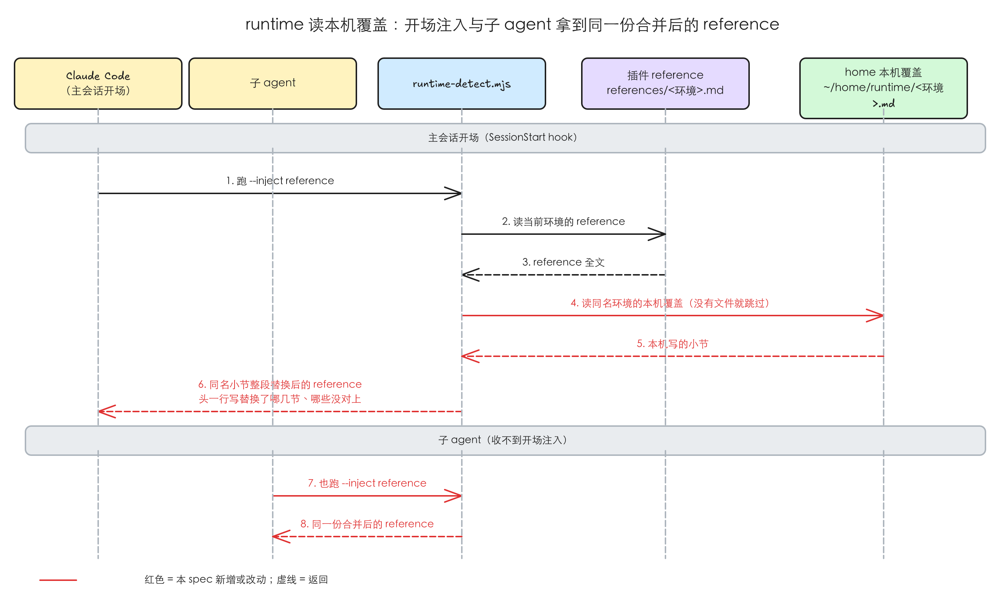
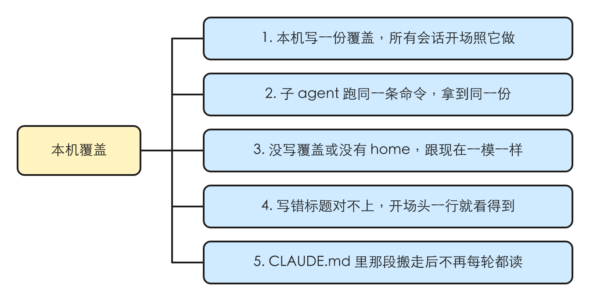

# runtime 的本机覆盖：放进 home，同名小节整段替换

> #295 存在：本机跟 runtime reference 不一样的做法（例：magi 机器上调度改用常驻会话 + `magi wake`）没有 idea-loop 认得的落点，只能写进每个会话都读的 `CLAUDE.md`，详情在「问题陈述」

## 问题陈述

### 本机做法只能堆进 CLAUDE.md，每个会话都背着

`idea-loop:runtime` 把「定时任务」「会话管理」这些能力的具体做法写在每个运行环境一份的 reference 里（插件内 `skills/productivity/runtime/references/<运行环境>.md`）。一台机器的实际情况跟 reference 不一样时，没有地方告诉 idea-loop。

真实例子（issue 原文，2026-11-13 那台 magi 机器）：magi 的 reference 写「调度用 `magi cron` 每轮新开一个调度会话」（`magi.md`「定时任务」和「会话管理 / 调度」两节）。那台机器上 `magi cron` 开出的会话没有任何能力（连 `magi` 都没有），跑不了调度和分拣，所以人改成一个常驻会话 + `magi wake` 定时叫醒，不建不改 `magi cron`、跑完不停掉自己、开 issue 会话加 `--desktop main`。这约 10 行只有调度会话用得到，却写在那台机器每个会话都加载的 `CLAUDE.md` 里。

测了什么、看到什么（分拣评论 [2026-11-13](https://github.com/guohaonan-shy/harold-skills/issues/295#issuecomment-6851539509)，2026-11-17 对着 `release/idea-loop-0.2.0` 的 `950f916` 再核一遍）：

- 读 reference 的路只有两条，都不碰本机文件：主会话由 SessionStart hook 跑 `runtime-detect.mjs --inject reference`，原样打印插件里那份 reference；子 agent 照 runtime 的 SKILL.md「怎么用」自己读 `references/<运行环境>.md`。2026-11-20 对着 `release/idea-loop-0.2.0` 的 `ce6eaa8` 再核：两条路换成了 `dyna runtime inject reference` 和 `dyna runtime show <能力>`（#339），读的都只是插件里 `runtime/<运行环境>.md`，仍不碰本机文件。
- 全仓库 grep `RUNTIME.md` 零命中；`magi.md` 仍写 `magi cron`。
- 本机 `~/home` 已建（2026-11-17，#252 的 setup 建的），设备地图列了 `AGENTS.md`、`memory/`、`projects/`、`.backup/` 四层，没有放 runtime 做法的一层。

本该是：本机的做法写在一份只给 runtime 用的本机文件里，`CLAUDE.md` 不用背；会话用到某个能力时拿到的就是本机的做法。

### 根因

`idea-loop:runtime` 的输入只有插件里的 reference，没有约定任何本机文件；本机想改做法，只能绕到每轮都加载的 `CLAUDE.md`。

## 方案

**用户得到什么**：在一台设备上写一份 `~/home/runtime/<运行环境>.md`（例：`~/home/runtime/magi.md`），里面按 reference 的标题写要换掉的小节。之后这台设备上该运行环境的每个会话，开场注入的 reference 里那几节已经是本机写的；子 agent 照 runtime 的步骤拿到的也是同一份。本机文件不存在，或没有 home，一切跟现在一样。决定输出的输入只有三样：当前运行环境的名字、插件里那份 reference、home 里同名的本机覆盖。

**做法**：

1. `dyna runtime inject reference`（主会话开场注入）读完插件里的运行环境数据后，再读 `<home>/runtime/<运行环境>.md`（home 的位置跟 #252 的项目地图注入用同一个规则：`IDEA_LOOP_HOME` 有值用它，否则 `~/home`）。
2. 按标题合并：本机文件里每个 `##` 或 `###` 标题开一段，到下一个同级或更高级标题为止；reference 里同级、标题文字完全相同、且只有一处的那段，被整段替换。`##` 段里带着的 `###` 一起算在这段里。本机文件第一个 `##` / `###` 之前的内容（如 `# magi 本机覆盖` 这行标题）不用。
3. 注入的头一行（在「以下是 … reference 全文」之前）说明合并结果：替换了哪几节，哪几节没对上、没用上。没有本机文件就没有这一行。
4. 子 agent 取某个能力的做法用的 `dyna runtime show <能力>`，取的是合并后的那份：那一节被本机替换了，输出第一行写「本机覆盖 <路径>：这一节是本机写的」。主会话照旧直接照开场注入做。
5. 设备地图加一行：设备地图模板（wiki-conventions 的 `references/home-maps.md`，setup 和 dreaming 共用）的「home 里每一层放什么」多列 `runtime/`：「这台设备对 `idea-loop:runtime` 的本机覆盖，`<运行环境>.md` 一份，开场已合进注入的 reference，不用另读」。

magi 例子改完的样子：那台机器把 `CLAUDE.md` 里那约 10 行搬成 `~/home/runtime/magi.md`，写两段：`### 调度（issue-dispatch 的三处）`（写在最前）和 `## 定时任务`（不建不改 `magi cron`）（常驻会话 + `magi wake`、跑完不停、`--desktop main`）。调度会话开场拿到的 reference 里这两段已是本机写法，头一行写「本机覆盖 ~/home/runtime/magi.md：替换了「定时任务」「调度（issue-dispatch 的三处）」」。`CLAUDE.md` 删掉那一节。

同一行为的其他入口：

| 入口 | 纳入 / 排除 |
|---|---|
| 主会话开场注入（SessionStart hook，claude-desktop 和 magi 都走它） | 纳入 |
| 子 agent 取一个能力的做法（`dyna runtime show <能力>`） | 纳入，同一份合并逻辑 |
| `dyna runtime name` 打印运行环境名、`dyna runtime show` 不带能力打印能力清单和退路 | 排除：只给名字或通用规则，不涉及做法 |
| 开场的另两段注入（decision-rules、runtime 正文） | 排除：本机覆盖只针对运行环境的具体做法；runtime 正文的能力清单和退路是通用规则，不给本机改 |

## User Stories

本机覆盖：

1. 作为在一台设备上有特殊做法的人，我想要写一份 `~/home/runtime/<运行环境>.md`，以便这台设备上的会话开场就照本机做法做，不用写进 `CLAUDE.md`
2. 作为编排者派出的子 agent，我想要跑一条命令拿到合并过本机覆盖的 reference，以便我用的做法跟主会话一样
3. 作为没写本机覆盖、或设备上没有 home 的人，我想要开场注入跟现在一字不差，以便这次改动对我没有影响
4. 作为写错了标题的人，我想要开场注入的头一行写出哪几节没对上，以便我知道覆盖没生效、去改标题
5. 作为人，我想要把 `CLAUDE.md` 里只有调度会话用得到的那段搬走，以便每个会话不再背着它

## 实现决策

- **落点 `~/home/runtime/<运行环境>.md`，一个运行环境一份**：依据人在本会话选的「home 里一份，runtime 去读」（raw 的 U1）。按运行环境分文件，因为一台设备可能同时跑 claude-desktop 和 magi，两边的做法互不相干；文件名跟插件 `references/` 下的同名，人一眼对得上。home 不存在或文件不存在，等于没有覆盖。
- **同名小节整段替换，不做补充**：依据人选的「同名小节整段替换」（raw 的 U2）。规则机械：本机写了的整段用本机的，没写的用 reference 的，两边不会同时生效、不用 agent 判断谁优先。
- **`##` 段吞掉紧跟其后的 `###`，不看插件结构**：同一份本机文件里 `## 定时任务` 后面接 `### 调度（issue-dispatch 的三处）`，后者算在定时任务那一段里，不去换插件「会话管理」下的同名小节。要单独换一个 `###`，把它写在所有 `##` 之前，或前面隔一行 `#` 标题（`dyna runtime --help` 写了这条）。夜间实现时（2026-11-20）按推荐定：规则保持只按本机文件切、不看插件结构；写错顺序的后果在头一行看得到（只报替换了「定时任务」）。
- **对不上的段不用，只报出来**：本机文件里的标题在 reference 里找不到同级同名的、或找到不止一处的，这段不进注入，记进头一行的「没对上」。不往末尾追加：追加等于「补充」，跟人定的替换规则冲突，而且 reference 改名后旧覆盖会静默变成补充。
- **合并在 `dyna` 的 runtime 模块里做，不新增命令或 hook**：依据「先扩展已在用的工具」。spec 起草时（2026-11-17）这里写的是 `runtime-detect.mjs`；#339（PR #387，2026-11-18 合进 `release/idea-loop-0.2.0`）把它和 runtime skill 一起换成了 `dyna runtime inject` / `dyna runtime show`，落点跟着搬，原则不变：主会话和子 agent 都经由同一处，合并逻辑只有一份。改了 dyna 代码，照 `REVIEW.md` 升 dyna 版本、存登记表；发版由人说了才发（`DEVELOPMENT.md`「命令行 dyna」）。
- **home 位置复用 #252 的规则**：`IDEA_LOOP_HOME` 优先，否则 `~/home`（#252 的项目地图注入用的同一条，见 [[home-bootstrap]]）。合并逻辑直接复用它解析 home 的那段代码，不另写一套。
- **合并后超过 10000 字**：hook 输出在 10000 字处被截断（`session-start-inject.test.mjs` 钉着这个上限）。合并后超了，头一行加一句「合并后 N 字，超过开场注入上限，后面被截断；完整的某一节跑 `dyna runtime show <能力>`」，不报错、不拒绝注入。
- **本机文件出错不挡开场**：读不了、不是 UTF-8 之类，当作没有覆盖，头一行写「本机覆盖读取失败：<原因>」；跟 #252 项目地图注入「坏了的 home 不能挡住会话开始」同一个原则。
- **magi 的 reference 不改**：那台机器上 `magi cron` 开出的会话没有能力，是不是 magi 的通用情况没核过（issue 原文只说「本机」）；照本机覆盖处理，不改通用 reference。
- **跟 #252 的先后**：设备地图模板和 home 位置的解析都来自 #252（之后搬进 wiki-conventions 的参考和 dyna 的 home 模块），所以这份 spec 在 #252 的 PR #360 合进 `release/idea-loop-0.2.0` 之后实现，PR 开到 `release/idea-loop-0.2.0`。

## 测试决策

| 变的是什么 | 仪器 | 本次 |
|---|---|---|
| 纯逻辑、数据转换、状态机 | TDD 单元测试 | 碰到：合并规则（替换、对不上、重名、`##` 带 `###`、无文件、无 home、超长、读取失败）、头一行的写法 |
| API 契约（路由、schema、序列化） | TDD API 测试 | 不涉及 |
| DB schema、迁移、并发与事务语义 | 真 DB 测试 | 不涉及 |
| LLM 输出质量（prompt 改动） | eval（确定性断言） | 不涉及：没有改 prompt；设备地图模板多一行，由已有的 `setup-home-doc.test.mjs` 这类文档测试钉住 |
| 视觉正确性 | UI 实现环 | 不涉及 |
| 端到端用户流程 | 浏览器端到端测试 | 不涉及；本机实测替代：在本机写一份 `~/home/runtime/claude-desktop.md` 开一个新会话看注入 |

- **seam**：dyna runtime 模块的 `Inject("reference", env)` 和 `Show(capability, env)`，已有的那两个。测试用临时目录当 `IDEA_LOOP_PLUGIN_ROOT`（放假数据）和 `IDEA_LOOP_HOME`（放假本机覆盖），读返回的字符串。能抓到合并规则和头一行的每种情形；漏掉 hook 真被宿主调起、输出真被截断这两样，由本机实测补。
- **增量功能测试**：
  - 前置：本机 `~/home` 存在；写 `~/home/runtime/claude-desktop.md`，内容一段 `## 推送`（写一句本机做法）和一段 `## 不存在的能力`。步骤：在 harold-skills 开一个新会话，看开场注入。期望：头一行写替换了「推送」、「不存在的能力」没对上；reference 的「推送」一节是本机那句；其余各节跟插件里的一样。覆盖：本机覆盖 1、4。
  - 前置同上。步骤：同一会话里派一个子 agent，让它照 runtime 的步骤读「推送」一节并原样交回。期望：交回的是本机那句。覆盖：本机覆盖 2。
  - 前置：删掉 `~/home/runtime/claude-desktop.md`。步骤：开新会话。期望：注入跟插件 reference 逐字相同、没有头一行。覆盖：本机覆盖 3。
  - 本机覆盖 5 由人在 magi 那台机器上搬 `CLAUDE.md` 那一节后，开一个调度会话核：注入的「定时任务」「调度」是本机写法。这台 Mac 没有 magi，实现会话做不了，交给人。
- **照着谁写**：`dyna/internal/runtime/runtime_test.go`（同一个 seam 的现有测试）；`dyna/internal/home/home_test.go`（用 `IDEA_LOOP_HOME` 指临时 home 的写法）。

## Out of scope

- 让本机覆盖改 runtime 正文（能力清单、退路）或 decision-rules。
- 按项目覆盖（`~/home/projects/<名字>/` 下放 runtime 做法）：issue 里的例子都是设备级的，没找到按项目不同的真实例子。
- 改 magi 的通用 reference。
- 帮人迁移 magi 那台机器的 `CLAUDE.md`：内容只在那台机器上，由人搬。

## 关联

- raw：[[2026-11-17-runtime-local-override]]
- 相关 spec：[[home-bootstrap]]（#252，在 `issue/252-home` 分支上，PR #360 开在 `release/idea-loop-0.2.0`），本 spec 依赖它建的 home 和 home 位置的解析，在它之后。
- 父 issue #331（idea-loop 0.2.0）：本 spec 跟着 home 走，挂进 0.2.0。
- 相邻还没完成的：#332（记忆整台设备一份）、#333（skill 从 home 读知识库）、#247（迁到 home）都动 home 但不碰 runtime，无重叠；#333 改的是知识库的读法，本 spec 只改 runtime reference 的读法。
