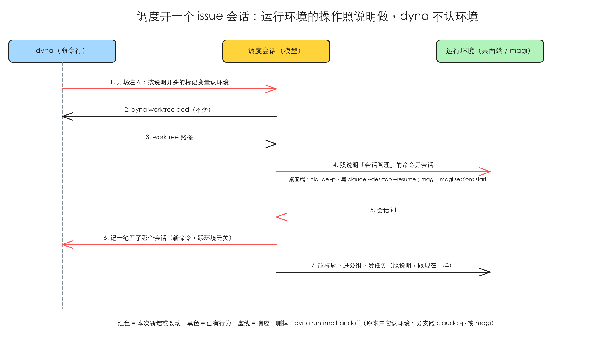
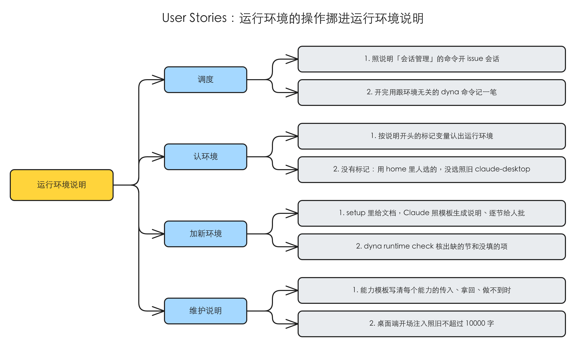

# 运行环境的操作写进运行环境说明，dyna 不再按环境分支

> #471 存在：`release/idea-loop-0.2.0`（66b4d463，2026-11-23）上，开一个 issue 会话由 `dyna runtime handoff` 自己认环境、在 Go 里分两支（桌面端 `claude -p` 再 `claude --desktop --resume`；magi `magi sessions start`），每加一种运行环境都要改 dyna；详情在「问题陈述」

## 问题陈述

### 1. 开会话这类运行环境的操作写死在 dyna 里

**现状**：调度交出一个 issue（比如 `harold-skills#471`）时，桌面端和 magi 的运行环境说明都写同一条 `dyna runtime handoff --worktree … --issue … --repo … --period … --cap … --prompt-file …`（`idea-loop/runtime/claude-desktop.md`、`magi.md` 的「会话管理 → 调度 → 怎么交出 issue」第 2 步）。命令在 Go 里认出当前环境，再走不同的分支：

- 桌面端：先 `claude -p` 建会话、读 id，再 `claude --desktop --resume <id>`（`dyna/internal/runtime/handoff.go`）；
- magi：`magi sessions start --cwd --slug --cap … <prompt>`（`handoff_magi.go`）。

两支跑完都往 `~/.idea-loop/dispatch/<仓库名>.json` 记一笔，早上汇总靠它找夜里开出的会话。

dyna 能认出哪些环境，也写死在 Go 里：`dyna/internal/runtime/runtime.go` 的 `Names` 只有 `claude-desktop`、`magi`。认环境的规则是 `IDEA_LOOP_RUNTIME` → `MAGI_SESSION_ID` → 默认 `claude-desktop`。

**本该是**：开会话、分组、定时这些操作在每个运行环境里本来就是不同的命令或 MCP，都是给模型调的。它们应该跟其他能力一样，写在运行环境说明里，由模型照着做。dyna 只做跟环境无关的事。

**例子**：2026-11-23 评估把 cmux 加成运行环境时，光开会话一步就要动三处：在 `Names` 里加名字，在 Go 里再加一支 `cmux new-workspace`，再写它的测试。评估 t3code 也一样。人的判断是：「cmux、magi、t3code 无论是mcp还是cli，其实都是给llm的调用方式」。

### 2. 不在支持列表里的环境没有路可走

**现状**：要加一种运行环境，得改插件，也就是多写一份 `idea-loop/runtime/<名>.md`，再改 `Names`（`dyna runtime --help` 的「加一种运行环境」）。插件目录是只读的，用户在本机加不了。本机覆盖（`<home>/runtime/<环境>.md`，spec `runtime-local-override`）只能整段替换一个已知环境里的某几节，加不了新环境。

`capabilities.md` 只列十一个能力名，每个配一句「通用流程要它做什么」。照它写不出一份完整的说明：比如「开一个 issue 会话」要传什么进去、要拿回什么，得去翻 `issue-dispatch` 和两份现有说明才拼得出来。

复现材料：`docs/raw/issue-workflow/2026-11-23-runtime-ops-grill.md` 文末的本机核对。

### 根因

1. 「认环境再分支」放在了 dyna 里：`runtime handoff` 和 `Names` 把运行环境的知识编进了二进制。对应问题 1。
2. 能力清单只有能力名，没有每个能力的契约（传入、拿回、做不到时），所以写不成「照它就能写一份说明」的模板。对应问题 2。

## 方案

改完以后：

- 每个运行环境的操作，包括开 issue 会话，都写在这个环境自己的运行环境说明里，模型照说明调命令或 MCP。
- dyna 不再出现任何运行环境的名字或分支，只按说明开头写的标记变量认环境，只做建 worktree、记一笔这类跟环境无关的事。
- 插件自带桌面端、magi 两份说明。不在列表里的环境，用户在 setup 里给出它的文档，由 Claude 照能力模板生成说明，写在 home 里。

图里红色是这次新增或改动的：

- 第 1 步，开场注入时 dyna 按说明开头的标记变量认环境；
- 第 4、5 步，模型照说明的命令开会话、拿回会话 id；
- 第 6 步，跟环境无关的一条记一笔命令。

第 2、3、7 步不变。`dyna runtime handoff` 删掉。

行为由这几样输入决定：

- **当前在哪个运行环境**，按顺序认：
  1. `IDEA_LOOP_RUNTIME` 有值就用它；
  2. 扫插件和 home 里的运行环境说明，哪份开头写的标记变量在环境里有值，就是哪个；
  3. 都没有，用 home 里人选的环境；
  4. 人也没选，照旧落到 `claude-desktop`（ADR-0026：命令行、IDE 插件没有可靠标记，落到 claude-desktop）。

  一份说明可以写「没有标记」，桌面端就是这样。两份说明的标记同时有值，按上面的顺序取第一份，并在注入里写一行提示。
- **用哪份说明**：
  - 插件和 home 里都有同名的一份：home 那份按小节整段替换插件那份。这是现有的本机覆盖，规则不变。
  - 只有 home 里有：它就是一份完整的说明，用户的新环境就走这条路。
  - 只有插件里有：用插件那份。
- **说明的内容**：照能力模板，一个能力一节。每节写「在这里怎么做」，或者写「没有」，没有的走退路。

同一行为的其他入口：

| 入口 | 处置 |
|---|---|
| `issue-dispatch` 交出 issue | 纳入：照『会话管理』开会话，再跑记一笔命令。skill 正文本来就只写能力名，改的是说明里的「调度」小节 |
| `issue-session` 归位、收尾 | 不受影响：已经是照『会话管理』做，说明里的写法不变 |
| `setup` | 纳入：加「选运行环境」和「照模板生成新环境的说明」两步 |
| 子代理用 `dyna runtime show <能力>` | 纳入：按新的认环境规则取那一节 |
| `dyna runtime name` | 纳入：按新规则打印名字，名字从说明里读，不再查写死的名单 |

### dyna 的命令变化

- **删**：`runtime handoff`，以及它的两支实现和测试，共 1247 行。
- **改**：`runtime name`、`show`、`inject` 认环境时读说明开头的标记，不再查写死的名单。`IDEA_LOOP_RUNTIME` 给了不认识的名字，照旧报错、不猜；只是「认识」改成「插件或 home 里有这份说明」。
- **新增**：
  - `runtime check [<文件>]`：按能力模板核一份说明。核的是每个能力的那一节在不在、节名对不对、模板里每一项有没有写做法或「没有」、开头有没有标记一行。不带文件就核插件和 home 里的全部。
  - 一条记一笔命令：往 `~/.idea-loop/dispatch/<仓库名>.json` 追加 `{issue, desktopSessionId, openedAt, period}`，格式和现在 handoff 写的一样，早上汇总不用改。名字照 `idea-loop-cli` 的模块划分定。
- 版本：在当时集成分支的 dyna 版本上升一档，重存登记表，`idea-loop/dyna-version` 的下限跟着提（照 #437 的做法）。

## User Stories

**调度**

1. 作为调度会话，我想要照当前运行环境说明里「会话管理」的命令开 issue 会话，以便 dyna 不用为每个环境写一支代码
2. 作为调度会话，我想要开完会话后用一条跟环境无关的 dyna 命令记一笔，以便早上汇总照旧找得到夜里开出的会话

**认环境**

1. 作为任何会话，我想要 dyna 按说明开头的标记变量认出自己在哪个运行环境，以便新环境不改 dyna 也能被认出
2. 作为在没有标记的程序里开的会话（桌面端、命令行），我想要按 home 里人选的环境走，没选就照旧落到 claude-desktop，以便现有行为不变

**加新环境**

1. 作为用户，我想要在 setup 里给出一个新运行环境的文档，由 Claude 照能力模板生成说明、逐节给我批，以便不在支持列表里的环境也能用
2. 作为用户，我想要 `dyna runtime check` 核出说明缺哪一节、哪一项既没写做法也没写「没有」，以便格式问题不等到用的时候才暴露

**维护说明**

1. 作为维护插件的人，我想要能力模板把每个能力要传什么、拿回什么、做不到时怎么办写清，以便写一份说明时不用去翻各个流程
2. 作为维护插件的人，我想要桌面端开场注入照旧不超过 10000 字，以便改写说明后注入不被截断

## 实现决策

- **能力模板**：把 `capabilities.md` 扩成模板，只留这一份文件，不另开第二份（人 2026-11-23：「能力模版我倾向于我们这一套工作流总结出的一个通用模版，我们支持的环境按照这个模版写，用户的新环境也可以让claude根据这个模版生成」）。
  - 写法：每个能力下列出工作流要它做的几项，每项写三样：传入、拿回、做不到时。
  - 例子：「会话管理 → 开一个 issue 会话」，传入 worktree、标题「<仓库名>#<号> <标题>」、分组名、prompt 文件，拿回会话 id，做不到时调度整轮停下。
  - 各项从现有的 `issue-dispatch`、`issue-session`、`setup` 和两份说明里归纳，不新增能力。
  - 闭集、退路、例外一和例外二原样保留。
- **说明的开头写标记**：每份说明开头一行写它的标记变量：magi 写 `MAGI_SESSION_ID`，桌面端写「没有标记」。dyna 只读这一行，不读别的。
- **开会话写进说明**：
  - 桌面端：照 handoff.go 现在的两条命令写。先 `claude -p "<就绪>" --output-format json`，读出 `session_id`；再在 worktree 里跑 `claude --desktop --resume <id>`，退出码 0 算成功，桌面端的会话 id 是 `local_<id>`。两条都在沙箱外跑。
  - magi：写 `magi sessions start --cwd <worktree> --slug <仓库名>-<号> --cap … <prompt>`。
  - 两份说明里，失败的处理照现在写的：写进汇报，下一轮再试。
- **用户生成的说明放 home，不放 `~/.idea-loop/`**：grill 里一度说放 `~/.idea-loop/runtime/`。按已有的决定改放 `<home>/runtime/<名>.md`，依据是 spec `runtime-local-override`（人批过）已经把「本机跟运行环境有关的做法」放进 home 的 `runtime/` 目录。同名就按小节覆盖，不同名就是一份新说明，一个目录两种用法，不另开落点。
- **人选的环境记在 home**：setup 问一次，写进 home 的运行环境目录，dyna 读。没选过就照旧落到 claude-desktop。
- **setup 两步**：
  - 选运行环境：列出插件和 home 里有的说明，问人这台机器默认用哪个。
  - 生成新环境的说明：人给文档的链接或文件，Claude 读文档、照模板逐个能力写，逐节摆给人批，写进 home，跑 `dyna runtime check` 过了才算完。
  - 这两步要是写下来超出 setup 的篇幅线，拆成另一个 issue（人 2026-11-23 同意「不切」的前提）。
- **注入上限**：桌面端说明改写后，开场注入要在 10000 字以内。现在已经是 9865 字（父会话 2026-11-23 笔记）。开会话的两条命令替换掉原来那段 handoff 的说明，篇幅应该持平或更短；超了先删重复的说法，不改上限。
- **tripwire 不变**：skill、agent 正文里照旧不许出现运行环境专用的命令和工具名，新写的开会话命令只出现在运行环境说明里。
- **ADR-0026**：「运行环境靠检测，不按项目配置」仍然成立。被取代的是「检测规则写在代码里、加环境要改检测」那部分，由 `/idea-loop:dreaming` 标记，这里不改 ADR。

## 测试决策

| 变的是什么 | 仪器 | 本次 |
|---|---|---|
| 纯逻辑、数据转换、状态机 | TDD 单元测试 | 碰到：认环境的顺序、读标记、home 与插件的合并、`runtime check`、记一笔命令，都在 dyna 的 Go 单元测试里先红后绿 |
| API 契约（路由、schema、序列化） | TDD API 测试 | 碰到：记一笔写出的 JSON 跟现在 handoff 写的逐字段一致；`runtime check` 的输出格式 |
| DB schema、迁移、并发与事务语义 | 真 DB 测试 | 不涉及 |
| LLM 输出质量（prompt 改动） | eval | 不涉及：照模板生成说明的质量由人逐节批，不做 eval（AGENTS.md「Eval 策略」） |
| 视觉正确性 | UI 实现环 | 不涉及 |
| 端到端用户流程 | 浏览器端到端测试 | 不涉及浏览器；用一次真机调度代替，见下 |

- **seam**：
  - `dyna runtime` 的命令行，输入是环境变量和插件、home 两个目录，输出是 stdout、stderr 和退出码。沿用 `runtime_test.go`、`override_test.go` 的做法。它抓得到认环境、合并、核格式、记一笔；抓不到模型有没有照说明敲对命令。
  - 插件的文档测试 `runtime-data-doc.test.mjs`：改成用 `runtime check` 的同一套规则核两份自带说明，并核说明里不再出现 `runtime handoff`。
- **增量功能测试**：
  - 认环境 1：前置 home 里放一份 `zed.md`，开头标记写 `ZED_SESSION`。步骤：设 `ZED_SESSION=1` 跑 `dyna runtime name`。期望：打印 `zed`，dyna 没改过代码。
  - 认环境 2：前置没有任何标记变量，home 里没选过。步骤：`dyna runtime name`。期望：打印 `claude-desktop`。再写入人选的 `magi`，期望打印 `magi`。
  - 加新环境 2：前置一份缺「推送」一节、「定时任务」里有一项空着的说明。步骤：`dyna runtime check <文件>`。期望：退出码非 0，两处各一行，带节名。
  - 调度 2：步骤：用记一笔命令记 #471。期望：`~/.idea-loop/dispatch/harold-skills.json` 多一条，字段同现在。
  - 调度 1（真机，#340 遗留）：在桌面端照新说明交出一个真实 triage issue，看会话出现在侧边栏 triage 分组里、标题对、任务发到了。magi 由有 magi 的人跑一次，没有就记成未验证。
  - 维护说明 2：现有的注入长度测试照跑，桌面端注入不超过 10000 字。
- **照着谁写**：`dyna/internal/runtime/override_test.go`（home 加插件两层的合并）、`runtime_test.go`（认环境）、`handoff_test.go` 里记一笔的那部分（字段与失败时 `recorded:false`）。

## Out of scope

- 新增运行环境：cmux、t3code 的评估记在 #477（not planned，人遇到卡点再开）。手机连本机、连 devbox、按 section 管会话随它一起放着。
- 未来的云端服务器：这次只保证不挡路。云端也是多一份说明、写对标记，不改 dyna。
- 调度改用「按 issue 状态数会话」：只在 t3code 没有自建分组时需要，随 #477 放着。
- `issue-dispatch`、`issue-session` 正文的其他改动：它们已经只写能力名。

## 关联

- raw：[[2026-11-23-runtime-ops-grill]]
- ADR：[[0026-runtime]]（运行环境抽成能力清单加每环境一份说明，本 spec 取代其中「检测写在代码里」的部分）
- spec：[[runtime-local-override]]（home 里的本机覆盖，本 spec 沿用它的落点）、[[idea-loop-cli]]（dyna 的模块划分）、[[skill-rewrite]]（`runtime handoff` 的来处，删它后那份 spec 里的提法过期，由 dreaming 对账）
- 相邻未完成：
  - #247（迁移到 home）：迁移后 home 才有 `runtime/` 目录，本 spec 读写那里，没迁移的机器上 home 那一层是空的，不挡本 spec。
  - #280（PR #468）、#438、#451、#452：都改 `decision-rules`、spec 与 PR 结构，跟 `runtime` 模块不重叠。
  - dyna 版本号：跟同期改 dyna 的 PR 抢版本，照 #437 的做法，合并前在当时的版本上再升一档。
- issue：#471（本 spec）；#477（cmux / t3code 的评估，not planned）；#227、#237（被推翻的旧决定，这次只推翻到「以后可以加新环境」，cmux 本身仍不做）
