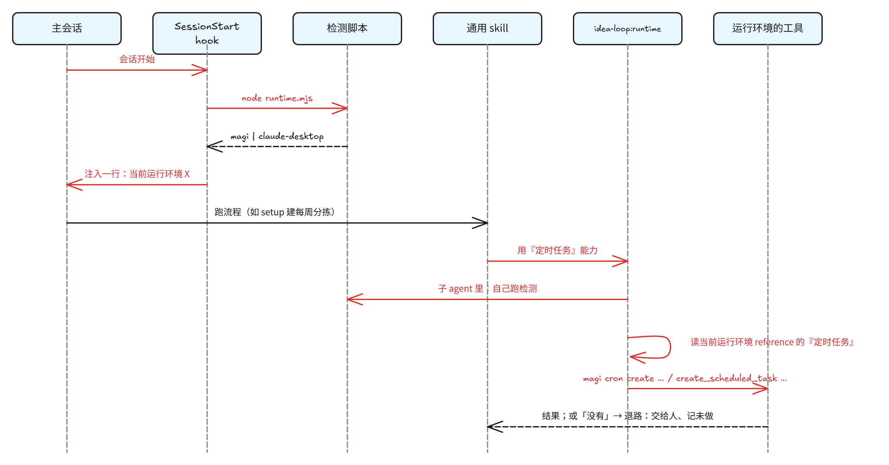
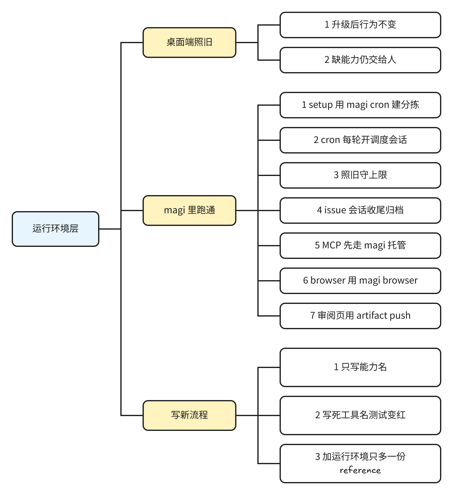

# runtime：把运行环境从 idea-loop 的通用流程里抽出来，按检测到的运行环境加载做法

> #262 存在：在 magi 启动的会话里，`issue-dispatch` 找不到会话管理工具、`CronCreate` 被禁用，setup 的每周任务找不到定时任务工具，`browser` 找不到 Playwright MCP 就停下；详情在「问题陈述」

## 问题陈述

对着 origin/main d5bc91e（idea-loop 0.1.10）核过，2026-11-06；运行环境一侧的事实在一个 magi 启动的 Claude Code 会话里实测（[[2026-11-06-runtime-grill]] 的 A3、A7）。

### 1. 通用流程里写死了 Claude 桌面端的工具

`skills/` 与 `agents/` 里有 24 个文件、64 行直接写了某个运行环境的工具或界面：

| 能力 | 写死的工具或界面 | 在哪些 skill |
|---|---|---|
| 定时任务 | `create_scheduled_task`、`list_scheduled_tasks`、`list_task_runs`、`update_scheduled_task` | setup（每周对账、每周分拣、夜间回放）、dreaming 的增量范围、seo-setup |
| 会话内循环 | `CronCreate` / `CronList` / `CronDelete` | issue-dispatch |
| 会话管理 | `mcp__ccd_session_mgmt__list_sessions` / `send_message` / `export_transcript`、`start_session` 出卡片、侧边栏 `list_sections` / `create_section` | issue-dispatch、issue-session、retro、setup 的夜间回放 |
| 浏览器 | `mcp__playwright__browser_*`（缺了就停）、`mcp__Claude_Browser__*` | browser 及所有开浏览器的流程 |
| 向人提问 | `AskUserQuestion` | setup、seo-setup、uiux-imagine、uiux-research |
| 发布审阅页 | `Artifact` | dreaming、seo-audit、seo-scan |
| 推送 | `PushNotification` | issue-dispatch、issue-triage、issue-session、seo-scan |
| 发文件给人 | 「发送文件的工具（桌面端在侧栏打开）」 | pr |
| 装 MCP、改设置 | 桌面 app 的 Connectors、`claude mcp add`、`~/.claude/settings.json` | setup（预检、Linear 接入、夜间回放的允许规则） |

退路也是各写各的：setup 的每周任务写「没有这个工具（不在桌面 app 里）：把 prompt 给人」，seo-audit 写「环境能发布或预览 HTML（例如 Artifact）就那样做」，issue-dispatch 没有退路。

### 2. 在 magi 里这些工具都不在，或者不能用

在 magi（一个管理 Claude Code / Codex 会话的工具）启动的会话里实测：

- 会话管理、定时任务、`Artifact`、`AskUserQuestion` 的工具都不存在；`CronCreate` 被 `CLAUDE_CODE_DISABLE_CRON` 禁用。
- magi 用命令给出对应的能力：`magi cron`（定时开会话）、`magi wake`（会话内定时）、`magi sessions list/start/send/show/stop`、`magi browser`（每个会话自带的匿名浏览器：开页面、读元素树、点击填表、等待、截图、手机视口与深色、网络请求、元素盒子；不能执行任意 JS）、`magi artifact push`（发布页面，页面里 `magi.reply` 把人的回复送回会话）、`magi mcp call`（magi 托管的 MCP，如 Linear）。
- 由别的会话开出的会话能再 `magi sessions start` 开会话，也能在 `magi sessions list` 里列出人的其他会话（只列不读）。

结果：setup 每处都要人在会话外逐条翻译；`issue-dispatch` 在 magi 里跑不起来。

### 根因

skill 正文把「做什么」（通用流程）和「用什么工具做」（运行环境）写在一起；没有一处说清有哪些能力、每个运行环境怎么做、做不到时怎么退。

## 方案

改完之后，同一套 idea-loop 在 Claude 桌面端与 magi 里都能从 setup 跑到调度、分拣、实现、review。用户得到什么只由一个输入决定：当前运行环境。桌面端用户升级后感觉不到差别（工具、参数、步骤原样）；magi 用户不再需要在会话外翻译。

- **能力清单**：新建共享 skill `idea-loop:runtime`。它的正文列出每个能力：叫什么、通用流程要它做什么（输入、产出）、做不到时怎么退。每个运行环境一份 reference，逐个能力写具体做法，或写「没有」。
- **当前运行环境**：一个检测脚本判定，打印运行环境的名字。`IDEA_LOOP_RUNTIME` 有值就用它；否则有 `MAGI_SESSION_ID` 是 `magi`；否则是 `claude-desktop`。主会话由 `SessionStart` hook 注入一行「当前运行环境：X，用到能力时照 `idea-loop:runtime` 做」；子 agent 收不到 hook，自己跑检测脚本（环境变量随会话继承）。
- **通用流程只写能力名**：所有写死工具的地方改成「用『定时任务』能力：…，做法照 `idea-loop:runtime`」。各 skill 不再写自己的退路。
- **tripwire**：一个测试扫 `skills/` 与 `agents/`，除了 runtime 的 reference，不许出现运行环境专用的工具名；frontmatter 的 `allowed-tools:`、`tools:` 放行（那是工具声明）。
- **版本** 0.1.11。

同一行为的其他入口：

| 入口 | 纳入？ | 理由 |
|---|---|---|
| skills/ 下全部分类（engineering、design、productivity、seo） | 纳入 | 一次改完，tripwire 才守得住 |
| agents/ 的正文 | 纳入 | 同上 |
| agents/ 与 skills 的 frontmatter（`tools:`、`allowed-tools:`） | 排除 | 工具声明，不是流程；没有的工具声明了也无害 |
| scripts/ 打印给 agent 的 prompt（`retro-install.mjs` 的计划任务 prompt） | 纳入 | 它让会话用 `send_message` 转发，跟正文一样会被照做；改成能力名 |
| scripts/ 的其他代码与测试夹具 | 排除 | 不含运行环境的工具调用 |
| plugin `README.md` | 纳入，改说明 | 写清支持哪两种运行环境、能力清单在哪 |
| Claude 命令行、IDE 插件 | 排除 | 人定：本期不支持；按 claude-desktop 判，缺的能力走退路 |

## User Stories

### 桌面端照旧

1. 作为桌面端用户，我想要升级到 0.1.11 后 setup、调度、分拣、浏览器、审阅页的行为不变，以便不用重学
2. 作为桌面端用户，我想要缺某个能力时（比如在命令行里跑）照旧得到「把 prompt 交给我」，以便自己补上

### magi 里跑通

1. 作为 magi 用户，我想要 setup 用 `magi cron` 建每周分拣，以便不用在会话外翻译
2. 作为 magi 用户，我想要调度由 cron 每轮新开一个会话来跑、直接开出 issue 会话，以便不用常驻一个 loop 会话
3. 作为 magi 用户，我想要调度照旧守上限（主队列 10、每轮最多 3），以便不会一次开出一堆会话
4. 作为 magi 用户，我想要 issue 会话收尾时停掉自己，以便不占会话上限、不空耗资源
5. 作为 magi 用户，我想要读写 Linear 先走 magi 托管的 MCP、没有再用原生工具，以便授权由 magi 统一管
6. 作为 magi 用户，我想要 browser 用 `magi browser` 截图、走用户路径，而不是因为缺 Playwright MCP 停下
7. 作为 magi 用户，我想要 dreaming、seo 的审阅页用 `magi artifact push` 发布并收回批示

### 写新流程

1. 作为维护 idea-loop 的人，我想要写新 skill 时只写能力名，以便它在两个运行环境里都能跑
2. 作为维护 idea-loop 的人，我想要在通用流程里写死某个运行环境的工具时测试变红，以便耦合不会悄悄回来
3. 作为维护 idea-loop 的人，我想要加一种运行环境只需多写一份 reference，以便不动通用流程

## 实现决策

### 能力清单（闭集）

| 能力 | 通用流程要它做什么 | claude-desktop | magi |
|---|---|---|---|
| 定时任务 | 按时间开一个新会话跑一段 prompt；列出已有的；读上次成功运行的时间 | 定时任务 MCP（create / list / update / list_task_runs），原样照搬现有参数 | `magi cron create <id> --expr … --action create_session --cwd <主 checkout> --prompt …`（表达式按人在 magi 设的时区，`magi cron show` 的 when 一行会显示；现有的「分钟避开 0 和 30」照旧）；`magi cron list` / `show` 读上次运行 |
| 会话内循环 | 在当前会话里每隔一段时间再叫自己一次 | `CronCreate` / `CronList` / `CronDelete` | `magi wake every` / `list` / `cancel`；调度在 magi 里不用它（见下） |
| 会话管理 | 列会话；开一个 issue 会话；给别的会话发消息；读一个会话的记录；会话收尾 | 会话管理 MCP 的 list_sessions / send_message / export_transcript；`start_session` 出卡片；侧边栏 section 分组 | `magi sessions list` / `start` / `send` / `show -o` / `stop`（会话停掉自己，不能归档自己）；**分组：没有** |
| 浏览器 | 无头地开页面、量、截图、走用户路径；把一页摆给人看 | 用户级 Playwright MCP（无头、隔离）；Claude Browser 面板 | `magi browser`（会话自带的匿名浏览器）两种用途都用它；子 agent 各自 `window new` 并带 `--tab`；不能执行任意 JS，量值用元素盒子与截图 |
| 向人提问 | 给 2–4 个选项的单选题 | `AskUserQuestion` | 在对话里用编号选项问，等人回 |
| 发布审阅页 | 发布一页 HTML 给人看，收回人的批示 | `Artifact` | `magi artifact push <文件或目录>`，页面里 `magi.reply({text, data})` 把批示送回会话 |
| 推送 | 人不在场时提醒一句 | `PushNotification` | `PushNotification` |
| 发文件给人 | 把一张图或一个文件发到人看得到的地方 | 发送文件的工具（桌面端侧栏打开） | `magi artifact push <文件>`，把链接贴进对话 |
| 调用 MCP | 调某个 MCP 服务器的工具（如 Linear） | 原生工具 | 先 `magi mcp list`，有就 `magi mcp call <服务器> <工具> key=value…`（参数名不变）；没有再看原生工具（人定：magi 托管的优先） |
| 装与设置 | 告诉人怎么接 MCP、装插件、加允许规则 | 桌面 app 的 Connectors；`claude mcp add --scope user …`；`~/.claude/settings.json` | 人在 magi 网页 Integrations → MCP servers 里加；在 magi 会话里 `/plugin`；`$CLAUDE_CONFIG_DIR/settings.json` |

能力名就是表里第一列，写进 `idea-loop:runtime` 后是闭集：通用流程只引用这些名字；要新能力先改这张表。

### 合并后补审定下的（2026-11-08，人定）

- seo-scan 改成可被模型调用：两个运行环境的每周定时任务都能起它（magi 的定时任务只能写「用 Skill 工具调」）。桌面端新建的扫描任务写斜杠命令，与仓库约定一致；这是桌面端相对 0.1.10 的一处写法差别。
- magi 的定时任务读不出每次成败：流程要「上次成功运行」时当作没有基准。dreaming 只在项目有设计档案时做截图对账，没有设计内容就不走这段对账。
- 仍算 0.1.11，不升版本号。

出自 #264（人定，2026-11-08）：

- **调度按指派人取候选**：顺序是指派给本人 > 未指派，指派给别人的不派（先不抢）；本人名下没有可派的，才派未指派的。每一档里都先按 issue 的优先级排（P0 / Urgent → P1 / High → P2 / Medium → 没有）：本人名下优先级之后照旧按号（Linear 按创建时间）；未指派的优先级之后，同一优先级里按在 todo 里停留的时间排，久的先（人补充，同日）。「停留时间」指 issue 在当前状态放了多久没动。Backlog 不按这条直接派，照旧先经每周分拣、再跟人讨论要不要进 Todo。GitHub 上本人是 `gh` 当前登录，停留时间取 issue events 里最后一次加上 `status:todo` 的时刻（`issues.mjs candidates`）；Linear 上用 `list_issues` 的 `assignee: "me"` / `"null"`，停留时间用 `updatedAt`（Linear 不给进入状态的时间）；GitHub 只对与别的未指派 issue 同一优先级的读 events。
- **magi 里开 issue 会话先建 worktree**：调度先 `git -C <主 checkout> worktree add <主 checkout 同级>/<仓库名>-worktrees/<号>-<slug> -b issue/<号>-<slug> origin/<基准分支>`，再 `--cwd` 到这个 worktree；对应桌面端 `start_session` 的 `use_worktree`。主 checkout 的工作区与分支不动，调度在主 checkout 只读的前提保持；worktree 准备由 issue 会话开场照 `DEVELOPMENT.md` 做。原来会话开在主 checkout 上、多个会话互相踩，是首次在 magi 跑 issue 会话时撞到的阻塞问题。
- **magi 里开 issue 会话带能力**：`magi sessions start` 加 `--cap`：`magi`、`browser`、issue 平台在 magi 里托管的 MCP 服务器名（取 `magi mcp list` 里的名字，Linear 项目是 `linear`）。
- **issue-session 指向 Linear 做法**：开场读 issue、翻状态那一步写明 Linear 项目照 `idea-loop:issues` 的 Linear 做法，不在 issue-session 里重复 MCP 细节。

### 与 0.2.0 计划的关系

0.2.0 的 release 计划里有一项同方向的「工作环境」层（#227：新 skill `idea-loop:workspace`，Desktop 与 cmux 两份 reference，按项目在 `~/.idea-loop/projects.json` 里选，排在 0.2.1）。人定（2026-11-06）：

- 现在就在 main 上做 0.1.11；#227 由本 spec 取代、关闭（cmux 人已不要）；0.2.0 重构以这一层为基础。
- 叫法用「运行环境」与 `idea-loop:runtime`；「工作环境」「workspace」进术语表的 _Avoid_（workspace 在 magi、IDE 里另有意思）。
- 运行环境靠检测，不按项目配置：magi 与桌面端从会话本身就分得清；要强制用 `IDEA_LOOP_RUNTIME`。

### 检测与加载

- 检测脚本只读环境变量，打印 `claude-desktop` 或 `magi`；`IDEA_LOOP_RUNTIME` 的值不在已知名单里时报错退出，不猜。
- 命令行、IDE 插件不另判：落到 claude-desktop，缺的工具走退路（人定）。依据：桌面端没有可靠的标记变量（实测 `CLAUDE_CODE_ENTRYPOINT` 未设）。
- `SessionStart` hook 只打印一行（运行环境名 + 指向 `idea-loop:runtime`），不注入整份 reference：reference 只在用到能力时读。
- `idea-loop:runtime` 可被模型调用；用到能力的 skill 写「用 Skill 工具调 `idea-loop:runtime`，读当前运行环境的『<能力>』」。

### 退路（只写在 `idea-loop:runtime`）

当前运行环境对某个能力写了「没有」，或工具实际不在：

- 把要做的事原样交给人（prompt、命令、参数），在汇报里记「未做：运行环境 <名> 没有『<能力>』」；
- 例外一：调度缺会话管理就停下说明，这一轮什么都不做；
- 例外二：会话管理里的「分组」缺了就跳过，不算未做（magi 本期如此）；
- 向人提问缺了，改在对话里问，不算未做。

### 调度在 magi 里的形状

通用部分留在 `issue-dispatch`：对账、队列与上限、候选、每轮合计最多开 3 个、汇报。跟运行环境有关的三处交给 runtime：

| | claude-desktop（照旧） | magi |
|---|---|---|
| 怎么一轮一轮跑 | 常驻调度会话里的会话内循环，7 天到期提醒重起 | `magi cron` 每轮新开一个调度会话（定时任务能力），跑完一轮 `magi sessions stop` 停掉自己（会话不能归档自己，实测）；没有 7 天到期 |
| 怎么数开着的会话 | 各 section 里标题匹配「<仓库名>#<号> …」的 | `magi sessions list` 里 slug 前缀 `<仓库名>-<号>`、状态不是 stopped / exited / dead、也没归档的 |
| 怎么交出 issue | 出卡片，人点了才开；还没点的卡片占位 | 先建 worktree，再 `magi sessions start --cwd <worktree> --slug <仓库名>-<号> --cap … <prompt>` 直接开，不等人（人定；worktree 与 `--cap` 见「合并后补审定下的」）；没有「还没点的卡片」，空位 = 上限 − 开着的会话 |

magi 里 issue 会话认领后照常翻状态，不挪分组；做完（PR 合并或 issue 取消）后 `magi sessions stop` 停掉自己；停掉的会话由人在 magi 或 Dawn 里归档（实测 2026-11-06：`magi sessions archive` 拒绝归档会话自己，只收它开出的 helper；`stop` 对自己可用）。setup 在 magi 里建调度用定时任务能力，id `dispatch-<仓库名>`，间隔由人定。

### 定时任务的 prompt

magi 发给会话的「/命令」不会被当成命令执行，所以定时任务的 prompt 在 magi 里写成「用 Skill 工具调 idea-loop:<skill>」；只能由人调用的 skill（`disable-model-invocation: true`）不能这样起，setup 遇到时走退路。桌面端照旧写斜杠命令。

### claude-desktop 只搬不改

claude-desktop 的 reference 收的是现有正文里的写法原样（工具名、参数、到期提醒的文案、section 规则）。唯一的行为差别是退路统一了：原来「不在桌面 app 里就把 prompt 给人」的几处，改由 runtime 的退路说同一件事。

### tripwire 的名单

运行环境专用的写法（正则）：定时任务 MCP 的工具名、会话管理 MCP 的前缀、`start_session`、`list_sections` / `create_section`、`CronCreate` / `CronList` / `CronDelete`、`mcp__playwright__`、`mcp__Claude_Browser__`、`AskUserQuestion`、`Artifact`（作工具名）、`PushNotification`、`magi `（命令）、`claude mcp add`、`~/.claude/settings`、「桌面 app」。扫 `skills/`、`agents/`，排除 runtime 自己的 `references/` 与 frontmatter 的工具声明行。命中输出「文件:行  规则  原文」。

## 测试决策

| 变的是什么 | 仪器 | 本次 |
|---|---|---|
| 纯逻辑、数据转换、状态机 | TDD 单元测试 | 检测脚本：环境变量 → 运行环境名（含强制、未知值报错） |
| API 契约（路由、schema、序列化） | TDD API 测试 | 不涉及 |
| DB schema、迁移、并发与事务语义 | 真 DB 测试 | 不涉及 |
| LLM 输出质量（prompt 改动） | eval（确定性断言） | skill 正文大面积改写，但桌面端行为不变、magi 侧是新做法：结构用 tripwire 与结构测试守；不加 eval |
| 视觉正确性 | UI 实现环 | 不涉及 |
| 端到端用户流程 | 浏览器端到端测试 | 不涉及浏览器；magi 里的端到端用人工走一遍代替（见下） |

- **seam**：
  1. 检测脚本的命令行（环境变量进、名字出）：抓得到检测规则的错；漏掉 hook 有没有接上。
  2. 插件文件树（tripwire 与结构测试读文件）：抓得到写死工具名、两份 reference 的能力不齐、hook 没注册；漏掉做法本身写错（比如 magi 命令参数写错）。
- **增量功能测试**：
  - 前置：magi 会话，装 0.1.11。步骤：跑检测脚本。期望：打印 `magi`；设 `IDEA_LOOP_RUNTIME=claude-desktop` 后打印 `claude-desktop`；设成 `foo` 退出码非 0。覆盖：写新流程 3。
  - 前置：同上，新开会话。期望：上下文里有一行当前运行环境。覆盖：magi 里跑通 1–7 的前提。
  - 前置：一个已 setup 的目标仓库（magi）。步骤：让 setup 建每周分拣。期望：`magi cron list` 里出现 `triage-<仓库名>`，prompt 是「用 Skill 工具调 idea-loop:issue-triage」。覆盖：magi 里跑通 1。
  - 前置：同上，有一个 todo issue。步骤：手动触发一轮调度（`magi cron` 的一次运行，或在会话里调 issue-dispatch）。期望：开出 slug 为 `<仓库名>-<号>` 的会话，调度会话停掉自己；再触发一轮不重复开。覆盖：magi 里跑通 2、3。
  - 前置：在通用 skill 里写一行 `create_scheduled_task`。期望：tripwire 变红并指到那一行。覆盖：写新流程 2。
  - 前置：桌面端（人）。步骤：照常跑一次 setup 的每周分拣与一轮调度。期望：与 0.1.10 相同。覆盖：桌面端照旧 1。
- **照着谁写**：tripwire 照 `no-project-leak.test.mjs`；结构测试照 `issues-skill-doc.test.mjs`、`pr-review-slim-doc.test.mjs` 这类读文档断言的测试。

## Out of scope

- 知识库在仓库外时 spec、设计、dreaming 怎么工作（人定：另议）。grill 里查到的脚本假设（设计档案根取自代码仓库根、`affected` 在档案目录 diff、retro 候选池读 git 历史、spec 与归档随代码 PR 合）留给那次讨论。
- dreaming 在 magi 里的定时任务（人定：暂不需要）；能力清单照样覆盖 dreaming 用到的能力，只是本期不建任务。
- magi 里的状态分组（人定：暂不维护）。已验证的路：magi 项目当分组，会话能 `magi projects move` 自己；开会话时不能直接放进项目（要求开者是成员）。
- Claude 命令行、IDE 插件、claude.ai 网页、Codex 会话作为单独的运行环境。

## 关联

- raw：[[2026-11-06-runtime-grill]]
- [[issue-linear]]：Linear 经 MCP 读写；本 spec 只改「MCP 从哪调」（magi 托管优先），不改它定的流程。
- #227（setup：工作环境独立成一层，Desktop / cmux）：同方向的早先需求，由本 spec 取代、关闭；见「实现决策」的「与 0.2.0 计划的关系」。
- #237（Codex 跑完 issue 会话）：要用到本 spec 的会话管理能力开 Codex 会话；在本 spec 之后，不重叠。
- #244、#252（知识库独立于代码仓库）：本 spec 的 Out of scope 第一条交给它们。
- #241、#247（0.2.0 的插件拆分与迁移）：会移动本 spec 改到的文件；本 spec 先合，0.2.0 照 main 同步。
- 其余 open issue 与 `docs/spec/index.md`：查过，无重叠。
