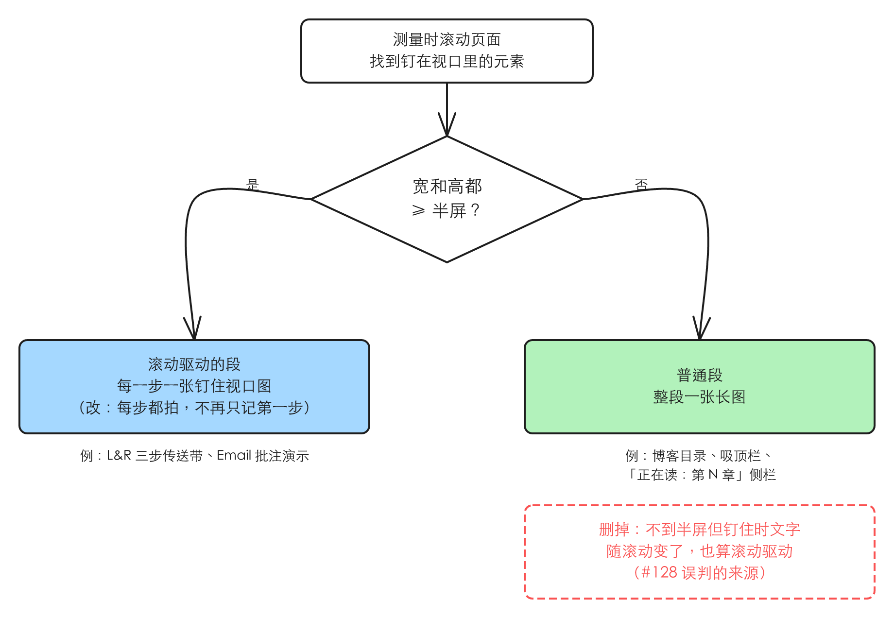

# 设计档案：滚动驱动只认整段钉住，每一步一张图

> #128 存在：一篇长文章旁边钉着一个写「Reading: Chapter N」、随滚动变字的窄侧栏，整段被判成滚动驱动，`attribute` 退出码 1；声明之后这段只拍钉住的一屏，文章其余内容档案里没图。详情在「问题陈述」

## 问题陈述

判据（人定，2026-11-13）：**档案里每一段的图，要包含这一段用户能看到的全部内容。** 下面两个问题都是这条判据不成立。

### 1 窄钉子让普通文章被认成滚动驱动

分拣在测试夹具上补了 issue 说的页面（分拣评论 https://github.com/guohaonan-shy/harold-skills/issues/128#issuecomment-6758203021 ，2026-11-10，对着主分支 6202c21）：一篇三章、约 2770px 高的文章，左侧一个 200px 宽的钉住侧栏，写着「Reading: Chapter N」，随滚动从 1 变到 3，正文正常往下滚。

- 看到的：侧栏被认成钉住元素（「钉住时的文字随滚动变了，3 种」），整段 `article` 被判为滚动驱动，`attribute` 退出码 1，要求声明 `scrollDriven: true`。声明之后这一段只拍钉住的那一屏，其余约 1870px 的正文档案里没有图。
- 本该是：这是普通文章，正常整段拍一张长图就完整，`attribute` 应当通过，不要求声明。

真实项目里（一个营销站 `origin/main` 842ea497，2026-11-12）唯一带钉住侧栏的博客文章页没撞上：它的目录滚动时只变高亮颜色，文字不变。会撞上的是任何把「当前章节」写成文字的侧栏。

复现材料：分拣评论里的 `.tmp/triage/128/zz-repro-128.test.mjs`（不提交）。

### 2 滚动驱动的段只有前两步有图

同一个营销站的 Listen & Repeat 介绍页（档案 `docs/design/prod/pages/mkt-listen-repeat/`，2026-11-13 查），「三步传送带」整段钉住一屏、滚一下换一张：LISTEN、HOLD、DELIVER。

| 步 | 档案里 |
|---|---|
| LISTEN | 入口状态的 `problem` 段长图，1440×2701：段标题加第 1 步，下面约 900px 空白 |
| HOLD | 段内状态 `causes-hold`，一张 1440×900 钉住视口图 |
| DELIVER | 没有图；状态文件写「结构相同，没有单独建状态」 |

- 本该是：三步各一张钉住视口图（人：「listen/hold/delivery可能都有一个图」）。
- DELIVER 缺图出自插件规则；LISTEN 带空白是那个项目没声明 `scrollDriven`，按规则本该只截一屏，是它的档案数据，不在本 spec 里改（见「Out of scope」）。

### 根因

- 问题 1：`design-archive-sections.mjs` 的钉住采样里，不到半屏的钉住元素只要钉住期间可见文字随滚动变了（且滚回去还是那段文字）就算滚动驱动。这条是 #65 review 第 1 轮按当时 spec「两条信号任一成立」补上的（`docs/raw/decisions/65.md` 题 4），没有真实实例；它分不清「侧栏的字在变」是这一段在换内容，还是只是在报告读到哪了。
- 问题 2：`design-archive` 的 `references/shooting.md`「滚动驱动的段」第 3 步写着「结构相同的步骤只记第一个」，照搬了 `references/writing.md`「建模的取舍」里 FAQ、卡片那类重复项的规则。传送带每一步的插图和文字都不同，是这一段内容本身，不是重复项。

## 方案

改完后：写档案的人只在一段**整段钉在视口里、滚动拿去换内容**时被要求声明 `scrollDriven: true`，并给每一步都拍一张钉住视口图；其余的段（包括旁边钉着窄目录、窄侧栏的长文章）一律照普通段整段拍一张长图。

1. **检出只认整段钉住**：钉住元素宽和高都 ≥ 半屏，钉住就算（现有的大钉子信号，不变）。删掉窄钉子按文字变化认定的整条路径，连同它为排除计时器轮播而「滚回原处核对文字」的那一步。窄钉子不再出现在测量的 `pins` 里。
2. **滚动驱动的段每一步一个状态、一张图**：`shooting.md` 第 3 步去掉「结构相同的步骤只记第一个」，改成每一步都建状态和边；`writing.md`「建模的取舍」的「结构相同的多项只记一个代表」加一句例外：滚动驱动段的步骤不算重复项。拍法（第 1 步 `shoot` 截钉住的一屏，后面每步 `pinned`）不变。
3. **两条已知限制删掉**：`shooting.md`「已知限制」里窄侧栏那条；#127 review 第 2 轮记下的「窄栏滚一下换一张、滚回去不退回检不出」不再存在（窄钉子不参与检出）。

同一行为的其他入口：

- `attribute` 的 `declaredNotDetected`（声明了却没检出）：纳入，不改代码。窄侧栏的段若以前声明过 `scrollDriven: true`，改后会得到这条提示，照提示删掉声明重拍即可。
- `design-archive-check.mjs` 校验规则 7（`scrollDriven` 只能写 `true`）：不改，不加「不是滚动驱动」的声明，没有需要。
- `dreaming` 的 `references/initial-scan.md` 引用「建模的取舍」的那句：纳入，同步加滚动驱动段步骤的例外。
- `idea-loop/README.md` 里 `design-archive-sections.mjs` 的说明（提到「a pinned column smaller than a screen whose text changes」）：纳入，同步改。
- 内层容器在滚的页面（`scroller.kind` 是 `element`）：检出同一段代码，纳入，不另写。

## User Stories

1. 期望行为：长文章旁边钉着一个随滚动变字的窄侧栏（不到半屏），`attribute` 不把这一段列进 `undeclaredScrollDriven`，退出码 0；`shoot` 把这一段拍成一张整段长图，正文全部在图里。
2. 期望行为：整段钉住、滚动换内容的段，档案里每一步都有一个段内状态和一张钉住视口图（三步就三张），不因为步骤版式相同而只记第一个。

## 实现决策

- **「整段钉住」的门槛沿用现有的「宽和高都 ≥ 半屏」**：依据是现有大钉子信号的实现与浏览器测试已覆盖真实的两类段（滚轮接管的传送带、按滚动位置点亮的批注演示，都是 `pin: true` 钉住整块），人的定义「整段被钉在视口」与它一致；不另定新阈值。
- **不加「不是滚动驱动」的声明**：issue 原先设想的排除办法；检出收窄后误判面没了，声明没有用处。依据人的话「分章节这块不是很需要复杂的逻辑」。
- **窄钉子直接不进 `pins`**，而不是进了再判否：`pins` 只用来认滚动驱动，留着窄钉子没有读者。
- **拍法不变**：滚动驱动段第 1 步 `shoot`、后面每步 `pinned`，ADR-0005 的这部分照旧；本 spec 只改「哪几步要拍」。ADR-0005「结构相同的步骤只记第一个」那半句和「已知限制」里 #128 那条，由下次 `/idea-loop:dreaming` 对账时订正，这里不改 ADR。

## 测试决策

| 变的是什么 | 仪器 | 本次 |
|---|---|---|
| 纯逻辑、数据转换、状态机 | TDD 单元测试 | `attribute` 的归属结果：真浏览器测试改判（见下）；`scrollDrivenOf` 的证据文字去掉窄钉子那句，单元测试跟着改 |
| API 契约（路由、schema、序列化） | TDD API 测试 | 不涉及 |
| DB schema、迁移、并发与事务语义 | 真 DB 测试 | 不涉及 |
| LLM 输出质量（prompt 改动） | eval（确定性断言） | 改了 `shooting.md`、`writing.md`、`initial-scan.md` 的规则；用文档测试断言，不加 eval |
| 视觉正确性 | UI 实现环 | 不涉及 |
| 端到端用户流程 | 浏览器端到端测试 | `design-archive-sections-browser.test.mjs` 的真 Chromium 测试（下面三条） |

- **seam**：`design-archive-sections.mjs` 的 `measure` → `attribute` → `shoot` 三个子命令在真 Chromium 上的输出（已有的浏览器测试 seam）。能抓到检出和拍图的行为；抓不到写档案的人是否照文档给每步建状态（那条由文档测试守住文字）。
- **增量功能测试**：
  - 前置：夹具页里一篇三章长文章，旁边一个 200px 宽、写「Reading: Chapter N」随滚动变字的钉住侧栏，不声明 `scrollDriven`。步骤：`measure`、`attribute`、`shoot`。期望：`pins` 为空，`attribute` 退出码 0，这一段的图高等于段高（不是一个视口高），正文三章都在图里。覆盖：期望行为 1。
  - 已有的「窄的钉住文字栏、文字随滚动变」用例（现在断言检出、退出码 1，以及 `shoot` 只拍一屏）改判：未声明时退出码 0、按整段长图拍；声明了 `scrollDriven: true` 时只得到 `declaredNotDetected` 提示。先在改前的代码上红。覆盖：期望行为 1。
  - 已有的整段钉住用例（滚轮换卡片、按滚动位置点亮）照旧检出、照旧退出码 1。覆盖：回归。
  - 文档测试：`shooting.md`「滚动驱动的段」不再含「结构相同的步骤只记第一个」、写明每一步一个状态；`writing.md`「建模的取舍」写明滚动驱动段的步骤例外；`shooting.md`「已知限制」不再含窄侧栏那条。先在改前的文字上红。覆盖：期望行为 2。
- **照着谁写**：浏览器测试照 `idea-loop/scripts/design-archive-sections-browser.test.mjs` 里 `NO_PIN_PAGE` 和窄文字栏那几条；文档测试照 `idea-loop/scripts/design-archive-sections-doc.test.mjs`。

## Out of scope

- 那个营销站档案里 L&R `problem` 段没声明 `scrollDriven`、拍成长图带空白，以及 DELIVER 补图：是它的档案数据，下次 `/idea-loop:dreaming` 对账时按新规则重拍。
- 把滚动驱动段的各步拼成一张图：讨论过，人选了每步一张钉住视口图（「我其实觉得右边的符合我的预期」）。
- ADR-0005 的订正：归 `/idea-loop:dreaming`。

## 关联

- raw：[[2026-11-13-scroll-driven-whole-pin-grill]]（本次讨论）；`docs/raw/decisions/65.md` 题 4、题 7（窄钉子信号和它的已知限制的来历）。
- 相关 ADR：[[0005-design-archive-unstable-sections]]。
- 相邻未完成的 issue：#69（入口是加载中的长页面不能分段）：同在分段脚本，讲的是入口状态，不碰钉住检出，无重叠，谁先都行。#192（`design-archive-sections-browser.test.mjs` 在 darwin 本机跑全量套件时卡住）：本 spec 要改这份测试文件，实现时单独跑它（`node --test idea-loop/scripts/design-archive-sections-browser.test.mjs`）验证；卡住的问题不在这里修，无重叠。
