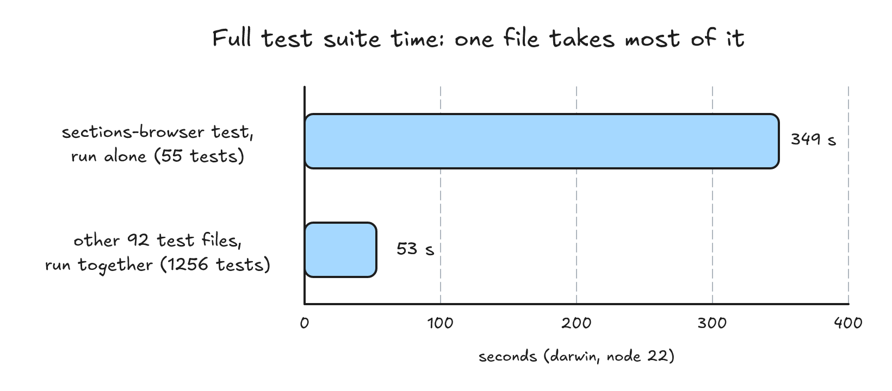

# 设计档案浏览器测试移出全量套件

> #192 存在：全量测试里 `design-archive-sections-browser.test.mjs` 一份文件跑近 6 分钟、期间不出输出，看起来像卡住；详情在「问题陈述」

## 问题陈述

### 1. 全量测试跑到这份文件就「不结束」

`REVIEW.md` 的全量测试命令 `node --test '*/scripts/*.test.mjs' 'scripts/*.test.mjs'` 会带上 idea-loop 设计档案分段截图脚本的浏览器测试 `idea-loop/scripts/design-archive-sections-browser.test.mjs`。这份文件的 55 个用例每个都真开 Chromium、截图、按真实时间等待（模拟「agent 在两步之间想了多久」）。

复现（2026-11-16，对着 main `a032e45`，darwin，node 22）：

- 这份文件单跑：55 例全过，用时 5 分 49 秒，CPU 只占 14%，时间几乎都在等。最慢的一例 46 秒（「页面时间停住后，agent 等多久拍出来都一样」），另有 6 例在 16–21 秒。
- 其余 92 个测试文件合跑：1256 例全过，用时 53 秒。

所以全量命令的总时长由这一份文件决定：其余文件 1 分钟内跑完，然后在这份文件跑完前长时间没有新输出。issue 里「3 分钟以上无输出、kill 后 9 个用例记为失败」就是这样：被 kill 时还没跑完的用例记成失败，不是用例本身坏了。分拣的证据评论（2026-11-13，main `a7c8129`）单跑 45 例用时 3 分 47 秒；两天里加了 10 个 `cover` 用例，时长涨到近 6 分钟，还会随用例继续涨。

另外，这份文件的用例和启动浏览器的 `before` 都没有超时。浏览器真的卡住时，测试会一直挂着，不会失败。

复现材料：`.tmp/to-spec/sections-browser-test-out-of-full-suite/repro/`（`single.log` 单跑逐例耗时，`rest.log` 其余文件合跑）。

### 根因

修正：issue 原先认为「可能是找到了浏览器但启动卡住」，实测启动正常，是 55 个真浏览器用例累计近 6 分钟。全量命令按文件名通配把它和 1 分钟就跑完的单元测试放在一起，又没有每例超时，慢和卡死在外面看起来一样。

## 方案

不涉及前后端交互，没有时序图。

1. **用户得到什么**：在这个仓库里跑全量测试（人、implementer、pr-reviewer 照 `REVIEW.md` 跑的那条命令），约 1 分钟结束，浏览器测试那 55 例记为 skipped，skip 的原因里写着单独跑它的命令。改了设计档案分段截图脚本的人照 `REVIEW.md` 新加的一行单独跑浏览器测试；那边每个用例有超时，浏览器真卡住时那一例失败、整份文件照样结束。
2. **做法**：浏览器测试只在环境变量 `IDEA_LOOP_BROWSER_TESTS=1` 时跑，没设就整份 skip（沿用文件里现有的「找不到 Chromium 就 skip」那条路，只是多一个 skip 原因）。全量命令本身不改。每个浏览器用例加 120 秒超时，启动浏览器的 `before` 加 60 秒超时。`REVIEW.md` 的「验证命令」加一行单独的命令和什么时候跑。
3. **中间状态**：
   - 没设环境变量：55 例 skipped，原因写「设 `IDEA_LOOP_BROWSER_TESTS=1` 单独跑，见 REVIEW.md」。
   - 设了，但本机找不到 Playwright 或 Chromium：照旧 skipped，原因照旧。
   - 设了且浏览器能起：照旧全跑；某一例超过 120 秒，那一例失败，其余照跑。
4. **其他入口**：
   - 纳入：`REVIEW.md` 的验证命令表（加一行）；`idea-loop/README.md` 讲测试命令和文件清单的两处；分段截图脚本 `design-archive-sections.mjs` 与它的单元测试文件头注释里「浏览器那一侧由谁测」的句子。
   - 排除：`docs/adr/0046-design-archive-loaded-sections.md` 里「darwin 本机全量套件会卡住，见 issue #192，单独跑」那句。理由：ADR 由 `/idea-loop:dreaming` 对账时改，不在实现 PR 里手改。
   - 排除：别的项目。插件的测试不随插件在目标项目里跑，只有这个仓库跑。

## User Stories

1. 期望行为：在这个仓库里跑 `REVIEW.md` 的全量测试命令，约 1 分钟结束，浏览器测试 55 例记为 skipped，skip 原因里有单独跑它的办法；单独跑的命令照旧跑全 55 例，任何一例卡住超过 120 秒就失败，不会让整份文件挂着不结束。

## 实现决策

- **用环境变量开关，不改文件名**：改名（让全量的 `*.test.mjs` 通配不再匹配）会让按 `.test.mjs` 后缀认测试文件的地方漏认它，比如 `issue-model-tripwire.test.mjs` 扫插件文件时按这个后缀跳过测试文件；环境变量开关不动文件名，全量命令也不用改。变量名 `IDEA_LOOP_BROWSER_TESTS`，值为 `1` 才跑。依据：人选的修法（raw 记录 U1「移出全量 + 加超时」），具体手段按「改动最少、不碰别的检查」自己定。
- **超时取值**：每例 120 秒，取实测最慢一例（46 秒）的约 2.5 倍，留出机器忙时的余量；`before` 里启动浏览器 60 秒。
- **什么时候要单独跑**：改了 `design-archive-sections.mjs`、它引入的 `ui-png-compare.mjs`，或这份浏览器测试本身。写进 `REVIEW.md` 那一行，并注明约 6 分钟、放后台跑。
- **版本**：改了 idea-loop 目录下的测试、脚本注释和 README，不改行为，升 patch（`REVIEW.md`「额外要求」的三档）。

## 测试决策

| 变的是什么 | 仪器 | 本次 |
|---|---|---|
| 纯逻辑、数据转换、状态机 | TDD 单元测试 | 不涉及：改的是测试文件自身的开关与超时 |
| API 契约（路由、schema、序列化） | TDD API 测试 | 不涉及 |
| DB schema、迁移、并发与事务语义 | 真 DB 测试 | 不涉及 |
| LLM 输出质量（prompt 改动） | eval（确定性断言） | 不涉及 |
| 视觉正确性 | UI 实现环 | 不涉及 |
| 端到端用户流程 | 浏览器端到端测试 | 不涉及 |

- **seam**：`node --test` 跑这份文件时报出的结果（通过、跳过、失败的个数和 skip 原因）。能抓到开关和超时是否生效；抓不到 `REVIEW.md` 有没有写对，那一处靠 review 读。
- **增量功能测试**：
  - 前置：本机有 Playwright 与 Chromium（npx 缓存里有）。步骤：不设环境变量跑全量命令。期望：约 1 分钟结束，全过，这份文件 55 例 skipped，原因里有 `IDEA_LOOP_BROWSER_TESTS=1`。覆盖：期望行为 1。
  - 步骤：设 `IDEA_LOOP_BROWSER_TESTS=1` 单跑这份文件。期望：55 例全过，用时与改前相当（约 6 分钟）。覆盖：期望行为 1。
  - 超时：临时把某一例的超时调到 1 秒跑一次，期望那一例因超时失败、其余照跑、文件正常结束；验完改回，不提交。覆盖：期望行为 1。
- **照着谁写**：文件里现有的 `browserTest` 包装和「找不到 Chromium 就 skip」的写法。

## Out of scope

- 给慢用例瘦身（缩短模拟等待）：人没选，它削弱「等多久拍出来都一样」的验证。
- 给全量命令本身加总超时。

## 关联

- raw：[[2026-11-16-sections-browser-test-slow]]
- 相邻 issue：#128（开着，滚动驱动段的声明）改的是同一份脚本的另一项功能，若加浏览器用例会落进同一份测试文件，经 `browserTest` 包装自动带上新的开关和超时；先后无关，后合的那个解一下同文件的冲突即可。
