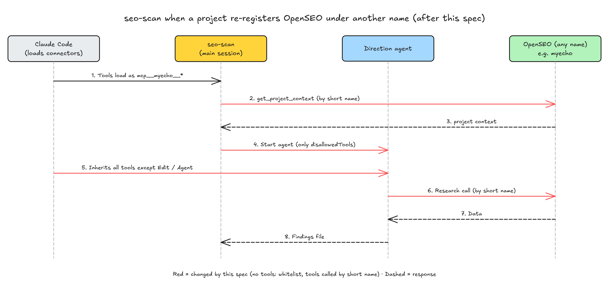

# 带连接器的 agent 不认得改了名的工具

> #164 存在：项目自己也配了同一个 OpenSEO 时，按白名单起的方向 agent 一个 OpenSEO 工具都拿不到；2026-11-16 用假插件在本机复现，2026-11-20 再验一次，详情在「问题陈述」

## 问题陈述

### 1. 连接器被别处的配置改了名，按白名单起的 agent 全部空手而归

idea-loop 插件自带两个连接器（会话里提供工具的 MCP 服务）：OpenSEO（SEO 扫描用）和 Mobbin（设计调研用）。用到它们的 8 个 agent，定义里的 `tools:` 白名单写死了插件那份的全名，例如 `mcp__plugin_idea-loop_openseo__*`、`mcp__plugin_idea-loop_mobbin__*`（`idea-loop/agents/` 下 technical-auditor、page-optimizer、keyword-miner、backlink-analyst、geo-analyst、results-analyst、uiux-researcher；对着 `main` 1e0c2b92 查，2026-11-20）。其中 results-analyst 另外还写死了 excalidrawer、PostHog 两个插件的连接器。

真实发生过一次：一个站点 2026-10-29 21:11 的 SEO 扫描（idea-loop 0.1.5）。主会话里 OpenSEO 调得通，technical-auditor 却交回「OpenSEO MCP 工具在本会话不可用」，page-optimizer 0 条发现，整次扫描 0 credits。那个会话里 OpenSEO 的工具全叫 `mcp__openseo__*`：项目根 `.mcp.json` 里也配了 `openseo`，地址跟插件的一样（issue 原文与 2026-11-14 分拣评论）。从外面看就是「OpenSEO 时好时坏」。Mobbin 在设计调研重构时也碰到过同一件事，当时的处理是让人删掉手动配的那份（运行环境说明「装与设置」的 Mobbin 一条）。

本机复现（2026-11-20，假插件 `p` 自带本地服务 `echo`，项目 `.mcp.json` 用名字 `myecho` 配同一条命令）：

| 项目配置 | 写白名单的 agent（现在的写法） | 只写禁用清单的 agent |
|---|---|---|
| 不额外配置 | 拿到插件那份，`ping` 回 pong | 拿到插件那份，`ping` 回 pong，`Write` 不在手里 |
| 项目用 `myecho` 配了同一服务 | **一个工具都没有** | 拿到 `mcp__myecho__ping`，回 pong，`Write` 不在手里 |

本该是：不管连接器以什么名字加载，agent 都拿得到它的工具，扫描和调研照常跑。

复现材料：`.tmp/grill/2026-11-20-connector-tools/probe/`（假插件、两份项目配置、各次运行的回复）。

### 根因

Claude Code 对同一个连接器只连一次：同一地址在几处都配了，按本地 > 项目 > 用户 > 插件 > claude.ai 连接器的优先级用一份，其余不连（[mcp.md](https://code.claude.com/docs/en/mcp.md)，2026-11-20 查）。插件那份排在手动配置之后，被顶掉时工具名换成手动配置起的名字，插件事先不知道。agent 的 `tools:` 白名单按全名逐字匹配，所以对不上就一个都拿不到。

修正：原先认为只能「发现重复就让人删」（2026-11-16 的决定），实测只写禁用清单的 agent 会继承主会话里任何名字的工具，不需要人删配置。

这个写法从 agent-builder 的模板来：「`tools: <白名单；MCP 可写 mcp__<server>__*>`」「权限用 `tools` 表达」。别的插件不这样写（本机已装插件，2026-11-20 查）：PostHog 唯一的 agent 不写 `tools:`、skill 里只写工具短名；ChatCut 的 skill 写明「按工具短名从可见工具里找」。idea-loop 自己也有 7 个 agent（implementer、designer、pr-reviewer 等）本来就不写白名单。

## 方案

1. **用户得到什么**：连接器不管以什么名字加载（插件自带、项目或用户手动配的、claude.ai 连接器），用到它的 agent 都拿得到工具：SEO 扫描照常派方向 agent、采集发现，设计调研照常查 Mobbin。人不用删任何配置。决定 agent 拿到什么的只有一个输入：主会话里加载了哪些工具，减去 agent 的禁用清单。
2. **做法**：
   - 8 个 agent 去掉 `tools:`，改写 `disallowedTools: Edit, NotebookEdit, Agent`。定义里不加「只用某个连接器」的话；以后要禁哪种连接器，再往禁用清单里加。
   - skill 正文、参考文件、agent 定义里称呼连接器的工具一律用短名，例如「OpenSEO 的 `whoami`」「Mobbin 的 `search_screens`」，不写 `mcp__plugin_…` 全名。
   - SEO 扫描开场只留「一个 OpenSEO 都没有就停下，去 `/mcp` 连上」：会话里任何一个连接器同时带 `whoami` 和 `get_project_context` 两个工具，就算 OpenSEO 在。PR #397 加的「被顶替就停下，让人删配置」整支删掉；SEO 设置第 1 步的同一段话术和它的参考文件一起删。
   - agent-builder 的模板改成：用到连接器的 agent 写 `disallowedTools`，不写 `tools:`。
3. **中间状态**：
   - 插件那份正常加载：跟现在一样。
   - 被手动配置改了名：扫描、调研照常跑，工具名是手动配置起的那个。
   - 一个都没连上：SEO 扫描开场停下、交回「去 `/mcp` 连上」；设计调研照现有「Mobbin 没连上」的交回。
   - 同一服务两个地址都配了（不算重复，两份都连上）：agent 看到两套同名短名的工具，哪套能用取决于各自有没有登录。本机没有这种配置，记为已知限制。
4. **其他入口**：
   - 纳入：8 个 agent 的定义；SEO 扫描开场；SEO 设置第 1 步；设计调研说明里 Mobbin 工具的写法；运行环境说明「装与设置」里 Mobbin 那一条（手动配了也能用，不再要求删）；agent-builder 的模板。
   - 排除：adr-reconciler、explorer、ui-master 的白名单。理由：它们不用连接器，白名单不会因改名而坏。
   - 排除：SEO 扫描的 `allowed-tools`（预先放行、免确认的清单）。理由：实测它不认中间通配（`mcp__*__whoami` 在改名和没改名时都不放行），只能写插件全名；保留全名，见「实现决策」的已知限制。
   - 排除：人在场时直接调的 SEO 方法 skill。理由：跑在主会话里，不受白名单限制，本来就能用。

## User Stories

只修问题，每个问题一行期望行为：

1. 期望行为：项目、本地、用户配置或 claude.ai 里也配了同一个连接器、工具名变了时，SEO 扫描的方向 agent 和设计调研员照常拿到并调用它的工具，不停下、不要人删配置；一个都没连上时，SEO 扫描在开场停下并说去 `/mcp` 连上。

## 实现决策

- **改走「agent 不写白名单、只写禁用清单」，推翻 2026-11-16「以插件那份为准、被顶替就停下」**。依据：Harold 2026-11-20 原话「选 B，起 grill 把方案定下来」；理由是别的插件都按短名用连接器，一处改法同时修好 OpenSEO 和 Mobbin，以后加连接器不用再补检测（raw [[2026-11-20-connector-tools-grill]]）。
- **改哪些 agent**：白名单里写了连接器的 8 个，results-analyst 白名单里的 excalidrawer、PostHog 一起放开。依据：Harold 原话「Q1 只改那8个」。
- **禁用清单写 `Edit, NotebookEdit, Agent`，定义里不加约束句**。依据：Harold 原话「agent定义不用写"只用 OpenSEO（或 Mobbin），不碰别的连接器"」「之后不允许什么样的连接器，我们再加」。代价已知并接受：agent 手里也有主会话里别的连接器（实测含 Gmail 的 `send_message`、Supabase 的 `execute_sql`），跟 implementer 等 7 个不写白名单的 agent 现状一样。原白名单里有 `Write` 的 agent 继续能写（它们要写发现文件），所以 `Write` 不进禁用清单。
- **没有「白名单里放开所有连接器」的折中写法**：实测 `tools: Read, mcp__*` 让 agent 拿到 0 个连接器工具（2026-11-20，本机）。
- **SEO 扫描开场按短名判断 OpenSEO 在不在**：某个连接器同时带 `whoami` 和 `get_project_context` 就算在；一个都没有才停下。不多一次付费调用：开场本来就要调 `get_project_context`。停下时的交回形状保留现有「没连上」那一种。
- **PR #397 已落地部分的去留**：删「被顶替」的判断表、交回形状、SEO 设置的 `openseo-superseded.md` 和第 1 步那句；为守 5000 字挪进参考文件的三段原文（缺口关卡交回、方向 agent 提示模板、项目对不上唯一一个），改完正文还超就留在参考文件里，不超就挪回正文。依据：Harold 对 Q3 的回答「没问题」。
- **`allowed-tools` 保留插件全名，记一条已知限制**：默认权限模式（要逐个确认的那种）下，连接器被改了名时，SEO 扫描里的 OpenSEO 调用会等确认，定时触发没人在场就卡住。`auto` 权限模式不受影响（本机实测三种写法都直接放行）。依据：实测中间通配无效（2026-11-20）。
- **防止写回白名单**：agent-builder 模板那两句改成「用到连接器的 agent 写 `disallowedTools`，不写 `tools:`」；加文档测试：任何 agent 的 `tools:` 行里出现 `mcp__plugin_` 就红。依据：Harold 对 Q5 的回答「没问题」。
- **版本档**：patch（`REVIEW.md`「额外要求」：修 bug，没被改名的项目照旧能用；agent 能用的工具变多了，没有删掉任何用法）。插件已在本分支升到 0.1.35，这次不再升；合并前主分支若已越过 0.1.35，照规则重升一档 patch。
- **README**：`idea-loop/README.md` 里 SEO 设置、SEO 扫描两行去掉「被顶替就停下」的说法，agents 一节写明用到连接器的 agent 只写禁用清单（`REVIEW.md`「额外要求」第一条）。

## 测试决策

| 变的是什么 | 仪器 | 本次 |
|---|---|---|
| 纯逻辑、数据转换、状态机 | TDD 单元测试 | 碰到：agent 定义的 frontmatter、SEO 扫描与设置的说明文字（文档测试） |
| API 契约（路由、schema、序列化） | TDD API 测试 | 不涉及 |
| DB schema、迁移、并发与事务语义 | 真 DB 测试 | 不涉及 |
| LLM 输出质量（prompt 改动） | eval（确定性断言） | 碰到：8 个 agent 定义、SEO 扫描与设置、设计调研说明；不加 eval，用下面的假插件探针 |
| 视觉正确性 | UI 实现环 | 不涉及 |
| 端到端用户流程 | 浏览器端到端测试 | 不涉及；换成本地假插件探针（见下） |

- **seam**：
  - 文档测试（把 PR #397 加的那份改写掉）：8 个 agent 没有 `tools:`、`disallowedTools` 是 `Edit, NotebookEdit, Agent`；任何 agent 的 `tools:` 行不含 `mcp__plugin_`；SEO 扫描开场按短名判断、没有「被顶替」一支；SEO 设置没有指向被顶替话术的引用；agent-builder 模板写的是 `disallowedTools`。能抓到：漏改、以后有人照旧模板写回白名单；漏掉：模型真的按短名找工具。
  - 假插件探针（不进测试套件，实现完跑一次）：沿用 grill 的探针，假插件里放一个照新写法的 agent。能抓到：当前 Claude Code 版本上禁用清单 agent 在改名后拿得到工具；漏掉：真实 OpenSEO、Mobbin 的鉴权和 credits。
- **增量功能测试**：
  - 前置：假插件 + 只写禁用清单的 agent，项目没有 `.mcp.json`。步骤：主会话起这个 agent，让它调 `ping`。期望：回 pong，`Edit`、`Agent` 不在它手里。覆盖：期望行为 1。
  - 前置：同上，项目 `.mcp.json` 用名字 `myecho` 配同一条命令。期望：agent 拿到 `mcp__myecho__ping`，回 pong。覆盖：期望行为 1。
  - 前置：假插件不带服务、项目也不配。期望：仿 SEO 扫描开场判断的 skill 停下，交回「去 `/mcp` 连上」。覆盖：期望行为 1。
- **照着谁写**：`idea-loop/scripts/seo-params-doc.test.mjs`（读 seo 的说明和 agent 定义、按小节断言），以及 PR #397 加的 `seo-openseo-superseded-doc.test.mjs`。

## Out of scope

- 按名字禁掉常见高危连接器（Gmail、Supabase 等）：每人起的名字不同，禁不全；Harold 定了以后要禁再加。
- 同一服务两个不同地址都连上时选哪一套：本机没有这种配置，记为已知限制。

## 关联

- raw：[[2026-11-20-connector-tools-grill]]（本次 grill）；`docs/raw/decisions/164.md`（2026-11-16 的旧决定，本 spec 推翻其中题 1）。
- 相关 ADR：ADR-0020（idea-loop 的 seo 分类，方向 agent 和插件自带 OpenSEO 的来历）。
- 相邻未完成的 issue：#241（把 seo 拆成单独的插件）：重叠但不冲突。拆完插件名变了，本 spec 之后 agent 不再写插件名，拆分时少改一处；谁先都行。
