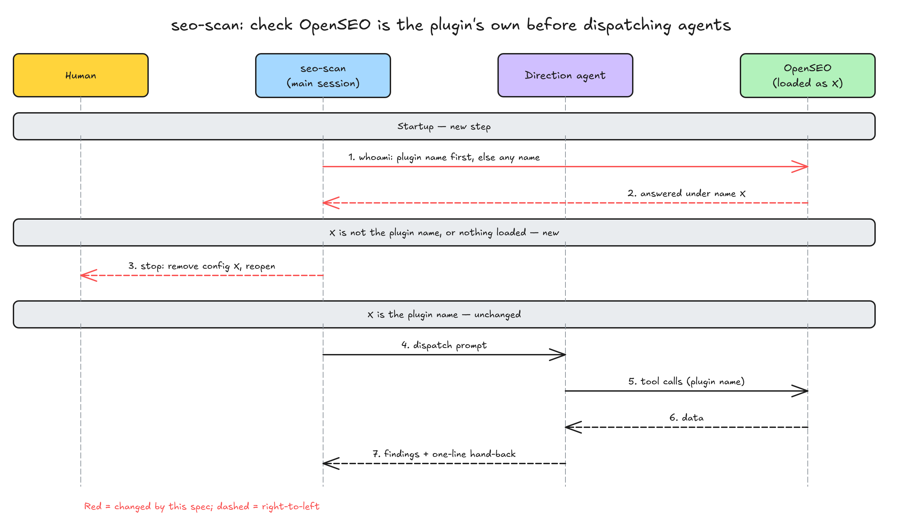

# 方向 agent 不认得改了名的 OpenSEO

> #164 存在：项目自己也配了同一个 OpenSEO 服务时，按白名单起的方向 agent 一个 OpenSEO 工具都拿不到；2026-11-16 用一个假插件在本机 Claude Code 2.1.299 上复现，详情在「问题陈述」

## 问题陈述

### 1. 项目也配了 OpenSEO，seo-scan 的方向 agent 全部空手而归

seo-scan 每周派五个方向 agent（technical-auditor、page-optimizer、keyword-miner、backlink-analyst、geo-analyst）去查站点。每个 agent 的定义里有一行 `tools:` 白名单，OpenSEO 的工具只写了插件自带那份的名字 `mcp__plugin_idea-loop_openseo__*`。

真实发生过一次：TOFEL-demo 2026-10-29 21:11 的 seo-scan（idea-loop 0.1.5）。主会话里 `whoami`、`get_project_context` 都调成功了，technical-auditor 却交回「OpenSEO MCP 工具在本会话不可用」，page-optimizer 0 条发现，整次扫描 0 credits。那个会话里的 OpenSEO 工具全叫 `mcp__openseo__*`：项目根 `.mcp.json`（本机配置，被 gitignore）里也配了 `openseo`，地址跟插件的一样（issue 原文与 2026-11-14 分拣评论）。从外面看就是「OpenSEO 时好时坏」：主会话不受白名单限制，能用；子 agent 受限，不能用。

这次在本机复现（2026-11-16，Claude Code 2.1.299）：做一个假插件 `p`，自带一个本地 MCP 服务 `echo`（一个工具 `ping`），插件里一个 agent 照方向 agent 的写法只放行 `mcp__plugin_p_echo__*`。让 agent 列出自己有的 MCP 工具并调一次 `ping`：

| 项目配置 | 白名单 agent 拿到的工具 | 调 `ping` |
|---|---|---|
| 项目没有 `.mcp.json` | `mcp__plugin_p_echo__ping` | pong |
| 项目 `.mcp.json` 用名字 `myecho` 配了同一条命令 | 无 | 调不到 |

本该是：插件自带的 OpenSEO 被别处的配置顶替时，扫描在开场就停下，说清是哪份配置顶替了它、怎么删，而不是派出五个拿不到工具的 agent 白跑一轮。

复现材料：`.tmp/to-spec/seo-agents-openseo-tool-name/repro/`（假插件、两份项目配置、三次运行的回复）。

### 根因

Claude Code 对同一个 MCP 服务只连一次：插件带的服务和项目、用户、本地配置里的服务地址相同（远程服务比 URL，本地服务比命令），就算重复，用优先级高的那份，插件那份排在项目、用户、本地之后（`code.claude.com/docs/en/mcp.md`，2026-11-16 查）。顶替之后工具名换成对方起的名字 `mcp__<对方的名字>__*`，而这个名字由人自己起，插件事先不知道。五个 agent 的白名单写死了插件那份的名字（`idea-loop/agents/` 下五个文件第 7 行，对着 `main` a032e45 查，2026-11-16），所以一个都匹配不上。

能走到这条路的不止项目 `.mcp.json` 一种（这三种情况本机当前都没有，2026-11-16 查）：
- 项目或本地配置里配了 OpenSEO：10-29 那次就是。TOFEL-demo 的 `.mcp.json` 已在 2026-11-16 10:39 去掉了 `openseo`，所以眼下这台机器碰不到。
- 用户级配置（`claude mcp add -s user`）配了 OpenSEO：所有项目一起中招。
- 同时装着 OpenSEO 官方插件（本机 `~/.claude/settings.json` 登记了它的 marketplace，现在没启用）：两份都是插件带的，谁顶替谁文档没写。ADR-0020 只写了「原 OpenSEO 插件要先卸，否则同名 skill 两份」，没提工具名。

## 方案

1. **用户得到什么**：OpenSEO 只认插件自带的那一份。装了 idea-loop 的项目里，别处（项目、本地、用户配置）也配了同一个 OpenSEO、把插件那份顶替掉时：
   - 跑 `/idea-loop:seo-setup`，第 1 步就告诉人是哪个名字的配置顶替了插件的 OpenSEO、在哪删，删完重开会话再跑。
   - 每周的 seo-scan 在开场停下，交回同一句话，不派出拿不到工具的 agent，不花 credits。
   决定走哪条的只有一个输入：这个会话里 OpenSEO 的工具以什么名字加载。插件那份正常加载时，两处都跟现在一样。
2. **做法**：
   - seo-scan 开场多一步「认 OpenSEO」：这个会话里有插件名下的 `whoami`，照常往下走；没有、但有别的名字下的 OpenSEO 工具（同时有 `<名字>__whoami` 和 `<名字>__get_project_context`）：停下，交回「`<名字>` 顶替了 idea-loop 插件自带的 OpenSEO，删掉那份配置（`claude mcp remove <名字>`，或项目 `.mcp.json` 里那一项），重开会话」；一个 OpenSEO 工具都没有：停下，交回「OpenSEO 没连上，在 `/mcp` 里连上 idea-loop 插件的 openseo」。
   - seo-setup 第 1 步的 `whoami` 前做同一个判断，顶替的情况照上面那句告诉人；人删完前，后面要 OpenSEO 的步骤照「连不上」的现有做法处理（只做仓库里的事，记「未做」）。
   - 五个方向 agent 的白名单不动。
3. **中间状态**：
   - 插件那份正常加载：跟现在一样，开场多一次判断，不多一次付费调用。
   - 被顶替（不管叫 `openseo` 还是别的）：这一周的扫描没跑；研究日志不写（日志也是经 OpenSEO 写的）。定时任务触发时没人在场，照 seo-scan 现在的做法用『推送』提醒。人删掉重复的配置后，下一次触发就恢复。
   - 10-29 那种写法（项目里也叫 `openseo`）同样会停下，要人删一次项目里的那项。
4. **其他入口**：
   - 纳入：seo-scan 开场、seo-setup 第 1 步。
   - 排除：五个方向 agent 的白名单。理由：只认插件那份，被顶替的情况在 seo-scan 开场就挡住了，agent 起来时插件名下的工具一定在。
   - 排除：人在场时直接调的 SEO 方法 skill（seo-audit、keyword-research 等）。理由：在主会话里跑，不受白名单限制，按工具的短名字调，被顶替了也能用，不坏。
   - 排除：seo-scan 的 `allowed-tools`。理由：只认插件那份后，它预先放行的就是插件名下的工具，不用改。

## User Stories

只修问题，每个问题一行期望行为：

1. 期望行为：OpenSEO 以插件自带的那份加载时，seo-scan 的方向 agent 照常采集；被别处的配置顶替（任何名字）或没加载时，seo-scan 在派 agent 之前停下、seo-setup 在第 1 步告诉人，两处都说出顶替它的配置名字和删法。

## 实现决策

- **以插件自带的 OpenSEO 为准，被顶替就让人删重复的配置**。依据：Harold 2026-11-16 在本会话的原话「从plugin建设的角度来说，我是觉得统一用plugin内的mcp配置是不是比较好？」。当时摆的三个选项里，「白名单加 `openseo`」和「改用 `disallowedTools` 继承全部工具」都是去迁就别处的配置，不选。插件没法让自己那份胜出：Claude Code 对同一个服务只连优先级最高的那份，插件排在项目、用户、本地之后（`code.claude.com/docs/en/mcp.md`，2026-11-16 查），所以「统一」只能靠发现重复并告诉人删。
- **判断按「这个会话里有哪个名字的 `whoami`」**：先插件名；不是插件名的，再看有没有别的服务同时带 `__whoami` 和 `__get_project_context`，有就是顶替它的那份，它的名字写进交回。依据：seo-scan 本来就要调这两个工具（开场调 `get_project_context`，预算一步调 `whoami` 读余额），判断不多一次付费调用。
- **停下时的交回**：seo-scan 照「交回」一节加一种形状，跟「缺口关卡」停下的形状并列，写明顶替的名字和删法。删法写两种：用户级或本地配置用 `claude mcp remove <名字>`，项目配置删 `.mcp.json` 里那一项；skill 不判断是哪一种，两种都写。
- **seo-setup 只改第 1 步**：在现有「调不通就告诉人去 `/mcp` 连上」旁边加「被顶替就告诉人删掉」这一种，后面的「连不上就继续往下走、记未做」不变。依据：Harold 的用户级约定「先扩展已在用的工具」。
- **版本档**：patch（`REVIEW.md`「额外要求」：修 bug，没有被顶替的项目照旧能用）。被顶替的项目以前是「跑了但空手」，现在是「停下要人删配置」，人要动一次配置，但这不算 major：没有改 skill 名、参数和产物位置，坏掉的那种运行本来就采集不到东西。
- **README**：`idea-loop/README.md` 的 `/idea-loop:seo-setup`、`/idea-loop:seo-scan` 两行各补一句：OpenSEO 只认插件自带的，别处配了同一服务时开场停下、说明删哪份（`REVIEW.md`「额外要求」第一条）。

## 测试决策

| 变的是什么 | 仪器 | 本次 |
|---|---|---|
| 纯逻辑、数据转换、状态机 | TDD 单元测试 | 碰到：seo-scan、seo-setup 文档里的判断与交回形状（文档测试） |
| API 契约（路由、schema、序列化） | TDD API 测试 | 不涉及 |
| DB schema、迁移、并发与事务语义 | 真 DB 测试 | 不涉及 |
| LLM 输出质量（prompt 改动） | eval（确定性断言） | 碰到：seo-scan、seo-setup 的 SKILL.md；不加 eval，用下面的探针 |
| 视觉正确性 | UI 实现环 | 不涉及 |
| 端到端用户流程 | 浏览器端到端测试 | 不涉及；换成本地假插件的探针（见下） |

- **seam**：
  - 文档测试（已有 `idea-loop/scripts/seo-params-doc.test.mjs` 这一类）：seo-scan 的「开场」有认 OpenSEO 的一步，「交回」有被顶替时停下的那种形状并写了两种删法；seo-setup 第 1 步有被顶替的那一种；五个 agent 的白名单仍只有插件名。能抓到：漏改、有人后来给白名单加别的名字；漏掉：模型真的照这一步判断。
  - 假插件探针（不进测试套件，实现完跑一次）：照问题陈述的复现，假插件带一个仿 seo-scan 开场判断的 skill，项目用 `myecho` 配同一条命令。能抓到：判断规则在当前 Claude Code 版本上认得出顶替它的名字；漏掉：真实 OpenSEO 的鉴权和 credits。
- **增量功能测试**：
  - 前置：假插件 + 照新写法的开场判断，项目没有 `.mcp.json`。期望：认出插件名，往下走。覆盖：期望行为 1。
  - 前置：同上，项目 `.mcp.json` 用名字 `myecho` 配同一条命令。期望：停下，交回里有 `myecho` 和两种删法，没有起任何 agent。覆盖：期望行为 1。
  - 前置：同上，项目改用名字 `openseo`。期望：同样停下，交回里是 `openseo`。覆盖：期望行为 1。
- **照着谁写**：`idea-loop/scripts/seo-params-doc.test.mjs`（读 seo 的 SKILL.md 和 agent 定义、按小节断言）。

## Out of scope

- 让 seo-scan 在 OpenSEO 被顶替时也照常跑（白名单加别的名字，或改用 `disallowedTools` 继承全部工具）：Harold 定了以插件那份为准。
- 跟 OpenSEO 官方插件并装时谁顶替谁：文档没写，本机没启用；被顶替时开场判断照样会报出它的名字。

## 关联

- raw：无（从 issue 起草，没有对话）。
- 相关 ADR：ADR-0020（idea-loop 的 seo 分类，五个方向 agent 和插件自带 OpenSEO 的来历）。
- 相邻未完成的 issue：#241（把 seo 拆成单独的插件）：重叠。拆完插件名从 `idea-loop` 变成 `seo`，白名单和开场判断里的插件名要跟着改；两者谁先都行，后合的那个改插件名。
