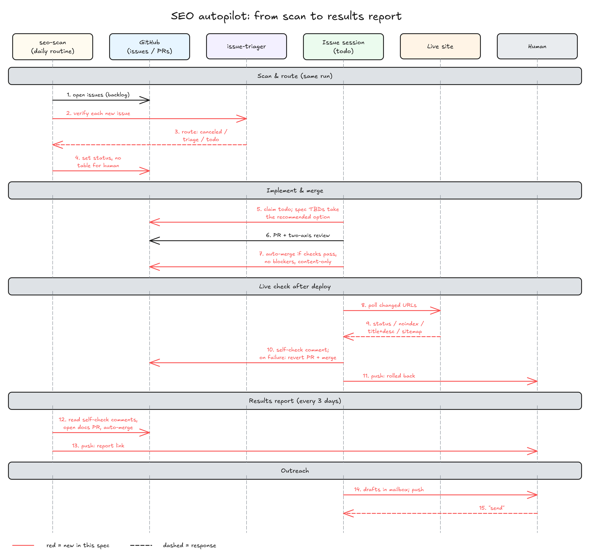
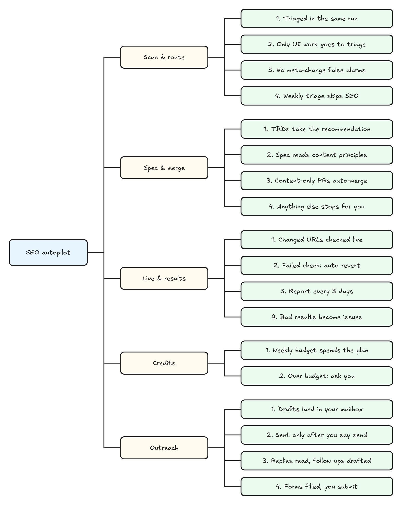

# SEO issue 默认全托管：从扫描到上线不停下等人，上线后有人看效果

> #291 存在：一个只改内容的 SEO 改动从扫出到上线要在分拣、spec 待定题、合并、外联四处等人，人在这几处几乎都是「照推荐」；上线后没有任何一步回头看效果，详情在「问题陈述」1–3
> #215 存在：technical 方向拿两次审计比 title/description，不看这段时间合并了什么，有意的 SEO 改动被报成 `key-page-meta-changed`，详情在「问题陈述」4

## 问题陈述

证据取自一个用 idea-loop SEO 分类的项目（目前唯一有 `SEO.md` 的那个），2026-11-12 对着它的 `origin/main` `842ea497` 查，出处是 #291 正文的「证据」；插件侧的现状 2026-11-13 对着本仓库 `main` `a7c8129` 复核。

### 1. 一个 SEO 改动从扫出到上线要停下等人四次，人在这几处几乎都是「照推荐」

现在的路径和四处停点（插件里的出处）：

1. **每周分拣**：`seo-scan` 开出的 issue 不打 `status:*`，就是 backlog（`seo-scan/SKILL.md`「提 issue」第 2 步：「开出的 issue 不打 `status:*`，就是 backlog，等人分拣」）。`issue-triage` 第 5 步把结论拼成表，「用『推送』能力发『N 个 issue 等你批』，停下」。
2. **spec 待定题**：`issue-session/references/draft-spec.md`「跟人定要 grill 的」：spec 里还有「待定」就推送、停下等人。
3. **合并**：`decision-rules`「护栏」写「合并改了代码的 PR」「对外发布」只由人定；`pr-review/references/merge.md` 开头「人在会话里明确说合并时才走这份」。
4. **外联**：`seo-outreach` 的产出停在 `docs/records/outreach/` 下的草稿和跟进表，开头写「每封信都由人自己发：这个 skill 的产出到草稿和表格为止，任何邮件、表单、私信工具都不调」。

人在这几处做了什么（项目 2026-10-22 起的 26 个 SEO issue）：

- 7 场 SEO 决定记录里 6 场人的原话是「选 A」「照推荐」，只有 1 场加了一条原则（「数据只当佐证，不罗列」）。
- 被拒的 6 个 issue 里 5 个是 Claude 起草 spec 时自己验证出的误报，人拒的只有 1 个（理由也成了一条原则：拿不出能直接练的东西、跟已有文章大面积重合的，不开新页）。
- 已完成的 14 个，没有一个 PR 改了 `.tsx` 或 `.astro` 组件，改的全是博客正文、配图、title/description、`llms.txt` 和 `docs/` 台账。
- 等的时间：2026-11-10 扫出的 5 个 issue 到 2026-11-12 还在 backlog 等分拣；实现 PR 等人合并 1 到 18 小时（三个例子：18h、13h、13h）。

### 2. 上线之后没有一步回头看效果

`seo-scan/SKILL.md` 末尾写「不发布审阅页、不写周报或『洞察』：issue 就是交付物」；插件里没有任何一步读 Search Console 的点击变化或比较改动前后的排名。项目的 ADR 原文写着「搜索结果有没有变好……全都还没有数据」。改坏了也没人发现：合并后没有一步去打开线上页面核对。

### 3. OpenSEO 的额度只用掉一个零头

账户余额 19,560 credits，套餐每月约 10,000（账期重置、不累积），过去一个月研究日志里只花了约 800。三处在压：

- `seo-budget.mjs` 的 `RUN_CAP = 2000`，单次扫描最多 2000；
- `seo-due.mjs` 的 `CADENCE`：keywords、backlinks、geo 都是 28 天一次；
- 项目 `SEO.md`「单次额度」里 geo 是 0。

### 4. 有意改过的 title/description 被报成回退（#215）

technical-auditor 第 3 步拿两次审计的页面跑 `seo-baseline.mjs`，重点页面的 title 或 description 变了就出 `technical/key-page-meta-changed`。它不看两次审计之间合并了什么。项目里已经发生三次，每次都是一个 issue 会话核实后关成「不存在」：

| 审计 | 报的页面 | 实际出处 |
|---|---|---|
| 10-22 | 2 页 | 两次审计之间合并的 2 个 SEO PR |
| 10-30 | 4 页（两个功能页、两篇博客） | 两次审计之间合并的 4 个 SEO PR |
| 11-10 | 还开着 | 同类 |

核实手段每次一样：拿新 title 去主分支历史里找引入它的提交，对上合并的 PR，再取线上页面确认逐字一致。能机械判定。

### 根因

1. 停点 1–3 都是对所有 issue 一刀切的规则：分拣、待定题、合并不分 issue 的类型。SEO 内容改动的风险（可回滚、改动面小、页面级可核对）低于它们为之设计的代码改动，人在这类 issue 上的判断又几乎都是「照推荐」。
2. 外联停在文档：`seo-outreach` 不调任何邮件或浏览器工具，草稿留在仓库里要人自己去翻。
3. 效果没有采集方向：`seo-scan` 的五个方向都是找问题，没有一个比较改动前后。
4. 预算按「单次扫描」而不是「一周」算，套餐额度又不累积，用不完的部分每个账期作废。
5. `seo-baseline.mjs` 只比两次审计，输入里没有合并历史（#215）。

## 方案

人最终得到：SEO issue 不用人分拣、不用人定待定题、只改内容的不用人合并；人收到的是三类推送——「N 封外联邮件在草稿箱」「目录提交页已填好等你点」「效果报告出了」，以及出问题时的「自动回滚了」「这条要你定」。决定一条 issue 走全托管还是停下等人的输入只有两个：它的分类是不是 `type:seo/*`，它要不要 UI 设计（spec 里有没有「前端交互」小节、改动是否只落在内容范围内）。

做法分八块，每块标明对的是 `idea-loop:writing-for-agents` 的哪条杠杆：

1. **扫描后当场分流**（`seo-scan` 新增「分流」一节，`issue-triage` 排除 `type:seo/*`）：提完 issue 后，对本次新建的每个 issue 起 `idea-loop:issue-triager`（同时最多 5 个），按它交回的 `route` 直接翻：canceled → `set canceled`；triage 且理由是要 UI 设计 → `set triage`；其余（todo、要 grill、判不了）→ `set todo`。SEO 的「要不要人」只看 UI，分拣员的去向表加一行 SEO 分支。每周 `issue-triage` 取 backlog 时排除 `type:seo/*`。杠杆：**单一事实来源**——「SEO 只有 UI 设计进 triage」只写在分拣员的去向表里，seo-scan 只照 `route` 翻。
2. **误报在扫描端消掉**（#215）：`key-page-meta-changed` 出发现之前，新脚本拿两次审计时间、变化页面的新 title/description，在主分支历史里找引入它的合并 PR；找到的不出发现，只在研究日志里记一行「有意改动：页面 → PR」。杠杆：**能机械判的做成检查**，不靠 agent 临场判断。
3. **spec 照推荐定**（`draft-spec.md`「跟人定要 grill 的」加 SEO 分支，`SEO.md` 新增「内容原则」节）：SEO issue 起草时先读 `SEO.md`「内容原则」；「待定」照推荐改写成决定，依据写「AI 照推荐定：<理由>」，不推送、不停下。spec 有「前端交互」小节（要 UI 设计）的仍翻回 triage 等人，照 todo 会话现有的「冒出了要人定的」做法。杠杆：**信息层级**——只有 SEO issue 走到，写成一条带分支的规则，不进 to-spec 主体。
4. **自动合并**（`decision-rules`「护栏」加 SEO 例外，`pr-review` 的「交审核报告」后加 SEO 分支）：三条全满足才由 Claude 合并：`REVIEW.md` 的检查与 `seo-check` 全过；两轴没有阻塞项（现有「最多两轮」不变）；新脚本判定改动只落在内容范围内。有一条不满足，照现在的流程停下交给人。杠杆：**护栏的正向写法**——例外写成可核对的三条，不写成「SEO 的可以不问」。
5. **上线后自查与自动回滚**（`pr-review/references/merge.md` 新增「上线后自查」）：合并后轮询 PR 描述里列的网址，直到线上内容跟合并提交的构建产物一致（或等满 `SEO.md` 写的上线等待）；逐个核：能打开、没被 noindex、title/description 与构建产物一致、还在 sitemap 里。全过：在 issue 上贴一条带标记的「上线自查」评论（网址、目标词、合并日、结果），给目标词开排名追踪。任一项不过：`git revert` 合并提交开 revert PR，检查过了就合并，推送通知人。等满了还没上线：不回滚，推送叫人看部署。
6. **效果报告**（新 `results` 方向 + 新 agent `idea-loop:results-analyst`）：`seo-scan` 改成每天被调，`seo-due.mjs` 定当天跑哪些方向：`results` 每 3 天，其余五个每 7 天。results-analyst 读带「上线自查」标记的已关 SEO issue 拿到改动清单，取 Search Console、OpenSEO 排名、`SEO.md`「分析」节指向的分析工具（如 PostHog），写 `docs/records/seo-results/<日期>.md` 加两张 excalidrawer 图；反常下跌、改了没起色的写成发现，走同一条提 issue → 分流。seo-scan 在一个临时 worktree 里把报告开成只改 `docs/` 的 PR，检查过了就合并，推送链接。
7. **按周花完套餐额度**：`SEO.md`「OpenSEO」改为写套餐额度、账期重置日和每周分配（排名追踪、各方向扫描、起草验证三份）；`seo-budget.mjs` 去掉单次 2000 的上限，改成「本周预算 = 本账期剩余套餐额度 ÷ 剩余周数」，扣掉本周研究日志里已记的花费。一项研究预估超过本周剩余：不跑，推送给人。
8. **外联进草稿箱、目录提交填到最后一步**（`seo-outreach` 新增「放进草稿箱」「发送」「跟进」「目录提交」四个分支）：连着邮件 MCP 时草稿直接建进人的草稿箱，跟进表记草稿 id，推送「N 封外联邮件在草稿箱」；人说「发」才发。之后每次扫描读回信、更新跟进表，追发的也先进草稿箱。目录提交用新的运行环境能力『人的浏览器』在人的浏览器里填好、截图、推送；登录、机器人检测、点提交都推送叫人，人说「提交」才点。没有邮件 MCP 或人的浏览器的运行环境：照现在的做法写进 `docs/`，推送「草稿在 <路径>」。

### 同一行为的其他入口

- **人手动跑 `/idea-loop:seo-scan <方向>`**：纳入，分流同样跑（人在场也不需要再摆表）。
- **人手动开的 SEO issue（不经扫描）**：纳入 3–5（spec 照推荐、自动合并、上线自查都看 `type:seo/*`）；不纳入 1 的当场分流，它照常进 backlog——每周 `issue-triage` 排除了 `type:seo/*`，所以 `issue-triage` 碰到没被分流的 SEO backlog 时，单独跑一次分流（同一个分拣员、同一张去向规则），不摆表。
- **SEO issue 被人直接接手（`/idea-loop:issue-session <号>`）**：纳入。人在场时照推荐定照样做，人可以推翻。
- **非 SEO 的 issue**：排除，四处停点对它们不变。
- **外链方向 `backlink-analyst`**：纳入「外链方向照常每周跑」，跟进表里已有的站点不再提名，现有规则不变。
- **`dreaming` 改护栏的那条（#286）**：排除，它改的是另一行；两边都改「护栏」小节，谁后合谁解冲突。

## User Stories

### 场景：扫描与分流

1. 作为人，我想要扫描开出的 SEO issue 在同一次运行里被验证并翻成 canceled / triage / todo，以便不用每周逐行批去向
2. 作为人，我想要只有需要 UI 设计的 SEO issue 进 triage，以便我只在真正要判断的地方出现
3. 作为人，我想要两次审计之间被已合并 PR 改过的 title/description 不再开成 issue，以便不再为误报占一个会话
4. 作为人，我想要每周分拣的表里不再出现 SEO issue，以便分拣只处理要人判断的 issue

### 场景：spec 与合并

1. 作为人，我想要 SEO issue 的待定题照推荐定、决定里写明「AI 照推荐定」和理由，以便不停下等我说「照推荐」，事后也看得出是谁定的
2. 作为人，我想要起草 SEO spec 时先读 `SEO.md` 的「内容原则」，以便我说过的原则不用每次重说
3. 作为人，我想要检查全过、两轴无阻塞、只改内容的 SEO PR 由 Claude 合并，以便上线不再等我几个小时
4. 作为人，我想要三条有一条不满足就停下交给我，以便代码和界面改动仍由我合并

### 场景：上线与效果

1. 作为人，我想要合并后自动核对每个改过的网址（能打开、没 noindex、title/description 一致、在 sitemap 里），以便改坏了马上被发现
2. 作为人，我想要自查失败时自动开 revert PR 并合并、再推送告诉我，以便坏的改动不在线上过夜
3. 作为人，我想要每 3 天收到一份效果报告：整站近 7 天对上一个 7 天、上线满 2 周的改动前后对比、本周要做什么，以便知道 SEO 做得有没有用
4. 作为人，我想要报告里反常下跌和改了没起色的被开成 issue 进分流，以便效果差的改动自动进入下一轮

### 场景：额度

1. 作为人，我想要每周预算按本账期剩余套餐额度均摊，五个方向每周都跑、geo 也有额度，以便套餐额度不再作废
2. 作为人，我想要一项研究预估超过本周剩余额度时停下推送给我，以便超支只由我决定

### 场景：外链

1. 作为人，我想要外联邮件直接出现在我的邮件草稿箱并收到推送，以便不用去仓库里翻草稿
2. 作为人，我想要只有我说「发」之后邮件才发出，以便对外发出的每封信都经我同意
3. 作为人，我想要 agent 读回信、更新跟进表，追发的也先进草稿箱，以便跟进不靠我记
4. 作为人，我想要目录提交页在我的浏览器里被填好、截图推送给我，我说「提交」才点，以便我只做登录、过人机验证和最后一下

## 实现决策

### 起草时补的六条，人已确认

依据：人在 2026-11-13 的 issue 会话里原话「6 条照草稿定」。六条是 ①改动清单记在 issue 的「上线自查」评论里，不另建台账；②「只改内容」由 `SEO.md` 新键「内容路径」判；③线上核对的期望值取合并提交的构建产物，PR 描述新增「上线自查的网址」一节，没有就不自动合并；④运行环境新增能力『人的浏览器』给目录提交用；⑤`SEO.md`「OpenSEO」改成套餐额度 + 每周分配，旧的「单次额度」报错并由 seo-setup 迁移；⑥分拣员判不了的 SEO issue 也翻 todo。各条的细节在下面对应的小节里。

### 分流（seo-scan「分流」一节）

- 只处理本次 `seo-issues.mjs` 输出里 `created` 的号；`commented`（追加到已有 issue 的）不再分流，它们已经在某个状态里。
- 分拣员照现有契约贴证据评论、交回一行 JSON；seo-scan 按 `route` 翻：`canceled` → `issues set canceled --comment=<结论>`；`triage` → `set triage`；`todo`、`backlog`（判不了）→ `set todo`。依据：#291「要改成」1 的「其余：todo，交给调度」。优先级照分拣员的建议打。
- 分拣员的「建议去向」表加一句 SEO 分支：带 `type:seo/*` 的 issue，只有要新建或改组件、页面模板、样式时建议 triage；要 grill、要定方案的建议 todo（todo 会话照推荐定）。依据：#291「要改成」4。
- 交回模板多一行「分流：todo <n>，triage <n>，canceled <n>」；研究日志模板对应加一行，前两行格式不动（`seo-due.mjs` 依赖）。
- `issue-triage` 取 backlog 时排除 `type:seo/*`（`issues backlog` 加排除分类的参数）；`issue-triage` 另外对剩在 backlog 的 SEO issue 照 seo-scan 的「分流」逐个翻、不摆表——覆盖人手动开的 SEO issue。
- 上线后对存量跑一次：项目里现存的 SEO backlog / triage issue（#291 举的 6 个）由合并后的清理步骤各跑一次分流。

### 误报（#215）

- 新脚本输入：两次审计的完成时间、`seo-baseline.mjs` 的 `key-page-meta-changed` 发现、仓库路径；对每个变化的页面，用新的 title / description 字符串在主分支上找引入它的提交（`git log -S`），提交落在两次审计之间、能对上一个合并 PR 的，判为有意改动。
- 有意改动不出发现，进研究日志「有意改动：<页面> → #<PR>」；找不到出处的照旧出发现。
- technical-auditor 第 3 步在跑完 `seo-baseline.mjs` 之后跑它，只多一行调用；判定全在脚本里。

### spec 照推荐定

- `draft-spec.md`「跟人定要 grill 的」开头加 SEO 分支：issue 带 `type:seo/*` 且 spec 没有「前端交互」小节时，「待定」逐条照推荐改写成决定，依据写「AI 照推荐定：<推荐的理由>」；「需要 grill」照 spec 已有的结论和 `SEO.md`「内容原则」自己答完、删掉标记；然后提交，不推送、不停下。
- 有「前端交互」小节的：照 todo 会话现有做法翻回 triage（「起草中冒出了要人定的」）。
- `draft-spec.md`「输入」加一项：SEO issue 读 `SEO.md`「内容原则」（与 #151 加的「先读方向 SEO skill 的原则文件」并列）。
- `SEO.md` 新增「内容原则」节，每行一条原则加出处（人的原话、哪个 issue）。seo-setup 建它时写入首批两条的通用写法由项目自己填；插件只定节名和格式，不写任何项目的原则。人以后说的新原则由当时的会话追加到这一节（照「知识库落地」走只改根文件的 PR——它不在 `docs/` 下，所以跟着当时那个 issue 的 PR 走）。

### 自动合并

- 「护栏」加一条例外，写成三条可核对的条件（见方案 4），外加「上线自查失败时开的 revert PR」；不满足就回到「只由人定」。
- 「只落在内容范围内」由新脚本判：`SEO.md`「构建与检查」新增键「内容路径」（项目的博客、配图、`robots.txt`、`sitemap`、`llms.txt` 等，glob 列表），加上 `docs/` 和根目录的 `SEO.md`；PR 改动的文件全部命中才算。`.astro`、`.tsx`、`.css` 这类文件只有被「内容路径」显式列出才算（例如项目把记 SEO 事件的那一个文件列进去，对应 #291「要改成」4 的「新增或修改 PostHog 事件不算 UI 改动」）。seo-setup 推测这个键的推荐值，人确认后写入。
- 自动合并接在 `pr-review` 现有「没有修复，且没有要人定的事 → 交审核报告」之后：报告照常写进 PR 描述；三条都满足就不停下，照 `merge.md` 的「合并」走（review loop 照常归档），汇报和推送写「已自动合并」。
- PR 描述要多一节「上线自查的网址」（每行一个网址和它的目标词），由实现阶段写；没有这一节的不自动合并（自查无从做起）。

### 上线后自查

- 新脚本：输入 `SEO.md`、构建产物目录、网址列表；对每个网址取线上页面，跟产物里对应 HTML 比 title / description，查 meta robots 与 `X-Robots-Tag` 有无 `noindex`、HTTP 状态、`sitemap.xml` 是否含它。输出每个网址的四项结果。
- 等上线：每分钟跑一次，全部网址的 title 与产物一致即视为已上线，再做完整核对；等满 `SEO.md`「构建与检查」新增键「上线等待」（分钟，没写按 30）还没一致：不回滚，推送「部署可能没跑，<网址>」，issue 评论记「未上线」。
- 回滚：`git revert -m 1 <合并提交>` 开 revert PR（描述引原 PR 和失败的项），`REVIEW.md` 检查过了就合并，推送「已回滚 #<PR>：<哪个网址哪一项>」；issue 翻回 todo 并评论原因。
- 记录：自查结果作为一条「🤖 idea-loop：」评论贴在 issue 上，带隐藏标记（网址、目标词、合并日期、四项结果），results-analyst 靠这个标记找改动清单。
- 排名追踪：自查通过后，把目标词加进 OpenSEO 的排名追踪（`SEO.md`「OpenSEO」写的追踪器）；花费记进研究日志、计入本周「排名追踪」那一份。

### 效果报告

- `seo-due.mjs`：`CADENCE` 改为 `results: 3`，其余五个 `7`；`DIRECTIONS` 加 `results`。定时任务改为每天一次（`seo-setup/references/weekly-scan.md` 改名为每天扫描，任务 id 不变），当天没有到期方向就只写一行研究日志。
- `results-analyst` 的输入同其他方向 agent（`SEO.md`、项目 id、额度、运行目录、今天）；产出 `<运行目录>/results.json`（发现，格式同 findings.md）和 `<运行目录>/results/<日期>.md` 加 `assets/` 下两张图（excalidrawer `chart`：近 4 周每日点击折线、标出每个改动的上线日；每个改动前后对比的柱状图）。
- 报告三块照 #291「要改成」7：开头写窗口的截止日（Search Console 晚 2–3 天）；中间只列上线满 14 天的改动；「本周要做什么」的条目同时进 `results.json` 成为发现。
- 分析工具：`SEO.md` 新增可选节「分析」（工具名、项目 id、dashboard 链接）。写了就取营销站访问和 CTA 点击并附 dashboard 链接；没写就这一块写「没有接分析工具」。
- `results` 方向的发现按原改动的方向打分类（例如改标题没起色的仍是 `type:seo/pages`），不新增 `type:seo/results`，项目的分类表不用动。
- 报告落地：seo-scan 在 `.tmp/` 下开一个从主分支出的临时 worktree，提交 `docs/records/seo-results/` 下的文件，开只改 `docs/` 的 PR，检查过了合并（现有「知识库落地」规则），删掉 worktree，推送 PR 链接。

### 额度

- `SEO.md`「OpenSEO」：去掉「单次额度」，加「套餐额度：每月 <n>，每月 <日> 日重置」和「每周分配：排名追踪 <n>；扫描 technical <n>，pages <n>，keywords <n>，backlinks <n>，geo <n>，results <n>；起草与验证 <n>」。`seo-md.mjs` 读旧键时报错并提示跑 `/idea-loop:seo-setup` 迁移（项目只有一个，迁移由 seo-setup 一并做）。
- `seo-budget.mjs`：本周预算 = (套餐额度 − 本账期已花) ÷ 本账期剩余周数（向上取整），按每周分配的比例分给三份；「本账期已花」「本周已花」都从研究日志的「花费」行加总。余额下限照旧。超过的那一项不跑，进 `skipped` 并推送。另外买的额度不计入套餐额度，不要求用完。
- 起草与验证的那一份：todo 会话跑 SEO 研究前用 `seo-budget.mjs` 查本周还剩多少，花费写回研究日志一行（格式同 seo-scan 的「花费」行）。

### 外联

- 新运行环境能力『人的浏览器』：在人自己的浏览器里（带人的登录态）打开页面、填表、截图。claude-desktop 用 Claude in Chrome；magi 写「没有」，走退路。能力清单和两份 reference 一起改（`idea-loop:runtime` 的「加能力」规则）。
- 邮件草稿：用『调用 MCP』找连着的邮件 MCP（有建草稿、发送、搜索线程三种工具的）；跟进表加「草稿 id」「线程 id」两列。
- 「发送」分支：人在任意会话说「发外联邮件」（seo-outreach 可被模型调用，description 加这个触发词），读跟进表里「待发送」且有草稿 id 的行，逐封发出、改状态为「已发送」，跟进表的改动走只改 `docs/` 的 PR。
- 「跟进」分支：每次 seo-scan 跑 backlinks 或每天的扫描结尾，有「已发送」行的就读线程：有回信改「已回复」并推送；发出 7 天没回的写一封追发进草稿箱，推送。
- 「目录提交」分支：填表、截图、推送；遇到登录页、人机验证、提交按钮都停下推送；人说「提交」才点，更新跟进表。不注册账号、不输入密码。
- `seo-outreach` 开头那句「任何邮件、表单、私信工具都不调」改成正向写法：建草稿和填表可以做，发出和提交只在人说之后做。

### 文档与版本

- 根目录 `AGENTS.md` 第 1 条里「seo-scan……它的出口是开成 backlog 的 issue，仍由人分拣」改成新的出口（分流后的 issue、效果报告 PR）。
- `skills/seo/README.md`、`idea-loop/README.md` 同步。
- 这个 issue 的 PR 合并时 idea-loop 升 patch 版本（`plugin.json` 当时的版本 +1；现在是 0.1.12）。

## 测试决策

| 变的是什么 | 仪器 | 本次 |
|---|---|---|
| 纯逻辑、数据转换、状态机 | TDD 单元测试 | 碰到：`seo-due.mjs` 新节奏、`seo-budget.mjs` 周预算、`seo-md.mjs` 新键、新的 meta 出处脚本、内容范围脚本、上线自查脚本、改动清单读取、`issues backlog` 排除分类 |
| API 契约（路由、schema、序列化） | TDD API 测试 | 碰到：results 方向的发现文件过 findings 的校验；上线自查评论的隐藏标记能被读回 |
| DB schema、迁移、并发与事务语义 | 真 DB 测试 | 不涉及 |
| LLM 输出质量（prompt 改动） | eval（确定性断言） | 改了 seo-scan、issue-triager、draft-spec、pr-review、merge、decision-rules、seo-outreach、seo-setup、新 agent 的文字；照仓库惯例用 `*-doc.test.mjs` 钉住关键句（不做 baseline eval，AGENTS.md §5） |
| 视觉正确性 | UI 实现环 | 不涉及 |
| 端到端用户流程 | 浏览器端到端测试 | 不涉及自动化；端到端由合并后在项目上的验收跑一遍（见下） |

- **seam**：脚本的命令行（输入文件 → stdout JSON），沿用 `seo-*.mjs` 现有的；上线自查脚本另起一个本地静态服务器当「线上」（能抓到 noindex、title 不一致、sitemap 缺页、404；漏掉真实部署的时延）。文字规则的 seam 是 `*-doc.test.mjs` 读 skill 原文（能抓到关键句被删改，漏掉 agent 实际怎么执行）。
- **增量功能测试**：
  - 前置：内容路径只列博客目录；步骤：内容范围脚本喂一个改了博客 md 和一个 `.tsx` 的文件列表；期望：判「不在范围内」并列出 `.tsx`；覆盖：spec 与合并 3、4。
  - 前置：两次审计之间有一个合并 PR 引入了新 title；步骤：出处脚本喂这条 `key-page-meta-changed`；期望：不出发现，日志行指到那个 PR；再喂一个仓库里找不到的 title，期望照旧出发现；覆盖：扫描与分流 3。
  - 前置：本地服务器给一个页面加 noindex；步骤：上线自查脚本跑它；期望：这个网址 noindex 一项失败；覆盖：上线与效果 1。
  - 前置：研究日志里 results 3 天前跑过、technical 6 天前跑过；步骤：`seo-due.mjs`；期望：两者都到期；覆盖：上线与效果 3。
  - 前置：套餐 10000、账期剩 2 周、本账期已花 5400；步骤：`seo-budget.mjs`；期望：本周 2300，按分配比例拆；超出的一项进 `skipped`；覆盖：额度 1、2。
  - 合并后验收（在项目上，人看）：照 #291「验收」五条跑一遍——一次扫描后新 issue 已分流；一个只改内容的 PR 被自动合并且 issue 上有自查评论；故意加 noindex 能看到 revert PR；`docs/records/seo-results/` 出现第一份带两张图的报告并推送；一封外联邮件出现在草稿箱、说「发」后才发。
- **照着谁写**：脚本测试照 `seo-scripts.test.mjs`、`seo-issues.test.mjs`；文字钉子照 `seo-params-doc.test.mjs`（带 `SEO_DOCS_ROOT` 指向改前副本先看它红）。

## Out of scope

- 排名、点击变差的自动回滚：只进效果报告和 issue（#291「要改成」6）。
- 真正发出邮件、点提交目录表单、超出每周额度的花费、UI 设计：仍只由人定（#291「要改成」10）。
- 非 SEO issue 的分拣、待定题、合并规则。
- 用 PostHog 截图做报告图：定时任务没人在场登录不了，报告只附 dashboard 链接。
- 新增 `type:seo/results` 分类。

## 关联

- #151 / [[seo-draft-reads-principles]]：已合并（PR #278），它在 `draft-spec.md`「输入」加了读方向原则文件；本 spec 在同一节并列加「内容原则」，不冲突。
- #235（seo-outreach 直接读 seo-setup 的私有参考文件，todo）：同改 `seo-outreach`，它改的是读 `seo-md.md` 的那句；本 spec 先合，它接着改。
- #241（插件拆分会动 seo 分类，backlog）：会搬动本 spec 改的文件；本 spec 先合，拆分照新结构搬。
- #286（dreaming 改「护栏」的另一条，triage）：同一小节两处改动，后合的解冲突。
- #238（外联 skill 写法）：已 canceled，无重叠。
- ADR [[0020-idea-loop-seo]]（SEO 分类的设计）、[[0022-issue-model]]（issue 状态）：本 spec 不改状态模型，只改 SEO issue 在状态之间怎么走。
